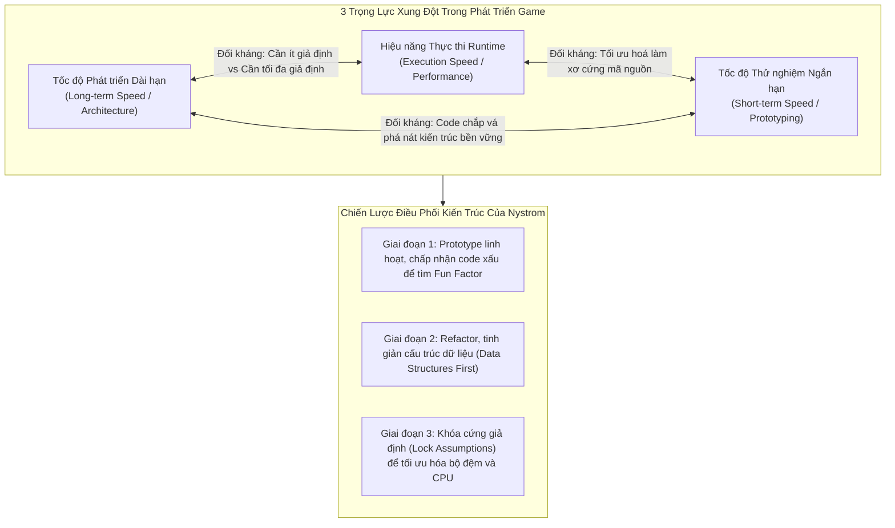
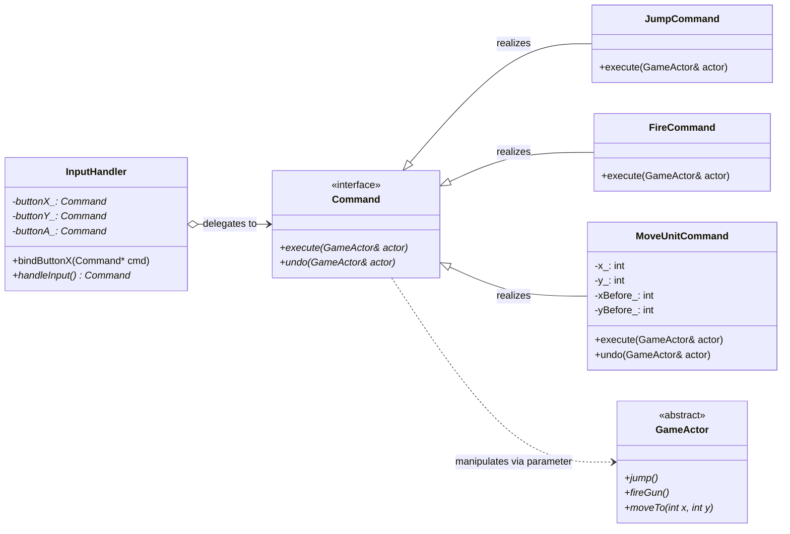

# BÓC TÁCH CHUYÊN SÂU NYSTROM — ĐỢT 1: CHƯƠNG 1 & CHƯƠNG 2
*(Dựa trên nguyên bản "Game Programming Patterns" của Robert Nystrom)*

---

# MỤC LỤC ĐỢT 1
- [CHƯƠNG 1: ARCHITECTURE, PERFORMANCE, AND GAMES (KIẾN TRÚC, HIỆU NĂNG VÀ TRÒ CHƠI)](#chương-1-architecture-performance-and-games-kiến-trúc-hiệu-năng-và-trò-chơi)
  - [1. ĐỀ MỤC & MỤC TIÊU CỐT LÕI (CORE PURPOSE)](#1-đề-mục--mục-tiêu-cốt-lõi-core-purpose)
  - [2. PHÂN TÍCH LÝ THUYẾT & NGUYÊN LÝ CHUYÊN SÂU](#2-phân-tích-lý-thuyết--nguyên-lý-chuyên-sâu)
  - [3. MỔ XẺ MÃ NGUỒN & KỸ THUẬT KIẾN TRÚC (CODE DEEP-DIVE)](#3-mổ-xẻ-mã-nguồn--kỹ-thuật-kiến-trúc-code-deep-dive)
  - [4. SƠ ĐỒ TRỰC QUAN HÓA (VISUAL MERMAID DIAGRAM)](#4-sơ-đồ-trực-quan-hóa-visual-mermaid-diagram)
  - [5. ÁNH XẠ ỨNG DỤNG VÀO DỰ ÁN GAME OOP](#5-ánh-xạ-ứng-dụng-vào-dự-án-game-oop)
- [CHƯƠNG 2: COMMAND PATTERN (MẪU LỆNH HÓA HÀNH ĐỘNG)](#chương-2-command-pattern-mẫu-lệnh-hóa-hành-động)
  - [1. ĐỀ MỤC & MỤC TIÊU CỐT LÕI (CORE PURPOSE)](#1-đề-mục--mục-tiêu-cốt-lõi-core-purpose-1)
  - [2. PHÂN TÍCH LÝ THUYẾT & NGUYÊN LÝ CHUYÊN SÂU](#2-phân-tích-lý-thuyết--nguyên-lý-chuyên-sâu-1)
  - [3. MỔ XẺ MÃ NGUỒN (CODE DEEP-DIVE)](#3-mổ-xẻ-mã-nguồn-code-deep-dive)
  - [4. SƠ ĐỒ TRỰC QUAN HÓA (VISUAL MERMAID DIAGRAM)](#4-sơ-đồ-trực-quan-hóa-visual-mermaid-diagram-1)
  - [5. ÁNH XẠ ỨNG DỤNG VÀO DỰ ÁN GAME OOP](#5-ánh-xạ-ứng-dụng-vào-dự-án-game-oop-1)

---

# CHƯƠNG 1: ARCHITECTURE, PERFORMANCE, AND GAMES (KIẾN TRÚC, HIỆU NĂNG VÀ TRÒ CHƠI)

## 1. ĐỀ MỤC & MỤC TIÊU CỐT LÕI (CORE PURPOSE)

### Danh mục đề mục (Headings Outline)
* **Architecture, Performance, and Games**
  * **What is Software Architecture?** *(Kiến trúc phần mềm là gì?)*
    * *What is good software architecture?* *(Thế nào là kiến trúc tốt?)*
    * *How do you make a change?* *(Cách thức ta tạo ra một sự thay đổi)*
    * *How can decoupling help?* *(Sự tách rời - Decoupling giúp ích như thế nào?)*
  * **At What Cost?** *(Phải trả giá bằng những gì?)*
  * **Performance and Speed** *(Hiệu năng và Tốc độ)*
  * **The Good in Bad Code** *(Điểm tích cực của "Code xấu"))*
  * **Striking a Balance** *(Thiết lập thế cân bằng kiến trúc)*
  * **Simplicity** *(Tính đơn giản hóa / Tinh giản)*
  * **Get On With It, Already** *(Lời khuyên hành động)*

### Vấn đề kỹ thuật thực tế & Thảm họa hệ thống
Chương này không đưa ra một công thức code cụ thể, mà thiết lập nền móng nhận thức luận cho toàn bộ ngành kỹ nghệ game: **Sự giằng co sinh tử giữa Khả năng bảo trì kiến trúc (Maintainability/Decoupling), Hiệu năng phần cứng thời gian thực (Runtime Performance), và Tốc độ phát triển tính năng (Development Velocity).**

Nếu một đội ngũ kỹ thuật không thấu suốt tư tưởng của chương này, dự án sẽ tất yếu rơi vào một trong hai thái cực thảm họa:
1. **Thảm họa Trừu tượng hóa quá mức (Architecture Astronauts / Over-Engineering):** Kỹ sư lạm dụng các lớp trừu tượng (Interface, Virtual inheritance, Scaffolding, Indirection). Hậu quả là CPU liên tục bị **vtable dispatch latency** và **Cache Miss**, trong khi lập trình viên bị quá tải nhận thức não bộ (*Mental Scratch Disk Exhaustion*), tốn hàng tháng trời dựng "Engine vạn năng" mà không thể phát hành một gameplay hoàn chỉnh.
2. **Thảm họa Spaghetti & Death of a Thousand Cuts:** Ngược lại, việc nhồi nhét mọi thứ vào một hàm khổng lồ kiểu `main()` hoặc các hàm xử lý dài hàng nghìn dòng code khiến hệ thống bị khớp nối chặt (*Tight Coupling*). Khi sửa một bug nhỏ ở đòn đánh của nhân vật, hệ thống giao diện HUD hoặc vật lý môi trường đột ngột bị gãy đổ.

---

## 2. PHÂN TÍCH LÝ THUYẾT & NGUYÊN LÝ CHUYÊN SÂU

### 2.1. Bản chất của Kiến trúc phần mềm là Quản trị Thay đổi (Architecture is About Change)
Robert Nystrom chỉ ra rằng: Nếu một chương trình không bao giờ phải sửa đổi (hoàn hảo tuyệt đối hoặc tồi tệ đến mức bị bỏ rơi), thì chất lượng kiến trúc của nó bằng không. Kiến trúc chỉ có ý nghĩa khi có con người can thiệp vào để sửa lỗi hoặc mở rộng tính năng.
* **Chi phí nạp nhận thức (Mental Cognitive Load):** Quá trình lập trình thực chất là quá trình "page" dữ liệu từ màn hình qua thị giác vào bộ nhớ não bộ (*load context into primate cerebrum*). Đây là khâu chậm nhất trong chu trình phát triển.
* **Định nghĩa chuẩn của Decoupling (Tách rời):** Hai thành phần code bị ghép nối (*coupled*) khi và chỉ khi ta **không thể hiểu được thành phần này nếu không nạp thành phần kia vào đầu**. Khi phân tách thành công, lập trình viên có thể thay đổi một module mà chỉ cần nạp đúng phạm vi của module đó.

### 2.2. Nghịch lý giữa Trừu tượng hóa (Abstraction) và Tối ưu hóa (Optimization)
Đây là luận điểm học thuật đắt giá nhất của tác giả:
* **Trừu tượng hóa (Abstraction/Flexibility)** sống bằng việc **giảm thiểu tối đa các giả định (encoding fewer assumptions)**. Ta dùng Interface để code có thể hoạt động với bất kỳ lớp con nào trong tương lai.
* **Tối ưu hóa hiệu năng (Optimization/Performance)** lại phát triển dựa trên **tối đa hóa các giả định và ràng buộc cụ thể (concrete constraints & assumptions)**. 
  * *Ví dụ:* Nếu giả định chắc chắn game không bao giờ có quá 256 loại quái, ta đóng gói ID vào đúng `uint8_t` (1 byte). Nếu giả định chỉ có một loại đối tượng duy nhất, ta phân bổ mảng tuần tự liên tục (contiguous memory buffer) để tận dụng triệt để bộ đệm L1/L2 Cache của CPU.
* **Kết luận của Nystrom:** *"Làm cho một game vui chạy nhanh dễ hơn nhiều so với việc làm cho một game chạy nhanh trở nên vui"* (*"It's easier to make a fun game fast than it is to make a fast game fun"*). Tính linh hoạt cần được duy trì trong giai đoạn thử nghiệm lối chơi, sau đó mới gọt giũa và cố định các giả định để tối ưu hiệu năng.

### 2.3. Quy luật Code xấu và Mã dùng một lần (Throwaway Prototyping Code)
Viết code kiến trúc chuẩn chỉ đòi hỏi thời gian. Trong giai đoạn thăm dò cơ chế gameplay (*Design Exploration*), code vội vã (*slapdash code*) có giá trị kinh tế lớn vì nó chứng minh được cơ chế đó có vui hay không mà không tốn công gọt giũa.
Tuy nhiên, điều kiện tiên quyết là: **Nếu viết code vứt đi, bạn phải đảm bảo có khả năng vứt nó đi.** Một thủ thuật thực chiến được gợi ý là viết prototype bằng một ngôn ngữ kịch bản khác (như Python, Lua, C#) để ngăn chặn việc quản lý ép biến prototype thành mã nguồn chính thức của engine C++.

### 2.4. Triết lý Tinh giản (Simplicity as Distillation)
Nystrom dẫn lại câu nói kinh điển của Antoine de Saint-Exupéry: *"Hoàn hảo không phải là khi không còn gì để thêm vào, mà là khi không còn gì để có thể bớt đi."* Một giải pháp kiến trúc thượng thừa không phải là xây một hệ thống plug-in đồ sộ, mà là tìm ra cấu trúc dữ liệu và giải thuật trực diện, tổng quát nhất để giải quyết toàn bộ miền bài toán với số lượng dòng mã ít nhất.

---

## 3. MỔ XẺ MÃ NGUỒN & KỸ THUẬT KIẾN TRÚC (CODE DEEP-DIVE)

Robert Nystrom minh họa cái giá của tính linh hoạt qua sự đánh đổi giữa liên kết động (Dynamic Dispatch) và liên kết tĩnh (Static Dispatch / Metaprogramming):

```cpp
// 1. Concrete Call (Author-time binding): Cực nhanh, inlined triệt để, không linh hoạt
void handleInputConcrete() {
    player.jump(); // Trực tiếp, CPU nhảy ngay đến địa chỉ hàm cố định
}

// 2. Virtual Interface Call (Runtime binding): Rất linh hoạt, chi phí trỏ vtable và cache miss
class Command {
public:
    virtual ~Command() {}
    virtual void execute(GameActor& actor) = 0; // vtable pointer lookup
};

// 3. Template Metaprogramming (Compile-time binding): Linh hoạt trừu tượng hóa nhưng zero runtime overhead
template <typename ActionPolicy>
class ActorController {
public:
    void trigger(GameActor& actor) {
        ActionPolicy::execute(actor); // Trình biên dịch phân giải tĩnh, có thể inline
    }
};
```

### Bảng phân tích kỹ thuật kiến trúc
| Dòng code / Khối kiến trúc | Giải thích kỹ thuật & Ý nghĩa thiết kế |
|:---|:---|
| `virtual void execute(...) = 0;` | Khai báo hàm ảo thuần túy (pure virtual function). Tạo ra vptr trong cấu trúc đối tượng và bảng vtable. Cho phép tráo đổi hành vi lúc runtime nhưng tốn chi phí gián tiếp (indirection) và ngăn cản compiler inlining. |
| `ActionPolicy::execute(actor);` | Hiện thực hóa kỹ thuật Compile-time Polymorphism (CRTP hoặc Policy-based Design). Trình biên dịch sinh mã trực tiếp cho từng kiểu dữ liệu, loại bỏ chi phí vtable, tối ưu hóa CPU cache nhưng làm tăng kích thước file nhị phân (code bloat). |
| `YAGNI (You Aren't Gonna Need It)` | Nguyên tắc kiến trúc phản biện lại việc phỏng đoán tương lai: Không thêm lớp bọc scaffolding nếu chưa có ít nhất 2 trường hợp cụ thể yêu cầu tính đa hình. |

---

## 4. SƠ ĐỒ TRỰC QUAN HÓA (VISUAL MERMAID DIAGRAM)

Sơ đồ thể hiện **Tam giác Giằng co Kiến trúc Game (The Architectural Triangle of Forces)** và luồng ra quyết định thiết kế:



---

## 5. ÁNH XẠ ỨNG DỤNG VÀO DỰ ÁN GAME OOP

1. **Quy tắc Tách biệt Tầng Gameplay và Tầng Core Engine:**
   * Trong một dự án game nhiều người chơi (2.5D Multiplayer), tầng Engine mạng và Hệ thống Ô lưới Không gian (Spatial Partition) cần được thiết kế dựa trên **các giả định cụ thể** (độ rộng map cố định, kích thước cell cố định, packet header chuẩn hóa theo byte) để đạt hiệu năng tối đa.
   * Ngược lại, tầng kỹ năng nhân vật (Hero Skills, Buffs) cần được thiết kế với **mức độ tách rời (Decoupling) tối đa** để game designer có thể thêm/bớt hàng trăm chiêu thức mà không làm xáo trộn vòng lặp vật lý.
2. **Cảnh báo chống bẫy "Engine Vạn Năng":**
   * Đội ngũ phát triển không nên xây dựng một framework quá chung chung có thể chạy cho mọi thể loại game. Hãy bám sát use case cụ thể của dự án và áp dụng nguyên tắc YAGNI triệt để.

---
---

# CHƯƠNG 2: COMMAND PATTERN (MẪU LỆNH HÓA HÀNH ĐỘNG)

## 1. ĐỀ MỤC & MỤC TIÊU CỐT LÕI (CORE PURPOSE)

### Danh mục đề mục (Headings Outline)
* **Command**
  * **Configuring Input** *(Cấu hình ánh xạ ngõ vào)*
  * **Directions for Actors** *(Định hướng hành động cho thực thể Actor)*
  * **Undo and Redo** *(Hoàn nguyên và Tái thực thi)*
  * **Classy and Dysfunctional?** *(Hướng đối tượng kinh điển hay phong cách Hàm/Closures?)*
  * **See Also** *(Mối liên hệ với các mẫu thiết kế khác)*

### Vấn đề kỹ thuật thực tế & Thảm họa hệ thống
* **Vấn đề kỹ thuật:** Khớp nối cứng (Hard-coded coupling) giữa sự kiện ngõ vào phần cứng (ấn phím, click chuột, nhận packet mạng, AI kích hoạt) với logic hành vi nội tại của nhân vật (`jump()`, `fire()`).
* **Thảm họa nếu thiếu Command Pattern:**
  1. **Không thể đổi phím (No Key Rebinding):** Nếu viết `if (isPressed(BUTTON_X)) player.jump();`, toàn bộ sơ đồ điều khiển bị chôn cứng trong mã nguồn. Việc cho phép người chơi tùy biến bàn phím đòi hỏi hàng loạt câu lệnh `switch-case` lồng nhau cực kỳ hỗn loạn.
  2. **AI và Player bị phân mảnh:** Logic AI của máy và logic điều khiển của người chơi bị tách làm hai nhánh code riêng biệt, dẫn đến trùng lặp mã nguồn nghiêm trọng khi điều khiển cùng một loại nhân vật.
  3. **Bế tắc trong Undo/Redo & Multiplayer Replay:** Để hoàn nguyên trạng thái hoặc phát lại trận đấu (Replay), lập trình viên buộc phải lưu toàn bộ snapshot của thế giới game qua từng frame (ngốn hàng GB RAM), thay vì chỉ cần lưu một chuỗi các đối tượng Command gọn nhẹ.

---

## 2. PHÂN TÍCH LÝ THUYẾT & NGUYÊN LÝ CHUYÊN SÂU

### 2.1. Định nghĩa Tinh hoa: Vật thể hóa lời gọi hàm (Reified Method Call)
Robert Nystrom đưa ra một định nghĩa mang tính kinh điển, vượt trội hơn định nghĩa rườm rà của GoF:
$$\text{Command Pattern} \equiv \text{A Reified Method Call (Một lời gọi hàm được biến thành đối tượng dữ liệu hạng nhất)}$$
* Thuật ngữ **"Reify"** xuất phát từ tiếng Latin (*res* = vật thể). Reify nghĩa là lấy một khái niệm trừu tượng (như một hành động, một lời gọi hàm) và gói nó vào một biến/đối tượng cụ thể có thể lưu trữ trong mảng, truyền qua tham số hàm, ghi vào hàng đợi, hoặc đẩy qua mạng socket.
* GoF gọi Command là *"sự thay thế hướng đối tượng cho các hàm gọi lại (callbacks)"*.

### 2.2. Sự tiến hóa qua 3 cấp độ của Command Pattern
1. **Cấp độ 1: Binding tĩnh (Static Action Binding):**
   * Lớp `Command` chỉ có phương thức `execute()`.
   * Lệnh ngầm định tham chiếu đến một đối tượng toàn cục hoặc nhân vật chơi. Nhược điểm: Chỉ duy nhất Player mới thực hiện được lệnh này.
2. **Cấp độ 2: Tách rời Actor (Actor-Parameterized Command):**
   * Phương thức thực thi chuyển thành `execute(GameActor& actor)`.
   * Lệnh trở thành một khối hành vi thuần túy (Stateless Chunk of Behavior). Bất kỳ Actor nào (Player, Quái vật AI, Nhân vật đóng thế trong Demo) đều có thể được truyền vào để thực thi lệnh.
3. **Cấp độ 3: Lệnh mang trạng thái & Hoàn nguyên (Undoable Stateful Command):**
   * Khi lệnh biểu diễn một sự kiện cụ thể theo thời gian (ví dụ: `MoveUnitCommand(unit, x, y)`), mỗi lần thực hiện sẽ khởi tạo một instance riêng.
   * Lớp lệnh lưu trữ biến thiên trạng thái quá khứ (`xBefore_`, `yBefore_`) và bổ sung phương thức `undo()`.

### 2.3. Chiến lược Lưu vết trạng thái: Delta Storage vs Memento Pattern
Nystrom chỉ rõ: Để hỗ trợ Undo/Redo, việc chụp ảnh toàn bộ đối tượng (Memento Pattern) gây lãng phí bộ nhớ vô ích. Một lệnh di chuyển chỉ thay đổi tọa độ $(x, y)$, do đó đối tượng Command chỉ cần lưu đúng độ biến thiên cục bộ (*Delta*):
$$\text{State}_{\text{old}} \xrightarrow{\text{execute()}} \text{State}_{\text{new}} \quad \text{với } \Delta = \{\Delta x, \Delta y\}$$
$$\text{State}_{\text{new}} \xrightarrow{\text{undo()}} \text{State}_{\text{old}} \quad \text{bằng cách áp dụng ngược } \Delta$$

---

## 3. MỔ XẺ MÃ NGUỒN (CODE DEEP-DIVE)

Dưới đây là mã nguồn C++ hoàn chỉnh trích xuất từ sách thể hiện toàn diện 3 khía cạnh: Tách rời Input, Điều khiển Actor, và Hoàn nguyên Undo.

```cpp
#include <iostream>
#include <vector>

// Forward declaration
class GameActor {
public:
    virtual ~GameActor() {}
    virtual void jump() = 0;
    virtual void fireGun() = 0;
    virtual int x() const = 0;
    virtual int y() const = 0;
    virtual void moveTo(int x, int y) = 0;
};

// =================================================================
// 1. ABSTRACT COMMAND VỚI ACTOR PARAMETER & UNDO CAPABILITY
// =================================================================
class Command {
public:
    virtual ~Command() {}
    virtual void execute(GameActor& actor) = 0;
    virtual void undo(GameActor& actor) {} // Mặc định không làm gì nếu không hỗ trợ
};

// =================================================================
// 2. CONCRETE COMMANDS (STATELESS BEHAVIOR)
// =================================================================
class JumpCommand : public Command {
public:
    virtual void execute(GameActor& actor) override {
        actor.jump();
    }
};

class FireCommand : public Command {
public:
    virtual void execute(GameActor& actor) override {
        actor.fireGun();
    }
};

// =================================================================
// 3. CONCRETE COMMAND (STATEFUL UNDOABLE COMMAND)
// =================================================================
class MoveUnitCommand : public Command {
public:
    MoveUnitCommand(int destX, int destY)
        : x_(destX), y_(destY), xBefore_(0), yBefore_(0) {}

    virtual void execute(GameActor& actor) override {
        // Lưu vết delta trạng thái trước khi thay đổi
        xBefore_ = actor.x();
        yBefore_ = actor.y();
        actor.moveTo(x_, y_);
    }

    virtual void undo(GameActor& actor) override {
        // Hoàn nguyên vị trí cũ mà không cần snapshot toàn bộ actor
        actor.moveTo(xBefore_, yBefore_);
    }

private:
    int x_, y_;
    int xBefore_, yBefore_;
};

// =================================================================
// 4. INPUT HANDLER (DECOUPLED BUTTON MAPPING)
// =================================================================
class InputHandler {
public:
    InputHandler() : buttonX_(nullptr), buttonY_(nullptr) {}
    
    void bindButtonX(Command* command) { buttonX_ = command; }
    void bindButtonY(Command* command) { buttonY_ = command; }

    // Reify input thành stream các lệnh
    Command* handleInput(bool isXPressed, bool isYPressed) {
        if (isXPressed) return buttonX_;
        if (isYPressed) return buttonY_;
        return nullptr;
    }

private:
    Command* buttonX_;
    Command* buttonY_;
};
```

### Bảng phân tích chi tiết mã nguồn
| Dòng code / Đoạn code then chốt | Giải thích kỹ thuật & Ý nghĩa thiết kế |
|:---|:---|
| `virtual void execute(GameActor& actor) = 0;` | Truyền trực tiếp đối tượng thụ hưởng (`actor`) vào signature của hàm. Triệt tiêu hoàn toàn sự phụ thuộc tĩnh vào đối tượng Player duy nhất, biến Command thành một "đơn vị hành động độc lập" có thể tái sử dụng cho mọi Actor. |
| `xBefore_ = actor.x(); yBefore_ = actor.y();` | Kỹ thuật **Delta State Recording**: Lưu trữ cục bộ biến thiên trạng thái bị tác động. Không tốn bộ nhớ lưu trữ các thuộc tính khác (máu, trang bị, sprite...). |
| `Command* handleInput(...)` | Thay vì gọi trực tiếp logic gameplay, hàm biến đổi tín hiệu vật lý thành con trỏ đối tượng `Command*`. Cho phép trì hoãn việc thực thi (Execution Postponement) hoặc đưa vào hàng đợi. |
| `void bindButtonX(Command* command)` | Khóa học hiện thực hóa nguyên lý **Open/Closed Principle (OCP)** và **Dependency Inversion Principle (DIP)**: Có thể thay đổi phím nóng hoặc chiêu thức lúc runtime mà không phải sửa một dòng code nào trong `InputHandler`. |

---

## 4. SƠ ĐỒ TRỰC QUAN HÓA (VISUAL MERMAID DIAGRAM)

### Sơ đồ Lớp (Class Diagram) & Sơ đồ Luồng Tuần tự (Sequence Diagram)



### Sơ đồ Luồng Tuần tự Điều phối Lệnh (Sequence Flow)

```mermaid
sequenceDiagram
    autonumber
    actor Player as Người Chơi
    participant IH as InputHandler
    participant Cmd as ConcreteCommand (Jump)
    participant Dispatcher as CommandStream/Queue
    participant Actor as GameActor (PlayerCharacter/AI)

    Player->>IH: Nhấn phím 'X' (Button Press)
    IH->>IH: Tra cứu con trỏ buttonX_
    IH-->>Dispatcher: Trả về đối tượng Command* (Reification)
    Note over Dispatcher: Có thể lưu vào Replay Log<br/>hoặc truyền qua Network Packet
    Dispatcher->>Cmd: execute(Actor)
    Cmd->>Actor: actor.jump()
    Actor-->>Actor: Cập nhật vận tốc trục Y & Play Animation
```

---

## 5. ÁNH XẠ ỨNG DỤNG VÀO DỰ ÁN GAME OOP

1. **Kiến trúc Netcode Client-Side Prediction & Server Reconciliation:**
   * Trong một game đấu trường 2.5D nhiều người chơi, Client không bao giờ gửi trực tiếp vị trí $(x, y)$ lên Server (để tránh hack tọa độ). Thay vào đó, Client tuần tự hóa phím bấm thành các gói tin `PlayerInputCommand` kèm số thứ tự khung hình (Sequence Number).
   * Khi Server gửi về trạng thái chuẩn (Authoritative State) mà có sự sai lệch với dự đoán của Client, Client sử dụng cơ chế `undo()` hoặc roll-back toàn bộ các Command từ khung hình sai lệch để tính toán lại (*replay*), đảm bảo game chuyển động mượt mà không bị giật lùi (rubberbanding).
2. **Hệ thống AI Bot cắm ghép dùng chung Engine:**
   * Module AI tìm đường (Pathfinding) sau khi phân tích hành vi không cần can thiệp thô bạo vào nhân vật quái. Nó chỉ cần tạo ra các lệnh `MoveUnitCommand` hoặc `SkillCastCommand` và đẩy vào cùng một hàng đợi lệnh (Command Queue) của nhân vật đó. Nhân vật hoàn toàn không phân biệt được nó đang được lái bởi người chơi thật hay thuật toán AI.
