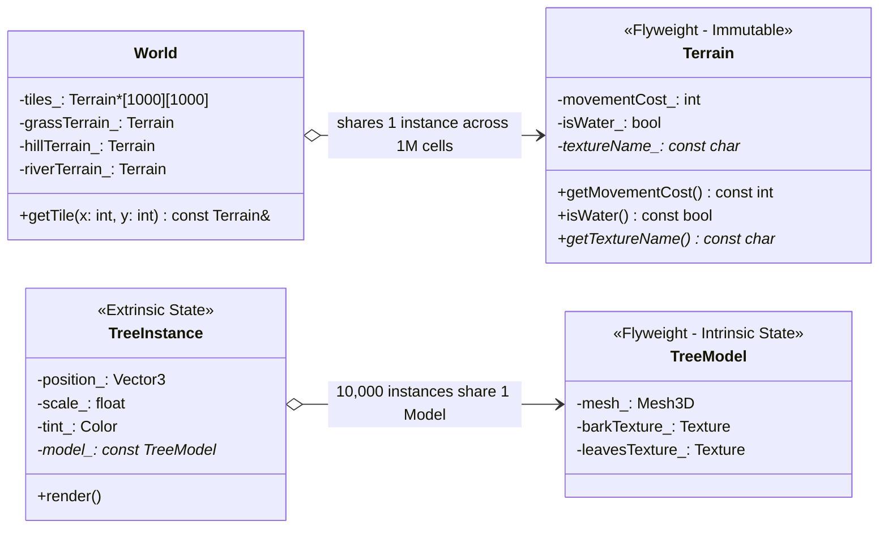
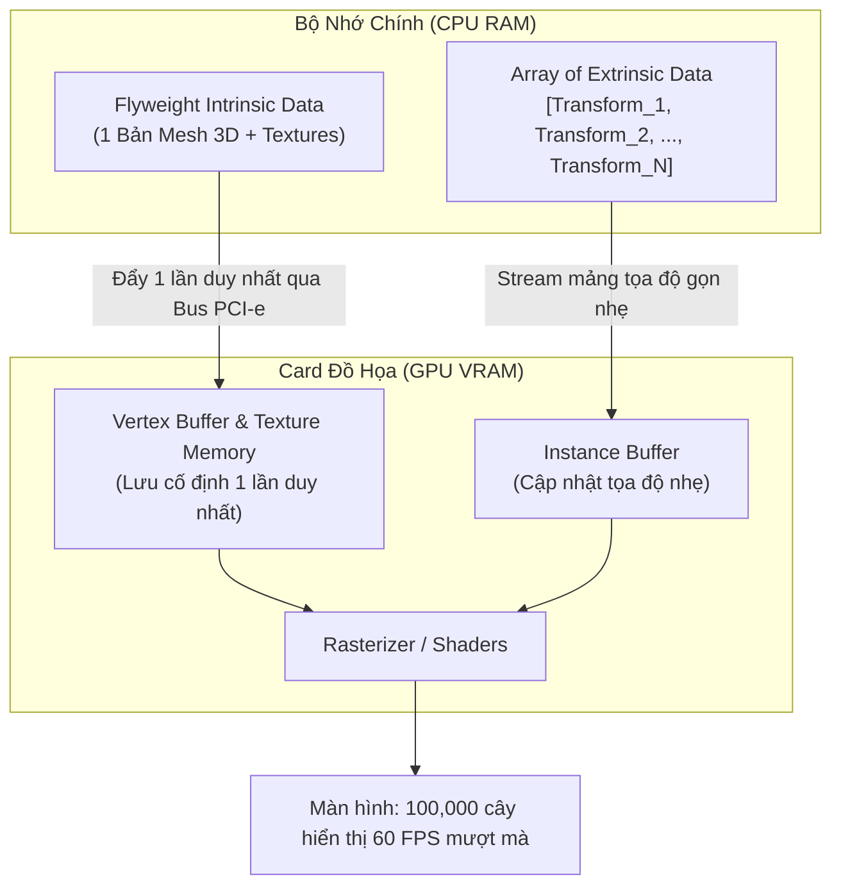
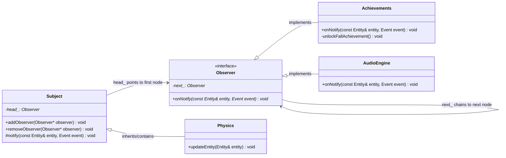
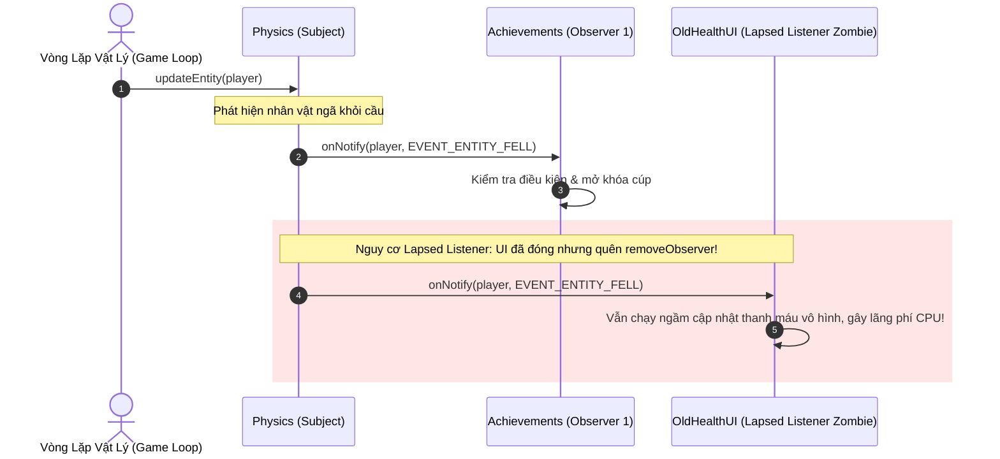

# BÓC TÁCH CHUYÊN SÂU NYSTROM — ĐỢT 2: CHƯƠNG 3 & CHƯƠNG 4
*(Dựa trên nguyên bản "Game Programming Patterns" của Robert Nystrom)*

---

# MỤC LỤC ĐỢT 2
- [CHƯƠNG 3: FLYWEIGHT PATTERN (MẪU ĐỐI TƯỢNG NHẸ / CHIA SẺ TRẠNG THÁI NỘI TẠI)](#chương-3-flyweight-pattern-mẫu-đối-tượng-nhẹ--chia-sẻ-trạng-thái-nội-tại)
  - [1. ĐỀ MỤC & MỤC TIÊU CỐT LÕI (CORE PURPOSE)](#1-đề-mục--mục-tiêu-cốt-lõi-core-purpose)
  - [2. PHÂN TÍCH LÝ THUYẾT & NGUYÊN LÝ CHUYÊN SÂU](#2-phân-tích-lý-thuyết--nguyên-lý-chuyên-sâu)
  - [3. MỔ XẺ MÃ NGUỒN (CODE DEEP-DIVE)](#3-mổ-xẻ-mã-nguồn-code-deep-dive)
  - [4. SƠ ĐỒ TRỰC QUAN HÓA (VISUAL MERMAID DIAGRAM)](#4-sơ-đồ-trực-quan-hóa-visual-mermaid-diagram)
  - [5. ÁNH XẠ ỨNG DỤNG VÀO DỰ ÁN GAME OOP](#5-ánh-xạ-ứng-dụng-vào-dự-án-game-oop)
- [CHƯƠNG 4: OBSERVER PATTERN (MẪU NGƯỜI QUAN SÁT / XỬ LÝ SỰ KIỆN PHÂN TÁN)](#chương-4-observer-pattern-mẫu-người-quan-sát--xử-lý-sự-kiện-phân-tán)
  - [1. ĐỀ MỤC & MỤC TIÊU CỐT LÕI (CORE PURPOSE)](#1-đề-mục--mục-tiêu-cốt-lõi-core-purpose-1)
  - [2. PHÂN TÍCH LÝ THUYẾT & NGUYÊN LÝ CHUYÊN SÂU](#2-phân-tích-lý-thuyết--nguyên-lý-chuyên-sâu-1)
  - [3. MỔ XẺ MÃ NGUỒN (CODE DEEP-DIVE)](#3-mổ-xẻ-mã-nguồn-code-deep-dive)
  - [4. SƠ ĐỒ TRỰC QUAN HÓA (VISUAL MERMAID DIAGRAM)](#4-sơ-đồ-trực-quan-hóa-visual-mermaid-diagram-1)
  - [5. ÁNH XẠ ỨNG DỤNG VÀO DỰ ÁN GAME OOP](#5-ánh-xạ-ứng-dụng-vào-dự-án-game-oop-1)

---

# CHƯƠNG 3: FLYWEIGHT PATTERN (MẪU ĐỐI TƯỢNG NHẸ / CHIA SẺ TRẠNG THÁI NỘI TẠI)

## 1. ĐỀ MỤC & MỤC TIÊU CỐT LÕI (CORE PURPOSE)

### Danh mục đề mục (Headings Outline)
* **Flyweight** *(Mẫu Đối tượng nhẹ)*
  * **Forest for the Trees** *(Nhìn thấy cả rừng cây: Thách thức dữ liệu đồ họa khổng lồ)*
  * **A Thousand Instances** *(Một ngàn thực thể & Kỹ thuật Instanced Rendering trên GPU)*
  * **The Flyweight Pattern** *(Nguyên lý mẫu Flyweight: Tách rời Trạng thái Nội tại & Ngoại tại)*
  * **A Place To Put Down Roots** *(Ứng dụng tạo lưới địa hình Tile-based Terrain)*
  * **What About Performance?** *(Đo lường hiệu năng: Con trỏ gián tiếp vs Bộ đệm L1/L2 Cache)*
  * **See Also** *(Mối liên hệ: Type Object, State, Factory Method, Object Pool)*

### Vấn đề kỹ thuật thực tế & Thảm họa hệ thống
Trong phát triển game, thế giới ảo thường chứa hàng trăm nghìn thực thể có diện mạo và hành vi tương tự nhau (như cả cánh rừng bạt ngàn cây cối, lưới địa hình hàng triệu ô gạch, hàng nghìn viên đạn hay đàn quái vật cùng chủng loại).

Nếu không áp dụng mẫu thiết kế Flyweight:
1. **Thảm họa cạn kiệt bộ nhớ (Out-Of-Memory - OOM):** Mỗi đối tượng nhân bản toàn bộ dữ liệu lưới đa giác (Mesh 3D), vân bề mặt (Textures), âm thanh và thông số vật lý. Hàng chục nghìn cây sẽ ngốn hàng Gigabyte RAM chỉ để chứa các bản sao giống hệt nhau.
2. **Nghẽn cổ chai Bus truyền dẫn CPU sang GPU (Bus Bandwidth Saturation):** Nếu mỗi frame CPU phải đẩy từng cây riêng biệt qua bus PCI-e lên GPU, băng thông truyền dữ liệu sẽ bị quá tải lập tức, khiến khung hình tụt thảm hại (dưới 10 FPS) dù GPU vẫn chưa chạy hết công suất.
3. **Thảm họa Bẫy mã `enum` và Phá vỡ Tính bao đóng (Encapsulation Violation):** Lập trình viên vì sợ tốn bộ nhớ nên chuyển sang dùng kiểu liệt kê `enum TerrainType` kết hợp các hàm `switch-case` khổng lồ (`getMovementCost()`, `isWater()`). Hệ quả là dữ liệu và hành vi của một loại địa hình bị vương vãi khắp nơi, vi phạm nghiêm trọng tính đóng gói của OOP và nguyên lý Open/Closed Principle (OCP).

---

## 2. PHÂN TÍCH LÝ THUYẾT & NGUYÊN LÝ CHUYÊN SÂU

### 2.1. Phân rã Trạng thái Nội tại (Intrinsic) và Ngoại tại (Extrinsic)
Bản chất cốt lõi của Flyweight là chia dữ liệu của một thực thể thành hai nửa tách biệt hoàn toàn:
* **Trạng thái Nội tại (Intrinsic State / Context-free State):** Là tập hợp dữ liệu bất biến, không phụ thuộc vào vị trí hay ngữ cảnh xuất hiện của đối tượng trong thế giới game. Dữ liệu này giống nhau trên toàn bộ các thực thể cùng loại (ví dụ: mô hình 3D, kết cấu vỏ cây, tán lá, chỉ số cản trở di chuyển).
* **Trạng thái Ngoại tại (Extrinsic State / Context-dependent State):** Là dữ liệu đặc thù riêng biệt cho từng cá thể tại một thời điểm/không gian cụ thể (ví dụ: tọa độ thế giới $(x, y, z)$, góc xoay, hệ số tỉ lệ thu phóng, màu sắc biến thiên ngẫu nhiên).
$$\text{Memory}(\text{Entity}) = \text{ExtrinsicState} + \text{PointerToShared}(\text{IntrinsicState})$$

### 2.2. Mẫu thiết kế duy nhất được phần cứng GPU hỗ trợ: Instanced Rendering
Robert Nystrom nhấn mạnh: Flyweight có thể là mẫu thiết kế duy nhất trong 23 mẫu GoF được hiện thực hóa trực tiếp ở cấp độ kiến trúc vi mạch bán dẫn phần cứng.
* Các API đồ họa hiện đại (DirectX 11/12, OpenGL, Vulkan) cung cấp kỹ thuật **Instanced Rendering**.
* CPU chỉ cần gửi **một bản sao duy nhất** của dữ liệu nội tại (Vertex Buffers, Textures) lên VRAM của GPU một lần.
* Tiếp đó, CPU chỉ gửi một danh sách mảng nhẹ chứa dữ liệu ngoại tại (Ma trận biến đổi Transform, Hệ số màu Tint) cho hàng vạn thực thể. Chỉ bằng **1 lệnh vẽ duy nhất (Draw Call)**, GPU tự động nhân bản và kết xuất cả khu rừng.

### 2.3. Tính Bất Biến Tuyệt Đối (Immutability) của Đối Tượng Flyweight
Do một đối tượng Flyweight (như `Terrain` hay `TreeModel`) được trỏ tới bởi hàng nghìn thực thể khác nhau cùng lúc, **nó bắt buộc phải là một đối tượng bất biến (Immutable Object)**.
* Tất cả các phương thức truy xuất phải được đánh dấu `const`.
* Tuyệt đối không cho phép bất kỳ thực thể nào thay đổi trạng thái nội tại lúc runtime; vì nếu một ô cỏ bị đổi màu qua đối tượng Flyweight, toàn bộ hàng triệu ô cỏ trên khắp bản đồ sẽ bị đổi màu theo.

### 2.4. Đánh đổi Hiệu năng: Pointer Chasing vs Cache Miss
Khi thay thế `enum` nguyên thủy bằng con trỏ trỏ tới đối tượng Flyweight (`Terrain* tiles_[WIDTH][HEIGHT]`), hệ thống phải thực hiện phép truy cập gián tiếp (*Indirect Lookup / Pointer Dereference*).
* Về lý thuyết, việc nhảy con trỏ có thể gây xáo trộn bộ đệm CPU (**Cache Miss**).
* Tuy nhiên, trong thực tế, vì số lượng đối tượng Flyweight rất nhỏ (chỉ vài kiểu địa hình: Cỏ, Đồi, Sông), toàn bộ các đối tượng Flyweight này sẽ nằm trọn trong **L1/L2 Data Cache** của CPU. Khi CPU duyệt mảng con trỏ, dữ liệu đối tượng đích luôn sẵn sàng trong Cache, mang lại hiệu năng tương đương hoặc thậm chí vượt trội hơn cấu trúc rẽ nhánh `switch-case` phức tạp.

---

## 3. MỔ XẺ MÃ NGUỒN (CODE DEEP-DIVE)

Dưới đây là mã nguồn C++ thể hiện kỹ thuật chia sẻ trạng thái cho hệ thống Địa hình (Tile-based Terrain) và Rừng cây (Instanced Trees):

```cpp
#include <iostream>
#include <vector>

// =================================================================
// 1. INTRINSIC STATE (TRẠNG THÁI NỘI TẠI BẤT BIẾN)
// =================================================================
class Terrain {
public:
    Terrain(int movementCost, bool isWater, const char* textureName)
        : movementCost_(movementCost), isWater_(isWater), textureName_(textureName) {}

    // Toàn bộ phương thức bắt buộc là CONST để bảo toàn tính bất biến
    int getMovementCost() const { return movementCost_; }
    bool isWater() const { return isWater_; }
    const char* getTextureName() const { return textureName_; }

private:
    int movementCost_;
    bool isWater_;
    const char* textureName_;
};

// =================================================================
// 2. WORLD LƯU MẢNG CON TRỎ FLYWEIGHT THAY VÌ COPY ĐỐI TƯỢNG
// =================================================================
class World {
public:
    static const int WIDTH = 1000;
    static const int HEIGHT = 1000;

    World()
        // Khởi tạo các Flyweight tĩnh duy nhất dùng chung toàn cục
        : grassTerrain_(1, false, "textures/grass.png"),
          hillTerrain_(3, false, "textures/hill.png"),
          riverTerrain_(2, true, "textures/river.png") {
        
        generateMap();
    }

    void generateMap() {
        for (int x = 0; x < WIDTH; ++x) {
            for (int y = 0; y < HEIGHT; ++y) {
                if (x == y) {
                    tiles_[x][y] = &riverTerrain_; // Trỏ chung vào 1 instance
                } else if ((x + y) % 5 == 0) {
                    tiles_[x][y] = &hillTerrain_;
                } else {
                    tiles_[x][y] = &grassTerrain_;
                }
            }
        }
    }

    // Truy xuất cực nhanh: Trả về tham chiếu const tới Flyweight
    const Terrain& getTile(int x, int y) const {
        return *tiles_[x][y];
    }

private:
    // 3 Thực thể Flyweight duy nhất nắm giữ toàn bộ trạng thái nội tại
    Terrain grassTerrain_;
    Terrain hillTerrain_;
    Terrain riverTerrain_;

    // Ma trận 1.000.000 ô chỉ tốn 4MB hoặc 8MB RAM con trỏ
    const Terrain* tiles_[WIDTH][HEIGHT];
};
```

### Bảng phân tích chi tiết mã nguồn
| Dòng code / Đoạn code then chốt | Giải thích kỹ thuật & Ý nghĩa thiết kế |
|:---|:---|
| `int getMovementCost() const` | Từ khóa `const` khẳng định hàm thuần túy đọc dữ liệu (pure query). Ngăn chặn tuyệt đối việc thay đổi trạng thái nội tại qua con trỏ chia sẻ, bảo vệ toàn vẹn dữ liệu cho hàng triệu thực thể khác. |
| `Terrain grassTerrain_(1, false, ...);` | Cài đặt khởi tạo sớm (Eager Initialization) trực tiếp trên vùng nhớ của `World`. Tránh cấp phát động trên Heap (`new`/`delete`), triệt tiêu phân mảnh bộ nhớ và kiểm soát vòng đời tường minh. |
| `const Terrain* tiles_[WIDTH][HEIGHT];` | Thay vì lưu `Terrain tiles_[WIDTH][HEIGHT]` tốn hàng trăm Megabytes bộ nhớ cho 1.000.000 ô gạch, việc lưu mảng con trỏ chỉ tốn $1000 \times 1000 \times 8 \text{ bytes} \approx 8 \text{MB}$ trên kiến trúc 64-bit. |
| `const Terrain& getTile(...) const` | Đóng gói hoàn hảo: Thế giới bên ngoài thao tác với một đối tượng OOP giàu thuộc tính và phương thức thay vì phải giải mã các hằng số ma thuật (magic numbers) từ mảng `enum`. |

---

## 4. SƠ ĐỒ TRỰC QUAN HÓA (VISUAL MERMAID DIAGRAM)

### Sơ đồ Lớp & Cấu trúc Phân rã Bộ nhớ (Class & Memory Layout)



### Sơ đồ Băng thông GPU (Instanced Rendering Architecture)



---

## 5. ÁNH XẠ ỨNG DỤNG VÀO DỰ ÁN GAME OOP

1. **Hệ thống Bản đồ Ô lưới & Phân vùng Tilemap:**
   * Trong game đấu trường 2.5D, toàn bộ bản đồ thế giới rộng hàng nghìn tọa độ được biểu diễn bằng các con trỏ trỏ tới các lớp Flyweight `TileType` (Đất, Nước, Tường đá, Bụi rậm che tầm nhìn).
   * Khi thuật toán tìm đường (A* Pathfinding) chạy trên Server, nó truy vấn trực tiếp trọng số di chuyển thông qua con trỏ Flyweight nằm gọn trong Cache CPU, đẩy tốc độ tính toán lên gấp hàng chục lần so với việc truy vấn cơ sở dữ liệu hoặc map tra cứu động.
2. **Quản lý Thông số Nhân vật & Quái vật (Monster Archetype):**
   * Trong một đợt quái dâng trào (Mob Wave) với 500 con Goblin, chỉ có tọa độ, máu hiện tại và thanh nộ khí là trạng thái ngoại tại nằm trên `MonsterEntity`.
   * Toàn bộ các thông số như bảng kỹ năng, âm thanh gầm rú, hoạt ảnh (Animation Frames) và chỉ số giáp/kháng phép cơ bản được trỏ chung về một đối tượng Flyweight `MonsterArchetype`, triệt tiêu hoàn toàn rủi ro rò rỉ bộ nhớ.

---
---

# CHƯƠNG 4: OBSERVER PATTERN (MẪU NGƯỜI QUAN SÁT / XỬ LÝ SỰ KIỆN PHÂN TÁN)

## 1. ĐỀ MỤC & MỤC TIÊU CỐT LÕI (CORE PURPOSE)

### Danh mục đề mục (Headings Outline)
* **Observer** *(Mẫu Người quan sát)*
  * **Achievement Unlocked** *(Mở khóa Thành tựu: Tách rời Logic Game khỏi Động cơ Vật lý)*
  * **How it Works** *(Cơ chế hoạt động)*
    * *The observer* *(Giao diện người quan sát)*
    * *The subject* *(Đối tượng phát thông báo)*
    * *Observable physics* *(Hiện thực hóa hệ thống vật lý có thể quan sát)*
  * **“It’s Too Slow”** *(Đập tan định kiến: Observer quá chậm?)*
    * *It’s too fast?* *(Nguy cơ nghẽn luồng đồng bộ và Deadlock)*
  * **“It Does Too Much Dynamic Allocation”** *(Giải quyết vấn đề cấp phát động và phân mảnh bộ nhớ)*
    * *Linked observers* *(Giải pháp Đột phá của Nystrom: Danh sách liên kết nội suy)*
    * *A pool of list nodes* *(Bể chứa phần tử Node danh sách liên kết)*
  * **Remaining Problems** *(Các góc khuất kiến trúc còn tồn đọng)*
    * *Destroying subjects and observers* *(Hủy đối tượng và con trỏ treo lơ lửng Dangling Pointers)*
    * *Don’t worry, I’ve got a GC* *(Vấn đề rò rỉ bộ nhớ kinh điển: The Lapsed Listener Problem)*
    * *What’s going on?* *(Khó khăn trong việc truy vết luồng thực thi lúc runtime)*
  * **Observers Today & Tomorrow** *(Observer thời hiện đại: Delegates, Closures và Functional Reactive Data Binding)*

### Vấn đề kỹ thuật thực tế & Thảm họa hệ thống
* **Vấn đề kỹ thuật:** Các hệ thống trong game (Vật lý, Đồ họa, Âm thanh, Thành tựu, Nhiệm vụ, Giao diện UI) cần phản ứng với cùng một biến cố trong thế giới game, nhưng không được phép liên kết trực tiếp với nhau.
* **Thảm họa nếu không có Observer Pattern:**
  1. **Khớp nối Spaghetti đa tầng (Spaghetti Cross-Coupling):** Nếu hệ thống vật lý khi phát hiện nhân vật rơi xuống vực lại phải gọi trực tiếp: `Achievements::unlockFallOffBridge()`, `AudioEngine::playScreamSound()`, `UI::showDefeatPopup()`. Động cơ toán học vật lý bị biến thành một mớ bòng bong chứa đầy mã nghiệp vụ gameplay, không thể tái sử dụng cho dự án khác.
  2. **Thảm họa rò rỉ bộ nhớ "Lapsed Listener" (Kể cả trên các ngôn ngữ có GC như Java/C#):** Màn hình UI đăng ký lắng nghe sự kiện từ `Player`, nhưng khi đóng giao diện lại quên hủy đăng ký (`removeObserver`). `Player` vẫn giữ con trỏ/tham chiếu cứng tới màn hình UI cũ, khiến Garbage Collector không thể thu hồi. Qua hàng giờ chơi, hàng trăm màn hình UI "zombie" vẫn âm thầm chạy ngầm, ngốn CPU và gây rò rỉ RAM nghiêm trọng.
  3. **Phân mảnh bộ nhớ Heap (Heap Fragmentation):** Nếu mỗi lần đăng ký hay gửi thông điệp, hệ thống lại cấp phát động (`new List`, `new EventData`), bộ nhớ heap sẽ bị phân mảnh vụn vặt, khiến game bị sụt giảm khung hình đột ngột khi bộ dọn rác kích hoạt.

---

## 2. PHÂN TÍCH LÝ THUYẾT & NGUYÊN LÝ CHUYÊN SÂU

### 2.1. Bản chất Phản biện: Observer là Đồng Bộ (Synchronous Dispatch)
Nhiều lập trình viên nhầm lẫn Observer với Hàng đợi sự kiện bất đồng bộ (Asynchronous Event Queue / Message Broker).
* **Robert Nystrom làm rõ:** Mẫu Observer kinh điển là **hoàn toàn đồng bộ (Synchronous)**. Khi `Subject::notify()` được gọi, luồng CPU sẽ trực tiếp nhảy qua bảng vtable của từng `Observer` để thực thi hàm `onNotify()`.
* **Cảnh báo "It's Too Fast":** Nếu một Observer thực hiện một tác vụ nặng (như ghi file, nạp âm thanh từ đĩa, hoặc gọi blocking I/O), nó sẽ **chặn đứng (block) luồng xử lý chính của Subject**. Nếu Subject đang giữ Mutex Lock, việc Observer yêu cầu thêm tài nguyên có thể dẫn đến **Deadlock** đóng băng toàn bộ game.

### 2.2. Giải pháp Đột phá của Nystrom: Linked Observers (Intrusive Linked List)
Để loại bỏ hoàn toàn việc cấp phát động mảng `std::vector<Observer*>` trên Heap nhằm tránh phân mảnh bộ nhớ, Nystrom giới thiệu kỹ thuật **Danh sách liên kết Nội suy (Intrusive Linked List)**:
* Thay vì `Subject` nắm giữ một mảng con trỏ ngoài, ta cấy trực tiếp con trỏ `Observer* next_` vào ngay bên trong định nghĩa của lớp `Observer`.
* Khi một Observer đăng ký vào Subject, nó tự luồn chính mình vào đầu danh sách liên kết (`next_ = head_; head_ = observer;`).
* **Đặc tính kỹ thuật phi thường:** Thao tác đăng ký đạt độ phức tạp $O(1)$, thao tác phát thông báo $O(N)$, và **hoàn toàn KHÔNG tốn một byte cấp phát động nào trên Heap** ($0 \text{ bytes dynamic memory overhead}$).

### 2.3. Vấn đề Người Lắng Nghe Quá Hạn (The Lapsed Listener Problem)
Đây là lỗi kiến trúc chết người phổ biến nhất trong các hệ sinh thái có bộ thu gom rác tự động (C#, Java, Unity, Unreal Blueprints):
* Một đối tượng sống ngắn hạn (*short-lived object*, ví dụ: một cửa sổ giao diện túi đồ Popup UI) đăng ký nhận sự kiện từ một đối tượng sống dài hạn (*long-lived object*, ví dụ: thực thể Người chơi `Player`).
* Khi cửa sổ UI bị đóng, lập trình viên nghĩ rằng nó đã bị hủy. Nhưng `Player` vẫn lưu tham chiếu mạnh (*strong reference*) tới UI trong danh sách Observers.
* **Hậu quả:** UI không bao giờ được giải phóng bộ nhớ. Tệ hơn, mỗi khi Player nhận sát thương, hàng chục instance UI vô hình vẫn bị đánh thức, chạy code cập nhật thanh máu và phát âm thanh lặp lại.

---

## 3. MỔ XẺ MÃ NGUỒN (CODE DEEP-DIVE)

Dưới đây là mã nguồn C++ thể hiện kỹ thuật **Linked Observers Không Cấp Phát Động (Zero-Allocation Intrusive List)** và cơ chế tự động hủy an toàn qua hàm hủy:

```cpp
#include <iostream>

class Entity {
public:
    bool isHero() const { return true; }
};

enum Event {
    EVENT_ENTITY_FELL,
    EVENT_HERO_DAMAGED
};

// Khai báo trước
class Subject;

// =================================================================
// 1. OBSERVER VỚI CON TRỎ NỘI SUY (INTRUSIVE LINKED NODE)
// =================================================================
class Observer {
    friend class Subject; // Trao quyền cho Subject thao tác trực tiếp trên next_
public:
    Observer() : next_(nullptr) {}
    virtual ~Observer() {}
    virtual void onNotify(const Entity& entity, Event event) = 0;

private:
    // Con trỏ nội suy: Biến bản thân Observer thành một Node trong danh sách liên kết
    Observer* next_;
};

// =================================================================
// 2. SUBJECT ĐIỀU PHỐI DANH SÁCH LIÊN KẾT KHÔNG DÙNG HEAP
// =================================================================
class Subject {
public:
    Subject() : head_(nullptr) {}

    // Đăng ký O(1) - Luồn node vào đầu danh sách, không malloc/new
    void addObserver(Observer* observer) {
        observer->next_ = head_;
        head_ = observer;
    }

    // Hủy đăng ký an toàn: Gỡ liên kết danh sách
    void removeObserver(Observer* observer) {
        if (head_ == nullptr || observer == nullptr) return;

        if (head_ == observer) {
            head_ = observer->next_;
            observer->next_ = nullptr;
            return;
        }

        Observer* current = head_;
        while (current != nullptr) {
            if (current->next_ == observer) {
                current->next_ = observer->next_;
                observer->next_ = nullptr;
                return;
            }
            current = current->next_;
        }
    }

protected:
    // Duyệt danh sách liên kết đồng bộ để kích hoạt Callback
    void notify(const Entity& entity, Event event) {
        Observer* observer = head_;
        while (observer != nullptr) {
            observer->onNotify(entity, event);
            observer = observer->next_;
        }
    }

private:
    Observer* head_; // Chỉ lưu duy nhất 1 con trỏ trỏ tới đầu danh sách
};

// =================================================================
// 3. CONCRETE SYSTEM: TÁCH BIỆT HOÀN TOÀN GIỮA VẬT LÝ VÀ THÀNH TỰU
// =================================================================
class Physics : public Subject {
public:
    void updateEntity(Entity& entity) {
        // Giả lập phát hiện rơi tự do từ cầu
        bool fell = true;
        if (fell) {
            notify(entity, EVENT_ENTITY_FELL); // Động cơ vật lý không hề biết ai đang nghe
        }
    }
};

class Achievements : public Observer {
public:
    virtual void onNotify(const Entity& entity, Event event) override {
        switch (event) {
            case EVENT_ENTITY_FELL:
                if (entity.isHero()) {
                    unlockFallAchievement();
                }
                break;
            default:
                break;
        }
    }

private:
    void unlockFallAchievement() {
        std::cout << ">>> [ACHIEVEMENT]: Da mo khoa huan chuong 'Roi Tu Tren Cau'!" << std::endl;
    }
};
```

### Bảng phân tích chi tiết mã nguồn
| Dòng code / Đoạn code then chốt | Giải thích kỹ thuật & Ý nghĩa thiết kế |
|:---|:---|
| `friend class Subject;` | Cho phép `Subject` can thiệp vào thuộc tính `private: Observer* next_` mà không cần công khai API ra ngoài. Giữ trọn vẹn tính đóng gói của hệ thống. |
| `observer->next_ = head_; head_ = observer;` | Kỹ thuật chèn đầu danh sách liên kết đơn (Head Insertion). Độ phức tạp thời gian đạt tuyệt đối $O(1)$. Không gây ra bất kỳ thao tác cấp phát bộ nhớ động (`malloc`/`new`), bài trừ triệt để nguy cơ phân mảnh Heap. |
| `observer->next_ = nullptr;` | Xóa con trỏ liên kết sau khi gỡ bỏ Node để tránh hiện tượng rò rỉ cấu trúc danh sách cũ hoặc lỗi dùng lại con trỏ đã tháo (*stale pointer hazard*). |
| `notify(entity, EVENT_ENTITY_FELL);` | Hiện thực hóa nguyên lý **Inversion of Control (IoC)** và **Single Responsibility Principle (SRP)**: Hệ thống vật lý chỉ chịu trách nhiệm thông báo trạng thái vận động, bàn giao toàn bộ quyền quyết định mở khóa thành tựu cho lớp nghiệp vụ độc lập. |

---

## 4. SƠ ĐỒ TRỰC QUAN HÓA (VISUAL MERMAID DIAGRAM)

### Sơ đồ Lớp Cấu trúc Danh sách Nội suy (Intrusive Linked Observer Pattern)



### Sơ đồ Tuần tự Vòng đời Sự kiện & Cảnh báo Lapsed Listener



---

## 5. ÁNH XẠ ỨNG DỤNG VÀO DỰ ÁN GAME OOP

1. **Hệ thống Bus Tách Rời Sát Thương (Combat Event Dispatcher):**
   * Trong một game chiến đấu nhiều người chơi, khi đòn đánh trúng mục tiêu, hệ thống tính toán va chạm vật lý chỉ phát ra sự kiện: `EventDispatcher::trigger(EVENT_ENTITY_DAMAGED, target, damageAmount)`.
   * Hàng loạt hệ thống độc lập tự động phản ứng:
     * `FloatingTextManager`: Tạo số sát thương nhảy lên trên màn hình.
     * `SoundManager`: Phát âm thanh va chạm kim loại tương ứng với chất liệu giáp.
     * `ParticleSystem`: Bắn tia lửa hoặc máu tại điểm va chạm.
     * `QuestTracker`: Tăng tiến trình nhiệm vụ "Gây 10,000 sát thương".
   * Các hệ thống trên hoàn toàn không biết đến sự tồn tại của nhau, loại bỏ hoàn toàn mã nguồn mạng nhện.
2. **Quy chuẩn Quản trị Vòng Đời RAII Chống Rò Rỉ Bộ Nhớ:**
   * Mọi lớp View/UI hoặc Bot AI kế thừa từ `Observer` bắt buộc phải gọi `subject.removeObserver(this)` trong hàm hủy (`Destructor`) theo triết lý **RAII (Resource Acquisition Is Initialization)**.
   * Trên các nền tảng chạy Java/C#, áp dụng cơ chế **WeakReference / WeakEventManager** để đảm bảo danh sách Subject không giữ tham chiếu mạnh, triệt tiêu vĩnh viễn thảm họa rò rỉ bộ nhớ "Lapsed Listener".
