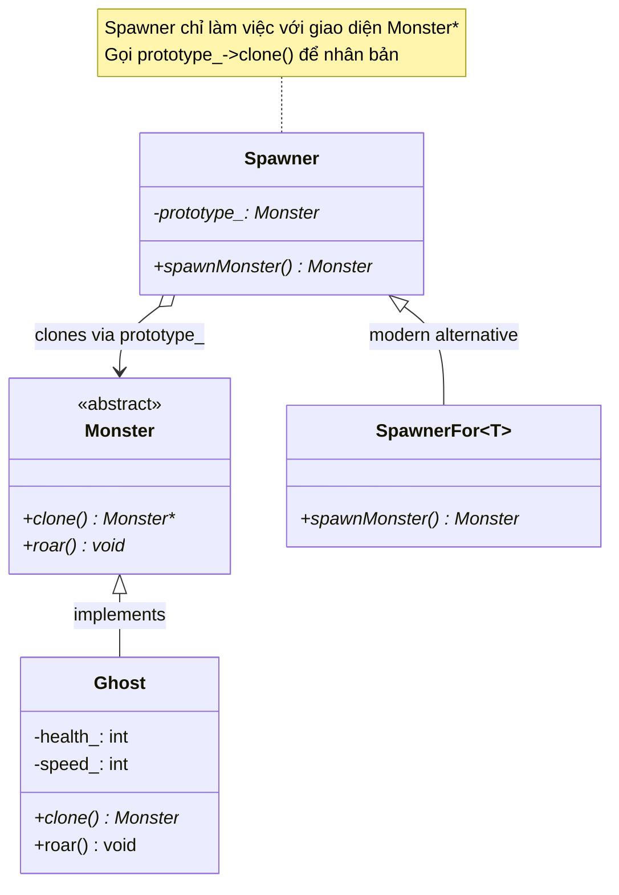
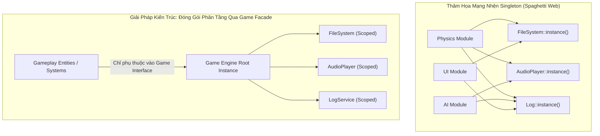
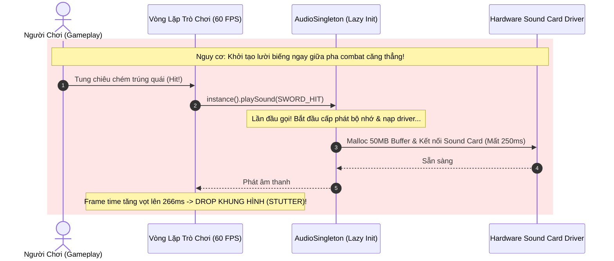

# BÓC TÁCH CHUYÊN SÂU NYSTROM — ĐỢT 3: CHƯƠNG 5 & CHƯƠNG 6
*(Dựa trên nguyên bản "Game Programming Patterns" của Robert Nystrom)*

---

# MỤC LỤC ĐỢT 3
- [CHƯƠNG 5: PROTOTYPE PATTERN (MẪU NGUYÊN MẪU / NHÂN BẢN THỰC THỂ)](#chương-5-prototype-pattern-mẫu-nguyên-mẫu--nhân-bản-thực-thể)
  - [1. ĐỀ MỤC & MỤC TIÊU CỐT LÕI (CORE PURPOSE)](#1-đề-mục--mục-tiêu-cốt-lõi-core-purpose)
  - [2. PHÂN TÍCH LÝ THUYẾT & NGUYÊN LÝ CHUYÊN SÂU](#2-phân-tích-lý-thuyết--nguyên-lý-chuyên-sâu)
  - [3. MỔ XẺ MÃ NGUỒN (CODE DEEP-DIVE)](#3-mổ-xẻ-mã-nguồn-code-deep-dive)
  - [4. SƠ ĐỒ TRỰC QUAN HÓA (VISUAL MERMAID DIAGRAM)](#4-sơ-đồ-trực-quan-hóa-visual-mermaid-diagram)
  - [5. ÁNH XẠ ỨNG DỤNG VÀO DỰ ÁN GAME OOP](#5-ánh-xạ-ứng-dụng-vào-dự-án-game-oop)
- [CHƯƠNG 6: SINGLETON PATTERN (MẪU ĐƠN THỂ / BẪY BIẾN TOÀN CỤC TRONG GAME)](#chương-6-singleton-pattern-mẫu-đơn-thể--bẫy-biến-toàn-cục-trong-game)
  - [1. ĐỀ MỤC & MỤC TIÊU CỐT LÕI (CORE PURPOSE)](#1-đề-mục--mục-tiêu-cốt-lõi-core-purpose-1)
  - [2. PHÂN TÍCH LÝ THUYẾT & NGUYÊN LÝ CHUYÊN SÂU](#2-phân-tích-lý-thuyết--nguyên-lý-chuyên-sâu-1)
  - [3. MỔ XẺ MÃ NGUỒN (CODE DEEP-DIVE)](#3-mổ-xẻ-mã-nguồn-code-deep-dive)
  - [4. SƠ ĐỒ TRỰC QUAN HÓA (VISUAL MERMAID DIAGRAM)](#4-sơ-đồ-trực-quan-hóa-visual-mermaid-diagram-1)
  - [5. ÁNH XẠ ỨNG DỤNG VÀO DỰ ÁN GAME OOP](#5-ánh-xạ-ứng-dụng-vào-dự-án-game-oop-1)

---

# CHƯƠNG 5: PROTOTYPE PATTERN (MẪU NGUYÊN MẪU / NHÂN BẢN THỰC THỂ)

## 1. ĐỀ MỤC & MỤC TIÊU CỐT LÕI (CORE PURPOSE)

### Danh mục đề mục chi tiết (Headings Outline)
* **Prototype** *(Mẫu Nguyên mẫu)*
  * **The Prototype Design Pattern** *(Mẫu thiết kế Nguyên mẫu kinh điển)*
  * **How well does it work?** *(Đánh giá tính hiệu quả thực tế và cái bẫy sao chép)*
    * *Spawn functions* *(Hàm sinh thực thể thay thế bằng Callback)*
    * *Templates* *(Hiện thực hóa sinh thực thể bằng C++ Templates)*
    * *First-class types* *(Ngôn ngữ có kiểu dữ liệu hạng nhất)*
  * **The Prototype Language Paradigm** *(Mô hình ngôn ngữ hướng nguyên mẫu)*
    * *Self* *(Ngôn ngữ Self và cơ chế Delegation thay thế Kế thừa)*
    * *How did it go?* *(Hạn chế thực tế của mô hình Prototype thuần túy)*
    * *What about JavaScript?* *(Sự dung hòa giữa Prototype và Class trong JavaScript)*
  * **Prototypes for Data Modeling** *(Ứng dụng đột phá: Mô hình hóa dữ liệu Game bằng Ủy quyền Prototype)*

### Vấn đề kỹ thuật thực tế & Thảm họa hệ thống
Trong phát triển game, hệ thống sinh quái vật (Spawner System) hoặc cơ chế tạo vật phẩm cần khởi tạo hàng trăm biến thể đối tượng khác nhau lúc runtime.
* **Vấn đề kỹ thuật:** Làm thế nào để một bộ sinh (Spawner) có thể tạo ra các thực thể quái vật (`Ghost`, `Demon`, `Sorcerer`) mà không bị gắn cứng vào kiểu dữ liệu cụ thể (`new Ghost()`), và không phải đẻ ra một cây phân cấp Spawner song song khổng lồ (`GhostSpawner`, `DemonSpawner`, `SorcererSpawner`).
* **Thảm họa nếu không có Prototype Pattern (hoặc kỹ thuật tương đương):**
  1. **Bùng nổ cây kế thừa song song (Parallel Class Hierarchy Explosion):** Cứ mỗi khi Game Designer sáng tạo ra 1 loại Monster mới, lập trình viên buộc phải viết thêm 1 lớp Spawner tương ứng. Hệ thống bị tràn ngập code "rác" lặp đi lặp lại chỉ để làm nhiệm vụ gọi `return new X();`.
  2. **Trùng lặp dữ liệu cấu hình phi mã trong Data Files (Data Duplication Nightmare):** Khi chuyển cấu hình quái sang JSON/XML, hàng trăm biến thể quái (Goblin Thường, Goblin Cung Thủ, Goblin Pháp Sư) lặp lại giống hệt nhau về chỉ số kháng, máu cơ bản, và điểm yếu. Nếu Game Designer muốn tăng máu cơ bản của loài Goblin, họ phải sửa thủ công hàng trăm file dữ liệu riêng biệt. Một sai sót nhỏ sẽ gây mất cân bằng toàn bộ game.

---

## 2. PHÂN TÍCH LÝ THUYẾT & NGUYÊN LÝ CHUYÊN SÂU

### 2.1. Bản chất Mẫu thiết kế Prototype của Gang of Four (GoF)
Ý tưởng nguyên thủy của GoF là: **Một đối tượng có thể tự sinh ra các đối tượng khác tương tự như chính nó thông qua phương thức nhân bản (`clone()`)**.
* `Spawner` không cần biết lớp cụ thể của quái vật là gì, nó chỉ nắm giữ một con trỏ đa hình `Monster* prototype_`. Khi cần sinh quái, nó chỉ việc gọi `prototype_->clone()`.
* **Ưu điểm vượt trội:** Prototype không chỉ sao chép kiểu lớp (Class), mà nó sao chép toàn bộ **trạng thái (State)** của đối tượng nguyên mẫu. Nhờ đó, ta có thể tạo ra `WeakGhostSpawner` hay `FastGhostSpawner` chỉ bằng cách cấu hình thuộc tính của instance nguyên mẫu ban đầu trước khi đưa vào Spawner.

### 2.2. Mặt trái và Sự suy thoái của Prototype trong C++ hiện đại
Robert Nystrom thẳng thắn thừa nhận: Trong thực tế phát triển engine C++, mẫu thiết kế Prototype GoF hiếm khi là lựa chọn tối ưu vì hai lý do cốt lõi:
1. **Cái bẫy sao chép sâu vs nông (Deep Clone vs Shallow Clone):** Khi một con Quái vật cầm một Cây giáo (`Weapon*`), hàm `clone()` sẽ chỉ nhân bản con trỏ hay tạo một vũ khí mới hoàn toàn? Nếu là vũ khí ma thuật có hiệu ứng đếm số lần sử dụng, sao chép nông sẽ dẫn đến lỗi logic nghiêm trọng khi cả hai con quái dùng chung 1 cây giáo.
2. **Các giải pháp thay thế thanh lịch hơn trong C++:**
   * **Spawn Callback Functions:** Lưu con trỏ hàm sinh `Monster* (*SpawnCallback)()`.
   * **C++ Templates:** Định nghĩa template `template <class T> class SpawnerFor : public Spawner { Monster* spawnMonster() { return new T(); } };`. Loại bỏ hoàn toàn sự cồng kềnh của hàm `clone()`.

### 2.3. Mô hình Ngôn ngữ Hướng Nguyên mẫu (Prototype-based OOP) vs Hướng Lớp (Class-based OOP)
Nystrom phân tích sâu sắc ngôn ngữ **Self** (tiền thân của JavaScript) do Dave Ungar và Randall Smith sáng tạo:
* **Ngôn ngữ có Class:** Trạng thái (Fields) nằm trong Instance; Hành vi (Methods) nằm trong Class; truy xuất hàm phải qua con trỏ ảo `vtable`.
* **Ngôn ngữ Hướng Prototype (Self):** Loại bỏ hoàn toàn khái niệm Class! Một đối tượng chứa cả State lẫn Behavior. Nếu đối tượng không tìm thấy thuộc tính hay phương thức trên bản thân nó, nó sẽ **ủy quyền (Delegation)** cho đối tượng cha (`parent` hoặc `[[Prototype]]`).
* **Sự thật về JavaScript:** Dù Brendan Eich lấy cảm hứng từ Self, JavaScript thực tế đã bị biến tướng thành một ngôn ngữ lai giữa Class và Prototype thông qua hàm tạo (`constructor functions`) và toán tử `new`.

### 2.4. Đột phá Ứng dụng: Prototype Delegation trong Mô hình hóa Dữ liệu (Data Modeling)
Đây là đóng góp giá trị nhất của Nystrom cho ngành phát triển game hiện đại: **Đem cơ chế Ủy quyền Nguyên mẫu (Prototypal Delegation) vào file dữ liệu JSON**.
* Đặt trường `"prototype": "goblin grunt"` trong file JSON của `goblin wizard`.
* Bộ nạp dữ liệu (Data Loader) của Engine khi đọc một thuộc tính bị thiếu trên `goblin wizard` sẽ tự động tra cứu ngược lên đối tượng nguyên mẫu `goblin grunt`.
* Triệt tiêu 80% sự trùng lặp dữ liệu cấu hình của Game Designer, biến dữ liệu game thành một hệ thống kế thừa linh hoạt mà không cần phải viết mã C++ phức tạp.

---

## 3. MỔ XẺ MÃ NGUỒN (CODE DEEP-DIVE)

Dưới đây là mã nguồn C++ đối chiếu giữa Mẫu Prototype GoF kinh điển, Giải pháp C++ Template hiện đại, và Cơ chế phân giải dữ liệu JSON theo Prototype:

```cpp
#include <iostream>
#include <string>
#include <unordered_map>
#include <vector>

// =================================================================
// 1. ABSTRACT MONSTER & PROTOTYPE PATTERN (GOF STYLE)
// =================================================================
class Monster {
public:
    virtual ~Monster() {}
    virtual Monster* clone() = 0; // Pure virtual clone method
    virtual void roar() = 0;
};

class Ghost : public Monster {
public:
    Ghost(int health, int speed) : health_(health), speed_(speed) {}

    // Deep clone trạng thái hiện tại của nguyên mẫu
    virtual Monster* clone() override {
        return new Ghost(this->health_, this->speed_);
    }

    virtual void roar() override {
        std::cout << "Ghost xuat hien! HP: " << health_ << ", Speed: " << speed_ << "\n";
    }

private:
    int health_;
    int speed_;
};

// =================================================================
// 2. MODERN C++ TEMPLATE SPAWNER (THAY THẾ PROTOTYPE CỒNG KỀNH)
// =================================================================
class Spawner {
public:
    virtual ~Spawner() {}
    virtual Monster* spawnMonster() = 0;
};

template <class T>
class SpawnerFor : public Spawner {
public:
    virtual Monster* spawnMonster() override {
        return new T(); // Sinh trực tiếp qua Template type parameter
    }
};

// =================================================================
// 3. PROTOTYPE DELEGATION CHO DATA MODELING (JSON METADATA RECORD)
// =================================================================
struct MonsterRecord {
    std::string name;
    int health;
    int attack;
    std::string prototypeName; // Trường ủy quyền nguyên mẫu
};

class MonsterDataCatalog {
public:
    void registerRecord(const MonsterRecord& record) {
        catalog_[record.name] = record;
    }

    // Tra cứu dữ liệu đệ quy theo chuỗi ủy quyền Prototype (Delegation Chain)
    int resolveHealth(const std::string& monsterName) {
        auto it = catalog_.find(monsterName);
        if (it == catalog_.end()) return 0;

        // Nếu bản ghi có chỉ số cụ thể (> 0), dùng ngay
        if (it->second.health > 0) {
            return it->second.health;
        }

        // Nếu thiếu chỉ số, ủy quyền tra cứu lên đối tượng Prototype cha
        if (!it->second.prototypeName.empty()) {
            return resolveHealth(it->second.prototypeName);
        }

        return 0; // Mặc định nếu không tìm thấy
    }

private:
    std::unordered_map<std::string, MonsterRecord> catalog_;
};
```

### Bảng phân tích chi tiết mã nguồn
| Dòng code / Đoạn code then chốt | Giải thích kỹ thuật & Ý nghĩa thiết kế |
|:---|:---|
| `virtual Monster* clone() = 0;` | Giao diện cốt lõi của Prototype Pattern: Bắt buộc mọi lớp con phải tự chịu trách nhiệm định nghĩa logic sao chép trạng thái của chính mình. |
| `return new Ghost(this->health_, this->speed_);` | Sao chép sâu (Deep Copy) các thuộc tính nguyên thủy. Đảm bảo đối tượng được sinh ra kế thừa toàn bộ chỉ số tùy biến của nguyên mẫu mà không làm sai lệch nguyên mẫu gốc. |
| `template <class T> class SpawnerFor : public Spawner` | Kỹ thuật **Template Metaprogramming Idiom**: Phân giải kiểu sinh đối tượng lúc Compile-time. Loại bỏ nhu cầu cài đặt hàm `clone()` trên hàng trăm lớp con của game. |
| `if (!it->second.prototypeName.empty()) return resolveHealth(...)` | Hiện thực hóa giải thuật **Prototype Lookup Delegation**: Nếu một thực thể trong file dữ liệu không định nghĩa thuộc tính, nó tự động ủy quyền tra cứu lên thực thể cha. Mô phỏng cơ chế Prototype Chain của JavaScript ngay trong C++ Engine. |

---

## 4. SƠ ĐỒ TRỰC QUAN HÓA (VISUAL MERMAID DIAGRAM)

### Sơ đồ Lớp & Cấu trúc Phân giải Chuỗi Prototype Data Delegation



### Sơ đồ Luồng Tra cứu Dữ liệu Ủy quyền Prototype (Data Delegation Chain)

```mermaid
flowchart LR
    GW["Goblin Wizard<br/>{prototype: 'goblin grunt', spells: ['Fireball']}"]
    GG["Goblin Grunt (Prototype)<br/>{health: 30, resists: ['Cold'], weaknesses: ['Fire']}"]
    Lookup{"Yêu cầu: Lấy chỉ số 'health' của Goblin Wizard"}

    Lookup -->|1. Tìm trên Goblin Wizard| FoundLocal{Có không?}
    FoundLocal -- Không -->|2. Ủy quyền lên Prototype| GG
    GG -->|3. Tìm thấy health = 30| ReturnValue["Trả về kết quả: 30 HP"]
```

---

## 5. ÁNH XẠ ỨNG DỤNG VÀO DỰ ÁN GAME OOP

1. **Hệ thống Tạo Vũ Khí & Trang Bị Đặc Biệt (Boss Drops):**
   * Trong game nhiều người chơi 2.5D, thay vì tạo hàng trăm class riêng cho từng cây kiếm huyền thoại, hệ thống lưu một bộ nguyên mẫu (Archetype Prototypes) trong file cấu hình JSON. 
   * Cây kiếm *"Huyết Kiếm Ma Vương"* chỉ cần khai báo `"prototype": "broadsword"` kèm `"lifestealBonus": 0.25`. Bộ sinh đồ (Loot Spawner) chỉ việc clone mẫu kiếm cơ bản và nạp các thuộc tính chênh lệch (Delta attributes).
2. **Hệ thống Xây dựng Trạm Spawn Quái (Monster Nest Spawners):**
   * Khi người chơi bước vào một hầm ngục Dungeon, mỗi tổ quái vật (`NestSpawner`) được nạp sẵn một con quái nguyên mẫu đã được buff chỉ số theo độ khó hầm ngục. Cứ mỗi 10 giây, Spawner gọi `prototype_->clone()` để thả một con quái ra trận mà không cần quan tâm đến logic khởi tạo phụ thuộc bên trong nó.

---
---

# CHƯƠNG 6: SINGLETON PATTERN (MẪU ĐƠN THỂ / BẪY BIẾN TOÀN CỤC TRONG GAME)

## 1. ĐỀ MỤC & MỤC TIÊU CỐT LÕI (CORE PURPOSE)

### Danh mục đề mục chi tiết (Headings Outline)
* **Singleton** *(Mẫu Đơn thể)*
  * **The Singleton Pattern** *(Định nghĩa mẫu thiết kế Đơn thể kinh điển)*
    * *Restricting a class to one instance* *(Giới hạn một lớp chỉ có duy nhất 1 thực thể)*
    * *Providing a global point of access* *(Cung cấp điểm truy cập toàn cục)*
  * **Why We Use It** *(Tại sao chúng ta lại lạm dụng Singleton?)*
    * *Lazy initialization* *(Khởi tạo lười biếng / Trì hoãn)*
    * *Runtime initialization* *(Khởi tạo lúc runtime giải quyết bài toán phụ thuộc cấu hình)*
    * *Subclassing the singleton* *(Đa hình hóa Singleton theo nền tảng phần cứng)*
  * **Why We Regret Using It** *(Tại sao chúng ta phải trả giá đắt và hối hận?)*
    * *It’s a global variable* *(Bản chất thực sự: Singleton chỉ là một biến toàn cục trá hình)*
    * *It solves two problems even when you just have one* *(Giải quyết 2 bài toán khi bạn chỉ cần 1)*
    * *Lazy initialization takes control away from you* *(Khởi tạo lười cướp mất quyền kiểm soát tài nguyên)*
  * **What We Can Do Instead** *(Các giải pháp kiến trúc thay thế tối ưu)*
    * *See if you need the class at all* *(Xem xét có thực sự cần các lớp "Manager" vô bổ không)*
    * *To limit a class to a single instance* *(Kỹ thuật kiểm tra thực thể đơn bằng Assert)*
    * *To provide convenient access to an instance* *(Kỹ thuật Truyền đối số / Dependency Injection)*
    * *Get it from the base class (Subclass Sandbox)* *(Lấy dịch vụ từ lớp cha)*
    * *Get it from something already global* *(Gom cụm dịch vụ vào một đối tượng World/Game duy nhất)*
    * *Get it from a Service Locator* *(Sử dụng Bộ định vị dịch vụ)*
  * **What’s Left for Singleton** *(Vị trí còn lại của Singleton: Gần như bằng Không)*

### Vấn đề kỹ thuật thực tế & Thảm họa hệ thống
Chương này là **chương duy nhất trong toàn bộ cuốn sách đóng vai trò là một lời cảnh tỉnh phản biện (Anti-Pattern Critique)**: Robert Nystrom hướng dẫn cách *không* sử dụng một mẫu thiết kế.
* **Vấn đề kỹ thuật:** Các hệ thống trong game (Hệ thống File, Âm thanh, Kết nối Mạng, Nhật ký Log) cần được truy cập ở nhiều nơi, đồng thời chỉ được phép có duy nhất 1 thể hiện điều khiển phần cứng.
* **Thảm họa khủng khiếp khi lạm dụng Singleton:**
  1. **Tạo ra Mạng nhện Khớp nối Toàn cục (Tight Coupling Web):** Khi viết `AudioPlayer::instance().play()`, bất kỳ file nào gọi lệnh này cũng bị phụ thuộc trực tiếp vào header của `AudioPlayer`. Việc thay thế hệ thống âm thanh hoặc kiểm thử tự động (Unit Test) cho logic nhân vật trở nên bất khả thi vì không thể Mock được các Singleton toàn cục.
  2. **Thảm họa Rớt khung hình do Khởi tạo Lười biếng (Lazy Initialization Stutter):** Trong game 60 FPS, việc khởi tạo tài nguyên âm thanh/đồ họa mất vài trăm mili-giây. Nếu để Singleton tự khởi tạo trong lần gọi đầu tiên (*Lazy Init*), đúng vào khoảnh khắc nhân vật tung chiêu quyết định, game sẽ bị khựng cứng (Frame Drop / Hitching) do CPU bận nạp driver và cấp phát bộ nhớ.
  3. **Xung đột đa luồng và Race Conditions:** Singleton biến bộ nhớ thành một "bãi rác công cộng" mà mọi Thread đều có thể đọc/ghi. Việc đồng bộ hóa bằng Mutex Lock dẫn đến tranh chấp khóa (Lock Contention) và Deadlock đóng băng hệ thống.

---

## 2. PHÂN TÍCH LÝ THUYẾT & NGUYÊN LÝ CHUYÊN SÂU

### 2.1. Bản chất: Singleton giải quyết 2 bài toán khi bạn chỉ cần 1
Định nghĩa của GoF: *"Đảm bảo một lớp chỉ có một thực thể, VÀ cung cấp một điểm truy cập toàn cục tới nó."*
Nystrom bóc tách từ **"VÀ"** tai hại này:
* **Bài toán 1: Ràng buộc duy nhất 1 thực thể (Single Instantiation):** Cần thiết để bảo vệ tài nguyên phần cứng (ví dụ: giao tiếp driver âm thanh). Nhưng không đồng nghĩa với việc cho phép toàn bộ thế giới bên ngoài được tùy tiện truy cập!
* **Bài toán 2: Tiện lợi truy cập (Convenient Access):** Thường là lý do chính khiến lập trình viên lạm dụng Singleton. Nhưng việc cho phép truy cập toàn cục sẽ phá vỡ toàn bộ kiến trúc phân tầng (Layered Architecture).
* **Hậu quả:** Một ngày đẹp trời, ta muốn tạo 2 bộ Log (1 cho Gameplay, 1 cho Network) hoặc 2 Viewport màn hình (Split-screen Multiplayer), nhưng Singleton đã chôn cứng cấu trúc `instance_` duy nhất vào hàng nghìn dòng code gọi lệnh khắp dự án.

### 2.2. Sự thất bại của Khởi tạo Lười biếng (Lazy Initialization) trong Game Engine
Trên môi trường ứng dụng thông thường, Lazy Initialization là một kỹ thuật tốt để tiết kiệm RAM. Nhưng trong Game Engine, **nó là một thảm họa hiệu năng**:
* Engine cần kiểm soát chính xác vị trí và thời điểm phân bổ trên Heap để tránh phân mảnh bộ nhớ (**Memory Fragmentation**).
* Toàn bộ các hệ thống cốt lõi bắt buộc phải được khởi tạo tuần tự, có chủ đích trong giai đoạn tải màn chơi (Loading Screen), tuyệt đối không để rò rỉ việc cấp phát động vào vòng lặp Gameplay.

### 2.3. Hiện tượng Bệnh lý "Manager-itis" (Hội chứng thừa thãi lớp Quản lý)
Nystrom chỉ trích gay gắt thói quen tạo ra hàng loạt lớp trung gian vô bổ: `MonsterManager`, `ParticleManager`, `SoundManager`, `BulletManager`.
* Bản chất của OOP là để **đối tượng tự quản lý chính mình** (Let objects take care of themselves).
* Việc tách `Bullet` (chỉ chứa $x, y$) và `BulletManager` (chứa logic di chuyển, kiểm tra màn hình) là sự thụt lùi về tư duy lập trình thủ tục (Procedural Programming) đội lốt OOP.

### 2.4. Bản đồ 5 Giải pháp Kiến trúc Thay thế Singleton
1. **Truyền đối tượng qua Tham số (Dependency Injection / Pass it in):** Truyền thẳng ngữ cảnh `RenderContext&` hoặc `PhysicsWorld&` vào phương thức cần dùng. Rõ ràng, minh bạch, dễ viết Unit Test Mock.
2. **Lấy từ Lớp cơ sở (Subclass Sandbox):** Các Entity kế thừa từ `GameObject`, và `GameObject` cung cấp phương thức `protected: Log& getLog()`. Chỉ có các Entity con mới truy cập được, thế giới bên ngoài hoàn toàn bị che giấu.
3. **Gom cụm vào Đối tượng Toàn cục duy nhất (Monolithic Game/World Facade):** Thay vì tạo 20 Singleton rải rác khắp nơi, chỉ duy nhất một đối tượng `Game` được phép sống toàn cục. Các hệ thống con được truy xuất qua `Game::instance().getAudio()`.
4. **Kiểm tra Ràng buộc bằng Khẳng định Thời gian chạy (Runtime Assertion):** Vẫn cho phép khởi tạo bình thường nhưng đặt `assert(!instantiated_)` trong Constructor. Bảo đảm chỉ có duy nhất 1 instance được tạo mà không cần biến nó thành biến toàn cục.
5. **Bộ định vị Dịch vụ (Service Locator):** Tách rời hoàn toàn giao diện trừu tượng và việc cung cấp dịch vụ (sẽ phân tích sâu ở Chương 16).

---

## 3. MỔ XẺ MÃ NGUỒN (CODE DEEP-DIVE)

Dưới đây là mã nguồn C++ đối chiếu giữa Singleton kinh điển (với thread-safety theo chuẩn C++11), Bẫy kiến trúc Lazy Init, và 2 giải pháp thay thế thượng thừa của Robert Nystrom:

```cpp
#include <iostream>
#include <cassert>

// =================================================================
// 1. C++11 THREAD-SAFE MEYERS' SINGLETON (CHUẨN HIỆN ĐẠI NHƯNG VẪN LÀ BIẾN TOÀN CỤC)
// =================================================================
class FileSystemModern {
public:
    static FileSystemModern& instance() {
        // C++11 đảm bảo biến static cục bộ khởi tạo an toàn đa luồng (Thread-safe)
        static FileSystemModern instance;
        return instance;
    }

    void readFile(const char* path) {
        std::cout << "Doc file: " << path << "\n";
    }

private:
    FileSystemModern() {} // Constructor private ngăn chặn khởi tạo ngoài
    FileSystemModern(const FileSystemModern&) = delete;
    FileSystemModern& operator=(const FileSystemModern&) = delete;
};

// =================================================================
// 2. GIẢI PHÁP THAY THẾ 1: ASSERTION-BASED SINGLE INSTANCE (KHÔNG TOÀN CỤC)
// =================================================================
class AudioDevice {
public:
    AudioDevice() {
        // Bảo vệ tài nguyên phần cứng: Chỉ duy nhất 1 instance được phép sống!
        assert(!instantiated_ && "Loi nghiem trong: AudioDevice da duoc khoi tao truoc do!");
        instantiated_ = true;
    }

    ~AudioDevice() {
        instantiated_ = false;
    }

    void playSound(int soundId) {
        std::cout << "Phat am thanh ID: " << soundId << "\n";
    }

private:
    static bool instantiated_; // Cờ trạng thái tĩnh kiểm soát vòng đời
};
bool AudioDevice::instantiated_ = false;

// =================================================================
// 3. GIẢI PHÁP THAY THẾ 2: SUBCLASS SANDBOX (TRUY CẬP TỪ LỚP CHA)
// =================================================================
class LogService {
public:
    void write(const char* msg) { std::cout << "[LOG]: " << msg << "\n"; }
};

class GameObject {
public:
    static void provideLog(LogService* log) { logService_ = log; }

protected:
    // Chỉ các lớp con kế thừa mới được phép dùng Log, ngan chan the gioi ben ngoai
    LogService& getLog() { return *logService_; }

private:
    static LogService* logService_;
};
LogService* GameObject::logService_ = nullptr;

class Hero : public GameObject {
public:
    void takeDamage(int amount) {
        getLog().write("Hero vua bi trung don!");
    }
};
```

### Bảng phân tích chi tiết mã nguồn
| Dòng code / Đoạn code then chốt | Giải thích kỹ thuật & Ý nghĩa thiết kế |
|:---|:---|
| `static FileSystemModern instance;` | Cài đặt Meyers' Singleton: Trình biên dịch sinh mã kiểm tra ngầm cờ thread-safety (Magic Statics). Dù an toàn luồng, nó vẫn vướng bẫy Lazy Initialization và là biến toàn cục khó kiểm thử. |
| `assert(!instantiated_ && "...");` | Kỹ thuật **Single Instantiation Enforcement**: Bảo đảm tính đơn lẻ của đối tượng ở cấp độ vòng đời runtime. Đối tượng có thể được truyền qua con trỏ hoặc tham chiếu mà không cần phơi bày API tĩnh toàn cục `instance()`. |
| `~AudioDevice() { instantiated_ = false; }` | Khi đối tượng bị hủy, cờ kiểm soát được trả về `false`. Cho phép hủy đối tượng cũ và tái tạo đối tượng mới trong các kịch bản kiểm thử (Unit Testing) hoặc khi tải lại màn chơi. |
| `protected: LogService& getLog()` | Hiện thực hóa nguyên lý **Đóng gói phạm vi hẹp nhất có thể (Narrowest Scope Principle)**: Đóng đinh quyền truy cập dịch vụ trong nội bộ cây phả hệ `GameObject`, ngăn chặn lập trình viên tùy tiện gọi Log từ các hàm toán học hay mạng socket. |

---

## 4. SƠ ĐỒ TRỰC QUAN HÓA (VISUAL MERMAID DIAGRAM)

### Sơ đồ Đối chiếu Kiến trúc: Bẫy Khớp Nối Singleton vs Giải Pháp Gom Cụm Facade



### Sơ đồ Tuần tự Rủi ro của Lazy Initialization vs Eager Loading



---

## 5. ÁNH XẠ ỨNG DỤNG VÀO DỰ ÁN GAME OOP

1. **Thanh Trừng Toàn Diện Các Singleton Trong Dự Án Đấu Trường 2.5D:**
   * Trong một dự án game chiến đấu nhiều người chơi, loại bỏ hoàn toàn các Singleton trá hình như `NetworkManager::getInstance()`, `CombatManager::getInstance()`.
   * Chuyển sang mô hình **Dependency Injection (DI) hoặc Game Context**: Khởi tạo `ServerNetworkService` và `CombatEngine` một lần duy nhất trong hàm `main()` của Server, sau đó truyền tham chiếu vào vòng lặp `GameSession`. Điều này cho phép mở nhiều phòng chơi (Multi-room / Multi-arena) trên cùng một tiến trình Server mà không bị xung đột bộ nhớ tĩnh.
2. **Quy Chuẩn Tải Trước Tài Nguyên Tránh Khựng Game (Eager Allocation Protocol):**
   * Tất cả các đối tượng điều khiển hệ thống phần cứng (Âm thanh, Đồ họa OpenGL/DirectX, Bộ đệm gói tin Socket) bắt buộc phải tuân thủ giao thức **Khởi tạo Sớm (Eager Initialization)** trong màn hình Loading Screen.
   * Cấm tuyệt đối việc sử dụng cú pháp Singleton Lazy Init bên trong bất kỳ hàm nào thuộc chu trình cập nhật mỗi khung hình (`update()`, `render()`).
