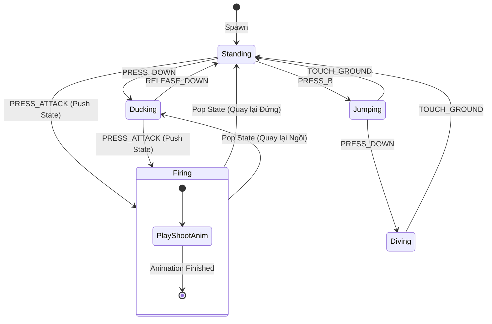
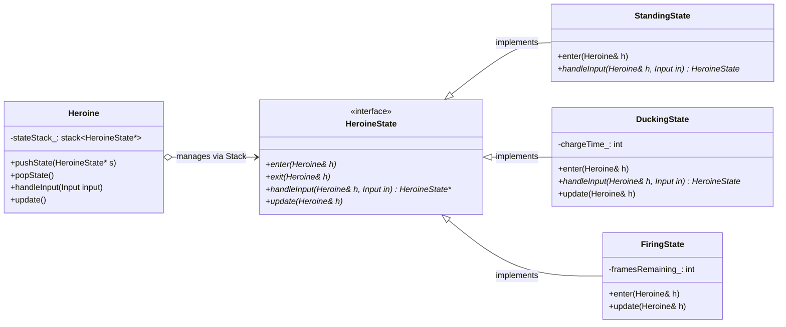
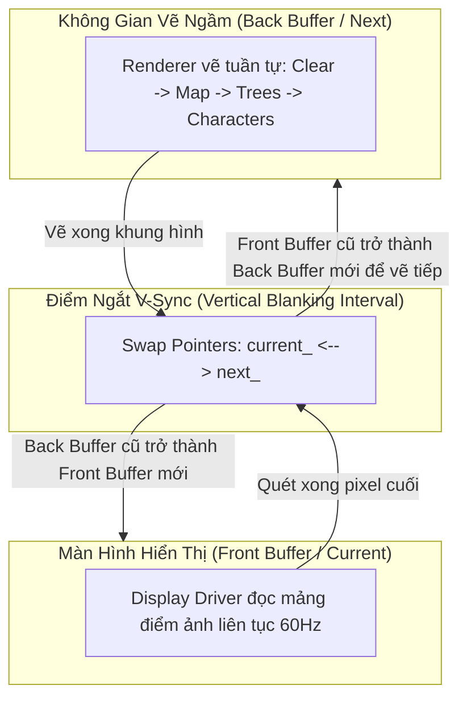
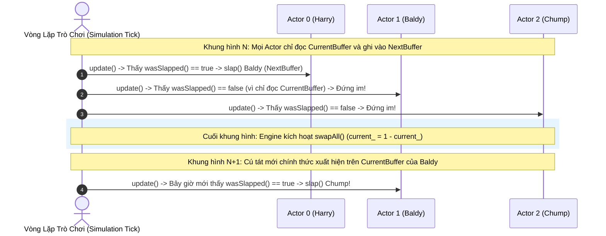

# BÓC TÁCH CHUYÊN SÂU NYSTROM — ĐỢT 4: CHƯƠNG 7 & CHƯƠNG 8
*(Dựa trên nguyên bản "Game Programming Patterns" của Robert Nystrom)*

---

# MỤC LỤC ĐỢT 4
- [CHƯƠNG 7: STATE PATTERN (MẪU MÁY TRẠNG THÁI HỮU HẠN & MỞ RỘNG)](#chương-7-state-pattern-mẫu-máy-trạng-thái-hữu-hạn--mở-rộng)
  - [1. ĐỀ MỤC & MỤC TIÊU CỐT LÕI (CORE PURPOSE)](#1-đề-mục--mục-tiêu-cốt-lõi-core-purpose)
  - [2. PHÂN TÍCH LÝ THUYẾT & NGUYÊN LÝ CHUYÊN SÂU](#2-phân-tích-lý-thuyết--nguyên-lý-chuyên-sâu)
  - [3. MỔ XẺ MÃ NGUỒN (CODE DEEP-DIVE)](#3-mổ-xẻ-mã-nguồn-code-deep-dive)
  - [4. SƠ ĐỒ TRỰC QUAN HÓA (VISUAL MERMAID DIAGRAM)](#4-sơ-đồ-trực-quan-hóa-visual-mermaid-diagram)
  - [5. ÁNH XẠ ỨNG DỤNG VÀO DỰ ÁN GAME OOP](#5-ánh-xạ-ứng-dụng-vào-dự-án-game-oop)
- [CHƯƠNG 8: DOUBLE BUFFER PATTERN (MẪU BỘ ĐỆM ĐÔI TRONG KẾT XUẤT VÀ MÔ PHỎNG)](#chương-8-double-buffer-pattern-mẫu-bộ-đệm-đôi-trong-kết-xuất-và-mô-phỏng)
  - [1. ĐỀ MỤC & MỤC TIÊU CỐT LÕI (CORE PURPOSE)](#1-đề-mục--mục-tiêu-cốt-lõi-core-purpose-1)
  - [2. PHÂN TÍCH LÝ THUYẾT & NGUYÊN LÝ CHUYÊN SÂU](#2-phân-tích-lý-thuyết--nguyên-lý-chuyên-sâu-1)
  - [3. MỔ XẺ MÃ NGUỒN (CODE DEEP-DIVE)](#3-mổ-xẻ-mã-nguồn-code-deep-dive)
  - [4. SƠ ĐỒ TRỰC QUAN HÓA (VISUAL MERMAID DIAGRAM)](#4-sơ-đồ-trực-quan-hóa-visual-mermaid-diagram-1)
  - [5. ÁNH XẠ ỨNG DỤNG VÀO DỰ ÁN GAME OOP](#5-ánh-xạ-ứng-dụng-vào-dự-án-game-oop-1)

---

# CHƯƠNG 7: STATE PATTERN (MẪU MÁY TRẠNG THÁI HỮU HẠN & MỞ RỘNG)

## 1. ĐỀ MỤC & MỤC TIÊU CỐT LÕI (CORE PURPOSE)

### Danh mục đề mục chi tiết (Headings Outline)
* **State** *(Mẫu Trạng thái)*
  * **We’ve All Been There** *(Tấn bi kịch quen thuộc: Rừng cờ Boolean lồng nhau)*
  * **Finite State Machines to the Rescue** *(Máy trạng thái hữu hạn FSM giải cứu)*
  * **Enums and Switches** *(Hiện thực hóa FSM bằng Enum & Rẽ nhánh Switch-Case)*
  * **The State Pattern** *(Mẫu thiết kế State chuẩn Gang of Four)*
    * *A state interface* *(Giao diện trừu tượng hóa trạng thái)*
    * *Classes for each state* *(Đóng gói hành vi vào từng lớp trạng thái riêng biệt)*
    * *Delegate to the state* *(Ủy quyền điều phối hành vi cho trạng thái hiện tại)*
  * **Where Are the State Objects?** *(Vị trí lưu trữ và Quản trị vòng đời đối tượng trạng thái)*
    * *Static states* *(Trạng thái tĩnh bất biến Flyweight)*
    * *Instantiated states* *(Trạng thái động cấp phát theo phiên & bài toán dọn dẹp bộ nhớ)*
  * **Enter and Exit Actions** *(Hành động kích hoạt khi Bước vào và Rời khỏi trạng thái)*
  * **What’s the Catch?** *(Hạn chế của FSM: Tính xơ cứng và Thiếu tính toán hoàn chỉnh)*
  * **Concurrent State Machines** *(Máy trạng thái đồng thời: Hóa giải bùng nổ tổ hợp trạng thái)*
  * **Hierarchical State Machines** *(Máy trạng thái phân cấp: Kế thừa và Tái sử dụng logic chuyển tiếp)*
  * **Pushdown Automata** *(Tự động đẩy xuống / Ngăn xếp trạng thái: Lưu vết lịch sử hành vi)*
  * **So How Useful Are They?** *(Đánh giá phạm vi ứng dụng thực tế trong Game Development)*

### Vấn đề kỹ thuật thực tế & Thảm họa hệ thống
Khi lập trình điều khiển nhân vật chính hoặc AI quái vật, nhân vật phải liên tục chuyển đổi giữa hàng chục tư thế vận động: Đứng yên, Chạy, Nhảy, Ngồi, Bổ nhào chém, Choáng, và Bị hất tung.
* **Thảm họa Rừng cờ biến Boolean (Boolean Flag Spaghetti):** Lập trình viên nghiệp dư thường quản lý bằng cách cấy hàng loạt biến cờ: `bool isJumping_`, `bool isDucking_`, `bool isAttacking_`, `bool isGrounded_`. 
* **Hậu quả chết người:**
  1. **Trạng thái không hợp lệ (Invalid Combinations):** Khi người chơi nhấn nút nhảy trong tư thế ngồi rồi nhả nút ngồi ngay giữa không trung, nhân vật đột ngột chuyển thành tư thế đứng trên không trung (`isJumping_ == true && isDucking_ == false`), cho phép người chơi nhảy vô hạn lần trên mây ("Air-jumping exploit").
  2. **Bùng nổ tổ hợp rẽ nhánh (Combinatorial Complexity):** Mỗi lần thêm một hành vi mới (như đòn tấn công khi lặn), ta buộc phải chèn thêm các điều kiện `if (!isJumping_ && !isDucking_ && !isDiving_ && ...)`. Mã nguồn biến thành một bãi mìn rẽ nhánh phức tạp; sửa một lỗi ở đòn đánh sẽ gián tiếp làm gãy logic nhảy hoặc ngã.

---

## 2. PHÂN TÍCH LÝ THUYẾT & NGUYÊN LÝ CHUYÊN SÂU

### 2.1. Nền tảng Lý thuyết Máy trạng thái Hữu hạn (Finite State Machine - FSM)
Xuất phát từ Lý thuyết Tự động học (Automata Theory), một FSM chuẩn mực bao gồm 4 yếu tố bất di bất dịch:
1. **Tập hợp trạng thái hữu hạn (Fixed set of states):** Đối tượng chỉ có thể ở một trong các trạng thái đã biết trước (`Standing`, `Jumping`, `Ducking`, `Diving`).
2. **Tính độc quyền thời gian (Exclusive state):** Tại một thời điểm duy nhất, cỗ máy chỉ được phép nằm ở đúng **MỘT** trạng thái duy nhất.
3. **Chuỗi tín hiệu ngõ vào (Inputs / Events):** Các sự kiện bấm phím hoặc thông điệp vật lý (`PRESS_B`, `PRESS_DOWN`, `TOUCH_GROUND`).
4. **Tập hợp chuyển tiếp (Transitions):** Mỗi trạng thái kết nối với trạng thái khác thông qua một điều kiện chuyển đổi cụ thể. Nếu một tín hiệu không có đường chuyển tiếp trong trạng thái hiện tại, nó bị triệt tiêu an toàn.

### 2.2. Sự tiến hóa từ `switch-case` sang Đa hình OOP State Pattern
* **Cấp độ Enum & Switch:** Đảo ngược thứ tự rẽ nhánh: thay vì gom theo input `if (input == PRESS_B)`, ta gom theo trạng thái `switch (state_)`. Cách này đơn giản, nhanh, nhưng thất bại khi một trạng thái phát sinh dữ liệu riêng cục bộ (ví dụ: `chargeTime_` chỉ có ý nghĩa khi ngồi gồng năng lượng).
* **Cấp độ OOP State Pattern:** Chuyển từng `case` thành một lớp cụ thể kế thừa từ giao diện trừu tượng `HeroineState`. Thay thế rẽ nhánh điều kiện bằng **Liên kết động (Dynamic Polymorphic Dispatch)**:
$$\text{Heroine::handleInput}() \implies \text{state\_}\to\text{handleInput}(*\text{this}, \text{input})$$

### 2.3. Quản trị Bộ nhớ State: Flyweight Tĩnh vs Cấp phát Động
1. **Static States (Flyweight):** Nếu State không chứa biến thuộc tính cá thể (chỉ có vptr và phương thức thuần túy), ta chỉ cần khai báo một instance `static` duy nhất cho toàn bộ game. Zero allocation, zero cache miss.
2. **Instantiated States:** Khi State cần lưu trữ dữ liệu riêng (như thời gian gồng đòn của từng thực thể), ta buộc phải cấp phát động (`new DuckingState()`). 
   * **Nguyên tắc an toàn:** Không bao giờ gọi `delete this;` bên trong phương thức của State. Thay vào đó, hàm `handleInput()` trả về con trỏ trạng thái mới `HeroineState*`, bàn giao quyền giải phóng trạng thái cũ cho lớp chủ thể `Heroine`.

### 2.4. Khắc phục hạn chế của FSM bằng 3 Mô hình Mở rộng Thượng thừa
FSM thuần túy không phải là Turing Complete và dễ bị bế tắc khi quy mô game mở rộng. Nystrom đưa ra 3 giải pháp kiến trúc:
1. **Máy trạng thái Đồng thời (Concurrent State Machines):**
   * Nếu nhân vật vừa chạy vừa cầm súng bắn, việc gộp chung sẽ tạo ra $N \times M$ trạng thái (`Standing_Armed`, `Jumping_Armed`,...).
   * Giải pháp: Chia làm hai cỗ máy trạng thái độc lập chạy song song trên cùng nhân vật: `state_` (chân/vận động) và `equipment_` (tay/vũ khí). Độ phức tạp giảm ngoạn mục xuống còn $N + M$ trạng thái.
2. **Máy trạng thái Phân cấp (Hierarchical State Machines - HSM):**
   * Sử dụng kế thừa hướng đối tượng: Tạo lớp `OnGroundState` xử lý các thao tác chung (Nhảy, Ngồi). Các lớp `StandingState`, `RunningState` kế thừa từ `OnGroundState`. Nếu lớp con không xử lý input, nó tự động ủy quyền ngược lên lớp cha (`OnGroundState::handleInput()`).
3. **Tự động Đẩy xuống (Pushdown Automata - PDA):**
   * FSM truyền thống không có bộ nhớ lịch sử (*memoryless*). Khi nhân vật kích hoạt đòn đánh `FiringState`, sau khi bắn xong, nó không biết phải quay về trạng thái nào (Đứng, Nhảy hay Bò?).
   * Giải pháp: Sử dụng **Ngăn xếp trạng thái (Stack of States)**. Khi bắn, push `FiringState` lên đỉnh stack. Bắn xong, pop `FiringState` ra khỏi stack, hệ thống tự động rơi về trạng thái trước đó một cách hoàn hảo.

---

## 3. MỔ XẺ MÃ NGUỒN (CODE DEEP-DIVE)

Dưới đây là mã nguồn C++ thể hiện kỹ thuật State Pattern hoàn chỉnh với Entry Actions và Pushdown Automata Stack:

```cpp
#include <iostream>
#include <stack>

// Khai báo trước
class Heroine;

enum Input {
    PRESS_B,
    PRESS_DOWN,
    RELEASE_DOWN,
    PRESS_ATTACK
};

// =================================================================
// 1. GIAO DIỆN STATE TRỪU TƯỢNG VỚI ENTRY & EXIT ACTIONS
// =================================================================
class HeroineState {
public:
    virtual ~HeroineState() {}
    virtual void enter(Heroine& heroine) {}
    virtual void exit(Heroine& heroine) {}
    virtual HeroineState* handleInput(Heroine& heroine, Input input) { return nullptr; }
    virtual void update(Heroine& heroine) {}
};

// =================================================================
// 2. LỚP CHỦ THỂ (HEROINE) QUẢN LÝ PUSHDOWN AUTOMATA STACK
// =================================================================
class Heroine {
public:
    Heroine();
    ~Heroine();

    void pushState(HeroineState* newState);
    void popState();
    void handleInput(Input input);
    void update();

    void setGraphics(const char* image) {
        std::cout << ">>> [RENDER]: Chuyen sprite nhan vat -> " << image << "\n";
    }

    void superBomb() {
        std::cout << ">>> [COMBAT]: KICH HOAT BOM NO TOAN MAN HINH!\n";
    }

private:
    std::stack<HeroineState*> stateStack_; // Pushdown Automata Stack
};

// =================================================================
// 3. CÁC TRẠNG THÁI CỤ THỂ (CONCRETE STATES)
// =================================================================
class StandingState : public HeroineState {
public:
    virtual void enter(Heroine& heroine) override {
        heroine.setGraphics("IMAGE_STAND");
    }

    virtual HeroineState* handleInput(Heroine& heroine, Input input) override;
};

class DuckingState : public HeroineState {
public:
    DuckingState() : chargeTime_(0) {}

    virtual void enter(Heroine& heroine) override {
        heroine.setGraphics("IMAGE_DUCK");
    }

    virtual HeroineState* handleInput(Heroine& heroine, Input input) override {
        if (input == RELEASE_DOWN) {
            return new StandingState(); // Chuyen ve dung day
        }
        return nullptr;
    }

    virtual void update(Heroine& heroine) override {
        chargeTime_++;
        if (chargeTime_ > 5) { // Nguong tich luy nang luong
            heroine.superBomb();
            chargeTime_ = 0;
        }
    }

private:
    int chargeTime_; // Du lieu cuc bo rieng biet cua trang thai ngoi
};

class FiringState : public HeroineState {
public:
    FiringState() : framesRemaining_(2) {}

    virtual void enter(Heroine& heroine) override {
        heroine.setGraphics("IMAGE_FIRE_ANIMATION");
    }

    virtual void update(Heroine& heroine) override;

private:
    int framesRemaining_;
};

// =================================================================
// 4. HIỆN THỰC HÓA LOGIC CHUYỂN TIẾP VÀ NGĂN XẾP PUSHDOWN
// =================================================================
HeroineState* StandingState::handleInput(Heroine& heroine, Input input) {
    if (input == PRESS_DOWN) {
        return new DuckingState();
    }
    if (input == PRESS_ATTACK) {
        heroine.pushState(new FiringState()); // Push vao ngan xep, khong xoa StandingState
        return nullptr;
    }
    return nullptr;
}

void FiringState::update(Heroine& heroine) {
    framesRemaining_--;
    if (framesRemaining_ <= 0) {
        std::cout << ">>> [ANIMATION]: Hoan tat ban sung, pop trang thai cu!\n";
        heroine.popState(); // Tu dong quay ve trang thai truoc do
    }
}

Heroine::Heroine() {
    pushState(new StandingState());
}

Heroine::~Heroine() {
    while (!stateStack_.empty()) {
        delete stateStack_.top();
        stateStack_.pop();
    }
}

void Heroine::pushState(HeroineState* newState) {
    if (!stateStack_.empty()) {
        stateStack_.top()->exit(*this);
    }
    stateStack_.push(newState);
    stateStack_.top()->enter(*this);
}

void Heroine::popState() {
    if (stateStack_.size() > 1) { // Giu lai it nhat 1 state goc
        HeroineState* top = stateStack_.top();
        top->exit(*this);
        delete top;
        stateStack_.pop();
        stateStack_.top()->enter(*this);
    }
}

void Heroine::handleInput(Input input) {
    if (!stateStack_.empty()) {
        HeroineState* nextState = stateStack_.top()->handleInput(*this, input);
        if (nextState != nullptr) {
            // Thay the state tren dinh
            HeroineState* oldState = stateStack_.top();
            oldState->exit(*this);
            delete oldState;
            stateStack_.pop();

            stateStack_.push(nextState);
            nextState->enter(*this);
        }
    }
}

void Heroine::update() {
    if (!stateStack_.empty()) {
        stateStack_.top()->update(*this);
    }
}
```

### Bảng phân tích chi tiết mã nguồn
| Dòng code / Đoạn code then chốt | Giải thích kỹ thuật & Ý nghĩa thiết kế |
|:---|:---|
| `virtual void enter(Heroine& heroine)` | Kỹ thuật **Lifecycle Hook (Entry Action)**: Đóng gói toàn bộ logic đổi sprite và âm thanh vào chính lớp trạng thái đích. Chạy nhất quán bất kể chuyển đến từ trạng thái nào. |
| `HeroineState* handleInput(...) { return new DuckingState(); }` | Cơ chế chuyển đổi trạng thái hướng đối tượng không tự hủy: Hàm trả về con trỏ trạng thái mới thay vì tự xóa chính mình, giúp ngăn chặn lỗi tham chiếu bộ nhớ vô hiệu (*use-after-free*). |
| `std::stack<HeroineState*> stateStack_;` | Cấu trúc dữ liệu hiện thực hóa mô hình **Pushdown Automaton**: Cho phép tạm dừng một trạng thái dài hạn (như `StandingState`), thực thi một trạng thái ngắn hạn (`FiringState`), rồi khôi phục lại trạng thái cũ mà không cần ghi nhớ biến cờ phức tạp. |
| `heroine.popState();` | Đóng gói giải thuật hoàn nguyên tự động: Khi hoạt ảnh kết thúc, trạng thái đỉnh stack tự giải phóng và kích hoạt lại `enter()` của trạng thái nằm dưới. |

---

## 4. SƠ ĐỒ TRỰC QUAN HÓA (VISUAL MERMAID DIAGRAM)

### Sơ đồ Máy trạng thái Nhân vật (State Diagram)



### Sơ đồ Lớp Cấu trúc Ngăn xếp Pushdown (Class Diagram)



---

## 5. ÁNH XẠ ỨNG DỤNG VÀO DỰ ÁN GAME OOP

1. **Kiến trúc Máy trạng thái Đấu sĩ 2.5D (Fighter FSM):**
   * Trong game chiến đấu, nhân vật sử dụng **Concurrent State Machine**:
     * *Cỗ máy vận động (Locomotion FSM):* `IdleState` $\leftrightarrow$ `RunningState` $\leftrightarrow$ `InAirState`.
     * *Cỗ máy tác chiến (Combat FSM):* `NormalState` $\leftrightarrow$ `AttackingState` $\leftrightarrow$ `BlockingState` $\leftrightarrow$ `StunnedState`.
   * Hai cỗ máy chạy độc lập nhưng có ràng buộc: Khi Combat FSM rơi vào `StunnedState` (Bị choáng), nó khóa toàn bộ khả năng xử lý input của Locomotion FSM, loại bỏ hoàn toàn lỗi "vừa bị choáng vừa chạy".
2. **Quản trị Luồng Màn hình UI bằng Pushdown Automata:**
   * Hệ thống Menu sử dụng Pushdown Automata Stack: `GameplayState` $\to$ Push `PauseMenuState` $\to$ Push `SettingsMenuState`. 
   * Khi người chơi nhấn nút *Back*, chỉ cần gọi `popState()` để quay lại đúng menu trước đó mà không cần viết các hàm điều hướng thủ công chằng chịt.

---
---

# CHƯƠNG 8: DOUBLE BUFFER PATTERN (MẪU BỘ ĐỆM ĐÔI TRONG KẾT XUẤT VÀ MÔ PHỎNG)

## 1. ĐỀ MỤC & MỤC TIÊU CỐT LÕI (CORE PURPOSE)

### Danh mục đề mục chi tiết (Headings Outline)
* **Double Buffer** *(Mẫu Bộ đệm đôi)*
  * **Intent** *(Mục đích: Biến chuỗi biến đổi tuần tự thành tức thời)*
  * **Motivation** *(Động lực: Bản chất tuần tự của máy tính vs Kỳ vọng đồng thời của người dùng)*
    * *How computer graphics work (briefly)* *(Cơ chế quét điểm ảnh của phần cứng hiển thị)*
    * *Act 1, Scene 1* *(Phép ẩn dụ hai sân khấu kịch A và B)*
    * *Back to the graphics* *(Ánh xạ ngược vào Framebuffer: Front Buffer vs Back Buffer)*
  * **The Pattern** *(Quy chuẩn mẫu thiết kế: Next Buffer, Current Buffer và Thao tác Swap)*
  * **When to Use It** *(Khi nào nên áp dụng)*
  * **Keep in Mind** *(Các đánh đổi kiến trúc: Chi phí hoán đổi và Bộ nhớ nhân đôi)*
  * **Sample Code** *(Mã nguồn kết xuất Framebuffer)*
  * **Not just for graphics** *(Không chỉ dành cho đồ họa: Bài toán Mô phỏng Game State và AI)*
    * *Artificial unintelligence* *(Hiện tượng sai lệch thứ tự cập nhật: Ví dụ hề kịch Slapstick)*
    * *Buffered slaps* *(Giải pháp Bộ đệm đôi cho trạng thái thực thể)*
  * **Design Decisions** *(Các quyết định thiết kế then chốt)*
    * *How are the buffers swapped?* *(Tráo đổi con trỏ vs Sao chép vùng nhớ)*
    * *What is the granularity of the buffer?* *(Bộ đệm nguyên khối Monolithic vs Bộ đệm phân tán Per-Entity)*

### Vấn đề kỹ thuật thực tế & Thảm họa hệ thống
Máy tính về bản chất là một cỗ máy xử lý tuần tự (sequential processing), trong khi thế giới thực tế và thị giác con người lại vận hành đồng thời (simultaneous reality).
* **Thảm họa Xé hình Đồ họa (Screen Tearing & Flickering):** Màn hình quét điểm ảnh liên tục 60 lần mỗi giây từ bộ nhớ đệm (Framebuffer). Nếu engine vừa tính toán vẽ mắt, mũi của nhân vật trực tiếp lên Framebuffer mà màn hình đã quét qua, người chơi sẽ nhìn thấy một nửa khuôn mặt bị cắt đứt gãy làm đôi (*tearing*), hoặc đồ họa bị nhấp nháy điên cuồng.
* **Thảm họa Sai lệch thứ tự cập nhật (Update Order Bias / Cascading Race Condition):** Trong mô phỏng vật lý hoặc AI, nếu thực thể $A$ tát thực thể $B$, và thực thể $B$ tát thực thể $C$. Nếu ta cập nhật mảng theo thứ tự $A \to B \to C$: Trong **cùng một khung hình**, cú tát của $A$ kích hoạt $B$ và lập tức kích hoạt $C$. Nhưng nếu đảo thứ tự mảng thành $C \to B \to A$, cú tát phải mất tới **3 khung hình** mới truyền tới $C$. Logic gameplay bị biến dạng hoàn toàn chỉ vì thứ tự sắp xếp index của mảng thực thể!

---

## 2. PHÂN TÍCH LÝ THUYẾT & NGUYÊN LÝ CHUYÊN SÂU

### 2.1. Bản chất Mẫu thiết kế Double Buffer
Quy chuẩn mẫu Double Buffer bao gồm:
* Một lớp được đệm (*buffered class*) chứa một trạng thái có thể bị biến đổi tuần tự từng bước.
* Trạng thái này được nhân đôi thành 2 bản sao:
  * **Current Buffer (Bộ đệm hiện tại / Front Buffer):** Chỉ dành cho thế giới bên ngoài **ĐỌC** dữ liệu ổn định của khung hình trước.
  * **Next Buffer (Bộ đệm kế tiếp / Back Buffer):** Chỉ dành cho nội bộ hệ thống **GHI** dữ liệu đang tính toán dở dang.
* **Thao tác Tráo đổi (Swap Operation):** Khi toàn bộ các phép tính toán/vẽ đã hoàn tất, hai bộ đệm được hoán đổi vai trò cho nhau trong một khoảnh khắc tức thời (atomic swap).

### 2.2. Cơ chế Đồng bộ Khung hình Đồ họa (Graphics V-Sync & Swapping)
* **Screen Tearing:** Xảy ra khi thao tác tráo đổi bộ đệm diễn ra ngay giữa chu kỳ quét tia điện tử/quét điểm ảnh của màn hình.
* **Vertical Synchronization (V-Sync):** Kỹ thuật phần cứng buộc lệnh `swapBuffers()` phải đợi cho đến khi màn hình quét xong điểm ảnh cuối cùng ở góc dưới bên phải (khoảng thời gian nghỉ dọc - *Vertical Blanking Interval / VBLANK*), loại bỏ triệt để hiện tượng xé hình.

### 2.3. Đột phá Tư duy: Double Buffering trong Game Simulation & Physics
Nystrom chỉ ra một ứng dụng sâu sắc ít người để ý: **Double Buffer giải quyết triệt để lỗi "Update Order Bias" trong mô phỏng thế giới**.
* Khi các thực thể game tương tác qua lại (Game of Life, lan truyền lửa, xô đẩy vật lý):
  * Mọi thực thể chỉ được phép **đọc trạng thái ở bộ đệm cũ (`current_`)**.
  * Mọi tác động làm biến đổi (gây sát thương, đổi vị trí) bắt buộc phải **ghi vào bộ đệm mới (`next_`)**.
* Nhờ đó, việc duyệt mảng quái vật từ $0 \to N$ hay từ $N \to 0$ cho ra kết quả toán học **hoàn toàn đồng nhất**, tạo ra ảo giác rằng mọi thực thể trong thế giới game đang suy nghĩ và hành động song song cùng một tích tắc.

### 2.4. Phân tích Các Quyết định Thiết kế Kiến trúc (Design Decisions)
1. **Tráo đổi bằng Con trỏ (Pointer Swapping) vs Sao chép Dữ liệu (Memcpy):**
   * *Tráo con trỏ:* $O(1)$, siêu tốc, chỉ cần tráo 2 địa chỉ pointer `std::swap(current_, next_)`. Nhược điểm: Bộ nhớ ngoài không được giữ con trỏ cố định vào bên trong buffer; dữ liệu trên buffer vẽ mới sẽ cách 2 khung hình so với hiện tại.
   * *Sao chép dữ liệu:* $O(N)$, sao chép toàn bộ byte từ `next_` sang `current_`. Dùng khi phần cứng bắt buộc bộ đệm hiển thị phải nằm ở một địa chỉ RAM cố định.
2. **Kỹ thuật Chỉ số Tĩnh Toàn cục (Static Index Double Buffering):**
   * Thay vì mỗi thực thể lưu 2 con trỏ và tốn vòng lặp duyệt gọi hàm `swap()` trên 10,000 quái vật, ta dùng mảng `state[2]` kết hợp 1 chỉ số tĩnh duy nhất cho toàn game:
$$\text{current\_} = 1 - \text{current\_}; \quad \text{next\_} = 1 - \text{current\_}$$
   * Chỉ với **một phép gán duy nhất**, toàn bộ 10,000 quái vật trong game được tráo đổi bộ đệm tức thì mà không tốn một vòng lặp nào!

---

## 3. MỔ XẺ MÃ NGUỒN (CODE DEEP-DIVE)

Dưới đây là mã nguồn C++ thể hiện kỹ thuật Double Buffer trong đồ họa (Pointer Swap) và trong mô phỏng hành vi AI (Static Index Swap):

```cpp
#include <iostream>
#include <vector>

// =================================================================
// 1. GRAPHICS FRAMEBUFFER DOUBLE BUFFERING (POINTER SWAP)
// =================================================================
class Framebuffer {
public:
    static const int WIDTH = 160;
    static const int HEIGHT = 120;

    Framebuffer() { clear(); }

    void clear() {
        for (int i = 0; i < WIDTH * HEIGHT; ++i) pixels_[i] = ' ';
    }

    void draw(int x, int y, char pixel) {
        if (x >= 0 && x < WIDTH && y >= 0 && y < HEIGHT) {
            pixels_[y * WIDTH + x] = pixel;
        }
    }

    const char* getPixels() const { return pixels_; }

private:
    char pixels_[WIDTH * HEIGHT];
};

class SceneRenderer {
public:
    SceneRenderer() : current_(&buffers_[0]), next_(&buffers_[1]) {}

    void renderScene() {
        // Luon ve tren NEXT BUFFER (Back Buffer ngam)
        next_->clear();
        next_->draw(10, 10, '@'); // Nhan vat
        next_->draw(11, 10, '>'); // Mui ten

        // Hoan tat khung hinh -> Swap con tro
        swap();
    }

    // Driver man hinh chi doc tu CURRENT BUFFER (Front Buffer on dinh)
    const Framebuffer& getDisplayBuffer() const {
        return *current_;
    }

private:
    void swap() {
        // Swap con tro O(1) - Khong ton chi phi sao chep RAM
        Framebuffer* temp = current_;
        current_ = next_;
        next_ = temp;
    }

    Framebuffer buffers_[2]; // 2 Framebuffer luon song song trong bo nho
    Framebuffer* current_;
    Framebuffer* next_;
};

// =================================================================
// 2. ACTOR SIMULATION DOUBLE BUFFERING (STATIC INDEX OPTIMIZATION)
// =================================================================
class ComedianActor {
public:
    static void initSimulation() { current_ = 0; }
    static void swapAll() { current_ = next(); } // 1 phep tinh swap toan bo thuc the

    ComedianActor(const char* name) : name_(name), facing_(nullptr) {
        slapped_[0] = false;
        slapped_[1] = false;
    }

    void face(ComedianActor* target) { facing_ = target; }

    // Ghi vao NEXT state
    void slap() {
        slapped_[next()] = true;
    }

    // Doc tu CURRENT state
    bool wasSlapped() const {
        return slapped_[current_];
    }

    void update() {
        if (wasSlapped()) {
            std::cout << name_ << " bi tat o khung hinh truoc -> Tat tra dua " << facing_->name_ << "!\n";
            facing_->slap(); // Ghi vao next buffer cua nan nhan
            slapped_[current_] = false; // Reset sau khi phan ung
        }
    }

private:
    static int next() { return 1 - current_; }

    const char* name_;
    ComedianActor* facing_;
    bool slapped_[2]; // Mang 2 phan tu chua State Double Buffer

    static int current_; // Chi so tinh dung chung cho toan bo he thong
};
int ComedianActor::current_ = 0;
```

### Bảng phân tích chi tiết mã nguồn
| Dòng code / Đoạn code then chốt | Giải thích kỹ thuật & Ý nghĩa thiết kế |
|:---|:---|
| `Framebuffer* temp = current_; current_ = next_; next_ = temp;` | Kỹ thuật **Pointer Ping-Pong Swapping**: Hoán vị 2 địa chỉ vùng nhớ với chi phí thời gian $O(1)$. Loại bỏ hoàn toàn việc gọi `memcpy` hàng triệu điểm ảnh mỗi khung hình. |
| `const Framebuffer& getDisplayBuffer() const` | Tính bao đóng bất biến: Đảm bảo luồng quét phần cứng của card màn hình không bao giờ có thể can thiệp làm biến dạng vùng nhớ đang được vẽ ngầm. |
| `static void swapAll() { current_ = next(); }` | Kỹ thuật **Global Index Alternation ($1 - \text{current}$)**: Biến toàn bộ thao tác tráo đổi bộ đệm của hàng vạn Actor thành một phép toán số học CPU cực nhanh, loại bỏ hoàn toàn vòng lặp $O(N)$ tốn kém. |
| `slapped_[next()] = true;` | Hiện thực hóa nguyên lý **Simulated Parallelism**: Tác động từ tương tác của thực thể chỉ có hiệu lực ở khung hình tiếp theo, triệt tiêu hoàn toàn sự phụ thuộc vào thứ tự duyệt mảng (*Update Order Bias*). |

---

## 4. SƠ ĐỒ TRỰC QUAN HÓA (VISUAL MERMAID DIAGRAM)

### Sơ đồ Luồng Tráo Đổi Con Trỏ Đồ Họa & V-Sync (Front/Back Buffer)



### Sơ đồ Khắc Phục Lỗi Thứ Tự Cập Nhật trong Mô Phỏng AI (Comedians Slap)



---

## 5. ÁNH XẠ ỨNG DỤNG VÀO DỰ ÁN GAME OOP

1. **Hệ thống Mô phỏng Động học Vật lý và Va chạm (Physics State Ping-Pong):**
   * Trong game đấu trường 2.5D, mỗi thực thể nhân vật lưu 2 cấu trúc biến đổi tọa độ: `Transform currentTransform_` và `Transform nextTransform_`.
   * Trong pha tính toán va chạm, tất cả các phép kiểm tra giao cắt (AABB Intersection) đều đọc từ `currentTransform_`. Các lực đẩy, phản lực nảy ngược được cộng dồn vào `nextTransform_`. Sau khi toàn bộ hệ thống vật lý hoàn tất tính toán cho tất cả các đối tượng, Engine tráo đổi đồng loạt, đảm bảo tính công bằng tuyệt đối: hai nhân vật lao vào nhau cùng lúc sẽ cùng bị bật ngửa, thay vì nhân vật có index nhỏ hơn hất văng nhân vật có index lớn hơn.
2. **Kiến trúc Đồng bộ Dữ liệu Netcode Client Prediction:**
   * Hệ thống mạng Client sử dụng Double Buffer để quản lý trạng thái đồng bộ: Một bộ đệm lưu giữ trạng thái xác thực từ Server (`Authoritative State`), một bộ đệm lưu giữ trạng thái ngoại suy cục bộ (`Predicted State`). Nhờ việc tách rời hai bộ đệm, quá trình nội suy chuyển động (Interpolation) diễn ra êm mượt mà không bị giật lag khi nhận gói tin mạng mới.
