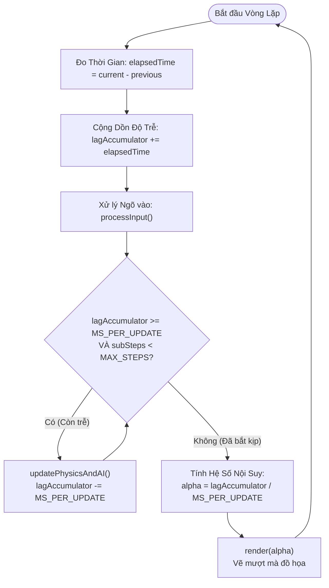
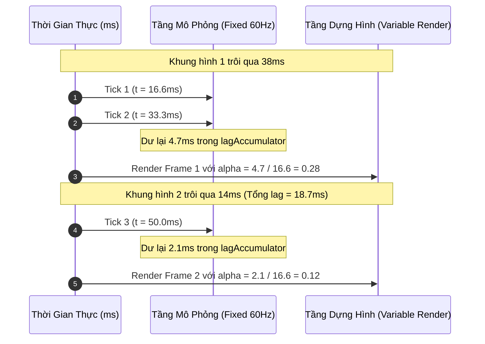
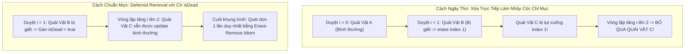

# BÓC TÁCH CHUYÊN SÂU NYSTROM — ĐỢT 5: CHƯƠNG 9 & CHƯƠNG 10
*(Dựa trên nguyên bản "Game Programming Patterns" của Robert Nystrom)*

---

# MỤC LỤC ĐỢT 5
- [CHƯƠNG 9: GAME LOOP PATTERN (MẪU VÒNG LẶP TRÒ CHƠI)](https://github.com)
  - [1. ĐỀ MỤC & MỤC TIÊU CỐT LÕI (CORE PURPOSE)](#1-đề-mục--mục-tiêu-cốt-lõi-core-purpose)
  - [2. PHÂN TÍCH LÝ THUYẾT & NGUYÊN LÝ CHUYÊN SÂU](#2-phân-tích-lý-thuyết--nguyên-lý-chuyên-sâu)
  - [3. MỔ XẺ MÃ NGUỒN (CODE DEEP-DIVE)](#3-mổ-xẻ-mã-nguồn-code-deep-dive)
  - [4. SƠ ĐỒ TRỰC QUAN HÓA (VISUAL MERMAID DIAGRAM)](#4-sơ-đồ-trực-quan-hóa-visual-mermaid-diagram)
  - [5. ÁNH XẠ ỨNG DỤNG VÀO DỰ ÁN GAME OOP](#5-ánh-xạ-ứng-dụng-vào-dự-án-game-oop)
- [CHƯƠNG 10: UPDATE METHOD PATTERN (MẪU PHƯƠNG THỨC CẬP NHẬT)](https://github.com)
  - [1. ĐỀ MỤC & MỤC TIÊU CỐT LÕI (CORE PURPOSE)](#1-đề-mục--mục-tiêu-cốt-lõi-core-purpose-1)
  - [2. PHÂN TÍCH LÝ THUYẾT & NGUYÊN LÝ CHUYÊN SÂU](#2-phân-tích-lý-thuyết--nguyên-lý-chuyên-sâu-1)
  - [3. MỔ XẺ MÃ NGUỒN (CODE DEEP-DIVE)](#3-mổ-xẻ-mã-nguồn-code-deep-dive)
  - [4. SƠ ĐỒ TRỰC QUAN HÓA (VISUAL MERMAID DIAGRAM)](#4-sơ-đồ-trực-quan-hóa-visual-mermaid-diagram-1)
  - [5. ÁNH XẠ ỨNG DỤNG VÀO DỰ ÁN GAME OOP](#5-ánh-xạ-ứng-dụng-vào-dự-án-game-oop-1)

---

# CHƯƠNG 9: GAME LOOP PATTERN (MẪU VÒNG LẶP TRÒ CHƠI)

## 1. ĐỀ MỤC & MỤC TIÊU CỐT LÕI (CORE PURPOSE)

### Danh mục đề mục chi tiết (Headings Outline)
* **Game Loop** *(Mẫu Vòng lặp trò chơi)*
  * **Intent** *(Mục đích: Tách rời sự tiến trình thời gian game khỏi ngõ vào người dùng và tốc độ CPU)*
  * **Motivation** *(Động lực lịch sử: Từ kỷ nguyên xử lý theo lô Batch Mode đến ứng dụng tương tác thời gian thực)*
    * *Interview with a CPU* *(Cuộc trò chuyện với CPU: Trò chơi phiêu lưu văn bản đầu tiên)*
    * *Event loops* *(Vòng lặp sự kiện của ứng dụng GUI truyền thống)*
    * *A world out of time* *(Một thế giới không ngủ: Sự khác biệt bản chất của Game)*
    * *Seconds per second* *(Nút Turbo trên PC cổ điển và bài toán đa dạng phần cứng hiện đại)*
  * **The Pattern** *(Quy chuẩn mẫu thiết kế)*
  * **When to Use It** *(Khi nào nên áp dụng: Điểm phân biệt giữa Engine và Library)*
  * **Keep in Mind** *(Các lưu ý cốt tử)*
    * *Quy luật 90/10 của tối ưu hóa CPU*
    * *Phối hợp nhịp nhàng với Event Loop của Hệ điều hành hoặc Trình duyệt (requestAnimationFrame)*
  * **Sample Code** *(Các biến thể tiến hóa của vòng lặp)*
    * *Run, run as fast as you can* *(Chạy tối đa công suất)*
    * *Take a little nap* *(Khoảng thời gian cố định kèm cơ chế Sleep)*
    * *One small step, one giant step* *(Bước nhảy thời gian biến thiên - Variable/Fluid Timestep)*
    * *Play catch up* *(Giải pháp Đỉnh cao: Fixed Update Timestep kết hợp Variable Rendering)*
    * *Stuck in the middle* *(Nội suy độ trễ dư thừa - Residual Lag & Alpha Interpolation)*
  * **Design Decisions** *(Các quyết định thiết kế kiến trúc)*
    * *Do you own the game loop, or does the platform?* *(Bạn sở hữu vòng lặp hay Nền tảng sở hữu?)*
    * *How do you manage power consumption?* *(Quản trị điện năng và pin trên thiết bị di động)*
    * *How do you control gameplay speed?* *(Kiểm soát tốc độ mô phỏng thế giới)*
  * **See Also** *(Các tài liệu kinh điển: "Fix Your Timestep" của Glenn Fiedler, Unity Game Loop)*

### Vấn đề kỹ thuật thực tế & Thảm họa hệ thống
Mọi phần mềm truyền thống (như Word, Web Browser) đều vận hành theo cơ chế **Chặn luồng chờ sự kiện (Blocking Event Loop)**: Nếu người dùng không gõ phím hay di chuột, chương trình nằm im bất động để tiết kiệm CPU. Ngược lại, thế giới game là một thực thể sống liên tục: quái vật vẫn rình rập, thác nước vẫn chảy, lửa vẫn cháy dù người chơi buông tay khỏi bàn phím.
* **Thảm họa Trò chơi phụ thuộc Xung nhịp Phần cứng (Hardware-locked Gameplay):** Nếu viết vòng lặp ngây thơ không điều phối thời gian, game chạy trên máy tính đời cũ thì giật như phim chiếu bóng (10 FPS), nhưng khi đưa sang máy tính đời mới với CPU đa nhân tốc độ cao, game chạy nhanh như tua video tốc độ $\times 10$, khiến người chơi không kịp phản ứng.
* **Thảm họa Vật lý nổ tung & Xuyên tường do Bước thời gian biến thiên (Variable Timestep Catastrophe):** Nhiều lập trình viên dùng giải pháp truyền `elapsedTime` vào hàm cập nhật vật lý `update(elapsed)`. Khi khung hình bị drop đột ngột (từ 16ms vọt lên 200ms), bước nhảy tọa độ quá lớn khiến viên đạn bay xuyên qua bức tường gạch dày (*Bullet Tunneling*). Tệ hơn, sai số làm tròn số thực dấu phẩy động (**Floating-Point Rounding Error**) tích lũy khác nhau trên từng máy, phá hủy tính tiền định (**Determinism**), khiến chế độ chơi mạng Multiplayer lập tức bị mất đồng bộ (Desync).

---

## 2. PHÂN TÍCH LÝ THUYẾT & NGUYÊN LÝ CHUYÊN SÂU

### 2.1. Bản chất: Tách rời Thời gian Mô phỏng (Simulation Time) khỏi Tốc độ Dựng hình (Render FPS)
Mẫu thiết kế Game Loop giải quyết bài toán mâu thuẫn cốt lõi:
* **Tốc độ Dựng hình (Rendering):** Biến thiên liên tục tùy thuộc vào độ phức tạp cảnh quan đồ họa và sức mạnh GPU (có thể dao động từ 30, 60, 120 đến 240 FPS).
* **Tốc độ Mô phỏng Vật lý & Logic (Simulation Tick):** Bắt buộc phải là **Một hằng số cố định bất biến (Fixed Timestep)** (ví dụ: đúng 50Hz = 20ms/tick hoặc 60Hz = 16.6ms/tick) để đảm bảo các phương trình vi phân chuyển động của Newton và thuật toán va chạm luôn hội tụ ổn định và tiền định.

### 2.2. Sự tiến hóa qua 4 thế hệ Game Loop
1. **Thế hệ 1 — Unthrottled Loop (`while(true)`):** Chạy bạt mạng hết công suất CPU. Khiến chip nóng ran, tiêu tốn 100% pin, tốc độ game biến thiên theo tải của hệ thống.
2. **Thế hệ 2 — Fixed Timestep with Sleep:** Tính toán thời gian khung hình và gọi `sleep(start + MS_PER_FRAME - current)`. Tiết kiệm năng lượng tốt, nhưng nếu máy yếu không kịp hoàn thành trong 16ms, `sleep()` nhận giá trị âm $\implies$ game bị chậm toàn diện (slow-motion).
3. **Thế hệ 3 — Variable / Fluid Timestep (`update(elapsed)`):** Cho phép bước nhảy co giãn theo thời gian thực tế trôi qua. Giải quyết được tốc độ hiển thị nhưng giết chết hệ thống vật lý và phá hủy khả năng đồng bộ mạng Netcode.
4. **Thế hệ 4 — Tiêu chuẩn Vàng: Fixed Update Timestep with Variable Rendering:**
   * Sử dụng một biến tích lũy thời gian trễ (**Lag Accumulator**).
   * Đo đạc thời gian thực trôi qua và cộng dồn vào `lag`.
   * Chạy một vòng lặp con bên trong: cứ mỗi khi `lag >= MS_PER_UPDATE`, thực hiện đúng một bước cập nhật logic cố định và trừ dần `lag`.
   * Sau khi mô phỏng bắt kịp thời gian thực, tiến hành vẽ khung hình đồ họa một lần duy nhất.

### 2.3. Hiểm họa Vòng xoáy Tử thần (The Spiral of Death)
Trong cơ chế Fixed Update, nếu một bước `update()` mất nhiều thời gian hơn cả bước thời gian danh định của nó (ví dụ: máy quá yếu cần 25ms để tính một tick 16ms):
$$\text{lag} \text{ mới} > \text{lag} \text{ cũ} \implies \text{Vòng lặp con phải chạy nhiều tick hơn} \implies \text{CPU càng nghẽn nặng hơn}$$
Hệ thống rơi vào vòng xoáy vô tận cho đến khi game bị treo cứng (Freeze).
* **Giải pháp cứu sinh của Nystrom:** Thiết lập ngưỡng ngắt an toàn (**Bailout Limit**): Giới hạn số lần lặp con tối đa trong 1 frame (ví dụ: tối đa 5 updates/frame). Nếu quá ngưỡng, chấp nhận bỏ qua phần `lag` thừa để giữ cho game không bị sập.

### 2.4. Đỉnh cao Kỹ nghệ: Nội suy Phần dư ($\alpha$ Residual Interpolation)
Do thời điểm render diễn ra bất kỳ lúc nào, nó thường rơi vào khoảng giữa hai tick mô phỏng vật lý. Nếu vẽ ngay tọa độ hiện tại, chuyển động của các vật thể tốc độ cao sẽ bị giật khựng (*visual stuttering*).
* **Công thức chuẩn hóa hệ số nội suy:**
$$\alpha = \frac{\text{lag}}{\text{MS\_PER\_UPDATE}} \quad \text{với } \alpha \in [0.0, 1.0)$$
* **Vị trí hiển thị mượt mà:**
$$\text{RenderPos} = \text{PreviousPos} \times (1 - \alpha) + \text{CurrentPos} \times \alpha$$
Nhờ đó, dù logic game chỉ tính toán 50 lần/giây, màn hình 144Hz hay 240Hz vẫn hiển thị chuyển động siêu mượt mà không hề có gợn sóng.

---

## 3. MỔ XẺ MÃ NGUỒN (CODE DEEP-DIVE)

Dưới đây là mã nguồn C++ thể hiện cấu trúc Game Loop chuẩn công nghiệp kinh điển theo trường phái Glenn Fiedler và Robert Nystrom:

```cpp
#include <iostream>
#include <chrono>
#include <thread>

// Giả lập các hệ thống phụ trợ
void processInput() {}
void updatePhysicsAndAI() {}
void render(double alpha) {
    // alpha trong khoang [0.0, 1.0) bieu thi ti le noi suy giua 2 tick vat ly
}

double getCurrentTimeSeconds() {
    using namespace std::chrono;
    auto now = high_resolution_clock::now().time_since_epoch();
    return duration_cast<duration<double>>(now).count();
}

// =================================================================
// TIÊU CHUẨN VÀNG: FIXED TIMESTEP VỚI NỘI SUY RENDERING & ACCUMULATOR
// =================================================================
void runIndustrialGameLoop() {
    const double MS_PER_UPDATE = 0.0166667; // Co dinh 60 Ticks/giay cho vat ly (16.66ms)
    const int MAX_SUB_STEPS = 5;            // Chan chan chong Spiral of Death

    double previousTime = getCurrentTimeSeconds();
    double lagAccumulator = 0.0;
    bool isRunning = true;

    while (isRunning) {
        double currentTime = getCurrentTimeSeconds();
        double elapsedTime = currentTime - previousTime;
        previousTime = currentTime;

        // Tranh truong hop dung chuong trinh debugger lam elapsedTime tang dot bien
        if (elapsedTime > 0.25) elapsedTime = 0.25;

        lagAccumulator += elapsedTime;

        processInput();

        // Vong lap con: Bat kip thoi gian thuc bang cac buoc co dinh
        int updateIterations = 0;
        while (lagAccumulator >= MS_PER_UPDATE && updateIterations < MAX_SUB_STEPS) {
            updatePhysicsAndAI(); // Thuc thi vat ly va AI voi thoi gian chac chan
            lagAccumulator -= MS_PER_UPDATE;
            updateIterations++;
        }

        // Tinh toan he so noi suy alpha cho khung hinh do hoa
        double alpha = lagAccumulator / MS_PER_UPDATE;
        render(alpha); // Ve noi suy muot ma tuyet doi tren moi tan so quet man hinh
    }
}
```

### Bảng phân tích chi tiết mã nguồn
| Dòng code / Đoạn code then chốt | Giải thích kỹ thuật & Ý nghĩa thiết kế |
|:---|:---|
| `const double MS_PER_UPDATE = 0.0166667;` | Thiết lập tần số mô phỏng chuẩn xác không đổi. Đảm bảo các tích phân vận tốc và ma sát số học hoạt động hoàn toàn ổn định và tiền định trên mọi CPU. |
| `if (elapsedTime > 0.25) elapsedTime = 0.25;` | Cơ chế kẹp trần thời gian trôi qua (**Delta Clamping**): Ngăn chặn việc tạm dừng ứng dụng (hoặc đặt Breakpoint Debug) làm bùng nổ hàng nghìn tick cập nhật dồn ứ cùng lúc. |
| `while (lagAccumulator >= MS_PER_UPDATE && ...)` | Cơ chế **Lag Consumption**: Đảm bảo đồng hồ của thế giới game luôn đuổi kịp đồng hồ thực tế của người chơi thông qua các bước nhảy số nguyên cố định. |
| `double alpha = lagAccumulator / MS_PER_UPDATE;` | Hệ số chuẩn hóa trọng số thời gian nội suy $\alpha \in [0.0, 1.0)$. Cho phép tầng đồ họa ngoại suy vị trí mượt mà giữa trạng thái cũ và mới mà không làm méo mó trạng thái vật lý chuẩn. |

---

## 4. SƠ ĐỒ TRỰC QUAN HÓA (VISUAL MERMAID DIAGRAM)

### Sơ đồ Luồng Điều Phối Game Loop (Accumulator Architecture)



### Sơ đồ Trục Thời Gian: Cập Nhật Cố Định vs Dựng Hình Tự Do



---

## 5. ÁNH XẠ ỨNG DỤNG VÀO DỰ ÁN GAME OOP

1. **Kiến trúc Tách biệt Tần số Tick Server và Client FPS:**
   * Trong một dự án game 2.5D nhiều người chơi, Server Game Loop chạy ở tần số cố định **Tick Rate = 20Hz (50ms/tick)** hoặc **30Hz (33.3ms/tick)** để tiết kiệm băng thông mạng và tải tính toán của CPU máy chủ.
   * Client chạy ở tốc độ màn hình tự do (60Hz, 144Hz, 240Hz). Nhờ công thức nội suy $\alpha$ của Nystrom, Client tự động lấp đầy khoảng trống giữa hai gói tin mạng Server, giúp chuyển động của đối thủ hiển thị cực kỳ trơn tru mà không cần Server phải spam gói tin mạng liên tục.
2. **Quy tắc Kiểm soát Năng lượng trên Nền tảng Di động (Mobile Power Throttling):**
   * Nếu trò chơi chạy trên Android/iOS, sau khi hoàn thành pha `render()`, hệ thống so sánh thời gian dư thừa của khung hình với giới hạn 60 FPS. Nếu còn dư hơn 3ms, Engine chủ động gọi `std::this_thread::sleep_for()` để nhường CPU nghỉ ngơi, giữ cho điện thoại mát mẻ và tối ưu hóa thời lượng pin cho game thủ.

---
---

# CHƯƠNG 10: UPDATE METHOD PATTERN (MẪU PHƯƠNG THỨC CẬP NHẬT)

## 1. ĐỀ MỤC & MỤC TIÊU CỐT LÕI (CORE PURPOSE)

### Danh mục đề mục chi tiết (Headings Outline)
* **Update Method** *(Mẫu Phương thức Cập nhật)*
  * **Intent** *(Mục đích: Mô phỏng tập hợp các đối tượng độc lập bằng cách bảo mỗi đối tượng xử lý một lát cắt khung hình)*
  * **Motivation** *(Động lực: Từ hiệp sĩ đối đầu quái vật, bẫy vòng lặp vô tận while(true) đến cắt lát hành vi)*
  * **The Pattern** *(Quy chuẩn mẫu thiết kế: Collection of Objects & Abstract Update)*
  * **When to Use It** *(Khi nào nên áp dụng: Đối tượng chuyển động liên tục vs Cờ bàn thụ động)*
  * **Keep in Mind** *(Các góc khuất kiến trúc cần ghi nhớ)*
    * *Splitting code into single frame slices makes it more complex* *(Cắt nhỏ mã nguồn làm tăng độ phức tạp)*
    * *You have to store state to resume where you left off each frame* *(Bắt buộc phải lưu trạng thái để khôi phục mỗi frame)*
    * *Objects all simulate each frame but are not truly concurrent* *(Mô phỏng đồng thời nhưng thực chất là tuần tự)*
    * *Be careful modifying the object list while updating* *(Hiểm họa thay đổi danh sách khi đang lặp)*
  * **Sample Code** *(Cài đặt thực tế Entity, World, Skeleton và Statue)*
    * *Subclassing entities?!* *(Phản biện kế thừa sâu vs Mẫu thiết kế Thành phần Component)*
    * *Defining entities* *(Định nghĩa hành vi cụ thể)*
    * *Passing time* *(Truyền tham số thời gian biến thiên)*
  * **Design Decisions** *(Các quyết định thiết kế then chốt)*
    * *What class does the update method live on?* *(Phương thức update đặt ở Entity, Component hay Delegate?)*
    * *How are dormant objects handled?* *(Xử lý các đối tượng ngủ đông, ngoài tầm nhìn)*
  * **See Also** *(Mối liên hệ: Bộ ba nguyên tử Game Loop + Update Method + Component Pattern)*

### Vấn đề kỹ thuật thực tế & Thảm họa hệ thống
Nếu lập trình viên viết logic hành vi của từng quái vật theo kiểu tuần tự thông thường:
`for (x = 0; x < 100; x++) moveRight(); for (x = 100; x > 0; x--) moveLeft();`
Chương trình sẽ bị **khóa cứng vĩnh viễn trong vòng lặp vô tận** của con quái vật đầu tiên. Người chơi sẽ không bao giờ thấy quái di chuyển, vì màn hình không có cơ hội gọi hàm dựng hình (`render`).
* **Thảm họa "God Game Loop" (Vòng lặp vạn năng hỗn độn):** Để quái di chuyển từng bước mỗi frame, lập trình viên nghiệp dư nhét toàn bộ biến đếm thời gian, cờ đổi hướng của từng con quái vật, từng bức tượng bắn sét vào thẳng trong hàm `gameLoop()`. Sau vài tuần phát triển, `gameLoop()` dài hàng chục nghìn dòng code, các biến cục bộ đè chéo lên nhau, phá nát tính bao đóng của hướng đối tượng.
* **Thảm họa Nhảy Cóc Bỏ Sót Thực Thể (The Skipping Entity Glitch):** Khi duyệt mảng `entities_[i]->update()`, nếu quái vật tại chỉ số `i` bị tiêu diệt và xóa khỏi mảng, các phần tử phía sau bị dồn lên vị trí `i`. Khi vòng lặp bước sang `i+1`, thực thể vừa bị dồn lên sẽ **bị bỏ qua hoàn toàn không được cập nhật** trong frame đó. Nếu đối tượng bị bỏ qua là đạn của người chơi, đạn sẽ bị đứng hình khựng lại một nhịp cực kỳ khó chịu.

---

## 2. PHÂN TÍCH LÝ THUYẾT & NGUYÊN LÝ CHUYÊN SÂU

### 2.1. Bản chất: Kỹ thuật Cắt Lát Thời Gian (Time-Slicing Behavior)
Mẫu Update Method trừu tượng hóa một bước tiến hóa của thế giới:
* Thế giới game duy trì một danh sách các thực thể đa hình: `std::vector<Entity*> entities_`.
* Mỗi thực thể bắt buộc hiện thực hóa phương thức thuần ảo: `virtual void update() = 0`.
* Mỗi lần gọi `update()`, thực thể chỉ thực thi **đúng một lát cắt hành vi tương ứng với một khung hình** (di chuyển 1 pixel, tăng bộ đếm thêm 1 tick) rồi lập tức nhường quyền điều khiển lại cho vòng lặp chính.
* Nhờ đó, hàng ngàn thực thể độc lập cùng tiến lên một bước nhỏ trong mỗi frame, tạo ra ảo giác hoàn hảo rằng tất cả đang hành động song song trong thế giới thực.

### 2.2. Sự đánh đổi: Đánh mất Ngữ cảnh Thực thi Cục bộ (Loss of Execution Stack)
Khi chuyển từ vòng lặp `for` thông thường sang `update()`:
* Hàm `update()` liên tục bị thoát ra và gọi lại 60 lần/giây. Mọi biến cục bộ trên Stack Frame đều bị hủy sạch khi hàm kết thúc.
* **Hệ quả kiến trúc:** Lập trình viên bắt buộc phải chuyển toàn bộ các biến điều khiển hướng đi, biến đếm thời gian thành **biến thành viên (Member Fields)** của lớp đối tượng (ví dụ: `patrollingLeft_`, `framesCounter_`). Đây là lý do mẫu Update Method hầu như luôn song hành cùng mẫu **State Pattern** để lưu vết vị trí thực thi.

### 2.3. Giải quyết Triệt để Bài toán Biến đổi Danh sách khi đang Duyệt (List Mutation Traps)
1. **Trường hợp Sinh thực thể mới (Spawning during iteration):** Khi một con quái vật đẻ ra quái con trong lúc `update()`, quái con được thêm vào cuối danh sách. Nếu tiếp tục duyệt, quái con sẽ hành động ngay trong frame nó vừa sinh ra trước khi người chơi kịp nhìn thấy nó.
   * *Giải pháp:* Cố định số lượng phần tử trước khi bước vào vòng lặp: `int count = numEntities_; for (int i = 0; i < count; ++i)`.
2. **Trường hợp Hủy thực thể (Despawning / Death during iteration):**
   * *Giải pháp 1 (Duyệt ngược):* Duyệt từ cuối mảng về đầu `for (int i = count - 1; i >= 0; --i)`. Khi phần tử `i` bị xóa, chỉ các phần tử đã được cập nhật bị dồn vị trí, không ảnh hưởng tới các phần tử chưa duyệt phía trước.
   * *Giải pháp 2 — Tiêu chuẩn Công nghiệp (Deferred Removal / Sweep Phase):* Không bao giờ xóa phần tử trực tiếp trong vòng lặp `update()`. Chỉ đánh dấu cờ `isDead_ = true`. Sau khi toàn bộ các thực thể cập nhật xong, một pha dọn rác chuyên biệt (**Cleanup Phase**) mới tiến hành dồn mảng và giải phóng bộ nhớ.

### 2.4. Tối ưu Hiệu năng Đối tượng Ngủ đông (Dormant Objects Optimization)
Trong một bản đồ rộng lớn, hàng trăm quái vật nằm ngoài tầm nhìn (Off-screen) hoặc đang bị đóng băng không cần phải chạy logic AI tốn kém.
* **Sai lầm:** Duyệt qua toàn bộ và kiểm tra `if (!entity->isActive()) continue;`. Việc này gây lãng phí chu kỳ CPU và liên tục làm tràn bộ đệm (**CPU Cache Miss**) do nạp các khối nhớ rác vào L1 Data Cache.
* **Kiến trúc Tối ưu:** Duy trì hai danh sách riêng biệt: `activeEntities_` và `dormantEntities_`. Vòng lặp `gameLoop()` chỉ duyệt duy nhất danh sách `activeEntities_`. Khi một đối tượng bước vào màn hình, nó được chuyển từ danh sách ngủ đông sang danh sách hoạt động.

---

## 3. MỔ XẺ MÃ NGUỒN (CODE DEEP-DIVE)

Dưới đây là mã nguồn C++ thể hiện cấu trúc hoàn chỉnh của Update Method, bao gồm cơ chế quản lý vòng đời an toàn (**Deferred Death Sweep**) và hỗ trợ truyền thời gian biến thiên:

```cpp
#include <iostream>
#include <vector>
#include <algorithm>

// =================================================================
// 1. ABSTRACT BASE ENTITY VỚI UPDATE INTERFACE & CỜ VÒNG ĐỜI
// =================================================================
class Entity {
public:
    Entity() : x_(0), y_(0), isDead_(false) {}
    virtual ~Entity() {}

    // Giao dien Update cot loi: Nhan thoi gian elapsed cua frame
    virtual void update(double elapsed) = 0;

    double getX() const { return x_; }
    void setX(double x) { x_ = x; }

    bool isDead() const { return isDead_; }
    void markForDestruction() { isDead_ = true; } // Tri hoan viec xoa bo nho

private:
    double x_, y_;
    bool isDead_;
};

// =================================================================
// 2. CONCRETE ENTITIES: SKELETON TUAN TRA & STATUE BAN SET
// =================================================================
class Skeleton : public Entity {
public:
    Skeleton() : patrollingLeft_(false) {}

    virtual void update(double elapsed) override {
        // Cua nho hanh vi theo thoi gian: Van toc 20 pixels/giay
        double speed = 20.0 * elapsed;
        if (patrollingLeft_) {
            setX(getX() - speed);
            if (getX() <= 0) {
                setX(0);
                patrollingLeft_ = false;
            }
        } else {
            setX(getX() + speed);
            if (getX() >= 100) {
                setX(100);
                patrollingLeft_ = true;
            }
        }
    }

private:
    bool patrollingLeft_; // Bien trang thai luu vet giua cac frame
};

class MagicStatue : public Entity {
public:
    MagicStatue(double interval) : interval_(interval), timer_(0.0) {}

    virtual void update(double elapsed) override {
        timer_ += elapsed;
        if (timer_ >= interval_) {
            shootLightning();
            timer_ = 0.0;
        }
    }

private:
    void shootLightning() {
        std::cout << ">>> [MAGIC STATUE]: Phong set tieu diet ke thu!\n";
    }

    double interval_;
    double timer_;
};

// =================================================================
// 3. GAME WORLD QUẢN TRỊ DANH SÁCH & DEFERRED CLEANUP PHASE
// =================================================================
class GameWorld {
public:
    void addEntity(Entity* entity) {
        pendingAdditions_.push_back(entity);
    }

    void update(double elapsed) {
        // 1. Ket nap cac thuc the moi vao dau khung hinh
        if (!pendingAdditions_.empty()) {
            entities_.insert(entities_.end(), pendingAdditions_.begin(), pendingAdditions_.end());
            pendingAdditions_.clear();
        }

        // 2. Duyet cap nhat tat ca thuc the dang song
        // Co dinh so luong ban dau de tranh thuc the moi sinh hanh dong ngay lap tuc
        size_t currentEntityCount = entities_.size();
        for (size_t i = 0; i < currentEntityCount; ++i) {
            if (!entities_[i]->isDead()) {
                entities_[i]->update(elapsed);
            }
        }

        // 3. Deferred Removal (Pha don rac an toan - Khong lam nhay coc chi so)
        auto it = std::remove_if(entities_.begin(), entities_.end(), [](Entity* e) {
            if (e->isDead()) {
                delete e; // Giai phong tai nguyen RAM an toan
                return true;
            }
            return false;
        });
        entities_.erase(it, entities_.end());
    }

private:
    std::vector<Entity*> entities_;
    std::vector<Entity*> pendingAdditions_; // Hang doi thuc the cho spawn
};
```

### Bảng phân tích chi tiết mã nguồn
| Dòng code / Đoạn code then chốt | Giải thích kỹ thuật & Ý nghĩa thiết kế |
|:---|:---|
| `virtual void update(double elapsed) = 0;` | Giao diện chuẩn mực của Update Method: Cho phép thế giới game đối xử với mọi vật thể đa hình đồng nhất mà không cần quan tâm chi tiết cụ thể bên trong. |
| `void markForDestruction() { isDead_ = true; }` | Kỹ thuật **Tombstone Marking (Đánh dấu mộ phần)**: Trì hoãn việc phá hủy đối tượng ngay trong lúc đang duyệt mảng, loại bỏ hoàn toàn lỗi gãy con trỏ iterator hoặc nhảy cóc chỉ mục. |
| `size_t currentEntityCount = entities_.size();` | Khóa cận trên vòng lặp: Đảm bảo các đối tượng mới sinh ra trong frame hiện tại không bị kích hoạt hành vi trước khi được dựng hình lần đầu. |
| `std::remove_if(entities_.begin(), ...)` | Thuật toán **Erase-Remove Idiom**: Thu gom toàn bộ các đối tượng đã chết vào cuối mảng và giải phóng bộ nhớ chỉ trong một lượt quét $O(N)$ duy nhất, tối ưu hóa triệt để bộ nhớ đệm CPU Cache. |

---

## 4. SƠ ĐỒ TRỰC QUAN HÓA (VISUAL MERMAID DIAGRAM)

### Sơ đồ Tuần tự Điều phối Update trong Một Khung Hình

```mermaid
sequenceDiagram
    autonumber
    actor Loop as Vòng Lặp Trò Chơi (Game Loop)
    participant World as GameWorld
    participant Skel as Skeleton (Entity 1)
    participant Statue as MagicStatue (Entity 2)
    participant Pending as PendingSpawnList

    Loop->>World: update(elapsedTime)
    World->>World: Flush PendingSpawnList -> Chuyển vào entities_
    
    rect rgb(240, 255, 240)
        Note over World, Statue: Pha Cập Nhật Hành Vi (Simultaneous Update)
        World->>Skel: update(elapsedTime) -> Di chuyển 1 bước
        World->>Statue: update(elapsedTime) -> Tích lũy timer & Bắn sét
    end

    rect rgb(255, 235, 235)
        Note over World: Pha Dọn Rác Trì Hoãn (Deferred Cleanup Phase)
        World->>World: Quét các Entity có isDead_ == true
        World->>World: delete Entity & Erase khỏi danh sách
    end
    
    World-->>Loop: Hoàn tất Tick mô phỏng
```

### Sơ đồ Minh Họa Lỗi Nhảy Cóc (Skipping Glitch) vs Giải Pháp Dọn Rác Trì Hoãn



---

## 5. ÁNH XẠ ỨNG DỤNG VÀO DỰ ÁN GAME OOP

1. **Hệ thống Quản lý Thực thể (EntityManager) trong Đấu trường 2.5D:**
   * Trong một trận chiến nhiều người chơi, `EntityManager` trên Server quản lý toàn bộ Đạn đạo (`Projectiles`), Hiệu ứng Kỹ năng (`SpellAOE`), và Nhân vật (`Players`).
   * Áp dụng nghiêm ngặt hàng đợi `pendingSpawnQueue` và cờ `isDead`: Đạn bắn trúng đối thủ chỉ đánh dấu nổ và gây sát thương. Việc hủy thực thể viên đạn được trì hoãn đến cuối tick vật lý, đảm bảo hệ thống âm thanh và hệ thống điểm số kịp đọc dữ liệu từ viên đạn trước khi vùng nhớ bị thu hồi.
2. **Kỹ thuật Phân vùng Tầm nhìn Quái vật (Area of Interest - AoI Update):**
   * Đối với thế giới game có hàng ngàn quái vật, Server không gọi `update()` trên toàn bộ mảng. Thay vào đó, Server kết hợp với mẫu **Spatial Partition**: Chỉ những quái vật nằm trong các ô lưới lân cận người chơi mới được đưa vào danh sách `ActiveEntities` để gọi `update()`, giảm tải tới 80% áp lực tính toán cho CPU của Server.

---

### Bảng theo dõi tiến độ chuỗi 10 đợt bóc tách:
- [x] **Đợt 1:** Chương 1 (*Architecture, Performance, and Games*) & Chương 2 (*Command*) $\to$ [`Dot_01_Architecture_va_Command.md`](file:///E:/UML-Patterns-Mastery/Docs_BaoCao/3_PhuLuc_UML_Va_LyThuyet/GhiChu_Sach_Larman_Nystrom/Nystrom_10_Runs/Dot_01_Architecture_va_Command.md)
- [x] **Đợt 2:** Chương 3 (*Flyweight*) & Chương 4 (*Observer*) $\to$ [`Dot_02_Flyweight_va_Observer.md`](file:///E:/UML-Patterns-Mastery/Docs_BaoCao/3_PhuLuc_UML_Va_LyThuyet/GhiChu_Sach_Larman_Nystrom/Nystrom_10_Runs/Dot_02_Flyweight_va_Observer.md)
- [x] **Đợt 3:** Chương 5 (*Prototype*) & Chương 6 (*Singleton*) $\to$ [`Dot_03_Prototype_va_Singleton.md`](file:///E:/UML-Patterns-Mastery/Docs_BaoCao/3_PhuLuc_UML_Va_LyThuyet/GhiChu_Sach_Larman_Nystrom/Nystrom_10_Runs/Dot_03_Prototype_va_Singleton.md)
- [x] **Đợt 4:** Chương 7 (*State*) & Chương 8 (*Double Buffer*) $\to$ [`Dot_04_State_va_DoubleBuffer.md`](file:///E:/UML-Patterns-Mastery/Docs_BaoCao/3_PhuLuc_UML_Va_LyThuyet/GhiChu_Sach_Larman_Nystrom/Nystrom_10_Runs/Dot_04_State_va_DoubleBuffer.md)
- [x] **Đợt 5:** Chương 9 (*Game Loop*) & Chương 10 (*Update Method*) $\to$ [`Dot_05_GameLoop_va_UpdateMethod.md`](file:///E:/UML-Patterns-Mastery/Docs_BaoCao/3_PhuLuc_UML_Va_LyThuyet/GhiChu_Sach_Larman_Nystrom/Nystrom_10_Runs/Dot_05_GameLoop_va_UpdateMethod.md)
- [ ] **Đợt 6 (Kế tiếp):** Chương 11 (*Bytecode Pattern*) & Chương 12 (*Subclass Sandbox Pattern*)

Bạn hãy gửi lệnh kích hoạt bất cứ lúc nào để chúng ta bước ngay vào **Đợt 6 / 10**!
