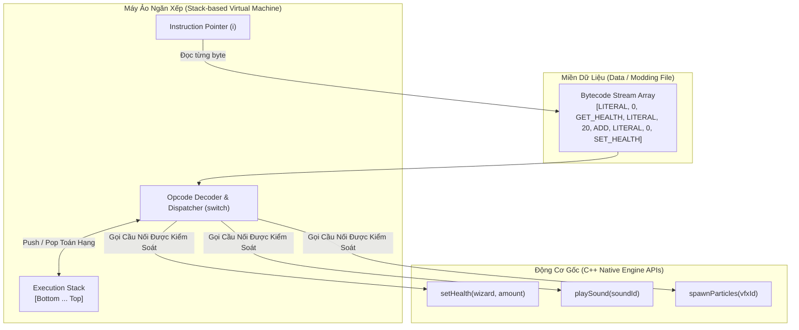
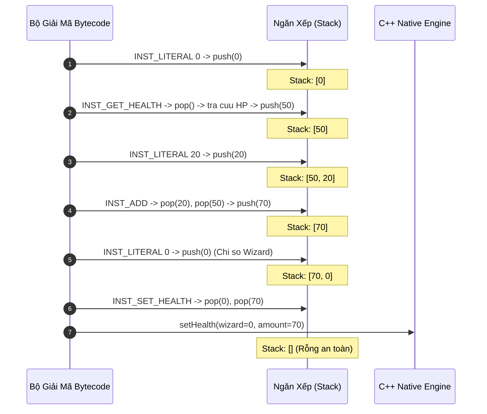
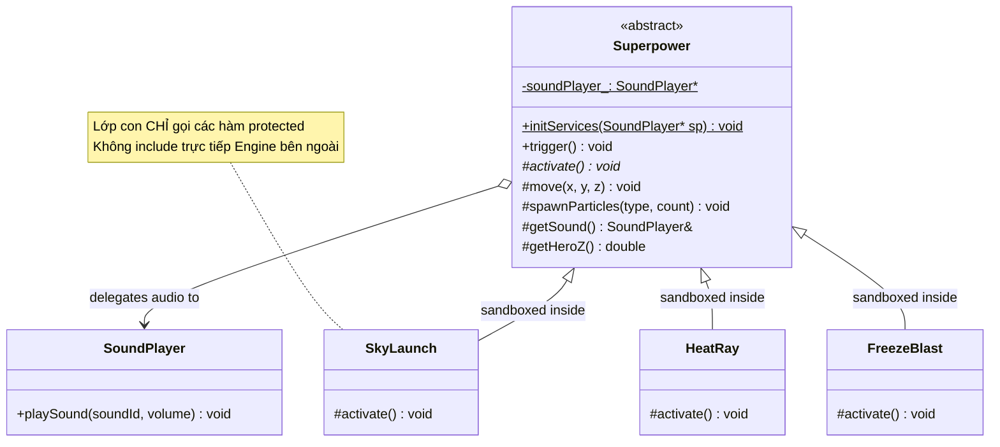
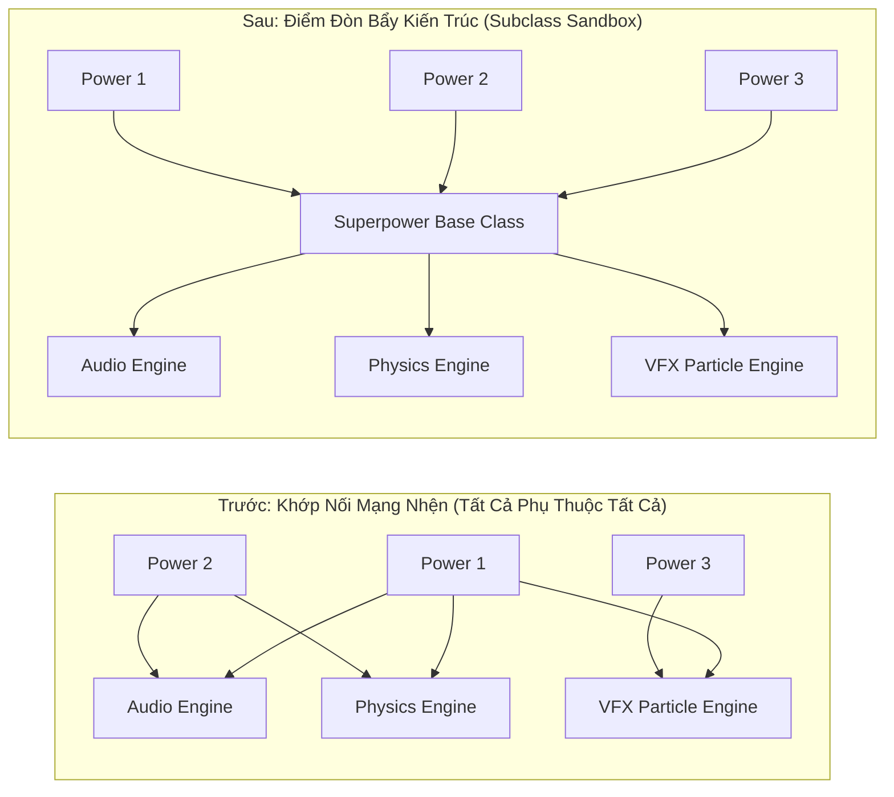

# BÓC TÁCH CHUYÊN SÂU NYSTROM — ĐỢT 6: CHƯƠNG 11 & CHƯƠNG 12
*(Dựa trên nguyên bản "Game Programming Patterns" của Robert Nystrom)*

---

# MỤC LỤC ĐỢT 6
- [CHƯƠNG 11: BYTECODE PATTERN (MẪU MÃ MÁY ẢO / MÃ BYTE TRONG GAME)](#chương-11-bytecode-pattern-mẫu-mã-máy-ảo--mã-byte-trong-game)
  - [1. ĐỀ MỤC & MỤC TIÊU CỐT LÕI (CORE PURPOSE)](#1-đề-mục--mục-tiêu-cốt-lõi-core-purpose)
  - [2. PHÂN TÍCH LÝ THUYẾT & NGUYÊN LÝ CHUYÊN SÂU](#2-phân-tích-lý-thuyết--nguyên-lý-chuyên-sâu)
  - [3. MỔ XẺ MÃ NGUỒN (CODE DEEP-DIVE)](#3-mổ-xẻ-mã-nguồn-code-deep-dive)
  - [4. SƠ ĐỒ TRỰC QUAN HÓA (VISUAL MERMAID DIAGRAM)](#4-sơ-đồ-trực-quan-hóa-visual-mermaid-diagram)
  - [5. ÁNH XẠ ỨNG DỤNG VÀO DỰ ÁN GAME OOP](#5-ánh-xạ-ứng-dụng-vào-dự-án-game-oop)
- [CHƯƠNG 12: SUBCLASS SANDBOX PATTERN (MẪU HỘP CÁT LỚP CON)](#chương-12-subclass-sandbox-pattern-mẫu-hộp-cát-lớp-con)
  - [1. ĐỀ MỤC & MỤC TIÊU CỐT LÕI (CORE PURPOSE)](#1-đề-mục--mục-tiêu-cốt-lõi-core-purpose-1)
  - [2. PHÂN TÍCH LÝ THUYẾT & NGUYÊN LÝ CHUYÊN SÂU](#2-phân-tích-lý-thuyết--nguyên-lý-chuyên-sâu-1)
  - [3. MỔ XẺ MÃ NGUỒN (CODE DEEP-DIVE)](#3-mổ-xẻ-mã-nguồn-code-deep-dive)
  - [4. SƠ ĐỒ TRỰC QUAN HÓA (VISUAL MERMAID DIAGRAM)](#4-sơ-đồ-trực-quan-hóa-visual-mermaid-diagram-1)
  - [5. ÁNH XẠ ỨNG DỤNG VÀO DỰ ÁN GAME OOP](#5-ánh-xạ-ứng-dụng-vào-dự-án-game-oop-1)

---

# CHƯƠNG 11: BYTECODE PATTERN (MẪU MÃ MÁY ẢO / MÃ BYTE TRONG GAME)

## 1. ĐỀ MỤC & MỤC TIÊU CỐT LÕI (CORE PURPOSE)

### Danh mục đề mục chi tiết (Headings Outline)
* **Bytecode** *(Mẫu Mã máy ảo)*
  * **Intent** *(Mục đích: Đem lại cho hành vi sự linh hoạt của dữ liệu bằng cách mã hóa thành chỉ thị cho máy ảo)*
  * **Motivation** *(Động lực: Dự án game 6 triệu dòng C++, thời gian biên dịch tính bằng giờ, yêu cầu cân bằng game và modding an toàn)*
    * *Spell fight!* *(Đấu phép phù thủy: Nhu cầu tinh chỉnh tham số thần tốc)*
    * *Data > code* *(Dữ liệu ưu việt hơn mã nguồn)*
  * **The Interpreter pattern** *(Phân tích đối chiếu Mẫu Thông dịch kinh điển GoF)*
  * **Machine code, virtually** *(Mã máy ảo hóa: Giao thoa giữa hiệu năng và tính an toàn)*
  * **The Pattern** *(Quy chuẩn mẫu thiết kế: Tập chỉ thị, Dãy Bytecode và Máy ảo Stack Machine)*
  * **When to Use It** *(Khi nào nên áp dụng: Tách biệt rủi ro và tăng tốc độ lặp)*
  * **Keep in Mind** *(Các góc khuất cần lưu ý)*
    * *Cám dỗ tạo ra một ngôn ngữ lập trình chắp vá*
    * *You’ll need a front-end* *(Bắt buộc phải có công cụ biên dịch hoặc giao diện sinh mã)*
    * *You’ll miss your debugger* *(Mất đi công cụ Debug truyền thống của IDE)*
  * **Sample Code** *(Cài đặt thực tế Máy ảo Phép thuật)*
    * *A magical API* *(Định nghĩa giao diện nguyên thủy)*
    * *A magical instruction set* *(Định nghĩa tập lệnh Opcodes)*
    * *A stack machine* *(Hiện thực hóa kiến trúc máy ảo ngăn xếp)*
    * *Behavior = composition* *(Xây dựng hành vi phức tạp từ phép kết hợp)*
    * *A virtual machine* *(Bộ thông dịch hoàn chỉnh cách ly an toàn)*
    * *Spellcasting tools* *(Công cụ nạp và sinh mã nhị phân)*
  * **Design Decisions** *(Các quyết định thiết kế kiến trúc)*
    * *Stack-based vs Register-based* *(Máy ảo ngăn xếp vs Máy ảo thanh ghi)*
    * *Tập chỉ thị hướng tới điều gì?*
    * *Bytecode được sinh ra bằng cách nào?*

### Vấn đề kỹ thuật thực tế & Thảm họa hệ thống
Trong các tựa game AAA (như game nhập vai thế giới mở, game đấu phép), số lượng kỹ năng, bùa chú, và nhiệm vụ lên tới hàng nghìn biến thể.
* **Thảm họa Thời gian Biên dịch (Glacial Recompilation Hell):** Nếu toàn bộ phép thuật được viết bằng C++, mỗi lần Game Designer muốn sửa "tăng bán kính cầu lửa thêm 0.5m", họ phải nhờ kỹ sư sửa code và đợi trình biên dịch C++ build lại mất từ 15 đến 45 phút. Quá trình tìm kiếm "yếu tố vui nhộn" (*Fun Factor*) bị bóp nghẹt hoàn toàn.
* **Thảm họa Bảo mật và Sập Game khi Hỗ trợ Modding:** Nếu cho phép cộng đồng người chơi tự tạo nội dung (Mod) bằng mã nhị phân gốc (Native Code) hoặc C++ DLLs, một lỗi tràn con trỏ null trong bản mod sẽ làm sập máy toàn bộ người chơi khác trong phòng mạng, thậm chí mở ra lỗ hổng bảo mật thực thi mã độc tùy ý (*Arbitrary Code Execution*).
* **Thảm họa Hiệu năng của Mẫu Interpreter GoF (S-L-O-W Disaster):** Nếu dùng cây cú pháp trừu tượng (Abstract Syntax Tree - AST) của mẫu Interpreter kinh điển, một biểu thức số học đơn giản sẽ đẻ ra hàng chục đối tượng nhỏ rời rạc trên Heap với các con trỏ ảo vtable. Việc duyệt cây đệ quy liên tục gây ra **Data Cache Miss** và **Instruction Cache Miss**, khiến hệ thống chạy chậm gấp hàng chục lần so với mã máy.

---

## 2. PHÂN TÍCH LÝ THUYẾT & NGUYÊN LÝ CHUYÊN SÂU

### 2.1. Bản chất: Biến Hành vi thành Dữ liệu (Behavior as Data)
Mẫu thiết kế Bytecode giải quyết nghịch lý lớn nhất của ngành game:
$$\text{Linh hoạt tuyệt đối như Dữ liệu (Data)} \quad \longleftrightarrow \quad \text{Tốc độ và Nén chặt như Mã máy (Machine Code)}$$
* Toàn bộ logic hành vi được biên dịch sẵn thành một chuỗi các byte nhị phân liên tục (**Contiguous Array of Bytes**).
* Game Engine nhúng một bộ giả lập phần cứng siêu nhỏ gọi là **Máy ảo (Virtual Machine - VM)** để tuần tự giải mã và thực thi các byte này.

### 2.2. So sánh Kiến trúc: Cây AST (Interpreter) vs Mảng Bytecode (VM)
* **Mẫu Interpreter (GoF):** Biểu thức `(1 + 2) * (3 - 4)` tạo ra một đồ thị cây fractal gồm các đối tượng `NumberExpression`, `AdditionExpression`, `MultiplyExpression`. Tốn ít nhất 68 bytes bộ nhớ, hàng chục con trỏ vtable, duyệt nhảy cóc khắp RAM.
* **Mẫu Bytecode:** Biểu thức trên được chuyển thành ký pháp Ba Lan nghịch đảo (**Reverse Polish Notation - RPN**):
$$\text{LITERAL } 1 \quad \text{LITERAL } 2 \quad \text{ADD} \quad \text{LITERAL } 3 \quad \text{LITERAL } 4 \quad \text{SUB} \quad \text{MUL}$$
Toàn bộ chuỗi lệnh gói gọn trong đúng **11 bytes**, nạp thẳng vào L1 Cache của CPU, tốc độ duyệt tuyến tính cực nhanh.

### 2.3. Cơ chế Vận hành của Máy Ảo Ngăn Xếp (Stack-based Virtual Machine)
Phần lớn các máy ảo thực chiến (Java JVM, .NET CLR, Lua ban đầu) đều chọn mô hình **Stack Machine**:
* Máy ảo duy trì một mảng ngăn xếp nội bộ `int stack_[MAX_STACK]`.
* Mọi phép toán đều tuân thủ nguyên lý:
  1. Đẩy các tham số ngõ vào lên ngăn xếp (`push`).
  2. Khi gặp lệnh toán tử (Opcode), bốc các toán hạng ra khỏi ngăn xếp (`pop`).
  3. Tính toán kết quả và đẩy ngược lại đỉnh ngăn xếp (`push`).
* **Tính ưu việt:** Không cần quản lý tên biến hay địa chỉ thanh ghi phức tạp; thứ tự thực thi của Stack tự động giải quyết các dấu ngoặc đơn và thứ tự ưu tiên của toán tử.

### 2.4. Tính An toàn Tuyệt đối và Hộp cát Cách ly (Pure Sandboxing)
Máy ảo Bytecode là một môi trường cách ly an toàn 100%:
1. **Không có con trỏ thô (No Raw Pointers):** Bytecode không thể truy cập bất kỳ vùng nhớ nào ngoài Stack của nó. Không thể gây lỗi Segmentation Fault hay Memory Leak.
2. **Kiểm soát Thời gian Thực thi (Execution Time Quota):** Máy ảo có thể đếm số lượng chỉ thị đã chạy. Nếu một bản mod chạy quá 10,000 instructions trong 1 frame, VM lập tức ngắt lệnh để bảo vệ tốc độ 60 FPS của game.
3. **Cổng giao tiếp Native API có kiểm soát:** Bytecode chỉ có thể tương tác với thế giới bên ngoài thông qua các hàm cầu nối do Engine cung cấp (`setHealth`, `playSound`).

---

## 3. MỔ XẺ MÃ NGUỒN (CODE DEEP-DIVE)

Dưới đây là mã nguồn C++ thể hiện một Máy ảo Ngăn xếp hoàn chỉnh (Stack-based VM) có khả năng thực thi các phép tính bùa chú phức tạp và tương tác với Game Engine:

```cpp
#include <iostream>
#include <cassert>
#include <vector>

// =================================================================
// 1. TẬP LỆNH MÃ NGUYÊN THỦY (OPCODES INSTRUCTION SET)
// =================================================================
enum Instruction {
    INST_LITERAL         = 0x01, // Nap so nguyen 1 byte tiep theo vao Stack
    INST_SET_HEALTH      = 0x02, // Pop(amount), Pop(wizard) -> setHealth()
    INST_GET_HEALTH      = 0x03, // Pop(wizard) -> Push(getHealth())
    INST_ADD             = 0x04, // Pop(b), Pop(a) -> Push(a + b)
    INST_DIVIDE          = 0x05, // Pop(b), Pop(a) -> Push(a / b)
    INST_PLAY_SOUND      = 0x06  // Pop(soundId) -> playSound()
};

// =================================================================
// 2. MÁY ẢO NGĂN XẾP CÁCH LY AN TOÀN (STACK-BASED VIRTUAL MACHINE)
// =================================================================
class VM {
public:
    VM() : stackSize_(0) {}

    void interpret(const unsigned char bytecode[], int size) {
        stackSize_ = 0; // Reset ngan xep moi phien thuc thi

        for (int i = 0; i < size; ++i) {
            unsigned char instruction = bytecode[i];

            switch (instruction) {
                case INST_LITERAL: {
                    // Doc 1 byte tiep theo lam gia tri so hoc
                    int value = bytecode[++i];
                    push(value);
                    break;
                }
                case INST_GET_HEALTH: {
                    int wizard = pop();
                    push(getHealth(wizard));
                    break;
                }
                case INST_SET_HEALTH: {
                    int amount = pop();
                    int wizard = pop();
                    setHealth(wizard, amount);
                    break;
                }
                case INST_ADD: {
                    int b = pop();
                    int a = pop();
                    push(a + b);
                    break;
                }
                case INST_DIVIDE: {
                    int b = pop();
                    int a = pop();
                    assert(b != 0 && "Loi chia cho 0 trong Bytecode!");
                    push(a / b);
                    break;
                }
                case INST_PLAY_SOUND: {
                    int soundId = pop();
                    playSound(soundId);
                    break;
                }
                default:
                    std::cerr << "Chi thi khong hop le: " << (int)instruction << "\n";
                    return;
            }
        }
    }

private:
    static const int MAX_STACK = 128;
    int stackSize_;
    int stack_[MAX_STACK];

    void push(int value) {
        assert(stackSize_ < MAX_STACK && "Tran bo dem Ngan xep VM (Stack Overflow)!");
        stack_[stackSize_++] = value;
    }

    int pop() {
        assert(stackSize_ > 0 && "Rong bo dem Ngan xep VM (Stack Underflow)!");
        return stack_[--stackSize_];
    }

    // Native Engine APIs duoc sandbox an toan
    int getHealth(int wizard) { return (wizard == 0) ? 50 : 80; }
    void setHealth(int wizard, int amount) {
        std::cout << ">>> [VM NATIVE]: Dat Mau Wizard " << wizard << " thanh " << amount << " HP\n";
    }
    void playSound(int soundId) {
        std::cout << ">>> [VM AUDIO]: Phat am thanh phep thuat ID: " << soundId << "\n";
    }
};
```

### Bảng phân tích chi tiết mã nguồn
| Dòng code / Đoạn code then chốt | Giải thích kỹ thuật & Ý nghĩa thiết kế |
|:---|:---|
| `enum Instruction { INST_LITERAL = 0x01, ... };` | Định nghĩa tập mã chỉ thị (Opcode Byte). Mỗi chỉ thị gói gọn trong đúng 1 byte (0 đến 255), cho phép mô tả tối đa 256 thao tác nguyên thủy khác nhau của Game Engine. |
| `int value = bytecode[++i]; push(value);` | Kỹ thuật **Immediate Operand Fetch**: Trích xuất toán hạng đi liền ngay sau mã lệnh trên dòng byte stream và đẩy trực tiếp lên đỉnh ngăn xếp. |
| `assert(stackSize_ < MAX_STACK && "...");` | Cơ chế **Hộp cát bảo vệ biên giới bộ nhớ (Memory Boundary Sandboxing)**: Ngăn chặn triệt để lỗi tràn bộ đệm (Stack Overflow), đảm bảo mã bytecode độc hại không bao giờ chọc thủng vùng nhớ của tiến trình game. |
| `case INST_ADD: int b = pop(); int a = pop(); push(a + b);` | Mô hình tính toán Postfix: Tách biệt hoàn toàn việc tính toán giá trị khỏi biểu thức ngữ pháp, cho phép kết hợp các phép tính lồng nhau vô hạn mà không cần cấu trúc cây phức tạp. |

---

## 4. SƠ ĐỒ TRỰC QUAN HÓA (VISUAL MERMAID DIAGRAM)

### Sơ đồ Kiến trúc Luồng Thực thi của Bytecode Virtual Machine



### Sơ đồ Diễn Biến Trạng Thái Ngăn Xếp Khi Hồi 20 HP Máu



---

## 5. ÁNH XẠ ỨNG DỤNG VÀO DỰ ÁN GAME OOP

1. **Hệ thống Logic Kỹ năng Bùa Chú Tùy Biến (Custom Skill Engine):**
   * Trong game đối kháng 2.5D, toàn bộ logic của 300 chiêu thức võ công được biên dịch sẵn thành các file bytecode nhị phân `.bin`.
   * Khi người chơi kích hoạt kỹ năng, Server chỉ việc gọi `VM::interpret(skillBytecode)` để trừ năng lượng, tính sát thương và tạo hiệu ứng. Game Designer có thể sửa công thức sát thương và nạp lại nóng (**Hot-Reloading**) ngay khi Server đang chạy mà không cần khởi động lại phòng đấu.
2. **Hệ thống Hỗ trợ Modding và Chống Gian Lận (Safe Modding Sandbox):**
   * Cho phép cộng đồng game thủ tự do sáng tạo chiêu thức mới và chia sẻ qua mạng. Vì máy ảo VM hoàn toàn không có lệnh đọc ghi file ổ cứng hay gửi socket tùy tiện, Client tải mod của người khác về máy có thể yên tâm tuyệt đối không bao giờ bị nhiễm virus hay mã độc đào tiền ảo.

---
---

# CHƯƠNG 12: SUBCLASS SANDBOX PATTERN (MẪU HỘP CÁT LỚP CON)

## 1. ĐỀ MỤC & MỤC TIÊU CỐT LÕI (CORE PURPOSE)

### Danh mục đề mục chi tiết (Headings Outline)
* **Subclass Sandbox** *(Mẫu Hộp cát lớp con)*
  * **Intent** *(Mục đích: Định nghĩa hành vi trong lớp con bằng cách sử dụng tập hợp các thao tác do lớp cha cung cấp)*
  * **Motivation** *(Động lực: Trò chơi siêu anh hùng với hàng trăm siêu năng lực, tránh trùng lặp code và mạng nhện khớp nối)*
  * **The Pattern** *(Quy chuẩn mẫu thiết kế: Abstract Sandbox Method + Protected Provided Operations)*
  * **When to Use It** *(Khi nào nên áp dụng: Cây kế thừa nông nhưng rộng)*
  * **Keep in Mind** *(Các góc khuất kiến trúc cần ghi nhớ)*
    * *Hiểm họa "Lớp cha phình to" (Brittle Base Class & Code Stew)*
  * **Sample Code** *(Cài đặt thực tế Superpower và SkyLaunch)*
  * **Design Decisions** *(Các quyết định thiết kế then chốt)*
    * *What operations should be provided?* *(Nên cung cấp những thao tác nguyên thủy nào?)*
    * *Should methods be provided directly, or through objects that contain them?* *(Cung cấp trực tiếp hay qua đối tượng ủy quyền Helper?)*
    * *How does the base class get the state that it needs?* *(Base class lấy trạng thái bằng cách nào: Constructor, Two-stage init, Static state, Service Locator)*
  * **See Also** *(Mối liên hệ: Update Method, Template Method GoF, Facade GoF, Component)*

### Vấn đề kỹ thuật thực tế & Thảm họa hệ thống
Khi xây dựng một tựa game nhập vai hoặc hành động có hàng trăm siêu năng lực (`Superpower`), kỹ năng nhân vật, hoặc phép bổ trợ, mỗi kỹ năng đều cần tương tác với hàng loạt hệ thống con của engine: Phát âm thanh, Bắn tia hạt hiệu ứng, Can thiệp gia tốc vật lý, Rung màn hình, và Tìm kiếm mục tiêu xung quanh.
* **Thảm họa Mạng nhện Khớp nối Đa tầng (Spiderweb Coupling Nightmare):** Nếu để các lập trình viên tự do viết lớp con của từng siêu năng lực, mỗi file kỹ năng sẽ trực tiếp `#include` hàng chục thư viện bên ngoài: `#include "SoundEngine.h"`, `#include "PhysicsWorld.h"`, `#include "ParticleSystem.h"`. Khi đội ngũ Engine Đồ họa hoặc Vật lý muốn tái cấu trúc một hàm nội bộ, **hàng trăm file kỹ năng bị gãy đổ hàng loạt**, gây ra sự đình trệ biên dịch trên toàn dự án.
* **Thảm họa Trùng lặp Mã nguồn và Phá vỡ Quy chuẩn (Code Duplication & Invariant Violation):** Mỗi kỹ sư tự viết một kiểu phát âm thanh riêng (người thì gọi thẳng âm thanh, người thì kiểm tra khoảng cách người nghe, người thì quên chỉnh âm lượng). Không có một cơ chế tập trung nào để quản lý hàng đợi ưu tiên âm thanh, khiến game bị nghẽn kênh âm thanh hoặc nổ âm rè loa.

---

## 2. PHÂN TÍCH LÝ THUYẾT & NGUYÊN LÝ CHUYÊN SÂU

### 2.1. Cấu trúc Cây Kế thừa Nông nhưng Rộng (Shallow but Wide Inheritance Tree)
Robert Nystrom phản biện lại trào lưu bài xích kế thừa thái quá trong giới công nghệ:
* Kế thừa sâu nhiều tầng ($A \to B \to C \to D \to E$) là thảm họa kiến trúc vì khớp nối quá chặt.
* Nhưng **Cây kế thừa Nông nhưng Rộng (Chỉ 1 tầng duy nhất từ lớp cha tới hàng trăm lớp con)** lại là một **Điểm Đòn Bẩy Kiến Trúc (Leverage Point)** vô giá!
* Lớp cha `Superpower` đóng vai trò là bức tường thành bảo vệ: **Nó gom toàn bộ các khớp nối phức tạp với các hệ thống con của engine vào chính nó**, giải phóng hoàn toàn hàng trăm lớp con khỏi việc phải biết đến sự tồn tại của thế giới bên ngoài.

### 2.2. Hai Trụ Cột của Mẫu Subclass Sandbox
1. **Phương thức Hộp cát (Sandbox Method):**
   * Là một phương thức thuần ảo được bảo vệ: `virtual void activate() = 0`.
   * Lớp con bắt buộc phải ghi đè. Đây là "sân chơi" duy nhất nơi lập trình viên gameplay thỏa sức sáng tạo logic chiêu thức.
2. **Các Thao tác Nguyên thủy được Cung cấp (Provided Operations):**
   * Là các phương thức `protected` non-virtual do lớp cha định nghĩa sẵn: `playSound()`, `spawnParticles()`, `move()`.
   * Lớp con chỉ được phép hiện thực hóa hàm `activate()` bằng cách lắp ghép các thao tác nguyên thủy này. Không được phép gọi trực tiếp ra các hệ thống bên ngoài.

### 2.3. Sự Đảo Ngược Thú Vị với Template Method (GoF)
Subclass Sandbox là một biến thể đảo ngược vai trò độc đáo của mẫu Template Method:
* **Template Method (GoF):** Lớp cha nắm giữ thuật toán khung cố định (`final void execute()`), lớp con chỉ được điền vào các phương thức nguyên thủy con (`primitiveOp()`).
* **Subclass Sandbox:** **Lớp cha nắm giữ các phương thức nguyên thủy**, lớp con tự do lắp ghép thành thuật toán nghiệp vụ theo ý muốn trong hàm `activate()`.
* Đồng thời, nó cũng là một biến thể của **Facade Pattern**: Lớp cha đóng vai trò là một Facade che giấu toàn bộ sự phức tạp của Game Engine trước mặt các lớp con.

### 2.4. Ngăn chặn Hiện tượng "Lớp Cha Phình To" (The Brittle Base Class / Code Stew)
Nguy cơ lớn nhất của mẫu này là lớp cha `Superpower` sẽ ngày càng phình to, tích tụ hàng trăm phương thức tiện ích. Nystrom đưa ra giải pháp: **Chuyển bớt trách nhiệm sang các lớp trợ năng (Auxiliary Helper Classes)**:
* Thay vì nhồi nhét: `playSound()`, `stopSound()`, `setVolume()`, `fadeSound()` vào `Superpower`.
* Ta gom chúng thành một lớp con độc lập: `SoundPlayer`, và lớp cha chỉ cung cấp một hàm getter duy nhất: `SoundPlayer& getSoundPlayer()`.

---

## 3. MỔ XẺ MÃ NGUỒN (CODE DEEP-DIVE)

Dưới đây là mã nguồn C++ thể hiện cấu trúc chuẩn của Subclass Sandbox kết hợp với Service Locator để quản lý tài nguyên tĩnh:

```cpp
#include <iostream>

// Định nghĩa các kiểu định danh
enum SoundId { SOUND_SPROING, SOUND_SWOOP, SOUND_DIVE };
enum ParticleType { PARTICLE_DUST, PARTICLE_SPARKLES };

// =================================================================
// 1. LỚP TRỢ NĂNG ĐÓNG GÓI DỊCH VỤ (AUXILIARY HELPER CLASS)
// =================================================================
class SoundPlayer {
public:
    void playSound(SoundId sound, double volume) {
        std::cout << ">>> [AUDIO SYSTEM]: Phat am thanh ID " << sound << " Volume: " << volume << "\n";
    }
};

// =================================================================
// 2. BASE CLASS SUPERPOWER: ĐỊNH NGHĨA SANDBOX VÀ PROVIDED OPERATIONS
// =================================================================
class Superpower {
public:
    virtual ~Superpower() {}

    // API cong khai de he thong kich hoat chieu
    void trigger() {
        activate(); // Goi vao Hop Cat cua lop con
    }

    // Khoi tao tinh dung chung dich vu toan cuc, loai bo passing constructor
    static void initServices(SoundPlayer* soundPlayer) {
        soundPlayer_ = soundPlayer;
    }

protected:
    // PHUONG THUC HOP CAT: Lop con bat buoc ghi de
    virtual void activate() = 0;

    // CAC THAO TAC NGUYEN THUY CUNG CAP CHO LOP CON (PROVIDED OPERATIONS)
    void move(double x, double y, double z) {
        std::cout << ">>> [PHYSICS]: Di chuyen nhan vat toa do: (" << x << ", " << y << ", " << z << ")\n";
    }

    void spawnParticles(ParticleType type, int count) {
        std::cout << ">>> [PARTICLE]: Ban tia hieu ung Type: " << type << " Count: " << count << "\n";
    }

    SoundPlayer& getSound() {
        return *soundPlayer_;
    }

    double getHeroZ() { return currentZ_; } // Truy van trang thai an toan

private:
    static SoundPlayer* soundPlayer_;
    double currentZ_ = 5.0; // Gia lap do cao nhan vat
};
SoundPlayer* Superpower::soundPlayer_ = nullptr;

// =================================================================
// 3. CONCRETE SANDBOXED SUBCLASS: CHI CHOI TRONG HOP CAT CỦA CHA
// =================================================================
class SkyLaunch : public Superpower {
protected:
    // File nay khong can #include Audio, Particle hay Physics Engine!
    virtual void activate() override {
        if (getHeroZ() == 0) {
            // Dang tren mat dat -> Nhay vot len
            getSound().playSound(SOUND_SPROING, 1.0);
            spawnParticles(PARTICLE_DUST, 10);
            move(0, 0, 20);
        } else if (getHeroZ() < 10.0) {
            // Dang o gan mat dat -> Nhay kep (Double Jump)
            getSound().playSound(SOUND_SWOOP, 0.8);
            move(0, 0, getHeroZ() + 15);
        } else {
            // Dang o tren cao -> Bo nhao xuong dat (Dive Attack)
            getSound().playSound(SOUND_DIVE, 1.2);
            spawnParticles(PARTICLE_SPARKLES, 20);
            move(0, 0, -getHeroZ());
        }
    }
};
```

### Bảng phân tích chi tiết mã nguồn
| Dòng code / Đoạn code then chốt | Giải thích kỹ thuật & Ý nghĩa thiết kế |
|:---|:---|
| `virtual void activate() = 0;` | Phương thức Hộp Cát thuần ảo (Pure Virtual Sandbox Method): Ràng buộc mọi lớp con phải tập trung toàn bộ mã nghiệp vụ vào đúng một điểm vào duy nhất. |
| `void move(...) { ... }` (protected) | Thao tác nguyên thủy được cung cấp: Được đánh dấu `protected` để ngăn chặn thế giới bên ngoài tùy tiện gọi lậu, chỉ dành riêng cho các siêu năng lực con lắp ghép. |
| `static SoundPlayer* soundPlayer_;` | Kỹ thuật **Static Service Injection**: Chia sẻ con trỏ dịch vụ âm thanh giữa toàn bộ các lớp con mà không bắt từng lớp con phải viết Constructor truyền tham số cồng kềnh. |
| `class SkyLaunch : public Superpower` | **Cách ly hoàn toàn (Zero Coupling to Engine):** Lớp `SkyLaunch` chỉ phụ thuộc duy nhất vào header của `Superpower`, hoàn toàn miễn nhiễm trước mọi thay đổi của hệ thống Vật lý, Âm thanh hay Hạt đồ họa. |

---

## 4. SƠ ĐỒ TRỰC QUAN HÓA (VISUAL MERMAID DIAGRAM)

### Sơ đồ Lớp Kiến trúc Hộp Cát Subclass Sandbox (Class Diagram)



### Sơ đồ Đối chiếu Mức độ Khớp Nối: Trước vs Sau khi dùng Sandbox



---

## 5. ÁNH XẠ ỨNG DỤNG VÀO DỰ ÁN GAME OOP

1. **Chuẩn Hóa Hệ Thống Chiêu Thức Tướng Đấu Trường 2.5D (`ChampionSkillBase`):**
   * Trong một game chiến đấu nhiều người chơi, thay vì để lập trình viên tự truy cập vào mảng đối thủ để trừ máu, ta tạo lớp cơ sở `ChampionSkillBase`.
   * Lớp cơ sở cung cấp các hàm nguyên thủy:
     * `applyDamage(Entity* target, float amount, DamageType type);`
     * `applyStun(Entity* target, float duration);`
     * `dashForward(float distance, float speed);`
   * Nhờ đó, lớp cha có thể tự động tích hợp sẵn các logic phức tạp như: tính toán giáp, kháng phép, kích hoạt hút máu, và gửi gói tin đồng bộ hiệu ứng về Server mà lớp con không cần phải bận tâm.
2. **Quy Chuẩn Chống Hack và Kiểm Soát Tính Bất Biến (Invariant Enforcement):**
   * Khi tất cả chiêu thức đều phải đi qua các hàm nguyên thủy của `ChampionSkillBase`, lớp cha dễ dàng đặt các rào chắn kiểm soát bất biến: kiểm tra xem nhân vật có đủ Mana không, chiêu có đang hồi chiêu (Cooldown) không, nhân vật có đang bị câm lặng (Silenced) không. Nếu vi phạm, lớp cha từ chối kích hoạt ngay lập tức, ngăn chặn hoàn toàn các lỗi cheat/hack tung chiêu liên tục.

---

### Bảng theo dõi tiến độ chuỗi 10 đợt bóc tách:
- [x] **Đợt 1:** Chương 1 (*Architecture, Performance, and Games*) & Chương 2 (*Command*) $\to$ [`Dot_01_Architecture_va_Command.md`](file:///E:/UML-Patterns-Mastery/Docs_BaoCao/3_PhuLuc_UML_Va_LyThuyet/GhiChu_Sach_Larman_Nystrom/Nystrom_10_Runs/Dot_01_Architecture_va_Command.md)
- [x] **Đợt 2:** Chương 3 (*Flyweight*) & Chương 4 (*Observer*) $\to$ [`Dot_02_Flyweight_va_Observer.md`](file:///E:/UML-Patterns-Mastery/Docs_BaoCao/3_PhuLuc_UML_Va_LyThuyet/GhiChu_Sach_Larman_Nystrom/Nystrom_10_Runs/Dot_02_Flyweight_va_Observer.md)
- [x] **Đợt 3:** Chương 5 (*Prototype*) & Chương 6 (*Singleton*) $\to$ [`Dot_03_Prototype_va_Singleton.md`](file:///E:/UML-Patterns-Mastery/Docs_BaoCao/3_PhuLuc_UML_Va_LyThuyet/GhiChu_Sach_Larman_Nystrom/Nystrom_10_Runs/Dot_03_Prototype_va_Singleton.md)
- [x] **Đợt 4:** Chương 7 (*State*) & Chương 8 (*Double Buffer*) $\to$ [`Dot_04_State_va_DoubleBuffer.md`](file:///E:/UML-Patterns-Mastery/Docs_BaoCao/3_PhuLuc_UML_Va_LyThuyet/GhiChu_Sach_Larman_Nystrom/Nystrom_10_Runs/Dot_04_State_va_DoubleBuffer.md)
- [x] **Đợt 5:** Chương 9 (*Game Loop*) & Chương 10 (*Update Method*) $\to$ [`Dot_05_GameLoop_va_UpdateMethod.md`](file:///E:/UML-Patterns-Mastery/Docs_BaoCao/3_PhuLuc_UML_Va_LyThuyet/GhiChu_Sach_Larman_Nystrom/Nystrom_10_Runs/Dot_05_GameLoop_va_UpdateMethod.md)
- [x] **Đợt 6:** Chương 11 (*Bytecode*) & Chương 12 (*Subclass Sandbox*) $\to$ [`Dot_06_Bytecode_va_SubclassSandbox.md`](file:///E:/UML-Patterns-Mastery/Docs_BaoCao/3_PhuLuc_UML_Va_LyThuyet/GhiChu_Sach_Larman_Nystrom/Nystrom_10_Runs/Dot_06_Bytecode_va_SubclassSandbox.md)
- [ ] **Đợt 7 (Kế tiếp):** Chương 13 (*Type Object Pattern*) & Chương 14 (*Component Pattern*)

Bạn hãy gửi lệnh kích hoạt bất cứ lúc nào để chúng ta bước ngay vào **Đợt 7 / 10**!
