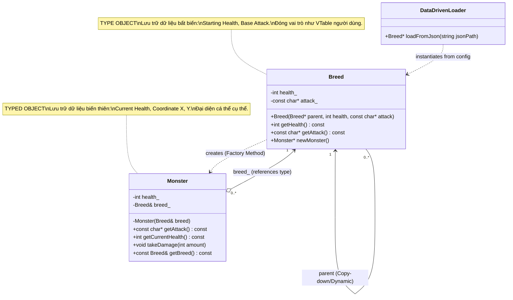
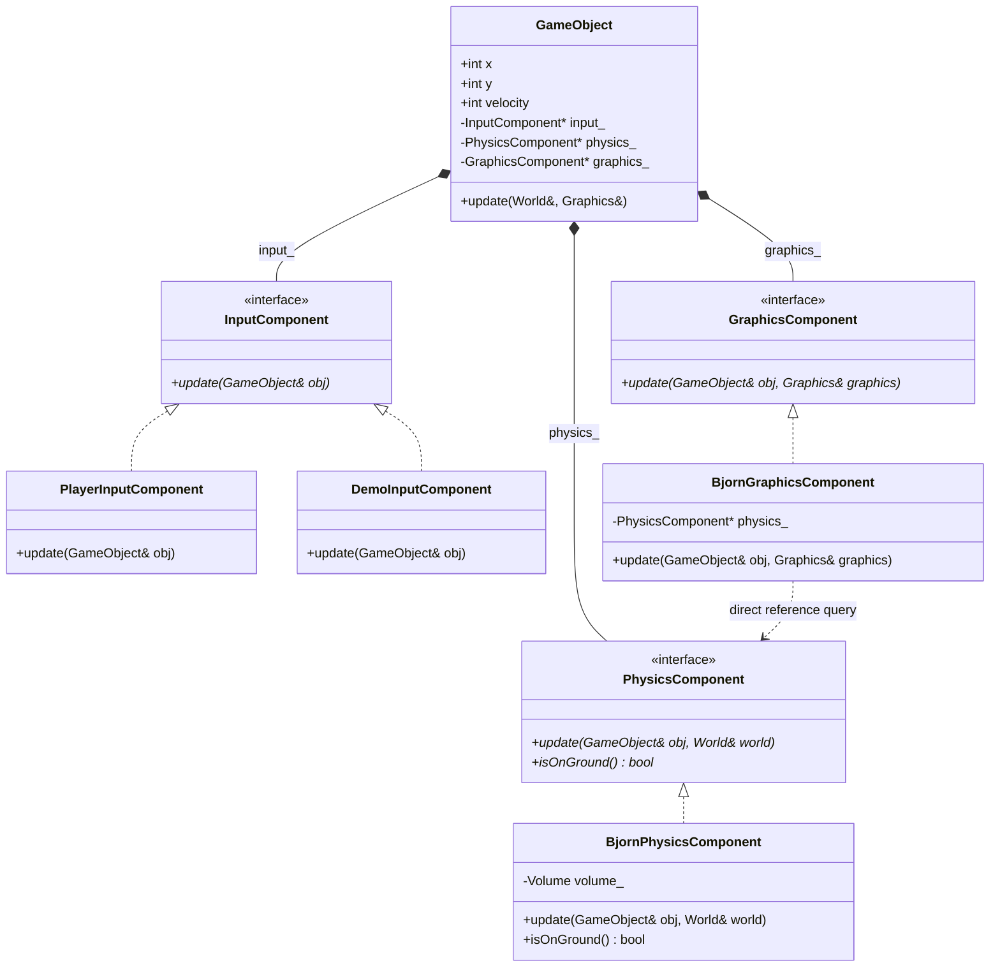
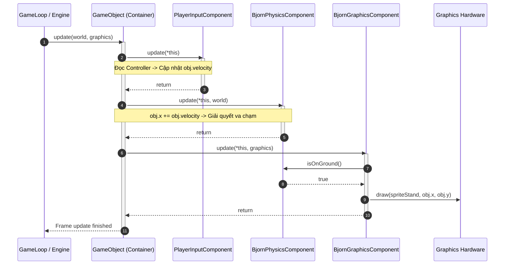

# ĐỢT 7 / 10: BÓC TÁCH KIẾN TRÚC & OOAD CHUYÊN SÂU
## Tác phẩm: *Game Programming Patterns* – Robert Nystrom
### Nội dung khảo sát: Chương 13 (Type Object) & Chương 14 (Component)

---

# CHƯƠNG 13: TYPE OBJECT PATTERN (MẪU ĐỐI TƯỢNG KIỂU)

---

## 1. ĐỀ MỤC & MỤC TIÊU CỐT LÕI (CORE PURPOSE)

### 1.1. Cấu trúc toàn bộ đề mục chương
- **Intent (Ý đồ thiết kế)**
- **Motivation (Bối cảnh động lực)**
  - *The typical OOP answer (Cách giải quyết OOP kinh điển: Phân cấp kế thừa)*
  - *A class for a class (Một lớp đại diện cho một lớp)*
- **The Pattern (Mô hình mẫu thiết kế)**
- **When to Use It (Khi nào nên sử dụng)**
- **Keep in Mind (Những lưu ý cốt tử)**
  - *The type objects have to be tracked manually (Đối tượng kiểu phải được quản trị thủ công)*
  - *It’s harder to define behavior for each type (Khó định nghĩa hành vi động độc lập cho từng kiểu)*
- **Sample Code (Mã nguồn mẫu)**
  - *Making type objects more like types: constructors (Tạo lập đối tượng kiểu như một kiểu thực thụ: Factory Method)*
  - *Sharing data through inheritance (Chia sẻ dữ liệu thông qua cơ chế kế thừa nội bộ)*
    - Dynamic delegation (Ủy nhiệm động khi truy vấn)
    - Copy-down delegation (Sao chép thuộc tính tĩnh lúc khởi tạo)
  - *Loading types from data files (Nạp kiểu dữ liệu từ cấu hình JSON)*
- **Design Decisions (Các quyết định kiến trúc)**
  - *Is the type object encapsulated or exposed? (Đối tượng kiểu được bao đóng hay công khai?)*
  - *How are typed objects created? (Đối tượng thực thể được tạo ra bằng cách nào?)*
  - *Can the type change? (Kiểu của đối tượng có được phép biến đổi lúc runtime không?)*
  - *What kind of inheritance is supported? (Hỗ trợ mô hình kế thừa kiểu nào: Không kế thừa, Đơn kế thừa, hay Đa kế thừa?)*
- **See Also (Mối liên hệ với các mẫu thiết kế khác)**

### 1.2. Vấn đề kỹ thuật thực tế & Thảm họa nếu không áp dụng
- **Vấn đề kỹ thuật thực tế:**
  Trong các game nhập vai thế giới mở hoặc chiến thuật, số lượng chủng loại thực thể (quái vật, trang bị, phép thuật, NPC) lên tới hàng trăm, thậm chí hàng ngàn loài (`Dragon`, `Troll`, `Goblin`, `Skeleton Warrior`, v.v.). Mỗi loài có các thông số cơ bản (starting health, attack string, elemental resistance, animation frames) và chia sẻ thuộc tính với các biến thể tương đồng.
- **Thảm họa nếu duy trì tư duy OOP ngây thơ (Hard-coded Subclassing):**
  1. **Bùng nổ số lượng lớp (Class Explosion):** Tạo ra hàng trăm file mã nguồn rác (`Dragon.h`, `Troll.h`, `GoblinArcher.h`...) chỉ để override 1-2 hàm trả về hằng số tĩnh (`getAttack()`, `getStartingHealth()`).
  2. **Cơn ác mộng biên dịch (Recompilation Hell):** Mỗi khi Game Designer muốn cân bằng chỉ số (ví dụ: tăng máu của `Troll` từ 48 lên 52), toàn bộ dự án phải compile lại mã nguồn C++. Lập trình viên bị hạ cấp thành "thợ gõ data" (data monkey), quy trình phát triển tê liệt vì vòng lặp *sửa code -> compile -> link -> test*.
  3. **Không thể mở rộng lúc Runtime (Zero Runtime Extensibility):** Game không thể tải thêm quái vật mới thông qua DLC, Mod của cộng đồng, hoặc nạp động từ file JSON/XML mà bắt buộc phải can thiệp trực tiếp vào mã nguồn C++.

---

## 2. PHÂN TÍCH LÝ THUYẾT & NGUYÊN LÝ CHUYÊN SÂU

### 2.1. Bản chất kiến trúc: Nâng cấp kiểu dữ liệu từ Ngôn ngữ thành Dữ liệu (Lifting Types into Data)
- Trong các ngôn ngữ có kiểu tĩnh (Static Typed Languages) như C++, C#, Java, một "Class" là khái niệm bậc cao dành cho compiler. Trình biên dịch tạo ra một bảng hàm ảo (*vtable*) và cấu trúc bộ nhớ tĩnh cho mỗi Class.
- **Type Object Pattern** thực hiện một bước nhảy vọt về mặt kiến trúc: **Tách một thực thể làm hai phần**:
  1. **Typed Object (`Monster`):** Đại diện cho một cá thể cụ thể tồn tại trên bàn cờ/thế giới game. Nó lưu trữ dữ liệu cá thể biến thiên theo thời gian (*instance-specific mutable state*, ví dụ: `currentHealth_`, vị trí không gian `x, y`).
  2. **Type Object (`Breed`):** Đại diện cho một "kiểu", một "loài" hoặc "khuôn mẫu". Nó lưu trữ dữ liệu bất biến dùng chung cho toàn bộ cá thể cùng loài (*shared invariant state*, ví dụ: `startingHealth_`, chuỗi thông báo tấn công `attack_`).
- Mỗi `Monster` giữ một tham chiếu (pointer/reference) đến `Breed` của nó. Khi quái vật muốn biết đòn đánh hoặc lượng máu tối đa, nó ủy nhiệm (*delegate*) truy vấn sang đối tượng `Breed`.

```
[Khái niệm OOP truyền thống]
Class Dragon (C++ Code) ----instantiates----> dragonInstance (Memory)

[Kiến trúc Type Object Pattern]
Data Config (JSON) ----parses into----> Breed Instance: "Dragon" (Type Object in Memory)
                                                ▲
                                                │ (references)
Monster Instance #1 (Typed Object) ─────────────┤
Monster Instance #2 (Typed Object) ─────────────┘
```

### 2.2. So sánh bản chất Vtable trong C++ và Type Object
Nystrom chỉ ra một sự tương đồng triết học sâu sắc:
- Trong C++, khi một lớp có phương thức ảo (`virtual`), compiler âm thầm tạo ra một struct gọi là `vtable` (chứa con trỏ hàm). Mỗi instance của lớp giữ một con trỏ ẩn `vptr` trỏ tới `vtable` đó.
- Đối tượng `Breed` thực chất chính là một `vtable` tự chế bằng tay ở tầng người dùng (User-space Vtable), còn tham chiếu `breed_` trong `Monster` chính là `vptr`. Bằng cách tự quản lý "vtable" này dưới dạng đối tượng C++, ta đưa khả năng định nghĩa kiểu ra khỏi sự kiểm soát cứng nhắc của compiler và trao nó vào tay của dữ liệu cấu hình.

### 2.3. Hai cơ chế hiện thực hóa Kế thừa nội bộ (Inheritance in Type Objects)
Khi các loài quái vật có biến thể (ví dụ: `Troll Archer` và `Troll Wizard` kế thừa từ `Troll`), Type Object hỗ trợ cơ chế kế thừa nội bộ (*Prototype-style Inheritance / Delegation Chain*):

1. **Ủy nhiệm động khi truy vấn (Dynamic Delegation):**
   - Mỗi `Breed` lưu con trỏ trỏ đến `parent_`.
   - Khi gọi `getHealth()`, nếu thuộc tính của `Breed` hiện tại bằng 0 (hoặc `null`), nó đệ quy gọi `parent_->getHealth()`.
   - *Ưu điểm:* Cập nhật theo thời gian thực (Hot-reload). Nếu Designer thay đổi máu của `Troll` lúc game đang chạy, `Troll Archer` lập tức nhận giá trị mới.
   - *Nhược điểm:* Tốn bộ nhớ lưu con trỏ cha; phát sinh chi phí duyệt chuỗi con trỏ (pointer chasing) gây cache miss mỗi lần truy vấn.
2. **Sao chép thuộc tính tĩnh lúc khởi tạo (Copy-Down Delegation):**
   - Lúc nạp dữ liệu từ JSON/XML, nếu thuộc tính của lớp con bị bỏ trống, constructor của `Breed` sao chép trực tiếp giá trị của `parent` vào trường nội tại của chính nó.
   - Sau khi khởi tạo xong, giải phóng hoàn toàn con trỏ `parent_`.
   - *Ưu điểm:* Tốc độ truy vấn cực nhanh $O(1)$, tương đương truy xuất biến nguyên thủy cục bộ, không tốn thêm bộ nhớ lưu con trỏ kế thừa.
   - *Nhược điểm:* Cố định thuộc tính lúc load-time; thay đổi ở loài cha sau khi nạp sẽ không tự động lan truyền xuống loài con nếu không nạp lại toàn bộ.

---

## 3. MỔ XẺ MÃ NGUỒN (CODE DEEP-DIVE)

### 3.1. Hiện thực hóa Type Object hoàn chỉnh kết hợp Factory Method và Kế thừa Copy-Down

```cpp
#include <iostream>
#include <string>

class Monster; // Forward declaration

// ============================================================================
// TYPE OBJECT CLASS: Đại diện cho một "Loài" (Kiểu dữ liệu hướng nội dung)
// ============================================================================
class Breed
{
public:
    // Constructor hỗ trợ cơ chế Copy-down Inheritance
    Breed(Breed* parent, int health, const char* attack)
    : health_(health), attack_(attack)
    {
        // Nếu có lớp cha và bản thân không định nghĩa, kế thừa trực tiếp từ cha
        if (parent != nullptr)
        {
            if (health_ == 0) health_ = parent->getHealth();
            if (attack_ == nullptr) attack_ = parent->getAttack();
        }
    }

    int getHealth() const { return health_; }
    const char* getAttack() const { return attack_; }

    // Factory Method: Type Object trực tiếp cấp phát và cấu hình Typed Object
    Monster* newMonster();

private:
    int health_;           // Starting health (Máu gốc chung của giống loài)
    const char* attack_;   // Chuỗi thông báo đòn đánh đặc trưng
};

// ============================================================================
// TYPED OBJECT CLASS: Đại diện cho một thực thể cá thể trong Game
// ============================================================================
class Monster
{
    // Cho phép Breed truy cập constructor private để kiểm soát việc cấp phát
    friend class Breed;

public:
    const char* getAttack() const
    {
        return breed_.getAttack();
    }

    int getCurrentHealth() const { return health_; }

    void takeDamage(int amount)
    {
        health_ -= amount;
        if (health_ < 0) health_ = 0;
    }

    const Breed& getBreed() const { return breed_; }

private:
    // Constructor đóng: Bắt buộc việc tạo cá thể phải thông qua Factory Method của Breed
    Monster(Breed& breed)
    : health_(breed.getHealth()),
      breed_(breed)
    {}

    int health_;    // Máu hiện tại biến thiên của riêng cá thể này
    Breed& breed_;  // Tham chiếu bất biến đến đối tượng kiểu (Type Object)
};

// Định nghĩa Factory Method của Breed
Monster* Breed::newMonster()
{
    return new Monster(*this);
}
```

### 3.2. Bảng phân tích chi tiết mã nguồn

| Dòng code / Đoạn code then chốt | Giải thích kỹ thuật & Ý nghĩa thiết kế |
| :--- | :--- |
| `class Breed` & `class Monster` | **Triệt tiêu phân cấp kế thừa (Eradicate Inheritance Hierarchy):** Thay vì hàng chục class con kế thừa từ `Monster`, toàn bộ hệ thống được rút gọn về đúng 2 class: `Breed` (Kiểu) và `Monster` (Thực thể). |
| `if (health_ == 0) health_ = parent->getHealth();` | **Kế thừa Copy-down (Copy-down Delegation):** Giải quyết triệt để vấn đề dư thừa dữ liệu cấu hình. Nếu giống loài biến thể không ghi đè thuộc tính, nó tự động kế thừa giá trị từ loài cơ sở ngay lúc khởi tạo. |
| `friend class Breed;` và `private Monster(Breed& breed)` | **Kiểm soát chặt chẽ vòng đời (Strict Lifecycle Invariant):** Ngăn chặn code bên ngoài tự do tạo `Monster` bừa bãi mà thiếu `Breed`. Mọi cá thể quái vật bắt buộc phải sinh ra từ một giống loài hợp lệ thông qua Factory Method. |
| `Monster* newMonster() { return new Monster(*this); }` | **Mẫu thiết kế Factory Method (GoF):** Trao quyền năng sinh sản cho chính đối tượng Kiểu. Trong các engine hiệu năng cao, hàm này có thể tích hợp sẵn Object Pool hoặc Custom Arena Allocator để cấp phát bộ nhớ liên tục. |
| `int health_;` vs `int health_;` (trong 2 class) | **Tách biệt Trạng thái Động và Bất biến (Mutable vs Invariant State Separation):** `Breed::health_` là máu khởi điểm danh định (bất biến), còn `Monster::health_` là sinh lực thời gian thực (giảm dần khi trúng đòn). |
| `Breed& breed_;` | **Quan hệ Ràng buộc Bền vững (Strong Association):** Dùng C++ reference để đảm bảo một `Monster` một khi đã sinh ra thì không bao giờ trỏ vào con trỏ rỗng (`nullptr`), bảo toàn tính toàn vẹn ngữ nghĩa của kiểu. |

---

## 4. SƠ ĐỒ TRỰC QUAN HÓA (MERMAID ARCHITECTURE)



---

## 5. ÁNH XẠ ỨNG DỤNG VÀO DỰ ÁN GAME OOP (2.5D MULTIPLAYER COMBAT)

1. **Hệ thống Quái vật và NPC điều khiển dữ liệu (Data-Driven Mob & Boss Archetypes):**
   - Thay vì tạo các class `Goblin`, `GoblinShaman`, `OrcBerserker`, ta tạo một class duy nhất `MonsterArchetype` (Type Object) và `MonsterEntity` (Typed Object).
   - Toàn bộ chỉ số căn bản (Base Damage, Attack Range, Move Speed, Hurtbox Bounds, Hitstun Duration, Cast Sound FX) được viết vào file `Monsters.json`.
   - Khi Server khởi động, toàn bộ `MonsterArchetype` được parse vào một bảng băm `std::unordered_map<std::string, MonsterArchetype*>`. Khi spawner triệu hồi 100 con Goblin, 100 cá thể `MonsterEntity` chỉ đơn thuần giữ một con trỏ trỏ tới archetype `"Goblin"`, tiết kiệm hàng chục megabyte RAM mạng và cho phép Game Designer cân bằng lại meta chỉ bằng việc reload file JSON mà không cần build lại server.
2. **Hệ thống Vũ khí và Vật phẩm Trang bị (Weapon & Equipment System):**
   - Mỗi thanh kiếm trong túi đồ của người chơi là một `ItemInstance` (Typed Object) lưu chỉ số độ bền hiện tại (`currentDurability`) và ngọc khảm nén (`socketedGems`).
   - `ItemInstance` tham chiếu tới một `ItemType` (Type Object) duy nhất mô tả: Tên vật phẩm ("Excalibur"), Sát thương cơ bản (150), Mô hình 3D Mesh, Hoạt ảnh vung kiếm (Attack Animation Key). Cơ chế Type Object giúp game đồng bộ hóa hàng ngàn vật phẩm qua môi trường mạng cực kỳ tối ưu vì chỉ cần truyền định danh `ItemTypeId`.

---
---

# CHƯƠNG 14: COMPONENT PATTERN (MẪU THÀNH PHẦN)

---

## 1. ĐỀ MỤC & MỤC TIÊU CỐT LÕI (CORE PURPOSE)

### 1.1. Cấu trúc toàn bộ đề mục chương
- **Intent (Ý đồ thiết kế)**
- **Motivation (Bối cảnh động lực)**
  - *The Gordian knot (Nút thắt Gordian: Mớ bòng bong liên kết chéo)*
  - *Cutting the knot (Chặt đứt nút thắt: Phân tách theo ranh giới nghiệp vụ)*
  - *Loose ends (Các đầu mối độc lập)*
  - *Tying back together (Gắn kết các thành phần: Đa hình thành phần và bài toán Kim cương chết)*
- **The Pattern (Mô hình mẫu thiết kế)**
- **When to Use It (Khi nào nên sử dụng)**
- **Keep in Mind (Những lưu ý cốt tử)**
- **Sample Code (Mã nguồn mẫu)**
  - *A monolithic class (Một lớp khổng lồ nguyên khối - Lớp Bjørn)*
  - *Splitting out a domain (Tách biệt một miền nghiệp vụ: InputComponent)*
  - *Splitting out the rest (Tách biệt các miền còn lại: PhysicsComponent, GraphicsComponent)*
  - *Robo-Bjørn (Trừu tượng hóa Component Interface: DemoInputComponent)*
  - *No Bjørn at all? (Triệt tiêu hoàn toàn lớp Bjørn: GameObject tổng quát)*
- **Design Decisions (Các quyết định kiến trúc)**
  - *How does the object get its components? (Đối tượng thu nhận các Component bằng cách nào? - Tự khởi tạo nội bộ vs Dependency Injection bên ngoài)*
  - *How do components communicate with each other? (Các Component giao tiếp với nhau qua cơ chế nào?)*
    - By modifying the container object’s state (Thông qua trạng thái chia sẻ của Container)
    - By referring directly to each other (Thông qua tham chiếu trực tiếp)
    - By sending messages (Thông qua hệ thống truyền thông điệp Mediator)
- **See Also (Mối liên hệ với các engine và mẫu thiết kế khác)**

### 1.2. Vấn đề kỹ thuật thực tế & Thảm họa nếu không áp dụng
- **Vấn đề kỹ thuật thực tế:**
  Một nhân vật hoặc thực thể trong game (như chàng thợ làm bánh `Bjørn`) không chỉ tồn tại đơn lẻ mà là giao điểm của rất nhiều phân hệ kỹ thuật (domains) hoàn toàn khác nhau: Xử lý phần cứng đầu vào (Controller/Keyboard), Tính toán vật lý & va chạm (Physics Engine), Kết xuất đồ họa & hoạt ảnh (Rendering/DirectX/OpenGL), và Âm thanh (Sound/FMOD).
- **Thảm họa nếu duy trì tư duy Lớp nguyên khối (Monolithic God Object) và Phân cấp kế thừa (Inheritance Hierarchy):**
  1. **Nút thắt thảm họa (The Gordian Knot Coupling):** Lớp `Player` phình to thành một "God Class" dài 5.000 - 10.000 dòng mã. Lập trình viên đồ họa sửa shader có thể vô tình làm vỡ logic tính va chạm vật lý; lập trình viên âm thanh phải đọc hiểu mã nguồn AI chỉ để chèn một tiếng bước chân.
  2. **Bế tắc đa luồng (Concurrency Deadlocks):** Trên kiến trúc CPU đa lõi hiện đại, các engine phân tách mỗi hệ thống chạy trên một luồng riêng (Core 1: AI, Core 2: Physics, Core 3: Render). Nếu một class duy nhất chứa lẫn lộn cả `updatePhysics()` lẫn `renderGraphics()`, việc đồng bộ dữ liệu sẽ dẫn đến race condition hoặc bế tắc luồng (deadlock) nghiêm trọng.
  3. **Vấn đề Kim cương chết (The Deadly Diamond of Death):** Trong mô hình kế thừa thuần túy: Nếu `Zone` kế thừa `GameObject` để có va chạm vật lý, `Decoration` kế thừa `GameObject` để có đồ họa hiển thị, thì một thực thể có cả hai (như `Prop` - hòm gỗ, tảng đá) sẽ phải đa kế thừa từ cả `Zone` và `Decoration`. Điều này dẫn đến sự nhập nhằng cấu trúc bộ nhớ, trùng lặp thuộc tính vị trí `x, y`, làm sụp đổ kiến trúc hướng đối tượng.

---

## 2. PHÂN TÍCH LÝ THUYẾT & NGUYÊN LÝ CHUYÊN SÂU

### 2.1. Bản chất kiến trúc: Composition over Inheritance & Decoupling Domains
- **Nguyên lý Tách biệt Mối quan tâm (Separation of Concerns - SoC):** Component Pattern áp dụng triết lý phân rã thực thể theo chiều dọc miền kỹ thuật. Thay vì hỏi *"Đối tượng này LÀ GÌ?"* (Tư duy kế thừa - Is-a), kiến trúc sư đặt câu hỏi: *"Đối tượng này CÓ NHỮNG NĂNG LỰC NÀO?"* (Tư duy thành phần - Has-a).
- **Thực thể rỗng (Entity as a Thin Shell / Sockets):** Lớp thực thể (`GameObject`) bị tước bỏ toàn bộ logic nghiệp vụ chi tiết. Nó thoái hóa trở thành một "chiếc túi đựng linh kiện" (Component Bag) hoặc một bộ khung cắm (Socket Container). Toàn bộ logic và dữ liệu chuyên biệt được đẩy xuống các lớp Component độc lập:
  - `InputComponent`: Chịu trách nhiệm phiên dịch tín hiệu phần cứng thành ý định di chuyển.
  - `PhysicsComponent`: Chịu trách nhiệm giải quyết va chạm hộp thể tích (`Volume`) với bản đồ thế giới (`World`).
  - `GraphicsComponent`: Chịu trách nhiệm quản lý sprite hoạt ảnh và đẩy lệnh vẽ xuống GPU (`Graphics`).

### 2.2. Ba chiến lược giao tiếp giữa các Component (Inter-Component Communication)

| Chiến lược | Cơ chế kỹ thuật | Ưu điểm kiến trúc | Nhược điểm & Rủi ro |
| :--- | :--- | :--- | :--- |
| **1. Chia sẻ qua trạng thái của Container (Shared State)** | Các component đọc/ghi dữ liệu chung đặt tại `GameObject` (ví dụ: `x, y`, `velocity`). | Giữ các Component hoàn toàn không biết đến sự tồn tại của nhau (Decoupled). | Làm bẩn lớp `GameObject` nếu đẩy quá nhiều biến chuyên biệt lên; nhạy cảm tuyệt đối với thứ tự gọi cập nhật (`update` order dependency). |
| **2. Tham chiếu trực tiếp (Direct Reference)** | Component này giữ con trỏ trỏ trực tiếp đến Component kia (ví dụ: `GraphicsComponent` giữ con trỏ `PhysicsComponent*` để gọi `isOnGround()`). | Tốc độ cực nhanh $O(1)$, gọi hàm trực tiếp, dễ dàng lấy dữ liệu phức tạp. | Tái ghép nối (tightly coupled) giữa 2 component; làm giảm khả năng tái sử dụng độc lập của component. |
| **3. Truyền thông điệp (Mediator Message Passing)** | `GameObject` đóng vai trò Mediator. Khi có biến cố (như chạm đất), `PhysicsComponent` gửi thông điệp `send(MSG_COLLIDE_FLOOR)`, Container phân phối tới hàm `receive(msg)` của toàn bộ Component còn lại. | Cách ly hoàn toàn các Component anh em. Rất lý tưởng cho các sự kiện rời rạc (chơi âm thanh, kích hoạt hiệu ứng hạt). | Khó debug luồng thực thi; overhead chi phí phân phối thông điệp; nguy cơ rơi vào vòng lặp thông điệp vô tận (infinite feedback loop). |

---

## 3. MỔ XẺ MÃ NGUỒN (CODE DEEP-DIVE)

### 3.1. Mã nguồn hiện thực hóa Component Pattern hoàn chỉnh

```cpp
#include <iostream>

// Forward declarations
class GameObject;
class World;
class Graphics;

// ============================================================================
// 1. CÁC GIAO DIỆN COMPONENT TRỪU TƯỢNG (ABSTRACT COMPONENT INTERFACES)
// ============================================================================
class InputComponent
{
public:
    virtual ~InputComponent() {}
    virtual void update(GameObject& obj) = 0;
};

class PhysicsComponent
{
public:
    virtual ~PhysicsComponent() {}
    virtual void update(GameObject& obj, World& world) = 0;
    virtual bool isOnGround() const { return true; } // Truy vấn trạng thái vật lý
};

class GraphicsComponent
{
public:
    virtual ~GraphicsComponent() {}
    virtual void update(GameObject& obj, Graphics& graphics) = 0;
};

// ============================================================================
// 2. LỚP THỰC THỂ TỔNG QUÁT: GAMEOBJECT (CONTAINER / SOCKETS)
// ============================================================================
class GameObject
{
public:
    // Trạng thái dùng chung xuyên miền (Pan-domain shared mutable state)
    int x, y;
    int velocity;

    // Dependency Injection: Nhận các thành phần năng lực từ bên ngoài
    GameObject(InputComponent* input,
               PhysicsComponent* physics,
               GraphicsComponent* graphics)
    : input_(input),
      physics_(physics),
      graphics_(graphics),
      x(0), y(0), velocity(0)
    {}

    ~GameObject()
    {
        delete input_;
        delete physics_;
        delete graphics_;
    }

    // Điều phối vòng lặp cập nhật theo đúng thứ tự nghiệp vụ
    void update(World& world, Graphics& graphics)
    {
        input_->update(*this);             // Bước 1: Thu nhận ý đồ điều khiển
        physics_->update(*this, world);     // Bước 2: Tính toán cơ học & va chạm
        graphics_->update(*this, graphics); // Bước 3: Xuất hình ảnh tại vị trí mới
    }

private:
    InputComponent*   input_;
    PhysicsComponent* physics_;
    GraphicsComponent* graphics_;
};

// ============================================================================
// 3. CÁC HIỆN THỰC CỤ THỂ CHO TỪNG NHU CẦU NGHIỆP VỤ
// ============================================================================

// Component điều khiển bởi người chơi
class PlayerInputComponent : public InputComponent
{
public:
    virtual void update(GameObject& obj) override
    {
        // Giả lập đọc Joystick phần cứng
        obj.velocity += 1; // Tăng tốc sang phải
    }
};

// Component điều khiển tự động cho chế độ Demo / AI máy
class DemoInputComponent : public InputComponent
{
public:
    virtual void update(GameObject& obj) override
    {
        // Thuật toán AI tự động tuần tra không cần người chơi can thiệp
        obj.velocity = 0; // Đứng yên biểu diễn hoạt ảnh
    }
};

// Component vật lý của nhân vật Bjørn
class BjornPhysicsComponent : public PhysicsComponent
{
public:
    virtual void update(GameObject& obj, World& world) override
    {
        obj.x += obj.velocity;
        // world.resolveCollision(volume_, obj.x, obj.y, obj.velocity);
    }
};

// Component đồ họa có tham chiếu trực tiếp đến PhysicsComponent để bắt trạng thái nhảy
class BjornGraphicsComponent : public GraphicsComponent
{
public:
    BjornGraphicsComponent(PhysicsComponent* physics)
    : physics_(physics)
    {}

    virtual void update(GameObject& obj, Graphics& graphics) override
    {
        if (physics_ && !physics_->isOnGround())
        {
            // Vẽ Sprite ở trạng thái nhảy trên không
        }
        else
        {
            // Vẽ Sprite chạy bình thường
        }
        // graphics.draw(sprite, obj.x, obj.y);
    }

private:
    PhysicsComponent* physics_; // Giao tiếp trực tiếp (Direct Reference)
};
```

### 3.2. Bảng phân tích chi tiết mã nguồn

| Dòng code / Đoạn code then chốt | Giải thích kỹ thuật & Ý nghĩa thiết kế |
| :--- | :--- |
| `virtual void update(GameObject& obj) = 0;` | **Đảo ngược phụ thuộc (Dependency Inversion Principle - DIP):** Container phụ thuộc vào trừu tượng `InputComponent`, không dính líu đến chi tiết phần cứng hoặc bàn phím cụ thể. |
| `GameObject(InputComponent* input, ...)` | **Tiêm phụ thuộc (Dependency Injection):** Cho phép tái cấu hình hành vi của thực thể hoàn toàn từ bên ngoài mà không cần sửa một dòng mã nào trong `GameObject`. |
| `input_->update(*this);` $\to$ `physics_->...` $\to$ `graphics_->...` | **Bảo toàn tính tuần tự nghiệp vụ (Deterministic Pipeline Execution):** Đảm bảo Input sinh ra gia tốc $\to$ Vật lý tính toán vị trí mới hợp lệ $\to$ Đồ họa render đúng frame hiện tại, loại bỏ hoàn toàn lỗi hiển thị trễ một khung hình (one-frame visual lag). |
| `class DemoInputComponent : public InputComponent` | **Đa hình hành vi cắm-rút (Plug-and-play Polymorphism):** Để biến nhân vật từ chế độ người chơi sang chế độ tự chơi (Kiosk Demo Mode), ta chỉ cần tráo đổi `PlayerInputComponent` thành `DemoInputComponent`. Toàn bộ code vật lý và render được tái sử dụng 100%. |
| `BjornGraphicsComponent(PhysicsComponent* physics)` | **Mô hình Giao tiếp Trực tiếp (Direct Component Coupling):** Giải quyết bài toán chia sẻ trạng thái chuyên biệt cao mà không làm ô nhiễm `GameObject`. Đồ họa chỉ hỏi thẳng Vật lý xem có đang chạm đất không (`isOnGround()`). |
| `delete input_; delete physics_; ...` | **Quyền sở hữu vòng đời (Strict Ownership Semantics):** `GameObject` đóng vai trò là Composite Root sở hữu độc quyền vòng đời của các Component cấu thành, giải phóng an toàn bộ nhớ khi thực thể bị tiêu hủy. |

---

## 4. SƠ ĐỒ TRỰC QUAN HÓA (MERMAID ARCHITECTURE)

### 4.1. Sơ đồ lớp Component Architecture (Cắm - Rút Năng Lực)



### 4.2. Sơ đồ tuần tự điều phối Frame Execution



---

## 5. ÁNH XẠ ỨNG DỤNG VÀO DỰ ÁN GAME OOP (2.5D MULTIPLAYER COMBAT)

1. **Tách biệt kiến trúc Client-Server thông qua Component Hoán đổi:**
   - Trong game chiến đấu đối kháng 2.5D nhiều người chơi, Server không bao giờ cần render hình ảnh hay phát âm thanh, nhưng bắt buộc phải chạy logic va chạm khung xương đòn đánh (Hitbox/Hurtbox) và tiếp nhận gói tin mạng (Packet Input).
   - Áp dụng Component Pattern:
     - **Phía Dedicated Server:** Khởi tạo `CombatEntity` với `NetworkInputComponent` (nhận phím từ Client gửi lên qua UDP), `CombatPhysicsComponent` (tính va chạm, roll-back netcode) và `NullGraphicsComponent` (component rỗng không làm gì).
     - **Phía Game Client:** Khởi tạo `CombatEntity` với `LocalInputComponent`, `ClientPredictionPhysicsComponent`, và `SpineAnimationGraphicsComponent` (vẽ hoạt ảnh 2.5D, particle vệt kiếm).
     - Kết quả: Không cần phân nhánh `if (isServer)` rải rác khắp mã nguồn; toàn bộ logic cốt lõi được tái sử dụng nguyên vẹn.
2. **Kiến trúc Nhân vật Đa dạng (Flexible Character & Ability Composition):**
   - Thay vì tạo hàng loạt lớp con như `FlyingWarrior`, `StealthAssassin`, `MountedKnight`, ta tạo các linh kiện chức năng độc lập: `FlyMovementComponent`, `InvisibilityBuffComponent`, `MeleeAttackComponent`, `NetworkSyncComponent`.
   - Một nhân vật mới trong game chỉ là một file mô tả cấu hình XML/JSON liệt kê các Component cần gắn vào. Việc thêm trạng thái tàng hình hay bay lượn cho nhân vật chỉ đơn thuần là `entity->addComponent(new FlyMovementComponent())` ngay tại thời gian thực mà không làm ảnh hưởng đến các phân hệ khác.
