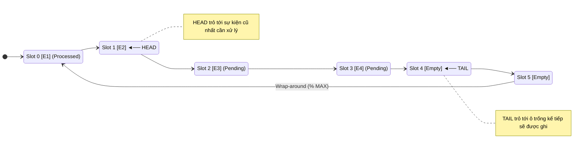
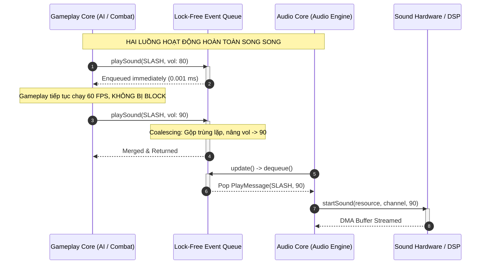
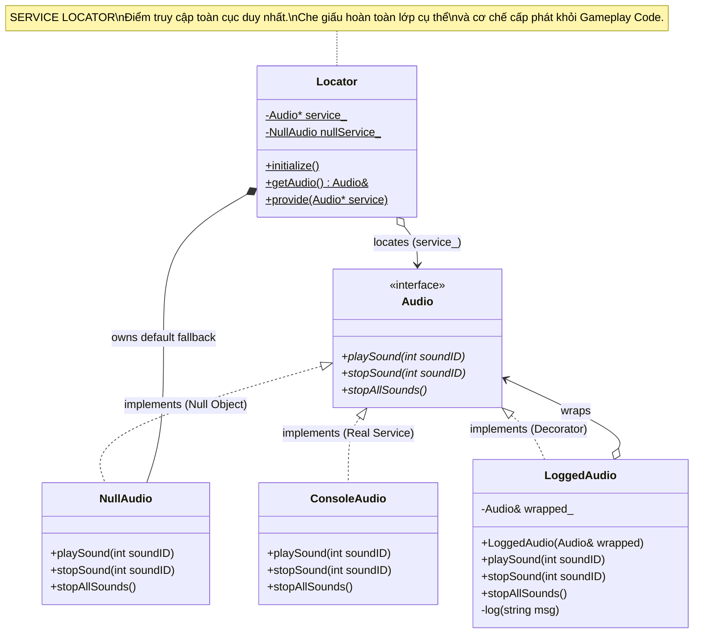

# ĐỢT 8 / 10: BÓC TÁCH KIẾN TRÚC & OOAD CHUYÊN SÂU
## Tác phẩm: *Game Programming Patterns* – Robert Nystrom
### Nội dung khảo sát: Chương 15 (Event Queue) & Chương 16 (Service Locator)

---

# CHƯƠNG 15: EVENT QUEUE PATTERN (MẪU HÀNG ĐỢI SỰ KIỆN)

---

## 1. ĐỀ MỤC & MỤC TIÊU CỐT LÕI (CORE PURPOSE)

### 1.1. Cấu trúc toàn bộ đề mục chương
- **Intent (Ý đồ thiết kế)**
- **Motivation (Bối cảnh động lực)**
  - *GUI event loops (Vòng lặp sự kiện giao diện người dùng)*
  - *Central event bus (Tuyến bus sự kiện trung tâm)*
  - *Say what? (Ví dụ điển hình: Hệ thống âm thanh Audio Engine)*
  - *Problem 1: The API blocks the caller (Vấn đề 1: Lệnh gọi đồng bộ chặn đứng luồng chính)*
  - *Problem 2: Requests cannot be processed in aggregate (Vấn đề 2: Không thể gộp và lọc bớt yêu cầu trùng lặp)*
  - *Problem 3: Requests are processed on the wrong thread (Vấn đề 3: Yêu cầu bị thực thi sai luồng CPU)*
- **The Pattern (Mô hình mẫu thiết kế)**
- **When to Use It (Khi nào nên sử dụng)**
  - *Mô hình Đẩy (Push) kết hợp mô hình Kéo (Pull)*
  - *Bộ đệm phân tách thời gian (Decoupling in Time)*
- **Keep in Mind (Những lưu ý cốt tử)**
  - *A central event queue is a global variable (Hàng đợi trung tâm thực chất là biến toàn cục)*
  - *The state of the world can change under you (Trạng thái thế giới game có thể thay đổi trước khi sự kiện được xử lý)*
  - *You can get stuck in feedback loops (Nguy cơ rơi vào vòng lặp phản hồi vô tận)*
- **Sample Code (Mã nguồn mẫu)**
  - *Reifying requests: PlayMessage struct (Cụ thể hóa yêu cầu thành cấu trúc dữ liệu)*
  - *A simple array buffer (Bộ đệm mảng tĩnh)*
  - *A ring buffer (Bộ đệm vòng tròn - Tối ưu hóa bộ nhớ O(1))*
  - *Aggregating requests (Gộp yêu cầu trùng lặp & Điều chỉnh âm lượng cực đại)*
  - *Spanning threads (Vượt ranh giới luồng an toàn - Thread Safety)*
- **Design Decisions (Các quyết định kiến trúc)**
  - *What goes in the queue? (Cái gì được đưa vào hàng đợi: Sự kiện trong quá khứ vs Thông điệp hành động tương lai)*
  - *Who can read from the queue? (Ai được quyền đọc: Hàng đợi đơn độc Single-cast, Hàng đợi phát thanh Broadcast, hay Hàng đợi phân phối việc Work Queue?)*
  - *Who can write to the queue? (Ai được quyền ghi: Một nguồn phát Single Writer vs Đa nguồn phát Multiple Writers / Fan-in)*
  - *What is the lifetime of the objects in the queue? (Vòng đời của thông điệp: Chuyển quyền sở hữu unique_ptr, Chia sẻ sở hữu shared_ptr, hay Hàng đợi tự sở hữu trong Object Pool?)*
- **See Also (Mối liên hệ với các mẫu thiết kế khác)**

### 1.2. Vấn đề kỹ thuật thực tế & Thảm họa nếu không áp dụng
- **Vấn đề kỹ thuật thực tế:**
  Khi người chơi thực hiện một cú quét kiếm trúng 5 quái vật cùng lúc trong 1 frame, cả 5 con quái vật đều kích hoạt lệnh phát âm thanh đau đớn `playSound(SOUND_PAIN)`. Nếu hệ thống xử lý âm thanh hoạt động theo cơ chế đồng bộ gọi trực tiếp (Synchronous Direct Call):
  1. *Lệnh gọi chặn (Blocking I/O):* Việc nạp file âm thanh từ ổ đĩa hoặc giải mã định dạng WAV/OGG sẽ chặn đứng (freeze) khung hình render của luồng chính.
  2. *Chập biên độ sóng âm (Waveform Summation):* 5 âm thanh giống hệt nhau phát đồng thời trên cùng một frame sẽ cộng biên độ dao động, tạo ra âm lượng lớn gấp 5 lần bình thường, gây vỡ tiếng (audio distortion) và chói tai người chơi.
  3. *Xung đột đa luồng (Multi-threading Race Condition):* Game chạy trên CPU đa lõi (AI thread, Physics thread, UI thread). Khi cả 3 luồng cùng gọi `playSound()`, chúng truy cập vào phần cứng âm thanh mà không có đồng bộ, gây race condition, hỏng bộ đệm DMA của card âm thanh, hoặc crash game.
- **Thảm họa nếu thiếu Event Queue:** Trò chơi giật cục (*frame drops*), trải nghiệm âm thanh hỗn loạn, cạn kiệt số kênh âm thanh phần cứng (*hardware channel exhaustion*), và phát sinh lỗi tranh chấp tài nguyên đa luồng cực kỳ khó tái hiện để debug.

---

## 2. PHÂN TÍCH LÝ THUYẾT & NGUYÊN LÝ CHUYÊN SÂU

### 2.1. Bản chất kiến trúc: Decoupling in Time (Tách rời về mặt Thời gian)
- Các mẫu thiết kế tách rời truyền thống như **Observer** hoặc **Command** chỉ tách rời về mặt **Không gian danh tính (Who)**: Bên gửi không biết ai là bên nhận. Tuy nhiên, chúng vẫn bị ràng buộc chặt chẽ về mặt **Thời gian (When)**: Khi bên gửi phát sự kiện `notify()`, toàn bộ bên nhận bắt buộc phải thực thi ngay lập tức trên cùng Call Stack của bên gửi.
- **Event Queue giải quyết chiều không gian thứ hai: Thời gian (When)**:
  - **Mô hình Đẩy (Push):** Bên gửi (`CombatSystem`) chỉ việc "đẩy" một gói dữ liệu mô tả yêu cầu vào hàng đợi rồi lập tức quay trở lại tiếp tục xử lý logic frame mà không cần chờ đợi.
  - **Mô hình Kéo (Pull):** Phân hệ nhận (`AudioEngine`) chủ động "kéo" các yêu cầu ra xử lý tại thời điểm thuận tiện nhất trong chu kỳ của riêng nó (ví dụ: chu kỳ tick của Audio Thread riêng biệt).
  - Hàng đợi đóng vai trò như một **vùng đệm hấp thụ xung lực (Shock-absorbing Buffer)** giữa tốc độ sản sinh sự kiện và tốc độ tiêu thụ sự kiện.

```
[Bên gửi - Push Model]                  [Vùng đệm Hàng đợi]                  [Bên nhận - Pull Model]
(Gameplay / Combat / UI)                 (Lockless Ring Buffer)                 (Dedicated Audio Thread)

Combat: playSound(SWORD_HIT) ──Enqueues──► [ Head ──► [E1][E2][E3] ──► Tail ] ──Dequeues──► Audio Engine updates
UI: playSound(BUTTON_CLICK)  ──Enqueues──►                                                  Aggregates duplicates
Physics: playSound(IMPACT)   ──Enqueues──►                                                  Plays on free channels
(Luồng Gameplay không bị block)                                                            (Chạy mượt mà 60 FPS)
```

### 2.2. Cấu trúc dữ liệu tối ưu: Bộ đệm vòng tròn (Ring Buffer / Circular Array)
- Nystrom phân tích sâu sắc lý do tại sao không nên dùng danh sách liên kết (`std::list`) cho Event Queue trong game:
  - Danh sách liên kết phân mảnh bộ nhớ heap, mỗi phần tử tốn thêm con trỏ `prev`/`next`, gây trượt bộ đệm CPU cache (*CPU Cache Misses*).
  - Mảng động co giãn (`std::vector`) khi xóa ở đầu mảng sẽ phải dịch chuyển toàn bộ $N$ phần tử còn lại sang trái với độ phức tạp $O(N)$, lãng phí băng thông bộ nhớ.
- **Giải pháp thượng thặng: Ring Buffer (Bộ đệm vòng)**:
  - Cấp phát tĩnh một mảng liên tục cố định kích thước $N$ (`MAX_PENDING`).
  - Dùng 2 con trỏ chỉ số: `head_` (nơi đọc sự kiện cũ nhất) và `tail_` (nơi ghi sự kiện mới tiếp theo).
  - Sử dụng số học modulo: `tail_ = (tail_ + 1) % MAX_PENDING` và `head_ = (head_ + 1) % MAX_PENDING`.
  - **Độ phức tạp $O(1)$ tuyệt đối**: Không cấp phát động, không dịch chuyển bộ nhớ, 100% thân thiện với L1/L2 Cache của CPU.

### 2.3. Kỹ thuật Gộp yêu cầu (Request Aggregation / Coalescing)
- Trong một khung hình, nếu có 10 kẻ địch cùng kêu la, thay vì nhét 10 sự kiện giống nhau vào hàng đợi, hệ thống duyệt qua các sự kiện đang chờ (`pending` items). Nếu phát hiện `SoundId` đã tồn tại, nó chỉ cần cập nhật âm lượng `volume = std::max(existingVolume, newVolume)` và kết thúc. Kỹ thuật này triệt tiêu hoàn toàn hiện tượng chập sóng âm và tiết kiệm khe trống trong bộ đệm.

---

## 3. MỔ XẺ MÃ NGUỒN (CODE DEEP-DIVE)

### 3.1. Hiện thực hóa Ring Buffer Event Queue an toàn cho Audio Engine

```cpp
#include <iostream>
#include <algorithm>
#include <cassert>

typedef int SoundId;
typedef int ResourceId;

const SoundId SOUND_BLOOP = 1;
const SoundId SOUND_SWORD_HIT = 2;
const int VOL_MAX = 100;

// ============================================================================
// CẤU TRÚC SỰ KIỆN / THÔNG ĐIỆP ĐƯỢC CỤ THỂ HÓA (REIFIED MESSAGE)
// ============================================================================
struct PlayMessage
{
    SoundId id;
    int volume;
};

// ============================================================================
// HỆ THỐNG ÂM THANH SỬ DỤNG BỘ ĐỆM VÒNG TRÒN (RING BUFFER AUDIO QUEUE)
// ============================================================================
class Audio
{
public:
    static void init()
    {
        head_ = 0;
        tail_ = 0;
    }

    // Gửi yêu cầu phát âm thanh (Phía Producer - Gameplay Thread)
    static void playSound(SoundId id, int volume)
    {
        // 1. Kỹ thuật Gộp yêu cầu (Request Aggregation): Kiểm tra trùng lặp trong hàng đợi
        for (int i = head_; i != tail_; i = (i + 1) % MAX_PENDING)
        {
            if (pending_[i].id == id)
            {
                // Giữ lại âm thanh có cường độ lớn nhất, loại bỏ yêu cầu thừa
                pending_[i].volume = std::max(volume, pending_[i].volume);
                return; // Đã gộp thành công, không cần thêm phần tử mới
            }
        }

        // 2. Kiểm tra tràn hàng đợi (Queue Overflow Invariant)
        assert((tail_ + 1) % MAX_PENDING != head_ && "Audio Event Queue Overflow!");

        // 3. Thêm phần tử mới vào đuôi hàng đợi
        pending_[tail_].id = id;
        pending_[tail_].volume = volume;

        // 4. Tịnh tiến con trỏ đuôi theo số học modulo (Wrap-around)
        tail_ = (tail_ + 1) % MAX_PENDING;
    }

    // Tiêu thụ và xử lý yêu cầu (Phía Consumer - Audio Thread / Game Loop Update)
    static void update()
    {
        // Nếu hàng đợi rỗng (head trùng tail), không làm gì cả
        if (head_ == tail_) return;

        // Rút một yêu cầu tại đầu hàng đợi (FIFO)
        SoundId id = pending_[head_].id;
        int volume = pending_[head_].volume;

        // Giả lập nạp tài nguyên và phát trên kênh âm thanh phần cứng
        ResourceId resource = loadSound(id);
        int channel = findOpenChannel();
        if (channel != -1)
        {
            startSound(resource, channel, volume);
        }

        // Tịnh tiến con trỏ đầu để giải phóng phần tử đã xử lý
        head_ = (head_ + 1) % MAX_PENDING;
    }

private:
    static ResourceId loadSound(SoundId id) { return id * 10; }
    static int findOpenChannel() { return 1; }
    static void startSound(ResourceId res, int channel, int vol)
    {
        // Giao tiếp với API phần cứng âm thanh cấp thấp
        // std::cout << "Playing resource " << res << " on channel " << channel << " vol " << vol << "\n";
    }

    static const int MAX_PENDING = 16;
    static PlayMessage pending_[MAX_PENDING];
    static int head_;
    static int tail_;
};

// Khởi tạo các biến tĩnh của Audio
PlayMessage Audio::pending_[Audio::MAX_PENDING];
int Audio::head_ = 0;
int Audio::tail_ = 0;
```

### 3.2. Bảng phân tích chi tiết mã nguồn

| Dòng code / Đoạn code then chốt | Giải thích kỹ thuật & Ý nghĩa thiết kế |
| :--- | :--- |
| `struct PlayMessage { SoundId id; int volume; };` | **Cụ thể hóa yêu cầu (Reification of Request):** Biến một hành vi gọi hàm vô hình thành một gói dữ liệu cụ thể (First-class Value) có thể lưu trữ, truyền qua mạng, sắp xếp hoặc hoãn thực thi. |
| `for (int i = head_; i != tail_; i = (i + 1) % MAX_PENDING)` | **Duyệt bộ đệm vòng không dịch chuyển (In-place Traversal):** Duyệt trọn vẹn danh sách các phần tử còn đang chờ từ `head_` đến `tail_` bằng phép toán số học đồng dư modulo. |
| `pending_[i].volume = std::max(volume, pending_[i].volume);` | **Khử trùng lặp sóng âm (Audio Coalescing):** Ngăn chặn hiện tượng âm lượng nhân đôi khi nhiều thực thể bị đánh trúng trong cùng 1 frame, tiết kiệm khe bộ nhớ và kênh âm thanh. |
| `assert((tail_ + 1) % MAX_PENDING != head_);` | **Bất biến Ouroboros (Collision Detection):** Chừa lại đúng 1 ô trống để phân biệt giữa trạng thái "hàng đợi rỗng" (`head == tail`) và "hàng đợi đầy" (`(tail + 1) % MAX == head`). Ngăn chặn việc ghi đè lên dữ liệu chưa kịp xử lý. |
| `tail_ = (tail_ + 1) % MAX_PENDING;` | **Cơ chế xoay vòng (Modulo Wrap-around):** Khi đuôi chạm giới hạn mảng, nó tự động cuộn tròn về chỉ số 0, đạt hiệu năng $O(1)$ mà không tốn chi phí copy phần tử. |
| `if (head_ == tail_) return;` | **Kiểm tra rỗng không khóa (Zero-overhead Empty Check):** Cho phép luồng xử lý âm thanh kiểm tra cực nhanh trạng thái hàng đợi mà không gây tốn tài nguyên CPU. |

---

## 4. SƠ ĐỒ TRỰC QUAN HÓA (MERMAID ARCHITECTURE)

### 4.1. Cấu trúc bộ nhớ Ring Buffer (Circular Memory Layout)



### 4.2. Luồng thực thi đa luồng bất đồng bộ (Multi-threaded Producer-Consumer)



---

## 5. ÁNH XẠ ỨNG DỤNG VÀO DỰ ÁN GAME OOP (2.5D MULTIPLAYER COMBAT)

1. **Hệ thống trộn âm thanh chiến đấu thời gian thực (Combat Sound Mixer):**
   - Trong game đối kháng nhiều người chơi, các chiêu thức diện rộng (AoE Ultimate) gây hàng chục đòn đánh cùng lúc lên nhiều hitbox.
   - Nhờ Event Queue, toàn bộ âm thanh trúng đòn (hit-confirm SFX) được đẩy vào một Ring Buffer trên Client. Hệ thống tự động gộp các âm thanh trùng loại trong phạm vi 16ms (1 frame), phân luồng ưu tiên (giọng lồng tiếng Ultimate của nhân vật có độ ưu tiên cao hơn tiếng bước chân), và gửi sang Audio Thread riêng biệt. Game chạy mượt mà không bao giờ bị khựng hình (frame hitch) do nạp file âm thanh.
2. **Hệ thống Nhiệm vụ và Thành tích phân tán (Decoupled Quest & Achievement System):**
   - Lớp `CombatSystem` không cần và không nên biết đến sự tồn tại của `AchievementManager` hay `DailyQuestSystem`.
   - Khi Boss bị hạ gục, `CombatSystem` chỉ việc phát thông điệp `MonsterKilledEvent { mobId, killerPlayerId, weaponUsed }` vào `GlobalEventQueue`.
   - Hệ thống Nhiệm vụ, Hệ thống Phân phối Điểm Kinh nghiệm (XP Distribution), và Hệ thống Ghi nhật ký Server (Server Audit Logs) lần lượt rút sự kiện này ra xử lý độc lập tại thời điểm thích hợp mà không làm tăng độ trễ (latency) của vòng lặp combat mạng.

---
---

# CHƯƠNG 16: SERVICE LOCATOR PATTERN (MẪU ĐỊNH VỊ DỊCH VỤ)

---

## 1. ĐỀ MỤC & MỤC TIÊU CỐT LÕI (CORE PURPOSE)

### 1.1. Cấu trúc toàn bộ đề mục chương
- **Intent (Ý đồ thiết kế)**
- **Motivation (Bối cảnh động lực)**
  - *Ubiquitous services (Các dịch vụ có mặt ở khắp mọi nơi trong mã nguồn)*
  - *The phone book analogy (Ẩn dụ cuốn Danh bạ điện thoại)*
  - *Decoupling who and where (Tách rời: Ai cung cấp và Tìm ở đâu)*
- **The Pattern (Mô hình mẫu thiết kế)**
- **When to Use It (Khi nào nên sử dụng)**
  - *Sử dụng có chừng mực (Use sparingly)*
  - *Các dịch vụ mang tính chất môi trường xung quanh (Ambient Services)*
- **Keep in Mind (Những lưu ý cốt tử)**
  - *The service actually has to be located (Dịch vụ bắt buộc phải được tìm thấy trước khi dùng)*
  - *The service doesn’t know who is locating it (Dịch vụ không biết ai đang gọi mình)*
- **Sample Code (Mã nguồn mẫu)**
  - *The service interface (Giao diện dịch vụ trừu tượng Audio)*
  - *The service provider (Lớp cung cấp dịch vụ cụ thể ConsoleAudio)*
  - *A simple locator with dependency injection (Lớp Locator đơn giản hỗ trợ tiêm phụ thuộc)*
  - *A null service: Null Object Pattern (Dịch vụ rỗng: Triệt tiêu hoàn toàn lỗi crash Null Pointer)*
  - *Logging decorator: Decorator Pattern (Trang trí dịch vụ để ghi log có điều kiện)*
- **Design Decisions (Các quyết định kiến trúc)**
  - *How is the service located? (Dịch vụ được định vị bằng cách nào: Bên ngoài đăng ký External Registration, Liên kết lúc biên dịch Compile-time, hay Cấu hình phản chiếu Runtime Reflection?)*
  - *What happens if the service can’t be located? (Xử lý thế nào khi không tìm thấy dịch vụ: Để caller tự xử lý, Dừng game bằng assert, hay Trả về một Null Service?)*
  - *What is the scope of the service? (Phạm vi của dịch vụ: Truy cập toàn cục Global Scope vs Giới hạn trong cây thừa kế Class Scope?)*
- **See Also (Mối liên hệ với các engine và mẫu thiết kế khác: Singleton, Unity GetComponent, XNA GameServices)**

### 1.2. Vấn đề kỹ thuật thực tế & Thảm họa nếu không áp dụng
- **Vấn đề kỹ thuật thực tế:**
  Các dịch vụ hạ tầng như Audio, File I/O, Logging, Network, và Memory Allocator cần được truy cập từ hàng trăm module khác nhau trong game.
  Nếu giải quyết bằng cách truyền con trỏ qua tham số hàm (Parameter Drilling / Plumbing), hàm vẽ hoạt ảnh của nhân vật `render()` sẽ phải nhận thêm các tham số rác như `AudioSystem*`, `FileSystem*`, `Logger*`, làm phá vỡ tính bao đóng và gây ô nhiễm API nghiêm trọng.
- **Thảm họa nếu duy trì tư duy Singleton hoặc Gọi tĩnh cứng (Static Direct Coupling):**
  1. **Ghép nối chặt chẽ vào nền tảng phần cứng (Hardware Lock-in):** Toàn bộ mã nguồn gọi trực tiếp `PS4AudioSystem::getInstance()->playSound()`. Khi chuyển hệ (porting) sang PC hoặc Nintendo Switch, lập trình viên phải tìm và sửa hàng ngàn dòng code gọi hàm.
  2. **Bất khả thi khi viết Kiểm thử tự động (Untestable Code / Mocking Failure):** Không thể viết Unit Test cho logic chiến đấu vì nó bị dính chặt vào phần cứng âm thanh vật lý; nếu không có card âm thanh cắm vào máy server CI/CD, game sẽ lập tức crash.
  3. **Lỗi phụ thuộc thời gian (Temporal Coupling Crash):** Nếu một module vô tình gọi service trước khi nó được khởi tạo, con trỏ trả về `nullptr` sẽ làm sập trò chơi ngay lập tức.

---

## 2. PHÂN TÍCH LÝ THUYẾT & NGUYÊN LÝ CHUYÊN SÂU

### 2.1. Bản chất kiến trúc: Decoupling "Who" and "Where" (Ẩn dụ Cuốn Danh Bạ)
- **Service Locator đóng vai trò như một cuốn danh bạ điện thoại:**
  - Nơi gọi dịch vụ (*Consumer*) không cần biết địa chỉ nhà thực tế của dịch vụ (*Where*), cũng không cần biết tên định danh cụ thể của nhà cung cấp (*Who*).
  - Consumer chỉ cầm trong tay một **Hợp đồng trừu tượng (Abstract Interface - `Audio`)** và truy vấn qua Locator: `Audio& audio = Locator::getAudio();`.
  - Thực thể cung cấp cụ thể (`ConsoleAudio`, `NullAudio`, `LoggedAudio`) được quyết định và tiêm (*Dependency Injection*) vào Locator ở tầng khởi tạo ứng dụng (Bootstrapper).

```
[Mã nguồn Gameplay]
     │
     │ 1. Locator::getAudio()
     ▼
┌──────────────┐          2. references          ┌───────────────────────────┐
│   Locator    │ ──────────────────────────────► │  <<interface>> Audio      │
└──────────────┘                                 └───────────────────────────┘
       ▲                                                       ▲
       │ provide(service)                                      │ implements
       │                                         ┌─────────────┴─────────────┐
[Bootstrap Code]                                 │                           │
(Quyết định nạp Provider nào)              ┌───────────┐               ┌───────────┐
                                           │ConsoleAudio│               │ NullAudio │
                                           └───────────┘               └───────────┘
```

### 2.2. Sự kết hợp hoàn mỹ với Mẫu Null Object Pattern
- Khi truy cập service, nguy cơ lớn nhất là service chưa được đăng ký hoặc bị tắt (ví dụ: tắt âm thanh khi chạy trên Server headless).
- Nystrom đưa ra giải pháp thanh lịch bậc nhất: **Null Object Pattern**:
  - Tạo một class `NullAudio` kế thừa `Audio` nhưng bên trong các hàm là thân rỗng (`/* do nothing */`).
  - Trong Locator, biến con trỏ `service_` luôn luôn được trỏ mặc định vào một instance tĩnh của `NullAudio`.
  - Hàm `getAudio()` trả về một **C++ Reference (`Audio&`)** thay vì con trỏ (`Audio*`). Trong chuẩn C++, reference đảm bảo luôn luôn hợp lệ (không bao giờ bằng `nullptr`).
  - Toàn bộ câu lệnh kiểm tra `if (audio != nullptr)` biến mất hoàn toàn trên toàn bộ codebase, loại trừ 100% nguy cơ crash bộ nhớ.

### 2.3. Mở rộng linh hoạt với Mẫu Decorator Pattern
- Nhờ việc Service Locator trả về giao diện trừu tượng `Audio&`, ta có thể bọc (*wrap*) một dịch vụ thật bằng một lớp trang trí `LoggedAudio` thực hiện ghi log chẩn đoán, đo lường thời gian thực thi (Performance Profiling) rồi mới chuyển tiếp lệnh sang provider thực sự. Quá trình này diễn ra hoàn toàn vô hình đối với gameplay code.

---

## 3. MỔ XẺ MÃ NGUỒN (CODE DEEP-DIVE)

### 3.1. Hiện thực hóa Service Locator hoàn chỉnh kết hợp Null Object và Decorator

```cpp
#include <iostream>
#include <cassert>

// ============================================================================
// 1. GIAO DIỆN DỊCH VỤ TRỪU TƯỢNG (ABSTRACT SERVICE INTERFACE)
// ============================================================================
class Audio
{
public:
    virtual ~Audio() {}
    virtual void playSound(int soundID) = 0;
    virtual void stopSound(int soundID) = 0;
    virtual void stopAllSounds() = 0;
};

// ============================================================================
// 2. DỊCH VỤ RỖNG (NULL OBJECT PATTERN) - LOẠI TRỪ CON TRỎ RỖNG
// ============================================================================
class NullAudio : public Audio
{
public:
    virtual void playSound(int soundID) override { /* Hoàn toàn im lặng, không làm gì */ }
    virtual void stopSound(int soundID) override { /* Do nothing */ }
    virtual void stopAllSounds()        override { /* Do nothing */ }
};

// ============================================================================
// 3. NHÀ CUNG CẤP DỊCH VỤ THỰC TẾ TRÊN PHẦN CỨNG CONSOLE
// ============================================================================
class ConsoleAudio : public Audio
{
public:
    virtual void playSound(int soundID) override
    {
        // Giao tiếp với SDK phần cứng PlayStation / Xbox / Switch
    }
    virtual void stopSound(int soundID) override {}
    virtual void stopAllSounds()        override {}
};

// ============================================================================
// 4. BỘ ĐỊNH VỊ DỊCH VỤ (SERVICE LOCATOR VỚI DEPENDENCY INJECTION)
// ============================================================================
class Locator
{
public:
    // Khởi tạo mặc định trỏ vào Null Service
    static void initialize()
    {
        service_ = &nullService_;
    }

    // Truy cập dịch vụ: Luôn trả về Reference an toàn, không bao giờ là nullptr
    static Audio& getAudio()
    {
        return *service_;
    }

    // Tiêm phụ thuộc (Dependency Injection) từ bên ngoài vào
    static void provide(Audio* service)
    {
        if (service == nullptr)
        {
            // Trả về Null Service nếu truyền vào nullptr
            service_ = &nullService_;
        }
        else
        {
            service_ = service;
        }
    }

private:
    static Audio* service_;
    static NullAudio nullService_;
};

// Định nghĩa các biến tĩnh của Locator
Audio* Locator::service_ = nullptr;
NullAudio Locator::nullService_;

// ============================================================================
// 5. TRANG TRÍ DỊCH VỤ (DECORATOR PATTERN CHO LOGGING & PROFILING)
// ============================================================================
class LoggedAudio : public Audio
{
public:
    LoggedAudio(Audio& wrapped) : wrapped_(wrapped) {}

    virtual void playSound(int soundID) override
    {
        log("Playing Sound ID: " + std::to_string(soundID));
        wrapped_.playSound(soundID); // Chuyển tiếp tới dịch vụ thực
    }

    virtual void stopSound(int soundID) override
    {
        log("Stopping Sound ID: " + std::to_string(soundID));
        wrapped_.stopSound(soundID);
    }

    virtual void stopAllSounds() override
    {
        log("Stopping All Sounds");
        wrapped_.stopAllSounds();
    }

private:
    void log(const std::string& msg)
    {
        // std::cout << "[AUDIOLOG]: " << msg << std::endl;
    }

    Audio& wrapped_;
};
```

### 3.2. Bảng phân tích chi tiết mã nguồn

| Dòng code / Đoạn code then chốt | Giải thích kỹ thuật & Ý nghĩa thiết kế |
| :--- | :--- |
| `class Audio { virtual ~Audio() {} ... };` | **Nguyên lý Đảo ngược Phụ thuộc (DIP):** Tạo ra một ranh giới kiến trúc độc lập; toàn bộ game chỉ biết đến giao diện trừu tượng, không bị dính líu vào thư viện âm thanh cụ thể nào. |
| `class NullAudio : public Audio` | **Mẫu thiết kế Null Object:** Thay vì trả về `nullptr` khi chưa có sound engine, `NullAudio` nuốt êm dịu mọi lệnh gọi hàm, giúp game tiếp tục chạy ổn định khi debug đồ họa hoặc chạy Dedicated Server. |
| `static Audio& getAudio() { return *service_; }` | **Đảm bảo tính bất biến của tham chiếu (Reference Return Guarantee):** Ép kiểu con trỏ nội bộ thành Reference C++, ra tín hiệu ngữ nghĩa rõ ràng cho caller: *"Đối tượng trả về luôn luôn tồn tại, không bao giờ kiểm tra null"*. |
| `if (service == nullptr) service_ = &nullService_;` | **Phục hồi an toàn (Graceful Fallback):** Nếu bên ngoài cố tình hủy đăng ký (`provide(nullptr)`), Locator tự động quay về bảo vệ bằng `NullAudio`. |
| `LoggedAudio(Audio& wrapped) : wrapped_(wrapped)` | **Mẫu thiết kế Decorator:** Cho phép bật tắt tính năng ghi nhật ký âm thanh lúc runtime mà không phải sửa một dòng mã nguồn nào trong `ConsoleAudio` hay các lớp gameplay. |

---

## 4. SƠ ĐỒ TRỰC QUAN HÓA (MERMAID ARCHITECTURE)



---

## 5. ÁNH XẠ ỨNG DỤNG VÀO DỰ ÁN GAME OOP (2.5D MULTIPLAYER COMBAT)

1. **Hệ thống Dịch vụ Đa nền tảng (Cross-Platform Subsystems Abstraction):**
   - Trong một dự án game phát hành trên PC (Steam), PS5, và Mobile (iOS/Android):
   - Ta tạo `NetworkService`, `SaveDataService`, và `InAppPurchaseService` dưới dạng các Interface.
   - Khi chạy trên Steam, Game Bootstrap tiêm `SteamNetworkService` và `SteamSaveDataService` vào `Locator`. Khi chạy trên PS5, nó tiêm `PSNNetworkService`.
   - Toàn bộ logic giao tranh, mở hòm, lưu dữ liệu nhân vật chỉ gọi `Locator::getSaveData().saveHero(heroData)`. Quá trình chuyển đổi nền tảng không làm ảnh hưởng đến một dòng mã gameplay nào.
2. **Kiểm thử tự động Tốc độ cao (Headless Server CI/CD Mocking):**
   - Khi chạy Unit Test cho logic tính toán sát thương chiêu thức hoặc chạy Server giải lập 1.000 trận đấu để kiểm tra cân bằng tướng:
   - Server hoàn toàn không có màn hình hiển thị hay loa phát thanh. Nhờ Service Locator, Server Bootstrap đăng ký `NullAudio` và `NullGraphics`.
   - Mã nguồn chiến đấu gọi `Locator::getAudio().playSound(SLASH)` hoàn toàn trơn tru mà không cần can thiệp mã nguồn, không tốn tài nguyên phần cứng, và không bao giờ bị crash vì thiếu driver âm thanh trên Linux Docker Container.
