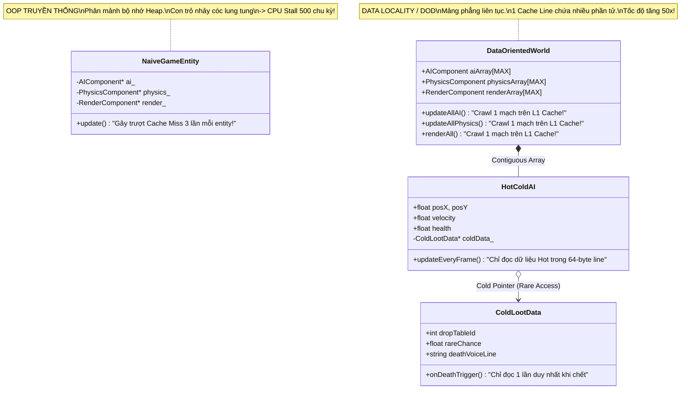
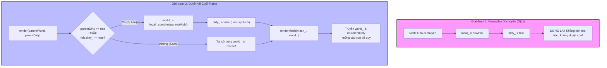

# ĐỢT 9 / 10: BÓC TÁCH KIẾN TRÚC & OOAD CHUYÊN SÂU
## Tác phẩm: *Game Programming Patterns* – Robert Nystrom
### Nội dung khảo sát: Chương 17 (Data Locality) & Chương 18 (Dirty Flag)

---

# CHƯƠNG 17: DATA LOCALITY PATTERN (MẪU ĐỊA PHƯƠNG HÓA DỮ LIỆU)

---

## 1. ĐỀ MỤC & MỤC TIÊU CỐT LÕI (CORE PURPOSE)

### 1.1. Cấu trúc toàn bộ đề mục chương
- **Intent (Ý đồ thiết kế)**
- **Motivation (Bối cảnh động lực)**
  - *The hardware lie: Processor and RAM speed gap (Lời nói dối phần cứng: Hố sâu tốc độ giữa CPU và RAM)*
  - *A data warehouse (Ẩn dụ Nhà kho dữ liệu & Anh kế toán)*
  - *A pallet for your CPU: CPU Caching (Kiện hàng cho CPU: Kiến trúc bộ nhớ đệm L1, L2, L3)*
  - *Cache lines, Cache hit, Cache miss, and CPU stalls (Dòng đệm, Trúng đệm, Trượt đệm và Sự đình trệ chu kỳ CPU)*
  - *Wait, data is performance? (Bất ngờ lớn: Bố cục dữ liệu chính là hiệu năng)*
- **The Pattern (Mô hình mẫu thiết kế)**
- **When to Use It (Khi nào nên sử dụng)**
  - *Đo đạc bằng Profiler chuyên dụng (Cachegrind)*
  - *Sự đánh đổi với tính trừu tượng OOP*
- **Keep in Mind (Những lưu ý cốt tử)**
  - *Sự hy sinh các tính năng hướng đối tượng (Con trỏ, Kế thừa, Bảng hàm ảo vtable)*
- **Sample Code (Mã nguồn mẫu)**
  - *Contiguous arrays (Mảng dữ liệu liên tục thay thế con trỏ rời rạc)*
  - *Packed data (Dồn nén dữ liệu hạt: Phân vùng Active/Inactive không rẽ nhánh)*
  - *Hot/cold splitting (Phân tách dữ liệu Nóng / Lạnh để bảo toàn dòng đệm)*
- **Design Decisions (Các quyết định kiến trúc)**
  - *How do you handle polymorphism? (Xử lý tính đa hình thế nào: Tránh hoàn toàn, Mảng riêng cho từng kiểu, hay Dùng mảng con trỏ?)*
  - *How are game entities defined? (Thực thể game được định nghĩa ra sao: Entity giữ con trỏ, Entity giữ ID, hay Entity chỉ đơn thuần là một con số ID - ECS thuần túy?)*
- **See Also (Mối liên hệ: Component, Object Pool, Data-Oriented Design, Artemis Engine)**

### 1.2. Vấn đề kỹ thuật thực tế & Thảm họa nếu không áp dụng
- **Vấn đề kỹ thuật thực tế:**
  Từ năm 1980 đến nay, tốc độ xung nhịp CPU tăng hàng nghìn lần, nhưng tốc độ truy xuất của RAM chỉ tăng với tốc độ ốc sên (hiện tượng *Memory Wall*). Để nạp một byte từ RAM vào thanh ghi CPU, phần cứng mất từ **200 đến 500 chu kỳ xung nhịp (clock cycles)**. Trong khoảng thời gian đó, CPU hoàn toàn không làm gì cả mà phải ngồi chờ (*CPU Stalls*).
- **Thảm họa nếu duy trì tư duy Lập trình Hướng đối tượng ngây thơ (Naive OOP):**
  1. **Đuổi bắt con trỏ (Pointer Chasing Hell):** Trong mô hình OOP kinh điển, một thực thể `GameEntity` nằm ở một ô nhớ heap ngẫu nhiên; nó trỏ sang `AIComponent` ở một ô nhớ khác, rồi trỏ tiếp sang `PhysicsComponent` ở ô nhớ thứ ba. Khi duyệt 10.000 quái vật trong game loop, CPU liên tục nhảy cóc lung tung khắp không gian địa chỉ bộ nhớ (RAM address space), gây ra hiện tượng **Trượt dòng đệm liên hoàn (Thrashing the CPU Cache)**.
  2. **Tổn thất hiệu năng tới 50 lần (50x Performance Degradation):** Robert Nystrom đã thực nghiệm đo đạc: Hai chương trình thực hiện cùng một thuật toán toán học giống hệt nhau, nhưng chương trình bố trí dữ liệu liên tục chạy **nhanh gấp 50 lần** chương trình dùng con trỏ nhảy cóc OOP.
  3. **Tràn dòng đệm bởi dữ liệu rác (Cache Line Pollution):** Một dòng đệm CPU (Cache Line) thường có kích thước 64 bytes. Nếu struct của đối tượng chứa lẫn lộn cả thuộc tính cần cập nhật mỗi frame lẫn thuộc tính hiếm khi dùng (như danh sách vật phẩm rơi ra khi chết), thì 80% dung lượng Cache quý giá bị chiếm dụng bởi dữ liệu rác vô dụng, khiến số lượng thực thể cập nhật được trong một frame giảm sút thê thảm.

---

## 2. PHÂN TÍCH LÝ THUYẾT & NGUYÊN LÝ CHUYÊN SÂU

### 2.1. Bản chất phần cứng: CPU Cache Hierarchy & Cache Line
- **Nguyên lý Cục bộ Tham chiếu (Locality of Reference):**
  - *Cục bộ Không gian (Spatial Locality):* Khi CPU đọc một ô nhớ tại địa chỉ $X$, nó phỏng đoán rằng bạn sẽ sớm đọc các ô nhớ lân cận $X+1, X+2$. Do đó, bộ điều khiển bộ nhớ tự động nạp nguyên một khối liên tục 64 bytes (gọi là **Cache Line**) vào bộ đệm L1/L2.
  - *Cục bộ Thời gian (Temporal Locality):* Dữ liệu vừa truy cập có khả năng cao sẽ được truy cập lại trong tương lai gần.
- **Tư duy Hướng Dữ liệu (Data-Oriented Design - DOD):**
  - Chuyển trọng tâm từ "Đóng gói mã nguồn & đối tượng" sang "Tối ưu hóa luồng dữ liệu chảy qua thanh ghi CPU".
  - Bố trí dữ liệu trong bộ nhớ sao cho: **Mỗi byte được nạp vào Cache Line đều phải được CPU xử lý hết trước khi nạp Cache Line tiếp theo**.

### 2.2. Ba kỹ thuật kiến trúc cốt lõi của Data Locality

```
1. MẢNG LIÊN TỤC (Contiguous Array):
[ AIComponent #1 ][ AIComponent #2 ][ AIComponent #3 ][ AIComponent #4 ] -> Nạp 1 Cache Line ăn ngay 4 Component!

2. PHÂN VÙNG DỒN NÉN (Packed Data Partition):
Index:    0      1      2       3          4          5
Data:   [Act1] [Act2] [Act3] | [Inact1]   [Inact2]   [Inact3]
                             ▲
                         numActive_ (Duyệt từ 0 đến numActive_, không cần lệnh if)

3. TÁCH NÓNG / LẠNH (Hot/Cold Splitting):
Mảng Nóng (Mỗi frame): [ Pos, Velocity, Energy ] [ Pos, Velocity, Energy ] (Cache-friendly)
                              │
                              ▼ con trỏ
Mảng Lạnh (Khi chết):   [ LootTable, DropChances, DeathSound ]
```

1. **Mảng thành phần liên tục (Contiguous Component Arrays):** Thay vì lưu mảng `GameEntity*` trỏ tới các `Component*`, ta tách thành các mảng phẳng: `AIComponent[]`, `PhysicsComponent[]`, `RenderComponent[]`. Game Loop duyệt tuần tự qua từng mảng phẳng, xóa bỏ hoàn toàn toán tử trỏ `->`.
2. **Dồn nén dữ liệu (Packed Data):** Trong hệ thống hạt (Particle System) hoặc quái vật, ta chia mảng làm 2 vùng: *Active* (nằm ở đầu mảng từ $0$ đến `numActive_ - 1`) và *Inactive* (nằm ở cuối mảng). Khi một hạt tắt hoặc kích hoạt, ta hoán đổi (*Swap*) nó với phần tử tại ranh giới `numActive_` với chi phí $O(1)$. Loại bỏ hoàn toàn câu lệnh `if (particle.isActive())` gây lỗi đoán nhánh (*branch misprediction*) và trượt pipeline CPU.
3. **Phân tách Nóng / Lạnh (Hot/Cold Splitting):** Tách cấu trúc dữ liệu thành 2 phần:
   - *Hot Data (Dữ liệu Nóng):* Những biến đọc/ghi mỗi khung hình (Animation State, Position, Velocity). Được ép chặt trong mảng phẳng để tối đa hóa số đối tượng nhét vừa 1 Cache Line.
   - *Cold Data (Dữ liệu Lạnh):* Những biến hiếm khi đụng đến (Loot Drop Table, Quest ID khi chết). Được cất riêng sang struct khác và liên kết qua con trỏ hoặc chỉ số song song.

---

## 3. MỔ XẺ MÃ NGUỒN (CODE DEEP-DIVE)

### 3.1. Hiện thực hóa Data Locality: Packed Particle System & Hot/Cold Splitting

```cpp
#include <iostream>
#include <cassert>

// ============================================================================
// 1. KỸ THUẬT PACKED DATA: DỒN NÉN KHÔNG CẦN NHÁNH RẼ (BRANCHLESS POOL)
// ============================================================================
class Particle
{
public:
    void update()
    {
        // Cập nhật vị trí và vận tốc (Dữ liệu nằm liên tục trên Cache Line)
        x_ += vx_;
        y_ += vy_;
    }

    // Dữ liệu nội tại nhỏ gọn, không chứa con trỏ hay biến cờ isActive
    float x_, y_;
    float vx_, vy_;
};

class ParticleSystem
{
public:
    ParticleSystem() : numActive_(0) {}

    // Vòng lặp cập nhật đạt tốc độ tối đa: 100% Cache Hit, KHÔNG CÓ IF CHECK!
    void update()
    {
        for (int i = 0; i < numActive_; ++i)
        {
            particles_[i].update();
        }
    }

    // Kích hoạt một hạt: Hoán đổi với hạt không hoạt động đầu tiên
    void activateParticle(int index)
    {
        assert(index >= numActive_ && "Particle đã active rồi!");

        // Swap phần tử kích hoạt vào vị trí ranh giới numActive_
        Particle temp = particles_[numActive_];
        particles_[numActive_] = particles_[index];
        particles_[index] = temp;

        numActive_++; // Mở rộng vùng hoạt động
    }

    // Hủy kích hoạt một hạt: Hoán đổi với hạt hoạt động cuối cùng
    void deactivateParticle(int index)
    {
        assert(index < numActive_ && "Particle đã inactive rồi!");

        numActive_--; // Thu hẹp vùng hoạt động

        // Swap phần tử cần hủy với phần tử active cuối cùng
        Particle temp = particles_[numActive_];
        particles_[numActive_] = particles_[index];
        particles_[index] = temp;
    }

private:
    static const int MAX_PARTICLES = 100000;
    int numActive_;
    Particle particles_[MAX_PARTICLES]; // Mảng phẳng liên tục tuyệt đối
};

// ============================================================================
// 2. KỸ THUẬT HOT/COLD SPLITTING: TÁCH BIỆT DỮ LIỆU NÓNG VÀ LẠNH
// ============================================================================

// DỮ LIỆU LẠNH: Chỉ dùng 1 lần duy nhất khi quái vật bị tiêu diệt
struct LootDropColdData
{
    int minGold;
    int maxGold;
    int dropItemTableId;
    float rareDropRate;
};

// DỮ LIỆU NÓNG: CPU liên tục đọc/ghi mỗi khung hình (60 - 120 FPS)
class AIComponentHot
{
public:
    void update()
    {
        // Tính toán hướng di chuyển, cập nhật thể lực
        posX += dirX;
        posY += dirY;
        energy -= 0.1f;
    }

    void onKilled()
    {
        // Chỉ khi chết mới nhảy qua con trỏ lạnh để tính toán nhặt đồ
        if (coldLootData_ != nullptr)
        {
            // Drop loot using coldLootData_->dropItemTableId;
        }
    }

    // 24 bytes nóng - nhét vừa vặn nhiều đối tượng trong 1 Cache Line (64 bytes)
    float posX, posY;
    float dirX, dirY;
    float energy;
    LootDropColdData* coldLootData_; // Con trỏ trỏ tới vùng dữ liệu lạnh tách rời
};
```

### 3.2. Bảng phân tích chi tiết mã nguồn

| Dòng code / Đoạn code then chốt | Giải thích kỹ thuật & Ý nghĩa thiết kế |
| :--- | :--- |
| `Particle particles_[MAX_PARTICLES];` | **Bố cục bộ nhớ phẳng (Flat Memory Layout):** Toàn bộ 100.000 hạt được cấp phát trên một khối nhớ liền mạch duy nhất. Khi CPU nạp một hạt, các hạt kế tiếp được kéo theo vào Cache Line tự động. |
| `for (int i = 0; i < numActive_; ++i)` | **Loại trừ lỗi đoán nhánh (Branchless Loop):** Loại bỏ hoàn toàn câu lệnh `if (particles[i].isActive())`. CPU chạy thẳng một mạch không bị gián đoạn, ngăn ngừa hiện tượng xả ống lệnh (*pipeline flush*). |
| `particles_[numActive_] = particles_[index];` | **Hoán đổi ranh giới O(1) (In-place Partition Swap):** Giữ cho tập hợp phần tử active luôn dồn về đầu mảng mà không cần chạy thuật toán sắp xếp tốn kém. |
| Không có biến `bool isActive_;` trong `Particle` | **Tiết kiệm kích thước struct (Struct Shrinking):** Trạng thái active được suy diễn từ chỉ số `i < numActive_`. Giảm kích thước `Particle` giúp tăng số lượng hạt nhét vừa vào một Cache Line 64-byte. |
| `LootDropColdData* coldLootData_;` | **Kỹ thuật Hot/Cold Splitting:** Đẩy toàn bộ dữ liệu cấu hình rơi đồ (loot table) ra ngoài mảng chính. Nhờ đó mảng AI Component thu nhỏ kích thước tối đa, tăng mật độ nạp dữ liệu hữu ích lên CPU. |

---

## 4. SƠ ĐỒ TRỰC QUAN HÓA (MERMAID ARCHITECTURE)



---

## 5. ÁNH XẠ ỨNG DỤNG VÀO DỰ ÁN GAME OOP (2.5D MULTIPLAYER COMBAT)

1. **Hệ thống Quản lý Đạn đạo và Hiệu ứng Đánh trúng (Hitscan & Projectile Simulation):**
   - Trong game chiến đấu đối kháng có hàng ngàn viên đạn ma thuật, mảnh vỡ kiếm khí và tia sét trên màn hình.
   - Thay vì tạo mỗi viên đạn là một `class Projectile : public GameObject` với con trỏ ảo, ta thiết kế một `ProjectileManager` sử dụng kỹ thuật **Packed Data**:
     - Mảng phẳng `ProjectileData projectiles_[MAX_PROJECTILES]`.
     - Chỉ số `numActiveProjectiles_` dồn toàn bộ đạn đang bay lên đầu mảng.
     - Luồng cập nhật vật lý bay quét qua mảng phẳng với tốc độ SIMD/Cache tối đa, triệt tiêu 100% tình trạng tụt FPS khi hai bên tung chiêu bão đạn cùng lúc.
2. **Kiến trúc Tách biệt Nhân vật Chiến đấu (Combat Entity Hot/Cold Memory):**
   - Mỗi nhân vật có các trường dữ liệu "Nóng": Tọa độ $X, Y$, Vector vận tốc, Hộp va chạm Hitbox thời gian thực, Khung hoạt ảnh hiện tại. Toàn bộ thông tin này nằm trong struct phẳng `CombatTransformData`.
   - Các trường dữ liệu "Lạnh": Tiểu sử nhân vật, Danh sách skin trang phục sở hữu, Bảng chỉ số thành tựu, Danh sách voice chat. Được tách sang `EntityProfileColdData`. Khi tính toán hitbox va chạm PvP, server chỉ nạp mảng dữ liệu Nóng, giúp một Server duy nhất có thể chịu tải 200 người chơi giao tranh liên tục với tickrate 128 Hz mà không bị nghẽn CPU Cache.

---
---

# CHƯƠNG 18: DIRTY FLAG PATTERN (MẪU CỜ BẨN)

---

## 1. ĐỀ MỤC & MỤC TIÊU CỐT LÕI (CORE PURPOSE)

### 1.1. Cấu trúc toàn bộ đề mục chương
- **Intent (Ý đồ thiết kế)**
- **Motivation (Bối cảnh động lực)**
  - *Scene graph (Đồ thị cảnh phân cấp)*
  - *Local and world transforms (Ma trận biến đổi cục bộ và Ma trận thế giới)*
  - *The pirate ship, crow's nest, pirate, and parrot hierarchy (Cây phân cấp: Tàu hải tặc -> Chòi quan sát -> Thủy thủ -> Con vẹt)*
  - *Cached world transforms (Lưu đệm ma trận thế giới)*
  - *The problem: Eager recalculation waste (Thảm họa: Lãng phí khi tính toán hấp tấp)*
  - *Deferred recalculation (Trì hoãn tính toán cho đến khi cần thiết)*
- **The Pattern (Mô hình mẫu thiết kế)**
- **When to Use It (Khi nào nên sử dụng)**
  - *Dữ liệu sơ cấp thay đổi thường xuyên hơn dữ liệu phái sinh được dùng*
  - *Tính toán phái sinh có chi phí đắt đỏ hoặc khó tính toán gia tăng (incremental)*
- **Keep in Mind (Những lưu ý cốt tử)**
  - *There is a cost to deferring for too long (Cái giá của sự trì hoãn quá lâu: Dồn toa gây khựng hình)*
  - *Cache invalidation: Setting the flag every time state changes (Hiểm họa quên bật cờ bẩn)*
  - *You have to keep previous derived data in memory (Đánh đổi bộ nhớ lưu trữ kết quả đệm)*
- **Sample Code (Mã nguồn mẫu)**
  - *Transform matrix combination (Kết hợp ma trận)*
  - *GraphNode bare minimum (Cấu trúc nút cơ bản)*
  - *Unoptimized recursive traversal (Duyệt đệ quy chưa tối ưu)*
  - *Let’s get dirty: world_ cache and dirty_ flag (Áp dụng cờ bẩn: Lưu đệm và bật cờ)*
  - *Clever cascading: Passing parent dirty bit down recursive call tree (Truyền cờ bẩn xuôi dòng mà không cần đệ quy bật cờ con cái)*
- **Design Decisions (Các quyết định kiến trúc)**
  - *When is the dirty flag cleaned? (Cờ bẩn được làm sạch khi nào: Khi cần kết quả, Tại các chốt kiểm tra Checkpoints, hay Chạy nền Background với cơ chế trễ Hysteresis?)*
  - *How fine-grained is your dirty tracking? (Độ mịn của việc theo dõi cờ: Độ mịn chi tiết Fine-grained vs Độ mịn thô Coarse-grained?)*
- **See Also (Mối liên hệ: Angular Change Detection, Physics Engine sleep/awake bit)**

### 1.2. Vấn đề kỹ thuật thực tế & Thảm họa nếu không áp dụng
- **Vấn đề kỹ thuật thực tế:**
  Trong đồ thị cảnh (Scene Graph) của game 2.5D/3D, các đối tượng liên kết cha-con dạng cây: Con tàu di chuyển kéo theo chòi quan sát, chòi quan sát kéo theo tên cướp biển, tên cướp biển kéo theo con vẹt trên vai.
  Để vẽ được con vẹt, ta cần **Ma trận thế giới (World Transform)** bằng cách nhân liên tiếp các **Ma trận cục bộ (Local Transform)** từ gốc đến lá: $\text{World}_{\text{parrot}} = \text{Local}_{\text{parrot}} \times \text{Local}_{\text{pirate}} \times \text{Local}_{\text{nest}} \times \text{Local}_{\text{ship}}$.
  Phép nhân ma trận $4 \times 4$ là phép toán dấu phẩy động tốn kém tài nguyên CPU.
- **Thảm họa nếu tính toán hấp tấp (Eager Recalculation):**
  Trong một khung hình, con tàu bập bênh trên sóng (tàu đổi góc), gió thổi làm lắc chòi (chòi đổi vị trí), tên cướp biển ngả người (người đổi tư thế), con vẹt vỗ cánh (vẹt đổi góc).
  Nếu mỗi khi một node cha đổi vị trí, nó lập tức đệ quy tính toán lại tọa độ thế giới cho toàn bộ cây con:
  - Con vẹt bị tính lại ma trận thế giới **4 lần liên tiếp** trong cùng một frame!
  - 3 phép tính trước đó hoàn toàn bị vứt vào sọt rác vì con vẹt chỉ được vẽ đúng 1 lần vào cuối frame.
  - Trên quy mô hàng chục ngàn node của cảnh game, CPU lãng phí hàng triệu phép nhân ma trận vô ích, gây tụt khung hình trầm trọng.

---

## 2. PHÂN TÍCH LÝ THUYẾT & NGUYÊN LÝ CHUYÊN SÂU

### 2.1. Bản chất kiến trúc: Trì hoãn Tính toán & Đánh dấu Vô hiệu hóa (Lazy Evaluation & Invalidation)
- **Dữ liệu Sơ cấp (Primary Data):** Dữ liệu nguồn gốc biến thiên (ví dụ: `localTransform_`).
- **Dữ liệu Phái sinh (Derived Data):** Dữ liệu được tính toán ra từ nguồn sơ cấp thông qua một quy trình nặng nề (ví dụ: `worldTransform_`).
- **Cờ bẩn (Dirty Flag - một bit boolean `dirty_`):**
  - Khi dữ liệu sơ cấp thay đổi: Chỉ đơn thuần gán `dirty_ = true;` với chi phí $O(1)$. **Tuyệt đối không tính toán ngay**.
  - Khi hệ thống thực sự cần dữ liệu phái sinh (ví dụ: đến giai đoạn `render`): Kiểm tra cờ `dirty_`.
    - Nếu `dirty_ == true`: Thực hiện tính toán ma trận, lưu đệm vào `worldTransform_`, và hạ cờ `dirty_ = false;`.
    - Nếu `dirty_ == false`: Sử dụng trực tiếp giá trị trong bộ đệm cũ mà không tốn một chu kỳ tính toán nào.

```
[Thay đổi vị trí]
Ship moves   ──► Ship.dirty = true
Nest sways   ──► Nest.dirty = true    (Chi phí cực rẻ: O(1) gán cờ, KHÔNG NHÂN MA TRẬN)
Parrot hops  ──► Parrot.dirty = true
                        │
                        ▼ (Đến cuối khung hình lúc Render)
[Giai đoạn Render]
Duyệt từ gốc xuống lá:
World(Ship)   = Combine(Ship.local, Origin)         -> Ship.dirty = false
World(Nest)   = Combine(Nest.local, World(Ship))    -> Nest.dirty = false
World(Pirate) = Combine(Pirate.local, World(Nest))  -> Pirate.dirty = false
World(Parrot) = Combine(Parrot.local, World(Pirate))-> Parrot.dirty = false
==> KẾT QUẢ: Con vẹt chỉ bị tính ma trận ĐÚNG 1 LẦN DUY NHẤT!
```

### 2.2. Kỹ thuật Lan truyền Cờ bẩn Xuôi dòng (Cascading Dirty Propagation)
- Một vấn đề đau đầu: Khi node cha di chuyển, toàn bộ các con cháu chắt của nó trên lý thuyết đều bị "bẩn". Nếu trong hàm `setTransform()` của cha, ta phải đệ quy duyệt xuống toàn bộ cây con để gán `child->dirty_ = true`, ta lại tự rước lấy chi phí duyệt cây $O(N)$ đắt đỏ.
- **Giải pháp xuất sắc của Nystrom:**
  - Trong hàm `setTransform()`, cha chỉ gán cờ bẩn cho **chính nó**: `dirty_ = true;`.
  - Trong hàm duyệt vẽ `render(parentWorld, parentDirty)`, tham số `parentDirty` được truyền từ trên xuống:
    $$\text{currentDirty} = \text{parentDirty} \mid \text{this->dirty\_}$$
  - Nếu bất kỳ node cha nào phía trên bị bẩn, toàn bộ nhánh con phía dưới tự động thừa hưởng trạng thái bẩn trong quá trình duyệt vẽ xuôi dòng mà không cần bất kỳ bước đệ quy đánh dấu trước nào!

---

## 3. MỔ XẺ MÃ NGUỒN (CODE DEEP-DIVE)

### 3.1. Hiện thực hóa Scene Graph với Dirty Flag và Cascading Propagation

```cpp
#include <iostream>

// Giả lập thư viện Ma trận biến đổi
class Transform
{
public:
    static Transform origin() { return Transform(0); }
    Transform combine(const Transform& parentWorld) const
    {
        // Giả lập phép nhân ma trận 4x4 đắt đỏ
        return Transform(value_ + parentWorld.value_);
    }

    Transform(int val = 0) : value_(val) {}
    int value_;
};

class Mesh {};
void renderMesh(Mesh* mesh, const Transform& transform)
{
    // Gửi lệnh vẽ đỉnh hình học xuống GPU
}

// ============================================================================
// LỚP ĐỒ THỊ CẢNH SCENE GRAPH NODE ÁP DỤNG MẪU THIẾT KẾ DIRTY FLAG
// ============================================================================
class GraphNode
{
public:
    GraphNode(Mesh* mesh)
    : mesh_(mesh),
      local_(Transform::origin()),
      world_(Transform::origin()),
      dirty_(true), // Khởi tạo bẩn vì chưa từng tính tọa độ thế giới
      numChildren_(0)
    {}

    // Khi thay đổi vị trí: Chỉ gán cờ nội bộ O(1), KHÔNG DUYỆT CÂY CON!
    void setTransform(Transform local)
    {
        local_ = local;
        dirty_ = true; // Đánh dấu dữ liệu thế giới đã lỗi thời
    }

    void addChild(GraphNode* child)
    {
        if (numChildren_ < MAX_CHILDREN)
        {
            children_[numChildren_++] = child;
        }
    }

    // Duyệt vẽ thông minh: Kết hợp cờ bẩn của cha và con xuôi dòng
    void render(Transform parentWorld, bool isParentDirty)
    {
        // 1. Lan truyền trạng thái bẩn: Bẩn nếu bản thân bẩn HOẶC cha bẩn
        bool isCurrentDirty = isParentDirty || dirty_;

        // 2. Chỉ tính toán lại ma trận khi thực sự bị bẩn
        if (isCurrentDirty)
        {
            world_ = local_.combine(parentWorld); // Phép nhân ma trận duy nhất
            dirty_ = false;                      // Làm sạch cờ bẩn
        }

        // 3. Kết xuất Mesh tại vị trí thế giới đã được làm mới hoặc lấy từ cache
        if (mesh_)
        {
            renderMesh(mesh_, world_);
        }

        // 4. Đệ quy xuống các con, truyền tiếp ma trận thế giới và cờ bẩn
        for (int i = 0; i < numChildren_; ++i)
        {
            children_[i]->render(world_, isCurrentDirty);
        }
    }

private:
    static const int MAX_CHILDREN = 8;
    GraphNode* children_[MAX_CHILDREN];
    int numChildren_;

    Mesh* mesh_;
    Transform local_;  // Dữ liệu sơ cấp (Primary Data)
    Transform world_;  // Dữ liệu phái sinh được lưu đệm (Cached Derived Data)
    bool dirty_;       // Cờ bẩn theo dõi tính hợp lệ của cache
};
```

### 3.2. Bảng phân tích chi tiết mã nguồn

| Dòng code / Đoạn code then chốt | Giải thích kỹ thuật & Ý nghĩa thiết kế |
| :--- | :--- |
| `dirty_(true)` | **Bất biến khởi tạo an toàn:** Khi một Node mới sinh ra, ma trận `world_` chưa từng được tính toán với chuỗi cha, do đó bắt buộc phải khởi tạo ở trạng thái bẩn để ép tính lần đầu. |
| `void setTransform(...) { local_ = local; dirty_ = true; }` | **Cắt giảm tối đa chi phí thay đổi ($O(1)$ Mutation):** Việc di chuyển hoặc xoay đối tượng chỉ tốn 2 phép gán bộ nhớ, không đệ quy, không phụ thuộc vào độ sâu của cây phả hệ. |
| `bool isCurrentDirty = isParentDirty \|\| dirty_;` | **Lan truyền cờ bẩn xuôi dòng (Cascading Invalidation):** Giải quyết triệt để bài toán node con bị gián tiếp làm bẩn bởi tổ tiên mà không tốn công duyệt ngược hoặc duyệt trước. |
| `if (isCurrentDirty) { world_ = local_.combine(...); dirty_ = false; }` | **Trì hoãn tính toán (Lazy Evaluation):** Nếu cả node và cha mẹ đều không di chuyển, phép toán nhân ma trận được bỏ qua hoàn toàn, tái sử dụng 100% `world_` từ cache frame trước. |
| `children_[i]->render(world_, isCurrentDirty);` | **Tận dụng dữ liệu trung gian:** Ma trận `world_` vừa tính của cha được truyền thẳng xuống làm `parentWorld` cho con, tránh việc con phải leo ngược lên cây cha để tính toán. |

---

## 4. SƠ ĐỒ TRỰC QUAN HÓA (MERMAID ARCHITECTURE)



---

## 5. ÁNH XẠ ỨNG DỤNG VÀO DỰ ÁN GAME OOP (2.5D MULTIPLAYER COMBAT)

1. **Cây Khung xương Hoạt ảnh & Khớp vũ khí (Skeletal Hierarchy & Weapon Sockets):**
   - Trong game chiến đấu 2.5D, thanh kiếm được gắn vào khớp bàn tay (`HandBone`), bàn tay gắn vào cẳng tay, cẳng tay gắn vào thân trên, thân trên gắn vào hông (`RootMotion`).
   - Khi nhân vật thi triển chuỗi combo kiếm pháp, hoạt ảnh làm rung lắc toàn bộ các khớp xương.
   - Nhờ Dirty Flag, vị trí va chạm của lưỡi kiếm (Sword Hitbox) chỉ được tính toán ma trận thế giới đúng vào thời điểm engine thực hiện kiểm tra va chạm đòn đánh (`checkHitboxCollision()`), loại bỏ hoàn toàn các phép tính ma trận thừa thãi trong các khung hình nhân vật đang nghỉ (idle).
2. **Đồng bộ hóa Trạng thái Mạng Client-Server (Network State Replication):**
   - Một thực thể nhân vật có hàng trăm thuộc tính: Máu, Giáp, Mana, Tọa độ, Bùa lợi (Buffs), Cấp độ, Trang bị.
   - Mỗi khi người chơi trúng đòn hoặc nhặt đồ, thuộc tính tương ứng bị thay đổi và bật cờ bẩn: `dirtyBits_ |= MASK_HEALTH;`.
   - Khi Server tick gói tin mạng (ví dụ: 30 lần/giây), Server không bao giờ gửi toàn bộ struct 1.000 bytes qua mạng. Server chỉ kiểm tra cờ bẩn: nếu `dirtyBits_ == 0` thì không gửi gì; nếu có bẩn thì chỉ đóng gói đúng các trường bị bẩn rồi xóa cờ `dirtyBits_ = 0`. Kỹ thuật này giúp tiết kiệm 90% băng thông đường truyền mạng cho game đối kháng nhiều người chơi.
