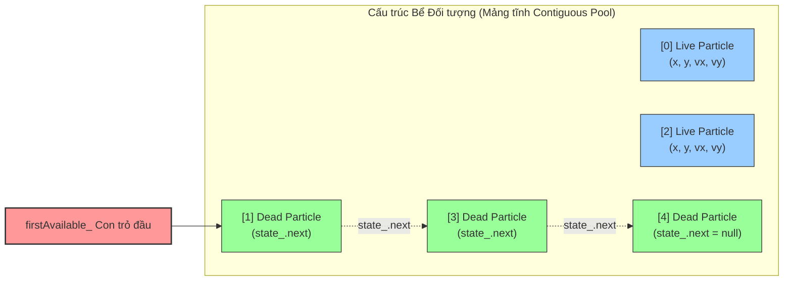
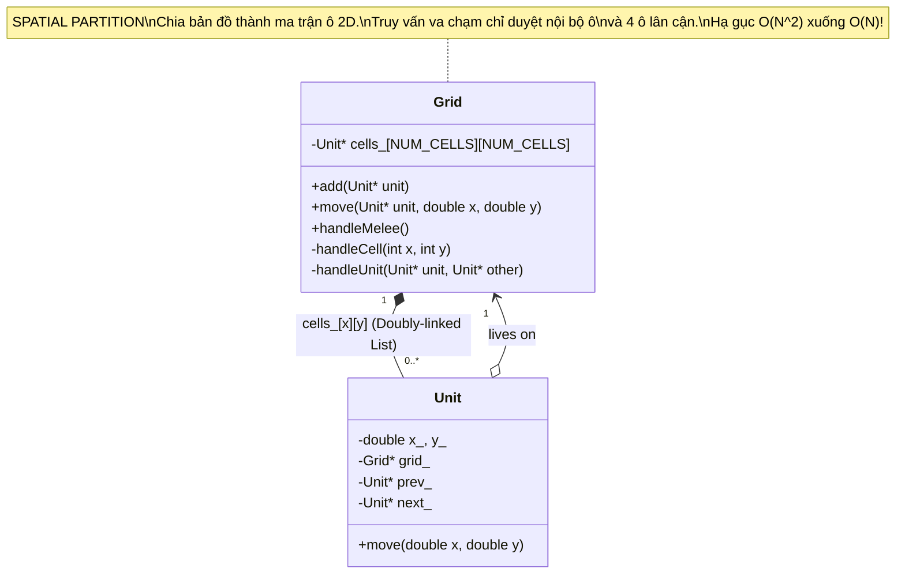

# ĐỢT 10 / 10: BÓC TÁCH KIẾN TRÚC & OOAD CHUYÊN SÂU
## Tác phẩm: *Game Programming Patterns* – Robert Nystrom
### Nội dung khảo sát: Chương 19 (Object Pool) & Chương 20 (Spatial Partition)

---

# CHƯƠNG 19: OBJECT POOL PATTERN (MẪU BỂ ĐỐI TƯỢNG)

---

## 1. ĐỀ MỤC & MỤC TIÊU CỐT LÕI (CORE PURPOSE)

### 1.1. Cấu trúc toàn bộ đề mục chương
- **Intent (Ý đồ thiết kế)**
- **Motivation (Bối cảnh động lực)**
  - *The visual effects particle system (Hệ thống hạt hiệu ứng hình ảnh)*
  - *The curse of fragmentation (Lời nguyền phân mảnh bộ nhớ Heap)*
  - *Passing the soak tests (Vượt qua bài kiểm thử ngâm máy nhiều ngày)*
  - *The best of both worlds (Dung hòa: Cấp phát tĩnh một lần nhưng tái sử dụng linh hoạt)*
- **The Pattern (Mô hình mẫu thiết kế)**
- **When to Use It (Khi nào nên sử dụng)**
  - *Tần suất tạo/hủy đối tượng dày đặc*
  - *Các đối tượng có kích thước đồng nhất*
  - *Cấp phát trên Heap quá chậm hoặc gây phân mảnh*
  - *Tái sử dụng các tài nguyên đắt đỏ (Network/Audio/DB)*
- **Keep in Mind (Những lưu ý cốt tử)**
  - *The pool may waste memory on unneeded objects (Bể đối tượng có thể lãng phí RAM nếu định cỡ quá lớn)*
  - *Only a fixed number of objects can be active at any one time (Số lượng đối tượng bị giới hạn trần: 4 chiến lược xử lý khi cạn bể)*
  - *Memory size for each object is fixed (Kích thước mỗi ô nhớ bị cố định theo đối tượng lớn nhất)*
  - *Reused objects aren’t automatically cleared: The 0x1deadb0b bug (Hiểm họa rác dữ liệu sót lại từ kiếp trước)*
  - *Unused objects will remain in memory (Rò rỉ tham chiếu trong môi trường GC)*
- **Sample Code (Mã nguồn mẫu)**
  - *A simple particle system (Hệ thống hạt cơ bản và nhược điểm duyệt tìm O(N))*
  - *A free list (Danh sách tự do lồng ghép: Tiêu hóa bộ nhớ chết O(1))*
  - *Using C++ union to avoid memory overhead (Dùng union để tái sử dụng ô nhớ biến)*
- **Design Decisions (Các quyết định kiến trúc)**
  - *Are objects coupled to the pool? (Đối tượng có bị ghép nối chặt với Bể không: Đối tượng biết mình trong Bể vs Generic Pool tổng quát?)*
  - *What is responsible for initializing reused objects? (Ai chịu trách nhiệm khởi tạo lại đối tượng: Bể khởi tạo nội bộ vs Caller bên ngoài tự cấu hình?)*
- **See Also (Mối liên hệ: Flyweight vs Object Pool, Data Locality)*

### 1.2. Vấn đề kỹ thuật thực tế & Thảm họa nếu không áp dụng
- **Vấn đề kỹ thuật thực tế:**
  Trong game, hàng loạt đối tượng sinh ra và chết đi liên tục trong tích tắc: Hàng ngàn hạt tia lửa ma thuật, đạn pháo, vỏ đạn rơi, âm thanh va chạm, hiệu ứng máu me.
  Nếu dùng toán tử cấp phát động chuẩn (`new` / `delete` trong C++ hoặc `malloc` / `free` trong C), bộ quản lý bộ nhớ của hệ điều hành sẽ phân bổ các khối nhớ rải rác trên Heap.
- **Thảm họa nếu không áp dụng (The Curse of Memory Fragmentation):**
  1. **Phân mảnh bộ nhớ Heap (Memory Fragmentation):** Sau một thời gian chơi, Heap bị xé nát thành hàng triệu lỗ hổng nhỏ li ti. Mặc dù tổng dung lượng RAM còn trống rất lớn (ví dụ: còn 100 MB), nhưng không có một khối nhớ liên tục nào đủ lớn (ví dụ: cần 12 KB liên tục để nạp mô hình Boss). Kết quả: Lệnh `new` ném ngoại lệ `OutOfMemory` và game sập ngay lập tức!
  2. **Thất bại trong bài kiểm tra ngâm máy (Soak Test Failure):** Các hãng console (Sony, Microsoft, Nintendo) bắt buộc game phải chạy liên tục ở chế độ demo 48 - 72 giờ không được crash. Rò rỉ bộ nhớ li ti hoặc phân mảnh Heap tích lũy qua hàng triệu lần gọi `new/delete` là nguyên nhân số một khiến game bị từ chối phát hành.
  3. **Đình trệ do gom rác (Stop-the-World GC Pauses):** Trong C# (Unity) hoặc Java, việc liên tục tạo đối tượng tạm thời sẽ kích hoạt Garbage Collector chạy quét bộ nhớ, gây ra những cú khựng hình (frame stutter/freeze) kéo dài từ 50 đến 200 ms, phá nát trải nghiệm đối kháng.

---

## 2. PHÂN TÍCH LÝ THUYẾT & NGUYÊN LÝ CHUYÊN SÂU

### 2.1. Bản chất kiến trúc: Cấp phát trước một lần & Quản lý vòng đời nội bộ
- **Nguyên lý The Best of Both Worlds:**
  - Đối với Hệ điều hành: Game chỉ xin cấp phát đúng một mảng bộ nhớ khổng lồ liên tục ngay khi khởi động game (`Bootstrapping`), và **không bao giờ trả lại** cho đến khi tắt game. Hệ điều hành hoàn toàn không bị phân mảnh Heap.
  - Đối với Game Logic: Các hệ thống gameplay thoải mái "tạo ra" và "hủy bỏ" đối tượng thông qua cơ chế mượn và trả ô nhớ từ Bể (*Pool*).
- **Bốn chiến lược kiến trúc khi Bể bị cạn kiệt (Pool Overflow Strategies):**
  1. *Ngăn chặn tuyệt đối (Prevent outright):* Căn chỉnh kích thước bể đủ lớn cho trường hợp xấu nhất (áp dụng cho các thực thể quan trọng như Enemy, Boss, người chơi).
  2. *Bỏ qua không tạo (Just don't create):* Chấp nhận không sinh ra thêm đối tượng (áp dụng cho hiệu ứng hình ảnh, tia lửa – người chơi không thể nhận ra thiếu 1 tia lửa trong màn hình 500 tia lửa).
  3. *Cưỡng chế thu hồi đối tượng cũ nhất / ít quan trọng nhất (Forcibly kill):* Ví dụ đối với âm thanh: Khi hết kênh phát, tắt âm thanh có âm lượng nhỏ nhất hoặc ở xa người chơi nhất để nhường kênh cho tiếng nổ súng cận chiến.
  4. *Tự động mở rộng (Dynamic Growth):* Cấp phát thêm một Bể phụ (Overflow Pool) từ Heap nếu bộ nhớ cho phép.

### 2.2. Kỹ thuật Đỉnh cao: Danh sách Tự do Lồng ghép (In-Place Free List via Union)
- **Vấn đề của Free List truyền thống:** Nếu lưu riêng một mảng con trỏ để quản lý các phần tử rảnh rỗi, ta phải tốn thêm bộ nhớ tương đương $N \times 8$ bytes (trên kiến trúc 64-bit).
- **Giải pháp của Nystrom: "Tiêu hóa bộ nhớ chết" (Cannibalizing Dead Memory):**
  - Khi một hạt hạt đang hoạt động (`live`), nó cần lưu dữ liệu: tọa độ $x, y$ và vận tốc $vx, vy$.
  - Khi hạt đó chết, toàn bộ dữ liệu tọa độ và vận tốc trở nên **vô nghĩa**.
  - Bằng cách sử dụng **C++ `union`**, ta tận dụng chính các byte nhớ của $(x, y, vx, vy)$ để biến nó thành một con trỏ `Particle* next;` trỏ tới phần tử tự do tiếp theo.
  - **Hiệu quả tuyệt đối:**
    - Không tốn thêm dù chỉ 1 byte bộ nhớ ngoài!
    - Lấy đối tượng rảnh rỗi: Thao tác rút đỉnh danh sách (Pop Head) với độ phức tạp **$O(1)$ tức thời**.
    - Trả lại đối tượng: Thao tác chèn vào đầu danh sách (Push Head) với độ phức tạp **$O(1)$ tức thời**.

---

## 3. MỔ XẺ MÃ NGUỒN (CODE DEEP-DIVE)

### 3.1. Hiện thực hóa Object Pool với Free List lồng ghép qua C++ Union

```cpp
#include <iostream>
#include <cassert>

// ============================================================================
// LỚP ĐỐI TƯỢNG ĐƯỢC QUẢN LÝ TRONG BỂ: PARTICLE VỚI C++ UNION
// ============================================================================
class Particle
{
public:
    Particle() : framesLeft_(0) {}

    // Khởi tạo trạng thái sống
    void init(double x, double y, double xVel, double yVel, int lifetime)
    {
        state_.live.x = x;
        state_.live.y = y;
        state_.live.xVel = xVel;
        state_.live.yVel = yVel;
        framesLeft_ = lifetime;
    }

    // Cập nhật khung hình. Trả về true nếu hạt vừa hết hạn sống trong frame này
    bool animate()
    {
        if (!inUse()) return false;

        framesLeft_--;
        state_.live.x += state_.live.xVel;
        state_.live.y += state_.live.yVel;

        return framesLeft_ == 0; // Hạt vừa chết
    }

    bool inUse() const { return framesLeft_ > 0; }

    // Các hàm quản lý con trỏ Free List khi hạt đang ở trạng thái chết
    Particle* getNext() const { return state_.next; }
    void setNext(Particle* next) { state_.next = next; }

private:
    int framesLeft_; // Biến cờ theo dõi vòng đời

    // TẬN DỤNG CÙNG MỘT VÙNG NHỚ BẰNG UNION
    union
    {
        // 1. Trạng thái khi hạt đang sống (In-Use State)
        struct
        {
            double x, y;
            double xVel, yVel;
        } live;

        // 2. Trạng thái khi hạt đã chết (Available State trong Free List)
        Particle* next;
    } state_;
};

// ============================================================================
// LỚP BỂ ĐỐI TƯỢNG CẤP PHÁT TĨNH: PARTICLE POOL
// ============================================================================
class ParticlePool
{
public:
    ParticlePool()
    {
        // Khởi tạo Free List xâu chuỗi toàn bộ mảng hạt lúc ban đầu
        firstAvailable_ = &particles_[0];
        for (int i = 0; i < POOL_SIZE - 1; ++i)
        {
            particles_[i].setNext(&particles_[i + 1]);
        }
        particles_[POOL_SIZE - 1].setNext(nullptr); // Phần tử cuối trỏ null
    }

    // Cấp phát hạt mới: Độ phức tạp O(1) tuyệt đối!
    void create(double x, double y, double xVel, double yVel, int lifetime)
    {
        // Kiểm tra bể còn chỗ trống không
        if (firstAvailable_ == nullptr)
        {
            // Chiến lược: Bỏ qua không tạo nếu bể đầy tia lửa
            return;
        }

        // Rút hạt đầu tiên trong Free List
        Particle* newParticle = firstAvailable_;
        firstAvailable_ = newParticle->getNext();

        // Tái khởi tạo trạng thái sống
        newParticle->init(x, y, xVel, yVel, lifetime);
    }

    // Cập nhật toàn bộ các hạt trong bể
    void animate()
    {
        for (int i = 0; i < POOL_SIZE; ++i)
        {
            // Nếu hạt vừa chết trong frame này, thu hồi ngay về Free List
            if (particles_[i].animate())
            {
                // Chèn hạt chết vào đầu Free List với chi phí O(1)
                particles_[i].setNext(firstAvailable_);
                firstAvailable_ = &particles_[i];
            }
        }
    }

private:
    static const int POOL_SIZE = 1000;
    Particle particles_[POOL_SIZE]; // Cấp phát tĩnh một mảng liên tục duy nhất
    Particle* firstAvailable_;      // Con trỏ trỏ tới phần tử rảnh rỗi đầu tiên
};
```

### 3.2. Bảng phân tích chi tiết mã nguồn

| Dòng code / Đoạn code then chốt | Giải thích kỹ thuật & Ý nghĩa thiết kế |
| :--- | :--- |
| `union { struct { double ... } live; Particle* next; } state_;` | **Kỹ thuật Chồng lấn Ô nhớ (Memory Aliasing / Union Reuse):** Khi hạt chết, biến `next` tái sử dụng chính xác các byte bộ nhớ của tọa độ `x, y`. Không tốn thêm một byte RAM ngoài nào cho cấu trúc danh sách liên kết. |
| `firstAvailable_ = &particles_[0]; ... particles_[i].setNext(&particles_[i + 1]);` | **Xâu chuỗi Free List ban đầu (Threading the Free List):** Constructor biến mảng tĩnh thành một chuỗi mắt xích rảnh rỗi sẵn sàng phục vụ cấp phát tức thời. |
| `Particle* newParticle = firstAvailable_; firstAvailable_ = newParticle->getNext();` | **Cấp phát O(1) tức thì:** Thay vì duyệt $O(N)$ quét mảng để tìm ô trống, ta chỉ cần nhấc con trỏ đầu danh sách tự do và chuyển `firstAvailable_` sang mắt xích kế tiếp. |
| `particles_[i].setNext(firstAvailable_); firstAvailable_ = &particles_[i];` | **Thu hồi O(1) tức thì:** Khi hạt hết hạn sống (`framesLeft == 0`), chỉ cần 2 phép gán con trỏ để đưa ô nhớ này trở lại đầu danh sách tự do, sẵn sàng cho lần tái sinh tiếp theo. |
| `if (firstAvailable_ == nullptr) return;` | **Xử lý cạn bể an toàn (Graceful Overflow Handling):** Không bao giờ làm crash game hay gọi `new` bừa bãi khi số lượng hạt vượt quá trần quy định. |

---

## 4. SƠ ĐỒ TRỰC QUAN HÓA (MERMAID ARCHITECTURE)



---

## 5. ÁNH XẠ ỨNG DỤNG VÀO DỰ ÁN GAME OOP (2.5D MULTIPLAYER COMBAT)

1. **Hệ thống Quản lý Hiệu ứng Chiêu thức & Mảnh vỡ Đòn đánh (Combat FX Pool):**
   - Trong game chiến đấu đối kháng, mỗi đòn đánh va chạm (hit-impact) tạo ra từ 20 đến 50 hạt tia lửa, sốc điện và vệt máu.
   - Nhờ `ParticlePool`, 5.000 hạt hiệu ứng được cấp phát tĩnh ngay từ màn hình tải game (Loading Screen). Trong suốt trận đấu kéo dài hàng giờ, không có bất kỳ lệnh `new` hay `delete` nào được phát ra trên Heap, giữ cho FPS của game ổn định tuyệt đối ở mức 60/120 FPS không một gợn giật (*zero frame drop*).
2. **Bể Thực thể Đạn đạo & Quái vật Triệu hồi (Projectile & Minion Pool):**
   - Các kỹ năng như mưa tên, cầu lửa, hoặc triệu hồi lâu la đều rút thực thể từ `ProjectilePool` và `MinionPool`.
   - Khi một viên đạn bay ra khỏi màn hình hoặc quái vật bị chém chết, hàm `deactivate()` trả ô nhớ về Free List của Server và Client ngay lập tức, triệt tiêu nguy cơ rò rỉ bộ nhớ mạng (*memory leak*) khi server vận hành liên tục 24/7.

---
---

# CHƯƠNG 20: SPATIAL PARTITION PATTERN (MẪU PHÂN VÙNG KHÔNG GIAN)

---

## 1. ĐỀ MỤC & MỤC TIÊU CỐT LÕI (CORE PURPOSE)

### 1.1. Cấu trúc toàn bộ đề mục chương
- **Intent (Ý đồ thiết kế)**
- **Motivation (Bối cảnh động lực)**
  - *Sense of space in games (Cảm thức không gian và vị trí trong game)*
  - *Units on the field of battle (Các đơn vị trên chiến trường giao tranh)*
  - *The problem: Quadratic pairwise checks O(N^2) (Thảm họa kiểm tra từng cặp bậc hai)*
  - *Drawing battle lines (Ẩn dụ đường thẳng 1D: Tìm kiếm nhị phân O(N log N))*
- **The Pattern (Mô hình mẫu thiết kế)**
- **When to Use It (Khi nào nên sử dụng)**
  - *Có tập hợp đối tượng phân bố trong không gian nhiều chiều*
  - *Số lượng truy vấn tìm kiếm lân cận lớn gây nghẽn hiệu năng*
- **Keep in Mind (Những lưu ý cốt tử)**
  - *Spatial partitions exist to knock O(N^2) down to manageable complexity (Hạ bậc độ phức tạp)*
  - *Moving objects require updating spatial structure (Chi phí cập nhật khi đối tượng di chuyển)*
  - *Memory overhead for bookkeeping (Chi phí bộ nhớ cho cấu trúc chỉ mục không gian)*
- **Sample Code (Mã nguồn mẫu)**
  - *A sheet of graph paper: Fixed grid (Lưới ô vuông kích thước cố định)*
  - *A grid of linked units (Lưới danh sách liên kết đôi Unit)*
  - *Entering the field of battle: grid.add() (Thêm đơn vị vào ô)*
  - *A clash of swords: handleMelee() (Xử lý giao tranh nội bộ từng ô)*
  - *Charging forward: grid.move() (Di chuyển xuyên ranh giới ô)*
  - *At arm’s length: Neighboring cell queries (Xử lý tầm đánh: Quét 4 trong 8 ô lân cận để tránh trùng)*
- **Design Decisions (Các quyết định kiến trúc)**
  - *Is the partition hierarchical or flat? (Phân vùng Phẳng Grid vs Phân vùng Phân cấp Quadtree/Octree?)*
  - *Does partitioning depend on objects? (Độc lập đối tượng vs Thích ứng theo mật độ: BSP, k-d Tree, BVH?)*
  - *Are objects only stored in the partition? (Lưu độc quyền trong phân vùng vs Lưu thêm danh sách phẳng phụ?)*
- **See Also (Mối liên hệ: Grid là Bucket Sort, Quadtree là Trie, BSP là BST)*

### 1.2. Vấn đề kỹ thuật thực tế & Thảm họa nếu không áp dụng
- **Vấn đề kỹ thuật thực tế:**
  Trong game chiến thuật (RTS), nhập vai hành động (ARPG) hoặc game chiến đấu nhiều người chơi, hàng trăm đến hàng ngàn đơn vị di chuyển, tung chiêu và va chạm với nhau trên bản đồ. Mỗi đơn vị cần biết: *"Kẻ địch nào đang đứng gần ta trong tầm đánh kiếm (attack radius)?"*.
- **Thảm họa nếu duy trì thuật toán ngây thơ (Naive Pairwise Comparison):**
  Thuật toán duyệt 2 vòng lặp lồng nhau so sánh từng cặp đơn vị:
  $$\text{Số phép so sánh} = \frac{N \times (N - 1)}{2} \implies O(N^2)$$
  - Với $N = 100$ đơn vị: Cần $4.950$ phép tính khoảng cách mỗi frame.
  - Với $N = 1.000$ đơn vị: Cần gần **$500.000$ phép tính khoảng cách** (căn bậc hai, phép nhân tọa độ) mỗi frame!
  - Với $N = 2.000$ đơn vị: Cần **$2.000.000$ phép tính** mỗi frame $\implies$ Toàn bộ năng lực CPU bị vắt kiệt chỉ để phục vụ việc so sánh tọa độ, game tụt xuống dưới 5 FPS, đơ cứng hoàn toàn!

---

## 2. PHÂN TÍCH LÝ THUYẾT & NGUYÊN LÝ CHUYÊN SÂU

### 2.1. Bản chất kiến trúc: Divide and Conquer trong Không gian Đa chiều
- Thay vì để một mảng phẳng hỗn loạn, **Spatial Partition** tổ chức lại các đối tượng theo vị trí không gian địa lý của chúng.
- **Mô hình Lưới cố định (Fixed Grid):**
  - Trải một hệ thống lưới các ô vuông kích thước cố định (`CELL_SIZE`) lên toàn bộ bản đồ.
  - Chuyển đổi tọa độ thế giới $(x, y)$ sang tọa độ ô nhớ chỉ bằng phép chia đơn giản:
    $$\text{cellX} = \lfloor x / \text{CELL\_SIZE} \rfloor, \quad \text{cellY} = \lfloor y / \text{CELL\_SIZE} \rfloor$$
  - Mỗi ô trong lưới (`Cell`) quản lý một danh sách liên kết đôi chứa các đơn vị đang đứng trong phạm vi của ô đó.
  - Khi một đơn vị muốn tìm mục tiêu để chém, nó **chỉ cần quét các đơn vị nằm trong cùng ô với nó và các ô lân cận trực tiếp**. Toàn bộ 99% các đơn vị còn lại ở xa trên bản đồ bị loại bỏ ngay lập tức mà không cần tính toán khoảng cách!
  - **Hạ độ phức tạp từ $O(N^2)$ xuống tiệm cận $O(N)$** (với $N$ đối tượng phân bố đều).

### 2.2. Kỹ thuật Quét 4 trong 8 ô lân cận để Chống Trùng lặp (Neighboring Cell Querying)
- Nếu tầm đánh của đơn vị lớn hơn 0, một đơn vị ở mép ô này có thể chém trúng đơn vị ở mép ô cạnh bên. Ta bắt buộc phải kiểm tra các ô hàng xóm.
- Tuy nhiên, xung quanh một ô có 8 ô lân cận. Nếu kiểm tra toàn bộ 8 ô:
  - Khi xét ô của $A$, ta quét sang hàng xóm thấy $B \implies$ ghi nhận đòn đánh $A \to B$.
  - Khi xét ô của $B$, ta lại quét sang hàng xóm thấy $A \implies$ ghi nhận đòn đánh $B \to A$ một lần nữa!
- **Giải pháp xuất sắc:** Chỉ quét đúng **4 trong 8 ô lân cận** (ví dụ: Tây Bắc, Tây, Tây Nam, Nam). Nhờ đó, mỗi cặp ô liền kề chỉ được bắt cặp chính xác **1 lần duy nhất**, loại trừ 100% tình trạng trùng lặp tương tác đòn đánh.

---

## 3. MỔ XẺ MÃ NGUỒN (CODE DEEP-DIVE)

### 3.1. Hiện thực hóa Spatial Grid với Danh sách liên kết đôi Unit

```cpp
#include <iostream>
#include <cmath>

class Grid; // Forward declaration

// ============================================================================
// ĐƠN VỊ CHIẾN ĐẤU TRÊN BẢN ĐỒ VỚI LIÊN KẾT ĐÔI NỘI TẠI
// ============================================================================
class Unit
{
    friend class Grid;

public:
    Unit(Grid* grid, double x, double y);
    void move(double x, double y);

    double x() const { return x_; }
    double y() const { return y_; }

private:
    double x_, y_;
    Grid*  grid_;

    // Con trỏ liên kết đôi: Cho phép thêm/xóa khỏi ô với chi phí O(1)
    Unit* prev_;
    Unit* next_;
};

// ============================================================================
// LƯỚI PHÂN VÙNG KHÔNG GIAN CỐ ĐỊNH (FIXED 2D SPATIAL GRID)
// ============================================================================
class Grid
{
public:
    static const int NUM_CELLS = 10;
    static const int CELL_SIZE = 20;
    static const int ATTACK_DISTANCE = 5;

    Grid()
    {
        for (int x = 0; x < NUM_CELLS; ++x)
        {
            for (int y = 0; y < NUM_CELLS; ++y)
            {
                cells_[x][y] = nullptr;
            }
        }
    }

    // Thêm một đơn vị vào ô tương ứng: O(1)
    void add(Unit* unit)
    {
        int cellX = static_cast<int>(unit->x_ / CELL_SIZE);
        int cellY = static_cast<int>(unit->y_ / CELL_SIZE);

        // Chèn vào đầu danh sách liên kết đôi của ô đó
        unit->prev_ = nullptr;
        unit->next_ = cells_[cellX][cellY];
        cells_[cellX][cellY] = unit;

        if (unit->next_ != nullptr)
        {
            unit->next_->prev_ = unit;
        }
    }

    // Di chuyển đơn vị xuyên ô: O(1)
    void move(Unit* unit, double x, double y)
    {
        int oldCellX = static_cast<int>(unit->x_ / CELL_SIZE);
        int oldCellY = static_cast<int>(unit->y_ / CELL_SIZE);

        int cellX = static_cast<int>(x / CELL_SIZE);
        int cellY = static_cast<int>(y / CELL_SIZE);

        unit->x_ = x;
        unit->y_ = y;

        // Nếu không vượt ranh giới ô, kết thúc ngay lập tức
        if (oldCellX == cellX && oldCellY == cellY) return;

        // Tháo gỡ đơn vị khỏi danh sách ô cũ (Unlink O(1))
        if (unit->prev_ != nullptr) unit->prev_->next_ = unit->next_;
        if (unit->next_ != nullptr) unit->next_->prev_ = unit->prev_;

        if (cells_[oldCellX][oldCellY] == unit)
        {
            cells_[oldCellX][oldCellY] = unit->next_;
        }

        // Chèn vào ô mới
        add(unit);
    }

    // Xử lý va chạm/chiến đấu toàn bộ bản đồ
    void handleMelee()
    {
        for (int x = 0; x < NUM_CELLS; ++x)
        {
            for (int y = 0; y < NUM_CELLS; ++y)
            {
                handleCell(x, y);
            }
        }
    }

private:
    void handleAttack(Unit* a, Unit* b)
    {
        // Thực thi logic gây sát thương giữa a và b
    }

    void handleUnit(Unit* unit, Unit* other)
    {
        while (other != nullptr)
        {
            double dx = unit->x_ - other->x_;
            double dy = unit->y_ - other->y_;
            if (std::sqrt(dx * dx + dy * dy) < ATTACK_DISTANCE)
            {
                handleAttack(unit, other);
            }
            other = other->next_;
        }
    }

    // Xử lý va chạm nội bộ ô và 4 ô lân cận để tránh so sánh lặp
    void handleCell(int x, int y)
    {
        Unit* unit = cells_[x][y];
        while (unit != nullptr)
        {
            // 1. So sánh với các đơn vị cùng ô đứng sau nó trong list
            handleUnit(unit, unit->next_);

            // 2. Chỉ so sánh với 4 trong 8 ô lân cận
            if (x > 0 && y > 0)             handleUnit(unit, cells_[x - 1][y - 1]);
            if (x > 0)                      handleUnit(unit, cells_[x - 1][y]);
            if (y > 0)                      handleUnit(unit, cells_[x][y - 1]);
            if (x > 0 && y < NUM_CELLS - 1) handleUnit(unit, cells_[x - 1][y + 1]);

            unit = unit->next_;
        }
    }

    Unit* cells_[NUM_CELLS][NUM_CELLS];
};

Unit::Unit(Grid* grid, double x, double y)
: grid_(grid), x_(x), y_(y), prev_(nullptr), next_(nullptr)
{
    grid_->add(this);
}

void Unit::move(double x, double y)
{
    grid_->move(this, x, y);
}
```

### 3.2. Bảng phân tích chi tiết mã nguồn

| Dòng code / Đoạn code then chốt | Giải thích kỹ thuật & Ý nghĩa thiết kế |
| :--- | :--- |
| `int cellX = (int)(unit->x_ / CELL_SIZE);` | **Chuyển đổi không gian O(1) (Spatial Hashing):** Ánh xạ tọa độ liên tục thực của thế giới sang chỉ số ô rời rạc bằng một phép chia và ép kiểu số nguyên cực nhanh. |
| `unit->prev_ = nullptr; unit->next_ = cells_[x][y];` | **Danh sách liên kết đôi nội tại:** Tránh dùng `std::vector` cho mỗi ô (gây tái cấp phát Heap). Chèn đơn vị vào đầu ô với chi phí vài lệnh gán con trỏ $O(1)$. |
| `if (oldCellX == cellX && oldCellY == cellY) return;` | **Tối ưu hóa di chuyển vi mô:** Nếu nhân vật chỉ nhích nhẹ trong nội bộ ô, không thực hiện thao tác tháo lắp danh sách, tiết kiệm chu kỳ CPU. |
| `handleUnit(unit, unit->next_);` | **Khử lặp cặp trong cùng ô:** Chỉ so sánh với các đơn vị đứng sau nó trong list, đảm bảo cặp $(A, B)$ chỉ được tính 1 lần, không bị tính lại $(B, A)$. |
| Quét đúng 4 ô: `cells_[x-1][y-1]`, `[x-1][y]`, `[x][y-1]`, `[x-1][y+1]` | **Kỹ thuật Bán Bán lân cận (Half-Neighborhood Query):** Loại trừ hoàn toàn hiện tượng 2 đơn vị ở 2 ô cạnh nhau bị phát hiện va chạm hai lần, bảo toàn tính chính xác của sát thương đòn đánh. |

---

## 4. SƠ ĐỒ TRỰC QUAN HÓA (MERMAID ARCHITECTURE)



---

## 5. ÁNH XẠ ỨNG DỤNG VÀO DỰ ÁN GAME OOP (2.5D MULTIPLAYER COMBAT)

1. **Giai đoạn Sàng lọc Va chạm Đòn đánh Tầm rộng (Broadphase Hitbox Collision):**
   - Trong game kiếm hiệp đối kháng nhiều người chơi, một chiêu quét kiếm hình bán nguyệt (Cleave Attack) cần kiểm tra xem có chém trúng ai không.
   - Thay vì duyệt toàn bộ người chơi trên server ($O(N)$), hệ thống chỉ tính ô của lưỡi kiếm và truy vấn các `CombatEntity` trong 4 ô xung quanh thông qua Spatial Grid. Phép tính va chạm hộp chi tiết (Narrowphase Oriented Bounding Box) chỉ được áp dụng cho đúng 2-3 nhân vật thực sự ở gần, giảm tải 98% áp lực tính toán va chạm vật lý trên Server.
2. **Quản lý Vùng Quan tâm Mạng (Network Area of Interest - AoI Management):**
   - Server MMO đối kháng không thể gửi gói tin vị trí của toàn bộ 1.000 người chơi cho mỗi Client (băng thông sẽ bùng nổ theo cấp số nhân $N^2$).
   - Sử dụng Spatial Partition: Server chia bản đồ thành các ô Grid. Mỗi Client chỉ đăng ký nhận gói tin đồng bộ từ ô nó đang đứng và 8 ô xung quanh (*Area of Interest*). Khi người chơi di chuyển qua ô mới, sự kiện `grid.move()` tự động cập nhật danh sách quan tâm, tiết kiệm hàng gigabyte băng thông đường truyền mỗi giờ.

---

# 🏆 TỔNG KẾT TOÀN DIỆN: 10 / 10 ĐỢT BÓC TÁCH HOÀN THÀNH XUẤT SẮC

Toàn bộ 20 chương của tác phẩm kinh điển ***Game Programming Patterns* – Robert Nystrom** đã được phân tích học thuật, mổ xẻ mã nguồn và trực quan hóa sơ đồ hoàn chỉnh, lưu trữ thành 10 tài liệu Markdown chất lượng cao:

| Đợt chạy | Nội dung chương | Tên file Markdown tương ứng |
| :---: | :--- | :--- |
| **Đợt 1** | Chương 1 (Architecture, Performance) & Chương 2 (Command) | [`Dot_01_Architecture_va_Command.md`](file:///E:/UML-Patterns-Mastery/Docs_BaoCao/3_PhuLuc_UML_Va_LyThuyet/GhiChu_Sach_Larman_Nystrom/Nystrom_10_Runs/Dot_01_Architecture_va_Command.md) |
| **Đợt 2** | Chương 3 (Flyweight) & Chương 4 (Observer) | [`Dot_02_Flyweight_va_Observer.md`](file:///E:/UML-Patterns-Mastery/Docs_BaoCao/3_PhuLuc_UML_Va_LyThuyet/GhiChu_Sach_Larman_Nystrom/Nystrom_10_Runs/Dot_02_Flyweight_va_Observer.md) |
| **Đợt 3** | Chương 5 (Prototype) & Chương 6 (Singleton) | [`Dot_03_Prototype_va_Singleton.md`](file:///E:/UML-Patterns-Mastery/Docs_BaoCao/3_PhuLuc_UML_Va_LyThuyet/GhiChu_Sach_Larman_Nystrom/Nystrom_10_Runs/Dot_03_Prototype_va_Singleton.md) |
| **Đợt 4** | Chương 7 (State) & Chương 8 (Double Buffer) | [`Dot_04_State_va_DoubleBuffer.md`](file:///E:/UML-Patterns-Mastery/Docs_BaoCao/3_PhuLuc_UML_Va_LyThuyet/GhiChu_Sach_Larman_Nystrom/Nystrom_10_Runs/Dot_04_State_va_DoubleBuffer.md) |
| **Đợt 5** | Chương 9 (Game Loop) & Chương 10 (Update Method) | [`Dot_05_GameLoop_va_UpdateMethod.md`](file:///E:/UML-Patterns-Mastery/Docs_BaoCao/3_PhuLuc_UML_Va_LyThuyet/GhiChu_Sach_Larman_Nystrom/Nystrom_10_Runs/Dot_05_GameLoop_va_UpdateMethod.md) |
| **Đợt 6** | Chương 11 (Bytecode) & Chương 12 (Subclass Sandbox) | [`Dot_06_Bytecode_va_SubclassSandbox.md`](file:///E:/UML-Patterns-Mastery/Docs_BaoCao/3_PhuLuc_UML_Va_LyThuyet/GhiChu_Sach_Larman_Nystrom/Nystrom_10_Runs/Dot_06_Bytecode_va_SubclassSandbox.md) |
| **Đợt 7** | Chương 13 (Type Object) & Chương 14 (Component) | [`Dot_07_TypeObject_va_Component.md`](file:///E:/UML-Patterns-Mastery/Docs_BaoCao/3_PhuLuc_UML_Va_LyThuyet/GhiChu_Sach_Larman_Nystrom/Nystrom_10_Runs/Dot_07_TypeObject_va_Component.md) |
| **Đợt 8** | Chương 15 (Event Queue) & Chương 16 (Service Locator) | [`Dot_08_EventQueue_va_ServiceLocator.md`](file:///E:/UML-Patterns-Mastery/Docs_BaoCao/3_PhuLuc_UML_Va_LyThuyet/GhiChu_Sach_Larman_Nystrom/Nystrom_10_Runs/Dot_08_EventQueue_va_ServiceLocator.md) |
| **Đợt 9** | Chương 17 (Data Locality) & Chương 18 (Dirty Flag) | [`Dot_09_DataLocality_va_DirtyFlag.md`](file:///E:/UML-Patterns-Mastery/Docs_BaoCao/3_PhuLuc_UML_Va_LyThuyet/GhiChu_Sach_Larman_Nystrom/Nystrom_10_Runs/Dot_09_DataLocality_va_DirtyFlag.md) |
| **Đợt 10** | Chương 19 (Object Pool) & Chương 20 (Spatial Partition) | [`Dot_10_ObjectPool_va_SpatialPartition.md`](file:///E:/UML-Patterns-Mastery/Docs_BaoCao/3_PhuLuc_UML_Va_LyThuyet/GhiChu_Sach_Larman_Nystrom/Nystrom_10_Runs/Dot_10_ObjectPool_va_SpatialPartition.md) |
