---
title: 'Game Programming Patterns — Toàn Tập Bóc Tách Kiến Trúc & OOAD (20 Chương)'
author: 'Robert Nystrom (Phân tích & Hệ thống hóa: Principal Software Architect / OOAD Lecturer)'
created: '2026-11-04'
book_source: 'Game Programming Patterns (Robert Nystrom, 604 trang PDF)'
total_runs: 10
total_chapters: 20
pillar: 2
---

# GAME PROGRAMMING PATTERNS — TOÀN TẬP BÓC TÁCH KIẾN TRÚC & OOAD CHUYÊN SÂU
## Tác giả: Robert Nystrom
> **Tài liệu hợp nhất toàn diện 10 đợt chạy (Từ Chương 1 đến Chương 20)**
> **Quy chuẩn 5 phần bắt buộc cho mỗi chương:** Mục tiêu cốt lõi & Đề mục -> Phân tích lý thuyết & Cơ chế -> Mổ xẻ mã nguồn (bảng giải thích từng dòng) -> Sơ đồ trực quan Mermaid -> Ánh xạ vào dự án Game OOP (2.5D Multiplayer Combat).

---

## 📑 MỤC LỤC TỔNG QUAN HỆ THỐNG 20 CHƯƠNG

| Đợt chạy | Nhóm mẫu thiết kế | Chương sách & Tên mẫu | File thành phần |
| :---: | :--- | :--- | :--- |
| **Đợt 1** | Introduction & GoF Revisitation | Chương 1: Architecture, Performance, and Games<br>Chương 2: Command Pattern | Dot_01_Architecture_va_Command.md |
| **Đợt 2** | Design Patterns Revisited | Chương 3: Flyweight Pattern<br>Chương 4: Observer Pattern | Dot_02_Flyweight_va_Observer.md |
| **Đợt 3** | Design Patterns Revisited | Chương 5: Prototype Pattern<br>Chương 6: Singleton Pattern | Dot_03_Prototype_va_Singleton.md |
| **Đợt 4** | Design Patterns Revisited & Sequencing | Chương 7: State Pattern<br>Chương 8: Double Buffer Pattern | Dot_04_State_va_DoubleBuffer.md |
| **Đợt 5** | Sequencing Patterns | Chương 9: Game Loop Pattern<br>Chương 10: Update Method Pattern | Dot_05_GameLoop_va_UpdateMethod.md |
| **Đợt 6** | Behavioral Patterns | Chương 11: Bytecode Pattern<br>Chương 12: Subclass Sandbox Pattern | Dot_06_Bytecode_va_SubclassSandbox.md |
| **Đợt 7** | Behavioral & Decoupling Patterns | Chương 13: Type Object Pattern<br>Chương 14: Component Pattern | Dot_07_TypeObject_va_Component.md |
| **Đợt 8** | Decoupling Patterns | Chương 15: Event Queue Pattern<br>Chương 16: Service Locator Pattern | Dot_08_EventQueue_va_ServiceLocator.md |
| **Đợt 9** | Optimization Patterns | Chương 17: Data Locality Pattern<br>Chương 18: Dirty Flag Pattern | Dot_09_DataLocality_va_DirtyFlag.md |
| **Đợt 10** | Optimization Patterns | Chương 19: Object Pool Pattern<br>Chương 20: Spatial Partition Pattern | Dot_10_ObjectPool_va_SpatialPartition.md |

---


<!-- ========================================================================= -->
<!-- BẮT ĐẦU Dot_01_Architecture_va_Command.md -->
<!-- ========================================================================= -->

---
aliases: [Nystrom Dot 1, Architecture Performance and Games, Command Pattern]
tags: [game-programming-patterns, nystrom, architecture, performance, command-pattern, oop, ooad]
created: 2026-11-04
author: Principal Software Architect & OOAD Lecturer
reference: "Game Programming Patterns by Robert Nystrom (Chap 02 & Chap 03)"
---

# BÓC TÁCH CHUYÊN SÂU NYSTROM — ĐỢT 1: CHƯƠNG 1 & CHƯƠNG 2
*(Dựa trên nguyên bản "Game Programming Patterns" của Robert Nystrom)*

---

# MỤC LỤC ĐỢT 1
- [CHƯƠNG 1: ARCHITECTURE, PERFORMANCE, AND GAMES (KIẾN TRÚC, HIỆU NĂNG VÀ TRÒ CHƠI)](#chương-1-architecture-performance-and-games-kiến-trúc-hiệu-năng-và-trò-chơi)
  - [1. ĐỀ MỤC & MỤC TIÊU CỐT LÕI (CORE PURPOSE)](#1-đề-mục--mục-tiêu-cốt-lõi-core-purpose)
  - [2. PHÂN TÍCH LÝ THUYẾT & NGUYÊN LÝ CHUYÊN SÂU](#2-phân-tích-lý-thuyết--nguyên-lý-chuyên-sâu)
  - [3. MỔ XẺ MÃ NGUỒN & KỸ THUẬT KIẾN TRÚC (CODE DEEP-DIVE)](#3-mổ-xẻ-mã-nguồn--kỹ-thuật-kiến-trúc-code-deep-dive)
  - [4. SƠ ĐỒ TRỰC QUAN HÓA (VISUAL MERMAID DIAGRAM)](#4-sơ-đồ-trực-quan-hóa-visual-mermaid-diagram)
  - [5. ÁNH XẠ ỨNG DỤNG VÀO DỰ ÁN GAME OOP](#5-ánh-xạ-ứng-dụng-vào-dự-án-game-oop)
- [CHƯƠNG 2: COMMAND PATTERN (MẪU LỆNH HÓA HÀNH ĐỘNG)](#chương-2-command-pattern-mẫu-lệnh-hóa-hành-động)
  - [1. ĐỀ MỤC & MỤC TIÊU CỐT LÕI (CORE PURPOSE)](#1-đề-mục--mục-tiêu-cốt-lõi-core-purpose-1)
  - [2. PHÂN TÍCH LÝ THUYẾT & NGUYÊN LÝ CHUYÊN SÂU](#2-phân-tích-lý-thuyết--nguyên-lý-chuyên-sâu-1)
  - [3. MỔ XẺ MÃ NGUỒN (CODE DEEP-DIVE)](#3-mổ-xẻ-mã-nguồn-code-deep-dive)
  - [4. SƠ ĐỒ TRỰC QUAN HÓA (VISUAL MERMAID DIAGRAM)](#4-sơ-đồ-trực-quan-hóa-visual-mermaid-diagram-1)
  - [5. ÁNH XẠ ỨNG DỤNG VÀO DỰ ÁN GAME OOP](#5-ánh-xạ-ứng-dụng-vào-dự-án-game-oop-1)

---

# CHƯƠNG 1: ARCHITECTURE, PERFORMANCE, AND GAMES (KIẾN TRÚC, HIỆU NĂNG VÀ TRÒ CHƠI)

## 1. ĐỀ MỤC & MỤC TIÊU CỐT LÕI (CORE PURPOSE)

### Danh mục đề mục (Headings Outline)
* **Architecture, Performance, and Games**
  * **What is Software Architecture?** *(Kiến trúc phần mềm là gì?)*
    * *What is good software architecture?* *(Thế nào là kiến trúc tốt?)*
    * *How do you make a change?* *(Cách thức ta tạo ra một sự thay đổi)*
    * *How can decoupling help?* *(Sự tách rời - Decoupling giúp ích như thế nào?)*
  * **At What Cost?** *(Phải trả giá bằng những gì?)*
  * **Performance and Speed** *(Hiệu năng và Tốc độ)*
  * **The Good in Bad Code** *(Điểm tích cực của "Code xấu"))*
  * **Striking a Balance** *(Thiết lập thế cân bằng kiến trúc)*
  * **Simplicity** *(Tính đơn giản hóa / Tinh giản)*
  * **Get On With It, Already** *(Lời khuyên hành động)*

### Vấn đề kỹ thuật thực tế & Thảm họa hệ thống
Chương này không đưa ra một công thức code cụ thể, mà thiết lập nền móng nhận thức luận cho toàn bộ ngành kỹ nghệ game: **Sự giằng co sinh tử giữa Khả năng bảo trì kiến trúc (Maintainability/Decoupling), Hiệu năng phần cứng thời gian thực (Runtime Performance), và Tốc độ phát triển tính năng (Development Velocity).**

Nếu một đội ngũ kỹ thuật không thấu suốt tư tưởng của chương này, dự án sẽ tất yếu rơi vào một trong hai thái cực thảm họa:
1. **Thảm họa Trừu tượng hóa quá mức (Architecture Astronauts / Over-Engineering):** Kỹ sư lạm dụng các lớp trừu tượng (Interface, Virtual inheritance, Scaffolding, Indirection). Hậu quả là CPU liên tục bị **vtable dispatch latency** và **Cache Miss**, trong khi lập trình viên bị quá tải nhận thức não bộ (*Mental Scratch Disk Exhaustion*), tốn hàng tháng trời dựng "Engine vạn năng" mà không thể phát hành một gameplay hoàn chỉnh.
2. **Thảm họa Spaghetti & Death of a Thousand Cuts:** Ngược lại, việc nhồi nhét mọi thứ vào một hàm khổng lồ kiểu `main()` hoặc các hàm xử lý dài hàng nghìn dòng code khiến hệ thống bị khớp nối chặt (*Tight Coupling*). Khi sửa một bug nhỏ ở đòn đánh của nhân vật, hệ thống giao diện HUD hoặc vật lý môi trường đột ngột bị gãy đổ.

---

## 2. PHÂN TÍCH LÝ THUYẾT & NGUYÊN LÝ CHUYÊN SÂU

### 2.1. Bản chất của Kiến trúc phần mềm là Quản trị Thay đổi (Architecture is About Change)
Robert Nystrom chỉ ra rằng: Nếu một chương trình không bao giờ phải sửa đổi (hoàn hảo tuyệt đối hoặc tồi tệ đến mức bị bỏ rơi), thì chất lượng kiến trúc của nó bằng không. Kiến trúc chỉ có ý nghĩa khi có con người can thiệp vào để sửa lỗi hoặc mở rộng tính năng.
* **Chi phí nạp nhận thức (Mental Cognitive Load):** Quá trình lập trình thực chất là quá trình "page" dữ liệu từ màn hình qua thị giác vào bộ nhớ não bộ (*load context into primate cerebrum*). Đây là khâu chậm nhất trong chu trình phát triển.
* **Định nghĩa chuẩn của Decoupling (Tách rời):** Hai thành phần code bị ghép nối (*coupled*) khi và chỉ khi ta **không thể hiểu được thành phần này nếu không nạp thành phần kia vào đầu**. Khi phân tách thành công, lập trình viên có thể thay đổi một module mà chỉ cần nạp đúng phạm vi của module đó.

### 2.2. Nghịch lý giữa Trừu tượng hóa (Abstraction) và Tối ưu hóa (Optimization)
Đây là luận điểm học thuật đắt giá nhất của tác giả:
* **Trừu tượng hóa (Abstraction/Flexibility)** sống bằng việc **giảm thiểu tối đa các giả định (encoding fewer assumptions)**. Ta dùng Interface để code có thể hoạt động với bất kỳ lớp con nào trong tương lai.
* **Tối ưu hóa hiệu năng (Optimization/Performance)** lại phát triển dựa trên **tối đa hóa các giả định và ràng buộc cụ thể (concrete constraints & assumptions)**. 
  * *Ví dụ:* Nếu giả định chắc chắn game không bao giờ có quá 256 loại quái, ta đóng gói ID vào đúng `uint8_t` (1 byte). Nếu giả định chỉ có một loại đối tượng duy nhất, ta phân bổ mảng tuần tự liên tục (contiguous memory buffer) để tận dụng triệt để bộ đệm L1/L2 Cache của CPU.
* **Kết luận của Nystrom:** *"Làm cho một game vui chạy nhanh dễ hơn nhiều so với việc làm cho một game chạy nhanh trở nên vui"* (*"It's easier to make a fun game fast than it is to make a fast game fun"*). Tính linh hoạt cần được duy trì trong giai đoạn thử nghiệm lối chơi, sau đó mới gọt giũa và cố định các giả định để tối ưu hiệu năng.

### 2.3. Quy luật Code xấu và Mã dùng một lần (Throwaway Prototyping Code)
Viết code kiến trúc chuẩn chỉ đòi hỏi thời gian. Trong giai đoạn thăm dò cơ chế gameplay (*Design Exploration*), code vội vã (*slapdash code*) có giá trị kinh tế lớn vì nó chứng minh được cơ chế đó có vui hay không mà không tốn công gọt giũa.
Tuy nhiên, điều kiện tiên quyết là: **Nếu viết code vứt đi, bạn phải đảm bảo có khả năng vứt nó đi.** Một thủ thuật thực chiến được gợi ý là viết prototype bằng một ngôn ngữ kịch bản khác (như Python, Lua, C#) để ngăn chặn việc quản lý ép biến prototype thành mã nguồn chính thức của engine C++.

### 2.4. Triết lý Tinh giản (Simplicity as Distillation)
Nystrom dẫn lại câu nói kinh điển của Antoine de Saint-Exupéry: *"Hoàn hảo không phải là khi không còn gì để thêm vào, mà là khi không còn gì để có thể bớt đi."* Một giải pháp kiến trúc thượng thừa không phải là xây một hệ thống plug-in đồ sộ, mà là tìm ra cấu trúc dữ liệu và giải thuật trực diện, tổng quát nhất để giải quyết toàn bộ miền bài toán với số lượng dòng mã ít nhất.

---

## 3. MỔ XẺ MÃ NGUỒN & KỸ THUẬT KIẾN TRÚC (CODE DEEP-DIVE)

Robert Nystrom minh họa cái giá của tính linh hoạt qua sự đánh đổi giữa liên kết động (Dynamic Dispatch) và liên kết tĩnh (Static Dispatch / Metaprogramming):

```cpp
// 1. Concrete Call (Author-time binding): Cực nhanh, inlined triệt để, không linh hoạt
void handleInputConcrete() {
    player.jump(); // Trực tiếp, CPU nhảy ngay đến địa chỉ hàm cố định
}

// 2. Virtual Interface Call (Runtime binding): Rất linh hoạt, chi phí trỏ vtable và cache miss
class Command {
public:
    virtual ~Command() {}
    virtual void execute(GameActor& actor) = 0; // vtable pointer lookup
};

// 3. Template Metaprogramming (Compile-time binding): Linh hoạt trừu tượng hóa nhưng zero runtime overhead
template <typename ActionPolicy>
class ActorController {
public:
    void trigger(GameActor& actor) {
        ActionPolicy::execute(actor); // Trình biên dịch phân giải tĩnh, có thể inline
    }
};
```

### Bảng phân tích kỹ thuật kiến trúc
| Dòng code / Khối kiến trúc | Giải thích kỹ thuật & Ý nghĩa thiết kế |
|:---|:---|
| `virtual void execute(...) = 0;` | Khai báo hàm ảo thuần túy (pure virtual function). Tạo ra vptr trong cấu trúc đối tượng và bảng vtable. Cho phép tráo đổi hành vi lúc runtime nhưng tốn chi phí gián tiếp (indirection) và ngăn cản compiler inlining. |
| `ActionPolicy::execute(actor);` | Hiện thực hóa kỹ thuật Compile-time Polymorphism (CRTP hoặc Policy-based Design). Trình biên dịch sinh mã trực tiếp cho từng kiểu dữ liệu, loại bỏ chi phí vtable, tối ưu hóa CPU cache nhưng làm tăng kích thước file nhị phân (code bloat). |
| `YAGNI (You Aren't Gonna Need It)` | Nguyên tắc kiến trúc phản biện lại việc phỏng đoán tương lai: Không thêm lớp bọc scaffolding nếu chưa có ít nhất 2 trường hợp cụ thể yêu cầu tính đa hình. |

---

## 4. SƠ ĐỒ TRỰC QUAN HÓA (VISUAL MERMAID DIAGRAM)

Sơ đồ thể hiện **Tam giác Giằng co Kiến trúc Game (The Architectural Triangle of Forces)** và luồng ra quyết định thiết kế:

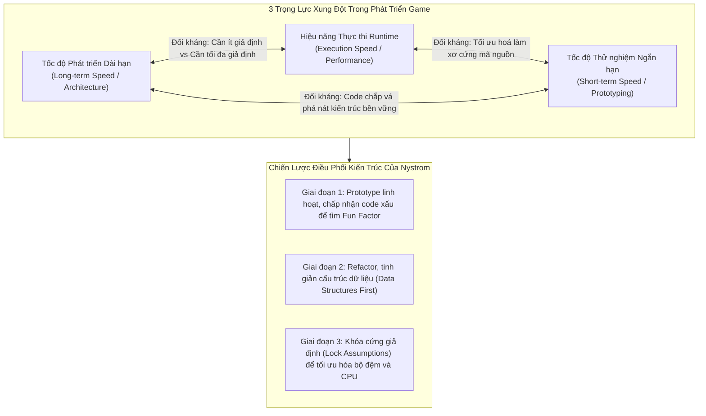

---

## 5. ÁNH XẠ ỨNG DỤNG VÀO DỰ ÁN GAME OOP

1. **Quy tắc Tách biệt Tầng Gameplay và Tầng Core Engine:**
   * Trong một dự án game nhiều người chơi (2.5D Multiplayer), tầng Engine mạng và Hệ thống Ô lưới Không gian (Spatial Partition) cần được thiết kế dựa trên **các giả định cụ thể** (độ rộng map cố định, kích thước cell cố định, packet header chuẩn hóa theo byte) để đạt hiệu năng tối đa.
   * Ngược lại, tầng kỹ năng nhân vật (Hero Skills, Buffs) cần được thiết kế với **mức độ tách rời (Decoupling) tối đa** để game designer có thể thêm/bớt hàng trăm chiêu thức mà không làm xáo trộn vòng lặp vật lý.
2. **Cảnh báo chống bẫy "Engine Vạn Năng":**
   * Đội ngũ phát triển không nên xây dựng một framework quá chung chung có thể chạy cho mọi thể loại game. Hãy bám sát use case cụ thể của dự án và áp dụng nguyên tắc YAGNI triệt để.

---
---

# CHƯƠNG 2: COMMAND PATTERN (MẪU LỆNH HÓA HÀNH ĐỘNG)

## 1. ĐỀ MỤC & MỤC TIÊU CỐT LÕI (CORE PURPOSE)

### Danh mục đề mục (Headings Outline)
* **Command**
  * **Configuring Input** *(Cấu hình ánh xạ ngõ vào)*
  * **Directions for Actors** *(Định hướng hành động cho thực thể Actor)*
  * **Undo and Redo** *(Hoàn nguyên và Tái thực thi)*
  * **Classy and Dysfunctional?** *(Hướng đối tượng kinh điển hay phong cách Hàm/Closures?)*
  * **See Also** *(Mối liên hệ với các mẫu thiết kế khác)*

### Vấn đề kỹ thuật thực tế & Thảm họa hệ thống
* **Vấn đề kỹ thuật:** Khớp nối cứng (Hard-coded coupling) giữa sự kiện ngõ vào phần cứng (ấn phím, click chuột, nhận packet mạng, AI kích hoạt) với logic hành vi nội tại của nhân vật (`jump()`, `fire()`).
* **Thảm họa nếu thiếu Command Pattern:**
  1. **Không thể đổi phím (No Key Rebinding):** Nếu viết `if (isPressed(BUTTON_X)) player.jump();`, toàn bộ sơ đồ điều khiển bị chôn cứng trong mã nguồn. Việc cho phép người chơi tùy biến bàn phím đòi hỏi hàng loạt câu lệnh `switch-case` lồng nhau cực kỳ hỗn loạn.
  2. **AI và Player bị phân mảnh:** Logic AI của máy và logic điều khiển của người chơi bị tách làm hai nhánh code riêng biệt, dẫn đến trùng lặp mã nguồn nghiêm trọng khi điều khiển cùng một loại nhân vật.
  3. **Bế tắc trong Undo/Redo & Multiplayer Replay:** Để hoàn nguyên trạng thái hoặc phát lại trận đấu (Replay), lập trình viên buộc phải lưu toàn bộ snapshot của thế giới game qua từng frame (ngốn hàng GB RAM), thay vì chỉ cần lưu một chuỗi các đối tượng Command gọn nhẹ.

---

## 2. PHÂN TÍCH LÝ THUYẾT & NGUYÊN LÝ CHUYÊN SÂU

### 2.1. Định nghĩa Tinh hoa: Vật thể hóa lời gọi hàm (Reified Method Call)
Robert Nystrom đưa ra một định nghĩa mang tính kinh điển, vượt trội hơn định nghĩa rườm rà của GoF:
$$\text{Command Pattern} \equiv \text{A Reified Method Call (Một lời gọi hàm được biến thành đối tượng dữ liệu hạng nhất)}$$
* Thuật ngữ **"Reify"** xuất phát từ tiếng Latin (*res* = vật thể). Reify nghĩa là lấy một khái niệm trừu tượng (như một hành động, một lời gọi hàm) và gói nó vào một biến/đối tượng cụ thể có thể lưu trữ trong mảng, truyền qua tham số hàm, ghi vào hàng đợi, hoặc đẩy qua mạng socket.
* GoF gọi Command là *"sự thay thế hướng đối tượng cho các hàm gọi lại (callbacks)"*.

### 2.2. Sự tiến hóa qua 3 cấp độ của Command Pattern
1. **Cấp độ 1: Binding tĩnh (Static Action Binding):**
   * Lớp `Command` chỉ có phương thức `execute()`.
   * Lệnh ngầm định tham chiếu đến một đối tượng toàn cục hoặc nhân vật chơi. Nhược điểm: Chỉ duy nhất Player mới thực hiện được lệnh này.
2. **Cấp độ 2: Tách rời Actor (Actor-Parameterized Command):**
   * Phương thức thực thi chuyển thành `execute(GameActor& actor)`.
   * Lệnh trở thành một khối hành vi thuần túy (Stateless Chunk of Behavior). Bất kỳ Actor nào (Player, Quái vật AI, Nhân vật đóng thế trong Demo) đều có thể được truyền vào để thực thi lệnh.
3. **Cấp độ 3: Lệnh mang trạng thái & Hoàn nguyên (Undoable Stateful Command):**
   * Khi lệnh biểu diễn một sự kiện cụ thể theo thời gian (ví dụ: `MoveUnitCommand(unit, x, y)`), mỗi lần thực hiện sẽ khởi tạo một instance riêng.
   * Lớp lệnh lưu trữ biến thiên trạng thái quá khứ (`xBefore_`, `yBefore_`) và bổ sung phương thức `undo()`.

### 2.3. Chiến lược Lưu vết trạng thái: Delta Storage vs Memento Pattern
Nystrom chỉ rõ: Để hỗ trợ Undo/Redo, việc chụp ảnh toàn bộ đối tượng (Memento Pattern) gây lãng phí bộ nhớ vô ích. Một lệnh di chuyển chỉ thay đổi tọa độ $(x, y)$, do đó đối tượng Command chỉ cần lưu đúng độ biến thiên cục bộ (*Delta*):
$$\text{State}_{\text{old}} \xrightarrow{\text{execute()}} \text{State}_{\text{new}} \quad \text{với } \Delta = \{\Delta x, \Delta y\}$$
$$\text{State}_{\text{new}} \xrightarrow{\text{undo()}} \text{State}_{\text{old}} \quad \text{bằng cách áp dụng ngược } \Delta$$

---

## 3. MỔ XẺ MÃ NGUỒN (CODE DEEP-DIVE)

Dưới đây là mã nguồn C++ hoàn chỉnh trích xuất từ sách thể hiện toàn diện 3 khía cạnh: Tách rời Input, Điều khiển Actor, và Hoàn nguyên Undo.

```cpp
#include <iostream>
#include <vector>

// Forward declaration
class GameActor {
public:
    virtual ~GameActor() {}
    virtual void jump() = 0;
    virtual void fireGun() = 0;
    virtual int x() const = 0;
    virtual int y() const = 0;
    virtual void moveTo(int x, int y) = 0;
};

// =================================================================
// 1. ABSTRACT COMMAND VỚI ACTOR PARAMETER & UNDO CAPABILITY
// =================================================================
class Command {
public:
    virtual ~Command() {}
    virtual void execute(GameActor& actor) = 0;
    virtual void undo(GameActor& actor) {} // Mặc định không làm gì nếu không hỗ trợ
};

// =================================================================
// 2. CONCRETE COMMANDS (STATELESS BEHAVIOR)
// =================================================================
class JumpCommand : public Command {
public:
    virtual void execute(GameActor& actor) override {
        actor.jump();
    }
};

class FireCommand : public Command {
public:
    virtual void execute(GameActor& actor) override {
        actor.fireGun();
    }
};

// =================================================================
// 3. CONCRETE COMMAND (STATEFUL UNDOABLE COMMAND)
// =================================================================
class MoveUnitCommand : public Command {
public:
    MoveUnitCommand(int destX, int destY)
        : x_(destX), y_(destY), xBefore_(0), yBefore_(0) {}

    virtual void execute(GameActor& actor) override {
        // Lưu vết delta trạng thái trước khi thay đổi
        xBefore_ = actor.x();
        yBefore_ = actor.y();
        actor.moveTo(x_, y_);
    }

    virtual void undo(GameActor& actor) override {
        // Hoàn nguyên vị trí cũ mà không cần snapshot toàn bộ actor
        actor.moveTo(xBefore_, yBefore_);
    }

private:
    int x_, y_;
    int xBefore_, yBefore_;
};

// =================================================================
// 4. INPUT HANDLER (DECOUPLED BUTTON MAPPING)
// =================================================================
class InputHandler {
public:
    InputHandler() : buttonX_(nullptr), buttonY_(nullptr) {}
    
    void bindButtonX(Command* command) { buttonX_ = command; }
    void bindButtonY(Command* command) { buttonY_ = command; }

    // Reify input thành stream các lệnh
    Command* handleInput(bool isXPressed, bool isYPressed) {
        if (isXPressed) return buttonX_;
        if (isYPressed) return buttonY_;
        return nullptr;
    }

private:
    Command* buttonX_;
    Command* buttonY_;
};
```

### Bảng phân tích chi tiết mã nguồn
| Dòng code / Đoạn code then chốt | Giải thích kỹ thuật & Ý nghĩa thiết kế |
|:---|:---|
| `virtual void execute(GameActor& actor) = 0;` | Truyền trực tiếp đối tượng thụ hưởng (`actor`) vào signature của hàm. Triệt tiêu hoàn toàn sự phụ thuộc tĩnh vào đối tượng Player duy nhất, biến Command thành một "đơn vị hành động độc lập" có thể tái sử dụng cho mọi Actor. |
| `xBefore_ = actor.x(); yBefore_ = actor.y();` | Kỹ thuật **Delta State Recording**: Lưu trữ cục bộ biến thiên trạng thái bị tác động. Không tốn bộ nhớ lưu trữ các thuộc tính khác (máu, trang bị, sprite...). |
| `Command* handleInput(...)` | Thay vì gọi trực tiếp logic gameplay, hàm biến đổi tín hiệu vật lý thành con trỏ đối tượng `Command*`. Cho phép trì hoãn việc thực thi (Execution Postponement) hoặc đưa vào hàng đợi. |
| `void bindButtonX(Command* command)` | Khóa học hiện thực hóa nguyên lý **Open/Closed Principle (OCP)** và **Dependency Inversion Principle (DIP)**: Có thể thay đổi phím nóng hoặc chiêu thức lúc runtime mà không phải sửa một dòng code nào trong `InputHandler`. |

---

## 4. SƠ ĐỒ TRỰC QUAN HÓA (VISUAL MERMAID DIAGRAM)

### Sơ đồ Lớp (Class Diagram) & Sơ đồ Luồng Tuần tự (Sequence Diagram)

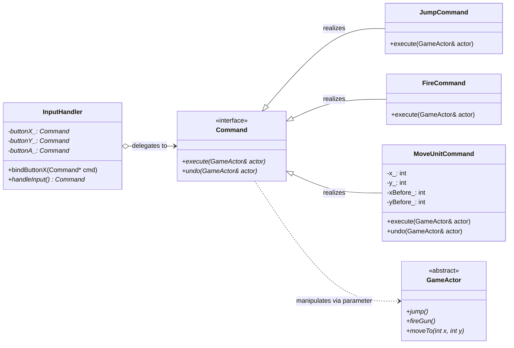

### Sơ đồ Luồng Tuần tự Điều phối Lệnh (Sequence Flow)

```mermaid
sequenceDiagram
    autonumber
    actor Player as Người Chơi
    participant IH as InputHandler
    participant Cmd as ConcreteCommand (Jump)
    participant Dispatcher as CommandStream/Queue
    participant Actor as GameActor (PlayerCharacter/AI)

    Player->>IH: Nhấn phím 'X' (Button Press)
    IH->>IH: Tra cứu con trỏ buttonX_
    IH-->>Dispatcher: Trả về đối tượng Command* (Reification)
    Note over Dispatcher: Có thể lưu vào Replay Log<br/>hoặc truyền qua Network Packet
    Dispatcher->>Cmd: execute(Actor)
    Cmd->>Actor: actor.jump()
    Actor-->>Actor: Cập nhật vận tốc trục Y & Play Animation
```

---

## 5. ÁNH XẠ ỨNG DỤNG VÀO DỰ ÁN GAME OOP

1. **Kiến trúc Netcode Client-Side Prediction & Server Reconciliation:**
   * Trong một game đấu trường 2.5D nhiều người chơi, Client không bao giờ gửi trực tiếp vị trí $(x, y)$ lên Server (để tránh hack tọa độ). Thay vào đó, Client tuần tự hóa phím bấm thành các gói tin `PlayerInputCommand` kèm số thứ tự khung hình (Sequence Number).
   * Khi Server gửi về trạng thái chuẩn (Authoritative State) mà có sự sai lệch với dự đoán của Client, Client sử dụng cơ chế `undo()` hoặc roll-back toàn bộ các Command từ khung hình sai lệch để tính toán lại (*replay*), đảm bảo game chuyển động mượt mà không bị giật lùi (rubberbanding).
2. **Hệ thống AI Bot cắm ghép dùng chung Engine:**
   * Module AI tìm đường (Pathfinding) sau khi phân tích hành vi không cần can thiệp thô bạo vào nhân vật quái. Nó chỉ cần tạo ra các lệnh `MoveUnitCommand` hoặc `SkillCastCommand` và đẩy vào cùng một hàng đợi lệnh (Command Queue) của nhân vật đó. Nhân vật hoàn toàn không phân biệt được nó đang được lái bởi người chơi thật hay thuật toán AI.


---


<!-- ========================================================================= -->
<!-- BẮT ĐẦU Dot_02_Flyweight_va_Observer.md -->
<!-- ========================================================================= -->

---
aliases: [Nystrom Dot 2, Flyweight Pattern, Observer Pattern]
tags: [game-programming-patterns, nystrom, flyweight, observer, intrusive-linked-list, memory-optimization, decoupled-architecture]
created: 2026-11-04
author: Principal Software Architect & OOAD Lecturer
reference: "Game Programming Patterns by Robert Nystrom (Chap 04 & Chap 05)"
---

# BÓC TÁCH CHUYÊN SÂU NYSTROM — ĐỢT 2: CHƯƠNG 3 & CHƯƠNG 4
*(Dựa trên nguyên bản "Game Programming Patterns" của Robert Nystrom)*

---

# MỤC LỤC ĐỢT 2
- [CHƯƠNG 3: FLYWEIGHT PATTERN (MẪU ĐỐI TƯỢNG NHẸ / CHIA SẺ TRẠNG THÁI NỘI TẠI)](#chương-3-flyweight-pattern-mẫu-đối-tượng-nhẹ--chia-sẻ-trạng-thái-nội-tại)
  - [1. ĐỀ MỤC & MỤC TIÊU CỐT LÕI (CORE PURPOSE)](#1-đề-mục--mục-tiêu-cốt-lõi-core-purpose)
  - [2. PHÂN TÍCH LÝ THUYẾT & NGUYÊN LÝ CHUYÊN SÂU](#2-phân-tích-lý-thuyết--nguyên-lý-chuyên-sâu)
  - [3. MỔ XẺ MÃ NGUỒN (CODE DEEP-DIVE)](#3-mổ-xẻ-mã-nguồn-code-deep-dive)
  - [4. SƠ ĐỒ TRỰC QUAN HÓA (VISUAL MERMAID DIAGRAM)](#4-sơ-đồ-trực-quan-hóa-visual-mermaid-diagram)
  - [5. ÁNH XẠ ỨNG DỤNG VÀO DỰ ÁN GAME OOP](#5-ánh-xạ-ứng-dụng-vào-dự-án-game-oop)
- [CHƯƠNG 4: OBSERVER PATTERN (MẪU NGƯỜI QUAN SÁT / XỬ LÝ SỰ KIỆN PHÂN TÁN)](#chương-4-observer-pattern-mẫu-người-quan-sát--xử-lý-sự-kiện-phân-tán)
  - [1. ĐỀ MỤC & MỤC TIÊU CỐT LÕI (CORE PURPOSE)](#1-đề-mục--mục-tiêu-cốt-lõi-core-purpose-1)
  - [2. PHÂN TÍCH LÝ THUYẾT & NGUYÊN LÝ CHUYÊN SÂU](#2-phân-tích-lý-thuyết--nguyên-lý-chuyên-sâu-1)
  - [3. MỔ XẺ MÃ NGUỒN (CODE DEEP-DIVE)](#3-mổ-xẻ-mã-nguồn-code-deep-dive)
  - [4. SƠ ĐỒ TRỰC QUAN HÓA (VISUAL MERMAID DIAGRAM)](#4-sơ-đồ-trực-quan-hóa-visual-mermaid-diagram-1)
  - [5. ÁNH XẠ ỨNG DỤNG VÀO DỰ ÁN GAME OOP](#5-ánh-xạ-ứng-dụng-vào-dự-án-game-oop-1)

---

# CHƯƠNG 3: FLYWEIGHT PATTERN (MẪU ĐỐI TƯỢNG NHẸ / CHIA SẺ TRẠNG THÁI NỘI TẠI)

## 1. ĐỀ MỤC & MỤC TIÊU CỐT LÕI (CORE PURPOSE)

### Danh mục đề mục (Headings Outline)
* **Flyweight** *(Mẫu Đối tượng nhẹ)*
  * **Forest for the Trees** *(Nhìn thấy cả rừng cây: Thách thức dữ liệu đồ họa khổng lồ)*
  * **A Thousand Instances** *(Một ngàn thực thể & Kỹ thuật Instanced Rendering trên GPU)*
  * **The Flyweight Pattern** *(Nguyên lý mẫu Flyweight: Tách rời Trạng thái Nội tại & Ngoại tại)*
  * **A Place To Put Down Roots** *(Ứng dụng tạo lưới địa hình Tile-based Terrain)*
  * **What About Performance?** *(Đo lường hiệu năng: Con trỏ gián tiếp vs Bộ đệm L1/L2 Cache)*
  * **See Also** *(Mối liên hệ: Type Object, State, Factory Method, Object Pool)*

### Vấn đề kỹ thuật thực tế & Thảm họa hệ thống
Trong phát triển game, thế giới ảo thường chứa hàng trăm nghìn thực thể có diện mạo và hành vi tương tự nhau (như cả cánh rừng bạt ngàn cây cối, lưới địa hình hàng triệu ô gạch, hàng nghìn viên đạn hay đàn quái vật cùng chủng loại).

Nếu không áp dụng mẫu thiết kế Flyweight:
1. **Thảm họa cạn kiệt bộ nhớ (Out-Of-Memory - OOM):** Mỗi đối tượng nhân bản toàn bộ dữ liệu lưới đa giác (Mesh 3D), vân bề mặt (Textures), âm thanh và thông số vật lý. Hàng chục nghìn cây sẽ ngốn hàng Gigabyte RAM chỉ để chứa các bản sao giống hệt nhau.
2. **Nghẽn cổ chai Bus truyền dẫn CPU sang GPU (Bus Bandwidth Saturation):** Nếu mỗi frame CPU phải đẩy từng cây riêng biệt qua bus PCI-e lên GPU, băng thông truyền dữ liệu sẽ bị quá tải lập tức, khiến khung hình tụt thảm hại (dưới 10 FPS) dù GPU vẫn chưa chạy hết công suất.
3. **Thảm họa Bẫy mã `enum` và Phá vỡ Tính bao đóng (Encapsulation Violation):** Lập trình viên vì sợ tốn bộ nhớ nên chuyển sang dùng kiểu liệt kê `enum TerrainType` kết hợp các hàm `switch-case` khổng lồ (`getMovementCost()`, `isWater()`). Hệ quả là dữ liệu và hành vi của một loại địa hình bị vương vãi khắp nơi, vi phạm nghiêm trọng tính đóng gói của OOP và nguyên lý Open/Closed Principle (OCP).

---

## 2. PHÂN TÍCH LÝ THUYẾT & NGUYÊN LÝ CHUYÊN SÂU

### 2.1. Phân rã Trạng thái Nội tại (Intrinsic) và Ngoại tại (Extrinsic)
Bản chất cốt lõi của Flyweight là chia dữ liệu của một thực thể thành hai nửa tách biệt hoàn toàn:
* **Trạng thái Nội tại (Intrinsic State / Context-free State):** Là tập hợp dữ liệu bất biến, không phụ thuộc vào vị trí hay ngữ cảnh xuất hiện của đối tượng trong thế giới game. Dữ liệu này giống nhau trên toàn bộ các thực thể cùng loại (ví dụ: mô hình 3D, kết cấu vỏ cây, tán lá, chỉ số cản trở di chuyển).
* **Trạng thái Ngoại tại (Extrinsic State / Context-dependent State):** Là dữ liệu đặc thù riêng biệt cho từng cá thể tại một thời điểm/không gian cụ thể (ví dụ: tọa độ thế giới $(x, y, z)$, góc xoay, hệ số tỉ lệ thu phóng, màu sắc biến thiên ngẫu nhiên).
$$\text{Memory}(\text{Entity}) = \text{ExtrinsicState} + \text{PointerToShared}(\text{IntrinsicState})$$

### 2.2. Mẫu thiết kế duy nhất được phần cứng GPU hỗ trợ: Instanced Rendering
Robert Nystrom nhấn mạnh: Flyweight có thể là mẫu thiết kế duy nhất trong 23 mẫu GoF được hiện thực hóa trực tiếp ở cấp độ kiến trúc vi mạch bán dẫn phần cứng.
* Các API đồ họa hiện đại (DirectX 11/12, OpenGL, Vulkan) cung cấp kỹ thuật **Instanced Rendering**.
* CPU chỉ cần gửi **một bản sao duy nhất** của dữ liệu nội tại (Vertex Buffers, Textures) lên VRAM của GPU một lần.
* Tiếp đó, CPU chỉ gửi một danh sách mảng nhẹ chứa dữ liệu ngoại tại (Ma trận biến đổi Transform, Hệ số màu Tint) cho hàng vạn thực thể. Chỉ bằng **1 lệnh vẽ duy nhất (Draw Call)**, GPU tự động nhân bản và kết xuất cả khu rừng.

### 2.3. Tính Bất Biến Tuyệt Đối (Immutability) của Đối Tượng Flyweight
Do một đối tượng Flyweight (như `Terrain` hay `TreeModel`) được trỏ tới bởi hàng nghìn thực thể khác nhau cùng lúc, **nó bắt buộc phải là một đối tượng bất biến (Immutable Object)**.
* Tất cả các phương thức truy xuất phải được đánh dấu `const`.
* Tuyệt đối không cho phép bất kỳ thực thể nào thay đổi trạng thái nội tại lúc runtime; vì nếu một ô cỏ bị đổi màu qua đối tượng Flyweight, toàn bộ hàng triệu ô cỏ trên khắp bản đồ sẽ bị đổi màu theo.

### 2.4. Đánh đổi Hiệu năng: Pointer Chasing vs Cache Miss
Khi thay thế `enum` nguyên thủy bằng con trỏ trỏ tới đối tượng Flyweight (`Terrain* tiles_[WIDTH][HEIGHT]`), hệ thống phải thực hiện phép truy cập gián tiếp (*Indirect Lookup / Pointer Dereference*).
* Về lý thuyết, việc nhảy con trỏ có thể gây xáo trộn bộ đệm CPU (**Cache Miss**).
* Tuy nhiên, trong thực tế, vì số lượng đối tượng Flyweight rất nhỏ (chỉ vài kiểu địa hình: Cỏ, Đồi, Sông), toàn bộ các đối tượng Flyweight này sẽ nằm trọn trong **L1/L2 Data Cache** của CPU. Khi CPU duyệt mảng con trỏ, dữ liệu đối tượng đích luôn sẵn sàng trong Cache, mang lại hiệu năng tương đương hoặc thậm chí vượt trội hơn cấu trúc rẽ nhánh `switch-case` phức tạp.

---

## 3. MỔ XẺ MÃ NGUỒN (CODE DEEP-DIVE)

Dưới đây là mã nguồn C++ thể hiện kỹ thuật chia sẻ trạng thái cho hệ thống Địa hình (Tile-based Terrain) và Rừng cây (Instanced Trees):

```cpp
#include <iostream>
#include <vector>

// =================================================================
// 1. INTRINSIC STATE (TRẠNG THÁI NỘI TẠI BẤT BIẾN)
// =================================================================
class Terrain {
public:
    Terrain(int movementCost, bool isWater, const char* textureName)
        : movementCost_(movementCost), isWater_(isWater), textureName_(textureName) {}

    // Toàn bộ phương thức bắt buộc là CONST để bảo toàn tính bất biến
    int getMovementCost() const { return movementCost_; }
    bool isWater() const { return isWater_; }
    const char* getTextureName() const { return textureName_; }

private:
    int movementCost_;
    bool isWater_;
    const char* textureName_;
};

// =================================================================
// 2. WORLD LƯU MẢNG CON TRỎ FLYWEIGHT THAY VÌ COPY ĐỐI TƯỢNG
// =================================================================
class World {
public:
    static const int WIDTH = 1000;
    static const int HEIGHT = 1000;

    World()
        // Khởi tạo các Flyweight tĩnh duy nhất dùng chung toàn cục
        : grassTerrain_(1, false, "textures/grass.png"),
          hillTerrain_(3, false, "textures/hill.png"),
          riverTerrain_(2, true, "textures/river.png") {
        
        generateMap();
    }

    void generateMap() {
        for (int x = 0; x < WIDTH; ++x) {
            for (int y = 0; y < HEIGHT; ++y) {
                if (x == y) {
                    tiles_[x][y] = &riverTerrain_; // Trỏ chung vào 1 instance
                } else if ((x + y) % 5 == 0) {
                    tiles_[x][y] = &hillTerrain_;
                } else {
                    tiles_[x][y] = &grassTerrain_;
                }
            }
        }
    }

    // Truy xuất cực nhanh: Trả về tham chiếu const tới Flyweight
    const Terrain& getTile(int x, int y) const {
        return *tiles_[x][y];
    }

private:
    // 3 Thực thể Flyweight duy nhất nắm giữ toàn bộ trạng thái nội tại
    Terrain grassTerrain_;
    Terrain hillTerrain_;
    Terrain riverTerrain_;

    // Ma trận 1.000.000 ô chỉ tốn 4MB hoặc 8MB RAM con trỏ
    const Terrain* tiles_[WIDTH][HEIGHT];
};
```

### Bảng phân tích chi tiết mã nguồn
| Dòng code / Đoạn code then chốt | Giải thích kỹ thuật & Ý nghĩa thiết kế |
|:---|:---|
| `int getMovementCost() const` | Từ khóa `const` khẳng định hàm thuần túy đọc dữ liệu (pure query). Ngăn chặn tuyệt đối việc thay đổi trạng thái nội tại qua con trỏ chia sẻ, bảo vệ toàn vẹn dữ liệu cho hàng triệu thực thể khác. |
| `Terrain grassTerrain_(1, false, ...);` | Cài đặt khởi tạo sớm (Eager Initialization) trực tiếp trên vùng nhớ của `World`. Tránh cấp phát động trên Heap (`new`/`delete`), triệt tiêu phân mảnh bộ nhớ và kiểm soát vòng đời tường minh. |
| `const Terrain* tiles_[WIDTH][HEIGHT];` | Thay vì lưu `Terrain tiles_[WIDTH][HEIGHT]` tốn hàng trăm Megabytes bộ nhớ cho 1.000.000 ô gạch, việc lưu mảng con trỏ chỉ tốn $1000 \times 1000 \times 8 \text{ bytes} \approx 8 \text{MB}$ trên kiến trúc 64-bit. |
| `const Terrain& getTile(...) const` | Đóng gói hoàn hảo: Thế giới bên ngoài thao tác với một đối tượng OOP giàu thuộc tính và phương thức thay vì phải giải mã các hằng số ma thuật (magic numbers) từ mảng `enum`. |

---

## 4. SƠ ĐỒ TRỰC QUAN HÓA (VISUAL MERMAID DIAGRAM)

### Sơ đồ Lớp & Cấu trúc Phân rã Bộ nhớ (Class & Memory Layout)

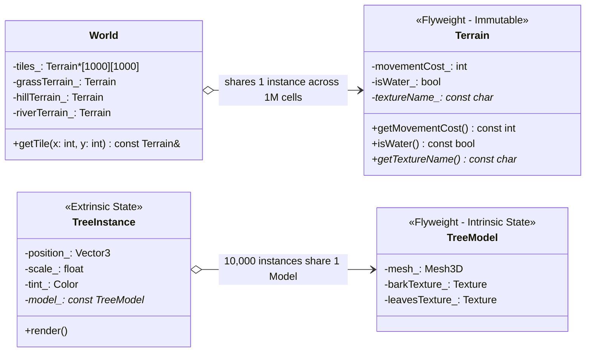

### Sơ đồ Băng thông GPU (Instanced Rendering Architecture)

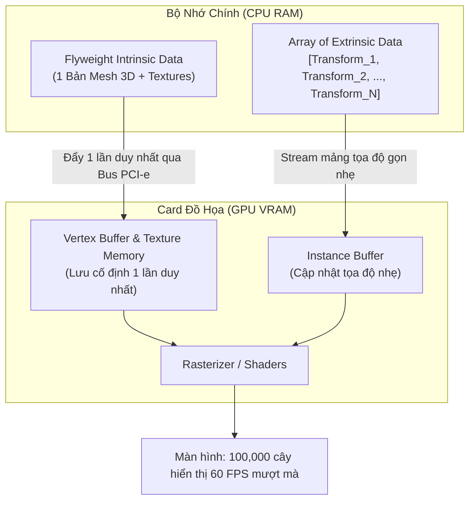

---

## 5. ÁNH XẠ ỨNG DỤNG VÀO DỰ ÁN GAME OOP

1. **Hệ thống Bản đồ Ô lưới & Phân vùng Tilemap:**
   * Trong game đấu trường 2.5D, toàn bộ bản đồ thế giới rộng hàng nghìn tọa độ được biểu diễn bằng các con trỏ trỏ tới các lớp Flyweight `TileType` (Đất, Nước, Tường đá, Bụi rậm che tầm nhìn).
   * Khi thuật toán tìm đường (A* Pathfinding) chạy trên Server, nó truy vấn trực tiếp trọng số di chuyển thông qua con trỏ Flyweight nằm gọn trong Cache CPU, đẩy tốc độ tính toán lên gấp hàng chục lần so với việc truy vấn cơ sở dữ liệu hoặc map tra cứu động.
2. **Quản lý Thông số Nhân vật & Quái vật (Monster Archetype):**
   * Trong một đợt quái dâng trào (Mob Wave) với 500 con Goblin, chỉ có tọa độ, máu hiện tại và thanh nộ khí là trạng thái ngoại tại nằm trên `MonsterEntity`.
   * Toàn bộ các thông số như bảng kỹ năng, âm thanh gầm rú, hoạt ảnh (Animation Frames) và chỉ số giáp/kháng phép cơ bản được trỏ chung về một đối tượng Flyweight `MonsterArchetype`, triệt tiêu hoàn toàn rủi ro rò rỉ bộ nhớ.

---
---

# CHƯƠNG 4: OBSERVER PATTERN (MẪU NGƯỜI QUAN SÁT / XỬ LÝ SỰ KIỆN PHÂN TÁN)

## 1. ĐỀ MỤC & MỤC TIÊU CỐT LÕI (CORE PURPOSE)

### Danh mục đề mục (Headings Outline)
* **Observer** *(Mẫu Người quan sát)*
  * **Achievement Unlocked** *(Mở khóa Thành tựu: Tách rời Logic Game khỏi Động cơ Vật lý)*
  * **How it Works** *(Cơ chế hoạt động)*
    * *The observer* *(Giao diện người quan sát)*
    * *The subject* *(Đối tượng phát thông báo)*
    * *Observable physics* *(Hiện thực hóa hệ thống vật lý có thể quan sát)*
  * **“It’s Too Slow”** *(Đập tan định kiến: Observer quá chậm?)*
    * *It’s too fast?* *(Nguy cơ nghẽn luồng đồng bộ và Deadlock)*
  * **“It Does Too Much Dynamic Allocation”** *(Giải quyết vấn đề cấp phát động và phân mảnh bộ nhớ)*
    * *Linked observers* *(Giải pháp Đột phá của Nystrom: Danh sách liên kết nội suy)*
    * *A pool of list nodes* *(Bể chứa phần tử Node danh sách liên kết)*
  * **Remaining Problems** *(Các góc khuất kiến trúc còn tồn đọng)*
    * *Destroying subjects and observers* *(Hủy đối tượng và con trỏ treo lơ lửng Dangling Pointers)*
    * *Don’t worry, I’ve got a GC* *(Vấn đề rò rỉ bộ nhớ kinh điển: The Lapsed Listener Problem)*
    * *What’s going on?* *(Khó khăn trong việc truy vết luồng thực thi lúc runtime)*
  * **Observers Today & Tomorrow** *(Observer thời hiện đại: Delegates, Closures và Functional Reactive Data Binding)*

### Vấn đề kỹ thuật thực tế & Thảm họa hệ thống
* **Vấn đề kỹ thuật:** Các hệ thống trong game (Vật lý, Đồ họa, Âm thanh, Thành tựu, Nhiệm vụ, Giao diện UI) cần phản ứng với cùng một biến cố trong thế giới game, nhưng không được phép liên kết trực tiếp với nhau.
* **Thảm họa nếu không có Observer Pattern:**
  1. **Khớp nối Spaghetti đa tầng (Spaghetti Cross-Coupling):** Nếu hệ thống vật lý khi phát hiện nhân vật rơi xuống vực lại phải gọi trực tiếp: `Achievements::unlockFallOffBridge()`, `AudioEngine::playScreamSound()`, `UI::showDefeatPopup()`. Động cơ toán học vật lý bị biến thành một mớ bòng bong chứa đầy mã nghiệp vụ gameplay, không thể tái sử dụng cho dự án khác.
  2. **Thảm họa rò rỉ bộ nhớ "Lapsed Listener" (Kể cả trên các ngôn ngữ có GC như Java/C#):** Màn hình UI đăng ký lắng nghe sự kiện từ `Player`, nhưng khi đóng giao diện lại quên hủy đăng ký (`removeObserver`). `Player` vẫn giữ con trỏ/tham chiếu cứng tới màn hình UI cũ, khiến Garbage Collector không thể thu hồi. Qua hàng giờ chơi, hàng trăm màn hình UI "zombie" vẫn âm thầm chạy ngầm, ngốn CPU và gây rò rỉ RAM nghiêm trọng.
  3. **Phân mảnh bộ nhớ Heap (Heap Fragmentation):** Nếu mỗi lần đăng ký hay gửi thông điệp, hệ thống lại cấp phát động (`new List`, `new EventData`), bộ nhớ heap sẽ bị phân mảnh vụn vặt, khiến game bị sụt giảm khung hình đột ngột khi bộ dọn rác kích hoạt.

---

## 2. PHÂN TÍCH LÝ THUYẾT & NGUYÊN LÝ CHUYÊN SÂU

### 2.1. Bản chất Phản biện: Observer là Đồng Bộ (Synchronous Dispatch)
Nhiều lập trình viên nhầm lẫn Observer với Hàng đợi sự kiện bất đồng bộ (Asynchronous Event Queue / Message Broker).
* **Robert Nystrom làm rõ:** Mẫu Observer kinh điển là **hoàn toàn đồng bộ (Synchronous)**. Khi `Subject::notify()` được gọi, luồng CPU sẽ trực tiếp nhảy qua bảng vtable của từng `Observer` để thực thi hàm `onNotify()`.
* **Cảnh báo "It's Too Fast":** Nếu một Observer thực hiện một tác vụ nặng (như ghi file, nạp âm thanh từ đĩa, hoặc gọi blocking I/O), nó sẽ **chặn đứng (block) luồng xử lý chính của Subject**. Nếu Subject đang giữ Mutex Lock, việc Observer yêu cầu thêm tài nguyên có thể dẫn đến **Deadlock** đóng băng toàn bộ game.

### 2.2. Giải pháp Đột phá của Nystrom: Linked Observers (Intrusive Linked List)
Để loại bỏ hoàn toàn việc cấp phát động mảng `std::vector<Observer*>` trên Heap nhằm tránh phân mảnh bộ nhớ, Nystrom giới thiệu kỹ thuật **Danh sách liên kết Nội suy (Intrusive Linked List)**:
* Thay vì `Subject` nắm giữ một mảng con trỏ ngoài, ta cấy trực tiếp con trỏ `Observer* next_` vào ngay bên trong định nghĩa của lớp `Observer`.
* Khi một Observer đăng ký vào Subject, nó tự luồn chính mình vào đầu danh sách liên kết (`next_ = head_; head_ = observer;`).
* **Đặc tính kỹ thuật phi thường:** Thao tác đăng ký đạt độ phức tạp $O(1)$, thao tác phát thông báo $O(N)$, và **hoàn toàn KHÔNG tốn một byte cấp phát động nào trên Heap** ($0 \text{ bytes dynamic memory overhead}$).

### 2.3. Vấn đề Người Lắng Nghe Quá Hạn (The Lapsed Listener Problem)
Đây là lỗi kiến trúc chết người phổ biến nhất trong các hệ sinh thái có bộ thu gom rác tự động (C#, Java, Unity, Unreal Blueprints):
* Một đối tượng sống ngắn hạn (*short-lived object*, ví dụ: một cửa sổ giao diện túi đồ Popup UI) đăng ký nhận sự kiện từ một đối tượng sống dài hạn (*long-lived object*, ví dụ: thực thể Người chơi `Player`).
* Khi cửa sổ UI bị đóng, lập trình viên nghĩ rằng nó đã bị hủy. Nhưng `Player` vẫn lưu tham chiếu mạnh (*strong reference*) tới UI trong danh sách Observers.
* **Hậu quả:** UI không bao giờ được giải phóng bộ nhớ. Tệ hơn, mỗi khi Player nhận sát thương, hàng chục instance UI vô hình vẫn bị đánh thức, chạy code cập nhật thanh máu và phát âm thanh lặp lại.

---

## 3. MỔ XẺ MÃ NGUỒN (CODE DEEP-DIVE)

Dưới đây là mã nguồn C++ thể hiện kỹ thuật **Linked Observers Không Cấp Phát Động (Zero-Allocation Intrusive List)** và cơ chế tự động hủy an toàn qua hàm hủy:

```cpp
#include <iostream>

class Entity {
public:
    bool isHero() const { return true; }
};

enum Event {
    EVENT_ENTITY_FELL,
    EVENT_HERO_DAMAGED
};

// Khai báo trước
class Subject;

// =================================================================
// 1. OBSERVER VỚI CON TRỎ NỘI SUY (INTRUSIVE LINKED NODE)
// =================================================================
class Observer {
    friend class Subject; // Trao quyền cho Subject thao tác trực tiếp trên next_
public:
    Observer() : next_(nullptr) {}
    virtual ~Observer() {}
    virtual void onNotify(const Entity& entity, Event event) = 0;

private:
    // Con trỏ nội suy: Biến bản thân Observer thành một Node trong danh sách liên kết
    Observer* next_;
};

// =================================================================
// 2. SUBJECT ĐIỀU PHỐI DANH SÁCH LIÊN KẾT KHÔNG DÙNG HEAP
// =================================================================
class Subject {
public:
    Subject() : head_(nullptr) {}

    // Đăng ký O(1) - Luồn node vào đầu danh sách, không malloc/new
    void addObserver(Observer* observer) {
        observer->next_ = head_;
        head_ = observer;
    }

    // Hủy đăng ký an toàn: Gỡ liên kết danh sách
    void removeObserver(Observer* observer) {
        if (head_ == nullptr || observer == nullptr) return;

        if (head_ == observer) {
            head_ = observer->next_;
            observer->next_ = nullptr;
            return;
        }

        Observer* current = head_;
        while (current != nullptr) {
            if (current->next_ == observer) {
                current->next_ = observer->next_;
                observer->next_ = nullptr;
                return;
            }
            current = current->next_;
        }
    }

protected:
    // Duyệt danh sách liên kết đồng bộ để kích hoạt Callback
    void notify(const Entity& entity, Event event) {
        Observer* observer = head_;
        while (observer != nullptr) {
            observer->onNotify(entity, event);
            observer = observer->next_;
        }
    }

private:
    Observer* head_; // Chỉ lưu duy nhất 1 con trỏ trỏ tới đầu danh sách
};

// =================================================================
// 3. CONCRETE SYSTEM: TÁCH BIỆT HOÀN TOÀN GIỮA VẬT LÝ VÀ THÀNH TỰU
// =================================================================
class Physics : public Subject {
public:
    void updateEntity(Entity& entity) {
        // Giả lập phát hiện rơi tự do từ cầu
        bool fell = true;
        if (fell) {
            notify(entity, EVENT_ENTITY_FELL); // Động cơ vật lý không hề biết ai đang nghe
        }
    }
};

class Achievements : public Observer {
public:
    virtual void onNotify(const Entity& entity, Event event) override {
        switch (event) {
            case EVENT_ENTITY_FELL:
                if (entity.isHero()) {
                    unlockFallAchievement();
                }
                break;
            default:
                break;
        }
    }

private:
    void unlockFallAchievement() {
        std::cout << ">>> [ACHIEVEMENT]: Da mo khoa huan chuong 'Roi Tu Tren Cau'!" << std::endl;
    }
};
```

### Bảng phân tích chi tiết mã nguồn
| Dòng code / Đoạn code then chốt | Giải thích kỹ thuật & Ý nghĩa thiết kế |
|:---|:---|
| `friend class Subject;` | Cho phép `Subject` can thiệp vào thuộc tính `private: Observer* next_` mà không cần công khai API ra ngoài. Giữ trọn vẹn tính đóng gói của hệ thống. |
| `observer->next_ = head_; head_ = observer;` | Kỹ thuật chèn đầu danh sách liên kết đơn (Head Insertion). Độ phức tạp thời gian đạt tuyệt đối $O(1)$. Không gây ra bất kỳ thao tác cấp phát bộ nhớ động (`malloc`/`new`), bài trừ triệt để nguy cơ phân mảnh Heap. |
| `observer->next_ = nullptr;` | Xóa con trỏ liên kết sau khi gỡ bỏ Node để tránh hiện tượng rò rỉ cấu trúc danh sách cũ hoặc lỗi dùng lại con trỏ đã tháo (*stale pointer hazard*). |
| `notify(entity, EVENT_ENTITY_FELL);` | Hiện thực hóa nguyên lý **Inversion of Control (IoC)** và **Single Responsibility Principle (SRP)**: Hệ thống vật lý chỉ chịu trách nhiệm thông báo trạng thái vận động, bàn giao toàn bộ quyền quyết định mở khóa thành tựu cho lớp nghiệp vụ độc lập. |

---

## 4. SƠ ĐỒ TRỰC QUAN HÓA (VISUAL MERMAID DIAGRAM)

### Sơ đồ Lớp Cấu trúc Danh sách Nội suy (Intrusive Linked Observer Pattern)

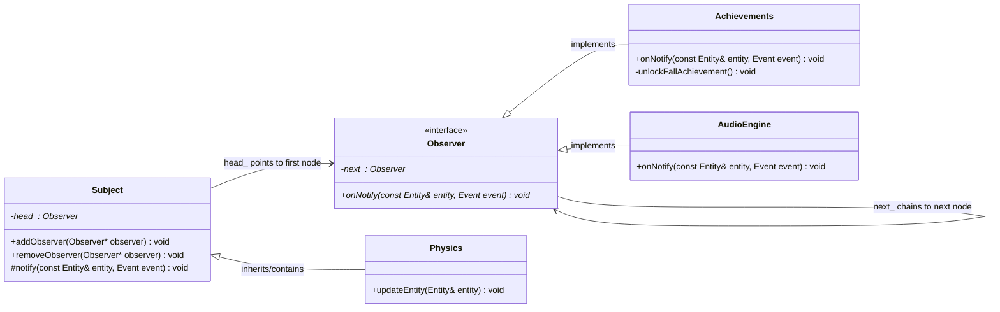

### Sơ đồ Tuần tự Vòng đời Sự kiện & Cảnh báo Lapsed Listener

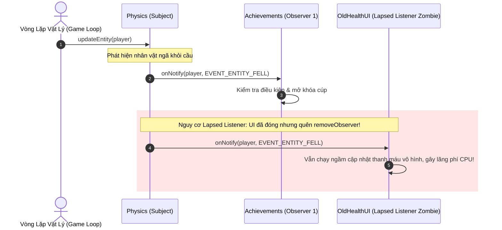

---

## 5. ÁNH XẠ ỨNG DỤNG VÀO DỰ ÁN GAME OOP

1. **Hệ thống Bus Tách Rời Sát Thương (Combat Event Dispatcher):**
   * Trong một game chiến đấu nhiều người chơi, khi đòn đánh trúng mục tiêu, hệ thống tính toán va chạm vật lý chỉ phát ra sự kiện: `EventDispatcher::trigger(EVENT_ENTITY_DAMAGED, target, damageAmount)`.
   * Hàng loạt hệ thống độc lập tự động phản ứng:
     * `FloatingTextManager`: Tạo số sát thương nhảy lên trên màn hình.
     * `SoundManager`: Phát âm thanh va chạm kim loại tương ứng với chất liệu giáp.
     * `ParticleSystem`: Bắn tia lửa hoặc máu tại điểm va chạm.
     * `QuestTracker`: Tăng tiến trình nhiệm vụ "Gây 10,000 sát thương".
   * Các hệ thống trên hoàn toàn không biết đến sự tồn tại của nhau, loại bỏ hoàn toàn mã nguồn mạng nhện.
2. **Quy chuẩn Quản trị Vòng Đời RAII Chống Rò Rỉ Bộ Nhớ:**
   * Mọi lớp View/UI hoặc Bot AI kế thừa từ `Observer` bắt buộc phải gọi `subject.removeObserver(this)` trong hàm hủy (`Destructor`) theo triết lý **RAII (Resource Acquisition Is Initialization)**.
   * Trên các nền tảng chạy Java/C#, áp dụng cơ chế **WeakReference / WeakEventManager** để đảm bảo danh sách Subject không giữ tham chiếu mạnh, triệt tiêu vĩnh viễn thảm họa rò rỉ bộ nhớ "Lapsed Listener".


---


<!-- ========================================================================= -->
<!-- BẮT ĐẦU Dot_03_Prototype_va_Singleton.md -->
<!-- ========================================================================= -->

---
aliases: [Nystrom Dot 3, Prototype Pattern, Singleton Pattern]
tags: [game-programming-patterns, nystrom, prototype, singleton, anti-pattern, delegation, data-modeling, dependency-injection]
created: 2026-11-04
author: Principal Software Architect & OOAD Lecturer
reference: "Game Programming Patterns by Robert Nystrom (Chap 06 & Chap 07)"
---

# BÓC TÁCH CHUYÊN SÂU NYSTROM — ĐỢT 3: CHƯƠNG 5 & CHƯƠNG 6
*(Dựa trên nguyên bản "Game Programming Patterns" của Robert Nystrom)*

---

# MỤC LỤC ĐỢT 3
- [CHƯƠNG 5: PROTOTYPE PATTERN (MẪU NGUYÊN MẪU / NHÂN BẢN THỰC THỂ)](#chương-5-prototype-pattern-mẫu-nguyên-mẫu--nhân-bản-thực-thể)
  - [1. ĐỀ MỤC & MỤC TIÊU CỐT LÕI (CORE PURPOSE)](#1-đề-mục--mục-tiêu-cốt-lõi-core-purpose)
  - [2. PHÂN TÍCH LÝ THUYẾT & NGUYÊN LÝ CHUYÊN SÂU](#2-phân-tích-lý-thuyết--nguyên-lý-chuyên-sâu)
  - [3. MỔ XẺ MÃ NGUỒN (CODE DEEP-DIVE)](#3-mổ-xẻ-mã-nguồn-code-deep-dive)
  - [4. SƠ ĐỒ TRỰC QUAN HÓA (VISUAL MERMAID DIAGRAM)](#4-sơ-đồ-trực-quan-hóa-visual-mermaid-diagram)
  - [5. ÁNH XẠ ỨNG DỤNG VÀO DỰ ÁN GAME OOP](#5-ánh-xạ-ứng-dụng-vào-dự-án-game-oop)
- [CHƯƠNG 6: SINGLETON PATTERN (MẪU ĐƠN THỂ / BẪY BIẾN TOÀN CỤC TRONG GAME)](#chương-6-singleton-pattern-mẫu-đơn-thể--bẫy-biến-toàn-cục-trong-game)
  - [1. ĐỀ MỤC & MỤC TIÊU CỐT LÕI (CORE PURPOSE)](#1-đề-mục--mục-tiêu-cốt-lõi-core-purpose-1)
  - [2. PHÂN TÍCH LÝ THUYẾT & NGUYÊN LÝ CHUYÊN SÂU](#2-phân-tích-lý-thuyết--nguyên-lý-chuyên-sâu-1)
  - [3. MỔ XẺ MÃ NGUỒN (CODE DEEP-DIVE)](#3-mổ-xẻ-mã-nguồn-code-deep-dive)
  - [4. SƠ ĐỒ TRỰC QUAN HÓA (VISUAL MERMAID DIAGRAM)](#4-sơ-đồ-trực-quan-hóa-visual-mermaid-diagram-1)
  - [5. ÁNH XẠ ỨNG DỤNG VÀO DỰ ÁN GAME OOP](#5-ánh-xạ-ứng-dụng-vào-dự-án-game-oop-1)

---

# CHƯƠNG 5: PROTOTYPE PATTERN (MẪU NGUYÊN MẪU / NHÂN BẢN THỰC THỂ)

## 1. ĐỀ MỤC & MỤC TIÊU CỐT LÕI (CORE PURPOSE)

### Danh mục đề mục chi tiết (Headings Outline)
* **Prototype** *(Mẫu Nguyên mẫu)*
  * **The Prototype Design Pattern** *(Mẫu thiết kế Nguyên mẫu kinh điển)*
  * **How well does it work?** *(Đánh giá tính hiệu quả thực tế và cái bẫy sao chép)*
    * *Spawn functions* *(Hàm sinh thực thể thay thế bằng Callback)*
    * *Templates* *(Hiện thực hóa sinh thực thể bằng C++ Templates)*
    * *First-class types* *(Ngôn ngữ có kiểu dữ liệu hạng nhất)*
  * **The Prototype Language Paradigm** *(Mô hình ngôn ngữ hướng nguyên mẫu)*
    * *Self* *(Ngôn ngữ Self và cơ chế Delegation thay thế Kế thừa)*
    * *How did it go?* *(Hạn chế thực tế của mô hình Prototype thuần túy)*
    * *What about JavaScript?* *(Sự dung hòa giữa Prototype và Class trong JavaScript)*
  * **Prototypes for Data Modeling** *(Ứng dụng đột phá: Mô hình hóa dữ liệu Game bằng Ủy quyền Prototype)*

### Vấn đề kỹ thuật thực tế & Thảm họa hệ thống
Trong phát triển game, hệ thống sinh quái vật (Spawner System) hoặc cơ chế tạo vật phẩm cần khởi tạo hàng trăm biến thể đối tượng khác nhau lúc runtime.
* **Vấn đề kỹ thuật:** Làm thế nào để một bộ sinh (Spawner) có thể tạo ra các thực thể quái vật (`Ghost`, `Demon`, `Sorcerer`) mà không bị gắn cứng vào kiểu dữ liệu cụ thể (`new Ghost()`), và không phải đẻ ra một cây phân cấp Spawner song song khổng lồ (`GhostSpawner`, `DemonSpawner`, `SorcererSpawner`).
* **Thảm họa nếu không có Prototype Pattern (hoặc kỹ thuật tương đương):**
  1. **Bùng nổ cây kế thừa song song (Parallel Class Hierarchy Explosion):** Cứ mỗi khi Game Designer sáng tạo ra 1 loại Monster mới, lập trình viên buộc phải viết thêm 1 lớp Spawner tương ứng. Hệ thống bị tràn ngập code "rác" lặp đi lặp lại chỉ để làm nhiệm vụ gọi `return new X();`.
  2. **Trùng lặp dữ liệu cấu hình phi mã trong Data Files (Data Duplication Nightmare):** Khi chuyển cấu hình quái sang JSON/XML, hàng trăm biến thể quái (Goblin Thường, Goblin Cung Thủ, Goblin Pháp Sư) lặp lại giống hệt nhau về chỉ số kháng, máu cơ bản, và điểm yếu. Nếu Game Designer muốn tăng máu cơ bản của loài Goblin, họ phải sửa thủ công hàng trăm file dữ liệu riêng biệt. Một sai sót nhỏ sẽ gây mất cân bằng toàn bộ game.

---

## 2. PHÂN TÍCH LÝ THUYẾT & NGUYÊN LÝ CHUYÊN SÂU

### 2.1. Bản chất Mẫu thiết kế Prototype của Gang of Four (GoF)
Ý tưởng nguyên thủy của GoF là: **Một đối tượng có thể tự sinh ra các đối tượng khác tương tự như chính nó thông qua phương thức nhân bản (`clone()`)**.
* `Spawner` không cần biết lớp cụ thể của quái vật là gì, nó chỉ nắm giữ một con trỏ đa hình `Monster* prototype_`. Khi cần sinh quái, nó chỉ việc gọi `prototype_->clone()`.
* **Ưu điểm vượt trội:** Prototype không chỉ sao chép kiểu lớp (Class), mà nó sao chép toàn bộ **trạng thái (State)** của đối tượng nguyên mẫu. Nhờ đó, ta có thể tạo ra `WeakGhostSpawner` hay `FastGhostSpawner` chỉ bằng cách cấu hình thuộc tính của instance nguyên mẫu ban đầu trước khi đưa vào Spawner.

### 2.2. Mặt trái và Sự suy thoái của Prototype trong C++ hiện đại
Robert Nystrom thẳng thắn thừa nhận: Trong thực tế phát triển engine C++, mẫu thiết kế Prototype GoF hiếm khi là lựa chọn tối ưu vì hai lý do cốt lõi:
1. **Cái bẫy sao chép sâu vs nông (Deep Clone vs Shallow Clone):** Khi một con Quái vật cầm một Cây giáo (`Weapon*`), hàm `clone()` sẽ chỉ nhân bản con trỏ hay tạo một vũ khí mới hoàn toàn? Nếu là vũ khí ma thuật có hiệu ứng đếm số lần sử dụng, sao chép nông sẽ dẫn đến lỗi logic nghiêm trọng khi cả hai con quái dùng chung 1 cây giáo.
2. **Các giải pháp thay thế thanh lịch hơn trong C++:**
   * **Spawn Callback Functions:** Lưu con trỏ hàm sinh `Monster* (*SpawnCallback)()`.
   * **C++ Templates:** Định nghĩa template `template <class T> class SpawnerFor : public Spawner { Monster* spawnMonster() { return new T(); } };`. Loại bỏ hoàn toàn sự cồng kềnh của hàm `clone()`.

### 2.3. Mô hình Ngôn ngữ Hướng Nguyên mẫu (Prototype-based OOP) vs Hướng Lớp (Class-based OOP)
Nystrom phân tích sâu sắc ngôn ngữ **Self** (tiền thân của JavaScript) do Dave Ungar và Randall Smith sáng tạo:
* **Ngôn ngữ có Class:** Trạng thái (Fields) nằm trong Instance; Hành vi (Methods) nằm trong Class; truy xuất hàm phải qua con trỏ ảo `vtable`.
* **Ngôn ngữ Hướng Prototype (Self):** Loại bỏ hoàn toàn khái niệm Class! Một đối tượng chứa cả State lẫn Behavior. Nếu đối tượng không tìm thấy thuộc tính hay phương thức trên bản thân nó, nó sẽ **ủy quyền (Delegation)** cho đối tượng cha (`parent` hoặc `[[Prototype]]`).
* **Sự thật về JavaScript:** Dù Brendan Eich lấy cảm hứng từ Self, JavaScript thực tế đã bị biến tướng thành một ngôn ngữ lai giữa Class và Prototype thông qua hàm tạo (`constructor functions`) và toán tử `new`.

### 2.4. Đột phá Ứng dụng: Prototype Delegation trong Mô hình hóa Dữ liệu (Data Modeling)
Đây là đóng góp giá trị nhất của Nystrom cho ngành phát triển game hiện đại: **Đem cơ chế Ủy quyền Nguyên mẫu (Prototypal Delegation) vào file dữ liệu JSON**.
* Đặt trường `"prototype": "goblin grunt"` trong file JSON của `goblin wizard`.
* Bộ nạp dữ liệu (Data Loader) của Engine khi đọc một thuộc tính bị thiếu trên `goblin wizard` sẽ tự động tra cứu ngược lên đối tượng nguyên mẫu `goblin grunt`.
* Triệt tiêu 80% sự trùng lặp dữ liệu cấu hình của Game Designer, biến dữ liệu game thành một hệ thống kế thừa linh hoạt mà không cần phải viết mã C++ phức tạp.

---

## 3. MỔ XẺ MÃ NGUỒN (CODE DEEP-DIVE)

Dưới đây là mã nguồn C++ đối chiếu giữa Mẫu Prototype GoF kinh điển, Giải pháp C++ Template hiện đại, và Cơ chế phân giải dữ liệu JSON theo Prototype:

```cpp
#include <iostream>
#include <string>
#include <unordered_map>
#include <vector>

// =================================================================
// 1. ABSTRACT MONSTER & PROTOTYPE PATTERN (GOF STYLE)
// =================================================================
class Monster {
public:
    virtual ~Monster() {}
    virtual Monster* clone() = 0; // Pure virtual clone method
    virtual void roar() = 0;
};

class Ghost : public Monster {
public:
    Ghost(int health, int speed) : health_(health), speed_(speed) {}

    // Deep clone trạng thái hiện tại của nguyên mẫu
    virtual Monster* clone() override {
        return new Ghost(this->health_, this->speed_);
    }

    virtual void roar() override {
        std::cout << "Ghost xuat hien! HP: " << health_ << ", Speed: " << speed_ << "\n";
    }

private:
    int health_;
    int speed_;
};

// =================================================================
// 2. MODERN C++ TEMPLATE SPAWNER (THAY THẾ PROTOTYPE CỒNG KỀNH)
// =================================================================
class Spawner {
public:
    virtual ~Spawner() {}
    virtual Monster* spawnMonster() = 0;
};

template <class T>
class SpawnerFor : public Spawner {
public:
    virtual Monster* spawnMonster() override {
        return new T(); // Sinh trực tiếp qua Template type parameter
    }
};

// =================================================================
// 3. PROTOTYPE DELEGATION CHO DATA MODELING (JSON METADATA RECORD)
// =================================================================
struct MonsterRecord {
    std::string name;
    int health;
    int attack;
    std::string prototypeName; // Trường ủy quyền nguyên mẫu
};

class MonsterDataCatalog {
public:
    void registerRecord(const MonsterRecord& record) {
        catalog_[record.name] = record;
    }

    // Tra cứu dữ liệu đệ quy theo chuỗi ủy quyền Prototype (Delegation Chain)
    int resolveHealth(const std::string& monsterName) {
        auto it = catalog_.find(monsterName);
        if (it == catalog_.end()) return 0;

        // Nếu bản ghi có chỉ số cụ thể (> 0), dùng ngay
        if (it->second.health > 0) {
            return it->second.health;
        }

        // Nếu thiếu chỉ số, ủy quyền tra cứu lên đối tượng Prototype cha
        if (!it->second.prototypeName.empty()) {
            return resolveHealth(it->second.prototypeName);
        }

        return 0; // Mặc định nếu không tìm thấy
    }

private:
    std::unordered_map<std::string, MonsterRecord> catalog_;
};
```

### Bảng phân tích chi tiết mã nguồn
| Dòng code / Đoạn code then chốt | Giải thích kỹ thuật & Ý nghĩa thiết kế |
|:---|:---|
| `virtual Monster* clone() = 0;` | Giao diện cốt lõi của Prototype Pattern: Bắt buộc mọi lớp con phải tự chịu trách nhiệm định nghĩa logic sao chép trạng thái của chính mình. |
| `return new Ghost(this->health_, this->speed_);` | Sao chép sâu (Deep Copy) các thuộc tính nguyên thủy. Đảm bảo đối tượng được sinh ra kế thừa toàn bộ chỉ số tùy biến của nguyên mẫu mà không làm sai lệch nguyên mẫu gốc. |
| `template <class T> class SpawnerFor : public Spawner` | Kỹ thuật **Template Metaprogramming Idiom**: Phân giải kiểu sinh đối tượng lúc Compile-time. Loại bỏ nhu cầu cài đặt hàm `clone()` trên hàng trăm lớp con của game. |
| `if (!it->second.prototypeName.empty()) return resolveHealth(...)` | Hiện thực hóa giải thuật **Prototype Lookup Delegation**: Nếu một thực thể trong file dữ liệu không định nghĩa thuộc tính, nó tự động ủy quyền tra cứu lên thực thể cha. Mô phỏng cơ chế Prototype Chain của JavaScript ngay trong C++ Engine. |

---

## 4. SƠ ĐỒ TRỰC QUAN HÓA (VISUAL MERMAID DIAGRAM)

### Sơ đồ Lớp & Cấu trúc Phân giải Chuỗi Prototype Data Delegation

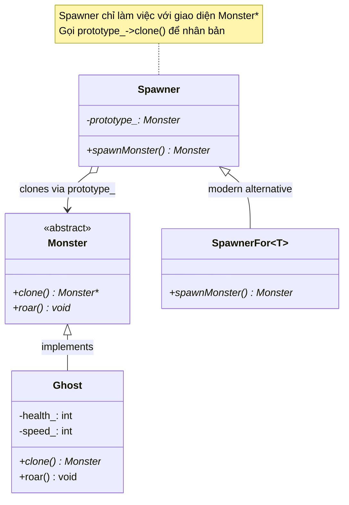

### Sơ đồ Luồng Tra cứu Dữ liệu Ủy quyền Prototype (Data Delegation Chain)

```mermaid
flowchart LR
    GW["Goblin Wizard<br/>{prototype: 'goblin grunt', spells: ['Fireball']}"]
    GG["Goblin Grunt (Prototype)<br/>{health: 30, resists: ['Cold'], weaknesses: ['Fire']}"]
    Lookup{"Yêu cầu: Lấy chỉ số 'health' của Goblin Wizard"}

    Lookup -->|1. Tìm trên Goblin Wizard| FoundLocal{Có không?}
    FoundLocal -- Không -->|2. Ủy quyền lên Prototype| GG
    GG -->|3. Tìm thấy health = 30| ReturnValue["Trả về kết quả: 30 HP"]
```

---

## 5. ÁNH XẠ ỨNG DỤNG VÀO DỰ ÁN GAME OOP

1. **Hệ thống Tạo Vũ Khí & Trang Bị Đặc Biệt (Boss Drops):**
   * Trong game nhiều người chơi 2.5D, thay vì tạo hàng trăm class riêng cho từng cây kiếm huyền thoại, hệ thống lưu một bộ nguyên mẫu (Archetype Prototypes) trong file cấu hình JSON. 
   * Cây kiếm *"Huyết Kiếm Ma Vương"* chỉ cần khai báo `"prototype": "broadsword"` kèm `"lifestealBonus": 0.25`. Bộ sinh đồ (Loot Spawner) chỉ việc clone mẫu kiếm cơ bản và nạp các thuộc tính chênh lệch (Delta attributes).
2. **Hệ thống Xây dựng Trạm Spawn Quái (Monster Nest Spawners):**
   * Khi người chơi bước vào một hầm ngục Dungeon, mỗi tổ quái vật (`NestSpawner`) được nạp sẵn một con quái nguyên mẫu đã được buff chỉ số theo độ khó hầm ngục. Cứ mỗi 10 giây, Spawner gọi `prototype_->clone()` để thả một con quái ra trận mà không cần quan tâm đến logic khởi tạo phụ thuộc bên trong nó.

---
---

# CHƯƠNG 6: SINGLETON PATTERN (MẪU ĐƠN THỂ / BẪY BIẾN TOÀN CỤC TRONG GAME)

## 1. ĐỀ MỤC & MỤC TIÊU CỐT LÕI (CORE PURPOSE)

### Danh mục đề mục chi tiết (Headings Outline)
* **Singleton** *(Mẫu Đơn thể)*
  * **The Singleton Pattern** *(Định nghĩa mẫu thiết kế Đơn thể kinh điển)*
    * *Restricting a class to one instance* *(Giới hạn một lớp chỉ có duy nhất 1 thực thể)*
    * *Providing a global point of access* *(Cung cấp điểm truy cập toàn cục)*
  * **Why We Use It** *(Tại sao chúng ta lại lạm dụng Singleton?)*
    * *Lazy initialization* *(Khởi tạo lười biếng / Trì hoãn)*
    * *Runtime initialization* *(Khởi tạo lúc runtime giải quyết bài toán phụ thuộc cấu hình)*
    * *Subclassing the singleton* *(Đa hình hóa Singleton theo nền tảng phần cứng)*
  * **Why We Regret Using It** *(Tại sao chúng ta phải trả giá đắt và hối hận?)*
    * *It’s a global variable* *(Bản chất thực sự: Singleton chỉ là một biến toàn cục trá hình)*
    * *It solves two problems even when you just have one* *(Giải quyết 2 bài toán khi bạn chỉ cần 1)*
    * *Lazy initialization takes control away from you* *(Khởi tạo lười cướp mất quyền kiểm soát tài nguyên)*
  * **What We Can Do Instead** *(Các giải pháp kiến trúc thay thế tối ưu)*
    * *See if you need the class at all* *(Xem xét có thực sự cần các lớp "Manager" vô bổ không)*
    * *To limit a class to a single instance* *(Kỹ thuật kiểm tra thực thể đơn bằng Assert)*
    * *To provide convenient access to an instance* *(Kỹ thuật Truyền đối số / Dependency Injection)*
    * *Get it from the base class (Subclass Sandbox)* *(Lấy dịch vụ từ lớp cha)*
    * *Get it from something already global* *(Gom cụm dịch vụ vào một đối tượng World/Game duy nhất)*
    * *Get it from a Service Locator* *(Sử dụng Bộ định vị dịch vụ)*
  * **What’s Left for Singleton** *(Vị trí còn lại của Singleton: Gần như bằng Không)*

### Vấn đề kỹ thuật thực tế & Thảm họa hệ thống
Chương này là **chương duy nhất trong toàn bộ cuốn sách đóng vai trò là một lời cảnh tỉnh phản biện (Anti-Pattern Critique)**: Robert Nystrom hướng dẫn cách *không* sử dụng một mẫu thiết kế.
* **Vấn đề kỹ thuật:** Các hệ thống trong game (Hệ thống File, Âm thanh, Kết nối Mạng, Nhật ký Log) cần được truy cập ở nhiều nơi, đồng thời chỉ được phép có duy nhất 1 thể hiện điều khiển phần cứng.
* **Thảm họa khủng khiếp khi lạm dụng Singleton:**
  1. **Tạo ra Mạng nhện Khớp nối Toàn cục (Tight Coupling Web):** Khi viết `AudioPlayer::instance().play()`, bất kỳ file nào gọi lệnh này cũng bị phụ thuộc trực tiếp vào header của `AudioPlayer`. Việc thay thế hệ thống âm thanh hoặc kiểm thử tự động (Unit Test) cho logic nhân vật trở nên bất khả thi vì không thể Mock được các Singleton toàn cục.
  2. **Thảm họa Rớt khung hình do Khởi tạo Lười biếng (Lazy Initialization Stutter):** Trong game 60 FPS, việc khởi tạo tài nguyên âm thanh/đồ họa mất vài trăm mili-giây. Nếu để Singleton tự khởi tạo trong lần gọi đầu tiên (*Lazy Init*), đúng vào khoảnh khắc nhân vật tung chiêu quyết định, game sẽ bị khựng cứng (Frame Drop / Hitching) do CPU bận nạp driver và cấp phát bộ nhớ.
  3. **Xung đột đa luồng và Race Conditions:** Singleton biến bộ nhớ thành một "bãi rác công cộng" mà mọi Thread đều có thể đọc/ghi. Việc đồng bộ hóa bằng Mutex Lock dẫn đến tranh chấp khóa (Lock Contention) và Deadlock đóng băng hệ thống.

---

## 2. PHÂN TÍCH LÝ THUYẾT & NGUYÊN LÝ CHUYÊN SÂU

### 2.1. Bản chất: Singleton giải quyết 2 bài toán khi bạn chỉ cần 1
Định nghĩa của GoF: *"Đảm bảo một lớp chỉ có một thực thể, VÀ cung cấp một điểm truy cập toàn cục tới nó."*
Nystrom bóc tách từ **"VÀ"** tai hại này:
* **Bài toán 1: Ràng buộc duy nhất 1 thực thể (Single Instantiation):** Cần thiết để bảo vệ tài nguyên phần cứng (ví dụ: giao tiếp driver âm thanh). Nhưng không đồng nghĩa với việc cho phép toàn bộ thế giới bên ngoài được tùy tiện truy cập!
* **Bài toán 2: Tiện lợi truy cập (Convenient Access):** Thường là lý do chính khiến lập trình viên lạm dụng Singleton. Nhưng việc cho phép truy cập toàn cục sẽ phá vỡ toàn bộ kiến trúc phân tầng (Layered Architecture).
* **Hậu quả:** Một ngày đẹp trời, ta muốn tạo 2 bộ Log (1 cho Gameplay, 1 cho Network) hoặc 2 Viewport màn hình (Split-screen Multiplayer), nhưng Singleton đã chôn cứng cấu trúc `instance_` duy nhất vào hàng nghìn dòng code gọi lệnh khắp dự án.

### 2.2. Sự thất bại của Khởi tạo Lười biếng (Lazy Initialization) trong Game Engine
Trên môi trường ứng dụng thông thường, Lazy Initialization là một kỹ thuật tốt để tiết kiệm RAM. Nhưng trong Game Engine, **nó là một thảm họa hiệu năng**:
* Engine cần kiểm soát chính xác vị trí và thời điểm phân bổ trên Heap để tránh phân mảnh bộ nhớ (**Memory Fragmentation**).
* Toàn bộ các hệ thống cốt lõi bắt buộc phải được khởi tạo tuần tự, có chủ đích trong giai đoạn tải màn chơi (Loading Screen), tuyệt đối không để rò rỉ việc cấp phát động vào vòng lặp Gameplay.

### 2.3. Hiện tượng Bệnh lý "Manager-itis" (Hội chứng thừa thãi lớp Quản lý)
Nystrom chỉ trích gay gắt thói quen tạo ra hàng loạt lớp trung gian vô bổ: `MonsterManager`, `ParticleManager`, `SoundManager`, `BulletManager`.
* Bản chất của OOP là để **đối tượng tự quản lý chính mình** (Let objects take care of themselves).
* Việc tách `Bullet` (chỉ chứa $x, y$) và `BulletManager` (chứa logic di chuyển, kiểm tra màn hình) là sự thụt lùi về tư duy lập trình thủ tục (Procedural Programming) đội lốt OOP.

### 2.4. Bản đồ 5 Giải pháp Kiến trúc Thay thế Singleton
1. **Truyền đối tượng qua Tham số (Dependency Injection / Pass it in):** Truyền thẳng ngữ cảnh `RenderContext&` hoặc `PhysicsWorld&` vào phương thức cần dùng. Rõ ràng, minh bạch, dễ viết Unit Test Mock.
2. **Lấy từ Lớp cơ sở (Subclass Sandbox):** Các Entity kế thừa từ `GameObject`, và `GameObject` cung cấp phương thức `protected: Log& getLog()`. Chỉ có các Entity con mới truy cập được, thế giới bên ngoài hoàn toàn bị che giấu.
3. **Gom cụm vào Đối tượng Toàn cục duy nhất (Monolithic Game/World Facade):** Thay vì tạo 20 Singleton rải rác khắp nơi, chỉ duy nhất một đối tượng `Game` được phép sống toàn cục. Các hệ thống con được truy xuất qua `Game::instance().getAudio()`.
4. **Kiểm tra Ràng buộc bằng Khẳng định Thời gian chạy (Runtime Assertion):** Vẫn cho phép khởi tạo bình thường nhưng đặt `assert(!instantiated_)` trong Constructor. Bảo đảm chỉ có duy nhất 1 instance được tạo mà không cần biến nó thành biến toàn cục.
5. **Bộ định vị Dịch vụ (Service Locator):** Tách rời hoàn toàn giao diện trừu tượng và việc cung cấp dịch vụ (sẽ phân tích sâu ở Chương 16).

---

## 3. MỔ XẺ MÃ NGUỒN (CODE DEEP-DIVE)

Dưới đây là mã nguồn C++ đối chiếu giữa Singleton kinh điển (với thread-safety theo chuẩn C++11), Bẫy kiến trúc Lazy Init, và 2 giải pháp thay thế thượng thừa của Robert Nystrom:

```cpp
#include <iostream>
#include <cassert>

// =================================================================
// 1. C++11 THREAD-SAFE MEYERS' SINGLETON (CHUẨN HIỆN ĐẠI NHƯNG VẪN LÀ BIẾN TOÀN CỤC)
// =================================================================
class FileSystemModern {
public:
    static FileSystemModern& instance() {
        // C++11 đảm bảo biến static cục bộ khởi tạo an toàn đa luồng (Thread-safe)
        static FileSystemModern instance;
        return instance;
    }

    void readFile(const char* path) {
        std::cout << "Doc file: " << path << "\n";
    }

private:
    FileSystemModern() {} // Constructor private ngăn chặn khởi tạo ngoài
    FileSystemModern(const FileSystemModern&) = delete;
    FileSystemModern& operator=(const FileSystemModern&) = delete;
};

// =================================================================
// 2. GIẢI PHÁP THAY THẾ 1: ASSERTION-BASED SINGLE INSTANCE (KHÔNG TOÀN CỤC)
// =================================================================
class AudioDevice {
public:
    AudioDevice() {
        // Bảo vệ tài nguyên phần cứng: Chỉ duy nhất 1 instance được phép sống!
        assert(!instantiated_ && "Loi nghiem trong: AudioDevice da duoc khoi tao truoc do!");
        instantiated_ = true;
    }

    ~AudioDevice() {
        instantiated_ = false;
    }

    void playSound(int soundId) {
        std::cout << "Phat am thanh ID: " << soundId << "\n";
    }

private:
    static bool instantiated_; // Cờ trạng thái tĩnh kiểm soát vòng đời
};
bool AudioDevice::instantiated_ = false;

// =================================================================
// 3. GIẢI PHÁP THAY THẾ 2: SUBCLASS SANDBOX (TRUY CẬP TỪ LỚP CHA)
// =================================================================
class LogService {
public:
    void write(const char* msg) { std::cout << "[LOG]: " << msg << "\n"; }
};

class GameObject {
public:
    static void provideLog(LogService* log) { logService_ = log; }

protected:
    // Chỉ các lớp con kế thừa mới được phép dùng Log, ngan chan the gioi ben ngoai
    LogService& getLog() { return *logService_; }

private:
    static LogService* logService_;
};
LogService* GameObject::logService_ = nullptr;

class Hero : public GameObject {
public:
    void takeDamage(int amount) {
        getLog().write("Hero vua bi trung don!");
    }
};
```

### Bảng phân tích chi tiết mã nguồn
| Dòng code / Đoạn code then chốt | Giải thích kỹ thuật & Ý nghĩa thiết kế |
|:---|:---|
| `static FileSystemModern instance;` | Cài đặt Meyers' Singleton: Trình biên dịch sinh mã kiểm tra ngầm cờ thread-safety (Magic Statics). Dù an toàn luồng, nó vẫn vướng bẫy Lazy Initialization và là biến toàn cục khó kiểm thử. |
| `assert(!instantiated_ && "...");` | Kỹ thuật **Single Instantiation Enforcement**: Bảo đảm tính đơn lẻ của đối tượng ở cấp độ vòng đời runtime. Đối tượng có thể được truyền qua con trỏ hoặc tham chiếu mà không cần phơi bày API tĩnh toàn cục `instance()`. |
| `~AudioDevice() { instantiated_ = false; }` | Khi đối tượng bị hủy, cờ kiểm soát được trả về `false`. Cho phép hủy đối tượng cũ và tái tạo đối tượng mới trong các kịch bản kiểm thử (Unit Testing) hoặc khi tải lại màn chơi. |
| `protected: LogService& getLog()` | Hiện thực hóa nguyên lý **Đóng gói phạm vi hẹp nhất có thể (Narrowest Scope Principle)**: Đóng đinh quyền truy cập dịch vụ trong nội bộ cây phả hệ `GameObject`, ngăn chặn lập trình viên tùy tiện gọi Log từ các hàm toán học hay mạng socket. |

---

## 4. SƠ ĐỒ TRỰC QUAN HÓA (VISUAL MERMAID DIAGRAM)

### Sơ đồ Đối chiếu Kiến trúc: Bẫy Khớp Nối Singleton vs Giải Pháp Gom Cụm Facade

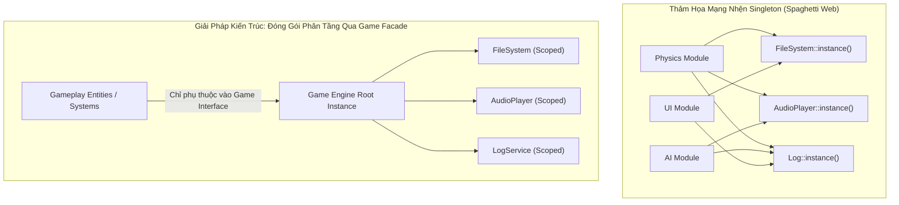

### Sơ đồ Tuần tự Rủi ro của Lazy Initialization vs Eager Loading

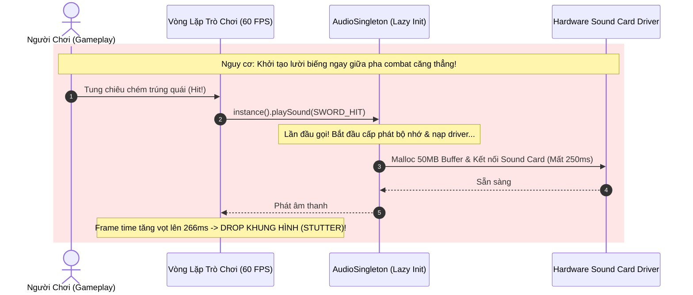

---

## 5. ÁNH XẠ ỨNG DỤNG VÀO DỰ ÁN GAME OOP

1. **Thanh Trừng Toàn Diện Các Singleton Trong Dự Án Đấu Trường 2.5D:**
   * Trong một dự án game chiến đấu nhiều người chơi, loại bỏ hoàn toàn các Singleton trá hình như `NetworkManager::getInstance()`, `CombatManager::getInstance()`.
   * Chuyển sang mô hình **Dependency Injection (DI) hoặc Game Context**: Khởi tạo `ServerNetworkService` và `CombatEngine` một lần duy nhất trong hàm `main()` của Server, sau đó truyền tham chiếu vào vòng lặp `GameSession`. Điều này cho phép mở nhiều phòng chơi (Multi-room / Multi-arena) trên cùng một tiến trình Server mà không bị xung đột bộ nhớ tĩnh.
2. **Quy Chuẩn Tải Trước Tài Nguyên Tránh Khựng Game (Eager Allocation Protocol):**
   * Tất cả các đối tượng điều khiển hệ thống phần cứng (Âm thanh, Đồ họa OpenGL/DirectX, Bộ đệm gói tin Socket) bắt buộc phải tuân thủ giao thức **Khởi tạo Sớm (Eager Initialization)** trong màn hình Loading Screen.
   * Cấm tuyệt đối việc sử dụng cú pháp Singleton Lazy Init bên trong bất kỳ hàm nào thuộc chu trình cập nhật mỗi khung hình (`update()`, `render()`).


---


<!-- ========================================================================= -->
<!-- BẮT ĐẦU Dot_04_State_va_DoubleBuffer.md -->
<!-- ========================================================================= -->

---
aliases: [Nystrom Dot 4, State Pattern, Double Buffer Pattern]
tags: [game-programming-patterns, nystrom, state-machine, fsm, pushdown-automata, double-buffer, screen-tearing, simulation-order-bias]
created: 2026-11-04
author: Principal Software Architect & OOAD Lecturer
reference: "Game Programming Patterns by Robert Nystrom (Chap 08 & Chap 09)"
---

# BÓC TÁCH CHUYÊN SÂU NYSTROM — ĐỢT 4: CHƯƠNG 7 & CHƯƠNG 8
*(Dựa trên nguyên bản "Game Programming Patterns" của Robert Nystrom)*

---

# MỤC LỤC ĐỢT 4
- [CHƯƠNG 7: STATE PATTERN (MẪU MÁY TRẠNG THÁI HỮU HẠN & MỞ RỘNG)](#chương-7-state-pattern-mẫu-máy-trạng-thái-hữu-hạn--mở-rộng)
  - [1. ĐỀ MỤC & MỤC TIÊU CỐT LÕI (CORE PURPOSE)](#1-đề-mục--mục-tiêu-cốt-lõi-core-purpose)
  - [2. PHÂN TÍCH LÝ THUYẾT & NGUYÊN LÝ CHUYÊN SÂU](#2-phân-tích-lý-thuyết--nguyên-lý-chuyên-sâu)
  - [3. MỔ XẺ MÃ NGUỒN (CODE DEEP-DIVE)](#3-mổ-xẻ-mã-nguồn-code-deep-dive)
  - [4. SƠ ĐỒ TRỰC QUAN HÓA (VISUAL MERMAID DIAGRAM)](#4-sơ-đồ-trực-quan-hóa-visual-mermaid-diagram)
  - [5. ÁNH XẠ ỨNG DỤNG VÀO DỰ ÁN GAME OOP](#5-ánh-xạ-ứng-dụng-vào-dự-án-game-oop)
- [CHƯƠNG 8: DOUBLE BUFFER PATTERN (MẪU BỘ ĐỆM ĐÔI TRONG KẾT XUẤT VÀ MÔ PHỎNG)](#chương-8-double-buffer-pattern-mẫu-bộ-đệm-đôi-trong-kết-xuất-và-mô-phỏng)
  - [1. ĐỀ MỤC & MỤC TIÊU CỐT LÕI (CORE PURPOSE)](#1-đề-mục--mục-tiêu-cốt-lõi-core-purpose-1)
  - [2. PHÂN TÍCH LÝ THUYẾT & NGUYÊN LÝ CHUYÊN SÂU](#2-phân-tích-lý-thuyết--nguyên-lý-chuyên-sâu-1)
  - [3. MỔ XẺ MÃ NGUỒN (CODE DEEP-DIVE)](#3-mổ-xẻ-mã-nguồn-code-deep-dive)
  - [4. SƠ ĐỒ TRỰC QUAN HÓA (VISUAL MERMAID DIAGRAM)](#4-sơ-đồ-trực-quan-hóa-visual-mermaid-diagram-1)
  - [5. ÁNH XẠ ỨNG DỤNG VÀO DỰ ÁN GAME OOP](#5-ánh-xạ-ứng-dụng-vào-dự-án-game-oop-1)

---

# CHƯƠNG 7: STATE PATTERN (MẪU MÁY TRẠNG THÁI HỮU HẠN & MỞ RỘNG)

## 1. ĐỀ MỤC & MỤC TIÊU CỐT LÕI (CORE PURPOSE)

### Danh mục đề mục chi tiết (Headings Outline)
* **State** *(Mẫu Trạng thái)*
  * **We’ve All Been There** *(Tấn bi kịch quen thuộc: Rừng cờ Boolean lồng nhau)*
  * **Finite State Machines to the Rescue** *(Máy trạng thái hữu hạn FSM giải cứu)*
  * **Enums and Switches** *(Hiện thực hóa FSM bằng Enum & Rẽ nhánh Switch-Case)*
  * **The State Pattern** *(Mẫu thiết kế State chuẩn Gang of Four)*
    * *A state interface* *(Giao diện trừu tượng hóa trạng thái)*
    * *Classes for each state* *(Đóng gói hành vi vào từng lớp trạng thái riêng biệt)*
    * *Delegate to the state* *(Ủy quyền điều phối hành vi cho trạng thái hiện tại)*
  * **Where Are the State Objects?** *(Vị trí lưu trữ và Quản trị vòng đời đối tượng trạng thái)*
    * *Static states* *(Trạng thái tĩnh bất biến Flyweight)*
    * *Instantiated states* *(Trạng thái động cấp phát theo phiên & bài toán dọn dẹp bộ nhớ)*
  * **Enter and Exit Actions** *(Hành động kích hoạt khi Bước vào và Rời khỏi trạng thái)*
  * **What’s the Catch?** *(Hạn chế của FSM: Tính xơ cứng và Thiếu tính toán hoàn chỉnh)*
  * **Concurrent State Machines** *(Máy trạng thái đồng thời: Hóa giải bùng nổ tổ hợp trạng thái)*
  * **Hierarchical State Machines** *(Máy trạng thái phân cấp: Kế thừa và Tái sử dụng logic chuyển tiếp)*
  * **Pushdown Automata** *(Tự động đẩy xuống / Ngăn xếp trạng thái: Lưu vết lịch sử hành vi)*
  * **So How Useful Are They?** *(Đánh giá phạm vi ứng dụng thực tế trong Game Development)*

### Vấn đề kỹ thuật thực tế & Thảm họa hệ thống
Khi lập trình điều khiển nhân vật chính hoặc AI quái vật, nhân vật phải liên tục chuyển đổi giữa hàng chục tư thế vận động: Đứng yên, Chạy, Nhảy, Ngồi, Bổ nhào chém, Choáng, và Bị hất tung.
* **Thảm họa Rừng cờ biến Boolean (Boolean Flag Spaghetti):** Lập trình viên nghiệp dư thường quản lý bằng cách cấy hàng loạt biến cờ: `bool isJumping_`, `bool isDucking_`, `bool isAttacking_`, `bool isGrounded_`. 
* **Hậu quả chết người:**
  1. **Trạng thái không hợp lệ (Invalid Combinations):** Khi người chơi nhấn nút nhảy trong tư thế ngồi rồi nhả nút ngồi ngay giữa không trung, nhân vật đột ngột chuyển thành tư thế đứng trên không trung (`isJumping_ == true && isDucking_ == false`), cho phép người chơi nhảy vô hạn lần trên mây ("Air-jumping exploit").
  2. **Bùng nổ tổ hợp rẽ nhánh (Combinatorial Complexity):** Mỗi lần thêm một hành vi mới (như đòn tấn công khi lặn), ta buộc phải chèn thêm các điều kiện `if (!isJumping_ && !isDucking_ && !isDiving_ && ...)`. Mã nguồn biến thành một bãi mìn rẽ nhánh phức tạp; sửa một lỗi ở đòn đánh sẽ gián tiếp làm gãy logic nhảy hoặc ngã.

---

## 2. PHÂN TÍCH LÝ THUYẾT & NGUYÊN LÝ CHUYÊN SÂU

### 2.1. Nền tảng Lý thuyết Máy trạng thái Hữu hạn (Finite State Machine - FSM)
Xuất phát từ Lý thuyết Tự động học (Automata Theory), một FSM chuẩn mực bao gồm 4 yếu tố bất di bất dịch:
1. **Tập hợp trạng thái hữu hạn (Fixed set of states):** Đối tượng chỉ có thể ở một trong các trạng thái đã biết trước (`Standing`, `Jumping`, `Ducking`, `Diving`).
2. **Tính độc quyền thời gian (Exclusive state):** Tại một thời điểm duy nhất, cỗ máy chỉ được phép nằm ở đúng **MỘT** trạng thái duy nhất.
3. **Chuỗi tín hiệu ngõ vào (Inputs / Events):** Các sự kiện bấm phím hoặc thông điệp vật lý (`PRESS_B`, `PRESS_DOWN`, `TOUCH_GROUND`).
4. **Tập hợp chuyển tiếp (Transitions):** Mỗi trạng thái kết nối với trạng thái khác thông qua một điều kiện chuyển đổi cụ thể. Nếu một tín hiệu không có đường chuyển tiếp trong trạng thái hiện tại, nó bị triệt tiêu an toàn.

### 2.2. Sự tiến hóa từ `switch-case` sang Đa hình OOP State Pattern
* **Cấp độ Enum & Switch:** Đảo ngược thứ tự rẽ nhánh: thay vì gom theo input `if (input == PRESS_B)`, ta gom theo trạng thái `switch (state_)`. Cách này đơn giản, nhanh, nhưng thất bại khi một trạng thái phát sinh dữ liệu riêng cục bộ (ví dụ: `chargeTime_` chỉ có ý nghĩa khi ngồi gồng năng lượng).
* **Cấp độ OOP State Pattern:** Chuyển từng `case` thành một lớp cụ thể kế thừa từ giao diện trừu tượng `HeroineState`. Thay thế rẽ nhánh điều kiện bằng **Liên kết động (Dynamic Polymorphic Dispatch)**:
$$\text{Heroine::handleInput}() \implies \text{state\_}\to\text{handleInput}(*\text{this}, \text{input})$$

### 2.3. Quản trị Bộ nhớ State: Flyweight Tĩnh vs Cấp phát Động
1. **Static States (Flyweight):** Nếu State không chứa biến thuộc tính cá thể (chỉ có vptr và phương thức thuần túy), ta chỉ cần khai báo một instance `static` duy nhất cho toàn bộ game. Zero allocation, zero cache miss.
2. **Instantiated States:** Khi State cần lưu trữ dữ liệu riêng (như thời gian gồng đòn của từng thực thể), ta buộc phải cấp phát động (`new DuckingState()`). 
   * **Nguyên tắc an toàn:** Không bao giờ gọi `delete this;` bên trong phương thức của State. Thay vào đó, hàm `handleInput()` trả về con trỏ trạng thái mới `HeroineState*`, bàn giao quyền giải phóng trạng thái cũ cho lớp chủ thể `Heroine`.

### 2.4. Khắc phục hạn chế của FSM bằng 3 Mô hình Mở rộng Thượng thừa
FSM thuần túy không phải là Turing Complete và dễ bị bế tắc khi quy mô game mở rộng. Nystrom đưa ra 3 giải pháp kiến trúc:
1. **Máy trạng thái Đồng thời (Concurrent State Machines):**
   * Nếu nhân vật vừa chạy vừa cầm súng bắn, việc gộp chung sẽ tạo ra $N \times M$ trạng thái (`Standing_Armed`, `Jumping_Armed`,...).
   * Giải pháp: Chia làm hai cỗ máy trạng thái độc lập chạy song song trên cùng nhân vật: `state_` (chân/vận động) và `equipment_` (tay/vũ khí). Độ phức tạp giảm ngoạn mục xuống còn $N + M$ trạng thái.
2. **Máy trạng thái Phân cấp (Hierarchical State Machines - HSM):**
   * Sử dụng kế thừa hướng đối tượng: Tạo lớp `OnGroundState` xử lý các thao tác chung (Nhảy, Ngồi). Các lớp `StandingState`, `RunningState` kế thừa từ `OnGroundState`. Nếu lớp con không xử lý input, nó tự động ủy quyền ngược lên lớp cha (`OnGroundState::handleInput()`).
3. **Tự động Đẩy xuống (Pushdown Automata - PDA):**
   * FSM truyền thống không có bộ nhớ lịch sử (*memoryless*). Khi nhân vật kích hoạt đòn đánh `FiringState`, sau khi bắn xong, nó không biết phải quay về trạng thái nào (Đứng, Nhảy hay Bò?).
   * Giải pháp: Sử dụng **Ngăn xếp trạng thái (Stack of States)**. Khi bắn, push `FiringState` lên đỉnh stack. Bắn xong, pop `FiringState` ra khỏi stack, hệ thống tự động rơi về trạng thái trước đó một cách hoàn hảo.

---

## 3. MỔ XẺ MÃ NGUỒN (CODE DEEP-DIVE)

Dưới đây là mã nguồn C++ thể hiện kỹ thuật State Pattern hoàn chỉnh với Entry Actions và Pushdown Automata Stack:

```cpp
#include <iostream>
#include <stack>

// Khai báo trước
class Heroine;

enum Input {
    PRESS_B,
    PRESS_DOWN,
    RELEASE_DOWN,
    PRESS_ATTACK
};

// =================================================================
// 1. GIAO DIỆN STATE TRỪU TƯỢNG VỚI ENTRY & EXIT ACTIONS
// =================================================================
class HeroineState {
public:
    virtual ~HeroineState() {}
    virtual void enter(Heroine& heroine) {}
    virtual void exit(Heroine& heroine) {}
    virtual HeroineState* handleInput(Heroine& heroine, Input input) { return nullptr; }
    virtual void update(Heroine& heroine) {}
};

// =================================================================
// 2. LỚP CHỦ THỂ (HEROINE) QUẢN LÝ PUSHDOWN AUTOMATA STACK
// =================================================================
class Heroine {
public:
    Heroine();
    ~Heroine();

    void pushState(HeroineState* newState);
    void popState();
    void handleInput(Input input);
    void update();

    void setGraphics(const char* image) {
        std::cout << ">>> [RENDER]: Chuyen sprite nhan vat -> " << image << "\n";
    }

    void superBomb() {
        std::cout << ">>> [COMBAT]: KICH HOAT BOM NO TOAN MAN HINH!\n";
    }

private:
    std::stack<HeroineState*> stateStack_; // Pushdown Automata Stack
};

// =================================================================
// 3. CÁC TRẠNG THÁI CỤ THỂ (CONCRETE STATES)
// =================================================================
class StandingState : public HeroineState {
public:
    virtual void enter(Heroine& heroine) override {
        heroine.setGraphics("IMAGE_STAND");
    }

    virtual HeroineState* handleInput(Heroine& heroine, Input input) override;
};

class DuckingState : public HeroineState {
public:
    DuckingState() : chargeTime_(0) {}

    virtual void enter(Heroine& heroine) override {
        heroine.setGraphics("IMAGE_DUCK");
    }

    virtual HeroineState* handleInput(Heroine& heroine, Input input) override {
        if (input == RELEASE_DOWN) {
            return new StandingState(); // Chuyen ve dung day
        }
        return nullptr;
    }

    virtual void update(Heroine& heroine) override {
        chargeTime_++;
        if (chargeTime_ > 5) { // Nguong tich luy nang luong
            heroine.superBomb();
            chargeTime_ = 0;
        }
    }

private:
    int chargeTime_; // Du lieu cuc bo rieng biet cua trang thai ngoi
};

class FiringState : public HeroineState {
public:
    FiringState() : framesRemaining_(2) {}

    virtual void enter(Heroine& heroine) override {
        heroine.setGraphics("IMAGE_FIRE_ANIMATION");
    }

    virtual void update(Heroine& heroine) override;

private:
    int framesRemaining_;
};

// =================================================================
// 4. HIỆN THỰC HÓA LOGIC CHUYỂN TIẾP VÀ NGĂN XẾP PUSHDOWN
// =================================================================
HeroineState* StandingState::handleInput(Heroine& heroine, Input input) {
    if (input == PRESS_DOWN) {
        return new DuckingState();
    }
    if (input == PRESS_ATTACK) {
        heroine.pushState(new FiringState()); // Push vao ngan xep, khong xoa StandingState
        return nullptr;
    }
    return nullptr;
}

void FiringState::update(Heroine& heroine) {
    framesRemaining_--;
    if (framesRemaining_ <= 0) {
        std::cout << ">>> [ANIMATION]: Hoan tat ban sung, pop trang thai cu!\n";
        heroine.popState(); // Tu dong quay ve trang thai truoc do
    }
}

Heroine::Heroine() {
    pushState(new StandingState());
}

Heroine::~Heroine() {
    while (!stateStack_.empty()) {
        delete stateStack_.top();
        stateStack_.pop();
    }
}

void Heroine::pushState(HeroineState* newState) {
    if (!stateStack_.empty()) {
        stateStack_.top()->exit(*this);
    }
    stateStack_.push(newState);
    stateStack_.top()->enter(*this);
}

void Heroine::popState() {
    if (stateStack_.size() > 1) { // Giu lai it nhat 1 state goc
        HeroineState* top = stateStack_.top();
        top->exit(*this);
        delete top;
        stateStack_.pop();
        stateStack_.top()->enter(*this);
    }
}

void Heroine::handleInput(Input input) {
    if (!stateStack_.empty()) {
        HeroineState* nextState = stateStack_.top()->handleInput(*this, input);
        if (nextState != nullptr) {
            // Thay the state tren dinh
            HeroineState* oldState = stateStack_.top();
            oldState->exit(*this);
            delete oldState;
            stateStack_.pop();

            stateStack_.push(nextState);
            nextState->enter(*this);
        }
    }
}

void Heroine::update() {
    if (!stateStack_.empty()) {
        stateStack_.top()->update(*this);
    }
}
```

### Bảng phân tích chi tiết mã nguồn
| Dòng code / Đoạn code then chốt | Giải thích kỹ thuật & Ý nghĩa thiết kế |
|:---|:---|
| `virtual void enter(Heroine& heroine)` | Kỹ thuật **Lifecycle Hook (Entry Action)**: Đóng gói toàn bộ logic đổi sprite và âm thanh vào chính lớp trạng thái đích. Chạy nhất quán bất kể chuyển đến từ trạng thái nào. |
| `HeroineState* handleInput(...) { return new DuckingState(); }` | Cơ chế chuyển đổi trạng thái hướng đối tượng không tự hủy: Hàm trả về con trỏ trạng thái mới thay vì tự xóa chính mình, giúp ngăn chặn lỗi tham chiếu bộ nhớ vô hiệu (*use-after-free*). |
| `std::stack<HeroineState*> stateStack_;` | Cấu trúc dữ liệu hiện thực hóa mô hình **Pushdown Automaton**: Cho phép tạm dừng một trạng thái dài hạn (như `StandingState`), thực thi một trạng thái ngắn hạn (`FiringState`), rồi khôi phục lại trạng thái cũ mà không cần ghi nhớ biến cờ phức tạp. |
| `heroine.popState();` | Đóng gói giải thuật hoàn nguyên tự động: Khi hoạt ảnh kết thúc, trạng thái đỉnh stack tự giải phóng và kích hoạt lại `enter()` của trạng thái nằm dưới. |

---

## 4. SƠ ĐỒ TRỰC QUAN HÓA (VISUAL MERMAID DIAGRAM)

### Sơ đồ Máy trạng thái Nhân vật (State Diagram)

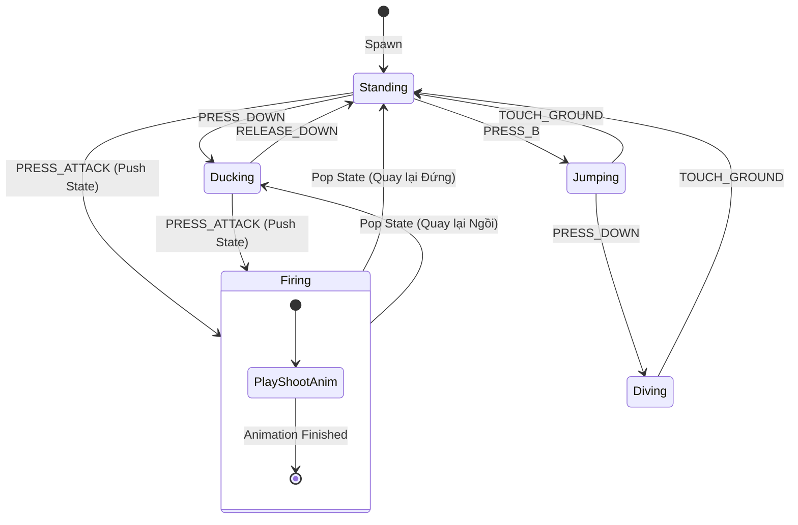

### Sơ đồ Lớp Cấu trúc Ngăn xếp Pushdown (Class Diagram)

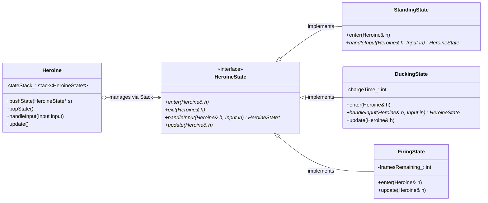

---

## 5. ÁNH XẠ ỨNG DỤNG VÀO DỰ ÁN GAME OOP

1. **Kiến trúc Máy trạng thái Đấu sĩ 2.5D (Fighter FSM):**
   * Trong game chiến đấu, nhân vật sử dụng **Concurrent State Machine**:
     * *Cỗ máy vận động (Locomotion FSM):* `IdleState` $\leftrightarrow$ `RunningState` $\leftrightarrow$ `InAirState`.
     * *Cỗ máy tác chiến (Combat FSM):* `NormalState` $\leftrightarrow$ `AttackingState` $\leftrightarrow$ `BlockingState` $\leftrightarrow$ `StunnedState`.
   * Hai cỗ máy chạy độc lập nhưng có ràng buộc: Khi Combat FSM rơi vào `StunnedState` (Bị choáng), nó khóa toàn bộ khả năng xử lý input của Locomotion FSM, loại bỏ hoàn toàn lỗi "vừa bị choáng vừa chạy".
2. **Quản trị Luồng Màn hình UI bằng Pushdown Automata:**
   * Hệ thống Menu sử dụng Pushdown Automata Stack: `GameplayState` $\to$ Push `PauseMenuState` $\to$ Push `SettingsMenuState`. 
   * Khi người chơi nhấn nút *Back*, chỉ cần gọi `popState()` để quay lại đúng menu trước đó mà không cần viết các hàm điều hướng thủ công chằng chịt.

---
---

# CHƯƠNG 8: DOUBLE BUFFER PATTERN (MẪU BỘ ĐỆM ĐÔI TRONG KẾT XUẤT VÀ MÔ PHỎNG)

## 1. ĐỀ MỤC & MỤC TIÊU CỐT LÕI (CORE PURPOSE)

### Danh mục đề mục chi tiết (Headings Outline)
* **Double Buffer** *(Mẫu Bộ đệm đôi)*
  * **Intent** *(Mục đích: Biến chuỗi biến đổi tuần tự thành tức thời)*
  * **Motivation** *(Động lực: Bản chất tuần tự của máy tính vs Kỳ vọng đồng thời của người dùng)*
    * *How computer graphics work (briefly)* *(Cơ chế quét điểm ảnh của phần cứng hiển thị)*
    * *Act 1, Scene 1* *(Phép ẩn dụ hai sân khấu kịch A và B)*
    * *Back to the graphics* *(Ánh xạ ngược vào Framebuffer: Front Buffer vs Back Buffer)*
  * **The Pattern** *(Quy chuẩn mẫu thiết kế: Next Buffer, Current Buffer và Thao tác Swap)*
  * **When to Use It** *(Khi nào nên áp dụng)*
  * **Keep in Mind** *(Các đánh đổi kiến trúc: Chi phí hoán đổi và Bộ nhớ nhân đôi)*
  * **Sample Code** *(Mã nguồn kết xuất Framebuffer)*
  * **Not just for graphics** *(Không chỉ dành cho đồ họa: Bài toán Mô phỏng Game State và AI)*
    * *Artificial unintelligence* *(Hiện tượng sai lệch thứ tự cập nhật: Ví dụ hề kịch Slapstick)*
    * *Buffered slaps* *(Giải pháp Bộ đệm đôi cho trạng thái thực thể)*
  * **Design Decisions** *(Các quyết định thiết kế then chốt)*
    * *How are the buffers swapped?* *(Tráo đổi con trỏ vs Sao chép vùng nhớ)*
    * *What is the granularity of the buffer?* *(Bộ đệm nguyên khối Monolithic vs Bộ đệm phân tán Per-Entity)*

### Vấn đề kỹ thuật thực tế & Thảm họa hệ thống
Máy tính về bản chất là một cỗ máy xử lý tuần tự (sequential processing), trong khi thế giới thực tế và thị giác con người lại vận hành đồng thời (simultaneous reality).
* **Thảm họa Xé hình Đồ họa (Screen Tearing & Flickering):** Màn hình quét điểm ảnh liên tục 60 lần mỗi giây từ bộ nhớ đệm (Framebuffer). Nếu engine vừa tính toán vẽ mắt, mũi của nhân vật trực tiếp lên Framebuffer mà màn hình đã quét qua, người chơi sẽ nhìn thấy một nửa khuôn mặt bị cắt đứt gãy làm đôi (*tearing*), hoặc đồ họa bị nhấp nháy điên cuồng.
* **Thảm họa Sai lệch thứ tự cập nhật (Update Order Bias / Cascading Race Condition):** Trong mô phỏng vật lý hoặc AI, nếu thực thể $A$ tát thực thể $B$, và thực thể $B$ tát thực thể $C$. Nếu ta cập nhật mảng theo thứ tự $A \to B \to C$: Trong **cùng một khung hình**, cú tát của $A$ kích hoạt $B$ và lập tức kích hoạt $C$. Nhưng nếu đảo thứ tự mảng thành $C \to B \to A$, cú tát phải mất tới **3 khung hình** mới truyền tới $C$. Logic gameplay bị biến dạng hoàn toàn chỉ vì thứ tự sắp xếp index của mảng thực thể!

---

## 2. PHÂN TÍCH LÝ THUYẾT & NGUYÊN LÝ CHUYÊN SÂU

### 2.1. Bản chất Mẫu thiết kế Double Buffer
Quy chuẩn mẫu Double Buffer bao gồm:
* Một lớp được đệm (*buffered class*) chứa một trạng thái có thể bị biến đổi tuần tự từng bước.
* Trạng thái này được nhân đôi thành 2 bản sao:
  * **Current Buffer (Bộ đệm hiện tại / Front Buffer):** Chỉ dành cho thế giới bên ngoài **ĐỌC** dữ liệu ổn định của khung hình trước.
  * **Next Buffer (Bộ đệm kế tiếp / Back Buffer):** Chỉ dành cho nội bộ hệ thống **GHI** dữ liệu đang tính toán dở dang.
* **Thao tác Tráo đổi (Swap Operation):** Khi toàn bộ các phép tính toán/vẽ đã hoàn tất, hai bộ đệm được hoán đổi vai trò cho nhau trong một khoảnh khắc tức thời (atomic swap).

### 2.2. Cơ chế Đồng bộ Khung hình Đồ họa (Graphics V-Sync & Swapping)
* **Screen Tearing:** Xảy ra khi thao tác tráo đổi bộ đệm diễn ra ngay giữa chu kỳ quét tia điện tử/quét điểm ảnh của màn hình.
* **Vertical Synchronization (V-Sync):** Kỹ thuật phần cứng buộc lệnh `swapBuffers()` phải đợi cho đến khi màn hình quét xong điểm ảnh cuối cùng ở góc dưới bên phải (khoảng thời gian nghỉ dọc - *Vertical Blanking Interval / VBLANK*), loại bỏ triệt để hiện tượng xé hình.

### 2.3. Đột phá Tư duy: Double Buffering trong Game Simulation & Physics
Nystrom chỉ ra một ứng dụng sâu sắc ít người để ý: **Double Buffer giải quyết triệt để lỗi "Update Order Bias" trong mô phỏng thế giới**.
* Khi các thực thể game tương tác qua lại (Game of Life, lan truyền lửa, xô đẩy vật lý):
  * Mọi thực thể chỉ được phép **đọc trạng thái ở bộ đệm cũ (`current_`)**.
  * Mọi tác động làm biến đổi (gây sát thương, đổi vị trí) bắt buộc phải **ghi vào bộ đệm mới (`next_`)**.
* Nhờ đó, việc duyệt mảng quái vật từ $0 \to N$ hay từ $N \to 0$ cho ra kết quả toán học **hoàn toàn đồng nhất**, tạo ra ảo giác rằng mọi thực thể trong thế giới game đang suy nghĩ và hành động song song cùng một tích tắc.

### 2.4. Phân tích Các Quyết định Thiết kế Kiến trúc (Design Decisions)
1. **Tráo đổi bằng Con trỏ (Pointer Swapping) vs Sao chép Dữ liệu (Memcpy):**
   * *Tráo con trỏ:* $O(1)$, siêu tốc, chỉ cần tráo 2 địa chỉ pointer `std::swap(current_, next_)`. Nhược điểm: Bộ nhớ ngoài không được giữ con trỏ cố định vào bên trong buffer; dữ liệu trên buffer vẽ mới sẽ cách 2 khung hình so với hiện tại.
   * *Sao chép dữ liệu:* $O(N)$, sao chép toàn bộ byte từ `next_` sang `current_`. Dùng khi phần cứng bắt buộc bộ đệm hiển thị phải nằm ở một địa chỉ RAM cố định.
2. **Kỹ thuật Chỉ số Tĩnh Toàn cục (Static Index Double Buffering):**
   * Thay vì mỗi thực thể lưu 2 con trỏ và tốn vòng lặp duyệt gọi hàm `swap()` trên 10,000 quái vật, ta dùng mảng `state[2]` kết hợp 1 chỉ số tĩnh duy nhất cho toàn game:
$$\text{current\_} = 1 - \text{current\_}; \quad \text{next\_} = 1 - \text{current\_}$$
   * Chỉ với **một phép gán duy nhất**, toàn bộ 10,000 quái vật trong game được tráo đổi bộ đệm tức thì mà không tốn một vòng lặp nào!

---

## 3. MỔ XẺ MÃ NGUỒN (CODE DEEP-DIVE)

Dưới đây là mã nguồn C++ thể hiện kỹ thuật Double Buffer trong đồ họa (Pointer Swap) và trong mô phỏng hành vi AI (Static Index Swap):

```cpp
#include <iostream>
#include <vector>

// =================================================================
// 1. GRAPHICS FRAMEBUFFER DOUBLE BUFFERING (POINTER SWAP)
// =================================================================
class Framebuffer {
public:
    static const int WIDTH = 160;
    static const int HEIGHT = 120;

    Framebuffer() { clear(); }

    void clear() {
        for (int i = 0; i < WIDTH * HEIGHT; ++i) pixels_[i] = ' ';
    }

    void draw(int x, int y, char pixel) {
        if (x >= 0 && x < WIDTH && y >= 0 && y < HEIGHT) {
            pixels_[y * WIDTH + x] = pixel;
        }
    }

    const char* getPixels() const { return pixels_; }

private:
    char pixels_[WIDTH * HEIGHT];
};

class SceneRenderer {
public:
    SceneRenderer() : current_(&buffers_[0]), next_(&buffers_[1]) {}

    void renderScene() {
        // Luon ve tren NEXT BUFFER (Back Buffer ngam)
        next_->clear();
        next_->draw(10, 10, '@'); // Nhan vat
        next_->draw(11, 10, '>'); // Mui ten

        // Hoan tat khung hinh -> Swap con tro
        swap();
    }

    // Driver man hinh chi doc tu CURRENT BUFFER (Front Buffer on dinh)
    const Framebuffer& getDisplayBuffer() const {
        return *current_;
    }

private:
    void swap() {
        // Swap con tro O(1) - Khong ton chi phi sao chep RAM
        Framebuffer* temp = current_;
        current_ = next_;
        next_ = temp;
    }

    Framebuffer buffers_[2]; // 2 Framebuffer luon song song trong bo nho
    Framebuffer* current_;
    Framebuffer* next_;
};

// =================================================================
// 2. ACTOR SIMULATION DOUBLE BUFFERING (STATIC INDEX OPTIMIZATION)
// =================================================================
class ComedianActor {
public:
    static void initSimulation() { current_ = 0; }
    static void swapAll() { current_ = next(); } // 1 phep tinh swap toan bo thuc the

    ComedianActor(const char* name) : name_(name), facing_(nullptr) {
        slapped_[0] = false;
        slapped_[1] = false;
    }

    void face(ComedianActor* target) { facing_ = target; }

    // Ghi vao NEXT state
    void slap() {
        slapped_[next()] = true;
    }

    // Doc tu CURRENT state
    bool wasSlapped() const {
        return slapped_[current_];
    }

    void update() {
        if (wasSlapped()) {
            std::cout << name_ << " bi tat o khung hinh truoc -> Tat tra dua " << facing_->name_ << "!\n";
            facing_->slap(); // Ghi vao next buffer cua nan nhan
            slapped_[current_] = false; // Reset sau khi phan ung
        }
    }

private:
    static int next() { return 1 - current_; }

    const char* name_;
    ComedianActor* facing_;
    bool slapped_[2]; // Mang 2 phan tu chua State Double Buffer

    static int current_; // Chi so tinh dung chung cho toan bo he thong
};
int ComedianActor::current_ = 0;
```

### Bảng phân tích chi tiết mã nguồn
| Dòng code / Đoạn code then chốt | Giải thích kỹ thuật & Ý nghĩa thiết kế |
|:---|:---|
| `Framebuffer* temp = current_; current_ = next_; next_ = temp;` | Kỹ thuật **Pointer Ping-Pong Swapping**: Hoán vị 2 địa chỉ vùng nhớ với chi phí thời gian $O(1)$. Loại bỏ hoàn toàn việc gọi `memcpy` hàng triệu điểm ảnh mỗi khung hình. |
| `const Framebuffer& getDisplayBuffer() const` | Tính bao đóng bất biến: Đảm bảo luồng quét phần cứng của card màn hình không bao giờ có thể can thiệp làm biến dạng vùng nhớ đang được vẽ ngầm. |
| `static void swapAll() { current_ = next(); }` | Kỹ thuật **Global Index Alternation ($1 - \text{current}$)**: Biến toàn bộ thao tác tráo đổi bộ đệm của hàng vạn Actor thành một phép toán số học CPU cực nhanh, loại bỏ hoàn toàn vòng lặp $O(N)$ tốn kém. |
| `slapped_[next()] = true;` | Hiện thực hóa nguyên lý **Simulated Parallelism**: Tác động từ tương tác của thực thể chỉ có hiệu lực ở khung hình tiếp theo, triệt tiêu hoàn toàn sự phụ thuộc vào thứ tự duyệt mảng (*Update Order Bias*). |

---

## 4. SƠ ĐỒ TRỰC QUAN HÓA (VISUAL MERMAID DIAGRAM)

### Sơ đồ Luồng Tráo Đổi Con Trỏ Đồ Họa & V-Sync (Front/Back Buffer)

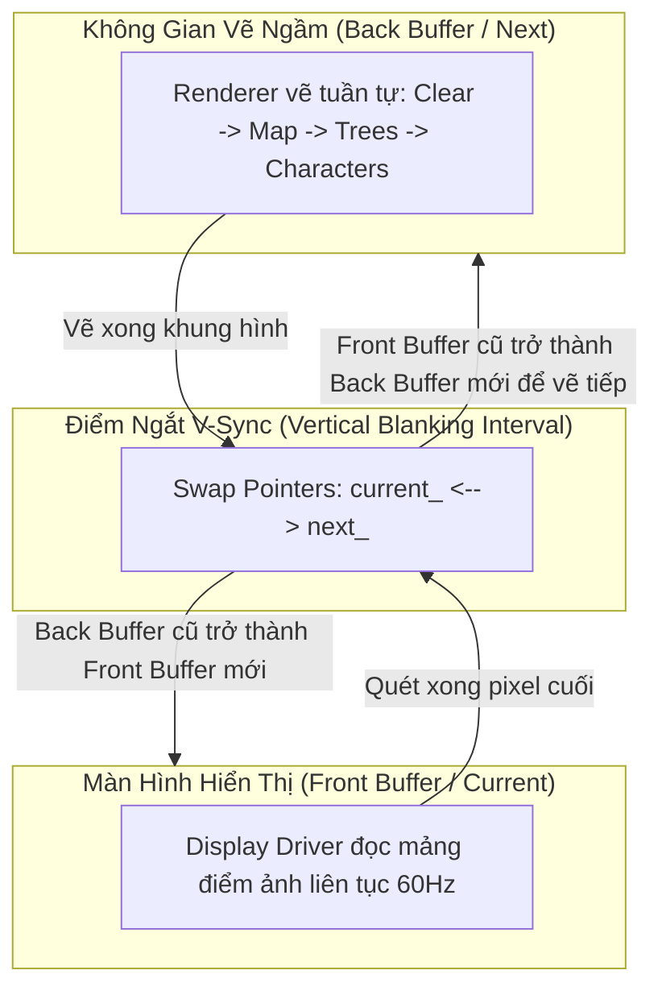

### Sơ đồ Khắc Phục Lỗi Thứ Tự Cập Nhật trong Mô Phỏng AI (Comedians Slap)

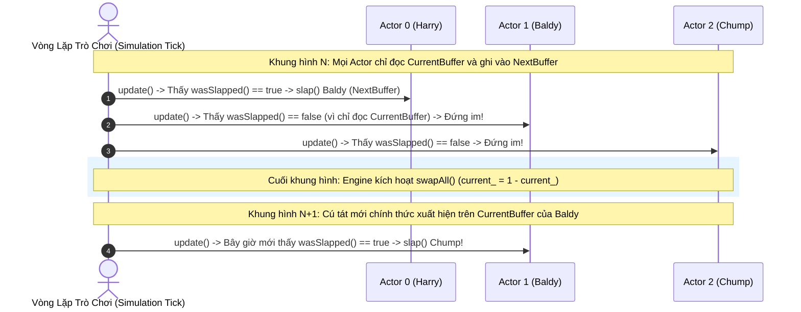

---

## 5. ÁNH XẠ ỨNG DỤNG VÀO DỰ ÁN GAME OOP

1. **Hệ thống Mô phỏng Động học Vật lý và Va chạm (Physics State Ping-Pong):**
   * Trong game đấu trường 2.5D, mỗi thực thể nhân vật lưu 2 cấu trúc biến đổi tọa độ: `Transform currentTransform_` và `Transform nextTransform_`.
   * Trong pha tính toán va chạm, tất cả các phép kiểm tra giao cắt (AABB Intersection) đều đọc từ `currentTransform_`. Các lực đẩy, phản lực nảy ngược được cộng dồn vào `nextTransform_`. Sau khi toàn bộ hệ thống vật lý hoàn tất tính toán cho tất cả các đối tượng, Engine tráo đổi đồng loạt, đảm bảo tính công bằng tuyệt đối: hai nhân vật lao vào nhau cùng lúc sẽ cùng bị bật ngửa, thay vì nhân vật có index nhỏ hơn hất văng nhân vật có index lớn hơn.
2. **Kiến trúc Đồng bộ Dữ liệu Netcode Client Prediction:**
   * Hệ thống mạng Client sử dụng Double Buffer để quản lý trạng thái đồng bộ: Một bộ đệm lưu giữ trạng thái xác thực từ Server (`Authoritative State`), một bộ đệm lưu giữ trạng thái ngoại suy cục bộ (`Predicted State`). Nhờ việc tách rời hai bộ đệm, quá trình nội suy chuyển động (Interpolation) diễn ra êm mượt mà không bị giật lag khi nhận gói tin mạng mới.


---


<!-- ========================================================================= -->
<!-- BẮT ĐẦU Dot_05_GameLoop_va_UpdateMethod.md -->
<!-- ========================================================================= -->

---
aliases: [Nystrom Dot 5, Game Loop Pattern, Update Method Pattern]
tags: [game-programming-patterns, nystrom, game-loop, update-method, fixed-timestep, alpha-interpolation, time-slicing, list-mutation]
created: 2026-11-04
author: Principal Software Architect & OOAD Lecturer
reference: "Game Programming Patterns by Robert Nystrom (Chap 10 & Chap 11)"
---

# BÓC TÁCH CHUYÊN SÂU NYSTROM — ĐỢT 5: CHƯƠNG 9 & CHƯƠNG 10
*(Dựa trên nguyên bản "Game Programming Patterns" của Robert Nystrom)*

---

# MỤC LỤC ĐỢT 5
- [CHƯƠNG 9: GAME LOOP PATTERN (MẪU VÒNG LẶP TRÒ CHƠI)](https://github.com)
  - [1. ĐỀ MỤC & MỤC TIÊU CỐT LÕI (CORE PURPOSE)](#1-đề-mục--mục-tiêu-cốt-lõi-core-purpose)
  - [2. PHÂN TÍCH LÝ THUYẾT & NGUYÊN LÝ CHUYÊN SÂU](#2-phân-tích-lý-thuyết--nguyên-lý-chuyên-sâu)
  - [3. MỔ XẺ MÃ NGUỒN (CODE DEEP-DIVE)](#3-mổ-xẻ-mã-nguồn-code-deep-dive)
  - [4. SƠ ĐỒ TRỰC QUAN HÓA (VISUAL MERMAID DIAGRAM)](#4-sơ-đồ-trực-quan-hóa-visual-mermaid-diagram)
  - [5. ÁNH XẠ ỨNG DỤNG VÀO DỰ ÁN GAME OOP](#5-ánh-xạ-ứng-dụng-vào-dự-án-game-oop)
- [CHƯƠNG 10: UPDATE METHOD PATTERN (MẪU PHƯƠNG THỨC CẬP NHẬT)](https://github.com)
  - [1. ĐỀ MỤC & MỤC TIÊU CỐT LÕI (CORE PURPOSE)](#1-đề-mục--mục-tiêu-cốt-lõi-core-purpose-1)
  - [2. PHÂN TÍCH LÝ THUYẾT & NGUYÊN LÝ CHUYÊN SÂU](#2-phân-tích-lý-thuyết--nguyên-lý-chuyên-sâu-1)
  - [3. MỔ XẺ MÃ NGUỒN (CODE DEEP-DIVE)](#3-mổ-xẻ-mã-nguồn-code-deep-dive)
  - [4. SƠ ĐỒ TRỰC QUAN HÓA (VISUAL MERMAID DIAGRAM)](#4-sơ-đồ-trực-quan-hóa-visual-mermaid-diagram-1)
  - [5. ÁNH XẠ ỨNG DỤNG VÀO DỰ ÁN GAME OOP](#5-ánh-xạ-ứng-dụng-vào-dự-án-game-oop-1)

---

# CHƯƠNG 9: GAME LOOP PATTERN (MẪU VÒNG LẶP TRÒ CHƠI)

## 1. ĐỀ MỤC & MỤC TIÊU CỐT LÕI (CORE PURPOSE)

### Danh mục đề mục chi tiết (Headings Outline)
* **Game Loop** *(Mẫu Vòng lặp trò chơi)*
  * **Intent** *(Mục đích: Tách rời sự tiến trình thời gian game khỏi ngõ vào người dùng và tốc độ CPU)*
  * **Motivation** *(Động lực lịch sử: Từ kỷ nguyên xử lý theo lô Batch Mode đến ứng dụng tương tác thời gian thực)*
    * *Interview with a CPU* *(Cuộc trò chuyện với CPU: Trò chơi phiêu lưu văn bản đầu tiên)*
    * *Event loops* *(Vòng lặp sự kiện của ứng dụng GUI truyền thống)*
    * *A world out of time* *(Một thế giới không ngủ: Sự khác biệt bản chất của Game)*
    * *Seconds per second* *(Nút Turbo trên PC cổ điển và bài toán đa dạng phần cứng hiện đại)*
  * **The Pattern** *(Quy chuẩn mẫu thiết kế)*
  * **When to Use It** *(Khi nào nên áp dụng: Điểm phân biệt giữa Engine và Library)*
  * **Keep in Mind** *(Các lưu ý cốt tử)*
    * *Quy luật 90/10 của tối ưu hóa CPU*
    * *Phối hợp nhịp nhàng với Event Loop của Hệ điều hành hoặc Trình duyệt (requestAnimationFrame)*
  * **Sample Code** *(Các biến thể tiến hóa của vòng lặp)*
    * *Run, run as fast as you can* *(Chạy tối đa công suất)*
    * *Take a little nap* *(Khoảng thời gian cố định kèm cơ chế Sleep)*
    * *One small step, one giant step* *(Bước nhảy thời gian biến thiên - Variable/Fluid Timestep)*
    * *Play catch up* *(Giải pháp Đỉnh cao: Fixed Update Timestep kết hợp Variable Rendering)*
    * *Stuck in the middle* *(Nội suy độ trễ dư thừa - Residual Lag & Alpha Interpolation)*
  * **Design Decisions** *(Các quyết định thiết kế kiến trúc)*
    * *Do you own the game loop, or does the platform?* *(Bạn sở hữu vòng lặp hay Nền tảng sở hữu?)*
    * *How do you manage power consumption?* *(Quản trị điện năng và pin trên thiết bị di động)*
    * *How do you control gameplay speed?* *(Kiểm soát tốc độ mô phỏng thế giới)*
  * **See Also** *(Các tài liệu kinh điển: "Fix Your Timestep" của Glenn Fiedler, Unity Game Loop)*

### Vấn đề kỹ thuật thực tế & Thảm họa hệ thống
Mọi phần mềm truyền thống (như Word, Web Browser) đều vận hành theo cơ chế **Chặn luồng chờ sự kiện (Blocking Event Loop)**: Nếu người dùng không gõ phím hay di chuột, chương trình nằm im bất động để tiết kiệm CPU. Ngược lại, thế giới game là một thực thể sống liên tục: quái vật vẫn rình rập, thác nước vẫn chảy, lửa vẫn cháy dù người chơi buông tay khỏi bàn phím.
* **Thảm họa Trò chơi phụ thuộc Xung nhịp Phần cứng (Hardware-locked Gameplay):** Nếu viết vòng lặp ngây thơ không điều phối thời gian, game chạy trên máy tính đời cũ thì giật như phim chiếu bóng (10 FPS), nhưng khi đưa sang máy tính đời mới với CPU đa nhân tốc độ cao, game chạy nhanh như tua video tốc độ $\times 10$, khiến người chơi không kịp phản ứng.
* **Thảm họa Vật lý nổ tung & Xuyên tường do Bước thời gian biến thiên (Variable Timestep Catastrophe):** Nhiều lập trình viên dùng giải pháp truyền `elapsedTime` vào hàm cập nhật vật lý `update(elapsed)`. Khi khung hình bị drop đột ngột (từ 16ms vọt lên 200ms), bước nhảy tọa độ quá lớn khiến viên đạn bay xuyên qua bức tường gạch dày (*Bullet Tunneling*). Tệ hơn, sai số làm tròn số thực dấu phẩy động (**Floating-Point Rounding Error**) tích lũy khác nhau trên từng máy, phá hủy tính tiền định (**Determinism**), khiến chế độ chơi mạng Multiplayer lập tức bị mất đồng bộ (Desync).

---

## 2. PHÂN TÍCH LÝ THUYẾT & NGUYÊN LÝ CHUYÊN SÂU

### 2.1. Bản chất: Tách rời Thời gian Mô phỏng (Simulation Time) khỏi Tốc độ Dựng hình (Render FPS)
Mẫu thiết kế Game Loop giải quyết bài toán mâu thuẫn cốt lõi:
* **Tốc độ Dựng hình (Rendering):** Biến thiên liên tục tùy thuộc vào độ phức tạp cảnh quan đồ họa và sức mạnh GPU (có thể dao động từ 30, 60, 120 đến 240 FPS).
* **Tốc độ Mô phỏng Vật lý & Logic (Simulation Tick):** Bắt buộc phải là **Một hằng số cố định bất biến (Fixed Timestep)** (ví dụ: đúng 50Hz = 20ms/tick hoặc 60Hz = 16.6ms/tick) để đảm bảo các phương trình vi phân chuyển động của Newton và thuật toán va chạm luôn hội tụ ổn định và tiền định.

### 2.2. Sự tiến hóa qua 4 thế hệ Game Loop
1. **Thế hệ 1 — Unthrottled Loop (`while(true)`):** Chạy bạt mạng hết công suất CPU. Khiến chip nóng ran, tiêu tốn 100% pin, tốc độ game biến thiên theo tải của hệ thống.
2. **Thế hệ 2 — Fixed Timestep with Sleep:** Tính toán thời gian khung hình và gọi `sleep(start + MS_PER_FRAME - current)`. Tiết kiệm năng lượng tốt, nhưng nếu máy yếu không kịp hoàn thành trong 16ms, `sleep()` nhận giá trị âm $\implies$ game bị chậm toàn diện (slow-motion).
3. **Thế hệ 3 — Variable / Fluid Timestep (`update(elapsed)`):** Cho phép bước nhảy co giãn theo thời gian thực tế trôi qua. Giải quyết được tốc độ hiển thị nhưng giết chết hệ thống vật lý và phá hủy khả năng đồng bộ mạng Netcode.
4. **Thế hệ 4 — Tiêu chuẩn Vàng: Fixed Update Timestep with Variable Rendering:**
   * Sử dụng một biến tích lũy thời gian trễ (**Lag Accumulator**).
   * Đo đạc thời gian thực trôi qua và cộng dồn vào `lag`.
   * Chạy một vòng lặp con bên trong: cứ mỗi khi `lag >= MS_PER_UPDATE`, thực hiện đúng một bước cập nhật logic cố định và trừ dần `lag`.
   * Sau khi mô phỏng bắt kịp thời gian thực, tiến hành vẽ khung hình đồ họa một lần duy nhất.

### 2.3. Hiểm họa Vòng xoáy Tử thần (The Spiral of Death)
Trong cơ chế Fixed Update, nếu một bước `update()` mất nhiều thời gian hơn cả bước thời gian danh định của nó (ví dụ: máy quá yếu cần 25ms để tính một tick 16ms):
$$\text{lag} \text{ mới} > \text{lag} \text{ cũ} \implies \text{Vòng lặp con phải chạy nhiều tick hơn} \implies \text{CPU càng nghẽn nặng hơn}$$
Hệ thống rơi vào vòng xoáy vô tận cho đến khi game bị treo cứng (Freeze).
* **Giải pháp cứu sinh của Nystrom:** Thiết lập ngưỡng ngắt an toàn (**Bailout Limit**): Giới hạn số lần lặp con tối đa trong 1 frame (ví dụ: tối đa 5 updates/frame). Nếu quá ngưỡng, chấp nhận bỏ qua phần `lag` thừa để giữ cho game không bị sập.

### 2.4. Đỉnh cao Kỹ nghệ: Nội suy Phần dư ($\alpha$ Residual Interpolation)
Do thời điểm render diễn ra bất kỳ lúc nào, nó thường rơi vào khoảng giữa hai tick mô phỏng vật lý. Nếu vẽ ngay tọa độ hiện tại, chuyển động của các vật thể tốc độ cao sẽ bị giật khựng (*visual stuttering*).
* **Công thức chuẩn hóa hệ số nội suy:**
$$\alpha = \frac{\text{lag}}{\text{MS\_PER\_UPDATE}} \quad \text{với } \alpha \in [0.0, 1.0)$$
* **Vị trí hiển thị mượt mà:**
$$\text{RenderPos} = \text{PreviousPos} \times (1 - \alpha) + \text{CurrentPos} \times \alpha$$
Nhờ đó, dù logic game chỉ tính toán 50 lần/giây, màn hình 144Hz hay 240Hz vẫn hiển thị chuyển động siêu mượt mà không hề có gợn sóng.

---

## 3. MỔ XẺ MÃ NGUỒN (CODE DEEP-DIVE)

Dưới đây là mã nguồn C++ thể hiện cấu trúc Game Loop chuẩn công nghiệp kinh điển theo trường phái Glenn Fiedler và Robert Nystrom:

```cpp
#include <iostream>
#include <chrono>
#include <thread>

// Giả lập các hệ thống phụ trợ
void processInput() {}
void updatePhysicsAndAI() {}
void render(double alpha) {
    // alpha trong khoang [0.0, 1.0) bieu thi ti le noi suy giua 2 tick vat ly
}

double getCurrentTimeSeconds() {
    using namespace std::chrono;
    auto now = high_resolution_clock::now().time_since_epoch();
    return duration_cast<duration<double>>(now).count();
}

// =================================================================
// TIÊU CHUẨN VÀNG: FIXED TIMESTEP VỚI NỘI SUY RENDERING & ACCUMULATOR
// =================================================================
void runIndustrialGameLoop() {
    const double MS_PER_UPDATE = 0.0166667; // Co dinh 60 Ticks/giay cho vat ly (16.66ms)
    const int MAX_SUB_STEPS = 5;            // Chan chan chong Spiral of Death

    double previousTime = getCurrentTimeSeconds();
    double lagAccumulator = 0.0;
    bool isRunning = true;

    while (isRunning) {
        double currentTime = getCurrentTimeSeconds();
        double elapsedTime = currentTime - previousTime;
        previousTime = currentTime;

        // Tranh truong hop dung chuong trinh debugger lam elapsedTime tang dot bien
        if (elapsedTime > 0.25) elapsedTime = 0.25;

        lagAccumulator += elapsedTime;

        processInput();

        // Vong lap con: Bat kip thoi gian thuc bang cac buoc co dinh
        int updateIterations = 0;
        while (lagAccumulator >= MS_PER_UPDATE && updateIterations < MAX_SUB_STEPS) {
            updatePhysicsAndAI(); // Thuc thi vat ly va AI voi thoi gian chac chan
            lagAccumulator -= MS_PER_UPDATE;
            updateIterations++;
        }

        // Tinh toan he so noi suy alpha cho khung hinh do hoa
        double alpha = lagAccumulator / MS_PER_UPDATE;
        render(alpha); // Ve noi suy muot ma tuyet doi tren moi tan so quet man hinh
    }
}
```

### Bảng phân tích chi tiết mã nguồn
| Dòng code / Đoạn code then chốt | Giải thích kỹ thuật & Ý nghĩa thiết kế |
|:---|:---|
| `const double MS_PER_UPDATE = 0.0166667;` | Thiết lập tần số mô phỏng chuẩn xác không đổi. Đảm bảo các tích phân vận tốc và ma sát số học hoạt động hoàn toàn ổn định và tiền định trên mọi CPU. |
| `if (elapsedTime > 0.25) elapsedTime = 0.25;` | Cơ chế kẹp trần thời gian trôi qua (**Delta Clamping**): Ngăn chặn việc tạm dừng ứng dụng (hoặc đặt Breakpoint Debug) làm bùng nổ hàng nghìn tick cập nhật dồn ứ cùng lúc. |
| `while (lagAccumulator >= MS_PER_UPDATE && ...)` | Cơ chế **Lag Consumption**: Đảm bảo đồng hồ của thế giới game luôn đuổi kịp đồng hồ thực tế của người chơi thông qua các bước nhảy số nguyên cố định. |
| `double alpha = lagAccumulator / MS_PER_UPDATE;` | Hệ số chuẩn hóa trọng số thời gian nội suy $\alpha \in [0.0, 1.0)$. Cho phép tầng đồ họa ngoại suy vị trí mượt mà giữa trạng thái cũ và mới mà không làm méo mó trạng thái vật lý chuẩn. |

---

## 4. SƠ ĐỒ TRỰC QUAN HÓA (VISUAL MERMAID DIAGRAM)

### Sơ đồ Luồng Điều Phối Game Loop (Accumulator Architecture)

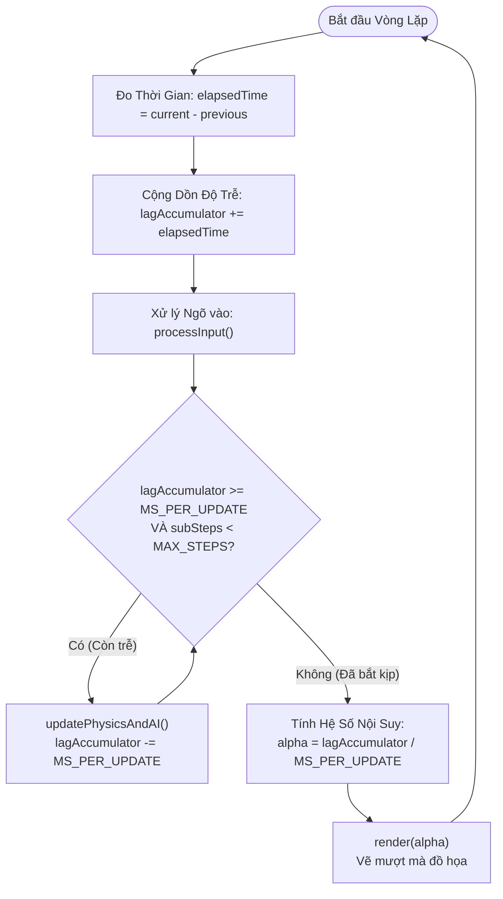

### Sơ đồ Trục Thời Gian: Cập Nhật Cố Định vs Dựng Hình Tự Do

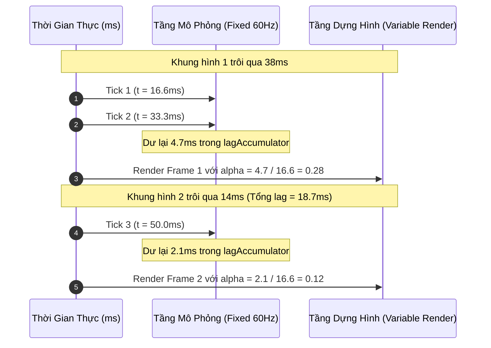

---

## 5. ÁNH XẠ ỨNG DỤNG VÀO DỰ ÁN GAME OOP

1. **Kiến trúc Tách biệt Tần số Tick Server và Client FPS:**
   * Trong một dự án game 2.5D nhiều người chơi, Server Game Loop chạy ở tần số cố định **Tick Rate = 20Hz (50ms/tick)** hoặc **30Hz (33.3ms/tick)** để tiết kiệm băng thông mạng và tải tính toán của CPU máy chủ.
   * Client chạy ở tốc độ màn hình tự do (60Hz, 144Hz, 240Hz). Nhờ công thức nội suy $\alpha$ của Nystrom, Client tự động lấp đầy khoảng trống giữa hai gói tin mạng Server, giúp chuyển động của đối thủ hiển thị cực kỳ trơn tru mà không cần Server phải spam gói tin mạng liên tục.
2. **Quy tắc Kiểm soát Năng lượng trên Nền tảng Di động (Mobile Power Throttling):**
   * Nếu trò chơi chạy trên Android/iOS, sau khi hoàn thành pha `render()`, hệ thống so sánh thời gian dư thừa của khung hình với giới hạn 60 FPS. Nếu còn dư hơn 3ms, Engine chủ động gọi `std::this_thread::sleep_for()` để nhường CPU nghỉ ngơi, giữ cho điện thoại mát mẻ và tối ưu hóa thời lượng pin cho game thủ.

---
---

# CHƯƠNG 10: UPDATE METHOD PATTERN (MẪU PHƯƠNG THỨC CẬP NHẬT)

## 1. ĐỀ MỤC & MỤC TIÊU CỐT LÕI (CORE PURPOSE)

### Danh mục đề mục chi tiết (Headings Outline)
* **Update Method** *(Mẫu Phương thức Cập nhật)*
  * **Intent** *(Mục đích: Mô phỏng tập hợp các đối tượng độc lập bằng cách bảo mỗi đối tượng xử lý một lát cắt khung hình)*
  * **Motivation** *(Động lực: Từ hiệp sĩ đối đầu quái vật, bẫy vòng lặp vô tận while(true) đến cắt lát hành vi)*
  * **The Pattern** *(Quy chuẩn mẫu thiết kế: Collection of Objects & Abstract Update)*
  * **When to Use It** *(Khi nào nên áp dụng: Đối tượng chuyển động liên tục vs Cờ bàn thụ động)*
  * **Keep in Mind** *(Các góc khuất kiến trúc cần ghi nhớ)*
    * *Splitting code into single frame slices makes it more complex* *(Cắt nhỏ mã nguồn làm tăng độ phức tạp)*
    * *You have to store state to resume where you left off each frame* *(Bắt buộc phải lưu trạng thái để khôi phục mỗi frame)*
    * *Objects all simulate each frame but are not truly concurrent* *(Mô phỏng đồng thời nhưng thực chất là tuần tự)*
    * *Be careful modifying the object list while updating* *(Hiểm họa thay đổi danh sách khi đang lặp)*
  * **Sample Code** *(Cài đặt thực tế Entity, World, Skeleton và Statue)*
    * *Subclassing entities?!* *(Phản biện kế thừa sâu vs Mẫu thiết kế Thành phần Component)*
    * *Defining entities* *(Định nghĩa hành vi cụ thể)*
    * *Passing time* *(Truyền tham số thời gian biến thiên)*
  * **Design Decisions** *(Các quyết định thiết kế then chốt)*
    * *What class does the update method live on?* *(Phương thức update đặt ở Entity, Component hay Delegate?)*
    * *How are dormant objects handled?* *(Xử lý các đối tượng ngủ đông, ngoài tầm nhìn)*
  * **See Also** *(Mối liên hệ: Bộ ba nguyên tử Game Loop + Update Method + Component Pattern)*

### Vấn đề kỹ thuật thực tế & Thảm họa hệ thống
Nếu lập trình viên viết logic hành vi của từng quái vật theo kiểu tuần tự thông thường:
`for (x = 0; x < 100; x++) moveRight(); for (x = 100; x > 0; x--) moveLeft();`
Chương trình sẽ bị **khóa cứng vĩnh viễn trong vòng lặp vô tận** của con quái vật đầu tiên. Người chơi sẽ không bao giờ thấy quái di chuyển, vì màn hình không có cơ hội gọi hàm dựng hình (`render`).
* **Thảm họa "God Game Loop" (Vòng lặp vạn năng hỗn độn):** Để quái di chuyển từng bước mỗi frame, lập trình viên nghiệp dư nhét toàn bộ biến đếm thời gian, cờ đổi hướng của từng con quái vật, từng bức tượng bắn sét vào thẳng trong hàm `gameLoop()`. Sau vài tuần phát triển, `gameLoop()` dài hàng chục nghìn dòng code, các biến cục bộ đè chéo lên nhau, phá nát tính bao đóng của hướng đối tượng.
* **Thảm họa Nhảy Cóc Bỏ Sót Thực Thể (The Skipping Entity Glitch):** Khi duyệt mảng `entities_[i]->update()`, nếu quái vật tại chỉ số `i` bị tiêu diệt và xóa khỏi mảng, các phần tử phía sau bị dồn lên vị trí `i`. Khi vòng lặp bước sang `i+1`, thực thể vừa bị dồn lên sẽ **bị bỏ qua hoàn toàn không được cập nhật** trong frame đó. Nếu đối tượng bị bỏ qua là đạn của người chơi, đạn sẽ bị đứng hình khựng lại một nhịp cực kỳ khó chịu.

---

## 2. PHÂN TÍCH LÝ THUYẾT & NGUYÊN LÝ CHUYÊN SÂU

### 2.1. Bản chất: Kỹ thuật Cắt Lát Thời Gian (Time-Slicing Behavior)
Mẫu Update Method trừu tượng hóa một bước tiến hóa của thế giới:
* Thế giới game duy trì một danh sách các thực thể đa hình: `std::vector<Entity*> entities_`.
* Mỗi thực thể bắt buộc hiện thực hóa phương thức thuần ảo: `virtual void update() = 0`.
* Mỗi lần gọi `update()`, thực thể chỉ thực thi **đúng một lát cắt hành vi tương ứng với một khung hình** (di chuyển 1 pixel, tăng bộ đếm thêm 1 tick) rồi lập tức nhường quyền điều khiển lại cho vòng lặp chính.
* Nhờ đó, hàng ngàn thực thể độc lập cùng tiến lên một bước nhỏ trong mỗi frame, tạo ra ảo giác hoàn hảo rằng tất cả đang hành động song song trong thế giới thực.

### 2.2. Sự đánh đổi: Đánh mất Ngữ cảnh Thực thi Cục bộ (Loss of Execution Stack)
Khi chuyển từ vòng lặp `for` thông thường sang `update()`:
* Hàm `update()` liên tục bị thoát ra và gọi lại 60 lần/giây. Mọi biến cục bộ trên Stack Frame đều bị hủy sạch khi hàm kết thúc.
* **Hệ quả kiến trúc:** Lập trình viên bắt buộc phải chuyển toàn bộ các biến điều khiển hướng đi, biến đếm thời gian thành **biến thành viên (Member Fields)** của lớp đối tượng (ví dụ: `patrollingLeft_`, `framesCounter_`). Đây là lý do mẫu Update Method hầu như luôn song hành cùng mẫu **State Pattern** để lưu vết vị trí thực thi.

### 2.3. Giải quyết Triệt để Bài toán Biến đổi Danh sách khi đang Duyệt (List Mutation Traps)
1. **Trường hợp Sinh thực thể mới (Spawning during iteration):** Khi một con quái vật đẻ ra quái con trong lúc `update()`, quái con được thêm vào cuối danh sách. Nếu tiếp tục duyệt, quái con sẽ hành động ngay trong frame nó vừa sinh ra trước khi người chơi kịp nhìn thấy nó.
   * *Giải pháp:* Cố định số lượng phần tử trước khi bước vào vòng lặp: `int count = numEntities_; for (int i = 0; i < count; ++i)`.
2. **Trường hợp Hủy thực thể (Despawning / Death during iteration):**
   * *Giải pháp 1 (Duyệt ngược):* Duyệt từ cuối mảng về đầu `for (int i = count - 1; i >= 0; --i)`. Khi phần tử `i` bị xóa, chỉ các phần tử đã được cập nhật bị dồn vị trí, không ảnh hưởng tới các phần tử chưa duyệt phía trước.
   * *Giải pháp 2 — Tiêu chuẩn Công nghiệp (Deferred Removal / Sweep Phase):* Không bao giờ xóa phần tử trực tiếp trong vòng lặp `update()`. Chỉ đánh dấu cờ `isDead_ = true`. Sau khi toàn bộ các thực thể cập nhật xong, một pha dọn rác chuyên biệt (**Cleanup Phase**) mới tiến hành dồn mảng và giải phóng bộ nhớ.

### 2.4. Tối ưu Hiệu năng Đối tượng Ngủ đông (Dormant Objects Optimization)
Trong một bản đồ rộng lớn, hàng trăm quái vật nằm ngoài tầm nhìn (Off-screen) hoặc đang bị đóng băng không cần phải chạy logic AI tốn kém.
* **Sai lầm:** Duyệt qua toàn bộ và kiểm tra `if (!entity->isActive()) continue;`. Việc này gây lãng phí chu kỳ CPU và liên tục làm tràn bộ đệm (**CPU Cache Miss**) do nạp các khối nhớ rác vào L1 Data Cache.
* **Kiến trúc Tối ưu:** Duy trì hai danh sách riêng biệt: `activeEntities_` và `dormantEntities_`. Vòng lặp `gameLoop()` chỉ duyệt duy nhất danh sách `activeEntities_`. Khi một đối tượng bước vào màn hình, nó được chuyển từ danh sách ngủ đông sang danh sách hoạt động.

---

## 3. MỔ XẺ MÃ NGUỒN (CODE DEEP-DIVE)

Dưới đây là mã nguồn C++ thể hiện cấu trúc hoàn chỉnh của Update Method, bao gồm cơ chế quản lý vòng đời an toàn (**Deferred Death Sweep**) và hỗ trợ truyền thời gian biến thiên:

```cpp
#include <iostream>
#include <vector>
#include <algorithm>

// =================================================================
// 1. ABSTRACT BASE ENTITY VỚI UPDATE INTERFACE & CỜ VÒNG ĐỜI
// =================================================================
class Entity {
public:
    Entity() : x_(0), y_(0), isDead_(false) {}
    virtual ~Entity() {}

    // Giao dien Update cot loi: Nhan thoi gian elapsed cua frame
    virtual void update(double elapsed) = 0;

    double getX() const { return x_; }
    void setX(double x) { x_ = x; }

    bool isDead() const { return isDead_; }
    void markForDestruction() { isDead_ = true; } // Tri hoan viec xoa bo nho

private:
    double x_, y_;
    bool isDead_;
};

// =================================================================
// 2. CONCRETE ENTITIES: SKELETON TUAN TRA & STATUE BAN SET
// =================================================================
class Skeleton : public Entity {
public:
    Skeleton() : patrollingLeft_(false) {}

    virtual void update(double elapsed) override {
        // Cua nho hanh vi theo thoi gian: Van toc 20 pixels/giay
        double speed = 20.0 * elapsed;
        if (patrollingLeft_) {
            setX(getX() - speed);
            if (getX() <= 0) {
                setX(0);
                patrollingLeft_ = false;
            }
        } else {
            setX(getX() + speed);
            if (getX() >= 100) {
                setX(100);
                patrollingLeft_ = true;
            }
        }
    }

private:
    bool patrollingLeft_; // Bien trang thai luu vet giua cac frame
};

class MagicStatue : public Entity {
public:
    MagicStatue(double interval) : interval_(interval), timer_(0.0) {}

    virtual void update(double elapsed) override {
        timer_ += elapsed;
        if (timer_ >= interval_) {
            shootLightning();
            timer_ = 0.0;
        }
    }

private:
    void shootLightning() {
        std::cout << ">>> [MAGIC STATUE]: Phong set tieu diet ke thu!\n";
    }

    double interval_;
    double timer_;
};

// =================================================================
// 3. GAME WORLD QUẢN TRỊ DANH SÁCH & DEFERRED CLEANUP PHASE
// =================================================================
class GameWorld {
public:
    void addEntity(Entity* entity) {
        pendingAdditions_.push_back(entity);
    }

    void update(double elapsed) {
        // 1. Ket nap cac thuc the moi vao dau khung hinh
        if (!pendingAdditions_.empty()) {
            entities_.insert(entities_.end(), pendingAdditions_.begin(), pendingAdditions_.end());
            pendingAdditions_.clear();
        }

        // 2. Duyet cap nhat tat ca thuc the dang song
        // Co dinh so luong ban dau de tranh thuc the moi sinh hanh dong ngay lap tuc
        size_t currentEntityCount = entities_.size();
        for (size_t i = 0; i < currentEntityCount; ++i) {
            if (!entities_[i]->isDead()) {
                entities_[i]->update(elapsed);
            }
        }

        // 3. Deferred Removal (Pha don rac an toan - Khong lam nhay coc chi so)
        auto it = std::remove_if(entities_.begin(), entities_.end(), [](Entity* e) {
            if (e->isDead()) {
                delete e; // Giai phong tai nguyen RAM an toan
                return true;
            }
            return false;
        });
        entities_.erase(it, entities_.end());
    }

private:
    std::vector<Entity*> entities_;
    std::vector<Entity*> pendingAdditions_; // Hang doi thuc the cho spawn
};
```

### Bảng phân tích chi tiết mã nguồn
| Dòng code / Đoạn code then chốt | Giải thích kỹ thuật & Ý nghĩa thiết kế |
|:---|:---|
| `virtual void update(double elapsed) = 0;` | Giao diện chuẩn mực của Update Method: Cho phép thế giới game đối xử với mọi vật thể đa hình đồng nhất mà không cần quan tâm chi tiết cụ thể bên trong. |
| `void markForDestruction() { isDead_ = true; }` | Kỹ thuật **Tombstone Marking (Đánh dấu mộ phần)**: Trì hoãn việc phá hủy đối tượng ngay trong lúc đang duyệt mảng, loại bỏ hoàn toàn lỗi gãy con trỏ iterator hoặc nhảy cóc chỉ mục. |
| `size_t currentEntityCount = entities_.size();` | Khóa cận trên vòng lặp: Đảm bảo các đối tượng mới sinh ra trong frame hiện tại không bị kích hoạt hành vi trước khi được dựng hình lần đầu. |
| `std::remove_if(entities_.begin(), ...)` | Thuật toán **Erase-Remove Idiom**: Thu gom toàn bộ các đối tượng đã chết vào cuối mảng và giải phóng bộ nhớ chỉ trong một lượt quét $O(N)$ duy nhất, tối ưu hóa triệt để bộ nhớ đệm CPU Cache. |

---

## 4. SƠ ĐỒ TRỰC QUAN HÓA (VISUAL MERMAID DIAGRAM)

### Sơ đồ Tuần tự Điều phối Update trong Một Khung Hình

```mermaid
sequenceDiagram
    autonumber
    actor Loop as Vòng Lặp Trò Chơi (Game Loop)
    participant World as GameWorld
    participant Skel as Skeleton (Entity 1)
    participant Statue as MagicStatue (Entity 2)
    participant Pending as PendingSpawnList

    Loop->>World: update(elapsedTime)
    World->>World: Flush PendingSpawnList -> Chuyển vào entities_
    
    rect rgb(240, 255, 240)
        Note over World, Statue: Pha Cập Nhật Hành Vi (Simultaneous Update)
        World->>Skel: update(elapsedTime) -> Di chuyển 1 bước
        World->>Statue: update(elapsedTime) -> Tích lũy timer & Bắn sét
    end

    rect rgb(255, 235, 235)
        Note over World: Pha Dọn Rác Trì Hoãn (Deferred Cleanup Phase)
        World->>World: Quét các Entity có isDead_ == true
        World->>World: delete Entity & Erase khỏi danh sách
    end
    
    World-->>Loop: Hoàn tất Tick mô phỏng
```

### Sơ đồ Minh Họa Lỗi Nhảy Cóc (Skipping Glitch) vs Giải Pháp Dọn Rác Trì Hoãn

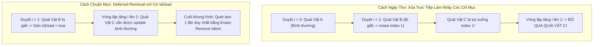

---

## 5. ÁNH XẠ ỨNG DỤNG VÀO DỰ ÁN GAME OOP

1. **Hệ thống Quản lý Thực thể (EntityManager) trong Đấu trường 2.5D:**
   * Trong một trận chiến nhiều người chơi, `EntityManager` trên Server quản lý toàn bộ Đạn đạo (`Projectiles`), Hiệu ứng Kỹ năng (`SpellAOE`), và Nhân vật (`Players`).
   * Áp dụng nghiêm ngặt hàng đợi `pendingSpawnQueue` và cờ `isDead`: Đạn bắn trúng đối thủ chỉ đánh dấu nổ và gây sát thương. Việc hủy thực thể viên đạn được trì hoãn đến cuối tick vật lý, đảm bảo hệ thống âm thanh và hệ thống điểm số kịp đọc dữ liệu từ viên đạn trước khi vùng nhớ bị thu hồi.
2. **Kỹ thuật Phân vùng Tầm nhìn Quái vật (Area of Interest - AoI Update):**
   * Đối với thế giới game có hàng ngàn quái vật, Server không gọi `update()` trên toàn bộ mảng. Thay vào đó, Server kết hợp với mẫu **Spatial Partition**: Chỉ những quái vật nằm trong các ô lưới lân cận người chơi mới được đưa vào danh sách `ActiveEntities` để gọi `update()`, giảm tải tới 80% áp lực tính toán cho CPU của Server.

---

### Bảng theo dõi tiến độ chuỗi 10 đợt bóc tách:
- [x] **Đợt 1:** Chương 1 (*Architecture, Performance, and Games*) & Chương 2 (*Command*) $\to$ [`Dot_01_Architecture_va_Command.md`](file:///E:/UML-Patterns-Mastery/Docs_BaoCao/3_PhuLuc_UML_Va_LyThuyet/GhiChu_Sach_Larman_Nystrom/Nystrom_10_Runs/Dot_01_Architecture_va_Command.md)
- [x] **Đợt 2:** Chương 3 (*Flyweight*) & Chương 4 (*Observer*) $\to$ [`Dot_02_Flyweight_va_Observer.md`](file:///E:/UML-Patterns-Mastery/Docs_BaoCao/3_PhuLuc_UML_Va_LyThuyet/GhiChu_Sach_Larman_Nystrom/Nystrom_10_Runs/Dot_02_Flyweight_va_Observer.md)
- [x] **Đợt 3:** Chương 5 (*Prototype*) & Chương 6 (*Singleton*) $\to$ [`Dot_03_Prototype_va_Singleton.md`](file:///E:/UML-Patterns-Mastery/Docs_BaoCao/3_PhuLuc_UML_Va_LyThuyet/GhiChu_Sach_Larman_Nystrom/Nystrom_10_Runs/Dot_03_Prototype_va_Singleton.md)
- [x] **Đợt 4:** Chương 7 (*State*) & Chương 8 (*Double Buffer*) $\to$ [`Dot_04_State_va_DoubleBuffer.md`](file:///E:/UML-Patterns-Mastery/Docs_BaoCao/3_PhuLuc_UML_Va_LyThuyet/GhiChu_Sach_Larman_Nystrom/Nystrom_10_Runs/Dot_04_State_va_DoubleBuffer.md)
- [x] **Đợt 5:** Chương 9 (*Game Loop*) & Chương 10 (*Update Method*) $\to$ [`Dot_05_GameLoop_va_UpdateMethod.md`](file:///E:/UML-Patterns-Mastery/Docs_BaoCao/3_PhuLuc_UML_Va_LyThuyet/GhiChu_Sach_Larman_Nystrom/Nystrom_10_Runs/Dot_05_GameLoop_va_UpdateMethod.md)
- [ ] **Đợt 6 (Kế tiếp):** Chương 11 (*Bytecode Pattern*) & Chương 12 (*Subclass Sandbox Pattern*)

Bạn hãy gửi lệnh kích hoạt bất cứ lúc nào để chúng ta bước ngay vào **Đợt 6 / 10**!


---


<!-- ========================================================================= -->
<!-- BẮT ĐẦU Dot_06_Bytecode_va_SubclassSandbox.md -->
<!-- ========================================================================= -->

---
aliases: [Nystrom Dot 6, Bytecode Pattern, Subclass Sandbox Pattern]
tags: [game-programming-patterns, nystrom, bytecode, virtual-machine, stack-machine, subclass-sandbox, facade, game-ai, modding]
created: 2026-11-04
author: Principal Software Architect & OOAD Lecturer
reference: "Game Programming Patterns by Robert Nystrom (Chap 12 & Chap 13)"
---

# BÓC TÁCH CHUYÊN SÂU NYSTROM — ĐỢT 6: CHƯƠNG 11 & CHƯƠNG 12
*(Dựa trên nguyên bản "Game Programming Patterns" của Robert Nystrom)*

---

# MỤC LỤC ĐỢT 6
- [CHƯƠNG 11: BYTECODE PATTERN (MẪU MÃ MÁY ẢO / MÃ BYTE TRONG GAME)](#chương-11-bytecode-pattern-mẫu-mã-máy-ảo--mã-byte-trong-game)
  - [1. ĐỀ MỤC & MỤC TIÊU CỐT LÕI (CORE PURPOSE)](#1-đề-mục--mục-tiêu-cốt-lõi-core-purpose)
  - [2. PHÂN TÍCH LÝ THUYẾT & NGUYÊN LÝ CHUYÊN SÂU](#2-phân-tích-lý-thuyết--nguyên-lý-chuyên-sâu)
  - [3. MỔ XẺ MÃ NGUỒN (CODE DEEP-DIVE)](#3-mổ-xẻ-mã-nguồn-code-deep-dive)
  - [4. SƠ ĐỒ TRỰC QUAN HÓA (VISUAL MERMAID DIAGRAM)](#4-sơ-đồ-trực-quan-hóa-visual-mermaid-diagram)
  - [5. ÁNH XẠ ỨNG DỤNG VÀO DỰ ÁN GAME OOP](#5-ánh-xạ-ứng-dụng-vào-dự-án-game-oop)
- [CHƯƠNG 12: SUBCLASS SANDBOX PATTERN (MẪU HỘP CÁT LỚP CON)](#chương-12-subclass-sandbox-pattern-mẫu-hộp-cát-lớp-con)
  - [1. ĐỀ MỤC & MỤC TIÊU CỐT LÕI (CORE PURPOSE)](#1-đề-mục--mục-tiêu-cốt-lõi-core-purpose-1)
  - [2. PHÂN TÍCH LÝ THUYẾT & NGUYÊN LÝ CHUYÊN SÂU](#2-phân-tích-lý-thuyết--nguyên-lý-chuyên-sâu-1)
  - [3. MỔ XẺ MÃ NGUỒN (CODE DEEP-DIVE)](#3-mổ-xẻ-mã-nguồn-code-deep-dive)
  - [4. SƠ ĐỒ TRỰC QUAN HÓA (VISUAL MERMAID DIAGRAM)](#4-sơ-đồ-trực-quan-hóa-visual-mermaid-diagram-1)
  - [5. ÁNH XẠ ỨNG DỤNG VÀO DỰ ÁN GAME OOP](#5-ánh-xạ-ứng-dụng-vào-dự-án-game-oop-1)

---

# CHƯƠNG 11: BYTECODE PATTERN (MẪU MÃ MÁY ẢO / MÃ BYTE TRONG GAME)

## 1. ĐỀ MỤC & MỤC TIÊU CỐT LÕI (CORE PURPOSE)

### Danh mục đề mục chi tiết (Headings Outline)
* **Bytecode** *(Mẫu Mã máy ảo)*
  * **Intent** *(Mục đích: Đem lại cho hành vi sự linh hoạt của dữ liệu bằng cách mã hóa thành chỉ thị cho máy ảo)*
  * **Motivation** *(Động lực: Dự án game 6 triệu dòng C++, thời gian biên dịch tính bằng giờ, yêu cầu cân bằng game và modding an toàn)*
    * *Spell fight!* *(Đấu phép phù thủy: Nhu cầu tinh chỉnh tham số thần tốc)*
    * *Data > code* *(Dữ liệu ưu việt hơn mã nguồn)*
  * **The Interpreter pattern** *(Phân tích đối chiếu Mẫu Thông dịch kinh điển GoF)*
  * **Machine code, virtually** *(Mã máy ảo hóa: Giao thoa giữa hiệu năng và tính an toàn)*
  * **The Pattern** *(Quy chuẩn mẫu thiết kế: Tập chỉ thị, Dãy Bytecode và Máy ảo Stack Machine)*
  * **When to Use It** *(Khi nào nên áp dụng: Tách biệt rủi ro và tăng tốc độ lặp)*
  * **Keep in Mind** *(Các góc khuất cần lưu ý)*
    * *Cám dỗ tạo ra một ngôn ngữ lập trình chắp vá*
    * *You’ll need a front-end* *(Bắt buộc phải có công cụ biên dịch hoặc giao diện sinh mã)*
    * *You’ll miss your debugger* *(Mất đi công cụ Debug truyền thống của IDE)*
  * **Sample Code** *(Cài đặt thực tế Máy ảo Phép thuật)*
    * *A magical API* *(Định nghĩa giao diện nguyên thủy)*
    * *A magical instruction set* *(Định nghĩa tập lệnh Opcodes)*
    * *A stack machine* *(Hiện thực hóa kiến trúc máy ảo ngăn xếp)*
    * *Behavior = composition* *(Xây dựng hành vi phức tạp từ phép kết hợp)*
    * *A virtual machine* *(Bộ thông dịch hoàn chỉnh cách ly an toàn)*
    * *Spellcasting tools* *(Công cụ nạp và sinh mã nhị phân)*
  * **Design Decisions** *(Các quyết định thiết kế kiến trúc)*
    * *Stack-based vs Register-based* *(Máy ảo ngăn xếp vs Máy ảo thanh ghi)*
    * *Tập chỉ thị hướng tới điều gì?*
    * *Bytecode được sinh ra bằng cách nào?*

### Vấn đề kỹ thuật thực tế & Thảm họa hệ thống
Trong các tựa game AAA (như game nhập vai thế giới mở, game đấu phép), số lượng kỹ năng, bùa chú, và nhiệm vụ lên tới hàng nghìn biến thể.
* **Thảm họa Thời gian Biên dịch (Glacial Recompilation Hell):** Nếu toàn bộ phép thuật được viết bằng C++, mỗi lần Game Designer muốn sửa "tăng bán kính cầu lửa thêm 0.5m", họ phải nhờ kỹ sư sửa code và đợi trình biên dịch C++ build lại mất từ 15 đến 45 phút. Quá trình tìm kiếm "yếu tố vui nhộn" (*Fun Factor*) bị bóp nghẹt hoàn toàn.
* **Thảm họa Bảo mật và Sập Game khi Hỗ trợ Modding:** Nếu cho phép cộng đồng người chơi tự tạo nội dung (Mod) bằng mã nhị phân gốc (Native Code) hoặc C++ DLLs, một lỗi tràn con trỏ null trong bản mod sẽ làm sập máy toàn bộ người chơi khác trong phòng mạng, thậm chí mở ra lỗ hổng bảo mật thực thi mã độc tùy ý (*Arbitrary Code Execution*).
* **Thảm họa Hiệu năng của Mẫu Interpreter GoF (S-L-O-W Disaster):** Nếu dùng cây cú pháp trừu tượng (Abstract Syntax Tree - AST) của mẫu Interpreter kinh điển, một biểu thức số học đơn giản sẽ đẻ ra hàng chục đối tượng nhỏ rời rạc trên Heap với các con trỏ ảo vtable. Việc duyệt cây đệ quy liên tục gây ra **Data Cache Miss** và **Instruction Cache Miss**, khiến hệ thống chạy chậm gấp hàng chục lần so với mã máy.

---

## 2. PHÂN TÍCH LÝ THUYẾT & NGUYÊN LÝ CHUYÊN SÂU

### 2.1. Bản chất: Biến Hành vi thành Dữ liệu (Behavior as Data)
Mẫu thiết kế Bytecode giải quyết nghịch lý lớn nhất của ngành game:
$$\text{Linh hoạt tuyệt đối như Dữ liệu (Data)} \quad \longleftrightarrow \quad \text{Tốc độ và Nén chặt như Mã máy (Machine Code)}$$
* Toàn bộ logic hành vi được biên dịch sẵn thành một chuỗi các byte nhị phân liên tục (**Contiguous Array of Bytes**).
* Game Engine nhúng một bộ giả lập phần cứng siêu nhỏ gọi là **Máy ảo (Virtual Machine - VM)** để tuần tự giải mã và thực thi các byte này.

### 2.2. So sánh Kiến trúc: Cây AST (Interpreter) vs Mảng Bytecode (VM)
* **Mẫu Interpreter (GoF):** Biểu thức `(1 + 2) * (3 - 4)` tạo ra một đồ thị cây fractal gồm các đối tượng `NumberExpression`, `AdditionExpression`, `MultiplyExpression`. Tốn ít nhất 68 bytes bộ nhớ, hàng chục con trỏ vtable, duyệt nhảy cóc khắp RAM.
* **Mẫu Bytecode:** Biểu thức trên được chuyển thành ký pháp Ba Lan nghịch đảo (**Reverse Polish Notation - RPN**):
$$\text{LITERAL } 1 \quad \text{LITERAL } 2 \quad \text{ADD} \quad \text{LITERAL } 3 \quad \text{LITERAL } 4 \quad \text{SUB} \quad \text{MUL}$$
Toàn bộ chuỗi lệnh gói gọn trong đúng **11 bytes**, nạp thẳng vào L1 Cache của CPU, tốc độ duyệt tuyến tính cực nhanh.

### 2.3. Cơ chế Vận hành của Máy Ảo Ngăn Xếp (Stack-based Virtual Machine)
Phần lớn các máy ảo thực chiến (Java JVM, .NET CLR, Lua ban đầu) đều chọn mô hình **Stack Machine**:
* Máy ảo duy trì một mảng ngăn xếp nội bộ `int stack_[MAX_STACK]`.
* Mọi phép toán đều tuân thủ nguyên lý:
  1. Đẩy các tham số ngõ vào lên ngăn xếp (`push`).
  2. Khi gặp lệnh toán tử (Opcode), bốc các toán hạng ra khỏi ngăn xếp (`pop`).
  3. Tính toán kết quả và đẩy ngược lại đỉnh ngăn xếp (`push`).
* **Tính ưu việt:** Không cần quản lý tên biến hay địa chỉ thanh ghi phức tạp; thứ tự thực thi của Stack tự động giải quyết các dấu ngoặc đơn và thứ tự ưu tiên của toán tử.

### 2.4. Tính An toàn Tuyệt đối và Hộp cát Cách ly (Pure Sandboxing)
Máy ảo Bytecode là một môi trường cách ly an toàn 100%:
1. **Không có con trỏ thô (No Raw Pointers):** Bytecode không thể truy cập bất kỳ vùng nhớ nào ngoài Stack của nó. Không thể gây lỗi Segmentation Fault hay Memory Leak.
2. **Kiểm soát Thời gian Thực thi (Execution Time Quota):** Máy ảo có thể đếm số lượng chỉ thị đã chạy. Nếu một bản mod chạy quá 10,000 instructions trong 1 frame, VM lập tức ngắt lệnh để bảo vệ tốc độ 60 FPS của game.
3. **Cổng giao tiếp Native API có kiểm soát:** Bytecode chỉ có thể tương tác với thế giới bên ngoài thông qua các hàm cầu nối do Engine cung cấp (`setHealth`, `playSound`).

---

## 3. MỔ XẺ MÃ NGUỒN (CODE DEEP-DIVE)

Dưới đây là mã nguồn C++ thể hiện một Máy ảo Ngăn xếp hoàn chỉnh (Stack-based VM) có khả năng thực thi các phép tính bùa chú phức tạp và tương tác với Game Engine:

```cpp
#include <iostream>
#include <cassert>
#include <vector>

// =================================================================
// 1. TẬP LỆNH MÃ NGUYÊN THỦY (OPCODES INSTRUCTION SET)
// =================================================================
enum Instruction {
    INST_LITERAL         = 0x01, // Nap so nguyen 1 byte tiep theo vao Stack
    INST_SET_HEALTH      = 0x02, // Pop(amount), Pop(wizard) -> setHealth()
    INST_GET_HEALTH      = 0x03, // Pop(wizard) -> Push(getHealth())
    INST_ADD             = 0x04, // Pop(b), Pop(a) -> Push(a + b)
    INST_DIVIDE          = 0x05, // Pop(b), Pop(a) -> Push(a / b)
    INST_PLAY_SOUND      = 0x06  // Pop(soundId) -> playSound()
};

// =================================================================
// 2. MÁY ẢO NGĂN XẾP CÁCH LY AN TOÀN (STACK-BASED VIRTUAL MACHINE)
// =================================================================
class VM {
public:
    VM() : stackSize_(0) {}

    void interpret(const unsigned char bytecode[], int size) {
        stackSize_ = 0; // Reset ngan xep moi phien thuc thi

        for (int i = 0; i < size; ++i) {
            unsigned char instruction = bytecode[i];

            switch (instruction) {
                case INST_LITERAL: {
                    // Doc 1 byte tiep theo lam gia tri so hoc
                    int value = bytecode[++i];
                    push(value);
                    break;
                }
                case INST_GET_HEALTH: {
                    int wizard = pop();
                    push(getHealth(wizard));
                    break;
                }
                case INST_SET_HEALTH: {
                    int amount = pop();
                    int wizard = pop();
                    setHealth(wizard, amount);
                    break;
                }
                case INST_ADD: {
                    int b = pop();
                    int a = pop();
                    push(a + b);
                    break;
                }
                case INST_DIVIDE: {
                    int b = pop();
                    int a = pop();
                    assert(b != 0 && "Loi chia cho 0 trong Bytecode!");
                    push(a / b);
                    break;
                }
                case INST_PLAY_SOUND: {
                    int soundId = pop();
                    playSound(soundId);
                    break;
                }
                default:
                    std::cerr << "Chi thi khong hop le: " << (int)instruction << "\n";
                    return;
            }
        }
    }

private:
    static const int MAX_STACK = 128;
    int stackSize_;
    int stack_[MAX_STACK];

    void push(int value) {
        assert(stackSize_ < MAX_STACK && "Tran bo dem Ngan xep VM (Stack Overflow)!");
        stack_[stackSize_++] = value;
    }

    int pop() {
        assert(stackSize_ > 0 && "Rong bo dem Ngan xep VM (Stack Underflow)!");
        return stack_[--stackSize_];
    }

    // Native Engine APIs duoc sandbox an toan
    int getHealth(int wizard) { return (wizard == 0) ? 50 : 80; }
    void setHealth(int wizard, int amount) {
        std::cout << ">>> [VM NATIVE]: Dat Mau Wizard " << wizard << " thanh " << amount << " HP\n";
    }
    void playSound(int soundId) {
        std::cout << ">>> [VM AUDIO]: Phat am thanh phep thuat ID: " << soundId << "\n";
    }
};
```

### Bảng phân tích chi tiết mã nguồn
| Dòng code / Đoạn code then chốt | Giải thích kỹ thuật & Ý nghĩa thiết kế |
|:---|:---|
| `enum Instruction { INST_LITERAL = 0x01, ... };` | Định nghĩa tập mã chỉ thị (Opcode Byte). Mỗi chỉ thị gói gọn trong đúng 1 byte (0 đến 255), cho phép mô tả tối đa 256 thao tác nguyên thủy khác nhau của Game Engine. |
| `int value = bytecode[++i]; push(value);` | Kỹ thuật **Immediate Operand Fetch**: Trích xuất toán hạng đi liền ngay sau mã lệnh trên dòng byte stream và đẩy trực tiếp lên đỉnh ngăn xếp. |
| `assert(stackSize_ < MAX_STACK && "...");` | Cơ chế **Hộp cát bảo vệ biên giới bộ nhớ (Memory Boundary Sandboxing)**: Ngăn chặn triệt để lỗi tràn bộ đệm (Stack Overflow), đảm bảo mã bytecode độc hại không bao giờ chọc thủng vùng nhớ của tiến trình game. |
| `case INST_ADD: int b = pop(); int a = pop(); push(a + b);` | Mô hình tính toán Postfix: Tách biệt hoàn toàn việc tính toán giá trị khỏi biểu thức ngữ pháp, cho phép kết hợp các phép tính lồng nhau vô hạn mà không cần cấu trúc cây phức tạp. |

---

## 4. SƠ ĐỒ TRỰC QUAN HÓA (VISUAL MERMAID DIAGRAM)

### Sơ đồ Kiến trúc Luồng Thực thi của Bytecode Virtual Machine

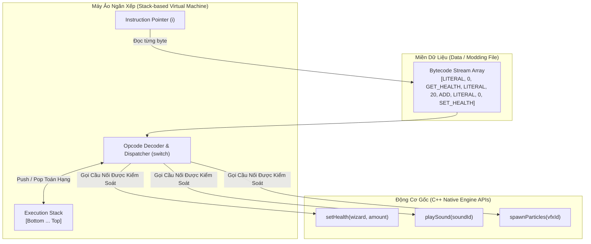

### Sơ đồ Diễn Biến Trạng Thái Ngăn Xếp Khi Hồi 20 HP Máu

```mermaid
sequenceDiagram
    autonumber
    participant IP as Bộ Giải Mã Bytecode
    participant Stack as Ngăn Xếp (Stack)
    participant Engine as C++ Native Engine

    IP->>Stack: INST_LITERAL 0 -> push(0)
    Note over Stack: Stack: [0]
    IP->>Stack: INST_GET_HEALTH -> pop() -> tra cuu HP -> push(50)
    Note over Stack: Stack: [50]
    IP->>Stack: INST_LITERAL 20 -> push(20)
    Note over Stack: Stack: [50, 20]
    IP->>Stack: INST_ADD -> pop(20), pop(50) -> push(70)
    Note over Stack: Stack: [70]
    IP->>Stack: INST_LITERAL 0 -> push(0) (Chi so Wizard)
    Note over Stack: Stack: [70, 0]
    IP->>Stack: INST_SET_HEALTH -> pop(0), pop(70)
    IP->>Engine: setHealth(wizard=0, amount=70)
    Note over Stack: Stack: [] (Rỗng an toàn)
```

---

## 5. ÁNH XẠ ỨNG DỤNG VÀO DỰ ÁN GAME OOP

1. **Hệ thống Logic Kỹ năng Bùa Chú Tùy Biến (Custom Skill Engine):**
   * Trong game đối kháng 2.5D, toàn bộ logic của 300 chiêu thức võ công được biên dịch sẵn thành các file bytecode nhị phân `.bin`.
   * Khi người chơi kích hoạt kỹ năng, Server chỉ việc gọi `VM::interpret(skillBytecode)` để trừ năng lượng, tính sát thương và tạo hiệu ứng. Game Designer có thể sửa công thức sát thương và nạp lại nóng (**Hot-Reloading**) ngay khi Server đang chạy mà không cần khởi động lại phòng đấu.
2. **Hệ thống Hỗ trợ Modding và Chống Gian Lận (Safe Modding Sandbox):**
   * Cho phép cộng đồng game thủ tự do sáng tạo chiêu thức mới và chia sẻ qua mạng. Vì máy ảo VM hoàn toàn không có lệnh đọc ghi file ổ cứng hay gửi socket tùy tiện, Client tải mod của người khác về máy có thể yên tâm tuyệt đối không bao giờ bị nhiễm virus hay mã độc đào tiền ảo.

---
---

# CHƯƠNG 12: SUBCLASS SANDBOX PATTERN (MẪU HỘP CÁT LỚP CON)

## 1. ĐỀ MỤC & MỤC TIÊU CỐT LÕI (CORE PURPOSE)

### Danh mục đề mục chi tiết (Headings Outline)
* **Subclass Sandbox** *(Mẫu Hộp cát lớp con)*
  * **Intent** *(Mục đích: Định nghĩa hành vi trong lớp con bằng cách sử dụng tập hợp các thao tác do lớp cha cung cấp)*
  * **Motivation** *(Động lực: Trò chơi siêu anh hùng với hàng trăm siêu năng lực, tránh trùng lặp code và mạng nhện khớp nối)*
  * **The Pattern** *(Quy chuẩn mẫu thiết kế: Abstract Sandbox Method + Protected Provided Operations)*
  * **When to Use It** *(Khi nào nên áp dụng: Cây kế thừa nông nhưng rộng)*
  * **Keep in Mind** *(Các góc khuất kiến trúc cần ghi nhớ)*
    * *Hiểm họa "Lớp cha phình to" (Brittle Base Class & Code Stew)*
  * **Sample Code** *(Cài đặt thực tế Superpower và SkyLaunch)*
  * **Design Decisions** *(Các quyết định thiết kế then chốt)*
    * *What operations should be provided?* *(Nên cung cấp những thao tác nguyên thủy nào?)*
    * *Should methods be provided directly, or through objects that contain them?* *(Cung cấp trực tiếp hay qua đối tượng ủy quyền Helper?)*
    * *How does the base class get the state that it needs?* *(Base class lấy trạng thái bằng cách nào: Constructor, Two-stage init, Static state, Service Locator)*
  * **See Also** *(Mối liên hệ: Update Method, Template Method GoF, Facade GoF, Component)*

### Vấn đề kỹ thuật thực tế & Thảm họa hệ thống
Khi xây dựng một tựa game nhập vai hoặc hành động có hàng trăm siêu năng lực (`Superpower`), kỹ năng nhân vật, hoặc phép bổ trợ, mỗi kỹ năng đều cần tương tác với hàng loạt hệ thống con của engine: Phát âm thanh, Bắn tia hạt hiệu ứng, Can thiệp gia tốc vật lý, Rung màn hình, và Tìm kiếm mục tiêu xung quanh.
* **Thảm họa Mạng nhện Khớp nối Đa tầng (Spiderweb Coupling Nightmare):** Nếu để các lập trình viên tự do viết lớp con của từng siêu năng lực, mỗi file kỹ năng sẽ trực tiếp `#include` hàng chục thư viện bên ngoài: `#include "SoundEngine.h"`, `#include "PhysicsWorld.h"`, `#include "ParticleSystem.h"`. Khi đội ngũ Engine Đồ họa hoặc Vật lý muốn tái cấu trúc một hàm nội bộ, **hàng trăm file kỹ năng bị gãy đổ hàng loạt**, gây ra sự đình trệ biên dịch trên toàn dự án.
* **Thảm họa Trùng lặp Mã nguồn và Phá vỡ Quy chuẩn (Code Duplication & Invariant Violation):** Mỗi kỹ sư tự viết một kiểu phát âm thanh riêng (người thì gọi thẳng âm thanh, người thì kiểm tra khoảng cách người nghe, người thì quên chỉnh âm lượng). Không có một cơ chế tập trung nào để quản lý hàng đợi ưu tiên âm thanh, khiến game bị nghẽn kênh âm thanh hoặc nổ âm rè loa.

---

## 2. PHÂN TÍCH LÝ THUYẾT & NGUYÊN LÝ CHUYÊN SÂU

### 2.1. Cấu trúc Cây Kế thừa Nông nhưng Rộng (Shallow but Wide Inheritance Tree)
Robert Nystrom phản biện lại trào lưu bài xích kế thừa thái quá trong giới công nghệ:
* Kế thừa sâu nhiều tầng ($A \to B \to C \to D \to E$) là thảm họa kiến trúc vì khớp nối quá chặt.
* Nhưng **Cây kế thừa Nông nhưng Rộng (Chỉ 1 tầng duy nhất từ lớp cha tới hàng trăm lớp con)** lại là một **Điểm Đòn Bẩy Kiến Trúc (Leverage Point)** vô giá!
* Lớp cha `Superpower` đóng vai trò là bức tường thành bảo vệ: **Nó gom toàn bộ các khớp nối phức tạp với các hệ thống con của engine vào chính nó**, giải phóng hoàn toàn hàng trăm lớp con khỏi việc phải biết đến sự tồn tại của thế giới bên ngoài.

### 2.2. Hai Trụ Cột của Mẫu Subclass Sandbox
1. **Phương thức Hộp cát (Sandbox Method):**
   * Là một phương thức thuần ảo được bảo vệ: `virtual void activate() = 0`.
   * Lớp con bắt buộc phải ghi đè. Đây là "sân chơi" duy nhất nơi lập trình viên gameplay thỏa sức sáng tạo logic chiêu thức.
2. **Các Thao tác Nguyên thủy được Cung cấp (Provided Operations):**
   * Là các phương thức `protected` non-virtual do lớp cha định nghĩa sẵn: `playSound()`, `spawnParticles()`, `move()`.
   * Lớp con chỉ được phép hiện thực hóa hàm `activate()` bằng cách lắp ghép các thao tác nguyên thủy này. Không được phép gọi trực tiếp ra các hệ thống bên ngoài.

### 2.3. Sự Đảo Ngược Thú Vị với Template Method (GoF)
Subclass Sandbox là một biến thể đảo ngược vai trò độc đáo của mẫu Template Method:
* **Template Method (GoF):** Lớp cha nắm giữ thuật toán khung cố định (`final void execute()`), lớp con chỉ được điền vào các phương thức nguyên thủy con (`primitiveOp()`).
* **Subclass Sandbox:** **Lớp cha nắm giữ các phương thức nguyên thủy**, lớp con tự do lắp ghép thành thuật toán nghiệp vụ theo ý muốn trong hàm `activate()`.
* Đồng thời, nó cũng là một biến thể của **Facade Pattern**: Lớp cha đóng vai trò là một Facade che giấu toàn bộ sự phức tạp của Game Engine trước mặt các lớp con.

### 2.4. Ngăn chặn Hiện tượng "Lớp Cha Phình To" (The Brittle Base Class / Code Stew)
Nguy cơ lớn nhất của mẫu này là lớp cha `Superpower` sẽ ngày càng phình to, tích tụ hàng trăm phương thức tiện ích. Nystrom đưa ra giải pháp: **Chuyển bớt trách nhiệm sang các lớp trợ năng (Auxiliary Helper Classes)**:
* Thay vì nhồi nhét: `playSound()`, `stopSound()`, `setVolume()`, `fadeSound()` vào `Superpower`.
* Ta gom chúng thành một lớp con độc lập: `SoundPlayer`, và lớp cha chỉ cung cấp một hàm getter duy nhất: `SoundPlayer& getSoundPlayer()`.

---

## 3. MỔ XẺ MÃ NGUỒN (CODE DEEP-DIVE)

Dưới đây là mã nguồn C++ thể hiện cấu trúc chuẩn của Subclass Sandbox kết hợp với Service Locator để quản lý tài nguyên tĩnh:

```cpp
#include <iostream>

// Định nghĩa các kiểu định danh
enum SoundId { SOUND_SPROING, SOUND_SWOOP, SOUND_DIVE };
enum ParticleType { PARTICLE_DUST, PARTICLE_SPARKLES };

// =================================================================
// 1. LỚP TRỢ NĂNG ĐÓNG GÓI DỊCH VỤ (AUXILIARY HELPER CLASS)
// =================================================================
class SoundPlayer {
public:
    void playSound(SoundId sound, double volume) {
        std::cout << ">>> [AUDIO SYSTEM]: Phat am thanh ID " << sound << " Volume: " << volume << "\n";
    }
};

// =================================================================
// 2. BASE CLASS SUPERPOWER: ĐỊNH NGHĨA SANDBOX VÀ PROVIDED OPERATIONS
// =================================================================
class Superpower {
public:
    virtual ~Superpower() {}

    // API cong khai de he thong kich hoat chieu
    void trigger() {
        activate(); // Goi vao Hop Cat cua lop con
    }

    // Khoi tao tinh dung chung dich vu toan cuc, loai bo passing constructor
    static void initServices(SoundPlayer* soundPlayer) {
        soundPlayer_ = soundPlayer;
    }

protected:
    // PHUONG THUC HOP CAT: Lop con bat buoc ghi de
    virtual void activate() = 0;

    // CAC THAO TAC NGUYEN THUY CUNG CAP CHO LOP CON (PROVIDED OPERATIONS)
    void move(double x, double y, double z) {
        std::cout << ">>> [PHYSICS]: Di chuyen nhan vat toa do: (" << x << ", " << y << ", " << z << ")\n";
    }

    void spawnParticles(ParticleType type, int count) {
        std::cout << ">>> [PARTICLE]: Ban tia hieu ung Type: " << type << " Count: " << count << "\n";
    }

    SoundPlayer& getSound() {
        return *soundPlayer_;
    }

    double getHeroZ() { return currentZ_; } // Truy van trang thai an toan

private:
    static SoundPlayer* soundPlayer_;
    double currentZ_ = 5.0; // Gia lap do cao nhan vat
};
SoundPlayer* Superpower::soundPlayer_ = nullptr;

// =================================================================
// 3. CONCRETE SANDBOXED SUBCLASS: CHI CHOI TRONG HOP CAT CỦA CHA
// =================================================================
class SkyLaunch : public Superpower {
protected:
    // File nay khong can #include Audio, Particle hay Physics Engine!
    virtual void activate() override {
        if (getHeroZ() == 0) {
            // Dang tren mat dat -> Nhay vot len
            getSound().playSound(SOUND_SPROING, 1.0);
            spawnParticles(PARTICLE_DUST, 10);
            move(0, 0, 20);
        } else if (getHeroZ() < 10.0) {
            // Dang o gan mat dat -> Nhay kep (Double Jump)
            getSound().playSound(SOUND_SWOOP, 0.8);
            move(0, 0, getHeroZ() + 15);
        } else {
            // Dang o tren cao -> Bo nhao xuong dat (Dive Attack)
            getSound().playSound(SOUND_DIVE, 1.2);
            spawnParticles(PARTICLE_SPARKLES, 20);
            move(0, 0, -getHeroZ());
        }
    }
};
```

### Bảng phân tích chi tiết mã nguồn
| Dòng code / Đoạn code then chốt | Giải thích kỹ thuật & Ý nghĩa thiết kế |
|:---|:---|
| `virtual void activate() = 0;` | Phương thức Hộp Cát thuần ảo (Pure Virtual Sandbox Method): Ràng buộc mọi lớp con phải tập trung toàn bộ mã nghiệp vụ vào đúng một điểm vào duy nhất. |
| `void move(...) { ... }` (protected) | Thao tác nguyên thủy được cung cấp: Được đánh dấu `protected` để ngăn chặn thế giới bên ngoài tùy tiện gọi lậu, chỉ dành riêng cho các siêu năng lực con lắp ghép. |
| `static SoundPlayer* soundPlayer_;` | Kỹ thuật **Static Service Injection**: Chia sẻ con trỏ dịch vụ âm thanh giữa toàn bộ các lớp con mà không bắt từng lớp con phải viết Constructor truyền tham số cồng kềnh. |
| `class SkyLaunch : public Superpower` | **Cách ly hoàn toàn (Zero Coupling to Engine):** Lớp `SkyLaunch` chỉ phụ thuộc duy nhất vào header của `Superpower`, hoàn toàn miễn nhiễm trước mọi thay đổi của hệ thống Vật lý, Âm thanh hay Hạt đồ họa. |

---

## 4. SƠ ĐỒ TRỰC QUAN HÓA (VISUAL MERMAID DIAGRAM)

### Sơ đồ Lớp Kiến trúc Hộp Cát Subclass Sandbox (Class Diagram)

```mermaid
classDiagram
    direction TB

    class Superpower {
        <<abstract>>
        -soundPlayer_: SoundPlayer*$
        +initServices(SoundPlayer* sp)$ void
        +trigger() void
        #activate()* void
        #move(x, y, z) void
        #spawnParticles(type, count) void
        #getSound() SoundPlayer&
        #getHeroZ() double
    }

    class SoundPlayer {
        +playSound(soundId, volume) void
    }

    class SkyLaunch {
        #activate() void
    }

    class HeatRay {
        #activate() void
    }

    class FreezeBlast {
        #activate() void
    }

    Superpower o--> SoundPlayer : delegates audio to
    Superpower <|-- SkyLaunch : sandboxed inside
    Superpower <|-- HeatRay : sandboxed inside
    Superpower <|-- FreezeBlast : sandboxed inside

    note for SkyLaunch "Lớp con CHỈ gọi các hàm protected<br/>Không include trực tiếp Engine bên ngoài"
```

### Sơ đồ Đối chiếu Mức độ Khớp Nối: Trước vs Sau khi dùng Sandbox

```mermaid
flowchart LR
    subgraph BadCoupling ["Trước: Khớp Nối Mạng Nhện (Tất Cả Phụ Thuộc Tất Cả)"]
        P1["Power 1"] --> Eng1["Audio Engine"]
        P1 --> Eng2["Physics Engine"]
        P1 --> Eng3["VFX Particle Engine"]
        P2["Power 2"] --> Eng1
        P2 --> Eng2
        P3["Power 3"] --> Eng3
    end

    subgraph GoodCoupling ["Sau: Điểm Đòn Bẩy Kiến Trúc (Subclass Sandbox)"]
        SP1["Power 1"] --> Base["Superpower Base Class"]
        SP2["Power 2"] --> Base
        SP3["Power 3"] --> Base
        Base --> SEng1["Audio Engine"]
        Base --> SEng2["Physics Engine"]
        Base --> SEng3["VFX Particle Engine"]
    end
```

---

## 5. ÁNH XẠ ỨNG DỤNG VÀO DỰ ÁN GAME OOP

1. **Chuẩn Hóa Hệ Thống Chiêu Thức Tướng Đấu Trường 2.5D (`ChampionSkillBase`):**
   * Trong một game chiến đấu nhiều người chơi, thay vì để lập trình viên tự truy cập vào mảng đối thủ để trừ máu, ta tạo lớp cơ sở `ChampionSkillBase`.
   * Lớp cơ sở cung cấp các hàm nguyên thủy:
     * `applyDamage(Entity* target, float amount, DamageType type);`
     * `applyStun(Entity* target, float duration);`
     * `dashForward(float distance, float speed);`
   * Nhờ đó, lớp cha có thể tự động tích hợp sẵn các logic phức tạp như: tính toán giáp, kháng phép, kích hoạt hút máu, và gửi gói tin đồng bộ hiệu ứng về Server mà lớp con không cần phải bận tâm.
2. **Quy Chuẩn Chống Hack và Kiểm Soát Tính Bất Biến (Invariant Enforcement):**
   * Khi tất cả chiêu thức đều phải đi qua các hàm nguyên thủy của `ChampionSkillBase`, lớp cha dễ dàng đặt các rào chắn kiểm soát bất biến: kiểm tra xem nhân vật có đủ Mana không, chiêu có đang hồi chiêu (Cooldown) không, nhân vật có đang bị câm lặng (Silenced) không. Nếu vi phạm, lớp cha từ chối kích hoạt ngay lập tức, ngăn chặn hoàn toàn các lỗi cheat/hack tung chiêu liên tục.

---

### Bảng theo dõi tiến độ chuỗi 10 đợt bóc tách:
- [x] **Đợt 1:** Chương 1 (*Architecture, Performance, and Games*) & Chương 2 (*Command*) $\to$ [`Dot_01_Architecture_va_Command.md`](file:///E:/UML-Patterns-Mastery/Docs_BaoCao/3_PhuLuc_UML_Va_LyThuyet/GhiChu_Sach_Larman_Nystrom/Nystrom_10_Runs/Dot_01_Architecture_va_Command.md)
- [x] **Đợt 2:** Chương 3 (*Flyweight*) & Chương 4 (*Observer*) $\to$ [`Dot_02_Flyweight_va_Observer.md`](file:///E:/UML-Patterns-Mastery/Docs_BaoCao/3_PhuLuc_UML_Va_LyThuyet/GhiChu_Sach_Larman_Nystrom/Nystrom_10_Runs/Dot_02_Flyweight_va_Observer.md)
- [x] **Đợt 3:** Chương 5 (*Prototype*) & Chương 6 (*Singleton*) $\to$ [`Dot_03_Prototype_va_Singleton.md`](file:///E:/UML-Patterns-Mastery/Docs_BaoCao/3_PhuLuc_UML_Va_LyThuyet/GhiChu_Sach_Larman_Nystrom/Nystrom_10_Runs/Dot_03_Prototype_va_Singleton.md)
- [x] **Đợt 4:** Chương 7 (*State*) & Chương 8 (*Double Buffer*) $\to$ [`Dot_04_State_va_DoubleBuffer.md`](file:///E:/UML-Patterns-Mastery/Docs_BaoCao/3_PhuLuc_UML_Va_LyThuyet/GhiChu_Sach_Larman_Nystrom/Nystrom_10_Runs/Dot_04_State_va_DoubleBuffer.md)
- [x] **Đợt 5:** Chương 9 (*Game Loop*) & Chương 10 (*Update Method*) $\to$ [`Dot_05_GameLoop_va_UpdateMethod.md`](file:///E:/UML-Patterns-Mastery/Docs_BaoCao/3_PhuLuc_UML_Va_LyThuyet/GhiChu_Sach_Larman_Nystrom/Nystrom_10_Runs/Dot_05_GameLoop_va_UpdateMethod.md)
- [x] **Đợt 6:** Chương 11 (*Bytecode*) & Chương 12 (*Subclass Sandbox*) $\to$ [`Dot_06_Bytecode_va_SubclassSandbox.md`](file:///E:/UML-Patterns-Mastery/Docs_BaoCao/3_PhuLuc_UML_Va_LyThuyet/GhiChu_Sach_Larman_Nystrom/Nystrom_10_Runs/Dot_06_Bytecode_va_SubclassSandbox.md)
- [ ] **Đợt 7 (Kế tiếp):** Chương 13 (*Type Object Pattern*) & Chương 14 (*Component Pattern*)

Bạn hãy gửi lệnh kích hoạt bất cứ lúc nào để chúng ta bước ngay vào **Đợt 7 / 10**!


---


<!-- ========================================================================= -->
<!-- BẮT ĐẦU Dot_07_TypeObject_va_Component.md -->
<!-- ========================================================================= -->

# ĐỢT 7 / 10: BÓC TÁCH KIẾN TRÚC & OOAD CHUYÊN SÂU
## Tác phẩm: *Game Programming Patterns* – Robert Nystrom
### Nội dung khảo sát: Chương 13 (Type Object) & Chương 14 (Component)

---

# CHƯƠNG 13: TYPE OBJECT PATTERN (MẪU ĐỐI TƯỢNG KIỂU)

---

## 1. ĐỀ MỤC & MỤC TIÊU CỐT LÕI (CORE PURPOSE)

### 1.1. Cấu trúc toàn bộ đề mục chương
- **Intent (Ý đồ thiết kế)**
- **Motivation (Bối cảnh động lực)**
  - *The typical OOP answer (Cách giải quyết OOP kinh điển: Phân cấp kế thừa)*
  - *A class for a class (Một lớp đại diện cho một lớp)*
- **The Pattern (Mô hình mẫu thiết kế)**
- **When to Use It (Khi nào nên sử dụng)**
- **Keep in Mind (Những lưu ý cốt tử)**
  - *The type objects have to be tracked manually (Đối tượng kiểu phải được quản trị thủ công)*
  - *It’s harder to define behavior for each type (Khó định nghĩa hành vi động độc lập cho từng kiểu)*
- **Sample Code (Mã nguồn mẫu)**
  - *Making type objects more like types: constructors (Tạo lập đối tượng kiểu như một kiểu thực thụ: Factory Method)*
  - *Sharing data through inheritance (Chia sẻ dữ liệu thông qua cơ chế kế thừa nội bộ)*
    - Dynamic delegation (Ủy nhiệm động khi truy vấn)
    - Copy-down delegation (Sao chép thuộc tính tĩnh lúc khởi tạo)
  - *Loading types from data files (Nạp kiểu dữ liệu từ cấu hình JSON)*
- **Design Decisions (Các quyết định kiến trúc)**
  - *Is the type object encapsulated or exposed? (Đối tượng kiểu được bao đóng hay công khai?)*
  - *How are typed objects created? (Đối tượng thực thể được tạo ra bằng cách nào?)*
  - *Can the type change? (Kiểu của đối tượng có được phép biến đổi lúc runtime không?)*
  - *What kind of inheritance is supported? (Hỗ trợ mô hình kế thừa kiểu nào: Không kế thừa, Đơn kế thừa, hay Đa kế thừa?)*
- **See Also (Mối liên hệ với các mẫu thiết kế khác)**

### 1.2. Vấn đề kỹ thuật thực tế & Thảm họa nếu không áp dụng
- **Vấn đề kỹ thuật thực tế:**
  Trong các game nhập vai thế giới mở hoặc chiến thuật, số lượng chủng loại thực thể (quái vật, trang bị, phép thuật, NPC) lên tới hàng trăm, thậm chí hàng ngàn loài (`Dragon`, `Troll`, `Goblin`, `Skeleton Warrior`, v.v.). Mỗi loài có các thông số cơ bản (starting health, attack string, elemental resistance, animation frames) và chia sẻ thuộc tính với các biến thể tương đồng.
- **Thảm họa nếu duy trì tư duy OOP ngây thơ (Hard-coded Subclassing):**
  1. **Bùng nổ số lượng lớp (Class Explosion):** Tạo ra hàng trăm file mã nguồn rác (`Dragon.h`, `Troll.h`, `GoblinArcher.h`...) chỉ để override 1-2 hàm trả về hằng số tĩnh (`getAttack()`, `getStartingHealth()`).
  2. **Cơn ác mộng biên dịch (Recompilation Hell):** Mỗi khi Game Designer muốn cân bằng chỉ số (ví dụ: tăng máu của `Troll` từ 48 lên 52), toàn bộ dự án phải compile lại mã nguồn C++. Lập trình viên bị hạ cấp thành "thợ gõ data" (data monkey), quy trình phát triển tê liệt vì vòng lặp *sửa code -> compile -> link -> test*.
  3. **Không thể mở rộng lúc Runtime (Zero Runtime Extensibility):** Game không thể tải thêm quái vật mới thông qua DLC, Mod của cộng đồng, hoặc nạp động từ file JSON/XML mà bắt buộc phải can thiệp trực tiếp vào mã nguồn C++.

---

## 2. PHÂN TÍCH LÝ THUYẾT & NGUYÊN LÝ CHUYÊN SÂU

### 2.1. Bản chất kiến trúc: Nâng cấp kiểu dữ liệu từ Ngôn ngữ thành Dữ liệu (Lifting Types into Data)
- Trong các ngôn ngữ có kiểu tĩnh (Static Typed Languages) như C++, C#, Java, một "Class" là khái niệm bậc cao dành cho compiler. Trình biên dịch tạo ra một bảng hàm ảo (*vtable*) và cấu trúc bộ nhớ tĩnh cho mỗi Class.
- **Type Object Pattern** thực hiện một bước nhảy vọt về mặt kiến trúc: **Tách một thực thể làm hai phần**:
  1. **Typed Object (`Monster`):** Đại diện cho một cá thể cụ thể tồn tại trên bàn cờ/thế giới game. Nó lưu trữ dữ liệu cá thể biến thiên theo thời gian (*instance-specific mutable state*, ví dụ: `currentHealth_`, vị trí không gian `x, y`).
  2. **Type Object (`Breed`):** Đại diện cho một "kiểu", một "loài" hoặc "khuôn mẫu". Nó lưu trữ dữ liệu bất biến dùng chung cho toàn bộ cá thể cùng loài (*shared invariant state*, ví dụ: `startingHealth_`, chuỗi thông báo tấn công `attack_`).
- Mỗi `Monster` giữ một tham chiếu (pointer/reference) đến `Breed` của nó. Khi quái vật muốn biết đòn đánh hoặc lượng máu tối đa, nó ủy nhiệm (*delegate*) truy vấn sang đối tượng `Breed`.

```
[Khái niệm OOP truyền thống]
Class Dragon (C++ Code) ----instantiates----> dragonInstance (Memory)

[Kiến trúc Type Object Pattern]
Data Config (JSON) ----parses into----> Breed Instance: "Dragon" (Type Object in Memory)
                                                ▲
                                                │ (references)
Monster Instance #1 (Typed Object) ─────────────┤
Monster Instance #2 (Typed Object) ─────────────┘
```

### 2.2. So sánh bản chất Vtable trong C++ và Type Object
Nystrom chỉ ra một sự tương đồng triết học sâu sắc:
- Trong C++, khi một lớp có phương thức ảo (`virtual`), compiler âm thầm tạo ra một struct gọi là `vtable` (chứa con trỏ hàm). Mỗi instance của lớp giữ một con trỏ ẩn `vptr` trỏ tới `vtable` đó.
- Đối tượng `Breed` thực chất chính là một `vtable` tự chế bằng tay ở tầng người dùng (User-space Vtable), còn tham chiếu `breed_` trong `Monster` chính là `vptr`. Bằng cách tự quản lý "vtable" này dưới dạng đối tượng C++, ta đưa khả năng định nghĩa kiểu ra khỏi sự kiểm soát cứng nhắc của compiler và trao nó vào tay của dữ liệu cấu hình.

### 2.3. Hai cơ chế hiện thực hóa Kế thừa nội bộ (Inheritance in Type Objects)
Khi các loài quái vật có biến thể (ví dụ: `Troll Archer` và `Troll Wizard` kế thừa từ `Troll`), Type Object hỗ trợ cơ chế kế thừa nội bộ (*Prototype-style Inheritance / Delegation Chain*):

1. **Ủy nhiệm động khi truy vấn (Dynamic Delegation):**
   - Mỗi `Breed` lưu con trỏ trỏ đến `parent_`.
   - Khi gọi `getHealth()`, nếu thuộc tính của `Breed` hiện tại bằng 0 (hoặc `null`), nó đệ quy gọi `parent_->getHealth()`.
   - *Ưu điểm:* Cập nhật theo thời gian thực (Hot-reload). Nếu Designer thay đổi máu của `Troll` lúc game đang chạy, `Troll Archer` lập tức nhận giá trị mới.
   - *Nhược điểm:* Tốn bộ nhớ lưu con trỏ cha; phát sinh chi phí duyệt chuỗi con trỏ (pointer chasing) gây cache miss mỗi lần truy vấn.
2. **Sao chép thuộc tính tĩnh lúc khởi tạo (Copy-Down Delegation):**
   - Lúc nạp dữ liệu từ JSON/XML, nếu thuộc tính của lớp con bị bỏ trống, constructor của `Breed` sao chép trực tiếp giá trị của `parent` vào trường nội tại của chính nó.
   - Sau khi khởi tạo xong, giải phóng hoàn toàn con trỏ `parent_`.
   - *Ưu điểm:* Tốc độ truy vấn cực nhanh $O(1)$, tương đương truy xuất biến nguyên thủy cục bộ, không tốn thêm bộ nhớ lưu con trỏ kế thừa.
   - *Nhược điểm:* Cố định thuộc tính lúc load-time; thay đổi ở loài cha sau khi nạp sẽ không tự động lan truyền xuống loài con nếu không nạp lại toàn bộ.

---

## 3. MỔ XẺ MÃ NGUỒN (CODE DEEP-DIVE)

### 3.1. Hiện thực hóa Type Object hoàn chỉnh kết hợp Factory Method và Kế thừa Copy-Down

```cpp
#include <iostream>
#include <string>

class Monster; // Forward declaration

// ============================================================================
// TYPE OBJECT CLASS: Đại diện cho một "Loài" (Kiểu dữ liệu hướng nội dung)
// ============================================================================
class Breed
{
public:
    // Constructor hỗ trợ cơ chế Copy-down Inheritance
    Breed(Breed* parent, int health, const char* attack)
    : health_(health), attack_(attack)
    {
        // Nếu có lớp cha và bản thân không định nghĩa, kế thừa trực tiếp từ cha
        if (parent != nullptr)
        {
            if (health_ == 0) health_ = parent->getHealth();
            if (attack_ == nullptr) attack_ = parent->getAttack();
        }
    }

    int getHealth() const { return health_; }
    const char* getAttack() const { return attack_; }

    // Factory Method: Type Object trực tiếp cấp phát và cấu hình Typed Object
    Monster* newMonster();

private:
    int health_;           // Starting health (Máu gốc chung của giống loài)
    const char* attack_;   // Chuỗi thông báo đòn đánh đặc trưng
};

// ============================================================================
// TYPED OBJECT CLASS: Đại diện cho một thực thể cá thể trong Game
// ============================================================================
class Monster
{
    // Cho phép Breed truy cập constructor private để kiểm soát việc cấp phát
    friend class Breed;

public:
    const char* getAttack() const
    {
        return breed_.getAttack();
    }

    int getCurrentHealth() const { return health_; }

    void takeDamage(int amount)
    {
        health_ -= amount;
        if (health_ < 0) health_ = 0;
    }

    const Breed& getBreed() const { return breed_; }

private:
    // Constructor đóng: Bắt buộc việc tạo cá thể phải thông qua Factory Method của Breed
    Monster(Breed& breed)
    : health_(breed.getHealth()),
      breed_(breed)
    {}

    int health_;    // Máu hiện tại biến thiên của riêng cá thể này
    Breed& breed_;  // Tham chiếu bất biến đến đối tượng kiểu (Type Object)
};

// Định nghĩa Factory Method của Breed
Monster* Breed::newMonster()
{
    return new Monster(*this);
}
```

### 3.2. Bảng phân tích chi tiết mã nguồn

| Dòng code / Đoạn code then chốt | Giải thích kỹ thuật & Ý nghĩa thiết kế |
| :--- | :--- |
| `class Breed` & `class Monster` | **Triệt tiêu phân cấp kế thừa (Eradicate Inheritance Hierarchy):** Thay vì hàng chục class con kế thừa từ `Monster`, toàn bộ hệ thống được rút gọn về đúng 2 class: `Breed` (Kiểu) và `Monster` (Thực thể). |
| `if (health_ == 0) health_ = parent->getHealth();` | **Kế thừa Copy-down (Copy-down Delegation):** Giải quyết triệt để vấn đề dư thừa dữ liệu cấu hình. Nếu giống loài biến thể không ghi đè thuộc tính, nó tự động kế thừa giá trị từ loài cơ sở ngay lúc khởi tạo. |
| `friend class Breed;` và `private Monster(Breed& breed)` | **Kiểm soát chặt chẽ vòng đời (Strict Lifecycle Invariant):** Ngăn chặn code bên ngoài tự do tạo `Monster` bừa bãi mà thiếu `Breed`. Mọi cá thể quái vật bắt buộc phải sinh ra từ một giống loài hợp lệ thông qua Factory Method. |
| `Monster* newMonster() { return new Monster(*this); }` | **Mẫu thiết kế Factory Method (GoF):** Trao quyền năng sinh sản cho chính đối tượng Kiểu. Trong các engine hiệu năng cao, hàm này có thể tích hợp sẵn Object Pool hoặc Custom Arena Allocator để cấp phát bộ nhớ liên tục. |
| `int health_;` vs `int health_;` (trong 2 class) | **Tách biệt Trạng thái Động và Bất biến (Mutable vs Invariant State Separation):** `Breed::health_` là máu khởi điểm danh định (bất biến), còn `Monster::health_` là sinh lực thời gian thực (giảm dần khi trúng đòn). |
| `Breed& breed_;` | **Quan hệ Ràng buộc Bền vững (Strong Association):** Dùng C++ reference để đảm bảo một `Monster` một khi đã sinh ra thì không bao giờ trỏ vào con trỏ rỗng (`nullptr`), bảo toàn tính toàn vẹn ngữ nghĩa của kiểu. |

---

## 4. SƠ ĐỒ TRỰC QUAN HÓA (MERMAID ARCHITECTURE)

```mermaid
classDiagram
    direction TB

    class Breed {
        -int health_
        -const char* attack_
        +Breed(Breed* parent, int health, const char* attack)
        +int getHealth() const
        +const char* getAttack() const
        +Monster* newMonster()
    }

    class Monster {
        -int health_
        -Breed& breed_
        -Monster(Breed& breed)
        +const char* getAttack() const
        +int getCurrentHealth() const
        +void takeDamage(int amount)
        +const Breed& getBreed() const
    }

    class DataDrivenLoader {
        +Breed* loadFromJson(string jsonPath)
    }

    Breed "1" <-- "0..*" Breed : parent (Copy-down/Dynamic)
    Monster "0..*" o--> "1" Breed : breed_ (references type)
    Breed ..> Monster : creates (Factory Method)
    DataDrivenLoader ..> Breed : instantiates from config

    note for Breed "TYPE OBJECT\nLưu trữ dữ liệu bất biến:\nStarting Health, Base Attack.\nĐóng vai trò như VTable người dùng."
    note for Monster "TYPED OBJECT\nLưu trữ dữ liệu biến thiên:\nCurrent Health, Coordinate X, Y.\nĐại diện cá thể cụ thể."
```

---

## 5. ÁNH XẠ ỨNG DỤNG VÀO DỰ ÁN GAME OOP (2.5D MULTIPLAYER COMBAT)

1. **Hệ thống Quái vật và NPC điều khiển dữ liệu (Data-Driven Mob & Boss Archetypes):**
   - Thay vì tạo các class `Goblin`, `GoblinShaman`, `OrcBerserker`, ta tạo một class duy nhất `MonsterArchetype` (Type Object) và `MonsterEntity` (Typed Object).
   - Toàn bộ chỉ số căn bản (Base Damage, Attack Range, Move Speed, Hurtbox Bounds, Hitstun Duration, Cast Sound FX) được viết vào file `Monsters.json`.
   - Khi Server khởi động, toàn bộ `MonsterArchetype` được parse vào một bảng băm `std::unordered_map<std::string, MonsterArchetype*>`. Khi spawner triệu hồi 100 con Goblin, 100 cá thể `MonsterEntity` chỉ đơn thuần giữ một con trỏ trỏ tới archetype `"Goblin"`, tiết kiệm hàng chục megabyte RAM mạng và cho phép Game Designer cân bằng lại meta chỉ bằng việc reload file JSON mà không cần build lại server.
2. **Hệ thống Vũ khí và Vật phẩm Trang bị (Weapon & Equipment System):**
   - Mỗi thanh kiếm trong túi đồ của người chơi là một `ItemInstance` (Typed Object) lưu chỉ số độ bền hiện tại (`currentDurability`) và ngọc khảm nén (`socketedGems`).
   - `ItemInstance` tham chiếu tới một `ItemType` (Type Object) duy nhất mô tả: Tên vật phẩm ("Excalibur"), Sát thương cơ bản (150), Mô hình 3D Mesh, Hoạt ảnh vung kiếm (Attack Animation Key). Cơ chế Type Object giúp game đồng bộ hóa hàng ngàn vật phẩm qua môi trường mạng cực kỳ tối ưu vì chỉ cần truyền định danh `ItemTypeId`.

---
---

# CHƯƠNG 14: COMPONENT PATTERN (MẪU THÀNH PHẦN)

---

## 1. ĐỀ MỤC & MỤC TIÊU CỐT LÕI (CORE PURPOSE)

### 1.1. Cấu trúc toàn bộ đề mục chương
- **Intent (Ý đồ thiết kế)**
- **Motivation (Bối cảnh động lực)**
  - *The Gordian knot (Nút thắt Gordian: Mớ bòng bong liên kết chéo)*
  - *Cutting the knot (Chặt đứt nút thắt: Phân tách theo ranh giới nghiệp vụ)*
  - *Loose ends (Các đầu mối độc lập)*
  - *Tying back together (Gắn kết các thành phần: Đa hình thành phần và bài toán Kim cương chết)*
- **The Pattern (Mô hình mẫu thiết kế)**
- **When to Use It (Khi nào nên sử dụng)**
- **Keep in Mind (Những lưu ý cốt tử)**
- **Sample Code (Mã nguồn mẫu)**
  - *A monolithic class (Một lớp khổng lồ nguyên khối - Lớp Bjørn)*
  - *Splitting out a domain (Tách biệt một miền nghiệp vụ: InputComponent)*
  - *Splitting out the rest (Tách biệt các miền còn lại: PhysicsComponent, GraphicsComponent)*
  - *Robo-Bjørn (Trừu tượng hóa Component Interface: DemoInputComponent)*
  - *No Bjørn at all? (Triệt tiêu hoàn toàn lớp Bjørn: GameObject tổng quát)*
- **Design Decisions (Các quyết định kiến trúc)**
  - *How does the object get its components? (Đối tượng thu nhận các Component bằng cách nào? - Tự khởi tạo nội bộ vs Dependency Injection bên ngoài)*
  - *How do components communicate with each other? (Các Component giao tiếp với nhau qua cơ chế nào?)*
    - By modifying the container object’s state (Thông qua trạng thái chia sẻ của Container)
    - By referring directly to each other (Thông qua tham chiếu trực tiếp)
    - By sending messages (Thông qua hệ thống truyền thông điệp Mediator)
- **See Also (Mối liên hệ với các engine và mẫu thiết kế khác)**

### 1.2. Vấn đề kỹ thuật thực tế & Thảm họa nếu không áp dụng
- **Vấn đề kỹ thuật thực tế:**
  Một nhân vật hoặc thực thể trong game (như chàng thợ làm bánh `Bjørn`) không chỉ tồn tại đơn lẻ mà là giao điểm của rất nhiều phân hệ kỹ thuật (domains) hoàn toàn khác nhau: Xử lý phần cứng đầu vào (Controller/Keyboard), Tính toán vật lý & va chạm (Physics Engine), Kết xuất đồ họa & hoạt ảnh (Rendering/DirectX/OpenGL), và Âm thanh (Sound/FMOD).
- **Thảm họa nếu duy trì tư duy Lớp nguyên khối (Monolithic God Object) và Phân cấp kế thừa (Inheritance Hierarchy):**
  1. **Nút thắt thảm họa (The Gordian Knot Coupling):** Lớp `Player` phình to thành một "God Class" dài 5.000 - 10.000 dòng mã. Lập trình viên đồ họa sửa shader có thể vô tình làm vỡ logic tính va chạm vật lý; lập trình viên âm thanh phải đọc hiểu mã nguồn AI chỉ để chèn một tiếng bước chân.
  2. **Bế tắc đa luồng (Concurrency Deadlocks):** Trên kiến trúc CPU đa lõi hiện đại, các engine phân tách mỗi hệ thống chạy trên một luồng riêng (Core 1: AI, Core 2: Physics, Core 3: Render). Nếu một class duy nhất chứa lẫn lộn cả `updatePhysics()` lẫn `renderGraphics()`, việc đồng bộ dữ liệu sẽ dẫn đến race condition hoặc bế tắc luồng (deadlock) nghiêm trọng.
  3. **Vấn đề Kim cương chết (The Deadly Diamond of Death):** Trong mô hình kế thừa thuần túy: Nếu `Zone` kế thừa `GameObject` để có va chạm vật lý, `Decoration` kế thừa `GameObject` để có đồ họa hiển thị, thì một thực thể có cả hai (như `Prop` - hòm gỗ, tảng đá) sẽ phải đa kế thừa từ cả `Zone` và `Decoration`. Điều này dẫn đến sự nhập nhằng cấu trúc bộ nhớ, trùng lặp thuộc tính vị trí `x, y`, làm sụp đổ kiến trúc hướng đối tượng.

---

## 2. PHÂN TÍCH LÝ THUYẾT & NGUYÊN LÝ CHUYÊN SÂU

### 2.1. Bản chất kiến trúc: Composition over Inheritance & Decoupling Domains
- **Nguyên lý Tách biệt Mối quan tâm (Separation of Concerns - SoC):** Component Pattern áp dụng triết lý phân rã thực thể theo chiều dọc miền kỹ thuật. Thay vì hỏi *"Đối tượng này LÀ GÌ?"* (Tư duy kế thừa - Is-a), kiến trúc sư đặt câu hỏi: *"Đối tượng này CÓ NHỮNG NĂNG LỰC NÀO?"* (Tư duy thành phần - Has-a).
- **Thực thể rỗng (Entity as a Thin Shell / Sockets):** Lớp thực thể (`GameObject`) bị tước bỏ toàn bộ logic nghiệp vụ chi tiết. Nó thoái hóa trở thành một "chiếc túi đựng linh kiện" (Component Bag) hoặc một bộ khung cắm (Socket Container). Toàn bộ logic và dữ liệu chuyên biệt được đẩy xuống các lớp Component độc lập:
  - `InputComponent`: Chịu trách nhiệm phiên dịch tín hiệu phần cứng thành ý định di chuyển.
  - `PhysicsComponent`: Chịu trách nhiệm giải quyết va chạm hộp thể tích (`Volume`) với bản đồ thế giới (`World`).
  - `GraphicsComponent`: Chịu trách nhiệm quản lý sprite hoạt ảnh và đẩy lệnh vẽ xuống GPU (`Graphics`).

### 2.2. Ba chiến lược giao tiếp giữa các Component (Inter-Component Communication)

| Chiến lược | Cơ chế kỹ thuật | Ưu điểm kiến trúc | Nhược điểm & Rủi ro |
| :--- | :--- | :--- | :--- |
| **1. Chia sẻ qua trạng thái của Container (Shared State)** | Các component đọc/ghi dữ liệu chung đặt tại `GameObject` (ví dụ: `x, y`, `velocity`). | Giữ các Component hoàn toàn không biết đến sự tồn tại của nhau (Decoupled). | Làm bẩn lớp `GameObject` nếu đẩy quá nhiều biến chuyên biệt lên; nhạy cảm tuyệt đối với thứ tự gọi cập nhật (`update` order dependency). |
| **2. Tham chiếu trực tiếp (Direct Reference)** | Component này giữ con trỏ trỏ trực tiếp đến Component kia (ví dụ: `GraphicsComponent` giữ con trỏ `PhysicsComponent*` để gọi `isOnGround()`). | Tốc độ cực nhanh $O(1)$, gọi hàm trực tiếp, dễ dàng lấy dữ liệu phức tạp. | Tái ghép nối (tightly coupled) giữa 2 component; làm giảm khả năng tái sử dụng độc lập của component. |
| **3. Truyền thông điệp (Mediator Message Passing)** | `GameObject` đóng vai trò Mediator. Khi có biến cố (như chạm đất), `PhysicsComponent` gửi thông điệp `send(MSG_COLLIDE_FLOOR)`, Container phân phối tới hàm `receive(msg)` của toàn bộ Component còn lại. | Cách ly hoàn toàn các Component anh em. Rất lý tưởng cho các sự kiện rời rạc (chơi âm thanh, kích hoạt hiệu ứng hạt). | Khó debug luồng thực thi; overhead chi phí phân phối thông điệp; nguy cơ rơi vào vòng lặp thông điệp vô tận (infinite feedback loop). |

---

## 3. MỔ XẺ MÃ NGUỒN (CODE DEEP-DIVE)

### 3.1. Mã nguồn hiện thực hóa Component Pattern hoàn chỉnh

```cpp
#include <iostream>

// Forward declarations
class GameObject;
class World;
class Graphics;

// ============================================================================
// 1. CÁC GIAO DIỆN COMPONENT TRỪU TƯỢNG (ABSTRACT COMPONENT INTERFACES)
// ============================================================================
class InputComponent
{
public:
    virtual ~InputComponent() {}
    virtual void update(GameObject& obj) = 0;
};

class PhysicsComponent
{
public:
    virtual ~PhysicsComponent() {}
    virtual void update(GameObject& obj, World& world) = 0;
    virtual bool isOnGround() const { return true; } // Truy vấn trạng thái vật lý
};

class GraphicsComponent
{
public:
    virtual ~GraphicsComponent() {}
    virtual void update(GameObject& obj, Graphics& graphics) = 0;
};

// ============================================================================
// 2. LỚP THỰC THỂ TỔNG QUÁT: GAMEOBJECT (CONTAINER / SOCKETS)
// ============================================================================
class GameObject
{
public:
    // Trạng thái dùng chung xuyên miền (Pan-domain shared mutable state)
    int x, y;
    int velocity;

    // Dependency Injection: Nhận các thành phần năng lực từ bên ngoài
    GameObject(InputComponent* input,
               PhysicsComponent* physics,
               GraphicsComponent* graphics)
    : input_(input),
      physics_(physics),
      graphics_(graphics),
      x(0), y(0), velocity(0)
    {}

    ~GameObject()
    {
        delete input_;
        delete physics_;
        delete graphics_;
    }

    // Điều phối vòng lặp cập nhật theo đúng thứ tự nghiệp vụ
    void update(World& world, Graphics& graphics)
    {
        input_->update(*this);             // Bước 1: Thu nhận ý đồ điều khiển
        physics_->update(*this, world);     // Bước 2: Tính toán cơ học & va chạm
        graphics_->update(*this, graphics); // Bước 3: Xuất hình ảnh tại vị trí mới
    }

private:
    InputComponent*   input_;
    PhysicsComponent* physics_;
    GraphicsComponent* graphics_;
};

// ============================================================================
// 3. CÁC HIỆN THỰC CỤ THỂ CHO TỪNG NHU CẦU NGHIỆP VỤ
// ============================================================================

// Component điều khiển bởi người chơi
class PlayerInputComponent : public InputComponent
{
public:
    virtual void update(GameObject& obj) override
    {
        // Giả lập đọc Joystick phần cứng
        obj.velocity += 1; // Tăng tốc sang phải
    }
};

// Component điều khiển tự động cho chế độ Demo / AI máy
class DemoInputComponent : public InputComponent
{
public:
    virtual void update(GameObject& obj) override
    {
        // Thuật toán AI tự động tuần tra không cần người chơi can thiệp
        obj.velocity = 0; // Đứng yên biểu diễn hoạt ảnh
    }
};

// Component vật lý của nhân vật Bjørn
class BjornPhysicsComponent : public PhysicsComponent
{
public:
    virtual void update(GameObject& obj, World& world) override
    {
        obj.x += obj.velocity;
        // world.resolveCollision(volume_, obj.x, obj.y, obj.velocity);
    }
};

// Component đồ họa có tham chiếu trực tiếp đến PhysicsComponent để bắt trạng thái nhảy
class BjornGraphicsComponent : public GraphicsComponent
{
public:
    BjornGraphicsComponent(PhysicsComponent* physics)
    : physics_(physics)
    {}

    virtual void update(GameObject& obj, Graphics& graphics) override
    {
        if (physics_ && !physics_->isOnGround())
        {
            // Vẽ Sprite ở trạng thái nhảy trên không
        }
        else
        {
            // Vẽ Sprite chạy bình thường
        }
        // graphics.draw(sprite, obj.x, obj.y);
    }

private:
    PhysicsComponent* physics_; // Giao tiếp trực tiếp (Direct Reference)
};
```

### 3.2. Bảng phân tích chi tiết mã nguồn

| Dòng code / Đoạn code then chốt | Giải thích kỹ thuật & Ý nghĩa thiết kế |
| :--- | :--- |
| `virtual void update(GameObject& obj) = 0;` | **Đảo ngược phụ thuộc (Dependency Inversion Principle - DIP):** Container phụ thuộc vào trừu tượng `InputComponent`, không dính líu đến chi tiết phần cứng hoặc bàn phím cụ thể. |
| `GameObject(InputComponent* input, ...)` | **Tiêm phụ thuộc (Dependency Injection):** Cho phép tái cấu hình hành vi của thực thể hoàn toàn từ bên ngoài mà không cần sửa một dòng mã nào trong `GameObject`. |
| `input_->update(*this);` $\to$ `physics_->...` $\to$ `graphics_->...` | **Bảo toàn tính tuần tự nghiệp vụ (Deterministic Pipeline Execution):** Đảm bảo Input sinh ra gia tốc $\to$ Vật lý tính toán vị trí mới hợp lệ $\to$ Đồ họa render đúng frame hiện tại, loại bỏ hoàn toàn lỗi hiển thị trễ một khung hình (one-frame visual lag). |
| `class DemoInputComponent : public InputComponent` | **Đa hình hành vi cắm-rút (Plug-and-play Polymorphism):** Để biến nhân vật từ chế độ người chơi sang chế độ tự chơi (Kiosk Demo Mode), ta chỉ cần tráo đổi `PlayerInputComponent` thành `DemoInputComponent`. Toàn bộ code vật lý và render được tái sử dụng 100%. |
| `BjornGraphicsComponent(PhysicsComponent* physics)` | **Mô hình Giao tiếp Trực tiếp (Direct Component Coupling):** Giải quyết bài toán chia sẻ trạng thái chuyên biệt cao mà không làm ô nhiễm `GameObject`. Đồ họa chỉ hỏi thẳng Vật lý xem có đang chạm đất không (`isOnGround()`). |
| `delete input_; delete physics_; ...` | **Quyền sở hữu vòng đời (Strict Ownership Semantics):** `GameObject` đóng vai trò là Composite Root sở hữu độc quyền vòng đời của các Component cấu thành, giải phóng an toàn bộ nhớ khi thực thể bị tiêu hủy. |

---

## 4. SƠ ĐỒ TRỰC QUAN HÓA (MERMAID ARCHITECTURE)

### 4.1. Sơ đồ lớp Component Architecture (Cắm - Rút Năng Lực)

```mermaid
classDiagram
    direction TB

    class GameObject {
        +int x
        +int y
        +int velocity
        -InputComponent* input_
        -PhysicsComponent* physics_
        -GraphicsComponent* graphics_
        +update(World&, Graphics&)
    }

    class InputComponent {
        <<interface>>
        +update(GameObject& obj)*
    }
    class PlayerInputComponent {
        +update(GameObject& obj)
    }
    class DemoInputComponent {
        +update(GameObject& obj)
    }

    class PhysicsComponent {
        <<interface>>
        +update(GameObject& obj, World& world)*
        +isOnGround() bool*
    }
    class BjornPhysicsComponent {
        -Volume volume_
        +update(GameObject& obj, World& world)
        +isOnGround() bool
    }

    class GraphicsComponent {
        <<interface>>
        +update(GameObject& obj, Graphics& graphics)*
    }
    class BjornGraphicsComponent {
        -PhysicsComponent* physics_
        +update(GameObject& obj, Graphics& graphics)
    }

    GameObject *-- InputComponent : input_
    GameObject *-- PhysicsComponent : physics_
    GameObject *-- GraphicsComponent : graphics_

    InputComponent <|.. PlayerInputComponent
    InputComponent <|.. DemoInputComponent
    PhysicsComponent <|.. BjornPhysicsComponent
    GraphicsComponent <|.. BjornGraphicsComponent

    BjornGraphicsComponent ..> PhysicsComponent : direct reference query
```

### 4.2. Sơ đồ tuần tự điều phối Frame Execution

```mermaid
sequenceDiagram
    autonumber
    participant Engine as GameLoop / Engine
    participant GO as GameObject (Container)
    participant Input as PlayerInputComponent
    participant Physics as BjornPhysicsComponent
    participant GraphicsComp as BjornGraphicsComponent
    participant GfxSys as Graphics Hardware

    Engine->>GO: update(world, graphics)
    activate GO
    
    GO->>Input: update(*this)
    activate Input
    Note over Input,GO: Đọc Controller -> Cập nhật obj.velocity
    Input-->>GO: return
    deactivate Input

    GO->>Physics: update(*this, world)
    activate Physics
    Note over Physics,GO: obj.x += obj.velocity -> Giải quyết va chạm
    Physics-->>GO: return
    deactivate Physics

    GO->>GraphicsComp: update(*this, graphics)
    activate GraphicsComp
    GraphicsComp->>Physics: isOnGround()
    Physics-->>GraphicsComp: true
    GraphicsComp->>GfxSys: draw(spriteStand, obj.x, obj.y)
    GraphicsComp-->>GO: return
    deactivate GraphicsComp

    GO-->>Engine: Frame update finished
    deactivate GO
```

---

## 5. ÁNH XẠ ỨNG DỤNG VÀO DỰ ÁN GAME OOP (2.5D MULTIPLAYER COMBAT)

1. **Tách biệt kiến trúc Client-Server thông qua Component Hoán đổi:**
   - Trong game chiến đấu đối kháng 2.5D nhiều người chơi, Server không bao giờ cần render hình ảnh hay phát âm thanh, nhưng bắt buộc phải chạy logic va chạm khung xương đòn đánh (Hitbox/Hurtbox) và tiếp nhận gói tin mạng (Packet Input).
   - Áp dụng Component Pattern:
     - **Phía Dedicated Server:** Khởi tạo `CombatEntity` với `NetworkInputComponent` (nhận phím từ Client gửi lên qua UDP), `CombatPhysicsComponent` (tính va chạm, roll-back netcode) và `NullGraphicsComponent` (component rỗng không làm gì).
     - **Phía Game Client:** Khởi tạo `CombatEntity` với `LocalInputComponent`, `ClientPredictionPhysicsComponent`, và `SpineAnimationGraphicsComponent` (vẽ hoạt ảnh 2.5D, particle vệt kiếm).
     - Kết quả: Không cần phân nhánh `if (isServer)` rải rác khắp mã nguồn; toàn bộ logic cốt lõi được tái sử dụng nguyên vẹn.
2. **Kiến trúc Nhân vật Đa dạng (Flexible Character & Ability Composition):**
   - Thay vì tạo hàng loạt lớp con như `FlyingWarrior`, `StealthAssassin`, `MountedKnight`, ta tạo các linh kiện chức năng độc lập: `FlyMovementComponent`, `InvisibilityBuffComponent`, `MeleeAttackComponent`, `NetworkSyncComponent`.
   - Một nhân vật mới trong game chỉ là một file mô tả cấu hình XML/JSON liệt kê các Component cần gắn vào. Việc thêm trạng thái tàng hình hay bay lượn cho nhân vật chỉ đơn thuần là `entity->addComponent(new FlyMovementComponent())` ngay tại thời gian thực mà không làm ảnh hưởng đến các phân hệ khác.


---


<!-- ========================================================================= -->
<!-- BẮT ĐẦU Dot_08_EventQueue_va_ServiceLocator.md -->
<!-- ========================================================================= -->

# ĐỢT 8 / 10: BÓC TÁCH KIẾN TRÚC & OOAD CHUYÊN SÂU
## Tác phẩm: *Game Programming Patterns* – Robert Nystrom
### Nội dung khảo sát: Chương 15 (Event Queue) & Chương 16 (Service Locator)

---

# CHƯƠNG 15: EVENT QUEUE PATTERN (MẪU HÀNG ĐỢI SỰ KIỆN)

---

## 1. ĐỀ MỤC & MỤC TIÊU CỐT LÕI (CORE PURPOSE)

### 1.1. Cấu trúc toàn bộ đề mục chương
- **Intent (Ý đồ thiết kế)**
- **Motivation (Bối cảnh động lực)**
  - *GUI event loops (Vòng lặp sự kiện giao diện người dùng)*
  - *Central event bus (Tuyến bus sự kiện trung tâm)*
  - *Say what? (Ví dụ điển hình: Hệ thống âm thanh Audio Engine)*
  - *Problem 1: The API blocks the caller (Vấn đề 1: Lệnh gọi đồng bộ chặn đứng luồng chính)*
  - *Problem 2: Requests cannot be processed in aggregate (Vấn đề 2: Không thể gộp và lọc bớt yêu cầu trùng lặp)*
  - *Problem 3: Requests are processed on the wrong thread (Vấn đề 3: Yêu cầu bị thực thi sai luồng CPU)*
- **The Pattern (Mô hình mẫu thiết kế)**
- **When to Use It (Khi nào nên sử dụng)**
  - *Mô hình Đẩy (Push) kết hợp mô hình Kéo (Pull)*
  - *Bộ đệm phân tách thời gian (Decoupling in Time)*
- **Keep in Mind (Những lưu ý cốt tử)**
  - *A central event queue is a global variable (Hàng đợi trung tâm thực chất là biến toàn cục)*
  - *The state of the world can change under you (Trạng thái thế giới game có thể thay đổi trước khi sự kiện được xử lý)*
  - *You can get stuck in feedback loops (Nguy cơ rơi vào vòng lặp phản hồi vô tận)*
- **Sample Code (Mã nguồn mẫu)**
  - *Reifying requests: PlayMessage struct (Cụ thể hóa yêu cầu thành cấu trúc dữ liệu)*
  - *A simple array buffer (Bộ đệm mảng tĩnh)*
  - *A ring buffer (Bộ đệm vòng tròn - Tối ưu hóa bộ nhớ O(1))*
  - *Aggregating requests (Gộp yêu cầu trùng lặp & Điều chỉnh âm lượng cực đại)*
  - *Spanning threads (Vượt ranh giới luồng an toàn - Thread Safety)*
- **Design Decisions (Các quyết định kiến trúc)**
  - *What goes in the queue? (Cái gì được đưa vào hàng đợi: Sự kiện trong quá khứ vs Thông điệp hành động tương lai)*
  - *Who can read from the queue? (Ai được quyền đọc: Hàng đợi đơn độc Single-cast, Hàng đợi phát thanh Broadcast, hay Hàng đợi phân phối việc Work Queue?)*
  - *Who can write to the queue? (Ai được quyền ghi: Một nguồn phát Single Writer vs Đa nguồn phát Multiple Writers / Fan-in)*
  - *What is the lifetime of the objects in the queue? (Vòng đời của thông điệp: Chuyển quyền sở hữu unique_ptr, Chia sẻ sở hữu shared_ptr, hay Hàng đợi tự sở hữu trong Object Pool?)*
- **See Also (Mối liên hệ với các mẫu thiết kế khác)**

### 1.2. Vấn đề kỹ thuật thực tế & Thảm họa nếu không áp dụng
- **Vấn đề kỹ thuật thực tế:**
  Khi người chơi thực hiện một cú quét kiếm trúng 5 quái vật cùng lúc trong 1 frame, cả 5 con quái vật đều kích hoạt lệnh phát âm thanh đau đớn `playSound(SOUND_PAIN)`. Nếu hệ thống xử lý âm thanh hoạt động theo cơ chế đồng bộ gọi trực tiếp (Synchronous Direct Call):
  1. *Lệnh gọi chặn (Blocking I/O):* Việc nạp file âm thanh từ ổ đĩa hoặc giải mã định dạng WAV/OGG sẽ chặn đứng (freeze) khung hình render của luồng chính.
  2. *Chập biên độ sóng âm (Waveform Summation):* 5 âm thanh giống hệt nhau phát đồng thời trên cùng một frame sẽ cộng biên độ dao động, tạo ra âm lượng lớn gấp 5 lần bình thường, gây vỡ tiếng (audio distortion) và chói tai người chơi.
  3. *Xung đột đa luồng (Multi-threading Race Condition):* Game chạy trên CPU đa lõi (AI thread, Physics thread, UI thread). Khi cả 3 luồng cùng gọi `playSound()`, chúng truy cập vào phần cứng âm thanh mà không có đồng bộ, gây race condition, hỏng bộ đệm DMA của card âm thanh, hoặc crash game.
- **Thảm họa nếu thiếu Event Queue:** Trò chơi giật cục (*frame drops*), trải nghiệm âm thanh hỗn loạn, cạn kiệt số kênh âm thanh phần cứng (*hardware channel exhaustion*), và phát sinh lỗi tranh chấp tài nguyên đa luồng cực kỳ khó tái hiện để debug.

---

## 2. PHÂN TÍCH LÝ THUYẾT & NGUYÊN LÝ CHUYÊN SÂU

### 2.1. Bản chất kiến trúc: Decoupling in Time (Tách rời về mặt Thời gian)
- Các mẫu thiết kế tách rời truyền thống như **Observer** hoặc **Command** chỉ tách rời về mặt **Không gian danh tính (Who)**: Bên gửi không biết ai là bên nhận. Tuy nhiên, chúng vẫn bị ràng buộc chặt chẽ về mặt **Thời gian (When)**: Khi bên gửi phát sự kiện `notify()`, toàn bộ bên nhận bắt buộc phải thực thi ngay lập tức trên cùng Call Stack của bên gửi.
- **Event Queue giải quyết chiều không gian thứ hai: Thời gian (When)**:
  - **Mô hình Đẩy (Push):** Bên gửi (`CombatSystem`) chỉ việc "đẩy" một gói dữ liệu mô tả yêu cầu vào hàng đợi rồi lập tức quay trở lại tiếp tục xử lý logic frame mà không cần chờ đợi.
  - **Mô hình Kéo (Pull):** Phân hệ nhận (`AudioEngine`) chủ động "kéo" các yêu cầu ra xử lý tại thời điểm thuận tiện nhất trong chu kỳ của riêng nó (ví dụ: chu kỳ tick của Audio Thread riêng biệt).
  - Hàng đợi đóng vai trò như một **vùng đệm hấp thụ xung lực (Shock-absorbing Buffer)** giữa tốc độ sản sinh sự kiện và tốc độ tiêu thụ sự kiện.

```
[Bên gửi - Push Model]                  [Vùng đệm Hàng đợi]                  [Bên nhận - Pull Model]
(Gameplay / Combat / UI)                 (Lockless Ring Buffer)                 (Dedicated Audio Thread)

Combat: playSound(SWORD_HIT) ──Enqueues──► [ Head ──► [E1][E2][E3] ──► Tail ] ──Dequeues──► Audio Engine updates
UI: playSound(BUTTON_CLICK)  ──Enqueues──►                                                  Aggregates duplicates
Physics: playSound(IMPACT)   ──Enqueues──►                                                  Plays on free channels
(Luồng Gameplay không bị block)                                                            (Chạy mượt mà 60 FPS)
```

### 2.2. Cấu trúc dữ liệu tối ưu: Bộ đệm vòng tròn (Ring Buffer / Circular Array)
- Nystrom phân tích sâu sắc lý do tại sao không nên dùng danh sách liên kết (`std::list`) cho Event Queue trong game:
  - Danh sách liên kết phân mảnh bộ nhớ heap, mỗi phần tử tốn thêm con trỏ `prev`/`next`, gây trượt bộ đệm CPU cache (*CPU Cache Misses*).
  - Mảng động co giãn (`std::vector`) khi xóa ở đầu mảng sẽ phải dịch chuyển toàn bộ $N$ phần tử còn lại sang trái với độ phức tạp $O(N)$, lãng phí băng thông bộ nhớ.
- **Giải pháp thượng thặng: Ring Buffer (Bộ đệm vòng)**:
  - Cấp phát tĩnh một mảng liên tục cố định kích thước $N$ (`MAX_PENDING`).
  - Dùng 2 con trỏ chỉ số: `head_` (nơi đọc sự kiện cũ nhất) và `tail_` (nơi ghi sự kiện mới tiếp theo).
  - Sử dụng số học modulo: `tail_ = (tail_ + 1) % MAX_PENDING` và `head_ = (head_ + 1) % MAX_PENDING`.
  - **Độ phức tạp $O(1)$ tuyệt đối**: Không cấp phát động, không dịch chuyển bộ nhớ, 100% thân thiện với L1/L2 Cache của CPU.

### 2.3. Kỹ thuật Gộp yêu cầu (Request Aggregation / Coalescing)
- Trong một khung hình, nếu có 10 kẻ địch cùng kêu la, thay vì nhét 10 sự kiện giống nhau vào hàng đợi, hệ thống duyệt qua các sự kiện đang chờ (`pending` items). Nếu phát hiện `SoundId` đã tồn tại, nó chỉ cần cập nhật âm lượng `volume = std::max(existingVolume, newVolume)` và kết thúc. Kỹ thuật này triệt tiêu hoàn toàn hiện tượng chập sóng âm và tiết kiệm khe trống trong bộ đệm.

---

## 3. MỔ XẺ MÃ NGUỒN (CODE DEEP-DIVE)

### 3.1. Hiện thực hóa Ring Buffer Event Queue an toàn cho Audio Engine

```cpp
#include <iostream>
#include <algorithm>
#include <cassert>

typedef int SoundId;
typedef int ResourceId;

const SoundId SOUND_BLOOP = 1;
const SoundId SOUND_SWORD_HIT = 2;
const int VOL_MAX = 100;

// ============================================================================
// CẤU TRÚC SỰ KIỆN / THÔNG ĐIỆP ĐƯỢC CỤ THỂ HÓA (REIFIED MESSAGE)
// ============================================================================
struct PlayMessage
{
    SoundId id;
    int volume;
};

// ============================================================================
// HỆ THỐNG ÂM THANH SỬ DỤNG BỘ ĐỆM VÒNG TRÒN (RING BUFFER AUDIO QUEUE)
// ============================================================================
class Audio
{
public:
    static void init()
    {
        head_ = 0;
        tail_ = 0;
    }

    // Gửi yêu cầu phát âm thanh (Phía Producer - Gameplay Thread)
    static void playSound(SoundId id, int volume)
    {
        // 1. Kỹ thuật Gộp yêu cầu (Request Aggregation): Kiểm tra trùng lặp trong hàng đợi
        for (int i = head_; i != tail_; i = (i + 1) % MAX_PENDING)
        {
            if (pending_[i].id == id)
            {
                // Giữ lại âm thanh có cường độ lớn nhất, loại bỏ yêu cầu thừa
                pending_[i].volume = std::max(volume, pending_[i].volume);
                return; // Đã gộp thành công, không cần thêm phần tử mới
            }
        }

        // 2. Kiểm tra tràn hàng đợi (Queue Overflow Invariant)
        assert((tail_ + 1) % MAX_PENDING != head_ && "Audio Event Queue Overflow!");

        // 3. Thêm phần tử mới vào đuôi hàng đợi
        pending_[tail_].id = id;
        pending_[tail_].volume = volume;

        // 4. Tịnh tiến con trỏ đuôi theo số học modulo (Wrap-around)
        tail_ = (tail_ + 1) % MAX_PENDING;
    }

    // Tiêu thụ và xử lý yêu cầu (Phía Consumer - Audio Thread / Game Loop Update)
    static void update()
    {
        // Nếu hàng đợi rỗng (head trùng tail), không làm gì cả
        if (head_ == tail_) return;

        // Rút một yêu cầu tại đầu hàng đợi (FIFO)
        SoundId id = pending_[head_].id;
        int volume = pending_[head_].volume;

        // Giả lập nạp tài nguyên và phát trên kênh âm thanh phần cứng
        ResourceId resource = loadSound(id);
        int channel = findOpenChannel();
        if (channel != -1)
        {
            startSound(resource, channel, volume);
        }

        // Tịnh tiến con trỏ đầu để giải phóng phần tử đã xử lý
        head_ = (head_ + 1) % MAX_PENDING;
    }

private:
    static ResourceId loadSound(SoundId id) { return id * 10; }
    static int findOpenChannel() { return 1; }
    static void startSound(ResourceId res, int channel, int vol)
    {
        // Giao tiếp với API phần cứng âm thanh cấp thấp
        // std::cout << "Playing resource " << res << " on channel " << channel << " vol " << vol << "\n";
    }

    static const int MAX_PENDING = 16;
    static PlayMessage pending_[MAX_PENDING];
    static int head_;
    static int tail_;
};

// Khởi tạo các biến tĩnh của Audio
PlayMessage Audio::pending_[Audio::MAX_PENDING];
int Audio::head_ = 0;
int Audio::tail_ = 0;
```

### 3.2. Bảng phân tích chi tiết mã nguồn

| Dòng code / Đoạn code then chốt | Giải thích kỹ thuật & Ý nghĩa thiết kế |
| :--- | :--- |
| `struct PlayMessage { SoundId id; int volume; };` | **Cụ thể hóa yêu cầu (Reification of Request):** Biến một hành vi gọi hàm vô hình thành một gói dữ liệu cụ thể (First-class Value) có thể lưu trữ, truyền qua mạng, sắp xếp hoặc hoãn thực thi. |
| `for (int i = head_; i != tail_; i = (i + 1) % MAX_PENDING)` | **Duyệt bộ đệm vòng không dịch chuyển (In-place Traversal):** Duyệt trọn vẹn danh sách các phần tử còn đang chờ từ `head_` đến `tail_` bằng phép toán số học đồng dư modulo. |
| `pending_[i].volume = std::max(volume, pending_[i].volume);` | **Khử trùng lặp sóng âm (Audio Coalescing):** Ngăn chặn hiện tượng âm lượng nhân đôi khi nhiều thực thể bị đánh trúng trong cùng 1 frame, tiết kiệm khe bộ nhớ và kênh âm thanh. |
| `assert((tail_ + 1) % MAX_PENDING != head_);` | **Bất biến Ouroboros (Collision Detection):** Chừa lại đúng 1 ô trống để phân biệt giữa trạng thái "hàng đợi rỗng" (`head == tail`) và "hàng đợi đầy" (`(tail + 1) % MAX == head`). Ngăn chặn việc ghi đè lên dữ liệu chưa kịp xử lý. |
| `tail_ = (tail_ + 1) % MAX_PENDING;` | **Cơ chế xoay vòng (Modulo Wrap-around):** Khi đuôi chạm giới hạn mảng, nó tự động cuộn tròn về chỉ số 0, đạt hiệu năng $O(1)$ mà không tốn chi phí copy phần tử. |
| `if (head_ == tail_) return;` | **Kiểm tra rỗng không khóa (Zero-overhead Empty Check):** Cho phép luồng xử lý âm thanh kiểm tra cực nhanh trạng thái hàng đợi mà không gây tốn tài nguyên CPU. |

---

## 4. SƠ ĐỒ TRỰC QUAN HÓA (MERMAID ARCHITECTURE)

### 4.1. Cấu trúc bộ nhớ Ring Buffer (Circular Memory Layout)

```mermaid
stateDiagram-v2
    direction LR
    [*] --> Slot0
    state "Slot 0 [E1] (Processed)" as Slot0
    state "Slot 1 [E2] ◄── HEAD" as Slot1
    state "Slot 2 [E3] (Pending)" as Slot2
    state "Slot 3 [E4] (Pending)" as Slot3
    state "Slot 4 [Empty] ◄── TAIL" as Slot4
    state "Slot 5 [Empty]" as Slot5

    Slot0 --> Slot1
    Slot1 --> Slot2
    Slot2 --> Slot3
    Slot3 --> Slot4
    Slot4 --> Slot5
    Slot5 --> Slot0: Wrap-around (% MAX)

    note right of Slot1: HEAD trỏ tới sự kiện cũ nhất cần xử lý
    note right of Slot4: TAIL trỏ tới ô trống kế tiếp sẽ được ghi
```

### 4.2. Luồng thực thi đa luồng bất đồng bộ (Multi-threaded Producer-Consumer)

```mermaid
sequenceDiagram
    autonumber
    participant GameplayThread as Gameplay Core (AI / Combat)
    participant Queue as Lock-Free Event Queue
    participant AudioThread as Audio Core (Audio Engine)
    participant SoundHW as Sound Hardware / DSP

    Note over GameplayThread,AudioThread: HAI LUỒNG HOẠT ĐỘNG HOÀN TOÀN SONG SONG
    GameplayThread->>Queue: playSound(SLASH, vol: 80)
    activate Queue
    Queue-->>GameplayThread: Enqueued immediately (0.001 ms)
    deactivate Queue
    Note over GameplayThread: Gameplay tiếp tục chạy 60 FPS, KHÔNG BỊ BLOCK

    GameplayThread->>Queue: playSound(SLASH, vol: 90)
    activate Queue
    Note over Queue: Coalescing: Gộp trùng lặp, nâng vol -> 90
    Queue-->>GameplayThread: Merged & Returned
    deactivate Queue

    AudioThread->>Queue: update() -> dequeue()
    activate Queue
    Queue-->>AudioThread: Pop PlayMessage(SLASH, 90)
    deactivate Queue

    AudioThread->>SoundHW: startSound(resource, channel, 90)
    activate SoundHW
    SoundHW-->>AudioThread: DMA Buffer Streamed
    deactivate SoundHW
```

---

## 5. ÁNH XẠ ỨNG DỤNG VÀO DỰ ÁN GAME OOP (2.5D MULTIPLAYER COMBAT)

1. **Hệ thống trộn âm thanh chiến đấu thời gian thực (Combat Sound Mixer):**
   - Trong game đối kháng nhiều người chơi, các chiêu thức diện rộng (AoE Ultimate) gây hàng chục đòn đánh cùng lúc lên nhiều hitbox.
   - Nhờ Event Queue, toàn bộ âm thanh trúng đòn (hit-confirm SFX) được đẩy vào một Ring Buffer trên Client. Hệ thống tự động gộp các âm thanh trùng loại trong phạm vi 16ms (1 frame), phân luồng ưu tiên (giọng lồng tiếng Ultimate của nhân vật có độ ưu tiên cao hơn tiếng bước chân), và gửi sang Audio Thread riêng biệt. Game chạy mượt mà không bao giờ bị khựng hình (frame hitch) do nạp file âm thanh.
2. **Hệ thống Nhiệm vụ và Thành tích phân tán (Decoupled Quest & Achievement System):**
   - Lớp `CombatSystem` không cần và không nên biết đến sự tồn tại của `AchievementManager` hay `DailyQuestSystem`.
   - Khi Boss bị hạ gục, `CombatSystem` chỉ việc phát thông điệp `MonsterKilledEvent { mobId, killerPlayerId, weaponUsed }` vào `GlobalEventQueue`.
   - Hệ thống Nhiệm vụ, Hệ thống Phân phối Điểm Kinh nghiệm (XP Distribution), và Hệ thống Ghi nhật ký Server (Server Audit Logs) lần lượt rút sự kiện này ra xử lý độc lập tại thời điểm thích hợp mà không làm tăng độ trễ (latency) của vòng lặp combat mạng.

---
---

# CHƯƠNG 16: SERVICE LOCATOR PATTERN (MẪU ĐỊNH VỊ DỊCH VỤ)

---

## 1. ĐỀ MỤC & MỤC TIÊU CỐT LÕI (CORE PURPOSE)

### 1.1. Cấu trúc toàn bộ đề mục chương
- **Intent (Ý đồ thiết kế)**
- **Motivation (Bối cảnh động lực)**
  - *Ubiquitous services (Các dịch vụ có mặt ở khắp mọi nơi trong mã nguồn)*
  - *The phone book analogy (Ẩn dụ cuốn Danh bạ điện thoại)*
  - *Decoupling who and where (Tách rời: Ai cung cấp và Tìm ở đâu)*
- **The Pattern (Mô hình mẫu thiết kế)**
- **When to Use It (Khi nào nên sử dụng)**
  - *Sử dụng có chừng mực (Use sparingly)*
  - *Các dịch vụ mang tính chất môi trường xung quanh (Ambient Services)*
- **Keep in Mind (Những lưu ý cốt tử)**
  - *The service actually has to be located (Dịch vụ bắt buộc phải được tìm thấy trước khi dùng)*
  - *The service doesn’t know who is locating it (Dịch vụ không biết ai đang gọi mình)*
- **Sample Code (Mã nguồn mẫu)**
  - *The service interface (Giao diện dịch vụ trừu tượng Audio)*
  - *The service provider (Lớp cung cấp dịch vụ cụ thể ConsoleAudio)*
  - *A simple locator with dependency injection (Lớp Locator đơn giản hỗ trợ tiêm phụ thuộc)*
  - *A null service: Null Object Pattern (Dịch vụ rỗng: Triệt tiêu hoàn toàn lỗi crash Null Pointer)*
  - *Logging decorator: Decorator Pattern (Trang trí dịch vụ để ghi log có điều kiện)*
- **Design Decisions (Các quyết định kiến trúc)**
  - *How is the service located? (Dịch vụ được định vị bằng cách nào: Bên ngoài đăng ký External Registration, Liên kết lúc biên dịch Compile-time, hay Cấu hình phản chiếu Runtime Reflection?)*
  - *What happens if the service can’t be located? (Xử lý thế nào khi không tìm thấy dịch vụ: Để caller tự xử lý, Dừng game bằng assert, hay Trả về một Null Service?)*
  - *What is the scope of the service? (Phạm vi của dịch vụ: Truy cập toàn cục Global Scope vs Giới hạn trong cây thừa kế Class Scope?)*
- **See Also (Mối liên hệ với các engine và mẫu thiết kế khác: Singleton, Unity GetComponent, XNA GameServices)**

### 1.2. Vấn đề kỹ thuật thực tế & Thảm họa nếu không áp dụng
- **Vấn đề kỹ thuật thực tế:**
  Các dịch vụ hạ tầng như Audio, File I/O, Logging, Network, và Memory Allocator cần được truy cập từ hàng trăm module khác nhau trong game.
  Nếu giải quyết bằng cách truyền con trỏ qua tham số hàm (Parameter Drilling / Plumbing), hàm vẽ hoạt ảnh của nhân vật `render()` sẽ phải nhận thêm các tham số rác như `AudioSystem*`, `FileSystem*`, `Logger*`, làm phá vỡ tính bao đóng và gây ô nhiễm API nghiêm trọng.
- **Thảm họa nếu duy trì tư duy Singleton hoặc Gọi tĩnh cứng (Static Direct Coupling):**
  1. **Ghép nối chặt chẽ vào nền tảng phần cứng (Hardware Lock-in):** Toàn bộ mã nguồn gọi trực tiếp `PS4AudioSystem::getInstance()->playSound()`. Khi chuyển hệ (porting) sang PC hoặc Nintendo Switch, lập trình viên phải tìm và sửa hàng ngàn dòng code gọi hàm.
  2. **Bất khả thi khi viết Kiểm thử tự động (Untestable Code / Mocking Failure):** Không thể viết Unit Test cho logic chiến đấu vì nó bị dính chặt vào phần cứng âm thanh vật lý; nếu không có card âm thanh cắm vào máy server CI/CD, game sẽ lập tức crash.
  3. **Lỗi phụ thuộc thời gian (Temporal Coupling Crash):** Nếu một module vô tình gọi service trước khi nó được khởi tạo, con trỏ trả về `nullptr` sẽ làm sập trò chơi ngay lập tức.

---

## 2. PHÂN TÍCH LÝ THUYẾT & NGUYÊN LÝ CHUYÊN SÂU

### 2.1. Bản chất kiến trúc: Decoupling "Who" and "Where" (Ẩn dụ Cuốn Danh Bạ)
- **Service Locator đóng vai trò như một cuốn danh bạ điện thoại:**
  - Nơi gọi dịch vụ (*Consumer*) không cần biết địa chỉ nhà thực tế của dịch vụ (*Where*), cũng không cần biết tên định danh cụ thể của nhà cung cấp (*Who*).
  - Consumer chỉ cầm trong tay một **Hợp đồng trừu tượng (Abstract Interface - `Audio`)** và truy vấn qua Locator: `Audio& audio = Locator::getAudio();`.
  - Thực thể cung cấp cụ thể (`ConsoleAudio`, `NullAudio`, `LoggedAudio`) được quyết định và tiêm (*Dependency Injection*) vào Locator ở tầng khởi tạo ứng dụng (Bootstrapper).

```
[Mã nguồn Gameplay]
     │
     │ 1. Locator::getAudio()
     ▼
┌──────────────┐          2. references          ┌───────────────────────────┐
│   Locator    │ ──────────────────────────────► │  <<interface>> Audio      │
└──────────────┘                                 └───────────────────────────┘
       ▲                                                       ▲
       │ provide(service)                                      │ implements
       │                                         ┌─────────────┴─────────────┐
[Bootstrap Code]                                 │                           │
(Quyết định nạp Provider nào)              ┌───────────┐               ┌───────────┐
                                           │ConsoleAudio│               │ NullAudio │
                                           └───────────┘               └───────────┘
```

### 2.2. Sự kết hợp hoàn mỹ với Mẫu Null Object Pattern
- Khi truy cập service, nguy cơ lớn nhất là service chưa được đăng ký hoặc bị tắt (ví dụ: tắt âm thanh khi chạy trên Server headless).
- Nystrom đưa ra giải pháp thanh lịch bậc nhất: **Null Object Pattern**:
  - Tạo một class `NullAudio` kế thừa `Audio` nhưng bên trong các hàm là thân rỗng (`/* do nothing */`).
  - Trong Locator, biến con trỏ `service_` luôn luôn được trỏ mặc định vào một instance tĩnh của `NullAudio`.
  - Hàm `getAudio()` trả về một **C++ Reference (`Audio&`)** thay vì con trỏ (`Audio*`). Trong chuẩn C++, reference đảm bảo luôn luôn hợp lệ (không bao giờ bằng `nullptr`).
  - Toàn bộ câu lệnh kiểm tra `if (audio != nullptr)` biến mất hoàn toàn trên toàn bộ codebase, loại trừ 100% nguy cơ crash bộ nhớ.

### 2.3. Mở rộng linh hoạt với Mẫu Decorator Pattern
- Nhờ việc Service Locator trả về giao diện trừu tượng `Audio&`, ta có thể bọc (*wrap*) một dịch vụ thật bằng một lớp trang trí `LoggedAudio` thực hiện ghi log chẩn đoán, đo lường thời gian thực thi (Performance Profiling) rồi mới chuyển tiếp lệnh sang provider thực sự. Quá trình này diễn ra hoàn toàn vô hình đối với gameplay code.

---

## 3. MỔ XẺ MÃ NGUỒN (CODE DEEP-DIVE)

### 3.1. Hiện thực hóa Service Locator hoàn chỉnh kết hợp Null Object và Decorator

```cpp
#include <iostream>
#include <cassert>

// ============================================================================
// 1. GIAO DIỆN DỊCH VỤ TRỪU TƯỢNG (ABSTRACT SERVICE INTERFACE)
// ============================================================================
class Audio
{
public:
    virtual ~Audio() {}
    virtual void playSound(int soundID) = 0;
    virtual void stopSound(int soundID) = 0;
    virtual void stopAllSounds() = 0;
};

// ============================================================================
// 2. DỊCH VỤ RỖNG (NULL OBJECT PATTERN) - LOẠI TRỪ CON TRỎ RỖNG
// ============================================================================
class NullAudio : public Audio
{
public:
    virtual void playSound(int soundID) override { /* Hoàn toàn im lặng, không làm gì */ }
    virtual void stopSound(int soundID) override { /* Do nothing */ }
    virtual void stopAllSounds()        override { /* Do nothing */ }
};

// ============================================================================
// 3. NHÀ CUNG CẤP DỊCH VỤ THỰC TẾ TRÊN PHẦN CỨNG CONSOLE
// ============================================================================
class ConsoleAudio : public Audio
{
public:
    virtual void playSound(int soundID) override
    {
        // Giao tiếp với SDK phần cứng PlayStation / Xbox / Switch
    }
    virtual void stopSound(int soundID) override {}
    virtual void stopAllSounds()        override {}
};

// ============================================================================
// 4. BỘ ĐỊNH VỊ DỊCH VỤ (SERVICE LOCATOR VỚI DEPENDENCY INJECTION)
// ============================================================================
class Locator
{
public:
    // Khởi tạo mặc định trỏ vào Null Service
    static void initialize()
    {
        service_ = &nullService_;
    }

    // Truy cập dịch vụ: Luôn trả về Reference an toàn, không bao giờ là nullptr
    static Audio& getAudio()
    {
        return *service_;
    }

    // Tiêm phụ thuộc (Dependency Injection) từ bên ngoài vào
    static void provide(Audio* service)
    {
        if (service == nullptr)
        {
            // Trả về Null Service nếu truyền vào nullptr
            service_ = &nullService_;
        }
        else
        {
            service_ = service;
        }
    }

private:
    static Audio* service_;
    static NullAudio nullService_;
};

// Định nghĩa các biến tĩnh của Locator
Audio* Locator::service_ = nullptr;
NullAudio Locator::nullService_;

// ============================================================================
// 5. TRANG TRÍ DỊCH VỤ (DECORATOR PATTERN CHO LOGGING & PROFILING)
// ============================================================================
class LoggedAudio : public Audio
{
public:
    LoggedAudio(Audio& wrapped) : wrapped_(wrapped) {}

    virtual void playSound(int soundID) override
    {
        log("Playing Sound ID: " + std::to_string(soundID));
        wrapped_.playSound(soundID); // Chuyển tiếp tới dịch vụ thực
    }

    virtual void stopSound(int soundID) override
    {
        log("Stopping Sound ID: " + std::to_string(soundID));
        wrapped_.stopSound(soundID);
    }

    virtual void stopAllSounds() override
    {
        log("Stopping All Sounds");
        wrapped_.stopAllSounds();
    }

private:
    void log(const std::string& msg)
    {
        // std::cout << "[AUDIOLOG]: " << msg << std::endl;
    }

    Audio& wrapped_;
};
```

### 3.2. Bảng phân tích chi tiết mã nguồn

| Dòng code / Đoạn code then chốt | Giải thích kỹ thuật & Ý nghĩa thiết kế |
| :--- | :--- |
| `class Audio { virtual ~Audio() {} ... };` | **Nguyên lý Đảo ngược Phụ thuộc (DIP):** Tạo ra một ranh giới kiến trúc độc lập; toàn bộ game chỉ biết đến giao diện trừu tượng, không bị dính líu vào thư viện âm thanh cụ thể nào. |
| `class NullAudio : public Audio` | **Mẫu thiết kế Null Object:** Thay vì trả về `nullptr` khi chưa có sound engine, `NullAudio` nuốt êm dịu mọi lệnh gọi hàm, giúp game tiếp tục chạy ổn định khi debug đồ họa hoặc chạy Dedicated Server. |
| `static Audio& getAudio() { return *service_; }` | **Đảm bảo tính bất biến của tham chiếu (Reference Return Guarantee):** Ép kiểu con trỏ nội bộ thành Reference C++, ra tín hiệu ngữ nghĩa rõ ràng cho caller: *"Đối tượng trả về luôn luôn tồn tại, không bao giờ kiểm tra null"*. |
| `if (service == nullptr) service_ = &nullService_;` | **Phục hồi an toàn (Graceful Fallback):** Nếu bên ngoài cố tình hủy đăng ký (`provide(nullptr)`), Locator tự động quay về bảo vệ bằng `NullAudio`. |
| `LoggedAudio(Audio& wrapped) : wrapped_(wrapped)` | **Mẫu thiết kế Decorator:** Cho phép bật tắt tính năng ghi nhật ký âm thanh lúc runtime mà không phải sửa một dòng mã nguồn nào trong `ConsoleAudio` hay các lớp gameplay. |

---

## 4. SƠ ĐỒ TRỰC QUAN HÓA (MERMAID ARCHITECTURE)

```mermaid
classDiagram
    direction TB

    class Audio {
        <<interface>>
        +playSound(int soundID)*
        +stopSound(int soundID)*
        +stopAllSounds()*
    }

    class NullAudio {
        +playSound(int soundID)
        +stopSound(int soundID)
        +stopAllSounds()
    }

    class ConsoleAudio {
        +playSound(int soundID)
        +stopSound(int soundID)
        +stopAllSounds()
    }

    class LoggedAudio {
        -Audio& wrapped_
        +LoggedAudio(Audio& wrapped)
        +playSound(int soundID)
        +stopSound(int soundID)
        +stopAllSounds()
        -log(string msg)
    }

    class Locator {
        -Audio* service_$
        -NullAudio nullService_$
        +initialize()$
        +getAudio() Audio&$
        +provide(Audio* service)$
    }

    Audio <|.. NullAudio : implements (Null Object)
    Audio <|.. ConsoleAudio : implements (Real Service)
    Audio <|.. LoggedAudio : implements (Decorator)
    LoggedAudio o--> Audio : wraps

    Locator o--> Audio : locates (service_)
    Locator *-- NullAudio : owns default fallback

    note for Locator "SERVICE LOCATOR\nĐiểm truy cập toàn cục duy nhất.\nChe giấu hoàn toàn lớp cụ thể\nvà cơ chế cấp phát khỏi Gameplay Code."
```

---

## 5. ÁNH XẠ ỨNG DỤNG VÀO DỰ ÁN GAME OOP (2.5D MULTIPLAYER COMBAT)

1. **Hệ thống Dịch vụ Đa nền tảng (Cross-Platform Subsystems Abstraction):**
   - Trong một dự án game phát hành trên PC (Steam), PS5, và Mobile (iOS/Android):
   - Ta tạo `NetworkService`, `SaveDataService`, và `InAppPurchaseService` dưới dạng các Interface.
   - Khi chạy trên Steam, Game Bootstrap tiêm `SteamNetworkService` và `SteamSaveDataService` vào `Locator`. Khi chạy trên PS5, nó tiêm `PSNNetworkService`.
   - Toàn bộ logic giao tranh, mở hòm, lưu dữ liệu nhân vật chỉ gọi `Locator::getSaveData().saveHero(heroData)`. Quá trình chuyển đổi nền tảng không làm ảnh hưởng đến một dòng mã gameplay nào.
2. **Kiểm thử tự động Tốc độ cao (Headless Server CI/CD Mocking):**
   - Khi chạy Unit Test cho logic tính toán sát thương chiêu thức hoặc chạy Server giải lập 1.000 trận đấu để kiểm tra cân bằng tướng:
   - Server hoàn toàn không có màn hình hiển thị hay loa phát thanh. Nhờ Service Locator, Server Bootstrap đăng ký `NullAudio` và `NullGraphics`.
   - Mã nguồn chiến đấu gọi `Locator::getAudio().playSound(SLASH)` hoàn toàn trơn tru mà không cần can thiệp mã nguồn, không tốn tài nguyên phần cứng, và không bao giờ bị crash vì thiếu driver âm thanh trên Linux Docker Container.


---


<!-- ========================================================================= -->
<!-- BẮT ĐẦU Dot_09_DataLocality_va_DirtyFlag.md -->
<!-- ========================================================================= -->

# ĐỢT 9 / 10: BÓC TÁCH KIẾN TRÚC & OOAD CHUYÊN SÂU
## Tác phẩm: *Game Programming Patterns* – Robert Nystrom
### Nội dung khảo sát: Chương 17 (Data Locality) & Chương 18 (Dirty Flag)

---

# CHƯƠNG 17: DATA LOCALITY PATTERN (MẪU ĐỊA PHƯƠNG HÓA DỮ LIỆU)

---

## 1. ĐỀ MỤC & MỤC TIÊU CỐT LÕI (CORE PURPOSE)

### 1.1. Cấu trúc toàn bộ đề mục chương
- **Intent (Ý đồ thiết kế)**
- **Motivation (Bối cảnh động lực)**
  - *The hardware lie: Processor and RAM speed gap (Lời nói dối phần cứng: Hố sâu tốc độ giữa CPU và RAM)*
  - *A data warehouse (Ẩn dụ Nhà kho dữ liệu & Anh kế toán)*
  - *A pallet for your CPU: CPU Caching (Kiện hàng cho CPU: Kiến trúc bộ nhớ đệm L1, L2, L3)*
  - *Cache lines, Cache hit, Cache miss, and CPU stalls (Dòng đệm, Trúng đệm, Trượt đệm và Sự đình trệ chu kỳ CPU)*
  - *Wait, data is performance? (Bất ngờ lớn: Bố cục dữ liệu chính là hiệu năng)*
- **The Pattern (Mô hình mẫu thiết kế)**
- **When to Use It (Khi nào nên sử dụng)**
  - *Đo đạc bằng Profiler chuyên dụng (Cachegrind)*
  - *Sự đánh đổi với tính trừu tượng OOP*
- **Keep in Mind (Những lưu ý cốt tử)**
  - *Sự hy sinh các tính năng hướng đối tượng (Con trỏ, Kế thừa, Bảng hàm ảo vtable)*
- **Sample Code (Mã nguồn mẫu)**
  - *Contiguous arrays (Mảng dữ liệu liên tục thay thế con trỏ rời rạc)*
  - *Packed data (Dồn nén dữ liệu hạt: Phân vùng Active/Inactive không rẽ nhánh)*
  - *Hot/cold splitting (Phân tách dữ liệu Nóng / Lạnh để bảo toàn dòng đệm)*
- **Design Decisions (Các quyết định kiến trúc)**
  - *How do you handle polymorphism? (Xử lý tính đa hình thế nào: Tránh hoàn toàn, Mảng riêng cho từng kiểu, hay Dùng mảng con trỏ?)*
  - *How are game entities defined? (Thực thể game được định nghĩa ra sao: Entity giữ con trỏ, Entity giữ ID, hay Entity chỉ đơn thuần là một con số ID - ECS thuần túy?)*
- **See Also (Mối liên hệ: Component, Object Pool, Data-Oriented Design, Artemis Engine)**

### 1.2. Vấn đề kỹ thuật thực tế & Thảm họa nếu không áp dụng
- **Vấn đề kỹ thuật thực tế:**
  Từ năm 1980 đến nay, tốc độ xung nhịp CPU tăng hàng nghìn lần, nhưng tốc độ truy xuất của RAM chỉ tăng với tốc độ ốc sên (hiện tượng *Memory Wall*). Để nạp một byte từ RAM vào thanh ghi CPU, phần cứng mất từ **200 đến 500 chu kỳ xung nhịp (clock cycles)**. Trong khoảng thời gian đó, CPU hoàn toàn không làm gì cả mà phải ngồi chờ (*CPU Stalls*).
- **Thảm họa nếu duy trì tư duy Lập trình Hướng đối tượng ngây thơ (Naive OOP):**
  1. **Đuổi bắt con trỏ (Pointer Chasing Hell):** Trong mô hình OOP kinh điển, một thực thể `GameEntity` nằm ở một ô nhớ heap ngẫu nhiên; nó trỏ sang `AIComponent` ở một ô nhớ khác, rồi trỏ tiếp sang `PhysicsComponent` ở ô nhớ thứ ba. Khi duyệt 10.000 quái vật trong game loop, CPU liên tục nhảy cóc lung tung khắp không gian địa chỉ bộ nhớ (RAM address space), gây ra hiện tượng **Trượt dòng đệm liên hoàn (Thrashing the CPU Cache)**.
  2. **Tổn thất hiệu năng tới 50 lần (50x Performance Degradation):** Robert Nystrom đã thực nghiệm đo đạc: Hai chương trình thực hiện cùng một thuật toán toán học giống hệt nhau, nhưng chương trình bố trí dữ liệu liên tục chạy **nhanh gấp 50 lần** chương trình dùng con trỏ nhảy cóc OOP.
  3. **Tràn dòng đệm bởi dữ liệu rác (Cache Line Pollution):** Một dòng đệm CPU (Cache Line) thường có kích thước 64 bytes. Nếu struct của đối tượng chứa lẫn lộn cả thuộc tính cần cập nhật mỗi frame lẫn thuộc tính hiếm khi dùng (như danh sách vật phẩm rơi ra khi chết), thì 80% dung lượng Cache quý giá bị chiếm dụng bởi dữ liệu rác vô dụng, khiến số lượng thực thể cập nhật được trong một frame giảm sút thê thảm.

---

## 2. PHÂN TÍCH LÝ THUYẾT & NGUYÊN LÝ CHUYÊN SÂU

### 2.1. Bản chất phần cứng: CPU Cache Hierarchy & Cache Line
- **Nguyên lý Cục bộ Tham chiếu (Locality of Reference):**
  - *Cục bộ Không gian (Spatial Locality):* Khi CPU đọc một ô nhớ tại địa chỉ $X$, nó phỏng đoán rằng bạn sẽ sớm đọc các ô nhớ lân cận $X+1, X+2$. Do đó, bộ điều khiển bộ nhớ tự động nạp nguyên một khối liên tục 64 bytes (gọi là **Cache Line**) vào bộ đệm L1/L2.
  - *Cục bộ Thời gian (Temporal Locality):* Dữ liệu vừa truy cập có khả năng cao sẽ được truy cập lại trong tương lai gần.
- **Tư duy Hướng Dữ liệu (Data-Oriented Design - DOD):**
  - Chuyển trọng tâm từ "Đóng gói mã nguồn & đối tượng" sang "Tối ưu hóa luồng dữ liệu chảy qua thanh ghi CPU".
  - Bố trí dữ liệu trong bộ nhớ sao cho: **Mỗi byte được nạp vào Cache Line đều phải được CPU xử lý hết trước khi nạp Cache Line tiếp theo**.

### 2.2. Ba kỹ thuật kiến trúc cốt lõi của Data Locality

```
1. MẢNG LIÊN TỤC (Contiguous Array):
[ AIComponent #1 ][ AIComponent #2 ][ AIComponent #3 ][ AIComponent #4 ] -> Nạp 1 Cache Line ăn ngay 4 Component!

2. PHÂN VÙNG DỒN NÉN (Packed Data Partition):
Index:    0      1      2       3          4          5
Data:   [Act1] [Act2] [Act3] | [Inact1]   [Inact2]   [Inact3]
                             ▲
                         numActive_ (Duyệt từ 0 đến numActive_, không cần lệnh if)

3. TÁCH NÓNG / LẠNH (Hot/Cold Splitting):
Mảng Nóng (Mỗi frame): [ Pos, Velocity, Energy ] [ Pos, Velocity, Energy ] (Cache-friendly)
                              │
                              ▼ con trỏ
Mảng Lạnh (Khi chết):   [ LootTable, DropChances, DeathSound ]
```

1. **Mảng thành phần liên tục (Contiguous Component Arrays):** Thay vì lưu mảng `GameEntity*` trỏ tới các `Component*`, ta tách thành các mảng phẳng: `AIComponent[]`, `PhysicsComponent[]`, `RenderComponent[]`. Game Loop duyệt tuần tự qua từng mảng phẳng, xóa bỏ hoàn toàn toán tử trỏ `->`.
2. **Dồn nén dữ liệu (Packed Data):** Trong hệ thống hạt (Particle System) hoặc quái vật, ta chia mảng làm 2 vùng: *Active* (nằm ở đầu mảng từ $0$ đến `numActive_ - 1`) và *Inactive* (nằm ở cuối mảng). Khi một hạt tắt hoặc kích hoạt, ta hoán đổi (*Swap*) nó với phần tử tại ranh giới `numActive_` với chi phí $O(1)$. Loại bỏ hoàn toàn câu lệnh `if (particle.isActive())` gây lỗi đoán nhánh (*branch misprediction*) và trượt pipeline CPU.
3. **Phân tách Nóng / Lạnh (Hot/Cold Splitting):** Tách cấu trúc dữ liệu thành 2 phần:
   - *Hot Data (Dữ liệu Nóng):* Những biến đọc/ghi mỗi khung hình (Animation State, Position, Velocity). Được ép chặt trong mảng phẳng để tối đa hóa số đối tượng nhét vừa 1 Cache Line.
   - *Cold Data (Dữ liệu Lạnh):* Những biến hiếm khi đụng đến (Loot Drop Table, Quest ID khi chết). Được cất riêng sang struct khác và liên kết qua con trỏ hoặc chỉ số song song.

---

## 3. MỔ XẺ MÃ NGUỒN (CODE DEEP-DIVE)

### 3.1. Hiện thực hóa Data Locality: Packed Particle System & Hot/Cold Splitting

```cpp
#include <iostream>
#include <cassert>

// ============================================================================
// 1. KỸ THUẬT PACKED DATA: DỒN NÉN KHÔNG CẦN NHÁNH RẼ (BRANCHLESS POOL)
// ============================================================================
class Particle
{
public:
    void update()
    {
        // Cập nhật vị trí và vận tốc (Dữ liệu nằm liên tục trên Cache Line)
        x_ += vx_;
        y_ += vy_;
    }

    // Dữ liệu nội tại nhỏ gọn, không chứa con trỏ hay biến cờ isActive
    float x_, y_;
    float vx_, vy_;
};

class ParticleSystem
{
public:
    ParticleSystem() : numActive_(0) {}

    // Vòng lặp cập nhật đạt tốc độ tối đa: 100% Cache Hit, KHÔNG CÓ IF CHECK!
    void update()
    {
        for (int i = 0; i < numActive_; ++i)
        {
            particles_[i].update();
        }
    }

    // Kích hoạt một hạt: Hoán đổi với hạt không hoạt động đầu tiên
    void activateParticle(int index)
    {
        assert(index >= numActive_ && "Particle đã active rồi!");

        // Swap phần tử kích hoạt vào vị trí ranh giới numActive_
        Particle temp = particles_[numActive_];
        particles_[numActive_] = particles_[index];
        particles_[index] = temp;

        numActive_++; // Mở rộng vùng hoạt động
    }

    // Hủy kích hoạt một hạt: Hoán đổi với hạt hoạt động cuối cùng
    void deactivateParticle(int index)
    {
        assert(index < numActive_ && "Particle đã inactive rồi!");

        numActive_--; // Thu hẹp vùng hoạt động

        // Swap phần tử cần hủy với phần tử active cuối cùng
        Particle temp = particles_[numActive_];
        particles_[numActive_] = particles_[index];
        particles_[index] = temp;
    }

private:
    static const int MAX_PARTICLES = 100000;
    int numActive_;
    Particle particles_[MAX_PARTICLES]; // Mảng phẳng liên tục tuyệt đối
};

// ============================================================================
// 2. KỸ THUẬT HOT/COLD SPLITTING: TÁCH BIỆT DỮ LIỆU NÓNG VÀ LẠNH
// ============================================================================

// DỮ LIỆU LẠNH: Chỉ dùng 1 lần duy nhất khi quái vật bị tiêu diệt
struct LootDropColdData
{
    int minGold;
    int maxGold;
    int dropItemTableId;
    float rareDropRate;
};

// DỮ LIỆU NÓNG: CPU liên tục đọc/ghi mỗi khung hình (60 - 120 FPS)
class AIComponentHot
{
public:
    void update()
    {
        // Tính toán hướng di chuyển, cập nhật thể lực
        posX += dirX;
        posY += dirY;
        energy -= 0.1f;
    }

    void onKilled()
    {
        // Chỉ khi chết mới nhảy qua con trỏ lạnh để tính toán nhặt đồ
        if (coldLootData_ != nullptr)
        {
            // Drop loot using coldLootData_->dropItemTableId;
        }
    }

    // 24 bytes nóng - nhét vừa vặn nhiều đối tượng trong 1 Cache Line (64 bytes)
    float posX, posY;
    float dirX, dirY;
    float energy;
    LootDropColdData* coldLootData_; // Con trỏ trỏ tới vùng dữ liệu lạnh tách rời
};
```

### 3.2. Bảng phân tích chi tiết mã nguồn

| Dòng code / Đoạn code then chốt | Giải thích kỹ thuật & Ý nghĩa thiết kế |
| :--- | :--- |
| `Particle particles_[MAX_PARTICLES];` | **Bố cục bộ nhớ phẳng (Flat Memory Layout):** Toàn bộ 100.000 hạt được cấp phát trên một khối nhớ liền mạch duy nhất. Khi CPU nạp một hạt, các hạt kế tiếp được kéo theo vào Cache Line tự động. |
| `for (int i = 0; i < numActive_; ++i)` | **Loại trừ lỗi đoán nhánh (Branchless Loop):** Loại bỏ hoàn toàn câu lệnh `if (particles[i].isActive())`. CPU chạy thẳng một mạch không bị gián đoạn, ngăn ngừa hiện tượng xả ống lệnh (*pipeline flush*). |
| `particles_[numActive_] = particles_[index];` | **Hoán đổi ranh giới O(1) (In-place Partition Swap):** Giữ cho tập hợp phần tử active luôn dồn về đầu mảng mà không cần chạy thuật toán sắp xếp tốn kém. |
| Không có biến `bool isActive_;` trong `Particle` | **Tiết kiệm kích thước struct (Struct Shrinking):** Trạng thái active được suy diễn từ chỉ số `i < numActive_`. Giảm kích thước `Particle` giúp tăng số lượng hạt nhét vừa vào một Cache Line 64-byte. |
| `LootDropColdData* coldLootData_;` | **Kỹ thuật Hot/Cold Splitting:** Đẩy toàn bộ dữ liệu cấu hình rơi đồ (loot table) ra ngoài mảng chính. Nhờ đó mảng AI Component thu nhỏ kích thước tối đa, tăng mật độ nạp dữ liệu hữu ích lên CPU. |

---

## 4. SƠ ĐỒ TRỰC QUAN HÓA (MERMAID ARCHITECTURE)

```mermaid
classDiagram
    direction TB

    class NaiveGameEntity {
        -AIComponent* ai_
        -PhysicsComponent* physics_
        -RenderComponent* render_
        +update() "Gây trượt Cache Miss 3 lần mỗi entity!"
    }

    class DataOrientedWorld {
        +AIComponent aiArray[MAX]
        +PhysicsComponent physicsArray[MAX]
        +RenderComponent renderArray[MAX]
        +updateAllAI() "Crawl 1 mạch trên L1 Cache!"
        +updateAllPhysics() "Crawl 1 mạch trên L1 Cache!"
        +renderAll() "Crawl 1 mạch trên L1 Cache!"
    }

    class HotColdAI {
        +float posX, posY
        +float velocity
        +float health
        -ColdLootData* coldData_
        +updateEveryFrame() "Chỉ đọc dữ liệu Hot trong 64-byte line"
    }

    class ColdLootData {
        +int dropTableId
        +float rareChance
        +string deathVoiceLine
        +onDeathTrigger() "Chỉ đọc 1 lần duy nhất khi chết"
    }

    DataOrientedWorld *-- HotColdAI : Contiguous Array
    HotColdAI o--> ColdLootData : Cold Pointer (Rare Access)

    note for NaiveGameEntity "OOP TRUYỀN THỐNG\nPhân mảnh bộ nhớ Heap.\nCon trỏ nhảy cóc lung tung\n-> CPU Stall 500 chu kỳ!"
    note for DataOrientedWorld "DATA LOCALITY / DOD\nMảng phẳng liên tục.\n1 Cache Line chứa nhiều phần tử.\nTốc độ tăng 50x!"
```

---

## 5. ÁNH XẠ ỨNG DỤNG VÀO DỰ ÁN GAME OOP (2.5D MULTIPLAYER COMBAT)

1. **Hệ thống Quản lý Đạn đạo và Hiệu ứng Đánh trúng (Hitscan & Projectile Simulation):**
   - Trong game chiến đấu đối kháng có hàng ngàn viên đạn ma thuật, mảnh vỡ kiếm khí và tia sét trên màn hình.
   - Thay vì tạo mỗi viên đạn là một `class Projectile : public GameObject` với con trỏ ảo, ta thiết kế một `ProjectileManager` sử dụng kỹ thuật **Packed Data**:
     - Mảng phẳng `ProjectileData projectiles_[MAX_PROJECTILES]`.
     - Chỉ số `numActiveProjectiles_` dồn toàn bộ đạn đang bay lên đầu mảng.
     - Luồng cập nhật vật lý bay quét qua mảng phẳng với tốc độ SIMD/Cache tối đa, triệt tiêu 100% tình trạng tụt FPS khi hai bên tung chiêu bão đạn cùng lúc.
2. **Kiến trúc Tách biệt Nhân vật Chiến đấu (Combat Entity Hot/Cold Memory):**
   - Mỗi nhân vật có các trường dữ liệu "Nóng": Tọa độ $X, Y$, Vector vận tốc, Hộp va chạm Hitbox thời gian thực, Khung hoạt ảnh hiện tại. Toàn bộ thông tin này nằm trong struct phẳng `CombatTransformData`.
   - Các trường dữ liệu "Lạnh": Tiểu sử nhân vật, Danh sách skin trang phục sở hữu, Bảng chỉ số thành tựu, Danh sách voice chat. Được tách sang `EntityProfileColdData`. Khi tính toán hitbox va chạm PvP, server chỉ nạp mảng dữ liệu Nóng, giúp một Server duy nhất có thể chịu tải 200 người chơi giao tranh liên tục với tickrate 128 Hz mà không bị nghẽn CPU Cache.

---
---

# CHƯƠNG 18: DIRTY FLAG PATTERN (MẪU CỜ BẨN)

---

## 1. ĐỀ MỤC & MỤC TIÊU CỐT LÕI (CORE PURPOSE)

### 1.1. Cấu trúc toàn bộ đề mục chương
- **Intent (Ý đồ thiết kế)**
- **Motivation (Bối cảnh động lực)**
  - *Scene graph (Đồ thị cảnh phân cấp)*
  - *Local and world transforms (Ma trận biến đổi cục bộ và Ma trận thế giới)*
  - *The pirate ship, crow's nest, pirate, and parrot hierarchy (Cây phân cấp: Tàu hải tặc -> Chòi quan sát -> Thủy thủ -> Con vẹt)*
  - *Cached world transforms (Lưu đệm ma trận thế giới)*
  - *The problem: Eager recalculation waste (Thảm họa: Lãng phí khi tính toán hấp tấp)*
  - *Deferred recalculation (Trì hoãn tính toán cho đến khi cần thiết)*
- **The Pattern (Mô hình mẫu thiết kế)**
- **When to Use It (Khi nào nên sử dụng)**
  - *Dữ liệu sơ cấp thay đổi thường xuyên hơn dữ liệu phái sinh được dùng*
  - *Tính toán phái sinh có chi phí đắt đỏ hoặc khó tính toán gia tăng (incremental)*
- **Keep in Mind (Những lưu ý cốt tử)**
  - *There is a cost to deferring for too long (Cái giá của sự trì hoãn quá lâu: Dồn toa gây khựng hình)*
  - *Cache invalidation: Setting the flag every time state changes (Hiểm họa quên bật cờ bẩn)*
  - *You have to keep previous derived data in memory (Đánh đổi bộ nhớ lưu trữ kết quả đệm)*
- **Sample Code (Mã nguồn mẫu)**
  - *Transform matrix combination (Kết hợp ma trận)*
  - *GraphNode bare minimum (Cấu trúc nút cơ bản)*
  - *Unoptimized recursive traversal (Duyệt đệ quy chưa tối ưu)*
  - *Let’s get dirty: world_ cache and dirty_ flag (Áp dụng cờ bẩn: Lưu đệm và bật cờ)*
  - *Clever cascading: Passing parent dirty bit down recursive call tree (Truyền cờ bẩn xuôi dòng mà không cần đệ quy bật cờ con cái)*
- **Design Decisions (Các quyết định kiến trúc)**
  - *When is the dirty flag cleaned? (Cờ bẩn được làm sạch khi nào: Khi cần kết quả, Tại các chốt kiểm tra Checkpoints, hay Chạy nền Background với cơ chế trễ Hysteresis?)*
  - *How fine-grained is your dirty tracking? (Độ mịn của việc theo dõi cờ: Độ mịn chi tiết Fine-grained vs Độ mịn thô Coarse-grained?)*
- **See Also (Mối liên hệ: Angular Change Detection, Physics Engine sleep/awake bit)**

### 1.2. Vấn đề kỹ thuật thực tế & Thảm họa nếu không áp dụng
- **Vấn đề kỹ thuật thực tế:**
  Trong đồ thị cảnh (Scene Graph) của game 2.5D/3D, các đối tượng liên kết cha-con dạng cây: Con tàu di chuyển kéo theo chòi quan sát, chòi quan sát kéo theo tên cướp biển, tên cướp biển kéo theo con vẹt trên vai.
  Để vẽ được con vẹt, ta cần **Ma trận thế giới (World Transform)** bằng cách nhân liên tiếp các **Ma trận cục bộ (Local Transform)** từ gốc đến lá: $\text{World}_{\text{parrot}} = \text{Local}_{\text{parrot}} \times \text{Local}_{\text{pirate}} \times \text{Local}_{\text{nest}} \times \text{Local}_{\text{ship}}$.
  Phép nhân ma trận $4 \times 4$ là phép toán dấu phẩy động tốn kém tài nguyên CPU.
- **Thảm họa nếu tính toán hấp tấp (Eager Recalculation):**
  Trong một khung hình, con tàu bập bênh trên sóng (tàu đổi góc), gió thổi làm lắc chòi (chòi đổi vị trí), tên cướp biển ngả người (người đổi tư thế), con vẹt vỗ cánh (vẹt đổi góc).
  Nếu mỗi khi một node cha đổi vị trí, nó lập tức đệ quy tính toán lại tọa độ thế giới cho toàn bộ cây con:
  - Con vẹt bị tính lại ma trận thế giới **4 lần liên tiếp** trong cùng một frame!
  - 3 phép tính trước đó hoàn toàn bị vứt vào sọt rác vì con vẹt chỉ được vẽ đúng 1 lần vào cuối frame.
  - Trên quy mô hàng chục ngàn node của cảnh game, CPU lãng phí hàng triệu phép nhân ma trận vô ích, gây tụt khung hình trầm trọng.

---

## 2. PHÂN TÍCH LÝ THUYẾT & NGUYÊN LÝ CHUYÊN SÂU

### 2.1. Bản chất kiến trúc: Trì hoãn Tính toán & Đánh dấu Vô hiệu hóa (Lazy Evaluation & Invalidation)
- **Dữ liệu Sơ cấp (Primary Data):** Dữ liệu nguồn gốc biến thiên (ví dụ: `localTransform_`).
- **Dữ liệu Phái sinh (Derived Data):** Dữ liệu được tính toán ra từ nguồn sơ cấp thông qua một quy trình nặng nề (ví dụ: `worldTransform_`).
- **Cờ bẩn (Dirty Flag - một bit boolean `dirty_`):**
  - Khi dữ liệu sơ cấp thay đổi: Chỉ đơn thuần gán `dirty_ = true;` với chi phí $O(1)$. **Tuyệt đối không tính toán ngay**.
  - Khi hệ thống thực sự cần dữ liệu phái sinh (ví dụ: đến giai đoạn `render`): Kiểm tra cờ `dirty_`.
    - Nếu `dirty_ == true`: Thực hiện tính toán ma trận, lưu đệm vào `worldTransform_`, và hạ cờ `dirty_ = false;`.
    - Nếu `dirty_ == false`: Sử dụng trực tiếp giá trị trong bộ đệm cũ mà không tốn một chu kỳ tính toán nào.

```
[Thay đổi vị trí]
Ship moves   ──► Ship.dirty = true
Nest sways   ──► Nest.dirty = true    (Chi phí cực rẻ: O(1) gán cờ, KHÔNG NHÂN MA TRẬN)
Parrot hops  ──► Parrot.dirty = true
                        │
                        ▼ (Đến cuối khung hình lúc Render)
[Giai đoạn Render]
Duyệt từ gốc xuống lá:
World(Ship)   = Combine(Ship.local, Origin)         -> Ship.dirty = false
World(Nest)   = Combine(Nest.local, World(Ship))    -> Nest.dirty = false
World(Pirate) = Combine(Pirate.local, World(Nest))  -> Pirate.dirty = false
World(Parrot) = Combine(Parrot.local, World(Pirate))-> Parrot.dirty = false
==> KẾT QUẢ: Con vẹt chỉ bị tính ma trận ĐÚNG 1 LẦN DUY NHẤT!
```

### 2.2. Kỹ thuật Lan truyền Cờ bẩn Xuôi dòng (Cascading Dirty Propagation)
- Một vấn đề đau đầu: Khi node cha di chuyển, toàn bộ các con cháu chắt của nó trên lý thuyết đều bị "bẩn". Nếu trong hàm `setTransform()` của cha, ta phải đệ quy duyệt xuống toàn bộ cây con để gán `child->dirty_ = true`, ta lại tự rước lấy chi phí duyệt cây $O(N)$ đắt đỏ.
- **Giải pháp xuất sắc của Nystrom:**
  - Trong hàm `setTransform()`, cha chỉ gán cờ bẩn cho **chính nó**: `dirty_ = true;`.
  - Trong hàm duyệt vẽ `render(parentWorld, parentDirty)`, tham số `parentDirty` được truyền từ trên xuống:
    $$\text{currentDirty} = \text{parentDirty} \mid \text{this->dirty\_}$$
  - Nếu bất kỳ node cha nào phía trên bị bẩn, toàn bộ nhánh con phía dưới tự động thừa hưởng trạng thái bẩn trong quá trình duyệt vẽ xuôi dòng mà không cần bất kỳ bước đệ quy đánh dấu trước nào!

---

## 3. MỔ XẺ MÃ NGUỒN (CODE DEEP-DIVE)

### 3.1. Hiện thực hóa Scene Graph với Dirty Flag và Cascading Propagation

```cpp
#include <iostream>

// Giả lập thư viện Ma trận biến đổi
class Transform
{
public:
    static Transform origin() { return Transform(0); }
    Transform combine(const Transform& parentWorld) const
    {
        // Giả lập phép nhân ma trận 4x4 đắt đỏ
        return Transform(value_ + parentWorld.value_);
    }

    Transform(int val = 0) : value_(val) {}
    int value_;
};

class Mesh {};
void renderMesh(Mesh* mesh, const Transform& transform)
{
    // Gửi lệnh vẽ đỉnh hình học xuống GPU
}

// ============================================================================
// LỚP ĐỒ THỊ CẢNH SCENE GRAPH NODE ÁP DỤNG MẪU THIẾT KẾ DIRTY FLAG
// ============================================================================
class GraphNode
{
public:
    GraphNode(Mesh* mesh)
    : mesh_(mesh),
      local_(Transform::origin()),
      world_(Transform::origin()),
      dirty_(true), // Khởi tạo bẩn vì chưa từng tính tọa độ thế giới
      numChildren_(0)
    {}

    // Khi thay đổi vị trí: Chỉ gán cờ nội bộ O(1), KHÔNG DUYỆT CÂY CON!
    void setTransform(Transform local)
    {
        local_ = local;
        dirty_ = true; // Đánh dấu dữ liệu thế giới đã lỗi thời
    }

    void addChild(GraphNode* child)
    {
        if (numChildren_ < MAX_CHILDREN)
        {
            children_[numChildren_++] = child;
        }
    }

    // Duyệt vẽ thông minh: Kết hợp cờ bẩn của cha và con xuôi dòng
    void render(Transform parentWorld, bool isParentDirty)
    {
        // 1. Lan truyền trạng thái bẩn: Bẩn nếu bản thân bẩn HOẶC cha bẩn
        bool isCurrentDirty = isParentDirty || dirty_;

        // 2. Chỉ tính toán lại ma trận khi thực sự bị bẩn
        if (isCurrentDirty)
        {
            world_ = local_.combine(parentWorld); // Phép nhân ma trận duy nhất
            dirty_ = false;                      // Làm sạch cờ bẩn
        }

        // 3. Kết xuất Mesh tại vị trí thế giới đã được làm mới hoặc lấy từ cache
        if (mesh_)
        {
            renderMesh(mesh_, world_);
        }

        // 4. Đệ quy xuống các con, truyền tiếp ma trận thế giới và cờ bẩn
        for (int i = 0; i < numChildren_; ++i)
        {
            children_[i]->render(world_, isCurrentDirty);
        }
    }

private:
    static const int MAX_CHILDREN = 8;
    GraphNode* children_[MAX_CHILDREN];
    int numChildren_;

    Mesh* mesh_;
    Transform local_;  // Dữ liệu sơ cấp (Primary Data)
    Transform world_;  // Dữ liệu phái sinh được lưu đệm (Cached Derived Data)
    bool dirty_;       // Cờ bẩn theo dõi tính hợp lệ của cache
};
```

### 3.2. Bảng phân tích chi tiết mã nguồn

| Dòng code / Đoạn code then chốt | Giải thích kỹ thuật & Ý nghĩa thiết kế |
| :--- | :--- |
| `dirty_(true)` | **Bất biến khởi tạo an toàn:** Khi một Node mới sinh ra, ma trận `world_` chưa từng được tính toán với chuỗi cha, do đó bắt buộc phải khởi tạo ở trạng thái bẩn để ép tính lần đầu. |
| `void setTransform(...) { local_ = local; dirty_ = true; }` | **Cắt giảm tối đa chi phí thay đổi ($O(1)$ Mutation):** Việc di chuyển hoặc xoay đối tượng chỉ tốn 2 phép gán bộ nhớ, không đệ quy, không phụ thuộc vào độ sâu của cây phả hệ. |
| `bool isCurrentDirty = isParentDirty \|\| dirty_;` | **Lan truyền cờ bẩn xuôi dòng (Cascading Invalidation):** Giải quyết triệt để bài toán node con bị gián tiếp làm bẩn bởi tổ tiên mà không tốn công duyệt ngược hoặc duyệt trước. |
| `if (isCurrentDirty) { world_ = local_.combine(...); dirty_ = false; }` | **Trì hoãn tính toán (Lazy Evaluation):** Nếu cả node và cha mẹ đều không di chuyển, phép toán nhân ma trận được bỏ qua hoàn toàn, tái sử dụng 100% `world_` từ cache frame trước. |
| `children_[i]->render(world_, isCurrentDirty);` | **Tận dụng dữ liệu trung gian:** Ma trận `world_` vừa tính của cha được truyền thẳng xuống làm `parentWorld` cho con, tránh việc con phải leo ngược lên cây cha để tính toán. |

---

## 4. SƠ ĐỒ TRỰC QUAN HÓA (MERMAID ARCHITECTURE)

```mermaid
flowchart TD
    subgraph SET_TRANSFORM ["Giai đoạn 1: Gameplay Di chuyển (O(1))"]
        A["Node Cha di chuyển"] --> B["local_ = newPos"]
        B --> C["dirty_ = true"]
        C -.-> D["DỪNG LẠI! Không tính ma trận, không duyệt con!"]
    end

    subgraph RENDER_PASS ["Giai đoạn 2: Duyệt Vẽ Cuối Frame"]
        E["render(parentWorld, parentDirty)"] --> F{"parentDirty == true<br/>HOẶC<br/>this.dirty_ == true?"}
        F -- Có (Bị bẩn) --> G["world_ = local_.combine(parentWorld)"]
        G --> H["dirty_ = false (Làm sạch cờ)"]
        H --> I["renderMesh(mesh_, world_)"]
        F -- Không (Sạch) --> J["Tái sử dụng world_ từ Cache!"]
        J --> I
        I --> K["Truyền world_ & isCurrentDirty<br/>xuống cây con đệ quy"]
    end

    style SET_TRANSFORM fill:#f9f,stroke:#333,stroke-width:2px
    style RENDER_PASS fill:#bbf,stroke:#333,stroke-width:2px
```

---

## 5. ÁNH XẠ ỨNG DỤNG VÀO DỰ ÁN GAME OOP (2.5D MULTIPLAYER COMBAT)

1. **Cây Khung xương Hoạt ảnh & Khớp vũ khí (Skeletal Hierarchy & Weapon Sockets):**
   - Trong game chiến đấu 2.5D, thanh kiếm được gắn vào khớp bàn tay (`HandBone`), bàn tay gắn vào cẳng tay, cẳng tay gắn vào thân trên, thân trên gắn vào hông (`RootMotion`).
   - Khi nhân vật thi triển chuỗi combo kiếm pháp, hoạt ảnh làm rung lắc toàn bộ các khớp xương.
   - Nhờ Dirty Flag, vị trí va chạm của lưỡi kiếm (Sword Hitbox) chỉ được tính toán ma trận thế giới đúng vào thời điểm engine thực hiện kiểm tra va chạm đòn đánh (`checkHitboxCollision()`), loại bỏ hoàn toàn các phép tính ma trận thừa thãi trong các khung hình nhân vật đang nghỉ (idle).
2. **Đồng bộ hóa Trạng thái Mạng Client-Server (Network State Replication):**
   - Một thực thể nhân vật có hàng trăm thuộc tính: Máu, Giáp, Mana, Tọa độ, Bùa lợi (Buffs), Cấp độ, Trang bị.
   - Mỗi khi người chơi trúng đòn hoặc nhặt đồ, thuộc tính tương ứng bị thay đổi và bật cờ bẩn: `dirtyBits_ |= MASK_HEALTH;`.
   - Khi Server tick gói tin mạng (ví dụ: 30 lần/giây), Server không bao giờ gửi toàn bộ struct 1.000 bytes qua mạng. Server chỉ kiểm tra cờ bẩn: nếu `dirtyBits_ == 0` thì không gửi gì; nếu có bẩn thì chỉ đóng gói đúng các trường bị bẩn rồi xóa cờ `dirtyBits_ = 0`. Kỹ thuật này giúp tiết kiệm 90% băng thông đường truyền mạng cho game đối kháng nhiều người chơi.


---


<!-- ========================================================================= -->
<!-- BẮT ĐẦU Dot_10_ObjectPool_va_SpatialPartition.md -->
<!-- ========================================================================= -->

# ĐỢT 10 / 10: BÓC TÁCH KIẾN TRÚC & OOAD CHUYÊN SÂU
## Tác phẩm: *Game Programming Patterns* – Robert Nystrom
### Nội dung khảo sát: Chương 19 (Object Pool) & Chương 20 (Spatial Partition)

---

# CHƯƠNG 19: OBJECT POOL PATTERN (MẪU BỂ ĐỐI TƯỢNG)

---

## 1. ĐỀ MỤC & MỤC TIÊU CỐT LÕI (CORE PURPOSE)

### 1.1. Cấu trúc toàn bộ đề mục chương
- **Intent (Ý đồ thiết kế)**
- **Motivation (Bối cảnh động lực)**
  - *The visual effects particle system (Hệ thống hạt hiệu ứng hình ảnh)*
  - *The curse of fragmentation (Lời nguyền phân mảnh bộ nhớ Heap)*
  - *Passing the soak tests (Vượt qua bài kiểm thử ngâm máy nhiều ngày)*
  - *The best of both worlds (Dung hòa: Cấp phát tĩnh một lần nhưng tái sử dụng linh hoạt)*
- **The Pattern (Mô hình mẫu thiết kế)**
- **When to Use It (Khi nào nên sử dụng)**
  - *Tần suất tạo/hủy đối tượng dày đặc*
  - *Các đối tượng có kích thước đồng nhất*
  - *Cấp phát trên Heap quá chậm hoặc gây phân mảnh*
  - *Tái sử dụng các tài nguyên đắt đỏ (Network/Audio/DB)*
- **Keep in Mind (Những lưu ý cốt tử)**
  - *The pool may waste memory on unneeded objects (Bể đối tượng có thể lãng phí RAM nếu định cỡ quá lớn)*
  - *Only a fixed number of objects can be active at any one time (Số lượng đối tượng bị giới hạn trần: 4 chiến lược xử lý khi cạn bể)*
  - *Memory size for each object is fixed (Kích thước mỗi ô nhớ bị cố định theo đối tượng lớn nhất)*
  - *Reused objects aren’t automatically cleared: The 0x1deadb0b bug (Hiểm họa rác dữ liệu sót lại từ kiếp trước)*
  - *Unused objects will remain in memory (Rò rỉ tham chiếu trong môi trường GC)*
- **Sample Code (Mã nguồn mẫu)**
  - *A simple particle system (Hệ thống hạt cơ bản và nhược điểm duyệt tìm O(N))*
  - *A free list (Danh sách tự do lồng ghép: Tiêu hóa bộ nhớ chết O(1))*
  - *Using C++ union to avoid memory overhead (Dùng union để tái sử dụng ô nhớ biến)*
- **Design Decisions (Các quyết định kiến trúc)**
  - *Are objects coupled to the pool? (Đối tượng có bị ghép nối chặt với Bể không: Đối tượng biết mình trong Bể vs Generic Pool tổng quát?)*
  - *What is responsible for initializing reused objects? (Ai chịu trách nhiệm khởi tạo lại đối tượng: Bể khởi tạo nội bộ vs Caller bên ngoài tự cấu hình?)*
- **See Also (Mối liên hệ: Flyweight vs Object Pool, Data Locality)*

### 1.2. Vấn đề kỹ thuật thực tế & Thảm họa nếu không áp dụng
- **Vấn đề kỹ thuật thực tế:**
  Trong game, hàng loạt đối tượng sinh ra và chết đi liên tục trong tích tắc: Hàng ngàn hạt tia lửa ma thuật, đạn pháo, vỏ đạn rơi, âm thanh va chạm, hiệu ứng máu me.
  Nếu dùng toán tử cấp phát động chuẩn (`new` / `delete` trong C++ hoặc `malloc` / `free` trong C), bộ quản lý bộ nhớ của hệ điều hành sẽ phân bổ các khối nhớ rải rác trên Heap.
- **Thảm họa nếu không áp dụng (The Curse of Memory Fragmentation):**
  1. **Phân mảnh bộ nhớ Heap (Memory Fragmentation):** Sau một thời gian chơi, Heap bị xé nát thành hàng triệu lỗ hổng nhỏ li ti. Mặc dù tổng dung lượng RAM còn trống rất lớn (ví dụ: còn 100 MB), nhưng không có một khối nhớ liên tục nào đủ lớn (ví dụ: cần 12 KB liên tục để nạp mô hình Boss). Kết quả: Lệnh `new` ném ngoại lệ `OutOfMemory` và game sập ngay lập tức!
  2. **Thất bại trong bài kiểm tra ngâm máy (Soak Test Failure):** Các hãng console (Sony, Microsoft, Nintendo) bắt buộc game phải chạy liên tục ở chế độ demo 48 - 72 giờ không được crash. Rò rỉ bộ nhớ li ti hoặc phân mảnh Heap tích lũy qua hàng triệu lần gọi `new/delete` là nguyên nhân số một khiến game bị từ chối phát hành.
  3. **Đình trệ do gom rác (Stop-the-World GC Pauses):** Trong C# (Unity) hoặc Java, việc liên tục tạo đối tượng tạm thời sẽ kích hoạt Garbage Collector chạy quét bộ nhớ, gây ra những cú khựng hình (frame stutter/freeze) kéo dài từ 50 đến 200 ms, phá nát trải nghiệm đối kháng.

---

## 2. PHÂN TÍCH LÝ THUYẾT & NGUYÊN LÝ CHUYÊN SÂU

### 2.1. Bản chất kiến trúc: Cấp phát trước một lần & Quản lý vòng đời nội bộ
- **Nguyên lý The Best of Both Worlds:**
  - Đối với Hệ điều hành: Game chỉ xin cấp phát đúng một mảng bộ nhớ khổng lồ liên tục ngay khi khởi động game (`Bootstrapping`), và **không bao giờ trả lại** cho đến khi tắt game. Hệ điều hành hoàn toàn không bị phân mảnh Heap.
  - Đối với Game Logic: Các hệ thống gameplay thoải mái "tạo ra" và "hủy bỏ" đối tượng thông qua cơ chế mượn và trả ô nhớ từ Bể (*Pool*).
- **Bốn chiến lược kiến trúc khi Bể bị cạn kiệt (Pool Overflow Strategies):**
  1. *Ngăn chặn tuyệt đối (Prevent outright):* Căn chỉnh kích thước bể đủ lớn cho trường hợp xấu nhất (áp dụng cho các thực thể quan trọng như Enemy, Boss, người chơi).
  2. *Bỏ qua không tạo (Just don't create):* Chấp nhận không sinh ra thêm đối tượng (áp dụng cho hiệu ứng hình ảnh, tia lửa – người chơi không thể nhận ra thiếu 1 tia lửa trong màn hình 500 tia lửa).
  3. *Cưỡng chế thu hồi đối tượng cũ nhất / ít quan trọng nhất (Forcibly kill):* Ví dụ đối với âm thanh: Khi hết kênh phát, tắt âm thanh có âm lượng nhỏ nhất hoặc ở xa người chơi nhất để nhường kênh cho tiếng nổ súng cận chiến.
  4. *Tự động mở rộng (Dynamic Growth):* Cấp phát thêm một Bể phụ (Overflow Pool) từ Heap nếu bộ nhớ cho phép.

### 2.2. Kỹ thuật Đỉnh cao: Danh sách Tự do Lồng ghép (In-Place Free List via Union)
- **Vấn đề của Free List truyền thống:** Nếu lưu riêng một mảng con trỏ để quản lý các phần tử rảnh rỗi, ta phải tốn thêm bộ nhớ tương đương $N \times 8$ bytes (trên kiến trúc 64-bit).
- **Giải pháp của Nystrom: "Tiêu hóa bộ nhớ chết" (Cannibalizing Dead Memory):**
  - Khi một hạt hạt đang hoạt động (`live`), nó cần lưu dữ liệu: tọa độ $x, y$ và vận tốc $vx, vy$.
  - Khi hạt đó chết, toàn bộ dữ liệu tọa độ và vận tốc trở nên **vô nghĩa**.
  - Bằng cách sử dụng **C++ `union`**, ta tận dụng chính các byte nhớ của $(x, y, vx, vy)$ để biến nó thành một con trỏ `Particle* next;` trỏ tới phần tử tự do tiếp theo.
  - **Hiệu quả tuyệt đối:**
    - Không tốn thêm dù chỉ 1 byte bộ nhớ ngoài!
    - Lấy đối tượng rảnh rỗi: Thao tác rút đỉnh danh sách (Pop Head) với độ phức tạp **$O(1)$ tức thời**.
    - Trả lại đối tượng: Thao tác chèn vào đầu danh sách (Push Head) với độ phức tạp **$O(1)$ tức thời**.

---

## 3. MỔ XẺ MÃ NGUỒN (CODE DEEP-DIVE)

### 3.1. Hiện thực hóa Object Pool với Free List lồng ghép qua C++ Union

```cpp
#include <iostream>
#include <cassert>

// ============================================================================
// LỚP ĐỐI TƯỢNG ĐƯỢC QUẢN LÝ TRONG BỂ: PARTICLE VỚI C++ UNION
// ============================================================================
class Particle
{
public:
    Particle() : framesLeft_(0) {}

    // Khởi tạo trạng thái sống
    void init(double x, double y, double xVel, double yVel, int lifetime)
    {
        state_.live.x = x;
        state_.live.y = y;
        state_.live.xVel = xVel;
        state_.live.yVel = yVel;
        framesLeft_ = lifetime;
    }

    // Cập nhật khung hình. Trả về true nếu hạt vừa hết hạn sống trong frame này
    bool animate()
    {
        if (!inUse()) return false;

        framesLeft_--;
        state_.live.x += state_.live.xVel;
        state_.live.y += state_.live.yVel;

        return framesLeft_ == 0; // Hạt vừa chết
    }

    bool inUse() const { return framesLeft_ > 0; }

    // Các hàm quản lý con trỏ Free List khi hạt đang ở trạng thái chết
    Particle* getNext() const { return state_.next; }
    void setNext(Particle* next) { state_.next = next; }

private:
    int framesLeft_; // Biến cờ theo dõi vòng đời

    // TẬN DỤNG CÙNG MỘT VÙNG NHỚ BẰNG UNION
    union
    {
        // 1. Trạng thái khi hạt đang sống (In-Use State)
        struct
        {
            double x, y;
            double xVel, yVel;
        } live;

        // 2. Trạng thái khi hạt đã chết (Available State trong Free List)
        Particle* next;
    } state_;
};

// ============================================================================
// LỚP BỂ ĐỐI TƯỢNG CẤP PHÁT TĨNH: PARTICLE POOL
// ============================================================================
class ParticlePool
{
public:
    ParticlePool()
    {
        // Khởi tạo Free List xâu chuỗi toàn bộ mảng hạt lúc ban đầu
        firstAvailable_ = &particles_[0];
        for (int i = 0; i < POOL_SIZE - 1; ++i)
        {
            particles_[i].setNext(&particles_[i + 1]);
        }
        particles_[POOL_SIZE - 1].setNext(nullptr); // Phần tử cuối trỏ null
    }

    // Cấp phát hạt mới: Độ phức tạp O(1) tuyệt đối!
    void create(double x, double y, double xVel, double yVel, int lifetime)
    {
        // Kiểm tra bể còn chỗ trống không
        if (firstAvailable_ == nullptr)
        {
            // Chiến lược: Bỏ qua không tạo nếu bể đầy tia lửa
            return;
        }

        // Rút hạt đầu tiên trong Free List
        Particle* newParticle = firstAvailable_;
        firstAvailable_ = newParticle->getNext();

        // Tái khởi tạo trạng thái sống
        newParticle->init(x, y, xVel, yVel, lifetime);
    }

    // Cập nhật toàn bộ các hạt trong bể
    void animate()
    {
        for (int i = 0; i < POOL_SIZE; ++i)
        {
            // Nếu hạt vừa chết trong frame này, thu hồi ngay về Free List
            if (particles_[i].animate())
            {
                // Chèn hạt chết vào đầu Free List với chi phí O(1)
                particles_[i].setNext(firstAvailable_);
                firstAvailable_ = &particles_[i];
            }
        }
    }

private:
    static const int POOL_SIZE = 1000;
    Particle particles_[POOL_SIZE]; // Cấp phát tĩnh một mảng liên tục duy nhất
    Particle* firstAvailable_;      // Con trỏ trỏ tới phần tử rảnh rỗi đầu tiên
};
```

### 3.2. Bảng phân tích chi tiết mã nguồn

| Dòng code / Đoạn code then chốt | Giải thích kỹ thuật & Ý nghĩa thiết kế |
| :--- | :--- |
| `union { struct { double ... } live; Particle* next; } state_;` | **Kỹ thuật Chồng lấn Ô nhớ (Memory Aliasing / Union Reuse):** Khi hạt chết, biến `next` tái sử dụng chính xác các byte bộ nhớ của tọa độ `x, y`. Không tốn thêm một byte RAM ngoài nào cho cấu trúc danh sách liên kết. |
| `firstAvailable_ = &particles_[0]; ... particles_[i].setNext(&particles_[i + 1]);` | **Xâu chuỗi Free List ban đầu (Threading the Free List):** Constructor biến mảng tĩnh thành một chuỗi mắt xích rảnh rỗi sẵn sàng phục vụ cấp phát tức thời. |
| `Particle* newParticle = firstAvailable_; firstAvailable_ = newParticle->getNext();` | **Cấp phát O(1) tức thì:** Thay vì duyệt $O(N)$ quét mảng để tìm ô trống, ta chỉ cần nhấc con trỏ đầu danh sách tự do và chuyển `firstAvailable_` sang mắt xích kế tiếp. |
| `particles_[i].setNext(firstAvailable_); firstAvailable_ = &particles_[i];` | **Thu hồi O(1) tức thì:** Khi hạt hết hạn sống (`framesLeft == 0`), chỉ cần 2 phép gán con trỏ để đưa ô nhớ này trở lại đầu danh sách tự do, sẵn sàng cho lần tái sinh tiếp theo. |
| `if (firstAvailable_ == nullptr) return;` | **Xử lý cạn bể an toàn (Graceful Overflow Handling):** Không bao giờ làm crash game hay gọi `new` bừa bãi khi số lượng hạt vượt quá trần quy định. |

---

## 4. SƠ ĐỒ TRỰC QUAN HÓA (MERMAID ARCHITECTURE)

```mermaid
flowchart LR
    subgraph POOL_MEMORY ["Cấu trúc Bể Đối tượng (Mảng tĩnh Contiguous Pool)"]
        direction LR
        P0["[0] Live Particle<br/>(x, y, vx, vy)"]
        P1["[1] Dead Particle<br/>(state_.next)"]
        P2["[2] Live Particle<br/>(x, y, vx, vy)"]
        P3["[3] Dead Particle<br/>(state_.next)"]
        P4["[4] Dead Particle<br/>(state_.next = null)"]
    end

    Head["firstAvailable_ Con trỏ đầu"] --> P1
    P1 -.->|state_.next| P3
    P3 -.->|state_.next| P4

    style Head fill:#ff9999,stroke:#333,stroke-width:2px
    style P1 fill:#99ff99,stroke:#333
    style P3 fill:#99ff99,stroke:#333
    style P4 fill:#99ff99,stroke:#333
    style P0 fill:#99ccff,stroke:#333
    style P2 fill:#99ccff,stroke:#333
```

---

## 5. ÁNH XẠ ỨNG DỤNG VÀO DỰ ÁN GAME OOP (2.5D MULTIPLAYER COMBAT)

1. **Hệ thống Quản lý Hiệu ứng Chiêu thức & Mảnh vỡ Đòn đánh (Combat FX Pool):**
   - Trong game chiến đấu đối kháng, mỗi đòn đánh va chạm (hit-impact) tạo ra từ 20 đến 50 hạt tia lửa, sốc điện và vệt máu.
   - Nhờ `ParticlePool`, 5.000 hạt hiệu ứng được cấp phát tĩnh ngay từ màn hình tải game (Loading Screen). Trong suốt trận đấu kéo dài hàng giờ, không có bất kỳ lệnh `new` hay `delete` nào được phát ra trên Heap, giữ cho FPS của game ổn định tuyệt đối ở mức 60/120 FPS không một gợn giật (*zero frame drop*).
2. **Bể Thực thể Đạn đạo & Quái vật Triệu hồi (Projectile & Minion Pool):**
   - Các kỹ năng như mưa tên, cầu lửa, hoặc triệu hồi lâu la đều rút thực thể từ `ProjectilePool` và `MinionPool`.
   - Khi một viên đạn bay ra khỏi màn hình hoặc quái vật bị chém chết, hàm `deactivate()` trả ô nhớ về Free List của Server và Client ngay lập tức, triệt tiêu nguy cơ rò rỉ bộ nhớ mạng (*memory leak*) khi server vận hành liên tục 24/7.

---
---

# CHƯƠNG 20: SPATIAL PARTITION PATTERN (MẪU PHÂN VÙNG KHÔNG GIAN)

---

## 1. ĐỀ MỤC & MỤC TIÊU CỐT LÕI (CORE PURPOSE)

### 1.1. Cấu trúc toàn bộ đề mục chương
- **Intent (Ý đồ thiết kế)**
- **Motivation (Bối cảnh động lực)**
  - *Sense of space in games (Cảm thức không gian và vị trí trong game)*
  - *Units on the field of battle (Các đơn vị trên chiến trường giao tranh)*
  - *The problem: Quadratic pairwise checks O(N^2) (Thảm họa kiểm tra từng cặp bậc hai)*
  - *Drawing battle lines (Ẩn dụ đường thẳng 1D: Tìm kiếm nhị phân O(N log N))*
- **The Pattern (Mô hình mẫu thiết kế)**
- **When to Use It (Khi nào nên sử dụng)**
  - *Có tập hợp đối tượng phân bố trong không gian nhiều chiều*
  - *Số lượng truy vấn tìm kiếm lân cận lớn gây nghẽn hiệu năng*
- **Keep in Mind (Những lưu ý cốt tử)**
  - *Spatial partitions exist to knock O(N^2) down to manageable complexity (Hạ bậc độ phức tạp)*
  - *Moving objects require updating spatial structure (Chi phí cập nhật khi đối tượng di chuyển)*
  - *Memory overhead for bookkeeping (Chi phí bộ nhớ cho cấu trúc chỉ mục không gian)*
- **Sample Code (Mã nguồn mẫu)**
  - *A sheet of graph paper: Fixed grid (Lưới ô vuông kích thước cố định)*
  - *A grid of linked units (Lưới danh sách liên kết đôi Unit)*
  - *Entering the field of battle: grid.add() (Thêm đơn vị vào ô)*
  - *A clash of swords: handleMelee() (Xử lý giao tranh nội bộ từng ô)*
  - *Charging forward: grid.move() (Di chuyển xuyên ranh giới ô)*
  - *At arm’s length: Neighboring cell queries (Xử lý tầm đánh: Quét 4 trong 8 ô lân cận để tránh trùng)*
- **Design Decisions (Các quyết định kiến trúc)**
  - *Is the partition hierarchical or flat? (Phân vùng Phẳng Grid vs Phân vùng Phân cấp Quadtree/Octree?)*
  - *Does partitioning depend on objects? (Độc lập đối tượng vs Thích ứng theo mật độ: BSP, k-d Tree, BVH?)*
  - *Are objects only stored in the partition? (Lưu độc quyền trong phân vùng vs Lưu thêm danh sách phẳng phụ?)*
- **See Also (Mối liên hệ: Grid là Bucket Sort, Quadtree là Trie, BSP là BST)*

### 1.2. Vấn đề kỹ thuật thực tế & Thảm họa nếu không áp dụng
- **Vấn đề kỹ thuật thực tế:**
  Trong game chiến thuật (RTS), nhập vai hành động (ARPG) hoặc game chiến đấu nhiều người chơi, hàng trăm đến hàng ngàn đơn vị di chuyển, tung chiêu và va chạm với nhau trên bản đồ. Mỗi đơn vị cần biết: *"Kẻ địch nào đang đứng gần ta trong tầm đánh kiếm (attack radius)?"*.
- **Thảm họa nếu duy trì thuật toán ngây thơ (Naive Pairwise Comparison):**
  Thuật toán duyệt 2 vòng lặp lồng nhau so sánh từng cặp đơn vị:
  $$\text{Số phép so sánh} = \frac{N \times (N - 1)}{2} \implies O(N^2)$$
  - Với $N = 100$ đơn vị: Cần $4.950$ phép tính khoảng cách mỗi frame.
  - Với $N = 1.000$ đơn vị: Cần gần **$500.000$ phép tính khoảng cách** (căn bậc hai, phép nhân tọa độ) mỗi frame!
  - Với $N = 2.000$ đơn vị: Cần **$2.000.000$ phép tính** mỗi frame $\implies$ Toàn bộ năng lực CPU bị vắt kiệt chỉ để phục vụ việc so sánh tọa độ, game tụt xuống dưới 5 FPS, đơ cứng hoàn toàn!

---

## 2. PHÂN TÍCH LÝ THUYẾT & NGUYÊN LÝ CHUYÊN SÂU

### 2.1. Bản chất kiến trúc: Divide and Conquer trong Không gian Đa chiều
- Thay vì để một mảng phẳng hỗn loạn, **Spatial Partition** tổ chức lại các đối tượng theo vị trí không gian địa lý của chúng.
- **Mô hình Lưới cố định (Fixed Grid):**
  - Trải một hệ thống lưới các ô vuông kích thước cố định (`CELL_SIZE`) lên toàn bộ bản đồ.
  - Chuyển đổi tọa độ thế giới $(x, y)$ sang tọa độ ô nhớ chỉ bằng phép chia đơn giản:
    $$\text{cellX} = \lfloor x / \text{CELL\_SIZE} \rfloor, \quad \text{cellY} = \lfloor y / \text{CELL\_SIZE} \rfloor$$
  - Mỗi ô trong lưới (`Cell`) quản lý một danh sách liên kết đôi chứa các đơn vị đang đứng trong phạm vi của ô đó.
  - Khi một đơn vị muốn tìm mục tiêu để chém, nó **chỉ cần quét các đơn vị nằm trong cùng ô với nó và các ô lân cận trực tiếp**. Toàn bộ 99% các đơn vị còn lại ở xa trên bản đồ bị loại bỏ ngay lập tức mà không cần tính toán khoảng cách!
  - **Hạ độ phức tạp từ $O(N^2)$ xuống tiệm cận $O(N)$** (với $N$ đối tượng phân bố đều).

### 2.2. Kỹ thuật Quét 4 trong 8 ô lân cận để Chống Trùng lặp (Neighboring Cell Querying)
- Nếu tầm đánh của đơn vị lớn hơn 0, một đơn vị ở mép ô này có thể chém trúng đơn vị ở mép ô cạnh bên. Ta bắt buộc phải kiểm tra các ô hàng xóm.
- Tuy nhiên, xung quanh một ô có 8 ô lân cận. Nếu kiểm tra toàn bộ 8 ô:
  - Khi xét ô của $A$, ta quét sang hàng xóm thấy $B \implies$ ghi nhận đòn đánh $A \to B$.
  - Khi xét ô của $B$, ta lại quét sang hàng xóm thấy $A \implies$ ghi nhận đòn đánh $B \to A$ một lần nữa!
- **Giải pháp xuất sắc:** Chỉ quét đúng **4 trong 8 ô lân cận** (ví dụ: Tây Bắc, Tây, Tây Nam, Nam). Nhờ đó, mỗi cặp ô liền kề chỉ được bắt cặp chính xác **1 lần duy nhất**, loại trừ 100% tình trạng trùng lặp tương tác đòn đánh.

---

## 3. MỔ XẺ MÃ NGUỒN (CODE DEEP-DIVE)

### 3.1. Hiện thực hóa Spatial Grid với Danh sách liên kết đôi Unit

```cpp
#include <iostream>
#include <cmath>

class Grid; // Forward declaration

// ============================================================================
// ĐƠN VỊ CHIẾN ĐẤU TRÊN BẢN ĐỒ VỚI LIÊN KẾT ĐÔI NỘI TẠI
// ============================================================================
class Unit
{
    friend class Grid;

public:
    Unit(Grid* grid, double x, double y);
    void move(double x, double y);

    double x() const { return x_; }
    double y() const { return y_; }

private:
    double x_, y_;
    Grid*  grid_;

    // Con trỏ liên kết đôi: Cho phép thêm/xóa khỏi ô với chi phí O(1)
    Unit* prev_;
    Unit* next_;
};

// ============================================================================
// LƯỚI PHÂN VÙNG KHÔNG GIAN CỐ ĐỊNH (FIXED 2D SPATIAL GRID)
// ============================================================================
class Grid
{
public:
    static const int NUM_CELLS = 10;
    static const int CELL_SIZE = 20;
    static const int ATTACK_DISTANCE = 5;

    Grid()
    {
        for (int x = 0; x < NUM_CELLS; ++x)
        {
            for (int y = 0; y < NUM_CELLS; ++y)
            {
                cells_[x][y] = nullptr;
            }
        }
    }

    // Thêm một đơn vị vào ô tương ứng: O(1)
    void add(Unit* unit)
    {
        int cellX = static_cast<int>(unit->x_ / CELL_SIZE);
        int cellY = static_cast<int>(unit->y_ / CELL_SIZE);

        // Chèn vào đầu danh sách liên kết đôi của ô đó
        unit->prev_ = nullptr;
        unit->next_ = cells_[cellX][cellY];
        cells_[cellX][cellY] = unit;

        if (unit->next_ != nullptr)
        {
            unit->next_->prev_ = unit;
        }
    }

    // Di chuyển đơn vị xuyên ô: O(1)
    void move(Unit* unit, double x, double y)
    {
        int oldCellX = static_cast<int>(unit->x_ / CELL_SIZE);
        int oldCellY = static_cast<int>(unit->y_ / CELL_SIZE);

        int cellX = static_cast<int>(x / CELL_SIZE);
        int cellY = static_cast<int>(y / CELL_SIZE);

        unit->x_ = x;
        unit->y_ = y;

        // Nếu không vượt ranh giới ô, kết thúc ngay lập tức
        if (oldCellX == cellX && oldCellY == cellY) return;

        // Tháo gỡ đơn vị khỏi danh sách ô cũ (Unlink O(1))
        if (unit->prev_ != nullptr) unit->prev_->next_ = unit->next_;
        if (unit->next_ != nullptr) unit->next_->prev_ = unit->prev_;

        if (cells_[oldCellX][oldCellY] == unit)
        {
            cells_[oldCellX][oldCellY] = unit->next_;
        }

        // Chèn vào ô mới
        add(unit);
    }

    // Xử lý va chạm/chiến đấu toàn bộ bản đồ
    void handleMelee()
    {
        for (int x = 0; x < NUM_CELLS; ++x)
        {
            for (int y = 0; y < NUM_CELLS; ++y)
            {
                handleCell(x, y);
            }
        }
    }

private:
    void handleAttack(Unit* a, Unit* b)
    {
        // Thực thi logic gây sát thương giữa a và b
    }

    void handleUnit(Unit* unit, Unit* other)
    {
        while (other != nullptr)
        {
            double dx = unit->x_ - other->x_;
            double dy = unit->y_ - other->y_;
            if (std::sqrt(dx * dx + dy * dy) < ATTACK_DISTANCE)
            {
                handleAttack(unit, other);
            }
            other = other->next_;
        }
    }

    // Xử lý va chạm nội bộ ô và 4 ô lân cận để tránh so sánh lặp
    void handleCell(int x, int y)
    {
        Unit* unit = cells_[x][y];
        while (unit != nullptr)
        {
            // 1. So sánh với các đơn vị cùng ô đứng sau nó trong list
            handleUnit(unit, unit->next_);

            // 2. Chỉ so sánh với 4 trong 8 ô lân cận
            if (x > 0 && y > 0)             handleUnit(unit, cells_[x - 1][y - 1]);
            if (x > 0)                      handleUnit(unit, cells_[x - 1][y]);
            if (y > 0)                      handleUnit(unit, cells_[x][y - 1]);
            if (x > 0 && y < NUM_CELLS - 1) handleUnit(unit, cells_[x - 1][y + 1]);

            unit = unit->next_;
        }
    }

    Unit* cells_[NUM_CELLS][NUM_CELLS];
};

Unit::Unit(Grid* grid, double x, double y)
: grid_(grid), x_(x), y_(y), prev_(nullptr), next_(nullptr)
{
    grid_->add(this);
}

void Unit::move(double x, double y)
{
    grid_->move(this, x, y);
}
```

### 3.2. Bảng phân tích chi tiết mã nguồn

| Dòng code / Đoạn code then chốt | Giải thích kỹ thuật & Ý nghĩa thiết kế |
| :--- | :--- |
| `int cellX = (int)(unit->x_ / CELL_SIZE);` | **Chuyển đổi không gian O(1) (Spatial Hashing):** Ánh xạ tọa độ liên tục thực của thế giới sang chỉ số ô rời rạc bằng một phép chia và ép kiểu số nguyên cực nhanh. |
| `unit->prev_ = nullptr; unit->next_ = cells_[x][y];` | **Danh sách liên kết đôi nội tại:** Tránh dùng `std::vector` cho mỗi ô (gây tái cấp phát Heap). Chèn đơn vị vào đầu ô với chi phí vài lệnh gán con trỏ $O(1)$. |
| `if (oldCellX == cellX && oldCellY == cellY) return;` | **Tối ưu hóa di chuyển vi mô:** Nếu nhân vật chỉ nhích nhẹ trong nội bộ ô, không thực hiện thao tác tháo lắp danh sách, tiết kiệm chu kỳ CPU. |
| `handleUnit(unit, unit->next_);` | **Khử lặp cặp trong cùng ô:** Chỉ so sánh với các đơn vị đứng sau nó trong list, đảm bảo cặp $(A, B)$ chỉ được tính 1 lần, không bị tính lại $(B, A)$. |
| Quét đúng 4 ô: `cells_[x-1][y-1]`, `[x-1][y]`, `[x][y-1]`, `[x-1][y+1]` | **Kỹ thuật Bán Bán lân cận (Half-Neighborhood Query):** Loại trừ hoàn toàn hiện tượng 2 đơn vị ở 2 ô cạnh nhau bị phát hiện va chạm hai lần, bảo toàn tính chính xác của sát thương đòn đánh. |

---

## 4. SƠ ĐỒ TRỰC QUAN HÓA (MERMAID ARCHITECTURE)

```mermaid
classDiagram
    direction TB

    class Grid {
        -Unit* cells_[NUM_CELLS][NUM_CELLS]
        +add(Unit* unit)
        +move(Unit* unit, double x, double y)
        +handleMelee()
        -handleCell(int x, int y)
        -handleUnit(Unit* unit, Unit* other)
    }

    class Unit {
        -double x_, y_
        -Grid* grid_
        -Unit* prev_
        -Unit* next_
        +move(double x, double y)
    }

    Grid "1" *-- "0..*" Unit : cells_[x][y] (Doubly-linked List)
    Unit o--> "1" Grid : lives on

    note for Grid "SPATIAL PARTITION\nChia bản đồ thành ma trận ô 2D.\nTruy vấn va chạm chỉ duyệt nội bộ ô\nvà 4 ô lân cận.\nHạ gục O(N^2) xuống O(N)!"
```

---

## 5. ÁNH XẠ ỨNG DỤNG VÀO DỰ ÁN GAME OOP (2.5D MULTIPLAYER COMBAT)

1. **Giai đoạn Sàng lọc Va chạm Đòn đánh Tầm rộng (Broadphase Hitbox Collision):**
   - Trong game kiếm hiệp đối kháng nhiều người chơi, một chiêu quét kiếm hình bán nguyệt (Cleave Attack) cần kiểm tra xem có chém trúng ai không.
   - Thay vì duyệt toàn bộ người chơi trên server ($O(N)$), hệ thống chỉ tính ô của lưỡi kiếm và truy vấn các `CombatEntity` trong 4 ô xung quanh thông qua Spatial Grid. Phép tính va chạm hộp chi tiết (Narrowphase Oriented Bounding Box) chỉ được áp dụng cho đúng 2-3 nhân vật thực sự ở gần, giảm tải 98% áp lực tính toán va chạm vật lý trên Server.
2. **Quản lý Vùng Quan tâm Mạng (Network Area of Interest - AoI Management):**
   - Server MMO đối kháng không thể gửi gói tin vị trí của toàn bộ 1.000 người chơi cho mỗi Client (băng thông sẽ bùng nổ theo cấp số nhân $N^2$).
   - Sử dụng Spatial Partition: Server chia bản đồ thành các ô Grid. Mỗi Client chỉ đăng ký nhận gói tin đồng bộ từ ô nó đang đứng và 8 ô xung quanh (*Area of Interest*). Khi người chơi di chuyển qua ô mới, sự kiện `grid.move()` tự động cập nhật danh sách quan tâm, tiết kiệm hàng gigabyte băng thông đường truyền mỗi giờ.

---

# 🏆 TỔNG KẾT TOÀN DIỆN: 10 / 10 ĐỢT BÓC TÁCH HOÀN THÀNH XUẤT SẮC

Toàn bộ 20 chương của tác phẩm kinh điển ***Game Programming Patterns* – Robert Nystrom** đã được phân tích học thuật, mổ xẻ mã nguồn và trực quan hóa sơ đồ hoàn chỉnh, lưu trữ thành 10 tài liệu Markdown chất lượng cao:

| Đợt chạy | Nội dung chương | Tên file Markdown tương ứng |
| :---: | :--- | :--- |
| **Đợt 1** | Chương 1 (Architecture, Performance) & Chương 2 (Command) | [`Dot_01_Architecture_va_Command.md`](file:///E:/UML-Patterns-Mastery/Docs_BaoCao/3_PhuLuc_UML_Va_LyThuyet/GhiChu_Sach_Larman_Nystrom/Nystrom_10_Runs/Dot_01_Architecture_va_Command.md) |
| **Đợt 2** | Chương 3 (Flyweight) & Chương 4 (Observer) | [`Dot_02_Flyweight_va_Observer.md`](file:///E:/UML-Patterns-Mastery/Docs_BaoCao/3_PhuLuc_UML_Va_LyThuyet/GhiChu_Sach_Larman_Nystrom/Nystrom_10_Runs/Dot_02_Flyweight_va_Observer.md) |
| **Đợt 3** | Chương 5 (Prototype) & Chương 6 (Singleton) | [`Dot_03_Prototype_va_Singleton.md`](file:///E:/UML-Patterns-Mastery/Docs_BaoCao/3_PhuLuc_UML_Va_LyThuyet/GhiChu_Sach_Larman_Nystrom/Nystrom_10_Runs/Dot_03_Prototype_va_Singleton.md) |
| **Đợt 4** | Chương 7 (State) & Chương 8 (Double Buffer) | [`Dot_04_State_va_DoubleBuffer.md`](file:///E:/UML-Patterns-Mastery/Docs_BaoCao/3_PhuLuc_UML_Va_LyThuyet/GhiChu_Sach_Larman_Nystrom/Nystrom_10_Runs/Dot_04_State_va_DoubleBuffer.md) |
| **Đợt 5** | Chương 9 (Game Loop) & Chương 10 (Update Method) | [`Dot_05_GameLoop_va_UpdateMethod.md`](file:///E:/UML-Patterns-Mastery/Docs_BaoCao/3_PhuLuc_UML_Va_LyThuyet/GhiChu_Sach_Larman_Nystrom/Nystrom_10_Runs/Dot_05_GameLoop_va_UpdateMethod.md) |
| **Đợt 6** | Chương 11 (Bytecode) & Chương 12 (Subclass Sandbox) | [`Dot_06_Bytecode_va_SubclassSandbox.md`](file:///E:/UML-Patterns-Mastery/Docs_BaoCao/3_PhuLuc_UML_Va_LyThuyet/GhiChu_Sach_Larman_Nystrom/Nystrom_10_Runs/Dot_06_Bytecode_va_SubclassSandbox.md) |
| **Đợt 7** | Chương 13 (Type Object) & Chương 14 (Component) | [`Dot_07_TypeObject_va_Component.md`](file:///E:/UML-Patterns-Mastery/Docs_BaoCao/3_PhuLuc_UML_Va_LyThuyet/GhiChu_Sach_Larman_Nystrom/Nystrom_10_Runs/Dot_07_TypeObject_va_Component.md) |
| **Đợt 8** | Chương 15 (Event Queue) & Chương 16 (Service Locator) | [`Dot_08_EventQueue_va_ServiceLocator.md`](file:///E:/UML-Patterns-Mastery/Docs_BaoCao/3_PhuLuc_UML_Va_LyThuyet/GhiChu_Sach_Larman_Nystrom/Nystrom_10_Runs/Dot_08_EventQueue_va_ServiceLocator.md) |
| **Đợt 9** | Chương 17 (Data Locality) & Chương 18 (Dirty Flag) | [`Dot_09_DataLocality_va_DirtyFlag.md`](file:///E:/UML-Patterns-Mastery/Docs_BaoCao/3_PhuLuc_UML_Va_LyThuyet/GhiChu_Sach_Larman_Nystrom/Nystrom_10_Runs/Dot_09_DataLocality_va_DirtyFlag.md) |
| **Đợt 10** | Chương 19 (Object Pool) & Chương 20 (Spatial Partition) | [`Dot_10_ObjectPool_va_SpatialPartition.md`](file:///E:/UML-Patterns-Mastery/Docs_BaoCao/3_PhuLuc_UML_Va_LyThuyet/GhiChu_Sach_Larman_Nystrom/Nystrom_10_Runs/Dot_10_ObjectPool_va_SpatialPartition.md) |


---

