# APPLYING UML AND PATTERNS (3RD EDITION) — CRAIG LARMAN
## TOÀN TẬP 38 CHƯƠNG LÝ THUYẾT PHÂN TÍCH THIẾT KẾ HƯỚNG ĐỐI TƯỢNG (OOA/D)
### Đồ án Lập trình Hướng đối tượng — Nhóm 1 (HUCE 2026)

> **Tác giả giáo trình:** Craig Larman
> **Chủ trì nghiên cứu học thuật:** Trung Kiên (Trưởng nhóm) & Duy Nam (Lead Architect)
> **Quy mô:** Toàn diện 38 Chương, 5 Phần chuẩn mực Agile Unified Process (UP), 9 Mẫu GRASP, Mẫu GoF và Hiện thực hóa mã nguồn Java.

---

## MỤC LỤC TỔNG QUAN 38 CHƯƠNG

- [CHƯƠNG 1: OBJECT-ORIENTED ANALYSIS AND DESIGN (OOA/D)](#chương-1-object-oriented-analysis-and-design-ooad)
- [CHƯƠNG 2: ITERATIVE DEVELOPMENT AND THE UNIFIED PROCESS (UP)](#chương-2-iterative-development-and-the-unified-process-up)
- [CHƯƠNG 3: CASE STUDY: THE NEXTGEN POS SYSTEM](#chương-3-case-study-the-nextgen-pos-system)
- [CHƯƠNG 4: INCEPTION](#chương-4-inception)
- [CHƯƠNG 5: UNDERSTANDING REQUIREMENTS](#chương-5-understanding-requirements)
- [CHƯƠNG 6: USE-CASE MODEL: WRITING REQUIREMENTS IN CONTEXT](#chương-6-use-case-model-writing-requirements-in-context)
- [CHƯƠNG 7: IDENTIFYING OTHER REQUIREMENTS](#chương-7-identifying-other-requirements)
- [CHƯƠNG 8: FROM INCEPTION TO ELABORATION](#chương-8-from-inception-to-elaboration)
- [CHƯƠNG 9: USE-CASE MODEL: DRAWING SYSTEM SEQUENCE DIAGRAMS (SSDs)](#chương-9-use-case-model-drawing-system-sequence-diagrams-ssds)
- [CHƯƠNG 10: DOMAIN MODELS: VISUALIZING CONCEPTS](#chương-10-domain-models-visualizing-concepts)
- [CHƯƠNG 11: DOMAIN MODEL: ADDING ASSOCIATIONS](#chương-11-domain-model-adding-associations)
- [CHƯƠNG 12: DOMAIN MODEL: ADDING ATTRIBUTES](#chương-12-domain-model-adding-attributes)
- [CHƯƠNG 13: USE-CASE MODEL: ADDING DETAIL WITH OPERATION CONTRACTS](#chương-13-use-case-model-adding-detail-with-operation-contracts)
- [CHƯƠNG 14: FROM REQUIREMENTS TO DESIGN IN THIS ITERATION](#chương-14-from-requirements-to-design-in-this-iteration)
- [CHƯƠNG 15: INTERACTION DIAGRAM NOTATION](#chương-15-interaction-diagram-notation)
- [CHƯƠNG 16: GRASP: DESIGNING OBJECTS WITH RESPONSIBILITIES](#chương-16-grasp-designing-objects-with-responsibilities)
- [CHƯƠNG 17: DESIGN MODEL: USE-CASE REALIZATIONS WITH GRASP PATTERNS](#chương-17-design-model-use-case-realizations-with-grasp-patterns)
- [CHƯƠNG 18: DESIGN MODEL: DETERMINING VISIBILITY](#chương-18-design-model-determining-visibility)
- [CHƯƠNG 19: DESIGN MODEL: CREATING DESIGN CLASS DIAGRAMS (DCDs)](#chương-19-design-model-creating-design-class-diagrams-dcds)
- [CHƯƠNG 20: IMPLEMENTATION MODEL: MAPPING DESIGNS TO CODE](#chương-20-implementation-model-mapping-designs-to-code)
- [CHƯƠNG 21: ITERATION 2 AND ITS REQUIREMENTS](#chương-21-iteration-2-and-its-requirements)
- [CHƯƠNG 22: GRASP: MORE PATTERNS FOR ASSIGNING RESPONSIBILITIES](#chương-22-grasp-more-patterns-for-assigning-responsibilities)
- [CHƯƠNG 23: DESIGNING USE-CASE REALIZATIONS WITH GOF DESIGN PATTERNS](#chương-23-designing-use-case-realizations-with-gof-design-patterns)
- [CHƯƠNG 24: ITERATION 3 AND ITS REQUIREMENTS](#chương-24-iteration-3-and-its-requirements)
- [CHƯƠNG 25: RELATING USE CASES](#chương-25-relating-use-cases)
- [CHƯƠNG 26: MODELING GENERALIZATION](#chương-26-modeling-generalization)
- [CHƯƠNG 27: REFINING THE DOMAIN MODEL](#chương-27-refining-the-domain-model)
- [CHƯƠNG 28: ADDING NEW SSDs AND CONTRACTS](#chương-28-adding-new-ssds-and-contracts)
- [CHƯƠNG 29: MODELING BEHAVIOR IN STATECHART DIAGRAMS](#chương-29-modeling-behavior-in-statechart-diagrams)
- [CHƯƠNG 30: DESIGNING THE LOGICAL ARCHITECTURE WITH PATTERNS](#chương-30-designing-the-logical-architecture-with-patterns)
- [CHƯƠNG 31: ORGANIZING THE DESIGN AND IMPLEMENTATION MODEL PACKAGES](#chương-31-organizing-the-design-and-implementation-model-packages)
- [CHƯƠNG 32: INTRODUCTION TO ARCHITECTURAL ANALYSIS AND THE SAD](#chương-32-introduction-to-architectural-analysis-and-the-sad)
- [CHƯƠNG 33: DESIGNING FOR MORE ARCHITECTURAL PATTERNS](#chương-33-designing-for-more-architectural-patterns)
- [CHƯƠNG 34: DESIGNING A PERSISTENCE FRAMEWORK WITH PATTERNS](#chương-34-designing-a-persistence-framework-with-patterns)
- [CHƯƠNG 35: ON DRAWING AND TOOLS](#chương-35-on-drawing-and-tools)
- [CHƯƠNG 36: INTRODUCTION TO ITERATIVE PLANNING AND PROJECT ISSUES](#chương-36-introduction-to-iterative-planning-and-project-issues)
- [CHƯƠNG 37: COMMENTS ON ITERATIVE DEVELOPMENT AND THE UP](#chương-37-comments-on-iterative-development-and-the-up)
- [CHƯƠNG 38: MORE UML NOTATION](#chương-38-more-uml-notation)

---


================================================================================
<!-- START CHAPTER 01: CHƯƠNG 1: OBJECT-ORIENTED ANALYSIS AND DESIGN (OOA/D) -->
================================================================================

---

## CHƯƠNG 1: OBJECT-ORIENTED ANALYSIS AND DESIGN (OOA/D)

### 1. ĐỀ MỤC & MỤC TIÊU CỐT LÕI (CORE PURPOSE)

#### Hệ thống đề mục (Heading Hierarchy)
* **1.1. Applying UML and Patterns in OOA/D** *(Ứng dụng UML và Mẫu hình trong OOA/D)*
* **1.2. Assigning Responsibilities** *(Phân bổ trách nhiệm – Trọng tâm cốt lõi)*
* **1.3. What Is Analysis and Design?** *(Bản chất của Phân tích và Thiết kế)*
* **1.4. What Is Object-Oriented Analysis and Design?** *(Phân tích và Thiết kế Hướng đối tượng là gì?)*
* **1.5. An Example: From Requirements to Code** *(Ví dụ xuyên suốt: Từ Yêu cầu tới Mã nguồn)*
  * *1.5.1. Define Use Cases (Định nghĩa ca sử dụng)*
  * *1.5.2. Define a Domain Model (Xây dựng mô hình miền khái niệm)*
  * *1.5.3. Assign Object Responsibilities & Draw Interaction Diagrams (Phân bổ trách nhiệm và vẽ sơ đồ tương tác)*
  * *1.5.4. Define Design Class Diagrams (Xác định sơ đồ lớp thiết kế)*
* **1.6. The UML (Unified Modeling Language)**
  * *1.6.1. Three Perspectives to Apply UML: Conceptual, Specification, Implementation (Ba lăng kính ứng dụng)*
  * *1.6.2. Three Ways to Use UML: Sketch, Blueprint, Programming Language (Ba cấp độ sử dụng UML)*
* **1.7. Further Readings** *(Tài liệu tham khảo chuyên sâu)*

#### Vấn đề kỹ thuật thực tế & Thảm họa kiến trúc được ngăn chặn
Chương 1 giải quyết **Khoảng cách ngữ nghĩa (Semantic Gap)** giữa miền bài toán nghiệp vụ thực tế (*Problem Domain*) và không gian giải pháp phần mềm (*Solution Space*). 

Nếu một đội ngũ kỹ thuật bỏ qua OOA/D mà nhảy thẳng vào viết mã nguồn (*Code-and-Fix*), hệ thống tất yếu sẽ hứng chịu các thảm họa:
* **The Blob / God Object Anti-Pattern:** Xuất hiện các lớp khổng lồ (vài nghìn dòng code) chứa toàn bộ luồng xử lý dữ liệu, biến các lớp còn lại thành cấu trúc dữ liệu thụ động (*Anemic Domain Model*).
* **Rò rỉ nghiệp vụ vào giao diện (Business Logic Leakage):** Logic nghiệp vụ (tính thuế, giảm giá, kiểm tra hợp lệ) bị đan cài trực tiếp vào UI Event Handlers (ví dụ: viết logic thanh toán trực tiếp trong hàm `button_Click`), dẫn đến việc không thể tái sử dụng logic khi đổi giao diện hoặc đưa lên web/mobile.
* **Khớp nối chặt (Tight Coupling) & Phụ thuộc vòng (Circular Dependencies):** Không phân định ranh giới trách nhiệm khiến việc sửa đổi một phương thức kéo theo hiệu ứng domino làm sập toàn bộ các module phụ thuộc.

---

### 2. PHÂN TÍCH LÝ THUYẾT & NGUYÊN LÝ CHUYÊN SÂU

```
+---------------------------------------------------------------------------------+
|                                 PROBLEM SPACE                                   |
|  Real-World Requirements  ==>  OOA: Domain Model (Concepts, Attributes, Assocs) |
+---------------------------------------------------------------------------------+
                                         |
                                         | (Semantic Bridge)
                                         v
+---------------------------------------------------------------------------------+
|                                 SOLUTION SPACE                                  |
|  OOD: Interaction Diagrams (Responsibilities) ==> DCD ==> Source Code (OOP)    |
+---------------------------------------------------------------------------------+
```

#### 2.1. Bản chất của Phân tích (Analysis) vs. Thiết kế (Design)
* **Phân tích (Analysis):** Tập trung vào việc **"Làm đúng thứ" (*Do the right thing*)**. Đây là quá trình điều tra bài toán và yêu cầu thực tế mà không bận tâm đến công nghệ hay giải pháp kỹ thuật cụ thể. Trong OOA, trọng tâm là tìm kiếm và mô tả các **Đối tượng khái niệm (*Conceptual Objects*)** trong miền ứng dụng (ví dụ: trong siêu thị có `Register`, `Item`, `Sale`).
* **Thiết kế (Design):** Tập trung vào việc **"Làm thứ đó đúng" (*Do the thing right*)**. Đây là việc xác định một giải pháp khái niệm thỏa mãn các yêu cầu đã phân tích. Trong OOD, ta định nghĩa các **Đối tượng phần mềm (*Software Objects*)** cùng sự cộng tác giữa chúng (ví dụ: phương thức nào gọi phương thức nào, kiểu dữ liệu trả về là gì).

#### 2.2. Kỹ năng quan trọng nhất: Phân bổ trách nhiệm (Assigning Responsibilities)
Craig Larman khẳng định: *Kỹ năng quan trọng nhất trong OOD không phải là vẽ cú pháp UML, mà là quyết định xem phương thức/hành vi nào thuộc về lớp nào.*
* Việc này được gọi là **Thiết kế dựa trên trách nhiệm (*Responsibility-Driven Design - RDD*)**. 
* Một đối tượng không chỉ chứa dữ liệu, nó chịu trách nhiệm thực thi các hành vi liên quan chặt chẽ đến dữ liệu đó (*Information Expert*). Nếu phân bổ sai trách nhiệm, hệ thống sẽ thoái hóa về lập trình thủ tục biến tướng (*Procedural programming in OOP disguise*).

#### 2.3. Ba lăng kính nhìn nhận UML (Three Perspectives of UML)
Larman phân loại rõ 3 lăng kính tư duy khi dùng UML để tránh nhầm lẫn giữa phân tích và hiện thực:
1. **Lăng kính khái niệm (Conceptual Perspective):** Sơ đồ mô tả các thực thể trong thế giới thực. Ở lăng kính này, lớp `Sale` thể hiện sự kiện mua hàng thực tế, không hề có phương thức `calculateTotal()` hay kiểu dữ liệu `java.util.Date`.
2. **Lăng kính đặc tả (Specification/Interface Perspective):** Sơ đồ mô tả các đối tượng phần mềm với các giao diện (Interface), chữ ký phương thức (Method Signatures), nhưng không bàn về chi tiết hiện thực bên trong.
3. **Lăng kính hiện thực (Implementation Perspective):** Sơ đồ ánh xạ trực tiếp 1-1 với mã nguồn của một ngôn ngữ lập trình cụ thể (như class Java/C#, các trường private, getter/setter, kiểu collection cụ thể).

---

### 3. MỔ XẺ MÃ NGUỒN HOẶC ĐẶC TẢ THIẾT KẾ (DESIGN / CODE DEEP-DIVE)

Để thấy rõ sự chuyển hóa từ **Khái niệm (Domain Model)** sang **Đối tượng phần mềm có trách nhiệm (Software Object)**, hãy mổ xẻ đoạn mã thể hiện nghiệp vụ tính tổng tiền của một hóa đơn (`Sale`) bao gồm nhiều dòng sản phẩm (`SalesLineItem`):

```java
public class Sale {
    private List<SalesLineItem> lineItems = new ArrayList<>();
    private Date dateTime = new Date();

    public void createSalesLineItem(ProductDescription desc, int quantity) {
        lineItems.add(new SalesLineItem(desc, quantity));
    }

    public Money getTotal() {
        Money total = new Money(0.0);
        for (SalesLineItem lineItem : lineItems) {
            total.add(lineItem.getSubtotal());
        }
        return total;
    }
}
```

#### Bảng phân tích kỹ thuật và ý nghĩa thiết kế:

| Dòng code / Đoạn code then chốt | Giải thích kỹ thuật & Ý nghĩa thiết kế kiến trúc |
| :--- | :--- |
| `private List<SalesLineItem> lineItems` | **Đóng gói thuộc tính (Information Hiding):** Danh sách các dòng hàng được bảo vệ nghiêm ngặt bên trong `Sale`. Các đối tượng bên ngoài không được phép tùy tiện can thiệp trực tiếp vào mảng này. |
| `public void createSalesLineItem(...)` | Hiện thực hóa mẫu hình **Creator (GRASP)**: `Sale` chứa và quản lý trực tiếp các phiên bản `SalesLineItem`, do đó `Sale` nắm trách nhiệm khởi tạo `SalesLineItem` thay vì để tầng UI hay controller làm việc này. |
| `public Money getTotal()` | Hiện thực hóa mẫu hình **Information Expert (GRASP)**: `Sale` là đối tượng nắm giữ danh sách tất cả các `lineItems`, do đó chính nó phải chịu trách nhiệm tính toán tổng số tiền của toàn bộ đơn hàng. |
| `total.add(lineItem.getSubtotal());` | **Ủy thác trách nhiệm (Delegation) & Tell, Don't Ask:** `Sale` không tự tiện chọc vào `desc.getPrice()` và `quantity` của từng `lineItem` để tự nhân tiền; thay vào đó, nó ra lệnh cho `lineItem` tự tính thành tiền (`getSubtotal()`) rồi chỉ việc cộng dồn kết quả. Điều này bảo vệ tính toàn vẹn và giảm khớp nối (*Low Coupling*). |

---

### 4. SƠ ĐỒ TRỰC QUAN HÓA (UML MERMAID)

Sơ đồ tuần tự thể hiện việc phân bổ trách nhiệm thông qua cơ chế truyền thông điệp (*Message Passing*) để tính tổng hóa đơn:

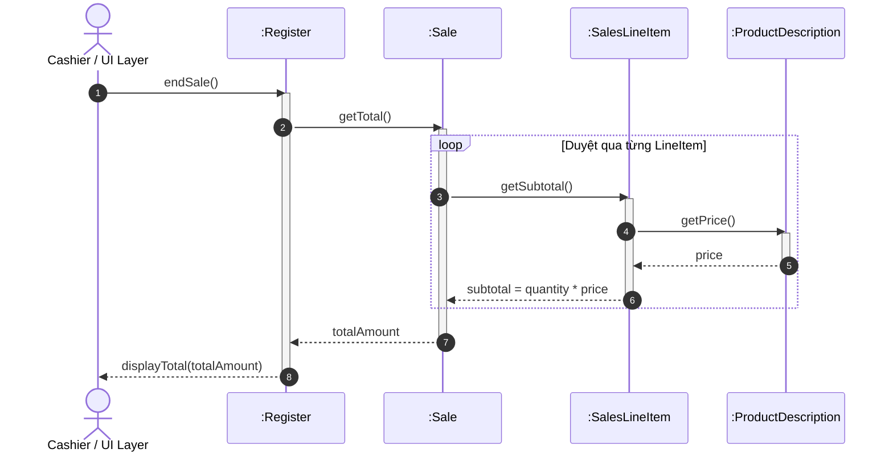

---

### 5. ÁNH XẠ ỨNG DỤNG VÀO DỰ ÁN GAME OOP THỰC CHIẾN

* **Bối cảnh áp dụng:** Hệ thống Hòm đồ & Trang bị (*Inventory & Equipment System*) trong Game 2.5D Multiplayer.
* **Vấn đề nếu thiếu OOA/D:** Lập trình viên thường tạo ra một lớp monolithic như `PlayerController` hoặc `Hero` chứa một mảng String tên trang bị. Khi người chơi đánh một đòn tấn công, lớp `Hero` tự duyệt mảng, kiểm tra từng chuỗi xem có phải kiếm hay áo giáp, tự cộng chỉ số tấn công và gửi socket. Kết quả là lớp này phình to thành hàng ngàn dòng code, không thể test, và tạo ra vô số bug khi thêm trang bị mới.
* **Ánh xạ OOA/D chuyên sâu từ Chương 1:**
  1. *Conceptual Analysis:* Xác định các khái niệm miền game: `Character`, `Inventory`, `ItemSlot`, `Equipment`, `StatModifier`.
  2. *Assigning Responsibilities:* 
     * `Character` không tự tính toán sát thương chi tiết; nó ủy thác cho `EquipmentManager.calculateBonusStats()`.
     * `EquipmentManager` lặp qua các `ItemSlot`, mỗi `Equipment` tự cung cấp `StatModifier` (Information Expert).
  3. *Lợi ích kiến trúc:* Tách biệt hoàn toàn logic thuộc tính nhân vật khỏi tầng hiển thị (Sprite/Animation) và tầng mạng (Network Synchronization).

---

<!-- END CHAPTER 01 -->

---


================================================================================
<!-- START CHAPTER 02: CHƯƠNG 2: ITERATIVE DEVELOPMENT AND THE UNIFIED PROCESS (UP) -->
================================================================================

---

## CHƯƠNG 2: ITERATIVE DEVELOPMENT AND THE UNIFIED PROCESS (UP)

### 1. ĐỀ MỤC & MỤC TIÊU CỐT LÕI (CORE PURPOSE)

#### Hệ thống đề mục (Heading Hierarchy)
* **2.1. The Most Important UP Idea: Iterative Development** *(Ý tưởng cốt lõi nhất của UP: Phát triển Lặp)*
* **2.2. Additional UP Best Practices and Concepts** *(Các thực hành tốt nhất trong UP)*
* **2.3. The UP Phases and Scheduled Milestones** *(Các pha của UP và các cột mốc lịch trình)*
  * *2.3.1. Inception (Khởi tạo)*
  * *2.3.2. Elaboration (Mô tả chi tiết / Định hình kiến trúc)*
  * *2.3.3. Construction (Xây dựng / Hiện thực hóa)*
  * *2.3.4. Transition (Chuyển giao)*
* **2.4. The UP Disciplines (was Workflows)** *(Các bộ môn/hoạt động trong UP)*
* **2.5. Process Customization and the Development Case** *(Tùy biến quy trình và Hồ sơ phát triển)*
* **2.6. The Agile UP** *(Quy trình UP linh hoạt)*
* **2.7. The Sequential "Waterfall" Lifecycle** *(Vòng đời thác nước tuần tự và thất bại tất yếu)*
* **2.8. You Know You Didn't Understand the UP When...** *(Dấu hiệu nhận biết việc áp dụng sai UP)*
* **2.9. Further Readings** *(Tài liệu tham khảo)*

#### Vấn đề kỹ thuật thực tế & Thảm họa kiến trúc được ngăn chặn
Chương 2 đập tan ảo tưởng về việc có thể **đóng băng yêu cầu (*Requirement Freezing*)** và thiết kế hoàn hảo ngay từ đầu theo mô hình Thác nước (*Waterfall*). 

Nếu một tổ chức phần mềm vận hành theo tư duy Thác nước, họ sẽ đối mặt với các thảm họa:
* **Hội chứng tích hợp muộn (*Late Integration Hell*):** Các nhóm phát triển độc lập trong nhiều tháng dựa trên tài liệu đặc tả giấy; đến cuối dự án khi ghép các thành phần lại với nhau thì các giao diện (*Interfaces*) không khớp, phát sinh hàng trăm lỗi kiến trúc nghiêm trọng.
* **Rủi ro kiến trúc cao nhất bị đẩy về cuối (*High-Risk Postponement*):** Các vấn đề hóc búa nhất (như hiệu năng chịu tải, phân tán dữ liệu, đồng bộ hóa) thường bị né tránh để làm sau; khi phát hiện hệ thống không đạt yêu cầu kiến trúc thì chi phí tái cấu trúc lúc này tương đương làm lại dự án từ đầu.
* **Phát triển cái người dùng không cần (*Building the Wrong Thing*):** Người dùng chỉ thực sự hiểu họ muốn gì khi họ được nhìn thấy và tương tác với phần mềm chạy thực tế (*Running software*). Thác nước tạo ra sản phẩm đúng từng câu chữ theo tài liệu yêu cầu ban đầu, nhưng lại hoàn toàn vô dụng trên thực tế.

---

### 2. PHÂN TÍCH LÝ THUYẾT & NGUYÊN LÝ CHUYÊN SÂU

```
+-----------------------------------------------------------------------------------------+
|                                    UP PHASES (Thời gian)                                |
|   Inception    |           Elaboration          |     Construction     |   Transition   |
+----------------+--------------------------------+----------------------+----------------+
|  Milestone:    |  Milestone:                    |  Milestone:          |  Milestone:    |
|  Lifecycle     |  Lifecycle Architecture        |  Initial Operational |  Final Product |
|  Objectives    |  (Architectural Baseline Code) |  Capability          |  Release       |
+----------------+--------------------------------+----------------------+----------------+
|  Iter. 1 (2-6w)| Iter. 2 (2-6w) | Iter. 3 (2-6w)| Iter. 4 ...          | Final Polish   |
+-----------------------------------------------------------------------------------------+
       |                 |               |
       v                 v               v
  [Mỗi Iteration sản sinh: Executable, Tested, Integrated Sub-system Baseline]
```

#### 2.1. Bản chất của Phát triển Lặp (Iterative Development) & Khái niệm Timeboxing
* **Phát triển Lặp và Tăng trưởng (Iterative & Incremental Development):** Dự án được chia thành các chu kỳ ngắn, cố định thời gian gọi là **Vòng lặp (Iterations)**, thường kéo dài từ 2 đến 6 tuần. Mỗi vòng lặp không phải là một bài tập trên giấy, mà là một dự án mini bao gồm đầy đủ các hoạt động: Lập kế hoạch, Phân tích, Thiết kế, Viết mã, Tích hợp và Kiểm thử.
* **Sản phẩm bàn giao của mỗi Iteration:** Bắt buộc phải là một **Hệ thống con chạy được, đã được kiểm thử và tích hợp (*Executable, Tested, Integrated Baseline*)**, không bao giờ là bản vẽ tài liệu đơn thuần.
* **Nguyên tắc Đóng khung thời gian (Timeboxing):** Nếu thời gian của một vòng lặp là 3 tuần, nó **tuyệt đối không được phép trễ hạn**. Nếu nhóm nhận thấy không thể hoàn thành toàn bộ khối lượng công việc đã cam kết, họ **phải cắt giảm phạm vi tính năng (*De-scope*)** để bảo vệ thời hạn chót, thay vì dời ngày kết thúc. Điều này rèn luyện tính kỷ luật và buộc đội ngũ phải luôn ưu tiên giải quyết các tính năng rủi ro cao nhất trước.

#### 2.2. Bốn Pha cốt lõi của UP (The Four UP Phases)
1. **Inception (Khởi tạo):** Không phải là pha phân tích yêu cầu toàn bộ! Inception chỉ kéo dài từ vài ngày đến một tuần nhằm trả lời các câu hỏi: *Tầm nhìn dự án là gì? Nó có khả thi về mặt kỹ thuật và kinh doanh không? Dự trù ngân sách sơ bộ?* Kết quả là cột mốc **Lifecycle Objectives (LCO)**.
2. **Elaboration (Mô tả chi tiết & Định hình kiến trúc):** Đây là pha tối quan trọng nhất đối với một Kiến trúc sư Phần mềm. 
   * Trọng tâm: Xây dựng **Bộ khung xương sống kiến trúc (*Architectural Baseline*)**, triệt tiêu hầu hết các rủi ro kỹ thuật nặng nề nhất (*High-Risk Items*), và làm rõ phần lớn các yêu cầu cốt lõi.
   * Kết thúc Elaboration, mã nguồn của khung kiến trúc cốt lõi phải được thực thi thành công. Cột mốc đạt được là **Lifecycle Architecture (LCA)**.
3. **Construction (Xây dựng):** Hiện thực hóa các tính năng còn lại dựa trên khung kiến trúc đã ổn định ở pha Elaboration. Đây là giai đoạn gia tăng khối lượng tính năng với rủi ro kỹ thuật thấp. Cột mốc đạt được: **Initial Operational Capability (IOC)**.
4. **Transition (Chuyển giao):** Đưa hệ thống vào môi trường vận hành thực tế (Beta test, triển khai sản phẩm, đào tạo người dùng, tinh chỉnh hiệu năng). Cột mốc: **Product Release (PR)**.

#### 2.3. Mối quan hệ hai chiều giữa Pha (Phases) và Bộ môn (Disciplines)
UP phân biệt rạch ròi giữa **Thời gian (*Phases*)** và **Nội dung công việc (*Disciplines*)**:
* Các bộ môn: *Business Modeling, Requirements, Analysis & Design, Implementation, Test, Deployment...*
* Trong **mọi** vòng lặp (dù ở Inception hay Construction), **tất cả** các bộ môn đều diễn ra đồng thời, chỉ khác nhau về mức độ đầu tư công sức (*Effort distribution*). Trong Elaboration, nỗ lực đổ dồn vào Requirements, Analysis & Design; còn trong Construction, nỗ lực tập trung vào Implementation và Testing.

---

### 3. MỔ XẺ MÃ NGUỒN HOẶC ĐẶC TẢ THIẾT KẾ (DESIGN / CODE DEEP-DIVE)

Trong pha Elaboration của UP, nhiệm vụ tối thượng của Kiến trúc sư là tạo ra một **Spike Solution** hoặc **Architectural Tracer Bullet** (Mã nguồn chứng minh kiến trúc) để triệt tiêu rủi ro tích hợp hệ thống ngoài. 

Đoạn mã sau minh họa việc xây dựng kiến trúc cắm rút (*Plug-and-play architecture*) qua Factory & Interface trong vòng lặp 1 để kết nối dịch vụ thanh toán thuế bên thứ ba, loại bỏ rủi ro phụ thuộc nhà cung cấp:

```java
// 1. Khung giao diện trừu tượng thuộc Tầng Miền Nghiệp Vụ
public interface ITaxCalculatorAdapter {
    Money getTax(Sale sale);
}

// 2. Hiện thực hóa cụ thể nằm ở Tầng Dịch vụ Kỹ thuật (Infrastructure)
public class GoodAsGoldTaxAdapter implements ITaxCalculatorAdapter {
    @Override
    public Money getTax(Sale sale) {
        // Thực hiện kết nối socket/REST API phức tạp tới hệ thống ngoài
        return callExternalTaxService(sale.getTotal());
    }
    
    private Money callExternalTaxService(Money amount) {
        // Mã gọi network thực tế được cô lập tại đây
        return new Money(amount.getAmount() * 0.1); // Giả lập thuế 10%
    }
}

// 3. Factory để khởi tạo đối tượng động mà không làm lộ implementation
public class ServicesFactory {
    private static ServicesFactory instance = new ServicesFactory();
    private ITaxCalculatorAdapter taxCalculator;

    public static ServicesFactory getInstance() { return instance; }

    public synchronized ITaxCalculatorAdapter getTaxCalculator() {
        if (taxCalculator == null) {
            // Đọc tên class từ file config (Property file) để phản chiếu động
            String className = System.getProperty("taxcalculator.class.name");
            try {
                taxCalculator = (ITaxCalculatorAdapter) Class.forName(className).getDeclaredConstructor().newInstance();
            } catch (Exception e) {
                taxCalculator = new GoodAsGoldTaxAdapter(); // Fallback mặc định
            }
        }
        return taxCalculator;
    }
}
```

#### Bảng phân tích kỹ thuật và ý nghĩa thiết kế:

| Dòng code / Đoạn code then chốt | Giải thích kỹ thuật & Ý nghĩa thiết kế kiến trúc |
| :--- | :--- |
| `public interface ITaxCalculatorAdapter` | **Nguyên lý Đảo ngược Phụ thuộc (DIP - Dependency Inversion Principle):** Tầng nghiệp vụ cốt lõi không bao giờ phụ thuộc trực tiếp vào SDK của nhà cung cấp bên thứ ba. Nó chỉ phụ thuộc vào một hợp đồng trừu tượng do chính nó làm chủ. |
| `public class GoodAsGoldTaxAdapter ...` | Mẫu hình **Adapter (GoF)**: Bọc kín toàn bộ sự phức tạp về giao thức mạng, lỗi timeout, parse JSON/XML của bên thứ ba vào trong một lớp chuyên biệt, cách ly hoàn toàn lỗi của nhà cung cấp với logic bán hàng. |
| `System.getProperty("taxcalculator.class.name")` | **Khả năng cấu hình động (Runtime Configurability):** Loại bỏ hoàn toàn mã nguồn phụ thuộc vào môi trường. Có thể tráo đổi nhà cung cấp dịch vụ thuế từ *GoodAsGold* sang *TaxMaster* chỉ bằng cách thay đổi cấu hình, không cần biên dịch lại mã nguồn. |
| `taxCalculator = (ITaxCalculatorAdapter)...` | Triệt tiêu rủi ro kiến trúc trong Elaboration: Bằng chứng cụ thể bằng mã chạy thực tế (*Executable Baseline*) chứng minh hệ thống có khả năng tích hợp đa đối tác dịch vụ mà không làm vỡ kiến trúc nghiệp vụ. |

---

### 4. SƠ ĐỒ TRỰC QUAN HÓA (UML MERMAID)

Sơ đồ thể hiện quy trình phát triển lặp của UP qua các pha, các vòng lặp Timeboxed và các mốc kiến trúc bắt buộc:

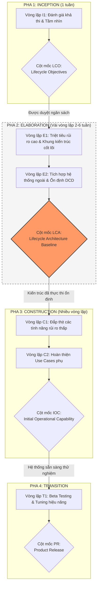

---

### 5. ÁNH XẠ ỨNG DỤNG VÀO DỰ ÁN GAME OOP THỰC CHIẾN

* **Bối cảnh áp dụng:** Phát triển Game 2.5D Online nhiều người chơi (Multiplayer Action RPG) với mô hình máy chủ tập trung (*Authoritative Dedicated Server*).
* **Thảm họa nếu làm theo kiểu Waterfall:** Nhóm dành 6 tháng viết tài liệu thiết kế chi tiết (vẽ hàng trăm loại quái, thiết kế giao diện HUD, cân bằng chỉ số 50 loại vũ khí). Đến tháng thứ 7 mới bắt đầu viết code mạng socket, và phát hiện ra vấn đề trễ mạng (*Latency jitter*), đồng bộ vật lý giữa Client và Server bị lệch vị trí liên tục (*Desync rubberbanding*). Toàn bộ hệ thống chiến đấu phải đập bỏ xây lại vì cấu trúc dữ liệu không hỗ trợ tua lại trạng thái (*Client-side Prediction & Server Reconciliation*).
* **Ứng dụng quy trình Lặp của UP từ Chương 2:**
  1. *Inception (Vòng lặp 1 - 1 tuần):* Làm rõ kiến trúc mạng: Dùng UDP (ENet/LiteNetLib) hay WebSockets? Khả thi về mặt kỹ thuật không?
  2. *Elaboration (Vòng lặp 2 đến 4 - Mỗi vòng lặp 2 tuần):*
     * *Iteration E1 (High Risk 1):* Không làm đồ họa đẹp, chỉ dùng 2 khối vuông (Capsule). Hiện thực hóa cơ chế di chuyển mạng: Client bấm phím di chuyển, Server tính toán vật lý, gửi lại vị trí; kiểm tra khả năng bù trễ khi ping 150ms.
     * *Iteration E2 (High Risk 2):* Thử nghiệm tải: Đưa 100 con bot vào cùng một phòng trên Server để đo đạc CPU/RAM và tần suất đóng gói gói tin (*Tick rate 30Hz*).
  3. *Kết quả đạt được:* Ngay tại pha Elaboration, "Khung xương kiến trúc mạng và đồng bộ" đã chạy thực tế trên máy chủ. Bước sang Construction chỉ việc tạo thêm model nhân vật, thêm hiệu ứng hạt (*VFX*), thêm âm thanh mà không bao giờ lo sập mạng.

---

<!-- END CHAPTER 02 -->

---


================================================================================
<!-- START CHAPTER 03: CHƯƠNG 3: CASE STUDY: THE NEXTGEN POS SYSTEM -->
================================================================================

---

## CHƯƠNG 3: CASE STUDY: THE NEXTGEN POS SYSTEM

### 1. ĐỀ MỤC & MỤC TIÊU CỐT LÕI (CORE PURPOSE)

#### Hệ thống đề mục (Heading Hierarchy)
* **3.1. The NextGen POS System** *(Hệ thống Điểm bán hàng NextGen POS)*
* **3.2. Architectural Layers and Case Study Emphasis** *(Các tầng kiến trúc và Trọng tâm nghiên cứu tình huống)*
  * *3.2.1. User Interface Layer (Tầng Giao diện người dùng)*
  * *3.2.2. Application Logic and Domain Objects Layer (Tầng Logic nghiệp vụ và Đối tượng miền)*
  * *3.2.3. Technical Services / Infrastructure Layer (Tầng Dịch vụ kỹ thuật / Hạ tầng)*
* **3.3. The Book's Strategy: Iterative Learning and Development** *(Chiến lược học tập và phát triển lặp của cuốn sách)*
  * *3.3.1. Iteration 1: Fundamental OOA/D Skills (Vòng lặp 1: Kỹ năng OOA/D nền tảng)*
  * *3.3.2. Iteration 2: Advanced GRASP and GoF Patterns (Vòng lặp 2: Mẫu hình nâng cao)*
  * *3.3.3. Iteration 3: Architectural Analysis and Persistence (Vòng lặp 3: Phân tích kiến trúc & Lưu trữ)*

#### Vấn đề kỹ thuật thực tế & Thảm họa kiến trúc được ngăn chặn
Chương 3 đặt ra bài toán kiến trúc cho một hệ thống bán hàng đa thiết bị, đa dịch vụ với các yêu cầu cực kỳ phức tạp: Hỗ trợ nhiều thiết bị phần cứng đầu cuối (máy quét mã vạch, cân điện tử, máy quẹt thẻ), tích hợp đa dạng dịch vụ ngoài (tính thuế, cấp phép thẻ tín dụng), và **khả năng sống sót khi mất mạng (*Offline Fault Tolerance*)**.

Nếu thiết kế theo lối mòn thiếu phân tầng chuẩn mực, hệ thống sẽ hứng chịu thảm họa:
* **Hội chứng Khóa cứng Nhà cung cấp (Vendor Lock-in):** Logic phần mềm bị ràng buộc cứng với một loại máy quét mã vạch hoặc một cổng thanh toán cụ thể. Khi siêu thị muốn đổi nhà cung cấp cổng thanh toán để giảm phí giao dịch, lập trình viên phải sửa đổi hàng chục nghìn dòng code logic bán hàng.
* **Tê liệt toàn diện khi đứt kết nối mạng (Network Single Point of Failure):** Nếu mã nguồn logic thanh toán gọi trực tiếp API đám mây mà không có cơ chế phân tầng và lưu trữ đệm cục bộ (*Local Store-and-Forward*), toàn bộ quầy thu ngân của chuỗi siêu thị sẽ phải ngừng hoạt động ngay khi đường truyền internet gặp sự cố.
* **Giao diện người dùng ký sinh vào Nghiệp vụ (UI-Business Entanglement):** Các biến trạng thái của màn hình (như trạng thái nút bấm, màu sắc nhãn) bị đem vào tính toán giá thành hóa đơn, khiến việc tự động hóa kiểm thử đơn vị (*Unit Testing*) cho logic thanh toán trở thành nhiệm vụ bất khả thi.

---

### 2. PHÂN TÍCH LÝ THUYẾT & NGUYÊN LÝ CHUYÊN SÂU

```
+-----------------------------------------------------------------------------------+
|                           USER INTERFACE LAYER (GUI)                              |
|           Màn hình bán hàng, Bàn phím ảo, Hiển thị hóa đơn (Thụ động)             |
+-----------------------------------------------------------------------------------+
                                         |
                                         | Chỉ phụ thuộc 1 chiều xuống dưới
                                         v
+-----------------------------------------------------------------------------------+
|              APPLICATION LOGIC & DOMAIN OBJECTS LAYER (TRỌNG TÂM CỦA SÁCH)        |
|               Register, Sale, SalesLineItem, Payment, Store, ProductCatalog       |
+-----------------------------------------------------------------------------------+
                                         |
                                         | Chỉ phụ thuộc 1 chiều xuống dưới
                                         v
+-----------------------------------------------------------------------------------+
|                       TECHNICAL SERVICES / INFRASTRUCTURE                         |
|     Persistence (Database), Logging, Hardware Drivers, Third-Party Adapters       |
+-----------------------------------------------------------------------------------+
```

#### 2.1. Kiến trúc phân tầng logic (Logical Layered Architecture)
Larman xác định rõ ranh giới giữa 3 tầng then chốt:
1. **Tầng Giao diện người dùng (User Interface - UI):** 
   * Trách nhiệm: Nhận sự kiện từ người dùng (click, phím bấm, quét mã) và hiển thị kết quả. 
   * Nguyên tắc tối thượng: **Tuyệt đối không chứa logic nghiệp vụ.** UI không được phép tự tính toán thuế, không tự cộng tiền, không tự quyết định hóa đơn có hợp lệ hay không.
2. **Tầng Logic Ứng dụng & Đối tượng Miền (Application Logic & Domain Objects):**
   * Đây là trái tim của hệ thống. Chứa các đối tượng nghiệp vụ thuần túy đại diện cho các khái niệm thế giới thực (`Sale`, `Register`, `Item`).
   * Tầng này hoàn toàn không biết gì về giao diện (UI) đang hiển thị nó (dù là Swing, Web, CLI hay Mobile App). Điều này đảm bảo tính độc lập và khả năng kiểm thử tự động (*Headless Automated Testing*).
3. **Tầng Dịch vụ Kỹ thuật (Technical Services / Infrastructure):**
   * Trách nhiệm: Cung cấp các dịch vụ hỗ trợ kỹ thuật không phụ thuộc nghiệp vụ cụ thể như: Ghi log (*Logging*), Lưu trữ dữ liệu (*Database Persistence*), Giao tiếp cổng COM/USB với phần cứng (*Hardware I/O*).

#### 2.2. Quy tắc Phụ thuộc Một Chiều (The One-Way Dependency Rule)
* Các tầng trên có thể gọi xuống tầng dưới ngay cạnh nó.
* **Tuyệt đối không có chiều ngược lại:** Tầng dưới không được phép phụ thuộc trực tiếp (import/reference) tầng trên. Tầng Miền nghiệp vụ không được phép import bất kỳ thư viện nào của tầng UI.
* Nếu tầng dưới cần thông báo dữ liệu cho tầng trên (ví dụ: cập nhật màn hình khi nhận được tiền), việc đó phải được thực hiện gián tiếp thông qua các mẫu hình như **Observer (GoF)** hoặc **Event-Driven Architecture**, nhằm bảo vệ sự độc lập hoàn hảo của Tầng Miền.

#### 2.3. Chiến lược học tập lặp 3 giai đoạn của Cuốn sách
Larman không dồn toàn bộ kiến thức vào một lần, mà tổ chức theo đúng lộ trình lặp của một dự án thực tế:
* **Vòng lặp 1 (Iteration 1):** Nắm vững các kỹ năng cốt lõi cơ bản nhất của OOA/D: Phân tích Use Case, xây dựng Domain Model ban đầu, phân bổ trách nhiệm bằng các mẫu GRASP cơ bản (Creator, Information Expert, Controller), vẽ DCD và chuyển sang mã nguồn Java.
* **Vòng lặp 2 (Iteration 2):** Đối mặt với các yêu cầu thay đổi và độ phức tạp tăng lên: Ứng dụng các mẫu hình GRASP nâng cao (Polymorphism, Pure Fabrication, Indirection, Protected Variations) và các mẫu hình GoF kinh điển (Strategy, Factory, Adapter, Singleton).
* **Vòng lặp 3 (Iteration 3):** Xử lý các bài toán kiến trúc quy mô lớn: Phân tích kiến trúc chuyên sâu (*Architectural Analysis*), biểu đồ trạng thái cho luồng thanh toán phức tạp, và tự tay thiết kế một Framework lưu trữ dữ liệu đối tượng (*Object-Relational Mapping / Persistence Framework*).

---

### 3. MỔ XẺ MÃ NGUỒN HOẶC ĐẶC TẢ THIẾT KẾ (DESIGN / CODE DEEP-DIVE)

Dưới đây là đoạn mã kiến trúc minh họa sự phân tách rạch ròi giữa **Tầng UI**, đối tượng điều phối **Controller (Tầng Miền)**, và các **Domain Objects**, hiện thực hóa quy tắc phụ thuộc một chiều trong ca sử dụng nhập mặt hàng (`enterItem`):

```java
// ==================== TẦNG GIAO DIỆN NGƯỜI DÙNG (UI LAYER) ====================
public class ProcessSaleJFrame {
    private Register register; // Tham chiếu xuống tầng dưới

    public ProcessSaleJFrame(Register register) {
        this.register = register;
    }

    // Xử lý sự kiện khi máy quét barcode đọc được mã
    public void onBarcodeScanned(String itemId, int quantity) {
        // UI CHỈ chuyển tiếp thông tin, KHÔNG làm logic tại đây
        register.enterItem(new ItemID(itemId), quantity);
        updateDisplay();
    }
    
    private void updateDisplay() {
        // Lấy thông tin hóa đơn hiện tại để vẽ lên giao diện
    }
}

// ================= TẦNG LOGIC MIỀN (APPLICATION / DOMAIN LAYER) =================
public class Register {
    private ProductCatalog catalog;
    private Sale currentSale;

    public Register(ProductCatalog catalog) {
        this.catalog = catalog;
    }

    // Phương thức xử lý hệ thống (System Operation) đóng vai trò Controller
    public void enterItem(ItemID id, int quantity) {
        ProductDescription desc = catalog.getProductDescription(id);
        if (desc == null) {
            throw new ItemNotFoundException("Không tìm thấy mặt hàng: " + id);
        }
        currentSale.createSalesLineItem(desc, quantity);
    }
}
```

#### Bảng phân tích kỹ thuật và ý nghĩa thiết kế:

| Dòng code / Đoạn code then chốt | Giải thích kỹ thuật & Ý nghĩa thiết kế kiến trúc |
| :--- | :--- |
| `private Register register;` | Tầng UI giữ tham chiếu tới một đối tượng thuộc Tầng Miền đóng vai trò **Controller**. UI chỉ biết gửi thông điệp xuống, Tầng Miền hoàn toàn không giữ tham chiếu ngược lại `ProcessSaleJFrame`. |
| `register.enterItem(new ItemID(itemId), quantity);` | **Tách biệt mối quan tâm (Separation of Concerns):** UI không tự chọc vào Database để tìm mặt hàng, không tự tạo `SalesLineItem`. Nó gửi sự kiện hệ thống `enterItem` kèm các tham số kiểu dữ liệu nguyên thủy/value object. |
| `public class Register ...` | Hiện thực hóa mẫu hình **Controller (GRASP)**: `Register` đóng vai trò là điểm tiếp nhận sự kiện hệ thống đầu tiên sau tầng giao diện, điều phối luồng nghiệp vụ mà không làm nhiệm vụ hiển thị đồ họa. |
| `ProductDescription desc = catalog.getProductDescription(id);` | **Ủy thác nghiệp vụ chính xác:** `Register` biết rằng `ProductCatalog` là chuyên gia nắm giữ danh mục thông tin sản phẩm (*Information Expert*), do đó ủy thác việc tìm kiếm cho `catalog`. |
| `currentSale.createSalesLineItem(desc, quantity);` | Thể hiện mối quan hệ **Creator (GRASP)**: Đảm bảo việc thêm sản phẩm vào hóa đơn thuộc về chính đối tượng `Sale`, duy trì tính toàn vẹn trạng thái nội bộ của đơn hàng. |

---

### 4. SƠ ĐỒ TRỰC QUAN HÓA (UML MERMAID)

Sơ đồ phân tầng kiến trúc (Package Diagram / Logical Architecture) của hệ thống NextGen POS thể hiện rõ ranh giới các tầng và sự tuân thủ nghiêm ngặt Quy tắc Phụ thuộc Một Chiều:

```mermaid
classDiagram
    direction TB

    namespace UI_Layer {
        class ProcessSaleView {
            +onBarcodeScanned(id, qty)
            +onPaymentSubmitted()
        }
    }

    namespace Domain_Layer {
        class Register {
            +enterItem(id, qty)
            +endSale()
            +makePayment(cashTendered)
        }
        class Sale {
            -dateTime: Date
            +createSalesLineItem(desc, qty)
            +getTotal(): Money
        }
        class ProductCatalog {
            +getProductDescription(id): ProductDescription
        }
    }

    namespace Infrastructure_Layer {
        class IPersistenceFacade {
            <<interface>>
            +get(id, Class): Object
            +put(id, Object)
        }
        class ITaxCalculatorAdapter {
            <<interface>>
            +getTax(Sale): Money
        }
        class ScannerDriver {
            +listenPort()
        }
    }

    ProcessSaleView --> Register : Gửi sự kiện nghiệp vụ
    Register --> ProductCatalog : Tra cứu thông tin
    Register --> Sale : Quản lý hóa đơn hiện tại
    Domain_Layer ..> Infrastructure_Layer : Sử dụng dịch vụ gián tiếp qua Interface

    style UI_Layer fill:#e1f5fe,stroke:#01579b
    style Domain_Layer fill:#e8f5e9,stroke:#2e7d32
    style Infrastructure_Layer fill:#fff3e0,stroke:#e65100
```

---

### 5. ÁNH XẠ ỨNG DỤNG VÀO DỰ ÁN GAME OOP THỰC CHIẾN

* **Bối cảnh áp dụng:** Kiến trúc Phân tầng trong Game 2.5D Multiplayer (tách biệt Game Engine / Simulation / Network Transport).
* **Vấn đề thực tế nếu vi phạm kiến trúc phân tầng NextGen POS:**
  Lập trình viên thường viết mã điều khiển nhân vật gắn chặt với API của Engine (ví dụ: trong Unity gọi trực tiếp `Input.GetAxis()`, `transform.Translate()`, `Rigidbody.AddForce()` và `GetComponent<PhotonView>().RPC()`). Điều này tạo ra một mớ bòng bong không thể tách rời: Logic chiến đấu gắn chết với đồ họa và engine mạng. Khi muốn chuyển từ Unity sang Godot, hoặc muốn chạy game logic trên Linux Server không có màn hình (*Headless Server*) để chống hack/cheat, toàn bộ dự án coi như phá sản vì Server không thể chạy các hàm liên quan đến GPU hay Engine Transform.
* **Ứng dụng tư duy Phân tầng Kiến trúc từ Chương 3:**
  1. *Presentation Layer (UI/Render):* Chỉ chứa các script hiển thị: Sprite Renderer, Animation Controller, Audio Player, Particle System. Tầng này chỉ lắng nghe trạng thái từ tầng dưới để vẽ lên màn hình.
  2. *Domain / Simulation Layer (Pure C# / Pure C++):*
     * Chứa các thực thể toán học và nghiệp vụ thuần túy: `CharacterState`, `CombatCalculator`, `SkillTree`, `Vector2D` (tự viết, không dùng Vector của Engine).
     * Tuyệt đối không import bất kỳ thư viện đồ họa nào. Logic di chuyển, tính toán trừ máu (*Damage calculation*), thời gian hồi chiêu (*Cooldown*) diễn ra hoàn toàn tại đây.
  3. *Infrastructure Layer:* Chứa các Adapter mạng (Socket client, WebSocket, LiteNetLib) và Adapter phần cứng (Input Reader).
  4. *Lợi ích tối thượng:* Cùng một tầng **Domain / Simulation Layer** này có thể biên dịch thẳng thành file `.dll` hoặc binary chạy trên **Dedicated Server** để làm trọng tài tính toán chống gian lận (*Authoritative Server Simulation*), đồng thời chạy được trên Client để dự đoán khung hình (*Client-side Prediction*), tối ưu hóa tái sử dụng mã nguồn 100%.

---

<!-- END CHAPTER 03 -->

---


================================================================================
<!-- START CHAPTER 04: CHƯƠNG 4: INCEPTION -->
================================================================================

---

## CHƯƠNG 4: INCEPTION

### 1. ĐỀ MỤC & MỤC TIÊU CỐT LÕI (CORE PURPOSE)

#### Hệ thống đề mục (Heading Hierarchy)
* **4.1. Inception: An Analogy** *(Sự tương đồng trực quan về Inception)*
* **4.2. Inception May Be Very Brief** *(Thời lượng cực ngắn của Inception)*
* **4.3. What Artifacts May Start in Inception?** *(Các tạo tác nào được khởi tạo trong Inception?)*
  * *Vision and Business Case (Tầm nhìn & Đề xuất kinh doanh)*
  * *Use-Case Model (Mô hình ca sử dụng sơ bộ)*
  * *Supplementary Specification (Đặc tả bổ sung sơ bộ)*
  * *Glossary (Bảng chú giải thuật ngữ & Từ điển dữ liệu)*
  * *Risk-List & Risk Management Plan (Danh mục và Kế hoạch kiểm soát rủi ro)*
  * *Prototypes and Proof-of-Concepts (Mô hình thử nghiệm và Bằng chứng khái niệm)*
  * *Iteration Plan (Kế hoạch cho Vòng lặp Elaboration 1)*
  * *Development Case (Hồ sơ quy trình phát triển tùy biến)*
* **4.4. You Know You Didn't Understand Inception When...** *(Dấu hiệu nhận biết sự ngộ nhận về Inception)*

#### Vấn đề kỹ thuật thực tế & Thảm họa kiến trúc được ngăn chặn
Chương 4 giải quyết sự nhầm lẫn tai hại kinh điển trong ngành công nghệ: **Đồng nhất pha Inception với giai đoạn thu thập toàn bộ yêu cầu (Requirements Phase) của mô hình Thác nước**.

Nếu một tổ chức hiểu sai Inception, họ sẽ rơi vào các thảm họa:
* **Tê liệt vì phân tích (Analysis Paralysis):** Nhóm dành nhiều tháng cố gắng viết tài liệu yêu cầu chi tiết 100%, tạo ra hàng trăm trang đặc tả tĩnh trên giấy mà không có dòng mã nào được thực thi.
* **Cam kết ngân sách và lịch trình ảo (Premature Over-commitment):** Đưa ra con số chi phí và ngày release chính xác khi chưa khảo sát thực tế và chưa hiểu rõ rủi ro kỹ thuật, dẫn đến vỡ kế hoạch (vượt ngân sách 200-300%).
* **Thất bại trong việc đưa ra quyết định Dừng/Chạy (No-Go Failure):** Không nhận diện được dự án là bất khả thi hoặc phi thực tế ngay từ tuần đầu tiên, tiếp tục đốt hàng trăm ngàn USD vào một sản phẩm vô vọng.

---

### 2. PHÂN TÍCH LÝ THUYẾT & NGUYÊN LÝ CHUYÊN SÂU

```
+-----------------------------------------------------------------------------------+
|                            INCEPTION: ENVISIONING PHASE                           |
|       Thời lượng: Vài giờ đến vài ngày (Tối đa 1 tuần cho dự án trung bình)       |
+-----------------------------------------------------------------------------------+
       |
       +---> [1] Nghiên cứu Tính khả thi (Feasibility Study)
       +---> [2] Làm rõ Tầm nhìn cốt lõi (Vision & Business Case)
       +---> [3] Khảo sát ~10% Use Cases quan trọng nhất (Deep dive sơ bộ)
       +---> [4] Liệt kê tên 90% Use Cases còn lại (Brief format)
       +---> [5] Nhận diện các Rủi ro kỹ thuật chí mạng (High-Risk Items)
       |
       v
+-----------------------------------------------------------------------------------+
|                               GO / NO-GO DECISION GATE                            |
|       - Đạt chuẩn (Go): Chuyển sang Elaboration để xây dựng Kiến trúc             |
|       - Không đạt (No-Go): Hủy dự án ngay lập tức (Tiết kiệm 95% chi phí)         |
+-----------------------------------------------------------------------------------+
```

#### 2.1. Bản chất của Inception: "Envisioning", không phải "Requirements"
* Inception chỉ là bước **Định hình tầm nhìn (*Envisioning*)**. Mục đích duy nhất của nó là thu thập đủ thông tin cơ bản để các bên liên quan quyết định: **"Có nên đầu tư tiền bạc để bước vào pha Elaboration nhằm nghiên cứu sâu hơn hay không?"**.
* Thời lượng chuẩn của Inception: Chỉ kéo dài từ **vài giờ đến vài ngày** (tối đa là 1-2 tuần với các dự án lớn). Nếu một nhóm đang ở "Inception tuần thứ 6", họ đang làm Thác nước trá hình.

#### 2.2. Khối lượng công việc thực tế trong Inception
Craig Larman nêu rõ quy tắc định lượng:
* Chỉ khoảng **10% Use Cases** (những ca sử dụng cốt lõi, đại diện cho giá trị nghiệp vụ chính hoặc chứa rủi ro kỹ thuật cao) được viết chi tiết ở dạng *Fully Dressed*.
* Khoảng **90% Use Cases còn lại** chỉ được ghi nhận dưới dạng tên gọi và tóm tắt 1-2 câu (*Brief format*).
* Tuyệt đối **không vẽ kiến trúc chi tiết, không vẽ hàng loạt biểu đồ UML**. Bản vẽ UML chỉ xuất hiện dưới dạng phác thảo nhanh trên bảng trắng (*UML as sketch*) để thảo luận ý tưởng.

#### 2.3. Các câu hỏi nhận biết việc áp dụng sai Inception
Craig Larman chỉ ra: "Bạn biết mình chưa hiểu Inception khi...":
1. Bạn cố gắng định nghĩa toàn bộ yêu cầu chi tiết.
2. Bạn dành hơn vài tuần cho pha này.
3. Bạn cố gắng đưa ra một ước lượng ngân sách chính xác tuyệt đối (thay vì dải ước lượng biến thiên như: 100,000$ $\pm$ 50%).
4. Bạn không tạo ra được một kế hoạch cụ thể cho Vòng lặp Elaboration 1 nhằm triệt tiêu rủi ro kiến trúc cao nhất.

---

### 3. MỔ XẺ MÃ NGUỒN HOẶC ĐẶC TẢ THIẾT KẾ (DESIGN / CODE DEEP-DIVE)

Trong Inception, công cụ kỹ thuật then chốt không phải là code sản phẩm, mà là **Ma trận Đánh giá Khả thi & Quyết định Go/No-Go (*Feasibility Evaluation & Risk Matrix*)** được mô hình hóa thành Schema cấu trúc dữ liệu để tự động hóa việc đánh giá dự án:

```json
{
  "projectInceptionAssessment": {
    "projectName": "NextGen POS",
    "iteration": "Inception-1",
    "businessViability": {
      "targetROI": "18 months",
      "executiveSponsor": "VP Retail Operations",
      "marketNeedUrgency": "HIGH"
    },
    "technicalFeasibilitySpikes": [
      {
        "riskId": "RISK-01",
        "description": "Mất kết nối mạng Internet khi đang thực hiện giao dịch thẻ tín dụng",
        "impact": "CRITICAL",
        "mitigationStrategy": "Thiết kế cơ chế Store-and-Forward ở Elaboration 1",
        "status": "UNRESOLVED_PENDING_ELABORATION"
      },
      {
        "riskId": "RISK-02",
        "description": "Đa dạng hóa driver máy quét mã vạch trên các hệ điều hành cũ",
        "impact": "MEDIUM",
        "mitigationStrategy": "Sử dụng Java POS chuẩn qua Adapter pattern",
        "status": "ACCEPTED_RISK"
      }
    ],
    "scopeAllocation": {
      "fullyDressedUseCasesCount": 1,
      "briefUseCasesCount": 14,
      "primaryTracerBullet": "Process Sale (Cash only)"
    },
    "decisionGate": {
      "recommendation": "GO_TO_ELABORATION",
      "budgetRangeApproved": "$120,000 - $180,000",
      "nextMilestoneDate": "2026-11-20 (Elaboration-1 Demo)"
    }
  }
}
```

#### Bảng phân tích kỹ thuật và ý nghĩa thiết kế:

| Thành phần đặc tả then chốt | Giải thích kỹ thuật & Ý nghĩa thiết kế kiến trúc |
| :--- | :--- |
| `"fullyDressedUseCasesCount": 1` | **Nguyên tắc tiết chế phạm vi (Scope Control):** Chỉ chọn đúng 1 ca sử dụng sống còn (`Process Sale`) để viết chi tiết. Tránh việc đội ngũ bị chôn vùi trong việc viết văn bản mô tả. |
| `"briefUseCasesCount": 14` | Nắm bắt được bức tranh toàn cảnh (Big Picture) của hệ thống nhưng không tốn tài nguyên đào sâu vào chi tiết khi chưa có phản hồi thực tế. |
| `"RISK-01": "Store-and-Forward"` | **Xác lập mục tiêu cho Elaboration:** Inception nhận diện ra rủi ro chí mạng nhưng **không giải quyết nó trên giấy**. Nó bàn giao rủi ro này làm đề bài bắt buộc cho Vòng lặp 1 của Elaboration phải giải quyết bằng mã nguồn chạy thực tế. |
| `"decisionGate": "GO_TO_ELABORATION"` | **Bản chất của Milestone LCO:** Inception kết thúc bằng một quyết định đầu tư rành mạch. Nếu rủi ro kỹ thuật không có phương án giải quyết khả thi, dự án bị khai tử ngay (No-Go) mà không lãng phí ngân sách. |

---

### 4. SƠ ĐỒ TRỰC QUAN HÓA (UML MERMAID)

Sơ đồ trạng thái quyết định của Pha Inception (Decision Gate Flowchart) trong quy trình UP:

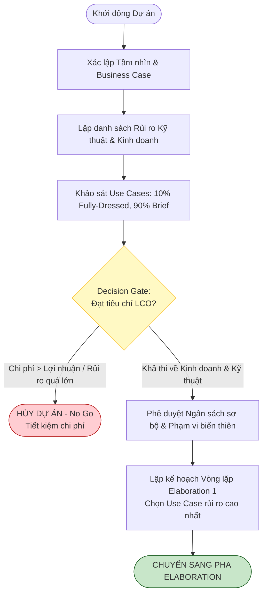

---

### 5. ÁNH XẠ ỨNG DỤNG VÀO DỰ ÁN GAME OOP THỰC CHIẾN

* **Bối cảnh áp dụng:** Pha Inception cho một dự án Game 2.5D Online nhiều người chơi (MMORPG / MOBA).
* **Sai lầm thường gặp (Water-falling Game Development):** Nhóm Game Design viết một cuốn "Kinh thánh Game" (*Game Design Document - GDD*) dày 300 trang: viết toàn bộ cốt truyện thế giới, vẽ concept art cho 100 vị tướng, thiết kế chi tiết chỉ số của 500 món đồ. Khi đưa cho lập trình viên làm, phát hiện ra engine mạng không chịu tải nổi quá 10 người chơi trên cùng một bản đồ, toàn bộ thế giới ảo 300 trang bị vứt vào sọt rác.
* **Ánh xạ Inception từ Chương 4 vào Game:**
  1. *Thời gian:* Giới hạn Inception trong đúng 1 tuần.
  2. *Tầm nhìn cốt lõi (Core Vision):* Xác định **Vòng lặp trải nghiệm cốt lõi (*Core Gameplay Loop*)**: Di chuyển $\to$ Dùng chiêu $\to$ Nhận kinh nghiệm/Rơi đồ.
  3. *Use Case 10% duy nhất:* Ca sử dụng `CombatAction`: Người chơi bấm chiêu, máy chủ tính toán hitbox, mục tiêu mất máu.
  4. *Rủi ro kỹ thuật chí mạng:* Đồng bộ chuyển động 2.5D giữa máy khách và máy chủ khi mạng giật lag.
  5. *Đầu ra Inception:* Không viết thêm lore hay cốt truyện; lập kế hoạch cho Elaboration 1: Tạo một bản build đen trắng (Greybox) gồm 2 nhân vật đánh nhau qua mạng local để kiểm tra Engine vật lý và Netcode.

---

<!-- END CHAPTER 04 -->

---


================================================================================
<!-- START CHAPTER 05: CHƯƠNG 5: UNDERSTANDING REQUIREMENTS -->
================================================================================

---

## CHƯƠNG 5: UNDERSTANDING REQUIREMENTS

### 1. ĐỀ MỤC & MỤC TIÊU CỐT LÕI (CORE PURPOSE)

#### Hệ thống đề mục (Heading Hierarchy)
* **5.1. Types of Requirements: The FURPS+ Model** *(Phân loại yêu cầu: Mô hình FURPS+)*
  * *Functional (Chức năng)*
  * *Usability (Khả năng sử dụng / Trải nghiệm)*
  * *Reliability (Độ tin cậy & An toàn vận hành)*
  * *Performance (Hiệu năng & Khả năng đáp ứng)*
  * *Supportability (Khả năng hỗ trợ & Bảo trì)*
  * *The "+" Sub-categories: Implementation, Interface, Operations, Packaging, Legal (Các ràng buộc mở rộng)*
* **5.2. Evolutionary vs. Waterfall Requirements** *(Yêu cầu tiến hóa vs. Yêu cầu thác nước đóng băng)*
* **5.3. Further Readings** *(Tài liệu đọc thêm)*

#### Vấn đề kỹ thuật thực tế & Thảm họa kiến trúc được ngăn chặn
Chương 5 đập tan thói quen xấu của lập trình viên: **Chỉ quan tâm đến Yêu cầu chức năng (*Functional Requirements*) mà coi nhẹ Yêu cầu phi chức năng (*Non-Functional Requirements / Quality Attributes*)**.

Nếu một Kiến trúc sư không làm chủ mô hình FURPS+, hệ thống sẽ hứng chịu các thảm họa:
* **Hội chứng Sụp đổ khi scale (*Scalability Collapse*):** Hệ thống chạy rất tốt trong phòng thí nghiệm với 1 người dùng thử, nhưng chết đứng (*Out of Memory / Thread Deadlock*) khi có 1000 người dùng đồng thời vì không thiết kế cho thuộc tính *Performance & Reliability*.
* **Bế tắc khi nâng cấp (*Supportability Nightmare*):** Mã nguồn bị hard-code các hằng số cấu hình, gắn chặt vào một hệ điều hành cụ thể, không thể quốc tế hóa ngôn ngữ (*i18n*), khiến chi phí bảo trì sau release chiếm tới 80% tổng ngân sách dự án.
* **Vi phạm pháp lý và an toàn dữ liệu (*Legal / Compliance Violations*):** Bỏ qua nhóm ràng buộc "+" (như chuẩn bảo mật PCI-DSS trong thanh toán thẻ, GDPR trong lưu trữ dữ liệu cá nhân), dẫn đến nguy cơ phần mềm bị cấm vận hành hoặc bị phạt hàng triệu USD.

---

### 2. PHÂN TÍCH LÝ THUYẾT & NGUYÊN LÝ CHUYÊN SÂU

```
+-----------------------------------------------------------------------------------+
|                            THE FURPS+ REQUIREMENTS MODEL                          |
+-----------------------------------------------------------------------------------+
| [F] FUNCTIONAL       : Tính năng, Năng lực xử lý, Bảo mật, Luồng nghiệp vụ        |
| [U] USABILITY        : Trải nghiệm UI, Khả năng tiếp cận, Tài liệu hướng dẫn       |
| [R] RELIABILITY      : Tần suất lỗi (MTBF), Khả năng phục hồi, Tính dự đoán được  |
| [P] PERFORMANCE      : Thời gian phản hồi (Latency), Thông lượng (Throughput)    |
| [S] SUPPORTABILITY   : Khả năng bảo trì, Cấu hình hóa, Khả năng mở rộng           |
+-----------------------------------------------------------------------------------+
| [+] CONSTRAINTS                                                                   |
|   - Implementation   : Ngôn ngữ lập trình bắt buộc, Thư viện, Nền tảng phần cứng  |
|   - Interface        : Ràng buộc giao thức phần cứng, Định dạng API ngoài         |
|   - Operations       : Quản trị hệ thống, Sao lưu, Giám sát vận hành (Metrics)   |
|   - Packaging        : Bộ cài đặt, Containerization (Docker), Cơ chế tự update    |
|   - Legal            : Bản quyền mã nguồn mở (GPL/MIT), Chuẩn bảo mật thanh toán  |
+-----------------------------------------------------------------------------------+
```

#### 2.1. Phân rã chuyên sâu mô hình FURPS+
Craig Larman sử dụng mô hình FURPS+ (khởi xướng bởi Robert Grady tại Hewlett-Packard) để phân loại có hệ thống toàn bộ yêu cầu phần mềm:
1. **Functional (Chức năng):** Những gì hệ thống **làm**. Được ghi nhận chủ yếu trong **Use-Case Model**. Bao gồm các tính năng chính, khả năng tính toán, tính toàn vẹn dữ liệu.
2. **Usability (Khả năng sử dụng):** Con người tương tác với hệ thống dễ dàng ra sao? Bao gồm công thái học giao diện (*GUI Ergonomics*), khả năng phòng tránh lỗi gõ nhầm của người dùng, tài liệu trợ giúp trực tuyến.
3. **Reliability (Độ tin cậy):** Mức độ chịu lỗi của hệ thống. Bao gồm thời gian trung bình giữa các lần sập (*Mean Time Between Failures - MTBF*), khả năng tự phục hồi khi database ngắt kết nối, khả năng sao lưu dự phòng (*Failover*).
4. **Performance (Hiệu năng):** Đo lường tính kịp thời của hệ thống. Bao gồm thời gian phản hồi (*Response Time* - ví dụ: giao dịch thanh toán phải hoàn thành dưới 2 giây trong 99% trường hợp), thông lượng (*Throughput* - xử lý 500 giao dịch/giây), mức tiêu thụ tài nguyên (RAM, CPU, băng thông mạng).
5. **Supportability (Khả năng hỗ trợ & Thích ứng):** Bao gồm khả năng bảo trì mã nguồn (*Maintainability*), khả năng mở rộng thêm tính năng mới (*Extensibility*), khả năng cấu hình mà không cần sửa code (*Configurability*), khả năng cài đặt và quốc tế hóa (*Localization*).

#### 2.2. Nhóm dấu "+" (Ràng buộc kỹ thuật & Môi trường)
Dấu "+" đại diện cho các yếu tố định hình trực tiếp Kiến trúc hệ thống (*Architectural Drivers*):
* **Ràng buộc Hiện thực (Implementation Constraints):** Bắt buộc chạy trên JVM 17, sử dụng C++20, bộ nhớ không vượt quá 512MB RAM.
* **Ràng buộc Giao diện (Interface Constraints):** Bắt buộc giao tiếp với máy quẹt thẻ qua chuẩn RS-232, trao đổi dữ liệu với ngân hàng qua chuẩn ISO 8583.
* **Vận hành & Đóng gói (Operations & Packaging):** Tự động phát hiện lỗi và gửi cảnh báo tới hệ thống giám sát Prometheus/Grafana.
* **Pháp lý (Legal):** Tuân thủ luật bảo vệ dữ liệu cá nhân, chứng chỉ bảo mật của cơ quan thuế nhà nước.

#### 2.3. Yêu cầu tiến hóa (Evolutionary Requirements)
Craig Larman nhấn mạnh: Yêu cầu không phải là một bia đá bất di bất dịch. Trong UP, yêu cầu được **làm rõ dần dần qua từng vòng lặp (*Evolutionary Requirements*)**. Khách hàng chỉ phát hiện ra các yêu cầu phi chức năng thực sự (như độ trễ hay tính dễ dùng) sau khi họ trực tiếp thử nghiệm các bản build của pha Elaboration.

---

### 3. MỔ XẺ MÃ NGUỒN HOẶC ĐẶC TẢ THIẾT KẾ (DESIGN / CODE DEEP-DIVE)

Để hiện thực hóa yêu cầu phi chức năng về **Performance & Reliability (FURPS+)** vào mã nguồn kiến trúc, Kiến trúc sư thiết kế một cơ chế kiểm soát hợp đồng thời gian thực thi (*Execution Time SLA Circuit Breaker*) bọc quanh các cuộc gọi dịch vụ ngoài:

```java
public class ReliableServiceProxy<T> {
    private final long maxExecutionTimeMs;
    private final int failureThreshold;
    private int consecutiveFailures = 0;

    public ReliableServiceProxy(long maxExecutionTimeMs, int failureThreshold) {
        this.maxExecutionTimeMs = maxExecutionTimeMs;
        this.failureThreshold = failureThreshold;
    }

    public <R> R executeWithSLA(Supplier<R> serviceCall, R fallbackResult) {
        // [FURPS - Reliability]: Kiểm tra trạng thái Circuit Breaker
        if (consecutiveFailures >= failureThreshold) {
            System.err.println("Circuit Breaker OPEN: Dịch vụ ngoài đang tê liệt. Dùng Fallback.");
            return fallbackResult;
        }

        long startTime = System.currentTimeMillis();
        try {
            R result = serviceCall.get();
            long duration = System.currentTimeMillis() - startTime;
            
            // [FURPS - Performance]: Giám sát thời gian phản hồi theo SLA
            if (duration > maxExecutionTimeMs) {
                System.warn.println("SLA Violated: Cuộc gọi mất " + duration + "ms (Ngưỡng: " + maxExecutionTimeMs + "ms)");
            }
            consecutiveFailures = 0; // Reset khi thành công
            return result;
        } catch (Exception e) {
            consecutiveFailures++;
            // [FURPS - Supportability]: Log lỗi chi tiết để điều tra
            Logger.logServiceError(e, consecutiveFailures);
            return fallbackResult;
        }
    }
}
```

#### Bảng phân tích kỹ thuật và ý nghĩa thiết kế:

| Dòng code / Đoạn code then chốt | Giải thích kỹ thuật & Ý nghĩa thiết kế kiến trúc |
| :--- | :--- |
| `if (consecutiveFailures >= failureThreshold)` | Hiện thực hóa thuộc tính **Reliability (Độ tin cậy)** qua mẫu hình *Circuit Breaker*: Ngăn chặn việc hệ thống tiếp tục gửi request vào một dịch vụ ngoài đang chết, tránh gây tràn hàng đợi (*Thread Starvation*) cho hệ thống chính. |
| `long duration = System.currentTimeMillis() - startTime;` | Hiện thực hóa thuộc tính **Performance (Hiệu năng)**: Kiểm tra cam kết SLA theo yêu cầu phi chức năng (ví dụ: phản hồi không quá 1500ms). |
| `return fallbackResult;` | **Khả năng chịu lỗi an toàn (Graceful Degradation):** Khi dịch vụ thanh toán ngoài sập, hệ thống chuyển sang chế độ dự phòng (chuyển sang thanh toán tiền mặt hoặc lưu giao dịch vào bộ nhớ đệm), đảm bảo hệ thống không bao giờ bị crash trắng màn hình trước mặt khách hàng. |
| `Logger.logServiceError(e...);` | Hiện thực hóa thuộc tính **Supportability (Khả năng hỗ trợ vận hành)**: Cung cấp dấu vết kiểm toán (*Audit Trail*) và log giám sát để đội vận hành chẩn đoán sự cố mà không cần cắm debugger vào môi trường production. |

---

### 4. SƠ ĐỒ TRỰC QUAN HÓA (UML MERMAID)

Sơ đồ phân loại toàn diện cây yêu cầu hệ thống theo mô hình FURPS+:

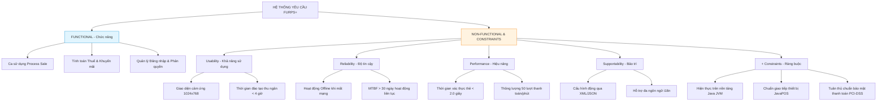

---

### 5. ÁNH XẠ ỨNG DỤNG VÀO DỰ ÁN GAME OOP THỰC CHIẾN

* **Bối cảnh áp dụng:** Thiết kế bộ yêu cầu FURPS+ cho Game 2.5D Multiplayer (Action RPG).
* **Vấn đề thực tế nếu chỉ tập trung vào Functional:** Đội ngũ làm ra đầy đủ chiêu thức, hệ thống trang bị, đánh boss rất hay. Nhưng khi mở Server thử nghiệm:
  * Game giật lag khung hình dưới 15 FPS trên máy cấu hình trung bình (*Usability/Performance fail*).
  * Mỗi khi rớt mạng 4G, người chơi bị văng thẳng ra màn hình đăng nhập, mất sạch dữ liệu trận đấu (*Reliability fail*).
  * Muốn thay đổi chỉ số sát thương của một cây kiếm, lập trình viên phải sửa code C#, build lại toàn bộ Client, đẩy lên App Store mất 3 ngày duyệt (*Supportability fail*).
* **Ứng dụng FURPS+ chuyên sâu vào Game:**
  1. *Usability:* Phím bấm ảo trên màn hình cảm ứng có độ nhạy cao, tự động khóa mục tiêu gần nhất (*Auto-target*); bố cục HUD không che khuất tầm nhìn 2.5D.
  2. *Reliability:* Khi mất kết nối mạng đột ngột trong trận đánh, hệ thống có cơ chế **Auto-Reconnect**: Client tự kết nối lại trong 10 giây, Server tự gửi lại snapshot trạng thái trận đấu gần nhất mà không bắt người chơi thoát game.
  3. *Performance:* 
     * Tốc độ khung hình (*FPS*): Tối thiểu 60 FPS ổn định trên thiết bị tiêu chuẩn.
     * Tần suất gửi gói tin mạng (*Server Tick Rate*): 30 Hz (30 lần cập nhật/giây).
     * Bộ nhớ RAM Client: Không vượt quá 1.5 GB để tránh bị hệ điều hành tiêu diệt tiến trình (*Out-Of-Memory Crash*).
  4. *Supportability:* Toàn bộ chỉ số quái vật, kỹ năng, vật phẩm được đưa ra ngoài file cấu hình JSON/ScriptableObject. Game Designer có thể chỉnh sửa cân bằng game và cập nhật tức thì (*Hot-fix Over The Air*) mà không cần build lại mã nguồn binary.

---

<!-- END CHAPTER 05 -->

---


================================================================================
<!-- START CHAPTER 06: CHƯƠNG 6: USE-CASE MODEL: WRITING REQUIREMENTS IN CONTEXT -->
================================================================================

---

## CHƯƠNG 6: USE-CASE MODEL: WRITING REQUIREMENTS IN CONTEXT

### 1. ĐỀ MỤC & MỤC TIÊU CỐT LÕI (CORE PURPOSE)

#### Hệ thống đề mục (Heading Hierarchy)
* **6.1. Goals and Stories** *(Mục tiêu của Tác nhân và Câu chuyện)*
* **6.2. Background** *(Bối cảnh ra đời của Use Cases)*
* **6.3. Use Cases and Adding Value** *(Ca sử dụng và Giá trị mang lại)*
* **6.4. Use Cases and Functional Requirements** *(Ca sử dụng là phương tiện mô tả Yêu cầu Chức năng)*
* **6.5. Use Case Types and Formats** *(Các loại và định dạng Ca sử dụng)*
  * *Brief (Tóm tắt sơ lược - 1 đoạn văn)*
  * *Casual (Thân mật - vài đoạn văn)*
  * *Fully Dressed (Trang phục đầy đủ - Cấu trúc chi tiết nhất)*
* **6.6. Fully Dressed Example: Process Sale** *(Ví dụ kinh điển: Xử lý Bán hàng)*
* **6.7. Explaining the Sections of a Fully Dressed Use Case** *(Giải thích chi tiết từng phần trong đặc tả)*
  * *Scope, Level, Primary Actor, Stakeholders & Interests*
  * *Preconditions & Success Guarantee (Postconditions)*
  * *Main Success Scenario (Happy Path)*
  * *Extensions (Alternative Flows / Luồng rẽ nhánh & Ngoại lệ)*
  * *Special Requirements, Technology & Data Variations List*
* **6.8. Goals and Scope of a Use Case: Finding the Right Boundary** *(Quy mô và Mục tiêu: Ranh giới EBP)*
  * *The Elementary Business Process (EBP - Quy trình nghiệp vụ cơ bản)*
  * *The Size Test (Kiểm tra quy mô nghiệp vụ)*
* **6.9. Finding Primary Actors, Goals, and Use Cases** *(Phương pháp tìm kiếm Tác nhân và Ca sử dụng)*
* **6.10. Write Use Cases in an Essential, UI-Free Style** *(Phong cách viết bản chất, không phụ thuộc UI)*
* **6.11. Use Case Diagrams** *(Sơ đồ Ca sử dụng UML và Cú pháp chuẩn)*
* **6.12. Use Cases Within the UP** *(Ca sử dụng trong Quy trình UP)*

#### Vấn đề kỹ thuật thực tế & Thảm họa kiến trúc được ngăn chặn
Chương 6 giải quyết sai lầm phổ biến nhất trong thu thập yêu cầu: **Liệt kê yêu cầu dưới dạng danh sách tính năng phẳng, rời rạc (*Flat Feature Lists*)**, và **Cài cắm chi tiết công nghệ giao diện vào tài liệu phân tích nghiệp vụ**.

Nếu không làm chủ kỹ thuật viết Use Case, dự án sẽ gặp phải các thảm họa:
* **Hội chứng "Tính năng chạy đúng, hệ thống thất bại":** Mọi hàm chức năng đơn lẻ đều test pass, nhưng khi ghép lại thành một quy trình làm việc thực tế của con người thì không thể sử dụng được vì thiếu ngữ cảnh và mục tiêu nghiệp vụ (*Business Goal*).
* **Khóa chết kiến trúc vào giao diện người dùng (UI Coupling in Specs):** Đặc tả ghi: *"Người dùng nhấp vào Dropdown A, nhập text vào ô B, bấm nút C"*. Khi chuyển đổi sang màn hình cảm ứng, giọng nói, hoặc API tự động, toàn bộ tài liệu yêu cầu bị phá sản vì gắn chặt vào các widget UI cụ thể thay vì bản chất của giao dịch.
* **Bỏ sót các kịch bản lỗi và biên ngoại lệ (Ignored Edge Cases):** Lập trình viên chỉ code cho kịch bản màu hồng (*Happy Path*); khi gặp sự cố ngoài đời thực (máy in hết giấy, thẻ bị từ chối, quét mã vạch sai định dạng), hệ thống văng ngoại lệ (*Unhandled Exception*) hoặc rơi vào trạng thái dữ liệu rác không nhất quán.

---

### 2. PHÂN TÍCH LÝ THUYẾT & NGUYÊN LÝ CHUYÊN SÂU

```
+-----------------------------------------------------------------------------------------+
|                                    USE-CASE ANATOMY                                     |
+-----------------------------------------------------------------------------------------+
| USE CASE: Process Sale                                     LEVEL: User Goal (EBP)       |
| PRIMARY ACTOR: Cashier                                     SCOPE: POS Application       |
+-----------------------------------------------------------------------------------------+
| PRECONDITIONS      : Thu ngân đã đăng nhập, Quầy thu ngân sẵn sàng hoạt động.            |
| POSTCONDITIONS     : Hóa đơn được lưu trữ, Thuế được tính, Kho hàng bị trừ số lượng,     |
| (Success Guarantee): Nhật ký kiểm toán được ghi nhận, Biên lai được in ra.              |
+-----------------------------------------------------------------------------------------+
| MAIN SUCCESS SCENARIO (Happy Path):                                                     |
|   1. Khách hàng mang hàng đến quầy.                                                     |
|   2. Thu ngân bắt đầu giao dịch mới.                                                    |
|   3. Thu ngân nhập mã nhận dạng mặt hàng.                                               |
|   4. Hệ thống ghi nhận mặt hàng, hiển thị mô tả và đơn giá.                             |
|      (Các bước 3-4 lặp lại cho đến khi hết hàng).                                       |
|   5. Hệ thống tính tổng tiền.                                                           |
|   6. Thu ngân thông báo số tiền, Khách hàng thanh toán.                                 |
|   7. Hệ thống xử lý thanh toán, in biên lai, cập nhật hàng tồn.                         |
|   8. Khách hàng nhận hàng và rời đi.                                                    |
+-----------------------------------------------------------------------------------------+
| EXTENSIONS (Alternative Flows / 80% độ phức tạp của hệ thống nằm ở đây!):               |
|   3a. Mã vạch không hợp lệ / Không tìm thấy hàng:                                       |
|       .1 Hệ thống báo lỗi âm thanh và hiển thị thông báo.                               |
|       .2 Thu ngân nhập mã thủ công hoặc gọi quản lý.                                    |
|   7a. Khách hàng thanh toán bằng thẻ tín dụng:                                          |
|       .1 Hệ thống gửi yêu cầu cấp phép tới Ngân hàng ngoài.                             |
|       .2 Kết nối mạng bị Timeout: Chuyển sang cơ chế Offline Authorization.             |
+-----------------------------------------------------------------------------------------+
```

#### 2.1. Bản chất của Use Case: Bản hợp đồng văn bản về hành vi hệ thống
* Craig Larman nhấn mạnh: **Use Case trước hết là văn bản viết bằng ngôn ngữ tự nhiên (*Text*), không phải là sơ đồ hình vẽ UML.** Sơ đồ Use Case chỉ đóng vai trò thứ yếu như một bảng mục lục trực quan (*Table of Contents*). Sức mạnh thực sự nằm ở nội dung chi tiết của kịch bản chữ.
* Một Use Case mô tả câu chuyện về một **Tác nhân chính (*Primary Actor*)** tương tác với hệ thống phần mềm nhằm đạt được một **Mục tiêu có giá trị nghiệp vụ (*Goal*)**.

#### 2.2. Kiểm tra quy mô: Quy trình Nghiệp vụ Cơ bản (The EBP Test)
Làm sao để biết một Use Case không quá lớn (như: "Vận hành siêu thị") và không quá vụn vặt (như: "Đăng nhập", "Bấm nút In")? Larman đưa ra bài kiểm tra **Elementary Business Process (EBP)**:
* *Định nghĩa EBP:* Là một nhiệm vụ được thực hiện bởi một người, tại một địa điểm, trong một thời điểm cụ thể, nhằm đáp ứng một sự kiện nghiệp vụ; nhiệm vụ này bổ sung giá trị kinh doanh đo lường được và đưa dữ liệu về trạng thái nhất quán (*Consistent State*).
* Do đó, `Process Sale` là một Use Case chuẩn mức EBP. `Login` hoặc `Print Receipt` chỉ là các bước phụ nhỏ, không mang lại giá trị kinh doanh độc lập nếu đứng một mình.

#### 2.3. Phong cách viết Essential (Bản chất), UI-Free Style
* **Quy tắc vàng:** Không bao giờ nhắc đến các từ như: *Window, Dialog, Button, Click, Mouse, Dropdown, Textbox* trong Use Case.
* **Cách viết đúng (Essential):** "Khách hàng xác nhận danh tính" thay vì "Khách hàng nhập User/Password vào ô Textbox rồi bấm nút Login".
* **Lý do kiến trúc:** Việc tách rời UI khỏi Use Case giúp giải pháp phần mềm tự do lựa chọn hình thái hiện thực: hôm nay có thể là ứng dụng Desktop, ngày mai là ứng dụng Mobile, ngày kia là Voice Assistant tự động, mà bản chất ca sử dụng không hề bị lỗi thời.

---

### 3. MỔ XẺ MÃ NGUỒN HOẶC ĐẶC TẢ THIẾT KẾ (DESIGN / CODE DEEP-DIVE)

Dưới đây là bản đặc tả kịch bản kiểm thử hướng hành vi (**Behavior-Driven Development - BDD / Gherkin Specification**) được sinh ra trực tiếp từ Use Case `Process Sale` (luồng chính và luồng ngoại lệ), làm cầu nối chuyển ngữ cảnh từ Use Case sang Code Test tự động:

```gherkin
Feature: Xử lý Bán hàng (Use Case: Process Sale)
  Là một Thu ngân
  Tôi muốn ghi nhận các mặt hàng khách mua và xử lý thanh toán
  Để hoàn tất giao dịch mua bán và mang lại doanh thu cho cửa hàng

  Background:
    Given Quầy thu ngân "Reg-01" đã mở và Thu ngân "Alice" đã đăng nhập thành công

  Scenario: Thanh toán tiền mặt thành công (Main Success Scenario)
    When Thu ngân bắt đầu một lượt bán hàng mới
    And Thu ngân nhập mã sản phẩm "ITEM-101" với số lượng là 2
    Then Màn hình hiển thị "Sữa chua Vinamilk" với đơn giá 12000 và thành tiền 24000
    When Thu ngân kết thúc lượt quét hàng
    Then Tổng số tiền phải thanh toán là 24000
    When Khách hàng đưa số tiền mặt là 50000
    Then Hệ thống ghi nhận thanh toán thành công
    And Số tiền thừa trả lại khách là 26000
    And Kho hàng giảm tồn kho của "ITEM-101" đi 2 đơn vị

  Scenario: Xử lý khi mã vạch không tồn tại (Extension Flow 3a)
    When Thu ngân bắt đầu một lượt bán hàng mới
    And Thu ngân nhập mã sản phẩm không tồn tại "ITEM-999" với số lượng là 1
    Then Hệ thống từ chối ghi nhận và phát âm thanh cảnh báo lỗi
    And Danh sách hóa đơn hiện tại vẫn có 0 mặt hàng
    And Tổng số tiền thanh toán hiện tại là 0
```

#### Bảng phân tích kỹ thuật và ý nghĩa thiết kế:

| Đoạn đặc tả then chốt | Giải thích kỹ thuật & Ý nghĩa thiết kế kiến trúc |
| :--- | :--- |
| `Given Quầy thu ngân đã mở...` | Ánh xạ trực tiếp từ **Preconditions (Tiền điều kiện)** của Use Case: Đảm bảo đối tượng `Register` và `Cashier` đã ở trạng thái hợp lệ trước khi cho phép hàm nghiệp vụ thực thi. |
| `Then Tổng tiền phải thanh toán là 24000` | Ánh xạ từ bước tính toán hệ thống trong **Main Success Scenario**: Thiết lập kỳ vọng kiểm thử cho phương thức `sale.getTotal()`. |
| `And Kho hàng giảm tồn kho đi 2 đơn vị` | Ánh xạ trực tiếp từ **Success Guarantee / Postconditions (Hậu điều kiện)**: Đảm bảo tính nhất quán dữ liệu của toàn bộ giao dịch (*Data Consistency & Acid Properties*). |
| `Scenario: Xử lý khi mã vạch không tồn tại` | Ánh xạ từ **Extension 3a**: Đảm bảo nhóm phát triển viết Unit Test và Exception Handling cho các tình huống lỗi ngay từ ngày đầu, triệt tiêu lỗi sập app ngoài thực tế. |

---

### 4. SƠ ĐỒ TRỰC QUAN HÓA (UML MERMAID)

Sơ đồ Ca sử dụng UML (Use Case Diagram) chuẩn mực cho Hệ thống NextGen POS thể hiện rõ Ranh giới Hệ thống (*System Boundary*), Tác nhân Chính (*Primary Actor*) và Tác nhân Hỗ trợ (*Supporting Actors*):

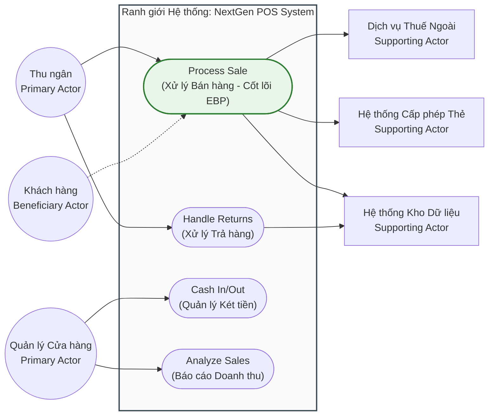

---

### 5. ÁNH XẠ ỨNG DỤNG VÀO DỰ ÁN GAME OOP THỰC CHIẾN

* **Bối cảnh áp dụng:** Đặc tả Ca sử dụng `TradeItemBetweenPlayers` (Giao dịch vật phẩm an toàn giữa 2 người chơi) trong Game 2.5D Multiplayer.
* **Thảm họa nếu viết yêu cầu cẩu thả:** Lập trình viên chỉ nghĩ đến kịch bản: Người chơi A chọn kiếm, người chơi B chọn vàng, cả hai bấm nút Đồng ý $\to$ Xong. Kết quả là tạo ra vô số lỗ hổng nhân bản vật phẩm (*Item Duplication Exploit*): Khi người chơi A nhanh tay rút kiếm về đúng miligiây người chơi B bấm Đồng ý; hoặc khi một trong hai người chơi cố tình rút dây mạng (*Disconnect Exploit*) lúc đang giao dịch.
* **Áp dụng cấu trúc Fully Dressed Use Case từ Chương 6:**
  1. *Primary Actors:* Initiator Player và Receiver Player.
  2. *Preconditions:* Cả hai người chơi phải đứng cạnh nhau trong bán kính 3 mét (Tile distance $\le 3$), cả hai không trong trạng thái chiến đấu (*In-Combat state*), không bị đóng băng/choáng.
  3. *Success Guarantee (Postconditions):* Vật phẩm và vàng được tráo đổi thành công theo nguyên lý giao dịch nguyên tử (*Atomic Transaction - ACID*); ghi nhật ký giao dịch (*Audit Log*) trên máy chủ để chống gian lận.
  4. *Extensions (Xử lý lỗ hổng hack/cheat):*
     * *3a. Một trong hai người chơi di chuyển ra xa quá 3 mét:* Hệ thống lập tức hủy giao dịch, hoàn trả toàn bộ đồ về hòm đồ ban đầu.
     * *4a. Một người chơi thay đổi vật phẩm trong ô giao dịch:* Hệ thống lập tức hủy bỏ trạng thái "Sẵn sàng" của người chơi kia, bắt buộc phải bấm xác nhận lại từ đầu.
     * *5a. Một người chơi bị ngắt kết nối mạng:* Hệ thống tự động rollback toàn bộ giao dịch, đảm bảo không một ai bị mất đồ hoặc nhân bản đồ.

---

<!-- END CHAPTER 06 -->

---


================================================================================
<!-- START CHAPTER 07: CHƯƠNG 7: IDENTIFYING OTHER REQUIREMENTS -->
================================================================================

---

## CHƯƠNG 7: IDENTIFYING OTHER REQUIREMENTS

### 1. ĐỀ MỤC & MỤC TIÊU CỐT LÕI (CORE PURPOSE)

#### Hệ thống đề mục (Heading Hierarchy)
* **7.1. NextGen POS Examples: The Non-Use-Case Artifacts** *(Các tạo tác phi ca sử dụng trong NextGen POS)*
* **7.2. NextGen Example: (Partial) Supplementary Specification** *(Đặc tả Bổ sung: Nơi chứa yêu cầu phi chức năng)*
* **7.3. Commentary: Supplementary Specification** *(Bình luận chuyên sâu về Đặc tả Bổ sung)*
* **7.4. NextGen Example: (Partial) Vision** *(Tài liệu Tầm nhìn: Mục tiêu kinh doanh & Khái quát hệ thống)*
* **7.5. Commentary: Vision** *(Bình luận chuyên sâu về Tài liệu Tầm nhìn)*
* **7.6. NextGen Example: A (Partial) Glossary** *(Bảng chú giải: Từ điển dữ liệu nghiệp vụ)*
* **7.7. Commentary: Glossary (Data Dictionary)** *(Bình luận chuyên sâu về Từ điển Dữ liệu)*
* **7.8. Reliable Specifications: An Oxymoron?** *(Đặc tả hoàn hảo tuyệt đối: Nghịch lý ảo tưởng?)*
* **7.9. Online Artifacts at the Project Website** *(Quản lý tài liệu sống động trên Project Portal)*
* **7.10. Not Much UML During Inception?** *(Tại sao không có nhiều UML trong pha Inception?)*
* **7.11. Other Requirement Artifacts Within the UP** *(Các tạo tác yêu cầu khác trong UP)*

#### Vấn đề kỹ thuật thực tế & Thảm họa kiến trúc được ngăn chặn
Chương 7 chỉ ra rằng: **Use Case không thể chứa được toàn bộ yêu cầu phần mềm**. Có rất nhiều yêu cầu mang tính bao trùm toàn hệ thống, các ràng buộc kỹ thuật ngầm và định nghĩa dữ liệu chi tiết cần những nơi lưu trữ chuyên biệt.

Nếu không xây dựng bộ ba tài liệu: *Supplementary Specification, Vision, và Glossary*, dự án sẽ đối mặt với các thảm họa:
* **Hội chứng Ám ảnh kiểu dữ liệu nguyên thủy (Primitive Obsession):** Lập trình viên dùng `String` hoặc `float` cho mọi thứ: mã sản phẩm, tiền tệ, số đo cân nặng. Không có một nơi định nghĩa cấu trúc dữ liệu chuẩn mực, dẫn đến việc tính toán sai lệch tiền lẻ do làm tròn số (*Floating-point precision errors*), hoặc nhầm lẫn giữa Kilogram và Pound.
* **Mất phương hướng chiến lược (Strategic Drift):** Nhóm kỹ thuật cắm đầu vào tối ưu những tính năng phức tạp mà khách hàng không cần, trong khi tính năng sống còn mang lại lợi thế cạnh tranh của sản phẩm (nêu trong *Vision*) lại bị bỏ quên.
* **Mâu thuẫn ngữ nghĩa trong đội ngũ (Semantic Babel):** Cùng một từ "Order", người làm kế toán hiểu là "Hóa đơn đã trả", người làm kho hiểu là "Lệnh xuất hàng", người làm UI hiểu là "Giỏ hàng tạm". Kết quả là các module nói chuyện với nhau sai ngữ nghĩa, tạo ra hàng loạt bug logic dữ liệu.

---

### 2. PHÂN TÍCH LÝ THUYẾT & NGUYÊN LÝ CHUYÊN SÂU

```
+-----------------------------------------------------------------------------------------+
|                                UP REQUIREMENTS ARTIFACT ECOSYSTEM                       |
+-----------------------------------------------------------------------------------------+
| [VISION]                   : TẠI SAO LÀM? Mục tiêu kinh doanh, Thị trường, Vấn đề cần   |
|                              giải quyết, Bức tranh tính năng cấp cao (Executive Level). |
+-----------------------------------------------------------------------------------------+
| [USE-CASE MODEL]           : LÀM CÁI GÌ? Các quy trình tương tác hành vi cụ thể giữa    |
|                              Tác nhân và Hệ thống để đạt mục tiêu nghiệp vụ.            |
+-----------------------------------------------------------------------------------------+
| [SUPPLEMENTARY SPEC]       : LÀM TỐT RA SAO? Chứa toàn bộ các yêu cầu phi chức năng     |
|                              (URPS+), Ràng buộc bảo mật, Phần cứng, Pháp lý.            |
+-----------------------------------------------------------------------------------------+
| [GLOSSARY / DATA DICT]     : DỮ LIỆU LÀ GÌ? Thuật ngữ nghiệp vụ, Cấu trúc trường,       |
|                              Quy tắc kiểm tra hợp lệ (Validation), Đơn vị đo lường.      |
+-----------------------------------------------------------------------------------------+
```

#### 2.1. Supplementary Specification (Đặc tả Bổ sung)
* Nơi lưu trữ tất cả các yêu cầu không nằm gọn trong một Use Case riêng biệt.
* Đây là nơi trú ngụ chính của các yếu tố **URPS+** (Usability, Reliability, Performance, Supportability và Constraints).
* Ví dụ: Ràng buộc "Mọi truy cập cơ sở dữ liệu phải được mã hóa chuẩn AES-256", "Hệ thống phải chịu được việc rút nguồn đột ngột mà không bị tham nhũng dữ liệu (*Data Corruption*)".

#### 2.2. Vision (Tài liệu Tầm nhìn)
* Là bản hợp đồng giữa ban lãnh đạo kinh doanh và nhóm kỹ thuật.
* Chứa **Mô tả vấn đề (*Problem Statement*)**: Vấn đề là gì? Ai bị ảnh hưởng? Giải pháp mang lại lợi ích gì?
* Danh sách các **Tính năng hệ thống cấp cao (*High-Level System Features*)**: Bản tóm tắt súc tích (thường khoảng 10-20 gạch đầu dòng) về các năng lực cốt lõi của phần mềm, giúp tất cả các bên có cùng một góc nhìn tổng thể (*Shared Mental Model*).

#### 2.3. Glossary đóng vai trò là Từ điển Dữ liệu (Data Dictionary)
Craig Larman nâng tầm Glossary vượt ra khỏi một bảng chú giải từ vựng thông thường:
* Nó ghi lại **Quy tắc xác thực dữ liệu (*Validation Rules*)**: Ví dụ: Mã UPC phải có 12 chữ số, số tài khoản ngân hàng từ 9-16 ký tự.
* Định nghĩa **Kiểu dữ liệu phức hợp và Đơn vị đo lường**: Tiền tệ bao gồm mệnh giá và loại tiền (USD, VND); Trọng lượng đi kèm đơn vị (g, kg).
* Trong OOD, các định nghĩa trong Glossary sẽ chuyển hóa trực tiếp thành các **Value Objects** cực kỳ mạnh mẽ trong mã nguồn, loại bỏ hoàn toàn các lỗi xử lý dữ liệu nguyên thủy.

---

### 3. MỔ XẺ MÃ NGUỒN HOẶC ĐẶC TẢ THIẾT KẾ (DESIGN / CODE DEEP-DIVE)

Dưới đây là mã nguồn hiện thực hóa định nghĩa nghiệp vụ từ **Glossary / Data Dictionary** thành một **Value Object** bất biến (`Immutable Value Object`) chuẩn mực cho khái niệm Tiền tệ (`Money`) và Mã sản phẩm (`ItemID`), triệt tiêu triệt để bệnh "Ám ảnh kiểu dữ liệu nguyên thủy" (*Primitive Obsession*):

```java
import java.math.BigDecimal;
import java.math.RoundingMode;
import java.util.Currency;

// Hiện thực hóa định nghĩa trong Glossary: Money không chỉ là con số, nó gồm Lượng và Đơn vị tệ
public final class Money {
    private final BigDecimal amount;
    private final Currency currency;

    public Money(double amount, Currency currency) {
        this(BigDecimal.valueOf(amount), currency);
    }

    public Money(BigDecimal amount, Currency currency) {
        // [Glossary Validation]: Làm tròn chuẩn 2 chữ số thập phân cho tài chính
        this.amount = amount.setScale(2, RoundingMode.HALF_EVEN);
        this.currency = currency;
    }

    public Money add(Money other) {
        // [Business Rule]: Không thể cộng 2 loại tiền tệ khác nhau mà không quy đổi
        if (!this.currency.equals(other.currency)) {
            throw new CurrencyMismatchException("Không thể cộng " + this.currency + " với " + other.currency);
        }
        return new Money(this.amount.add(other.amount), this.currency);
    }

    public BigDecimal getAmount() { return amount; }
    public Currency getCurrency() { return currency; }

    @Override
    public boolean equals(Object o) {
        if (this == o) return true;
        if (!(o instanceof Money)) return false;
        Money money = (Money) o;
        return amount.equals(money.amount) && currency.equals(money.currency);
    }
}
```

#### Bảng phân tích kỹ thuật và ý nghĩa thiết kế:

| Dòng code / Đoạn code then chốt | Giải thích kỹ thuật & Ý nghĩa thiết kế kiến trúc |
| :--- | :--- |
| `public final class Money` | **Đối tượng Giá trị Bất biến (Immutable Value Object):** Một khi đối tượng `Money` được tạo ra, trạng thái của nó không bao giờ bị thay đổi. Điều này loại bỏ hoàn toàn lỗi tranh chấp dữ liệu trong môi trường đa luồng (*Thread-safety*). |
| `BigDecimal.valueOf(amount)` | **Triệt tiêu lỗi làm tròn dấu phẩy động:** Tuyệt đối không dùng `float` hay `double` trong phần mềm tài chính vì lỗi sai số nhị phân (ví dụ: `0.1 + 0.2 = 0.30000000000000004`). `BigDecimal` bảo vệ tính toàn vẹn từng xu. |
| `RoundingMode.HALF_EVEN` | **Hiện thực hóa quy tắc ngân hàng (Banker's Rounding):** Làm tròn đến số chẵn gần nhất theo chuẩn kế toán quốc tế ghi trong Supplementary Specification. |
| `if (!this.currency.equals(other.currency))` | **Bảo vệ toàn vẹn nghiệp vụ tại tầng miền:** Không một dòng code nào có thể vô tình cộng 100 USD với 100 VND. Hệ thống sẽ quăng ngoại lệ ngay tại thời điểm thao tác dữ liệu. |

---

### 4. SƠ ĐỒ TRỰC QUAN HÓA (UML MERMAID)

Sơ đồ phân loại các Artifact yêu cầu trong UP và mối quan hệ hữu cơ giữa chúng:

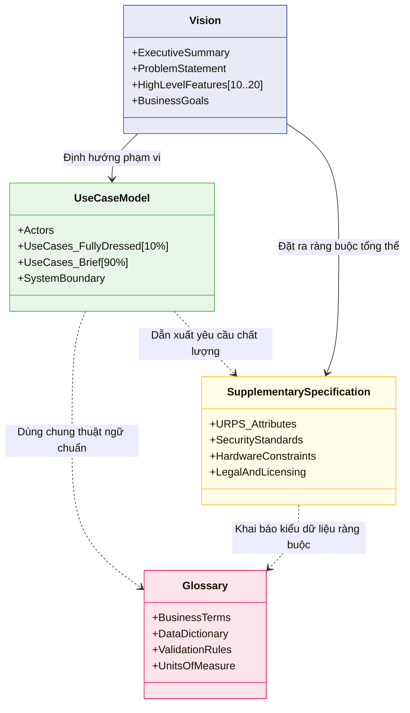

---

### 5. ÁNH XẠ ỨNG DỤNG VÀO DỰ ÁN GAME OOP THỰC CHIẾN

* **Bối cảnh áp dụng:** Thiết kế Glossary & Supplementary Specification cho Game 2.5D Multiplayer (Hệ thống Chỉ số Chiến đấu - Combat Attributes).
* **Thảm họa thực tế nếu thiếu Glossary / Data Dictionary:**
  * Lập trình viên Client tính toán tọa độ theo không gian màn hình (*Screen Pixels: 1920x1080*), trong khi lập trình viên Server tính toán vị trí theo đơn vị mét ảo trong thế giới (*World Space: x, y float*), dẫn đến việc nhân vật chém trúng quái trên màn hình nhưng Server phán định là đánh trượt.
  * Nhầm lẫn giữa sát thương cộng theo số tuyệt đối (*Flat Damage: +50*) và sát thương cộng theo phần trăm (*Percentage Damage: +50%*), tạo ra bug game nhân vật mạnh gấp 1000 lần bình thường làm sập kinh tế game chỉ sau 1 đêm.
* **Ứng dụng từ Chương 7 vào Game:**
  1. *Glossary (Data Dictionary):*
     * Định nghĩa chính xác hệ tọa độ: Toàn bộ logic sử dụng `TileCoord(int x, int y)` và `WorldCoord(float x, float y)`. 1 Tile = đúng 1.0 mét trong thế giới game.
     * Định nghĩa kiểu dữ liệu chỉ số: Tách bạch rõ `FlatModifier` và `PercentModifier`.
  2. *Supplementary Specification:*
     * Quy định cơ chế đồng bộ thời gian (*Tick Synchronization*): Sai số đồng hồ giữa Client và Server không được vượt quá 100ms; nếu vượt quá, Client phải tự động nội suy vị trí (*Interpolate*) chứ không được giật hình (*Snap*).

---

<!-- END CHAPTER 07 -->

---


================================================================================
<!-- START CHAPTER 08: CHƯƠNG 8: FROM INCEPTION TO ELABORATION -->
================================================================================

---

## CHƯƠNG 8: FROM INCEPTION TO ELABORATION

### 1. ĐỀ MỤC & MỤC TIÊU CỐT LÕI (CORE PURPOSE)

#### Hệ thống đề mục (Heading Hierarchy)
* **8.1. Checkpoint: What Happened in Inception?** *(Điểm kiểm soát: Những gì đã đạt được sau Inception)*
* **8.2. On to Elaboration** *(Tiến vào Pha Elaboration)*
* **8.3. Planning the Next Iteration** *(Lập kế hoạch cho Vòng lặp tiếp theo)*
* **8.4. Iteration 1 Requirements and Emphasis: Fundamental OOA/D Skills** *(Yêu cầu và Trọng tâm của Vòng lặp 1: Kỹ năng OOA/D nền tảng)*
* **8.5. What Artifacts May Start in Elaboration?** *(Các tạo tác nào bắt đầu xuất hiện trong Elaboration?)*
  * *Domain Model (Mô hình miền đối tượng)*
  * *Design Model (Mô hình thiết kế: Sơ đồ tương tác và Sơ đồ lớp thiết kế)*
  * *Software Architecture Document - SAD (Tài liệu kiến trúc phần mềm)*
  * *Data Model (Mô hình dữ liệu / Database Schema)*
  * *Test Plan & Automated Test Scripts (Kế hoạch và Mã kiểm thử tự động)*
* **8.6. You Know You Didn't Understand Elaboration When...** *(Dấu hiệu nhận biết việc hiểu sai về Elaboration)*

#### Vấn đề kỹ thuật thực tế & Thảm họa kiến trúc được ngăn chặn
Chương 8 đóng vai trò là cây cầu bản lề kết thúc giai đoạn ý niệm để bước vào thực chiến kỹ thuật. Nó giải quyết nguy cơ **Mất phương hướng khi bước vào vòng lặp đầu tiên (*First Iteration Disorientation*)**.

Nếu không có sự chuyển tiếp chuẩn xác từ Inception sang Elaboration, dự án sẽ gặp các thảm họa:
* **Hội chứng "Cố nuốt trọn chiếc bánh" (Scope Swallowing Failure):** Nhóm cố gắng hiện thực hóa toàn bộ 20 Use Cases trong Vòng lặp 1, dẫn đến việc không có tính năng nào hoàn thành trọn vẹn, mã nguồn dang dở, không build được hệ thống chạy thực tế.
* **Bỏ quên Trục kiến trúc xương sống (Neglecting the Architectural Skeleton):** Dành trọn Vòng lặp 1 để làm những tính năng râu ria dễ làm (như màn hình Đăng ký, trang About Us, chọn Avatar) thay vì tập trung vào nhân kiến trúc có rủi ro kỹ thuật cao nhất (như lõi tính toán bán hàng và cơ chế lưu trữ).
* **Tiếp tục tư duy làm tài liệu trên giấy (Paper Modeling Trap):** Nhóm tưởng rằng bước vào Elaboration là tiếp tục ngồi vẽ hàng trăm trang biểu đồ UML hoàn hảo trước khi được phép gõ phím viết code.

---

### 2. PHÂN TÍCH LÝ THUYẾT & NGUYÊN LÝ CHUYÊN SÂU

```
+-----------------------------------------------------------------------------------------+
|                  SỰ DỊCH CHUYỂN ARTIFACT TỪ INCEPTION SANG ELABORATION                  |
+-----------------------------------------------------------------------------------------+
| ARTIFACT                       INCEPTION (Khởi tạo)        ELABORATION 1 (Thực chiến)   |
+-----------------------------------------------------------------------------------------+
| Use-Case Model                 Khảo sát sơ bộ (~10%)       Đặc tả chi tiết kịch bản lõi |
| Domain Model                   Chưa có hoặc vài ghi chú    Khởi tạo: Tìm khái niệm miền |
| Design Model (UML Diagrams)    Không có                    Bắt buộc: Sequence & DCD     |
| Source Code & Unit Tests       Không có (hoặc spike nhỏ)   Bắt buộc: Khung mã chạy thật |
| Software Architecture Doc      Không có                    Khởi tạo: Định hình phân tầng|
+-----------------------------------------------------------------------------------------+
```

#### 2.1. Cột mốc Checkpoint tại cửa ngõ Elaboration
Trước khi được phép bước vào Elaboration, Kiến trúc sư phải kiểm tra danh sách:
1. Đã có một **Vision** rõ ràng được các bên liên quan đồng thuận?
2. Đã nhận diện được một **Use Case cốt lõi** đại diện cho giá trị nghiệp vụ chính của hệ thống chưa? (Trong NextGen POS, đó là `Process Sale`).
3. Đã xác định được các **Rủi ro kỹ thuật lớn nhất** cần kiểm chứng ngay lập tức chưa?

#### 2.2. Trọng tâm tuyệt đối của Vòng lặp 1 (Iteration 1: Fundamentals)
Craig Larman đưa ra lời khuyên cốt tử: **Trong Vòng lặp 1, hãy chọn một lát cắt dọc (*Vertical Slice*) đơn giản nhưng xuyên suốt toàn bộ hệ thống.**
* Đối với NextGen POS: Không làm toàn bộ Use Case `Process Sale`. Thay vào đó, **chỉ chọn kịch bản thanh toán tiền mặt đơn giản nhất (Cash Only - Happy Path)**.
* Tạm thời bỏ qua: Giảm giá phức tạp, thanh toán thẻ tín dụng, quét mã vạch không hợp lệ, trả hàng.
* Mục tiêu: Xây dựng một đường hầm xuyên suốt (*Tracer Bullet*) từ giao diện $\to$ Controller $\to$ Domain Objects $\to$ Tính tổng hóa đơn $\to$ In kết quả.
* Điều này giúp đội ngũ làm quen và thuần thục toàn bộ chu trình OOA/D: từ Yêu cầu $\to$ Domain Model $\to$ GRASP $\to$ Interaction Diagram $\to$ Design Class Diagram $\to$ Code Java hoàn chỉnh.

#### 2.3. Khởi tạo các Tạo tác Kỹ thuật thực sự (Engineering Artifacts)
Tại Elaboration 1, các công cụ phân tích và thiết kế chuyên nghiệp bắt đầu xuất hiện:
* **Mô hình Miền (Domain Model):** Bản đồ tư duy trực quan hóa các khái niệm thực tế trong thế giới nghiệp vụ (sẽ học sâu ở Chương 9-12).
* **Mô hình Thiết kế (Design Model):** Bản thiết kế phần mềm chi tiết bao gồm Sơ đồ Tương tác (*Interaction Diagrams*) để phân bổ trách nhiệm, và Sơ đồ Lớp Thiết kế (*DCD*) làm kim chỉ nam để viết mã nguồn.
* **Mã nguồn và Kiểm thử tự động:** Không có bản thiết kế nào được coi là hợp lệ nếu nó không được chứng minh bằng mã nguồn biên dịch thành công và vượt qua các bài kiểm thử đơn vị tự động (*JUnit Tests*).

---

### 3. MỔ XẺ MÃ NGUỒN HOẶC ĐẶC TẢ THIẾT KẾ (DESIGN / CODE DEEP-DIVE)

Dưới đây là bản đặc tả **Ma trận Phân bổ Phạm vi Vòng lặp 1 (Iteration 1 Scope Matrix)** và mã nguồn khung gầm kiến trúc đường hầm (**Tracer Bullet Baseline**) được thiết lập ngay tại ngày đầu của Pha Elaboration:

```java
// ================= TRACER BULLET ARCHITECTURAL BASELINE =================
// Kiểm chứng luồng đi xuyên suốt từ Controller xuống Domain trong Iteration 1

public class Iteration1SmokeTest {
    public static void main(String[] args) {
        System.out.println("--- BẮT ĐẦU KIỂM CHỨNG KIẾN TRÚC VÒNG LẶP 1 ---");

        // 1. Khởi tạo danh mục sản phẩm nền tảng
        ProductCatalog catalog = new ProductCatalog();
        catalog.addProductDescription(new ItemID("ITEM-001"), new Money(50.0, Currency.getInstance("USD")), "Bàn phím cơ");

        // 2. Khởi tạo đối tượng điều phối miền (Domain Controller)
        Register register = new Register(catalog);

        // 3. Thực thi kịch bản lát cắt dọc: Tạo đơn hàng -> Nhập hàng -> Kết thúc
        register.makeNewSale();
        register.enterItem(new ItemID("ITEM-001"), 2);
        register.endSale();

        // 4. Thanh toán tiền mặt đơn giản
        register.makePayment(new Money(150.0, Currency.getInstance("USD")));

        // 5. Xác thực tính nhất quán kiến trúc
        Sale completedSale = register.getCurrentSale();
        assert completedSale.getTotal().getAmount().doubleValue() == 100.0 : "Lỗi: Tổng tiền sai!";
        assert completedSale.getBalance().getAmount().doubleValue() == 50.0 : "Lỗi: Tiền thừa sai!";

        System.out.println("--- XÁC THỰC THÀNH CÔNG: KHUNG KIẾN TRÚC ELABORATION 1 SẴN SÀNG ---");
    }
}
```

#### Bảng phân tích kỹ thuật và ý nghĩa thiết kế:

| Dòng code / Đoạn code then chốt | Giải thích kỹ thuật & Ý nghĩa thiết kế kiến trúc |
| :--- | :--- |
| `catalog.addProductDescription(...)` | **Đơn giản hóa có chủ đích cho Iteration 1:** Chưa tích hợp Database thật phức tạp; dùng in-memory catalog giả lập để tập trung 100% năng lượng vào việc thiết kế cấu trúc lớp nghiệp vụ cốt lõi. |
| `Register register = new Register(catalog);` | Hiện thực hóa điểm kết nối giữa thế giới bên ngoài và Tầng Miền qua đối tượng **Controller (GRASP)**. |
| `register.makeNewSale(); ... enterItem(...)` | Kiểm chứng **Đường hầm kiến trúc (Tracer Bullet):** Chứng minh luồng thông điệp có thể đi mượt mà từ các System Operations xuống các thực thể `Sale` và `SalesLineItem`. |
| `assert completedSale.getTotal()...` | **Kiểm thử tự động hóa ngay từ vạch xuất phát:** Thiết lập văn hóa kiểm thử bắt buộc của quy trình UP: Mọi lát cắt kiến trúc của vòng lặp đều phải tự kiểm tra được tính đúng đắn mà không cần dùng mắt thường kiểm tra trên UI. |

---

### 4. SƠ ĐỒ TRỰC QUAN HÓA (UML MERMAID)

Sơ đồ dòng chảy chuyển dịch tạo tác (Artifact Transition Flow) từ Inception sang Elaboration Iteration 1:

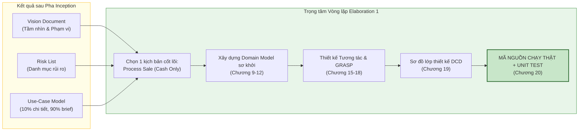

---

### 5. ÁNH XẠ ỨNG DỤNG VÀO DỰ ÁN GAME OOP THỰC CHIẾN

* **Bối cảnh áp dụng:** Lập kế hoạch chuyển giao từ Inception sang Vòng lặp Elaboration 1 trong dự án Game 2.5D Online nhiều người chơi.
* **Cạm bẫy kinh điển của các nhóm làm game:**
  * Bước sang Elaboration 1, nhóm đồ họa đòi dựng 5 bộ trang phục lộng lẫy, nhóm âm thanh đòi thu 20 bài nhạc nền, nhóm cốt truyện đòi viết lời thoại cho 30 NPC.
  * Nhóm lập trình viên chia rẽ: một người ngồi viết giao diện shop bán đồ, một người ngồi làm hiệu ứng nổ tung màn hình, một người ngồi viết hệ thống bang hội (*Guild System*). Sau 4 tuần của vòng lặp 1, không ai ghép được code với ai, game không có một màn hình nào chạy được từ đầu đến cuối.
* **Quy tắc Elaboration 1 của Craig Larman áp dụng vào Game:**
  1. *Cắt gọt phạm vi tàn nhẫn (Ruthless De-scoping):* Dẹp bỏ toàn bộ shop, bang hội, cốt truyện, âm thanh, đồ họa đẹp.
  2. *Chọn đúng 1 Lát cắt dọc cốt lõi (Core Vertical Slice):* 
     * Kịch bản duy nhất: **"Người chơi A di chuyển đến gần Bù nhìn (Dummy), bấm phím đánh thường, Bù nhìn nhận sát thương và giảm thanh máu trên mạng"**.
  3. *Tập trung vào OOA/D nền tảng trong Elaboration 1:*
     * Xây dựng Domain Model: `Player`, `Target`, `Weapon`, `Damage`.
     * Phân bổ trách nhiệm qua GRASP: Ai là người tính trừ máu? (Là `Target` tự trừ, hay `DamageCalculator` trừ?).
     * Viết mã C#/C++ kiểm chứng: Dựng một server console và 2 client hình khối chữ nhật đơn giản chạy kết nối socket cục bộ.
  4. *Kết quả:* Sau 2 tuần của Elaboration 1, toàn bộ đường hầm công nghệ (Engine $\to$ Logic Miền $\to$ Đóng gói Packet Mạng $\to$ Server Authority $\to$ Đồng bộ Client) đã thông suốt 100%. Đây chính là nền móng thép để nhóm tự tin đắp thêm hàng trăm tính năng trong các vòng lặp sau.

---

<!-- END CHAPTER 08 -->

---


================================================================================
<!-- START CHAPTER 09: CHƯƠNG 9: USE-CASE MODEL: DRAWING SYSTEM SEQUENCE DIAGRAMS (SSDs) -->
================================================================================

---

## CHƯƠNG 9: USE-CASE MODEL: DRAWING SYSTEM SEQUENCE DIAGRAMS (SSDs)

### 1. ĐỀ MỤC & MỤC TIÊU CỐT LÕI (CORE PURPOSE)

#### Hệ thống đề mục (Heading Hierarchy)
* **9.1. System Sequence Diagrams (SSDs)** *(Sơ đồ Tuần tự Hệ thống)*
* **9.2. Motivation: Why Draw an SSD?** *(Động lực: Tại sao cần vẽ SSD?)*
* **9.3. Applying UML: Sequence Diagrams** *(Ứng dụng UML: Sơ đồ tuần tự)*
* **9.4. What Is an SSD?** *(SSD là gì? Mô hình hộp đen của hệ thống)*
* **9.5. SSDs and Use Cases** *(Mối quan hệ giữa SSD và Ca sử dụng)*
* **9.6. System Events and the System Boundary** *(Sự kiện hệ thống và Ranh giới hệ thống)*
* **9.7. Naming System Events and Operations** *(Quy tắc đặt tên Sự kiện và Thao tác hệ thống hướng ý định)*
* **9.8. Showing Use Case Text on SSDs** *(Hiển thị kịch bản ca sử dụng trên SSD)*
* **9.9. SSDs Within the UP** *(SSD trong bối cảnh Quy trình UP)*
* **9.10. UP Artifacts and Process Context** *(Mối liên hệ giữa SSD và các tạo tác khác)*
* **9.11. Further Readings** *(Tài liệu tham khảo)*

#### Vấn đề kỹ thuật thực tế & Thảm họa kiến trúc được ngăn chặn
Chương 9 giải quyết sự nhập nhằng nguy hiểm giữa **Hành vi Hộp đen của Hệ thống (*Black-Box System Behavior*)** và **Thiết kế Đối tượng Nội bộ (*White-Box Internal Object Design*)**.

Nếu một đội ngũ kỹ thuật bỏ qua SSD mà nhảy thẳng vào vẽ sơ đồ tương tác giữa các lớp nội bộ, họ sẽ đối mặt với các thảm họa:
* **Xâm lấn công nghệ giao diện vào API hệ thống (UI-Coupled System Operations):** Đặt tên các thao tác tiếp nhận sự kiện theo hành vi vật lý của phần cứng/UI như `clickBtnEnter()`, `scanBarcode()`, `swipeCreditCard()`. Khi hệ thống chuyển sang giao diện Web, Mobile, hoặc tự động hóa qua AI, toàn bộ tầng điều phối nghiệp vụ bị sụp đổ vì phụ thuộc vào cách thức nhập liệu cũ.
* **Mất kiểm soát giao diện biên (System Boundary Leakage):** Không định hình được ranh giới: Dữ liệu nào thực sự đi vào hệ thống và dữ liệu nào là kết quả trả ra. Hậu quả là tầng UI gửi bừa bãi các đối tượng giao diện thô vào tầng miền, gây dính chặt (*Tight Coupling*) giữa Tầng Trình diễn và Tầng Nghiệp vụ.
* **Thiếu vắng hợp đồng thao tác (Missing Operation Signatures):** Các lập trình viên backend không biết chính xác Controller của hệ thống cần cung cấp các hàm (methods) gì cho tầng Frontend/Client gọi, dẫn đến việc thiết kế API chắp vá, bất nhất và thiếu tham số đầu vào cần thiết.

---

### 2. PHÂN TÍCH LÝ THUYẾT & NGUYÊN LÝ CHUYÊN SÂU

```
+-----------------------------------------------------------------------------------------+
|                                    SYSTEM SEQUENCE DIAGRAM                              |
+-----------------------------------------------------------------------------------------+
|  ACTOR (External)                          SYSTEM BOUNDARY                  :System     |
|         |                                         |                            |        |
|         |--- 1. makeNewSale() ------------------->|===========================>|        |
|         |                                         |   (System Event)           |        |
|         |                                         |                            |        |
|         |--- 2. enterItem(itemID, quantity) ----->|===========================>|        |
|         |<-- display item description & total ----|----------------------------|        |
|         |                                         |   (System Response)        |        |
|         |                                         |                            |        |
|         |--- 3. endSale() ----------------------->|===========================>|        |
|         |<-- display grand total -----------------|----------------------------|        |
|         |                                         |                            |        |
|         |--- 4. makePayment(amount) ------------->|===========================>|        |
|         |<-- display receipt & change ------------|----------------------------|        |
+-----------------------------------------------------------------------------------------+
```

#### 2.1. Bản chất của SSD: Góc nhìn Hộp đen (The Black-Box View)
* SSD là một dạng **Sơ đồ Tuần tự UML (*UML Sequence Diagram*)**, nhưng được áp dụng ở cấp độ phân tích hệ thống.
* Trong SSD, toàn bộ hệ thống phần mềm được xem như một thực thể duy nhất: **Hộp đen `:System`**. Ta cố tình che giấu toàn bộ cấu trúc nội bộ (không có các đối tượng `Sale`, `Register`, `Database` bên trong SSD).
* SSD chỉ mô tả 2 thứ:
  1. **Sự kiện hệ thống (*System Events*):** Các thông điệp do Tác nhân bên ngoài (*Actor*) gửi vào `:System`.
  2. **Phản hồi của hệ thống (*System Responses*):** Dữ liệu hoặc thông báo mà `:System` trả về cho Actor.

#### 2.2. Sự kiện hệ thống và Thao tác hệ thống (System Events & System Operations)
* **System Event (Sự kiện hệ thống):** Một sự kiện kích hoạt từ bên ngoài vượt qua ranh giới hệ thống (ví dụ: Thu ngân thông báo có một mặt hàng vừa được chọn).
* **System Operation (Thao tác hệ thống):** Thao tác mà `:System` phải thực thi để đáp ứng sự kiện đó. Tập hợp tất cả các System Operations trong các SSD sẽ định nghĩa nên **Giao diện công khai (*Public Interface / Facade*)** của toàn bộ hệ thống.
* Đây chính là nguồn gốc trực tiếp để Kiến trúc sư xác định các phương thức của lớp **Controller (GRASP)** trong giai đoạn thiết kế hướng đối tượng tiếp theo.

#### 2.3. Nguyên tắc đặt tên Hướng Ý định (Intent-Based Naming)
Craig Larman đưa ra quy tắc vàng: **Đặt tên Thao tác Hệ thống ở mức độ trừu tượng diễn đạt Ý định (*Intent*), thay vì thao tác vật lý (*Physical Action*)**.
* **SAI (Thao tác vật lý/UI):** `scanBarcode()`, `pressEnterKey()`, `swipeCard()`.
* **ĐÚNG (Ý định nghiệp vụ):** `enterItem(id, quantity)`, `makePayment(amount)`.
* **Lý do kiến trúc:** Ý định "nhập một mặt hàng vào hóa đơn" là bất biến trong nghiệp vụ bán lẻ. Dù hôm nay thu ngân dùng máy quét mã vạch laser, ngày mai khách dùng điện thoại quét mã QR, hay ngày kia dùng cổng RFID tự động, sự kiện hệ thống vẫn luôn là `enterItem(id, quantity)`.

---

### 3. MỔ XẺ MÃ NGUỒN HOẶC ĐẶC TẢ THIẾT KẾ (DESIGN / CODE DEEP-DIVE)

Từ Sơ đồ Tuần tự Hệ thống (SSD) của ca sử dụng `Process Sale`, Kiến trúc sư chuyển hóa trực tiếp thành **Hợp đồng Giao diện Thao tác Hệ thống (*System Operations Contract Interface*)** làm ranh giới tách biệt giữa tầng Giao diện (UI) và tầng Miền (Domain):

```java
// ==================== SYSTEM OPERATIONS CONTRACT INTERFACE ====================
// Sinh ra trực tiếp từ các mũi tên System Events trong SSD của ca sử dụng Process Sale

public interface IProcessSaleSystemOperations {

    /**
     * Tương ứng với System Event 1: makeNewSale()
     * Tiền điều kiện: Không có phiên bán hàng nào đang dang dở trên quầy này.
     * Hậu điều kiện: Một phiên bán hàng mới (Sale) được khởi tạo.
     */
    void makeNewSale();

    /**
     * Tương ứng với System Event 2: enterItem(itemID, quantity)
     * Thao tác lặp: Thêm mặt hàng vào hóa đơn hiện tại.
     * @param itemID Mã nhận dạng sản phẩm (Value Object)
     * @param quantity Số lượng mua (phải > 0)
     * @return DTO chứa thông tin mô tả mặt hàng vừa nhập và tổng tiền tạm tính
     */
    LineItemDTO enterItem(ItemID itemID, int quantity);

    /**
     * Tương ứng với System Event 3: endSale()
     * Đánh dấu kết thúc việc nhập hàng và chốt danh sách.
     * @return Tổng số tiền cuối cùng phải thanh toán (Grand Total)
     */
    Money endSale();

    /**
     * Tương ứng với System Event 4: makePayment(amount)
     * Ghi nhận thanh toán tiền mặt và hoàn tất hóa đơn.
     * @param cashTendered Số tiền khách đưa
     * @return Biên lai giao dịch (Receipt DTO) chứa chi tiết thanh toán và tiền thừa
     */
    ReceiptDTO makePayment(Money cashTendered);
}
```

#### Bảng phân tích kỹ thuật và ý nghĩa thiết kế:

| Phương thức / Tham số trong Hợp đồng | Giải thích kỹ thuật & Ý nghĩa thiết kế kiến trúc |
| :--- | :--- |
| `void makeNewSale()` | Ánh xạ trực tiếp từ sự kiện bắt đầu giao dịch trong SSD. Thiết lập trạng thái ranh giới, bảo đảm nguyên tắc đóng gói của giao dịch. |
| `ItemID itemID, int quantity` | **Tham số kiểu dữ liệu chuẩn mực:** Không truyền `String itemId` thô; sử dụng Value Object `ItemID` để đảm bảo kiểm tra hợp lệ ngay tại cổng ranh giới hệ thống (*System Boundary Invariant*). |
| `LineItemDTO enterItem(...)` | **Dùng Data Transfer Object (DTO) cho dữ liệu trả về:** `:System` trả về DTO thuần dữ liệu cho tầng UI hiển thị, tuyệt đối không trả về đối tượng miền `Sale` hay `SalesLineItem` thật để chống rò rỉ trạng thái (*Information Leaking*). |
| `Money endSale()` | Chốt trạng thái giao dịch: Chuyển hóa trạng thái nội bộ của `Sale` từ *Đang nhập hàng (In-Progress)* sang *Chờ thanh toán (Awaiting-Payment)*. |
| `ReceiptDTO makePayment(...)` | Hoàn tất giao dịch: Đảm bảo nguyên lý giao dịch nguyên tử (*Atomic Operation*). Biên lai DTO chứa đầy đủ dữ liệu bất biến (*Immutable*) chứng minh giao dịch thành công. |

---

### 4. SƠ ĐỒ TRỰC QUAN HÓA (UML MERMAID)

Sơ đồ Tuần tự Hệ thống (SSD) chuẩn mực cho kịch bản chính của Use Case `Process Sale`:

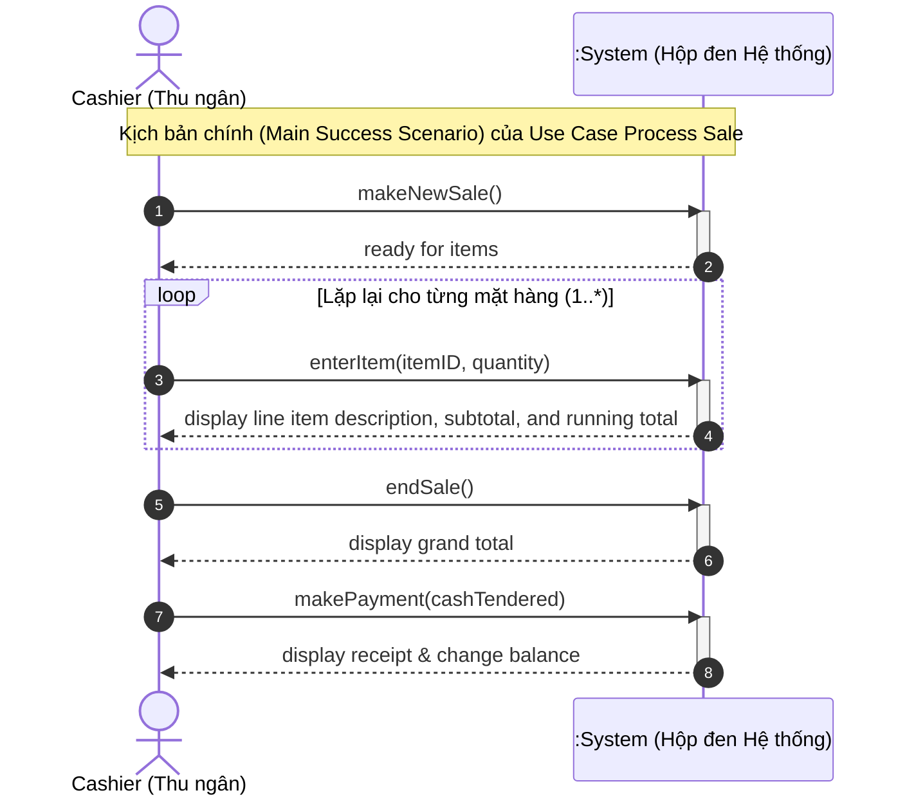

---

### 5. ÁNH XẠ ỨNG DỤNG VÀO DỰ ÁN GAME OOP THỰC CHIẾN

* **Bối cảnh áp dụng:** Thiết kế Giao thức Sự kiện Mạng (Network RPC Protocol / Packet Contracts) trong Game 2.5D Multiplayer giữa Client và Server.
* **Thảm họa nếu thiếu tư duy SSD:** 
  Lập trình viên Client tự tiện tính toán: Nhân vật A đánh quái vật B, Client tự tính sát thương trừ đi 500 máu của quái, rồi gửi packet mạng lên máy chủ: `SetMonsterHP(monsterID, currentHP - 500)`. 
  $\to$ **Lỗ hổng gian lận chí mạng (Hacking/Cheating Disaster):** Bất kỳ hacker nào dùng phần mềm can thiệp gói tin (WPE Pro/Cheat Engine) cũng có thể gửi lệnh `SetMonsterHP(bossID, 0)` để tiêu diệt Boss trong 1 giây!
* **Ứng dụng mô hình SSD từ Chương 9:**
  1. *Xác lập Ranh giới Hộp đen (:GameServer):* Client đóng vai trò là External Actor; toàn bộ máy chủ là `:GameServer`. Client **tuyệt đối không được ra lệnh thay đổi trạng thái nội bộ của Server**.
  2. *System Operation duy nhất:* Thay vì gửi kết quả, Client chỉ được phép gửi một System Event thể hiện **Ý định hành động**:
     ```
     RequestCastSkill(skillID: int, targetEntityID: long, clientTimestamp: long)
     ```
  3. *Phản hồi của Hệ thống (System Response):* `:GameServer` tiếp nhận sự kiện, tự kiểm tra tầm đánh, thời gian hồi chiêu (*Cooldown*), tự tính toán công thức trừ máu, và phát sóng sự kiện kết quả (*Broadcast Result Event*) về lại cho tất cả các Client:
     ```
     SkillExecutedBroadcast(casterID, targetID, damageDealt, remainingHP, isCrit)
     ```

---

<!-- END CHAPTER 09 -->

---


================================================================================
<!-- START CHAPTER 10: CHƯƠNG 10: DOMAIN MODELS: VISUALIZING CONCEPTS -->
================================================================================

---

## CHƯƠNG 10: DOMAIN MODELS: VISUALIZING CONCEPTS

### 1. ĐỀ MỤC & MỤC TIÊU CỐT LÕI (CORE PURPOSE)

#### Hệ thống đề mục (Heading Hierarchy)
* **10.1. Domain Models: Visualizing Concepts** *(Mô hình Miền: Trực quan hóa các khái niệm)*
* **10.2. Conceptual Classes** *(Lớp khái niệm: Biểu tượng, Nội hàm và Ngoại diên)*
* **10.3. Domain Models Are Not Models of Software Objects** *(Mô hình Miền không phải là mô hình của các đối tượng phần mềm)*
* **10.4. Why Call Them "Domain Models"?** *(Tại sao gọi là Mô hình Miền?)*
* **10.5. Why Create a Domain Model? The Lower Representational Gap (LRG)** *(Tại sao cần tạo Mô hình Miền? Thu hẹp khoảng cách biểu diễn)*
* **10.6. How to Create a Domain Model** *(Quy trình 3 bước xây dựng Mô hình Miền)*
* **10.7. Three Strategies to Find Conceptual Classes** *(Ba chiến lược tìm kiếm lớp khái niệm)*
  * *Reusing existing models (Tái sử dụng mô hình có sẵn)*
  * *Using a Category List (Sử dụng danh mục phân loại)*
  * *Linguistic Noun Phrase Analysis (Phân tích ngữ pháp danh từ)*
* **10.8. Common Mistake: Representing Something as an Attribute Instead of a Concept** *(Sai lầm phổ biến: Biểu diễn một Khái niệm thành một Thuộc tính)*
* **10.9. Description or Specification Conceptual Classes** *(Mẫu hình Lớp mô tả / Đặc tả - Description Class Pattern)*
* **10.10. Example: The NextGen POS Domain Model** *(Ví dụ: Mô hình Miền cho hệ thống NextGen POS)*
* **10.11. Domain Models Within the UP** *(Mô hình Miền trong bối cảnh Quy trình UP)*
* **10.12. Further Readings** *(Tài liệu tham khảo)*

#### Vấn đề kỹ thuật thực tế & Thảm họa kiến trúc được ngăn chặn
Chương 10 giải quyết sai lầm kinh điển của lập trình viên: **Sáng tác ra cấu trúc lớp phần mềm một cách tùy tiện mà không có sự tương đồng với thế giới thực**, hoặc **Cài cắm chi tiết kỹ thuật phần mềm quá sớm vào mô hình nghiệp vụ**.

Nếu không xây dựng Domain Model chuẩn mực, hệ thống sẽ hứng chịu các thảm họa:
* **Khoảng cách biểu diễn khổng lồ (Huge Representational Gap):** Các lớp trong mã nguồn mang tên quái dị (`ProcessManagerHelper`, `DataHolderBean`, `GenericTransactionWorker`) không tương thích với ngôn ngữ của chuyên gia nghiệp vụ. Mỗi khi có thay đổi chính sách kinh doanh, đội ngũ kỹ thuật mất nhiều tuần chỉ để tìm xem đoạn logic đó nằm ở đâu trong hàng nghìn file code.
* **Thảm họa "Hết hàng xóa luôn giá" (The Missing Description Class Disaster):** Lưu trữ thuộc tính `price` và `description` trực tiếp vào đối tượng mặt hàng vật lý `Item`. Khi toàn bộ các sản phẩm thực tế của một mã hàng bị bán hết sạch (xóa hết các thể hiện `Item`), hệ thống mất luôn thông tin giá bán và tên sản phẩm, khiến khách hàng tiếp theo không thể tra cứu giá của sản phẩm đó.
* **Ô nhiễm tư duy phần mềm (Premature Software Contamination):** Vẽ phương thức (`methods`), cơ sở dữ liệu (`database tables`), khóa ngoại (`foreign keys`) vào Domain Model, làm méo mó bản chất thuần khiết của mô hình khái niệm.

---

### 2. PHÂN TÍCH LÝ THUYẾT & NGUYÊN LÝ CHUYÊN SÂU

```
+-----------------------------------------------------------------------------------------+
|                                 LOWER REPRESENTATIONAL GAP (LRG)                        |
+-----------------------------------------------------------------------------------------+
| REAL-WORLD DOMAIN      :   [Sale]  ------------ records-sale-of ----------->  [Item]    |
| (Thế giới thực)                  \                                           /          |
|                                   \ (Ánh xạ trực tiếp 1 - 1, khoảng cách hẹp)           |
|                                    v                                       v            |
| SOFTWARE DOMAIN CODE   :   class Sale {                                class Item {     |
| (Mã nguồn phần mềm)            private List<SalesLineItem> items;          ...          |
|                            }                                           }                |
+-----------------------------------------------------------------------------------------+
```

#### 2.1. Bản chất của Mô hình Miền (The Domain Model)
* Mô hình Miền là một **Từ điển Trực quan (*Visual Dictionary*)** thể hiện các trừu tượng hóa của thế giới thực trong miền bài toán. Nó bao gồm:
  1. Các **Lớp khái niệm (*Conceptual Classes / Domain Objects*)**.
  2. Các **Mối quan hệ (*Associations*)** giữa các khái niệm.
  3. Các **Thuộc tính (*Attributes*)** của các khái niệm.
* **QUY TẮC BẤT DI BẤT DỊCH:** **Domain Model TUYỆT ĐỐI KHÔNG CÓ PHƯƠNG THỨC (NO METHODS)!** Nếu bạn thấy một biểu đồ có các hàm như `calculateTotal()` hay `saveToDB()`, đó là Sơ đồ Thiết kế Lớp Phần mềm (*Design Class Diagram*), không phải là Domain Model.

#### 2.2. Lợi ích tối thượng: Thu hẹp khoảng cách biểu diễn (Lower Representational Gap - LRG)
* Giữa tư duy con người về thế giới thực (*Mental Model*) và mã nguồn phần mềm (*Software Model*) luôn có một khoảng cách biểu diễn.
* Hướng đối tượng mang lại sức mạnh vĩ đại nhất khi nó làm cho **khoảng cách này trở nên cực nhỏ (LRG)**: Nếu người bán hàng nói về `Sale`, `Register`, `Store`, `Payment`, thì trong mã nguồn của bạn cũng xuất hiện chính xác các class mang tên `Sale`, `Register`, `Store`, `Payment`. Điều này giúp việc bảo trì, tái cấu trúc và mở rộng hệ thống đạt độ trực quan tối đa.

#### 2.3. Ba chiến lược tìm kiếm Lớp khái niệm
1. **Tái sử dụng mô hình có sẵn:** Tận dụng các mô hình miền chuẩn đã được kiểm chứng trong ngành (ví dụ: mô hình bán lẻ, ngân hàng, vận tải).
2. **Sử dụng Danh mục Phân loại (*Category List*):**
   * *Giao dịch nghiệp vụ (*Business Transactions*):* `Sale`, `Payment`, `Reservation`.
   * *Dòng hàng giao dịch (*Transaction Line Items*):* `SalesLineItem`.
   * *Sản phẩm/Dịch vụ liên quan (*Product/Service*):* `Item`, `ProductDescription`.
   * *Nơi ghi nhận giao dịch (*Places of Transaction*):* `Register`, `Store`.
   * *Vai trò con người (*Roles*):* `Cashier`, `Customer`, `Manager`.
   * *Vật chứa (*Containers*):* `Store`, `Warehouse`.
   * *Danh mục (*Catalogs*):* `ProductCatalog`.
3. **Phân tích Ngữ pháp Danh từ (*Linguistic Noun Phrase Analysis*):** Đọc kỹ Use Case, gạch chân tất cả các danh từ và cụm danh từ. Danh từ có thể là một Lớp khái niệm hoặc một Thuộc tính.

#### 2.4. Mẫu hình Lớp mô tả (Description / Specification Class Pattern)
Craig Larman nhấn mạnh mẫu hình cốt lõi này để giải quyết bài toán tách biệt thực thể:
* **Vấn đề:** Khi nào cần tạo một lớp `ProductDescription` thay vì chỉ dùng một lớp `Item`?
* **Giải pháp:** Cần tạo một lớp mô tả riêng khi:
  1. Cần lưu trữ thông tin về một mặt hàng/dịch vụ **độc lập với việc có mặt hàng vật lý đó trong kho hay không**.
  2. Việc xóa các cá thể mặt hàng vật lý không được phép làm mất thông tin mô tả và giá của sản phẩm.
  3. Tránh việc nhân bản lãng phí dữ liệu (1.000 chai nước ngọt cùng loại trong kho không nên lặp lại chuỗi text "Nước ngọt Coca 330ml" và giá 10.000đ 1.000 lần trong bộ nhớ).

---

### 3. MỔ XẺ MÃ NGUỒN HOẶC ĐẶC TẢ THIẾT KẾ (DESIGN / CODE DEEP-DIVE)

Dưới đây là bảng phân tích ngữ pháp trích xuất thực tế từ kịch bản Use Case `Process Sale` sang các Lớp Khái niệm trong Domain Model, giải quyết chuẩn mực ranh giới giữa **Lớp Khái niệm (*Class*)** và **Thuộc tính (*Attribute*)**:

| Cụm từ trích xuất từ Use Case | Phân loại trong Domain Model | Giải thích kỹ thuật & Lý do phân loại |
| :--- | :--- | :--- |
| *Cashier (Thu ngân)* | **Conceptual Class (Role)** | Đại diện cho tác nhân con người thực hiện giao dịch, có trách nhiệm và định danh riêng. |
| *Register (Quầy/Máy thu ngân)* | **Conceptual Class (Place/Device)** | Nơi diễn ra sự kiện giao dịch, điều phối luồng bán hàng. |
| *Sale (Giao dịch bán hàng)* | **Conceptual Class (Transaction)** | Trái tim của bài toán; lưu giữ thời gian, trạng thái và tổng tiền. |
| *SalesLineItem (Dòng hàng)* | **Conceptual Class (Line Item)** | Cực kỳ quan trọng: Đại diện cho một dòng trong hóa đơn (số lượng mua của một mặt hàng cụ thể). |
| *ProductDescription (Mô tả SP)* | **Conceptual Class (Description)** | Áp dụng *Description Class Pattern*: Lưu trữ `price`, `description`, `itemID` độc lập với hàng tồn kho. |
| *Item (Mặt hàng cụ thể)* | **Conceptual Class (Physical Object)** | Đại diện cho một vật thể vật lý thực tế có số sê-ri xác định nằm trên kệ hàng. |
| *Total, Price, Quantity* | **Attributes (Thuộc tính)** | Không độc lập; là các giá trị dữ liệu thuần túy thuộc về `Sale`, `ProductDescription`, `SalesLineItem`. |

#### Đoạn mã Cấu trúc minh họa Mẫu hình Description Class:

```java
// ==================== DESCRIPTION CLASS PATTERN ====================
// Tách biệt thông tin mô tả tĩnh (Description) khỏi cá thể vật lý (Physical Item)

public class ProductDescription {
    private ItemID id;
    private Money price;
    private String description;

    public ProductDescription(ItemID id, Money price, String description) {
        this.id = id;
        this.price = price;
        this.description = description;
    }

    public ItemID getId() { return id; }
    public Money getPrice() { return price; }
    public String getDescription() { return description; }
}

public class Item {
    private SerialNumber serialNumber; // Định danh vật lý duy nhất của từng cá thể
    private ProductDescription description; // Tham chiếu tới lớp mô tả dùng chung

    public Item(SerialNumber serialNumber, ProductDescription description) {
        this.serialNumber = serialNumber;
        this.description = description;
    }

    public SerialNumber getSerialNumber() { return serialNumber; }
    public ProductDescription getDescription() { return description; }
}
```

#### Bảng phân tích kỹ thuật và ý nghĩa thiết kế:

| Dòng code / Đoạn code then chốt | Giải thích kỹ thuật & Ý nghĩa thiết kế kiến trúc |
| :--- | :--- |
| `public class ProductDescription` | Hiện thực hóa **Description Class Pattern**: Tách toàn bộ thông tin giá bán và tên gọi khỏi đối tượng vật lý. Nếu kho hết hàng (`Item` bị xóa sạch), `ProductDescription` vẫn tồn tại nguyên vẹn trong `ProductCatalog`. |
| `private ProductDescription description;` | Mối liên kết từ cá thể thực tế về lớp mô tả dùng chung: Hàng ngàn đối tượng `Item` chỉ giữ một con trỏ tham chiếu nhẹ tới một phiên bản `ProductDescription` duy nhất, tiết kiệm 90% bộ nhớ RAM (*Flyweight-like memory efficiency*). |
| `private SerialNumber serialNumber;` | Cá thể vật lý chỉ chịu trách nhiệm quản lý định danh vật lý duy nhất của chính nó (mã vạch sê-ri máy, hạn sử dụng riêng của từng hộp sữa). |

---

### 4. SƠ ĐỒ TRỰC QUAN HÓA (UML MERMAID)

Sơ đồ Lớp Khái niệm (Domain Model) ban đầu của Hệ thống NextGen POS thể hiện rõ các khái niệm cốt lõi và mẫu hình Description Class (Lưu ý: Không chứa bất kỳ phương thức nào!):

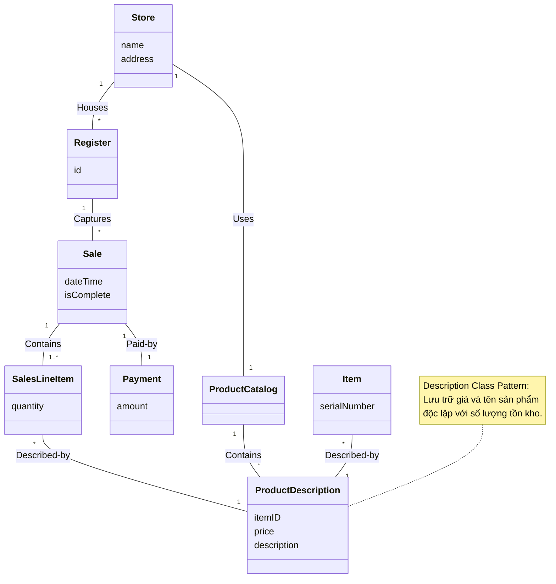

---

### 5. ÁNH XẠ ỨNG DỤNG VÀO DỰ ÁN GAME OOP THỰC CHIẾN

* **Bối cảnh áp dụng:** Thiết kế Hệ thống Vật phẩm & Kho đồ (*Inventory System*) trong Game 2.5D Multiplayer.
* **Thảm họa nếu vi phạm nguyên lý Description Class:**
  Lập trình viên tạo class `Item` chứa tất cả: `itemName`, `iconPath`, `baseDamage`, `loreText`, `durability`, `currentAmmo`.
  $\to$ **Thảm họa Tràn RAM Máy chủ (*Server Memory Out-of-Memory*):** Khi máy chủ có 100.000 người chơi đồng thời, mỗi người có 100 món đồ trong túi $\to$ Máy chủ phải cấp phát 10 triệu đối tượng `Item`. Chuỗi text mô tả thanh kiếm ("Thanh kiếm huyền thoại được rèn từ ngọn lửa rồng thiêng...") bị sao chép lặp lại 10 triệu lần trong RAM, ngốn hàng chục Gigabyte vô ích!
* **Ứng dụng Mô hình Miền từ Chương 10:**
  1. *ItemData / ItemTemplate (Description Class):* Là đối tượng bất biến (dùng ScriptableObject trong Unity hoặc Flyweight C++). Chứa: `ItemID`, `Name`, `BaseDamage`, `IconAssetReference`, `LoreText`. Toàn bộ máy chủ chỉ nạp đúng 1 phiên bản duy nhất vào RAM khi khởi động.
  2. *ItemInstance (Physical Item Concept):* Đại diện cho món đồ cụ thể nằm trong túi người chơi. Nó **chỉ chứa dữ liệu biến động**: `InstanceID` (UUID), `CurrentDurability` (Độ bền hiện tại: 85/100), `UpgradeLevel` (+7), và một con trỏ tham chiếu tới `ItemData`.
  3. *Lợi ích tối thượng:* Tiết kiệm 95% RAM máy chủ, đồng bộ gói tin mạng siêu nhẹ (chỉ cần gửi `ItemID` và `Durability` thay vì gửi toàn bộ text mô tả qua mạng).

---

<!-- END CHAPTER 10 -->

---


================================================================================
<!-- START CHAPTER 11: CHƯƠNG 11: DOMAIN MODEL: ADDING ASSOCIATIONS -->
================================================================================

---

## CHƯƠNG 11: DOMAIN MODEL: ADDING ASSOCIATIONS

### 1. ĐỀ MỤC & MỤC TIÊU CỐT LÕI (CORE PURPOSE)

#### Hệ thống đề mục (Heading Hierarchy)
* **11.1. Associations** *(Mối quan hệ kết hợp trong Mô hình Miền)*
* **11.2. The UML Association Notation** *(Ký hiệu quan hệ kết hợp trong UML: Đường nối, Tên, Mũi tên hướng đọc)*
* **11.3. Multiplicity** *(Bản số / Bội số: Ý nghĩa và các ràng buộc số lượng)*
* **11.4. Finding Associations - Common Associations List** *(Phương pháp tìm kiếm: Danh mục các quan hệ phổ biến)*
* **11.5. Association Guidelines: The Need-to-Know Principle** *(Nguyên tắc cốt tử: Chỉ đưa vào những liên kết "Cần-phải-biết")*
* **11.6. Roles** *(Tên vai trò ở các đầu mối liên kết)*
* **11.7. How Detailed Should Associations Be?** *(Mức độ chi tiết cần thiết của quan hệ)*
* **11.8. Naming Associations** *(Quy ước đặt tên quan hệ động từ / ngữ động từ)*
* **11.9. Multiple Associations Between Two Types** *(Đa quan hệ giữa hai lớp khái niệm)*
* **11.10. Associations and Implementation** *(Mối liên hệ giữa Association khái niệm và Hiện thực mã nguồn)*
* **11.11. NextGen POS Domain Model Associations** *(Xác định các quan hệ trong NextGen POS)*
* **11.12. NextGen POS Domain Model with Associations** *(Mô hình Miền hoàn chỉnh có quan hệ)*

#### Vấn đề kỹ thuật thực tế & Thảm họa kiến trúc được ngăn chặn
Chương 11 giải quyết thảm họa **Biểu đồ mạng nhện (*Spaghetti Association Diagram*)** và **Mơ hồ về ràng buộc số lượng phần tử (*Multiplicity Ambiguity*)**.

Nếu một đội ngũ thiết kế liên kết quan hệ sai lầm, họ sẽ đối mặt với các thảm họa:
* **Hội chứng "Nối tất cả với tất cả" (Over-Association Hell):** Vẽ đường liên kết giữa mọi lớp có thể nghĩ ra (ví dụ: nối `Cashier` với `Item`, nối `Customer` với `Register`), khiến mô hình miền trở thành một mớ dây nhợ rối rắm, che khuất hoàn toàn các luồng dữ liệu nghiệp vụ trọng tâm.
* **Khai báo sai cấu trúc dữ liệu trong Code (Data Structure Mismatch):** Không làm rõ Multiplicity dẫn đến việc lập trình viên dùng một biến đơn lẻ `private SalesLineItem item;` trong khi thực tế hóa đơn cần chứa nhiều dòng hàng (`1..*`), gây lỗi ghi đè dữ liệu hoặc crash chương trình.
* **Nhầm lẫn giữa Quan hệ khái niệm và Con trỏ bộ nhớ (Conceptual vs Memory Pointer Confusion):** Nghĩ rằng hễ vẽ một đường nối Association thì bắt buộc trong mã nguồn class A phải chứa biến con trỏ trỏ sang class B, làm mất đi sự tự do trong việc tối ưu hóa cấu trúc dữ liệu ở bước thiết kế phần mềm.

---

### 2. PHÂN TÍCH LÝ THUYẾT & NGUYÊN LÝ CHUYÊN SÂU

```
+-----------------------------------------------------------------------------------------+
|                                  UML ASSOCIATION ANATOMY                                |
+-----------------------------------------------------------------------------------------+
|                reading direction arrow (mũi tên hướng đọc)                              |
|                                     |                                                   |
|                                     v                                                   |
|   +--------------+             Paid-by >             +--------------+                   |
|   |     Sale     | 1 ----------------------------- 1 |   Payment    |                   |
|   +--------------+                                   +--------------+                   |
|                  ^                                   ^                                  |
|                  |                                   |                                  |
|            multiplicity                        multiplicity                             |
|          (1 đơn bán hàng)                   (1 lượt thanh toán)                         |
+-----------------------------------------------------------------------------------------+
```

#### 2.1. Bản chất của Association trong Mô hình Miền
* Association là một mối quan hệ ngữ nghĩa phản ánh **sự kết nối có ý nghĩa và cần ghi nhớ lâu dài** giữa các lớp khái niệm trong thế giới thực.
* Association **KHÔNG PHẢI là phát biểu về luồng dữ liệu, không phải là con trỏ phần mềm, không phải là câu lệnh truy vấn SQL**. Nó thuần túy là một phát biểu về tri thức ngữ nghĩa của nghiệp vụ (*Semantic Knowledge*).

#### 2.2. Nguyên tắc cốt tử: "Cần-phải-biết" (The Need-to-Know Principle)
Craig Larman đưa ra nguyên tắc sinh tử để tránh mô hình hóa rác:
* **Chỉ thêm một Association nếu hệ thống thực sự cần ghi nhớ mối liên kết này trong một khoảng thời gian dài (*Long-term Memory Need*)**.
* *Ví dụ phân tích:*
  * `Sale` cần liên kết với `Payment` $\to$ **CẦN**: Hệ thống phải lưu trữ vĩnh viễn bằng chứng đơn hàng này đã được thanh toán bằng khoản tiền nào để kiểm toán kế toán.
  * `Cashier` có cần liên kết với `Payment` không? $\to$ **KHÔNG**: Thu ngân chỉ là người thao tác tạm thời tại quầy. Mối quan hệ giữa Thu ngân và Tiền thanh toán là quan hệ thoáng qua trong vài giây, không có nhu cầu nghiệp vụ nào bắt hệ thống phải nhớ vĩnh viễn chiếc máy thu ngân đó do ai thu tiền của tờ tiền cụ thể nào.

#### 2.3. Cú pháp UML chuẩn mực cho Association
Một Association chuẩn mực gồm 4 thành phần:
1. **Đường nối liền nét (*Solid Line*)** giữa 2 lớp.
2. **Tên quan hệ (*Association Name*):** Bắt đầu bằng chữ hoa (CamelCase hoặc gạch nối), thường là động từ hoặc ngữ động từ: `Captures`, `Contains`, `Paid-by`.
3. **Mũi tên hướng đọc (*Reading Direction Arrow* $\blacktriangleright$):** Luôn đi kèm tên quan hệ để chỉ rõ cách đọc câu khẳng định (ví dụ: `Sale` $\blacktriangleright$ `Paid-by` `Payment`, không đọc ngược lại).
4. **Bản số / Bội số (*Multiplicity*):** Xác định có bao nhiêu thể hiện của lớp B có thể liên kết hợp lệ với 1 thể hiện của lớp A tại **một thời điểm bất kỳ**.
   * `1`: Đúng duy nhất 1 thể hiện.
   * `0..1`: Tùy chọn (0 hoặc 1).
   * `*` hoặc `0..*`: Từ 0 đến nhiều.
   * `1..*`: Tối thiểu 1, tối đa nhiều.
   * `n..m`: Phạm vi số lượng cố định.

#### 2.4. Đa quan hệ giữa hai lớp (Multiple Associations)
Hai lớp có thể có nhiều đường Association nối với nhau nếu giữa chúng tồn tại **nhiều vai trò ngữ nghĩa độc lập**.
* *Ví dụ trong ngành hàng không:* Giữa `Flight` (Chuyến bay) và `Airport` (Sân bay) có 2 quan hệ hoàn toàn tách biệt:
  * `Flight` [1] $\xrightarrow{\text{Departs-from}}$ [1] `Airport` (Sân bay khởi hành).
  * `Flight` [1] $\xrightarrow{\text{Lands-at}}$ [1] `Airport` (Sân bay hạ cánh).
* *Ví dụ trong NextGen POS:* Giữa `Store` và `Cashier`: `Store` $\xrightarrow{\text{Employs}}$ `Cashier` (Tuyển dụng) và `Store` $\xrightarrow{\text{Houses}}$ `Register` (Chứa quầy thu ngân).

---

### 3. MỔ XẺ MÃ NGUỒN HOẶC ĐẶC TẢ THIẾT KẾ (DESIGN / CODE DEEP-DIVE)

Dưới đây là Bảng trích xuất Danh mục Quan hệ Phổ biến (*Common Associations List*) của Craig Larman áp dụng vào NextGen POS, chứng minh lý do kỹ thuật tại sao từng liên kết được chấp nhận hoặc bị từ chối:

| Mẫu quan hệ trong Danh mục | Cặp Lớp Khái niệm | Tên Association & Multiplicity | Lý do nghiệp vụ & Quyết định thiết kế |
| :--- | :--- | :--- | :--- |
| **A ghi nhận B (A records B)** | `Register` -- `Sale` | `Register` [1] -- [*] `Sale` (`Captures`) | **CHẤP NHẬN:** Quầy thu ngân cần ghi nhận lịch sử các đơn hàng được thực hiện tại quầy đó. |
| **A chứa dòng con B (A contains B)** | `Sale` -- `SalesLineItem` | `Sale` [1] -- [1..*] `SalesLineItem` (`Contains`) | **CHẤP NHẬN:** Một đơn hàng không thể rỗng; nó bắt buộc phải chứa tối thiểu 1 dòng hàng. |
| **A mô tả B (A describes B)** | `ProductDescription` -- `Item` | `ProductDescription` [1] -- [*] `Item` (`Describes`) | **CHẤP NHẬN:** Một mô tả sản phẩm dùng chung cho nhiều mặt hàng vật lý cùng loại trong kho. |
| **A giao tiếp tạm với B (Transitory)** | `Cashier` -- `Payment` | Không tạo Association! | **TỪ CHỐI:** Vi phạm nguyên tắc *Need-to-Know*. Đây chỉ là tương tác thoáng qua, không có nhu cầu lưu trữ lâu dài. |

#### Mã nguồn Java minh họa cách thức Hiện thực hóa Association với Multiplicity Guard:

```java
// Hiện thực hóa Association: Sale [1] ---- (Contains) ----> [1..*] SalesLineItem
public class Sale {
    // Multiplicity [1..*] được biểu diễn bằng một Collection không được phép rỗng
    private final List<SalesLineItem> lineItems = new ArrayList<>();
    private Payment payment; // Multiplicity [0..1] chuyển thành [1] khi hoàn tất

    public void addSalesLineItem(ProductDescription desc, int quantity) {
        lineItems.add(new SalesLineItem(desc, quantity));
    }

    // MULTIPLICITY GUARD: Kiểm tra tính bất biến của bản số [1..*] trước khi kết thúc
    public void endSale() {
        if (lineItems.isEmpty()) {
            throw new IllegalStateException("Vi phạm bất biến: Đơn hàng bắt buộc phải có ít nhất 1 dòng hàng (Multiplicity 1..*)");
        }
    }

    // MULTIPLICITY GUARD: Kiểm tra quan hệ 1-1 với Payment
    public void setPayment(Payment payment) {
        if (this.payment != null) {
            throw new IllegalStateException("Vi phạm bất biến: Đơn hàng này đã được thanh toán rồi (Multiplicity 1-1)");
        }
        this.payment = payment;
    }
}
```

#### Bảng phân tích kỹ thuật và ý nghĩa thiết kế:

| Dòng code / Đoạn code then chốt | Giải thích kỹ thuật & Ý nghĩa thiết kế kiến trúc |
| :--- | :--- |
| `private final List<SalesLineItem> lineItems` | **Hiện thực hóa Multiplicity `*`:** Dùng cấu trúc `List` được bảo vệ đóng gói để lưu trữ quan hệ 1-nhiều. |
| `if (lineItems.isEmpty()) throw...` | **Bảo vệ Tính bất biến của Bội số (*Multiplicity Invariant Guard*):** Ngăn chặn hệ thống tạo ra một đơn hàng "ma" có 0 sản phẩm, hiện thực hóa nghiêm ngặt ràng buộc `1..*` đã định nghĩa trong Domain Model. |
| `if (this.payment != null) throw...` | **Bảo vệ Bội số `0..1` chuyển hóa sang `1`:** Đảm bảo một đơn hàng không bao giờ bị thanh toán 2 lần, giữ vững tính toàn vẹn tài chính. |

---

### 4. SƠ ĐỒ TRỰC QUAN HÓA (UML MERMAID)

Sơ đồ Lớp Khái niệm thể hiện đầy đủ mạng lưới Associations của NextGen POS với đầy đủ Tên quan hệ, Reading Direction Arrows, Bản số (Multiplicities) và Tên vai trò (Role Names):

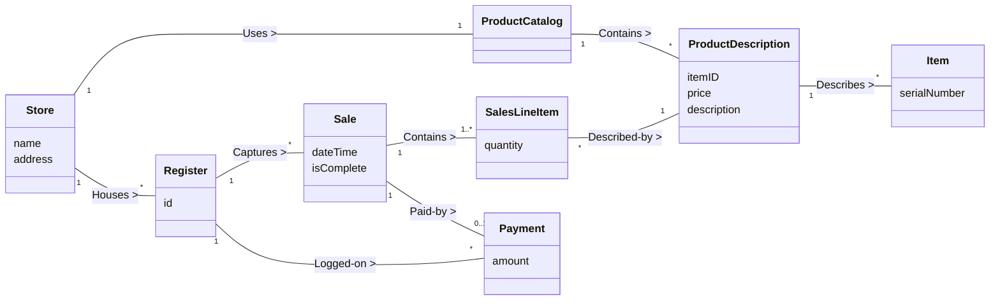

---

### 5. ÁNH XẠ ỨNG DỤNG VÀO DỰ ÁN GAME OOP THỰC CHIẾN

* **Bối cảnh áp dụng:** Thiết kế Mô hình Quan hệ Đội nhóm (*Party*), Bang hội (*Guild*) và Nhân vật (*PlayerCharacter*) trong Game 2.5D Multiplayer.
* **Thảm họa nếu hiểu sai Multiplicity trong Game:**
  Lập trình viên không định nghĩa rõ bội số: Thiết kế một `Player` lưu mảng `List<Party> parties`. Kết quả là một người chơi có thể gia nhập cùng lúc 5 Party khác nhau, nhận gấp 5 lần điểm kinh nghiệm (*EXP Duplication Bug*). Hoặc ngược lại, hệ thống cho phép tạo một Party có 0 thành viên, làm treo luồng giải phóng bộ nhớ của Server (*Memory Leak*).
* **Ứng dụng từ Chương 11 vào Game Architecture:**
  1. *Ràng buộc Multiplicity nghiêm ngặt:*
     * `PlayerCharacter` [0..1] $\longleftrightarrow$ [2..5] `Party`: Một người chơi chỉ có thể tham gia tối đa 1 Party tại một thời điểm; một Party hợp lệ bắt buộc phải có từ 2 đến 5 thành viên.
     * `Guild` [1] $\longleftrightarrow$ [1..50] `PlayerCharacter`: Bang hội có giới hạn từ 1 đến 50 thành viên.
  2. *Hiện thực hóa Đa quan hệ (Multiple Associations):*
     * Giữa `PlayerCharacter` và `Party` tồn tại 2 liên kết độc lập:
       * `PlayerCharacter` [1] $\xrightarrow{\text{Leads}}$ [1] `Party` (Đội trưởng - đúng 1 người).
       * `PlayerCharacter` [2..5] $\xrightarrow{\text{Member-of}}$ [1] `Party` (Thành viên - danh sách 2 đến 5 người).
  3. *Nguyên tắc Need-to-Know:* Khi người chơi đánh một con quái vật, quan hệ giữa `Player` và `Monster` là quan hệ tương tác thoáng qua (*Transient Combat Interaction*); tuyệt đối không tạo liên kết lưu trữ vĩnh viễn giữa 2 đối tượng này vào database để tránh làm phình to dữ liệu.

---

<!-- END CHAPTER 11 -->

---


================================================================================
<!-- START CHAPTER 12: CHƯƠNG 12: DOMAIN MODEL: ADDING ATTRIBUTES -->
================================================================================

---

## CHƯƠNG 12: DOMAIN MODEL: ADDING ATTRIBUTES

### 1. ĐỀ MỤC & MỤC TIÊU CỐT LÕI (CORE PURPOSE)

#### Hệ thống đề mục (Heading Hierarchy)
* **12.1. Attributes** *(Thuộc tính trong Mô hình Miền)*
* **12.2. UML Attribute Notation** *(Ký hiệu thuộc tính trong UML)*
* **12.3. Valid Attribute Types** *(Các kiểu dữ liệu thuộc tính hợp lệ: Kiểu nguyên thủy và Value Objects)*
* **12.4. Non-primitive Data Type Classes** *(Khi nào chuyển một Thuộc tính thành một Lớp Khái niệm riêng biệt)*
* **12.5. Common Mistake: Attributes as Foreign Keys** *(Sai lầm tai hại: Đưa Khóa Ngoại vào làm Thuộc tính đối tượng)*
* **12.6. Modeling Attribute Quantities and Units** *(Mô hình hóa Đại lượng và Đơn vị đo lường)*
* **12.7. Design Creed: Representing Things as Concepts vs Attributes** *(Tuyên ngôn thiết kế: Biểu diễn một thực thể thành Khái niệm hay Thuộc tính)*
* **12.8. The NextGen Domain Model with Attributes** *(Mô hình Miền hoàn chỉnh của NextGen POS có đầy đủ thuộc tính)*
* **12.9. Multiplicity from SalesLineItem to Item** *(Mối quan hệ bản số từ SalesLineItem tới Item)*
* **12.10. Domain Model Conclusion** *(Tổng kết toàn bộ kỹ thuật xây dựng Mô hình Miền)*

#### Vấn đề kỹ thuật thực tế & Thảm họa kiến trúc được ngăn chặn
Chương 12 giải quyết hai căn bệnh kinh niên phá hủy kiến trúc hướng đối tượng: **Tư duy Khóa Ngoại của Cơ sở dữ liệu quan hệ (*The Relational Foreign Key Anti-Pattern*)** và **Hội chứng Ám ảnh Kiểu Dữ liệu Nguyên thủy (*Primitive Obsession*)**.

Nếu lập trình viên thiết kế thuộc tính theo lối mòn cơ sở dữ liệu quan hệ, hệ thống sẽ gặp các thảm họa:
* **Thảm họa Khóa Ngoại trong OOP (The Foreign Key Smell):** Thêm các thuộc tính như `currentSaleID`, `storeID`, `cashierID` vào các lớp đối tượng. Điều này biến các đối tượng thành các bản ghi dữ liệu phẳng thụ động, phá hủy hoàn toàn khả năng điều hướng tự nhiên của con trỏ đối tượng, biến code hướng đối tượng thành lập trình thủ tục biến tướng (*Procedural Code with Foreign Keys*).
* **Mất mát đơn vị đo lường (Unit Loss Disaster):** Lưu trữ thuộc tính `weight` bằng số thực `double` đơn thuần mà không gắn liền với đơn vị đo lường (Kilogram, Pound, Gram). Khi hệ thống kết nối với cân điện tử gửi đơn vị Ounce, toàn bộ công thức tính giá bị sai lệch hàng trăm lần.
* **Mã nguồn thiếu tính đóng gói (Leaky Data Integrity):** Dùng `String` để lưu địa chỉ, số điện thoại, mã vạch khiến logic kiểm tra hợp lệ (*Validation*) bị vương vãi khắp nơi trong code (kiểm tra rỗng, kiểm tra độ dài bị lặp lại ở 50 hàm khác nhau).

---

### 2. PHÂN TÍCH LÝ THUYẾT & NGUYÊN LÝ CHUYÊN SÂU

```
+-----------------------------------------------------------------------------------------+
|                  THE FOREIGN KEY ANTI-PATTERN VS. PURE OO ASSOCIATION                   |
+-----------------------------------------------------------------------------------------+
| [SAI - TƯ DUY KHÓA NGOẠI RDBMS]:                                                        |
|   class Register {                                                                      |
|       private int currentSaleID;  <-- SAI! Đây là tư duy bảng SQL, phá vỡ OOP!          |
|       private int storeID;        <-- SAI! Bắt đối tượng phải tự đi truy vấn DB         |
|   }                                                                                     |
+-----------------------------------------------------------------------------------------+
| [ĐÚNG - HƯỚNG ĐỐI TƯỢNG THUẦN KHIẾT]:                                                   |
|   class Register {                                                                      |
|       private Sale currentSale;   <-- ĐÚNG! Tham chiếu trực tiếp tới đối tượng          |
|       // Liên kết với Store được thể hiện bằng Association, không cần trường ID!         |
|   }                                                                                     |
+-----------------------------------------------------------------------------------------+
```

#### 2.1. Cú pháp và Định dạng Thuộc tính chuẩn trong Domain Model
* Trong Mô hình Miền khái niệm, thuộc tính được viết theo cú pháp giản lược:
  $$\text{name} : \text{Type}$$
* **TUYỆT ĐỐI KHÔNG CÓ DẤU PHÂN QUYỀN TRUY CẬP (+, -, #):** Vì đây là mô hình khái niệm thế giới thực, không phải mã nguồn Java hay C++. Khái niệm "private" hay "public" không tồn tại trong thế giới thực.

#### 2.2. Tuyên ngôn Tối thượng: TUYỆT ĐỐI KHÔNG DÙNG KHÓA NGOẠI (NO Foreign Keys!)
Craig Larman đưa ra cảnh báo nghiêm khắc nhất trong cuốn sách:
* **Khóa ngoại (*Foreign Keys*) chỉ tồn tại trong thế giới Cơ sở dữ liệu quan hệ (RDBMS)** để phục vụ việc liên kết các bảng thông qua câu lệnh `JOIN`.
* Trong Thiết kế Hướng đối tượng và Domain Model: **Tuyệt đối không bao giờ dùng thuộc tính để đóng vai trò khóa ngoại kết nối hai lớp!**
* Thay vì viết `destinationAirportID` trong class `Flight`, ta vẽ một đường **Association** nối từ `Flight` sang `Airport`. Khi chuyển sang code, đường nối đó sẽ trở thành một tham chiếu đối tượng trực tiếp: `private Airport destinationAirport;`.
* Dùng khóa ngoại trong OOP là bằng chứng rõ nhất của việc chưa thoát khỏi tư duy lập trình cấu trúc dữ liệu phẳng.

#### 2.3. Tiêu chuẩn chuyển đổi: Khi nào một Thuộc tính phải biến thành một Lớp riêng?
Lập trình viên thường băn khoăn: *Một thực thể nên là Thuộc tính hay là một Lớp Khái niệm riêng?*
Craig Larman đưa ra các tiêu chí vàng: Hãy biến nó thành một **Lớp Khái niệm riêng (*Non-Primitive Value Object Class*)** nếu:
1. Nó có **cấu trúc con bên trong** (ví dụ: `Address` gồm số nhà, tên đường, thành phố; `PersonName` gồm họ, tên đệm, tên chính).
2. Nó có **các phép toán hoặc quy tắc kiểm tra hợp lệ riêng** (ví dụ: `ItemID` phải tuân theo thuật toán mã vạch UPC/EAN; `CreditCardNumber` phải vượt qua thuật toán kiểm tra Luhn checksum).
3. Nó có **đơn vị đo lường đi kèm** (ví dụ: `Money` gồm số tiền và loại tệ; `Weight` gồm số đo và đơn vị kg/lb; `Dimensions` gồm dài, rộng, cao).
4. Nó đại diện cho một khái niệm có vị thế độc lập trong thế giới nghiệp vụ.

---

### 3. MỔ XẺ MÃ NGUỒN HOẶC ĐẶC TẢ THIẾT KẾ (DESIGN / CODE DEEP-DIVE)

Dưới đây là đoạn mã Java đối đầu trực tiếp: Minh họa sự chuyển hóa từ thảm họa dùng Khóa ngoại và Kiểu nguyên thủy thô sang kiến trúc **Hướng đối tượng thuần khiết kết hợp Value Objects tự đóng gói**:

```java
// ==================== [SAI] KHÓA NGOẠI & PRIMITIVE OBSESSION ====================
// Vi phạm nghiêm trọng nguyên lý đóng gói của OOA/D
public class BadRegister {
    private int id;
    private int currentSaleId; // [SMELL]: Dùng khóa ngoại thay vì tham chiếu đối tượng!
    private double currentSaleTotal; // [SMELL]: Sai số dấu phẩy động!
    private String storeAddress; // [SMELL]: Dùng chuỗi thô, không có kiểm tra hợp lệ!
}

// ==================== [ĐÚNG] PURE OOP & VALUE OBJECT ARCHITECTURE ====================
// Tuân thủ 100% nguyên lý Domain Modeling của Craig Larman

public class Register {
    private RegisterID id; // Value Object định danh
    private Sale currentSale; // [PURE OO]: Tham chiếu trực tiếp tới đối tượng, KHÔNG dùng ID!

    public Register(RegisterID id) {
        this.id = id;
    }

    public void startNewSale() {
        this.currentSale = new Sale();
    }

    public Sale getCurrentSale() {
        return currentSale;
    }
}

// Value Object phức hợp có đơn vị đo lường tự bảo vệ tính toàn vẹn dữ liệu
public final class Weight {
    public enum Unit { GRAM, KILOGRAM, POUND, OUNCE }
    
    private final BigDecimal value;
    private final Unit unit;

    public Weight(double value, Unit unit) {
        if (value < 0) throw new IllegalArgumentException("Khối lượng không thể âm!");
        this.value = BigDecimal.valueOf(value);
        this.unit = unit;
    }

    public Weight toKilograms() {
        switch (unit) {
            case GRAM: return new Weight(value.divide(BigDecimal.valueOf(1000)).doubleValue(), Unit.KILOGRAM);
            case POUND: return new Weight(value.multiply(BigDecimal.valueOf(0.453592)).doubleValue(), Unit.KILOGRAM);
            case OUNCE: return new Weight(value.multiply(BigDecimal.valueOf(0.0283495)).doubleValue(), Unit.KILOGRAM);
            default: return this;
        }
    }

    public BigDecimal getValue() { return value; }
    public Unit getUnit() { return unit; }
}
```

#### Bảng phân tích kỹ thuật và ý nghĩa thiết kế:

| Dòng code / Đoạn code then chốt | Giải thích kỹ thuật & Ý nghĩa thiết kế kiến trúc |
| :--- | :--- |
| `private Sale currentSale;` | **Loại bỏ hoàn toàn Foreign Key:** Thay thế biến `int currentSaleId` bằng tham chiếu đối tượng trực tiếp. Cho phép gọi hàm hướng đối tượng tự nhiên: `currentSale.getTotal()` thay vì phải viết câu lệnh query cơ sở dữ liệu `SELECT * FROM sales WHERE id = currentSaleId`. |
| `public final class Weight` | Hiện thực hóa **Lớp Thuộc tính có Đơn vị đo lường**: Tự động chuyển đổi đơn vị an toàn (`toKilograms()`). Bảo vệ hệ thống khỏi các thảm họa tính toán sai lệch đơn vị giữa các quốc gia. |
| `if (value < 0) throw...` | **Bảo vệ Tính toàn vẹn tại Cội nguồn (*Self-Validating Invariant*):** Không một đối tượng `Weight` nào có thể tồn tại trên đời với giá trị âm. Lập trình viên không cần viết lại câu lệnh kiểm tra `if (weight < 0)` ở 100 màn hình khác nhau. |

---

### 4. SƠ ĐỒ TRỰC QUAN HÓA (UML MERMAID)

Sơ đồ Lớp Khái niệm hoàn chỉnh của Hệ thống NextGen POS tích hợp đầy đủ các Lớp Khái niệm, Thuộc tính định kiểu, các Value Objects phức hợp, tuyệt đối không có khóa ngoại, kèm hệ thống Associations chuẩn mực:

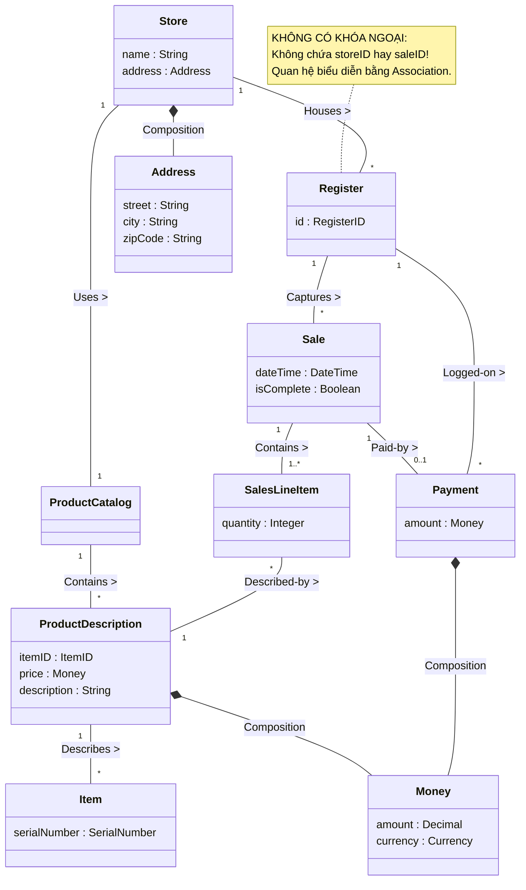

---

### 5. ÁNH XẠ ỨNG DỤNG VÀO DỰ ÁN GAME OOP THỰC CHIẾN

* **Bối cảnh áp dụng:** Thiết kế Thuộc tính Thực thể Nhân vật (*Character Attributes*) và Hệ tọa độ (*Coordinates*) trong Game 2.5D Multiplayer.
* **Thảm họa Khóa ngoại và Kiểu nguyên thủy trong Game:**
  1. *Lỗi Khóa ngoại:* Class `Character` lưu biến `int currentTargetID`. Khi người chơi bấm nút đánh, code phải gọi hàm toàn cục `EntityManager.FindEntityById(currentTargetID)` để lấy mục tiêu. Nếu mạng lag, con quái đó đã bị người chơi khác đánh chết và xóa khỏi bộ nhớ, lệnh tìm kiếm trả về `null` gây sập máy chủ (*NullReferenceException Crash*).
  2. *Lỗi Kiểu nguyên thủy:* Tọa độ nhân vật được lưu bằng 2 biến `float posX`, `float posY`. Lập trình viên nhầm lẫn giữa tọa độ ô cờ (*Grid Tile Coordinates: [12, 45]*) và tọa độ thực tế thế giới (*World Metric Space: [12.5f, 45.8f]*), khiến nhân vật dịch chuyển xuyên qua tường (*Wall Clip Exploit*).
* **Ứng dụng từ Chương 12 vào Game:**
  1. *Triệt tiêu Khóa ngoại:* `Character` giữ tham chiếu trực tiếp tới đối tượng mục tiêu:
     ```csharp
     private Character currentTarget; // Tham chiếu trực tiếp, không dùng ID!
     ```
  2. *Đóng gói Thuộc tính phức hợp thành Value Objects bất biến:*
     * Tạo lớp `WorldPosition2D(float x, float y)` có sẵn các hàm tính toán khoảng cách hình học `DistanceTo(other)`, kiểm tra nằm trong tầm nhìn `IsInSightRange()`.
     * Tạo lớp `GridTileCoordinate(int tileX, int tileY)` đại diện cho ô cờ trên bản đồ lưới 2.5D.
     * Cung cấp hàm chuyển đổi rõ ràng giữa 2 hệ tọa độ: `GridTileCoordinate.FromWorldPosition(pos)`, loại bỏ 100% nguy cơ nhầm lẫn đơn vị giữa Client và Server.

---

<!-- END CHAPTER 12 -->

---


================================================================================
<!-- START CHAPTER 13: CHƯƠNG 13: USE-CASE MODEL: ADDING DETAIL WITH OPERATION CONTRACTS -->
================================================================================

---

## CHƯƠNG 13: USE-CASE MODEL: ADDING DETAIL WITH OPERATION CONTRACTS

### 1. ĐỀ MỤC & MỤC TIÊU CỐT LÕI (CORE PURPOSE)

#### Hệ thống đề mục (Heading Hierarchy)
* **13.1. Contracts** *(Khái niệm Hợp đồng Vận hành Hệ thống)*
* **13.2. Example Contract: enterItem** *(Ví dụ kinh điển: Hợp đồng cho thao tác enterItem)*
* **13.3. Contract Sections** *(Các phần cấu thành một hợp đồng chuẩn mực)*
  * *Name (Tên thao tác & Tham số)*
  * *Responsibilities (Trách nhiệm nghiệp vụ)*
  * *Cross References (Tham chiếu chéo tới Use Cases)*
  * *Exceptions (Các trường hợp ngoại lệ)*
  * *Preconditions (Tiền điều kiện)*
  * *Postconditions (Hậu điều kiện – Trọng tâm cốt tử)*
* **13.4. Postconditions** *(Hậu điều kiện: Bốn loại biến đổi trạng thái trong Miền)*
  * *Instance Creation and Deletion (Khởi tạo và Tiêu hủy thể hiện)*
  * *Attribute Modification (Sửa đổi giá trị thuộc tính)*
  * *Associations Formed and Broken (Hình thành và Phá vỡ liên kết)*
* **13.5. Discussion: enterItem Postconditions** *(Thảo luận chuyên sâu về hậu điều kiện enterItem)*
* **13.6. Writing Contracts Leads to Domain Model Updates** *(Viết hợp đồng dẫn xuất việc cập nhật Mô hình Miền)*
* **13.7. When Are Contracts Useful? Contracts vs. Use Cases?** *(Khi nào cần dùng Hợp đồng? So sánh với Ca sử dụng)*
* **13.8. Guidelines: Contracts** *(Các nguyên tắc chỉ đạo: Tư duy khai báo, dùng thì quá khứ)*
* **13.9. NextGen POS Example: Contracts** *(Hệ thống hợp đồng cho NextGen POS: makeNewSale, enterItem, endSale, makePayment)*
* **13.10. Changes to the Domain Model** *(Các biến chuyển bổ sung cho Mô hình Miền)*
* **13.11. Contracts, Operations, and the UML** *(Hợp đồng, Thao tác hệ thống và chuẩn UML)*
* **13.12. Operation Contracts Within the UP** *(Hợp đồng vận hành trong Quy trình UP)*
* **13.13. Further Readings** *(Tài liệu tham khảo)*

#### Vấn đề kỹ thuật thực tế & Thảm họa kiến trúc được ngăn chặn
Chương 13 giải quyết sự mơ hồ chết người của **Ngôn ngữ tự nhiên trong Ca sử dụng (*Use Case Natural Language Ambiguity*)**. Một câu văn trong Use Case như *"Hệ thống ghi nhận mặt hàng và tính toán tiền"* nghe rất trôi chảy nhưng lại hoàn toàn vô định hình đối với một kỹ sư phần mềm khi thiết kế trạng thái đối tượng.

Nếu bỏ qua Hợp đồng Vận hành (Operation Contracts), hệ thống sẽ hứng chịu các thảm họa:
* **Tác dụng phụ ngoài dự kiến (Uncontrolled Side-Effects):** Lập trình viên chỉ tập trung tính toán giá tiền mà quên mất việc hình thành liên kết bền vững giữa `Payment` và `Sale`, hoặc quên trừ số lượng hàng trong kho, dẫn đến thất thoát dữ liệu và sai lệch báo cáo tài chính.
* **Tư duy thủ tục xâm lấn thiết kế (Procedural Thinking in OO):** Lập trình viên viết tài liệu mô tả luồng xử lý theo kiểu giải thuật tuần tự (*"Hệ thống chạy vòng lặp for, gọi hàm X, kiểm tra if-else..."*), làm mất đi tính độc lập khai báo (*Declarative*) của trạng thái nghiệp vụ.
* **Thiếu tiêu chí nghiệm thu kiểm thử giao dịch (Missing Test Assertions):** Đội ngũ QA không thể viết được các bài test tự động cấp độ Domain/Integration vì không có một định nghĩa toán học chính xác: Sau khi gọi hàm `makePayment()`, những đối tượng nào bắt buộc phải được sinh ra và những cờ trạng thái nào bắt buộc phải đổi sang `true`.

---

### 2. PHÂN TÍCH LÝ THUYẾT & NGUYÊN LÝ CHUYÊN SÂU

```
+-----------------------------------------------------------------------------------------+
|                              OPERATION CONTRACT TRANSFORMATION                          |
+-----------------------------------------------------------------------------------------+
| SYSTEM OPERATION : enterItem(itemID: ItemID, quantity: integer)                         |
+-----------------------------------------------------------------------------------------+
| PRECONDITIONS    : An ongoing Sale exists.                                              |
| (Tiền điều kiện)   (Một phiên bán hàng Sale đang diễn ra).                              |
+-----------------------------------------------------------------------------------------+
| POSTCONDITIONS   : [1] Instance Creation: A SalesLineItem instance 'sli' was created.   |
| (Hậu điều kiện)    [2] Association Formed: 'sli' was associated with the current Sale.  |
|                    [3] Attribute Modified: 'sli.quantity' became quantity.              |
|                    [4] Association Formed: 'sli' was associated with a                  |
|                        ProductDescription based on itemID match.                        |
+-----------------------------------------------------------------------------------------+
|                     TRẠNG THÁI TRƯỚC (Pre)  ===>  TRẠNG THÁI SAU (Post)                 |
|                     [Sale] (chưa có sli)    ===>  [Sale] ---> [sli:SalesLineItem]       |
|                                                                    |                    |
|                                                                    v                    |
|                                                           [ProductDescription]          |
+-----------------------------------------------------------------------------------------+
```

#### 2.1. Bản chất của Hợp đồng Vận hành (Operation Contract)
* Một Operation Contract là tài liệu đặc tả chi tiết nhất về **sự biến đổi trạng thái của Mô hình Miền (*Domain State Transformation*)** khi một Thao tác Hệ thống (*System Operation*) được thực thi.
* Hợp đồng không mô tả *làm thế nào (*How*)* để đạt được kết quả, mà mô tả **kết quả trạng thái sau cùng (*What state changes occurred*)**.

#### 2.2. Trọng tâm cốt tử: Hậu điều kiện (Postconditions)
Craig Larman khẳng định: Hậu điều kiện là phần quan trọng nhất của hợp đồng. Chúng **KHÔNG PHẢI là những hành động thủ tục** (không phải là *"hệ thống mở kết nối database"*, *"hệ thống tính tiền"*). Hậu điều kiện luôn được viết ở **thì quá khứ (*Past Tense*)** để thể hiện trạng thái đã hoàn tất của thế giới đối tượng.

Mọi hậu điều kiện trong vũ trụ OOA/D đều quy về **4 loại biến đổi trạng thái duy nhất**:
1. **Khởi tạo hoặc Tiêu hủy Thể hiện (*Instance Creation and Deletion*):**
   * *Ví dụ:* Một thể hiện `SalesLineItem` (gọi là `sli`) **đã được khởi tạo** (`sli was created`).
2. **Sửa đổi Giá trị Thuộc tính (*Attribute Modification*):**
   * *Ví dụ:* Thuộc tính `sli.quantity` **đã trở thành** `quantity` (`sli.quantity became quantity`); `Sale.isComplete` **đã trở thành** `true`.
3. **Hình thành Liên kết (*Associations Formed*):**
   * *Ví dụ:* `sli` **đã được liên kết với** `Sale` hiện tại (`sli was associated with the current Sale`).
   * `sli` **đã được liên kết với** `ProductDescription` tương ứng (`sli was associated with ProductDescription`).
4. **Phá vỡ Liên kết (*Associations Broken*):**
   * *Ví dụ:* Thể hiện thanh toán cũ đã bị hủy liên kết khỏi đơn hàng hiện tại.

#### 2.3. Tư duy Khai báo (Declarative Thinking) vs. Tư duy Thủ tục (Procedural Thinking)
* **Tư duy Thủ tục (SAI):** "Thu ngân quét mã, hệ thống tìm trong bảng database, nếu thấy thì tạo mảng, nhét sản phẩm vào mảng, rồi cộng dồn tổng tiền".
* **Tư duy Khai báo (ĐÚNG):** "Một thể hiện `SalesLineItem` đã được tạo ra; nó đã được gắn vào `Sale`; số lượng của nó đã được gán bằng `qty`; nó đã được kết nối với `ProductDescription`".
* **Tác động ngược tới Mô hình Miền (Domain Model Feedback):** Quá trình viết hợp đồng buộc Kiến trúc sư phải rà soát lại Domain Model. Nếu trong hợp đồng ta viết: *"sli was associated with ProductDescription"*, nhưng trên Domain Model trước đó chưa có đường Association nối giữa `SalesLineItem` và `ProductDescription`, thì **Domain Model bắt buộc phải được bổ sung ngay lập tức!**

---

### 3. MỔ XẺ MÃ NGUỒN HOẶC ĐẶC TẢ THIẾT KẾ (DESIGN / CODE DEEP-DIVE)

Dưới đây là bản đặc tả Hợp đồng Vận hành cho hai thao tác cốt lõi: `enterItem` và `makePayment`, kèm theo đoạn mã Java kiểm chứng việc hiện thực hóa chính xác 4 loại hậu điều kiện thông qua các bài kiểm thử tự động (*Automated Contract Assertion Test*):

```java
// ==================== HỢP ĐỒNG ĐẶC TẢ (CONTRACT SPECIFICATION) ====================
/*
Contract CO2: enterItem
Operation:      enterItem(itemID: ItemID, quantity: integer)
Cross Ref:      Use Cases: Process Sale
Preconditions:  An ongoing Sale exists.
Postconditions: 
    - A SalesLineItem instance 'sli' was created (Instance Creation).
    - 'sli' was associated with the current Sale (Association Formed).
    - 'sli.quantity' became quantity (Attribute Modification).
    - 'sli' was associated with a ProductDescription, based on itemID match (Association Formed).

Contract CO4: makePayment
Operation:      makePayment(amount: Money)
Cross Ref:      Use Cases: Process Sale
Preconditions:  An ongoing Sale exists, all items entered, sale is ended (isComplete is true).
Postconditions:
    - A Payment instance 'p' was created (Instance Creation).
    - 'p.amountTendered' became amount (Attribute Modification).
    - 'p' was associated with the current Sale (Association Formed).
    - The current Sale was associated with the Store to record completed sale (Association Formed).
*/

// ==================== MÃ NGUỒN KIỂM CHỨNG HẬU ĐIỀU KIỆN (JAVA TEST) ====================
public class OperationContractVerificationTest {

    @Test
    public void verify_enterItem_Postconditions() {
        // [PRECONDITION]: Khởi tạo phiên bán hàng sẵn sàng
        Register register = new Register(new ProductCatalog());
        register.makeNewSale();
        Sale currentSale = register.getCurrentSale();
        ItemID targetID = new ItemID("ITEM-001");

        // [ACTION]: Thực thi System Operation
        register.enterItem(targetID, 3);

        // [POSTCONDITION 1 & 2]: 'sli' was created AND associated with current Sale
        List<SalesLineItem> items = currentSale.getLineItems();
        assertEquals(1, items.size(), "Hậu điều kiện vi phạm: sli chưa được tạo hoặc chưa gắn vào Sale!");

        SalesLineItem sli = items.get(0);

        // [POSTCONDITION 3]: 'sli.quantity' became quantity
        assertEquals(3, sli.getQuantity(), "Hậu điều kiện vi phạm: sli.quantity không khớp!");

        // [POSTCONDITION 4]: 'sli' was associated with ProductDescription based on itemID match
        assertNotNull(sli.getProductDescription(), "Hậu điều kiện vi phạm: sli chưa gắn với ProductDescription!");
        assertEquals(targetID, sli.getProductDescription().getId(), "Hậu điều kiện vi phạm: Sai ProductDescription!");
    }
}
```

#### Bảng phân tích kỹ thuật và ý nghĩa thiết kế:

| Đoạn mã kiểm thử / Assertion | Hậu điều kiện được hiện thực hóa & Ý nghĩa thiết kế |
| :--- | :--- |
| `register.makeNewSale();` | Thiết lập **Tiền điều kiện (Precondition):** Hệ thống phải ở trạng thái hợp lệ thì mới cho phép thực thi thao tác tiếp theo. |
| `assertEquals(1, items.size());` | Kiểm chứng đồng thời **Instance Creation** và **Association Formed**: Chứng minh rằng một đối tượng `SalesLineItem` mới đã thực sự được cấp phát bộ nhớ và được đưa vào danh sách quản lý của `Sale`. |
| `assertEquals(3, sli.getQuantity());` | Kiểm chứng **Attribute Modification**: Đảm bảo giá trị thuộc tính số lượng được ghi nhận chính xác, không bị thất thoát hoặc gán nhầm giá trị mặc định. |
| `assertEquals(targetID, sli.getProductDescription().getId());` | Kiểm chứng **Association Formed**: Đảm bảo liên kết điều hướng từ `SalesLineItem` sang `ProductDescription` đã được thiết lập đúng đắn dựa trên mã sản phẩm. |

---

### 4. SƠ ĐỒ TRỰC QUAN HÓA (UML MERMAID)

Sơ đồ trạng thái đối tượng thể hiện sự biến chuyển của Mô hình Miền trước và sau khi thực thi Thao tác Hệ thống `makePayment(amount)`:

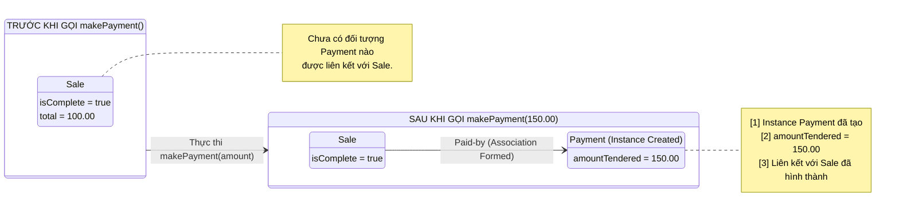

---

### 5. ÁNH XẠ ỨNG DỤNG VÀO DỰ ÁN GAME OOP THỰC CHIẾN

* **Bối cảnh áp dụng:** Đặc tả Hợp đồng Vận hành cho thao tác `ExecuteSkill(casterID, targetID, skillID)` trong Game 2.5D Multiplayer.
* **Thảm họa nếu lập trình viên làm theo cảm tính:**
  Lập trình viên chỉ viết hàm trừ máu đơn thuần: `target.hp -= skill.damage;`.
  $\to$ **Hậu quả thảm họa (Grave Side-Effects):**
  * Quên trừ mana của người tung chiêu $\to$ Người chơi spam chiêu vô hạn (*Infinite Mana Exploit*).
  * Quên kích hoạt trạng thái "Đang chiến đấu" (*In-Combat State*) $\to$ Người chơi vừa đánh nhau vừa cưỡi ngựa hoặc dịch chuyển tức thời về thành.
  * Quên tạo sự kiện kiểm toán chiến đấu (*CombatLogEvent*) $\to$ Không thể phát hiện hacker buff sát thương ảo.
* **Xây dựng Operation Contract chuẩn mực cho Game:**
  ```
  Contract GC01: ExecuteSkill
  Operation:      ExecuteSkill(casterID: EntityID, targetID: EntityID, skillID: SkillID)
  Preconditions:  
      - Caster và Target đều đang tồn tại và còn sống (isAlive == true).
      - Caster không trong trạng thái bị khống chế (isStunned == false, isSilenced == false).
      - Caster.currentMana >= Skill.manaCost.
      - Khoảng cách giữa Caster và Target <= Skill.castRange.
  Postconditions:
      - Caster.currentMana đã bị giảm đi một lượng đúng bằng Skill.manaCost (Attribute Modification).
      - Caster.isInCombat và Target.isInCombat đã trở thành true (Attribute Modification).
      - Một thể hiện DamageEvent 'de' đã được tạo ra (Instance Creation).
      - 'de.amount' đã được tính toán bằng [Caster.AttackPower * Skill.Multiplier - Target.Armor] (Attribute Modification).
      - Target.currentHP đã bị giảm đi đúng bằng 'de.amount' (Attribute Modification).
      - 'de' đã được liên kết với CombatAuditLog của máy chủ (Association Formed).
      - Nếu Target.currentHP <= 0: Target.isAlive đã trở thành false và một thể hiện DeathEvent đã được tạo ra (Instance Creation).
  ```

---

<!-- END CHAPTER 13 -->

---


================================================================================
<!-- START CHAPTER 14: CHƯƠNG 14: FROM REQUIREMENTS TO DESIGN IN THIS ITERATION -->
================================================================================

---

## CHƯƠNG 14: FROM REQUIREMENTS TO DESIGN IN THIS ITERATION

### 1. ĐỀ MỤC & MỤC TIÊU CỐT LÕI (CORE PURPOSE)

#### Hệ thống đề mục (Heading Hierarchy)
* **14.1. Do the Thing Right** *(Làm thứ đó đúng: Bước chuyển từ Phân tích sang Thiết kế)*
* **14.2. Provocation: Think Before Coding** *(Lời cảnh tỉnh: Hãy suy nghĩ trước khi gõ phím)*
* **14.3. On to Object Design** *(Tiến vào giai đoạn Thiết kế Đối tượng)*
* **14.4. Two Artifacts in Object Design: Dynamic vs. Static Modeling** *(Hai tạo tác cốt lõi: Mô hình Động và Mô hình Tĩnh)*
  * *Dynamic Modeling: Interaction Diagrams (Mô hình Động: Sơ đồ tương tác)*
  * *Static Modeling: Design Class Diagrams - DCD (Mô hình Tĩnh: Sơ đồ lớp thiết kế)*
  * *The Golden Rule: Dynamic Modeling First! (Quy tắc vàng: Mô hình Động đi trước!)*
* **14.5. Upfront Design Time: Agile Modeling Mindset** *(Thời lượng thiết kế ban đầu: Tư duy mô hình hóa linh hoạt)*
* **14.6. Designing Objects: What Skills Are Needed?** *(Kỹ năng cần thiết: Phân bổ trách nhiệm qua GRASP & GoF)*

#### Vấn đề kỹ thuật thực tế & Thảm họa kiến trúc được ngăn chặn
Chương 14 là cây cầu chuyển giao quyết định giữa **Miền Yêu cầu / Phân tích (*Analysis Space*)** và **Miền Giải pháp / Thiết kế (*Design Space*)**. Nó giải quyết sự giằng xé giữa hai thái cực sai lầm: **Lập trình bừa bãi không thiết kế (*Cowboy Coding*)** và **Thiết kế đồ sộ trên giấy trước khi code (*Big Design Up Front - BDUF*)**.

Nếu không có phương pháp luận chuyển giao chuẩn xác từ Chương 14, dự án sẽ gặp thảm họa:
* **Hội chứng Thiết kế Tĩnh chết (*Static-First Modeling Disaster*):** Ngồi vẽ sơ đồ lớp thiết kế (DCD) trước khi biết các đối tượng tương tác với nhau ra sao. Kết quả là tạo ra hàng loạt class với các getter/setter vô bổ, đẩy toàn bộ logic vào một hàm `main` hoặc `Controller` khổng lồ, vi phạm trắng trợn tính đóng gói.
* **Bẫy BDUF (Big Design Up Front):** Nhóm dành 3 tuần vẽ biểu đồ UML chi tiết đến từng biến private và dấu chấm phẩy. Khi bắt đầu viết mã, họ phát hiện ra thiết kế không thể chạy được trong thực tế, biến 3 tuần vẽ biểu đồ thành công cốc.
* **Bẫy Cowboy Coding (Nhảy vào gõ code ngay):** Lập trình viên mở IDE lên gõ code ngay lập tức mà không dành 15-30 phút tư duy trên bảng trắng. Kết quả là tạo ra kiến trúc mì ăn liền (*Spaghetti Architecture*), các class dính chặt vào nhau, không thể viết được Unit Test.

---

### 2. PHÂN TÍCH LÝ THUYẾT & NGUYÊN LÝ CHUYÊN SÂU

```
+-----------------------------------------------------------------------------------------+
|                         THE OBJECT DESIGN WORKFLOW (ELABORATION 1)                      |
+-----------------------------------------------------------------------------------------+
|  INPUT ARTIFACTS:                                                                       |
|    - Use Cases (Kịch bản hành vi)                                                       |
|    - Operation Contracts (Hậu điều kiện biến đổi trạng thái)                            |
|    - Domain Model (Cảm hứng đặt tên lớp khái niệm)                                      |
+-----------------------------------------------------------------------------------------+
                                         |
                                         | [BƯỚC 1: DYNAMIC MODELING FIRST - QUAN TRỌNG NHẤT]
                                         v
+-----------------------------------------------------------------------------------------+
|  DYNAMIC MODELING: INTERACTION DIAGRAMS (Sequence / Collaboration)                      |
|    - Thảo luận: Đối tượng nào nhận thông điệp trước?                                    |
|    - Áp dụng các mẫu hình GRASP để PHÂN BỔ TRÁCH NHIỆM (Assign Responsibilities).       |
|    - Quyết định: Phương thức foo() thuộc về Class nào?                                  |
+-----------------------------------------------------------------------------------------+
                                         |
                                         | [BƯỚC 2: DẪN XUẤT STATIC MODEL TỪ DYNAMIC MODEL]
                                         v
+-----------------------------------------------------------------------------------------+
|  STATIC MODELING: DESIGN CLASS DIAGRAMS (DCD)                                           |
|    - Thu thập toàn bộ các phương thức đã xuất hiện trong Interaction Diagrams.          |
|    - Bổ sung thuộc tính, kiểu dữ liệu, quan hệ điều hướng (Navigability).               |
+-----------------------------------------------------------------------------------------+
                                         |
                                         | [BƯỚC 3: HIỆN THỰC MÃ NGUỒN]
                                         v
+-----------------------------------------------------------------------------------------+
|  WORKING SOURCE CODE & AUTOMATED UNIT TESTS (TDD)                                       |
+-----------------------------------------------------------------------------------------+
```

#### 2.1. Quy tắc Vàng: Mô hình Động đi trước Mô hình Tĩnh (Dynamic First!)
Craig Larman nhấn mạnh một quy tắc thiết kế có tính cách mạng:
* **Không bao giờ ngồi vẽ Design Class Diagram (DCD) trước!**
* Tại sao? Vì một lớp phần mềm không thể tự nhiên biết nó cần phương thức gì nếu ta chưa đặt nó vào **bối cảnh tương tác truyền thông điệp (*Message Collaboration*)** để giải quyết một ca sử dụng cụ thể.
* **Quy trình chuẩn:**
  1. Vẽ **Sơ đồ Tương tác (*Interaction Diagrams*)**: Trong quá trình vẽ các mũi tên thông điệp giữa các đối tượng (nhờ sự dẫn đường của các nguyên lý **GRASP**), ta mới phát hiện ra: *"À, lớp `Sale` cần có phương thức `getTotal()`, lớp `SalesLineItem` cần có phương thức `getSubtotal()`"*.
  2. Vẽ **Sơ đồ Lớp Thiết kế (*DCD*)**: Đơn giản chỉ là việc tổng hợp lại toàn bộ các phương thức đã được khám phá từ Sơ đồ Tương tác và định hình thuộc tính điều hướng.

#### 2.2. Thời lượng Thiết kế: Tư duy Mô hình hóa Linh hoạt (Agile Modeling)
* UP và Craig Larman **tuyệt đối không cổ xúy cho việc vẽ UML kéo dài nhiều ngày**.
* **Thực hành chuẩn mực:** Nhóm 2-3 lập trình viên đứng trước bảng trắng (*Whiteboard*), dành từ **15 phút đến tối đa 1-2 giờ** để phác thảo nhanh các Sơ đồ Tương tác và DCD cho các ca sử dụng phức tạp của vòng lặp hiện tại.
* Ngay sau khi đạt được sự đồng thuận về kiến trúc trên bảng trắng, nhóm quay trở về bàn làm việc và bắt tay ngay vào việc viết mã nguồn và kiểm thử tự động (*Test-Driven Development - TDD*). Bản vẽ bảng trắng có thể được chụp ảnh lại hoặc xóa đi sau khi code đã chạy.

#### 2.3. Hai loại Trách nhiệm trong Thiết kế Hướng Đối tượng (RDD)
Thiết kế hướng đối tượng là nghệ thuật phân bổ trách nhiệm:
1. **Trách nhiệm Thực hiện (*Doing Responsibilities*):**
   * Tự mình làm một việc (ví dụ: `SalesLineItem` tự tính thành tiền của chính nó).
   * Khởi tạo một đối tượng khác (ví dụ: `Sale` tạo `SalesLineItem`).
   * Điều phối hoạt động của các đối tượng khác.
2. **Trách nhiệm Hiểu biết (*Knowing Responsibilities*):**
   * Biết về dữ liệu đóng gói riêng tư của chính nó.
   * Biết về các đối tượng liên quan (ví dụ: `Sale` biết danh sách các `SalesLineItem` của nó).
   * Biết về những điều mà nó có thể suy luận hoặc tính toán được.

---

### 3. MỔ XẺ MÃ NGUỒN HOẶC ĐẶC TẢ THIẾT KẾ (DESIGN / CODE DEEP-DIVE)

Dưới đây là minh chứng cho việc **Mã nguồn Bộ khung Lớp Thiết kế (*Class Skeleton*)** được sinh ra một cách tự nhiên và chính xác 100% từ quyết định phân bổ trách nhiệm trong Sơ đồ Tương tác, thay vì được bịa ra một cách tùy tiện:

```java
// ==================== DESIGN SKELETON DERIVED FROM INTERACTION ====================
// Bộ khung mã nguồn này là KẾT QUẢ TRỰC TIẾP của Sơ đồ Tương tác ở Bước 1

public class Register {
    private ProductCatalog catalog;
    private Sale currentSale;

    // Trách nhiệm Điều phối (Controller): Nhận System Operation từ UI
    public void enterItem(ItemID itemID, int quantity) {
        // 1. Gửi thông điệp tra cứu tới Catalog (Information Expert về sản phẩm)
        ProductDescription desc = catalog.getProductDescription(itemID);
        
        // 2. Gửi thông điệp tạo dòng hàng tới Sale (Creator của SalesLineItem)
        currentSale.makeLineItem(desc, quantity);
    }
}

public class Sale {
    private List<SalesLineItem> lineItems = new ArrayList<>();

    // Trách nhiệm Khởi tạo (Creator): Sale chứa SalesLineItem nên Sale tạo nó
    public void makeLineItem(ProductDescription desc, int quantity) {
        lineItems.add(new SalesLineItem(desc, quantity));
    }

    // Trách nhiệm Tính toán (Information Expert): Sale nắm danh sách nên Sale tính tổng
    public Money getTotal() {
        Money total = new Money(0.0);
        for (SalesLineItem lineItem : lineItems) {
            // Ủy thác trách nhiệm tính thành tiền con cho từng dòng hàng
            total = total.add(lineItem.getSubtotal());
        }
        return total;
    }
}

public class SalesLineItem {
    private int quantity;
    private ProductDescription description;

    public SalesLineItem(ProductDescription desc, int quantity) {
        this.description = desc;
        this.quantity = quantity;
    }

    // Trách nhiệm Chuyên gia Thông tin: Tự tính tiền của chính mình
    public Money getSubtotal() {
        return description.getPrice().multiply(quantity);
    }
}
```

#### Bảng phân tích kỹ thuật và ý nghĩa thiết kế:

| Dòng code / Phương thức | Nguồn gốc quyết định thiết kế từ Sơ đồ Tương tác |
| :--- | :--- |
| `register.enterItem(...)` | Sinh ra trực tiếp từ mũi tên System Operation `enterItem` trên SSD (Chương 9). |
| `catalog.getProductDescription(...)` | Kết quả của việc phân bổ trách nhiệm tra cứu cho `ProductCatalog` vì nó nắm giữ tập hợp các mô tả sản phẩm (*Information Expert*). |
| `currentSale.makeLineItem(...)` | Kết quả của mẫu hình **Creator (GRASP)**: Trách nhiệm tạo `SalesLineItem` được trao cho `Sale`, không để `Register` làm việc này nhằm bảo vệ tính gắn kết (*High Cohesion*). |
| `lineItem.getSubtotal()` | Kết quả của nguyên lý **Tell, Don't Ask**: `Sale` không tự lấy `quantity` và `price` ra để nhân; nó yêu cầu `lineItem` tự hoàn thành nhiệm vụ tính toán của nó. |

---

### 4. SƠ ĐỒ TRỰC QUAN HÓA (UML MERMAID)

Sơ đồ dòng chảy phương pháp luận chuyển tiếp từ Yêu cầu sang Thiết kế trong Vòng lặp Elaboration 1:

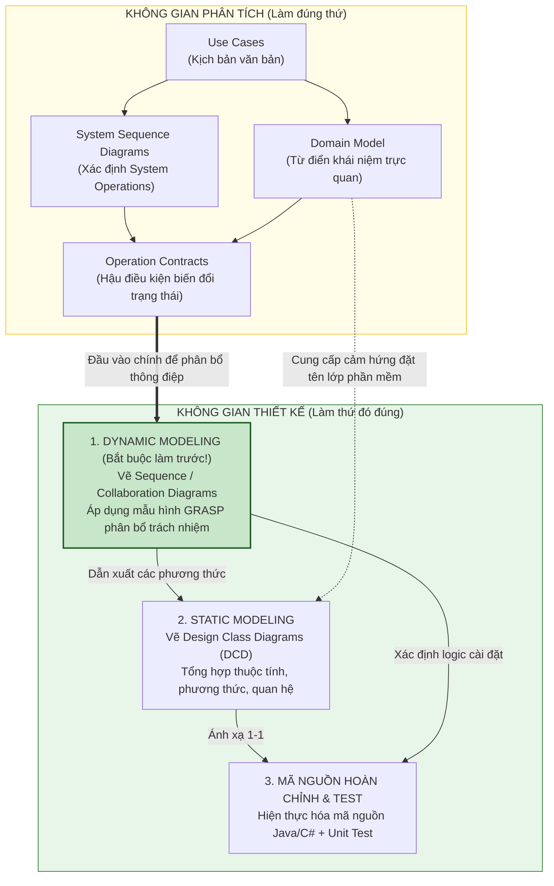

---

### 5. ÁNH XẠ ỨNG DỤNG VÀO DỰ ÁN GAME OOP THỰC CHIẾN

* **Bối cảnh áp dụng:** Chuyển giao từ Yêu cầu sang Thiết kế cho tính năng Nhặt vật phẩm rơi trên mặt đất (*Loot Dropped Item*) trong Game 2.5D Multiplayer.
* **Sai lầm thường gặp của lập trình viên Unity/Game Engine:**
  Nhảy bổ vào viết script ngay trong `PlayerController.cs`: Viết một hàm `OnTriggerEnter2D(Collider2D col)` dài 300 dòng kiêm luôn việc: kiểm tra tag có phải là đồ không, tự cộng vào danh sách, tự phát âm thanh, tự phá hủy game object `Destroy(col.gameObject)`, và tự gửi socket lên server. 
  $\to$ **Hậu quả:** Không thể tái sử dụng cho quái vật nhặt đồ, không thể chạy trên Server không có đồ họa (*Headless Server*), và không thể viết Unit Test kiểm tra túi đồ có bị đầy hay không.
* **Áp dụng Phương pháp luận Chương 14 vào Game:**
  1. *Dynamic Modeling First (15 phút trên bảng trắng):*
     * Thảo luận: Khi sự kiện `PickupLoot(itemID)` xảy ra, ai nên chịu trách nhiệm?
     * `Inventory` chịu trách nhiệm kiểm tra xem còn chỗ trống không (*Information Expert*).
     * `LootEntity` chịu trách nhiệm cung cấp thông tin `ItemInstance` và tự kích hoạt trạng thái tiêu hủy của nó.
     * `InventoryController` đóng vai trò điều phối luồng giữa Input và Domain Logic.
  2. *Dẫn xuất Static DCD:*
     * Từ sơ đồ tương tác trên bảng, xác định rõ: `Inventory` cần có hàm `bool CanAddItem(ItemInstance item)` và `bool AddItem(ItemInstance item)`.
  3. *Viết Mã C# thuần khiết (Pure C#):* Tách rời hoàn toàn logic thêm đồ vào túi khỏi component hiển thị đồ họa của Unity, đảm bảo mã nguồn chạy được trên cả Client lẫn Server console.

---

<!-- END CHAPTER 14 -->

---


================================================================================
<!-- START CHAPTER 15: CHƯƠNG 15: INTERACTION DIAGRAM NOTATION -->
================================================================================

---

## CHƯƠNG 15: INTERACTION DIAGRAM NOTATION

### 1. ĐỀ MỤC & MỤC TIÊU CỐT LÕI (CORE PURPOSE)

#### Hệ thống đề mục (Heading Hierarchy)
* **15.1. Interaction Diagrams** *(Tổng quan về Sơ đồ Tương tác)*
* **15.2. Sequence and Collaboration Diagrams** *(Hai thái cực: Sơ đồ Tuần tự vs. Sơ đồ Cộng tác/Giao tiếp)*
  * *Comparison of Strengths and Weaknesses (So sánh ưu và nhược điểm)*
* **15.3. Example Collaboration Diagram: makePayment** *(Ví dụ Sơ đồ Cộng tác: Thao tác makePayment)*
* **15.4. Example Sequence Diagram: makePayment** *(Ví dụ Sơ đồ Tuần tự: Thao tác makePayment)*
* **15.5. Common Interaction Diagram Notation** *(Ký hiệu chung trong sơ đồ tương tác)*
  * *Classes vs. Instances (Quy ước phân biệt Lớp và Thể hiện)*
  * *Basic Message Syntax (Cú pháp thông điệp cơ bản)*
* **15.6. Basic Collaboration Diagram Notation** *(Ký hiệu Sơ đồ Cộng tác chi tiết)*
  * *Links (Liên kết đường dẫn)*
  * *Messages (Thông điệp và Hướng mũi tên)*
  * *Sequence Numbering (Đánh số thứ tự lồng nhau: 1, 1.1, 1.2)*
  * *Conditional Messages (Thông điệp có điều kiện rẽ nhánh)*
  * *Iteration (Thông điệp lặp lại)*
* **15.7. Basic Sequence Diagram Notation** *(Ký hiệu Sơ đồ Tuần tự chi tiết)*
  * *Lifelines and Execution Specification / Activation Boxes (Đường đời và Hộp kích hoạt)*
  * *Creation of Instances (Ký hiệu khởi tạo thể hiện: <<create>>)*
  * *Object Destruction (Ký hiệu tiêu hủy đối tượng)*
  * *Return Values (Giá trị trả về và Mũi tên nét đứt)*
  * *Frames: Loop, Alt, Opt (Khung điều khiển trong UML 2.0)*

#### Vấn đề kỹ thuật thực tế & Thảm họa kiến trúc được ngăn chặn
Chương 15 cung cấp **Ngữ pháp và Ký hiệu trực quan hóa (*Visual Syntax*)** để các kỹ sư phần mềm giao tiếp với nhau về hành vi động của hệ thống. 

Nếu không làm chủ cú pháp Sơ đồ Tương tác, đội ngũ kỹ thuật sẽ hứng chịu các thảm họa:
* **Hội chứng "Bất đồng Ngôn ngữ Kiến trúc" (Architectural Miscommunication):** Mỗi lập trình viên vẽ một kiểu ký hiệu tự phát, gây hiểu lầm tai hại về thứ tự gọi hàm, luồng dữ liệu trả về và cơ chế khởi tạo đối tượng.
* **Bỏ sót các vòng lặp thông điệp vô tận (Invisible Infinite Call Loops):** Thiết kế luồng gọi hàm gián tiếp dẫn đến việc Class A gọi Class B, Class B gọi Class C, rồi Class C lại gọi ngược lại Class A, gây lỗi tràn ngăn xếp (*StackOverflowError*) khi chạy thực tế.
* **Mất kiểm soát vòng đời đối tượng (Object Lifecycle Leakage):** Không thể hiện rõ đối tượng nào chịu trách nhiệm khởi tạo (`create`) và tiêu hủy đối tượng khác, dẫn đến việc rò rỉ bộ nhớ (*Memory Leak*) hoặc sử dụng các con trỏ rác đã bị giải phóng (*Dangling Pointers*).

---

### 2. PHÂN TÍCH LÝ THUYẾT & NGUYÊN LÝ CHUYÊN SÂU

```
+-----------------------------------------------------------------------------------------+
|                  SEQUENCE DIAGRAM VS. COLLABORATION (COMMUNICATION) DIAGRAM             |
+-----------------------------------------------------------------------------------------+
| [SEQUENCE DIAGRAM - ƯU TIÊN THỜI GIAN]:                                                 |
|   :Register              :Sale                   :Payment                               |
|       |                     |                        |                                  |
|       |--- 1: makePayment ->|                        |                                  |
|       |                     |--- 2: create(amount) ->|                                  |
|       |                     |                        |-- (init)                         |
|       |                     |<-- (payment ref) ------|                                  |
+-----------------------------------------------------------------------------------------+
| [COLLABORATION DIAGRAM - ƯU TIÊN MỐI QUAN HỆ KHÔNG GIAN & VỊ TRÍ]:                     |
|                      1: makePayment(amount)                                             |
|        +-----------+ ------------------------> +-----------+                            |
|        | :Register |                           |   :Sale   |                            |
|        +-----------+                           +-----------+                            |
|                                                      | 1.1: create(amount)              |
|                                                      v                                  |
|                                                +-----------+                            |
|                                                | :Payment  |                            |
|                                                +-----------+                            |
+-----------------------------------------------------------------------------------------+
```

#### 2.1. Hai diện mạo của Sơ đồ Tương tác: Sequence vs. Collaboration
Craig Larman phân tích sâu sắc sự đánh đổi (*Trade-offs*) giữa hai loại sơ đồ:
1. **Sơ đồ Tuần tự (Sequence Diagram):**
   * *Ưu điểm:* Thể hiện **trật tự thời gian (*Time Ordering*)** vô cùng rõ ràng theo trục dọc từ trên xuống dưới. Rất trực quan để theo dõi luồng thực thi phức tạp của một kịch bản ca sử dụng.
   * *Nhược điểm:* Tốn diện tích theo chiều ngang khi có nhiều đối tượng tham gia.
2. **Sơ đồ Cộng tác / Giao tiếp (Collaboration / Communication Diagram):**
   * *Ưu điểm:* Thể hiện **mối quan hệ cấu trúc không gian (*Spatial Layout & Links*)** giữa các đối tượng một cách tự nhiên. Cực kỳ nhỏ gọn, là công cụ số một để vẽ phác thảo nhanh trên bảng trắng (*Whiteboard Modeling*).
   * *Nhược điểm:* Khó theo dõi trật tự thời gian vì phải dò theo các con số thứ tự lồng nhau (`1, 1.1, 1.2, 2, 2.1`).

#### 2.2. Quy ước Phân biệt Lớp (Class) và Thể hiện (Instance) trong UML
Một quy tắc cú pháp tối quan trọng thường bị vẽ sai:
* **Thể hiện đối tượng cụ thể (Instance):** Bắt buộc phải có **dấu gạch chân (*Underline*)** dưới tên và đi kèm dấu hai chấm `:`.
  * `:Sale` (Một thể hiện vô danh của lớp Sale).
  * `s1 : Sale` (Một thể hiện có tên là s1 thuộc lớp Sale).
* **Lớp (Class):** Không có dấu gạch chân, không có dấu hai chấm đứng trước: `Sale`.

#### 2.3. Quy tắc Đánh số Thứ tự Lồng nhau trong Sơ đồ Cộng tác (Sequence Numbering)
* Thông điệp đầu tiên: `1: doSomething()`.
* Mọi thông điệp được gửi đi **bên trong quá trình thực thi** của thông điệp 1 sẽ được đánh số lồng cấp độ con:
  * `1.1: getSubtotal()`
  * `1.2: calculateTax()`
* Nếu hàm `getSubtotal()` lại tiếp tục gọi hàm khác, nó sẽ thành cấp độ 3: `1.1.1: getPrice()`.
* Khi thông điệp 1 hoàn tất, thông điệp độc lập tiếp theo sẽ là `2: notifyUser()`.

#### 2.4. Ký hiệu Khởi tạo và Tiêu hủy Đối tượng
* Trong Sơ đồ Tuần tự:
  * **Khởi tạo:** Mũi tên thông điệp tạo mới (có nhãn `create` hoặc `new`) sẽ **đâm thẳng trực tiếp vào đỉnh của Hộp Đối tượng (*Instance Box*)**, thay vì đâm vào đường đời (*Lifeline*). Điều này thể hiện đối tượng đó trước thời điểm này chưa hề tồn tại trong bộ nhớ.
  * **Tiêu hủy (Explicit Destruction):** Được đánh dấu bằng một **dấu X lớn** nằm ở cuối đường đời của đối tượng, thể hiện việc giải phóng vùng nhớ trong C++ hoặc sẵn sàng cho Garbage Collector trong Java/C#.

---

### 3. MỔ XẺ MÃ NGUỒN HOẶC ĐẶC TẢ THIẾT KẾ (DESIGN / CODE DEEP-DIVE)

Dưới đây là sự đối chiếu giải phẫu chính xác 1-1 giữa **Sơ đồ Tương tác của ca sử dụng thanh toán (`makePayment`)** và **Mã nguồn Hiện thực hóa trong Java**, chứng minh cách thức chuyển dịch từng mũi tên thông điệp thành các dòng lệnh thực thi:

```java
// ==================== TẦNG CONTROLLER: REGISTER ====================
public class Register {
    private Sale currentSale;

    // THÔNG ĐIỆP 1: makePayment(cashTendered) từ UI gửi tới Register
    public void makePayment(Money cashTendered) {
        // THÔNG ĐIỆP 1.1: Register chuyển tiếp thông điệp tới currentSale
        currentSale.makePayment(cashTendered);
    }
}

// ==================== TẦNG DOMAIN: SALE & PAYMENT ====================
public class Sale {
    private Payment payment;
    private boolean isComplete = false;

    // THÔNG ĐIỆP 1.1: makePayment(cashTendered) thực thi bên trong Sale
    public void makePayment(Money cashTendered) {
        // THÔNG ĐIỆP 1.1.1: Khởi tạo đối tượng mới: new Payment(cashTendered)
        // Mũi tên <<create>> đâm vào đỉnh của đối tượng Payment
        this.payment = new Payment(cashTendered);

        // THÔNG ĐIỆP 1.1.2: Cập nhật trạng thái nội bộ của Sale
        this.isComplete = true;
    }

    public Payment getPayment() {
        return this.payment;
    }
}

public class Payment {
    private Money amount;

    // Constructor được gọi khi nhận thông điệp <<create>>
    public Payment(Money cashTendered) {
        this.amount = cashTendered;
    }

    public Money getAmount() {
        return this.amount;
    }
}
```

#### Bảng phân tích kỹ thuật và ý nghĩa thiết kế:

| Mã số Thông điệp trên Sơ đồ | Dòng mã nguồn tương ứng trong Java | Bản chất kỹ thuật & Ý nghĩa thiết kế |
| :--- | :--- | :--- |
| **Thông điệp 1** | `register.makePayment(cashTendered)` | **Điểm tiếp nhận sự kiện hệ thống (Controller):** `Register` nhận thông điệp từ giao diện người dùng, không tự xử lý mà đóng vai trò điều phối. |
| **Thông điệp 1.1** | `currentSale.makePayment(cashTendered)` | **Chuyển tiếp thẩm quyền (Delegation):** `Register` biết rằng `Sale` là đối tượng làm chủ giao dịch, do đó ủy thác trách nhiệm thanh toán cho `currentSale`. |
| **Thông điệp 1.1.1** | `this.payment = new Payment(...)` | Hiện thực hóa ký hiệu **`<<create>>`** trên sơ đồ: `Sale` thực thi mẫu hình **Creator (GRASP)** bằng việc khởi tạo phiên bản `Payment` và lưu giữ liên kết tham chiếu. |
| **Thông điệp 1.1.2** | `this.isComplete = true;` | Hiện thực hóa **Attribute Modification Postcondition**: Đóng dấu giao dịch đã hoàn tất hợp lệ. |

---

### 4. SƠ ĐỒ TRỰC QUAN HÓA (UML MERMAID)

Sơ đồ Tuần tự (Sequence Diagram) chuẩn mực thể hiện chi tiết luồng tương tác của thao tác `makePayment`, bao gồm hộp kích hoạt (*Activation Bars*), ký hiệu khởi tạo đối tượng `<<create>>`, và các thông điệp phản hồi:

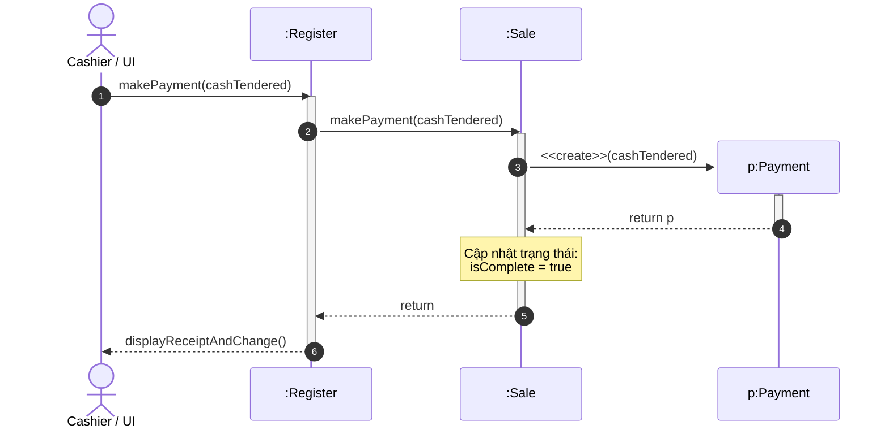

---

### 5. ÁNH XẠ ỨNG DỤNG VÀO DỰ ÁN GAME OOP THỰC CHIẾN

* **Bối cảnh áp dụng:** Thiết kế Sơ đồ Tương tác cho sự kiện Gây sát thương và Xử lý Tử vong (*ApplyDamage and Death Handling*) trong Game 2.5D Multiplayer.
* **Vấn đề thực tế nếu không vẽ Sơ đồ Tương tác:**
  Lập trình viên viết hàm trừ máu trong `Character.cs`:
  ```csharp
  // CODE NGUY HIỂM: Vòng lặp đệ quy vô tận gây treo game
  void TakeDamage(int dmg) {
      this.hp -= dmg;
      if (this.hp <= 0) {
          Die();
      }
  }
  void Die() {
      // Bắn sự kiện ra ngoài
      EventManager.TriggerDeathEvent(this); // Lắng nghe sự kiện này, một script khác lại gọi:
      // DropLoot() -> LootManager lại gọi: Killer.AddExp() -> Killer lên cấp phát nổ hào quang ->
      // Hào quang lại gây sát thương lên quái xung quanh -> Lại gọi TakeDamage()!
  }
  ```
  $\to$ **Thảm họa Treo Server (*Server Freeze / StackOverflowException*):** Do không trực quan hóa các mũi tên thông điệp tương tác, các sự kiện bắn vòng tròn tạo thành một vòng xoáy đệ quy không có hồi kết giữa các hệ thống Gameplay.
* **Ứng dụng Sơ đồ Tương tác (Chương 15) để kiểm soát Kiến trúc Game:**
  1. *Trực quan hóa luồng thông điệp tuyến tính trên Sequence Diagram:*
     * `CombatManager` $\xrightarrow{\text{1. ApplyDamage}}$ `TargetCharacter`.
     * `TargetCharacter` $\xrightarrow{\text{1.1. ReduceHP}}$ `HealthComponent`.
     * `HealthComponent` $\xrightarrow{\text{1.1.1. CheckDeath}}$ kiểm tra nếu HP $\le 0$ thì trả về cờ `isDead = true`.
     * `CombatManager` nhận cờ `isDead`, sau đó mới chủ động gửi lệnh tách biệt: `2. ProcessDeath(target)`.
  2. *Tách rời hoàn toàn các luồng:* Luồng tính sát thương và Luồng xử lý phần thưởng chết được ngắt thành 2 thông điệp tuần tự độc lập (1 và 2), triệt tiêu hoàn toàn nguy cơ đệ quy vòng tròn, bảo vệ tính ổn định tuyệt đối cho Game Loop của máy chủ.

---

<!-- END CHAPTER 15 -->

---


================================================================================
<!-- START CHAPTER 16: CHƯƠNG 16: GRASP: DESIGNING OBJECTS WITH RESPONSIBILITIES -->
================================================================================

---

## CHƯƠNG 16: GRASP: DESIGNING OBJECTS WITH RESPONSIBILITIES

### 1. ĐỀ MỤC & MỤC TIÊU CỐT LÕI (CORE PURPOSE)

#### Hệ thống đề mục (Heading Hierarchy)
* **16.1. Responsibilities and Methods** *(Trách nhiệm và Phương thức: Mối quan hệ mật thiết)*
* **16.2. Responsibilities and Interaction Diagrams** *(Trách nhiệm trong Sơ đồ Tương tác: Nơi quyết định hình thành)*
* **16.3. Patterns** *(Mẫu hình là gì? Khái niệm Pattern trong thiết kế)*
* **16.4. GRASP: Patterns of General Principles in Assigning Responsibilities** *(GRASP: Các mẫu nguyên lý chung trong việc phân bổ trách nhiệm)*
* **16.5. The UML Class Diagram Notation** *(Ký hiệu Sơ đồ Lớp UML trong thiết kế)*
* **16.6. Information Expert (or Expert)** *(Chuyên gia Thông tin – Nguyên tắc vàng số một)*
* **16.7. Creator** *(Người Tạo lập – Ai chịu trách nhiệm khởi tạo đối tượng?)*
* **16.8. Low Coupling** *(Khớp nối Lỏng – Mẫu hình đánh giá khả năng bảo trì)*
* **16.9. High Cohesion** *(Tính Gắn kết Cao – Mẫu hình đánh giá sự tập trung)*
* **16.10. Controller** *(Bộ Điều phối – Cửa sổ tiếp nhận sự kiện hệ thống)*
  * *Façade Controller (Bộ điều phối kiểu Mặt tiền)*
  * *Use-Case Controller (Bộ điều phối theo Ca sử dụng)*
  * *Bloated Controller (Cảnh báo: Hội chứng Bộ điều phối quá tải)*
* **16.11. Further Readings** *(Tài liệu tham khảo chuyên sâu)*

#### Vấn đề kỹ thuật thực tế & Thảm họa kiến trúc được ngăn chặn
Chương 16 là **trái tim triết lý của toàn bộ cuốn sách**. Nó trả lời câu hỏi cốt tử mà mọi lập trình viên OOP phải đối mặt: *"Lớp nào nên nắm giữ phương thức này? Đối tượng nào nên tạo ra đối tượng kia?"*.

Nếu không làm chủ 5 nguyên lý nền tảng của GRASP, hệ thống sẽ rơi vào các thảm họa:
* **Hội chứng Mô hình Miền Thiếu máu (Anemic Domain Model):** Các lớp nghiệp vụ bị biến thành các bị bông chứa dữ liệu thuần túy (*Dumb Data Holders*) chỉ có getter/setter. Toàn bộ logic bị rút ruột và nhét vào các lớp Service/Manager khổng lồ.
* **The God Object / Bloated Controller:** Một lớp duy nhất (như `POSManager` hay `GameManager`) ôm đồm hàng trăm hàm, biết tất cả mọi thứ, điều khiển tất cả các lớp khác. Khi lớp này bị lỗi, toàn bộ hệ thống sụp đổ; việc kiểm thử nó đòi hỏi phải mock hàng tá phụ thuộc.
* **Mạng nhện phụ thuộc (High Coupling Nightmare):** Các đối tượng can thiệp sâu vào cấu trúc nội bộ của nhau, vi phạm định luật Demeter (*Law of Demeter*). Thay đổi kiểu dữ liệu của một trường trong Class A làm vỡ vụn code ở 20 Class khác.

---

### 2. PHÂN TÍCH LÝ THUYẾT & NGUYÊN LÝ CHUYÊN SÂU

```
+-----------------------------------------------------------------------------------------+
|                                5 MẪU HÌNH GRASP NỀN TẢNG                                |
+-----------------------------------------------------------------------------------------+
| [CONTROLLER]          : Đối tượng đầu tiên ngoài UI tiếp nhận sự kiện hệ thống.         |
|                         (Phân loại: Façade Controller hoặc Use-Case Controller).        |
+-----------------------------------------------------------------------------------------+
| [CREATOR]             : Ai tạo B? Là A nếu A chứa B, A ghi nhận B, hoặc A có dữ liệu    |
|                         khởi tạo B (A là Expert về việc tạo B).                         |
+-----------------------------------------------------------------------------------------+
| [INFORMATION EXPERT]  : Giao trách nhiệm cho lớp nắm giữ thông tin cần thiết.          |
|                         (Nguyên lý: Tell, Don't Ask).                                   |
+-----------------------------------------------------------------------------------------+
| [LOW COUPLING]        : Mẫu hình đánh giá (Evaluative): Giữ phụ thuộc ở mức tối thiểu   |
|                         để tăng tính tái sử dụng và dễ kiểm thử.                        |
+-----------------------------------------------------------------------------------------+
| [HIGH COHESION]       : Mẫu hình đánh giá (Evaluative): Trách nhiệm tập trung, gắn kết, |
|                         không ôm đồm quá nhiều việc không liên quan.                     |
+-----------------------------------------------------------------------------------------+
```

#### 2.1. Bản chất của GRASP (General Responsibility Assignment Software Patterns)
* GRASP không phải là các mẫu thiết kế cấu trúc phức tạp như GoF (Factory, Adapter, Decorator).
* GRASP là **Bộ quy tắc tư duy nền tảng (*Mental Toolkit*)** hướng dẫn các kỹ sư phần mềm cách phân bổ trách nhiệm và phương thức vào các lớp trong quá trình vẽ Sơ đồ Tương tác.

#### 2.2. Phân tích Chi tiết 5 Mẫu hình Cốt lõi:

##### 1. Information Expert (Chuyên gia Thông tin)
* **Vấn đề:** Nguyên tắc cơ bản nhất để gán trách nhiệm cho một lớp là gì?
* **Giải pháp:** Gán trách nhiệm cho lớp nào **nắm giữ đầy đủ thông tin cần thiết nhất** để hoàn thành trách nhiệm đó.
* **Cơ chế hoạt động:** 
  * Ai tính tổng tiền của một dòng hàng? `SalesLineItem` nắm giữ `quantity` và liên kết với `ProductDescription` (nắm `price`), do đó `SalesLineItem` chính là Expert để tính `getSubtotal()`.
  * Ai tính tổng tiền của cả đơn hàng? `Sale` nắm giữ danh sách toàn bộ các `SalesLineItem`, do đó `Sale` là Expert để tính `getTotal()`.
* **Quy tắc: Tell, Don't Ask:** Đừng hỏi dữ liệu của đối tượng để tự tính toán bên ngoài; hãy ra lệnh cho đối tượng tự làm việc trên dữ liệu của chính nó.

##### 2. Creator (Người Tạo lập)
* **Vấn đề:** Ai nên chịu trách nhiệm tạo ra một thể hiện mới của lớp `A`?
* **Giải pháp:** Gán cho lớp `B` trách nhiệm tạo `A` nếu một trong các điều kiện sau được thỏa mãn (càng nhiều càng tốt):
  1. `B` chứa hoặc bao bọc `A` (*B contains or aggregates A*).
  2. `B` ghi nhận `A` (*B records A*).
  3. `B` sử dụng chặt chẽ `A` (*B closely uses A*).
  4. `B` có dữ liệu khởi tạo để truyền cho `A` khi tạo (*B has initializing data for A*).
* *Ví dụ:* `Sale` chứa danh sách các `SalesLineItem`, ghi nhận chúng và truyền dữ liệu cho chúng $\to$ `Sale` là Creator hợp tự nhiên của `SalesLineItem`.

##### 3. Low Coupling (Khớp nối Lỏng) & 4. High Cohesion (Gắn kết Cao)
* Đây là hai **Mẫu hình Đánh giá (*Evaluative Patterns*)**. Chúng đóng vai trò là chiếc la bàn đo lường chất lượng của mọi quyết định thiết kế:
  * **Low Coupling:** Đảm bảo một lớp không phụ thuộc vào quá nhiều lớp khác. Hạn chế tối đa các đường liên kết thừa. Lợi ích: Thay đổi một lớp không làm sập lớp khác, dễ tái sử dụng độc lập.
  * **High Cohesion:** Đảm bảo các trách nhiệm của một lớp có mối liên hệ mật thiết với nhau, không biến thành một lớp "làm tất cả mọi việc". Lớp có độ gắn kết cao thường có số lượng phương thức vừa phải, code ngắn gọn, cực kỳ dễ bảo trì.

##### 5. Controller (Bộ Điều phối)
* **Vấn đề:** Đối tượng đầu tiên nào ở Tầng Miền (*Domain Layer*) tiếp nhận thông điệp từ Tầng Giao diện (*UI Layer*)?
* **Giải pháp:** Gán trách nhiệm cho một lớp đại diện cho một trong hai lựa chọn:
  1. **Façade Controller:** Đại diện cho toàn bộ hệ thống, một thiết bị phần cứng, hoặc một hệ thống con (ví dụ: `Register`, `POSSystem`). Thích hợp khi hệ thống có số lượng sự kiện vừa phải.
  2. **Use-Case Controller:** Đại diện cho một kịch bản ca sử dụng cụ thể (ví dụ: `ProcessSaleHandler`, `ProcessSaleSession`). Thích hợp khi một ca sử dụng có quá nhiều sự kiện phức tạp để tránh làm phình to Façade Controller.
* **Cảnh báo Bloated Controller (Bộ điều phối Quá tải):** Nếu một Controller bắt đầu kiêm luôn việc tính toán thuế, tự kiểm tra mã vạch, tự tạo database query $\to$ Nó đã bị ung thư kiến trúc. Controller **chỉ điều phối luồng, không tự thực thi logic nghiệp vụ nặng**. Nó phải ủy thác (*Delegate*) ngay lập tức cho các Information Experts ở bên dưới.

---

### 3. MỔ XẺ MÃ NGUỒN HOẶC ĐẶC TẢ THIẾT KẾ (DESIGN / CODE DEEP-DIVE)

Dưới đây là đoạn mã Java chuẩn mực minh họa sự phối hợp nhịp nhàng giữa **Controller**, **Creator**, **Information Expert**, bảo đảm **Low Coupling** và **High Cohesion**:

```java
// ==================== GRASP: CONTROLLER ====================
// Register đóng vai trò Façade Controller: Tiếp nhận sự kiện, điều phối luồng
public class Register {
    private ProductCatalog catalog;
    private Sale currentSale;

    public Register(ProductCatalog catalog) {
        this.catalog = catalog;
    }

    public void enterItem(ItemID itemID, int quantity) {
        // [Information Expert]: Catalog nắm giữ thông tin sản phẩm -> ủy thác tra cứu
        ProductDescription desc = catalog.getProductDescription(itemID);
        if (desc == null) {
            throw new ItemNotFoundException("Không tìm thấy mã: " + itemID);
        }
        
        // [High Cohesion / Delegation]: Register không tự tạo SalesLineItem!
        // Ủy thác cho currentSale làm Creator
        currentSale.makeLineItem(desc, quantity);
    }
}

// ==================== GRASP: CREATOR & INFORMATION EXPERT ====================
public class Sale {
    private List<SalesLineItem> lineItems = new ArrayList<>();
    private Payment payment;

    // [CREATOR]: Sale chứa lineItems -> Sale chịu trách nhiệm tạo SalesLineItem
    public void makeLineItem(ProductDescription desc, int quantity) {
        lineItems.add(new SalesLineItem(desc, quantity));
    }

    // [INFORMATION EXPERT]: Sale nắm giữ danh sách toàn bộ lineItems -> Sale tính tổng
    public Money getTotal() {
        Money total = new Money(0.0);
        for (SalesLineItem lineItem : lineItems) {
            // [TELL, DON'T ASK]: Yêu cầu lineItem tự tính thành tiền, Sale chỉ cộng dồn
            total = total.add(lineItem.getSubtotal());
        }
        return total;
    }
}

// ==================== GRASP: INFORMATION EXPERT ====================
public class SalesLineItem {
    private int quantity;
    private ProductDescription description;

    public SalesLineItem(ProductDescription desc, int quantity) {
        this.description = desc;
        this.quantity = quantity;
    }

    // [INFORMATION EXPERT]: Nắm giữ quantity và tham chiếu ProductDescription
    // Nó là đối tượng duy nhất có đủ tri thức để tính thành tiền của chính mình
    public Money getSubtotal() {
        return description.getPrice().multiply(quantity);
    }
}
```

#### Bảng phân tích kỹ thuật và ý nghĩa thiết kế:

| Dòng code / Đoạn code then chốt | Mẫu hình GRASP áp dụng & Ý nghĩa kiến trúc |
| :--- | :--- |
| `public class Register` | **Controller:** Đóng vai trò là bức tường phòng thủ đầu tiên, ngăn chặn sự kiện UI chọc thẳng vào các thực thể `Sale` hay `ProductCatalog`. |
| `ProductDescription desc = catalog...` | **Information Expert & Low Coupling:** `Register` không tự lục lọi cơ sở dữ liệu; nó hỏi `ProductCatalog`. `Register` chỉ phụ thuộc vào `ProductCatalog` qua giao diện chuẩn. |
| `currentSale.makeLineItem(desc, quantity)` | **Creator & High Cohesion:** Bảo vệ sự gắn kết của `Register`. Nếu `Register` tự gọi `new SalesLineItem()`, nó sẽ bị khớp nối với cả `SalesLineItem`, làm tăng độ phức tạp phụ thuộc. |
| `total = total.add(lineItem.getSubtotal())` | **Information Expert (Tell, Don't Ask):** Tránh hiện tượng *Feature Envy*. `Sale` tôn trọng ranh giới đóng gói của `SalesLineItem`, không tò mò rút ruột biến `quantity` ra ngoài. |

---

### 4. SƠ ĐỒ TRỰC QUAN HÓA (UML MERMAID)

Sơ đồ phân bổ trách nhiệm theo 5 mẫu hình GRASP trong ca sử dụng nhập hàng (`enterItem`):

```mermaid
sequenceDiagram
    autonumber
    actor UI as Tầng Giao diện (UI)
    participant Reg as :Register (GRASP: Controller)
    participant Cat as :ProductCatalog (GRASP: Expert tra cứu)
    participant S as :Sale (GRASP: Creator & Expert tính tổng)
    participant SLI as :SalesLineItem (GRASP: Expert tính giá dòng)

    UI->>Reg: enterItem(itemID, quantity)
    activate Reg
    Note over Reg: GRASP: Controller<br/>Điều phối luồng nghiệp vụ

    Reg->>Cat: getProductDescription(itemID)
    activate Cat
    Note over Cat: GRASP: Information Expert<br/>Nắm giữ kho thông tin sản phẩm
    Cat-->>Reg: desc
    deactivate Cat

    Reg->>S: makeLineItem(desc, quantity)
    activate S
    Note over S: GRASP: Creator<br/>Sale chứa SalesLineItem nên Sale tạo nó
    
    create participant SLI
    S->>SLI: <<create>>(desc, quantity)
    activate SLI
    SLI-->>S: sli
    deactivate SLI

    S-->>Reg: return
    deactivate S

    Reg-->>UI: displayUpdatedSale()
    deactivate Reg
```

---

### 5. ÁNH XẠ ỨNG DỤNG VÀO DỰ ÁN GAME OOP THỰC CHIẾN

* **Bối cảnh áp dụng:** Thiết kế Hệ thống Chiến đấu & Trừ máu (*Combat & Health Reduction System*) trong Game 2.5D Multiplayer.
* **Thảm họa nếu vi phạm GRASP:**
  Lập trình viên tạo class `CombatManager` (Bloated Controller):
  ```csharp
  // THẢM HỌA: Anemic Domain Model & Feature Envy
  void ProcessHit(Player attacker, Monster target) {
      int baseDmg = attacker.weapon.damage;
      int def = target.armor.defense;
      int finalDmg = baseDmg - def; // CombatManager tự tính!
      target.currentHP = target.currentHP - finalDmg; // Tự trừ máu của quái!
      if (target.currentHP <= 0) target.Die();
  }
  ```
  $\to$ **Hậu quả:** `Player` và `Monster` chỉ là những cái xác rỗng. `CombatManager` dính chặt vào cấu trúc nội bộ của vũ khí, giáp, thanh máu. Khi game thêm cơ chế "Quái có khiên hấp thụ sát thương", ta phải sửa thẳng vào `CombatManager`, vi phạm nghiêm trọng Open-Closed Principle.
* **Ứng dụng GRASP từ Chương 16:**
  1. *Controller:* `CombatEventController` chỉ nhận sự kiện `OnHitEvent(attackerID, targetID)` từ mạng và điều phối.
  2. *Information Expert (Damage Calculation):* Giao việc tính sát thương cuối cùng cho `TargetMonster`:
     * `target.TakeDamage(incomingDamage)`: Chính con quái vật mới là Expert nắm rõ nó đang có khiên hay không, giáp bao nhiêu, đang có buff giảm sát thương không.
  3. *Creator:* Khi một đòn đánh chí mạng xảy ra, `TargetMonster` đóng vai trò là Creator để tạo ra một thể hiện `FloatingCombatText(amount, isCrit)` bay lên màn hình.
  4. *Kết quả:* `CombatEventController` cực kỳ gọn nhẹ (*High Cohesion*), logic bảo vệ giáp nằm kín bên trong `Monster` (*Encapsulation & Low Coupling*).

---

<!-- END CHAPTER 16 -->

---


================================================================================
<!-- START CHAPTER 17: CHƯƠNG 17: DESIGN MODEL: USE-CASE REALIZATIONS WITH GRASP PATTERNS -->
================================================================================

---

## CHƯƠNG 17: DESIGN MODEL: USE-CASE REALIZATIONS WITH GRASP PATTERNS

### 1. ĐỀ MỤC & MỤC TIÊU CỐT LÕI (CORE PURPOSE)

#### Hệ thống đề mục (Heading Hierarchy)
* **17.1. Do the Design: Use-Case Realizations** *(Hiện thực hóa Ca sử dụng: Biến kịch bản thành thiết kế đối tượng)*
* **17.2. Artifact Comments: Dynamic Design with GRASP** *(Đặc tả tạo tác: Mô hình động áp dụng mẫu hình)*
* **17.3. Use-Case Realizations for NextGen POS** *(Hiện thực hóa toàn bộ các Thao tác Hệ thống trong NextGen POS)*
  * *Realizing makeNewSale (Hiện thực hóa khởi tạo đơn hàng)*
  * *Realizing enterItem (Hiện thực hóa nhập mặt hàng)*
  * *Realizing endSale (Hiện thực hóa kết thúc đơn hàng)*
  * *Realizing makePayment (Hiện thực hóa thanh toán tiền mặt)*
* **17.4. Connecting the Design Model to Other Artifacts** *(Kết nối Mô hình Thiết kế với Hợp đồng và Mô hình Miền)*
* **17.5. Collaborations and Interactions in Design** *(Cộng tác và Tương tác trong Thiết kế)*
* **17.6. Summary of GRASP Applications in NextGen POS** *(Tổng kết ứng dụng mẫu hình GRASP)*

#### Vấn đề kỹ thuật thực tế & Thảm họa kiến trúc được ngăn chặn
Chương 17 là bài thực hành tổng lực: **Hiện thực hóa Ca sử dụng (*Use-Case Realization*)**. Nó giải quyết bài toán: Làm sao đảm bảo tất cả các cam kết trong **Hợp đồng Vận hành (Chương 13)** được chuyển hóa trọn vẹn 100% thành các tương tác đối tượng có thể chạy được.

Nếu không thực hiện Use-Case Realization bài bản, hệ thống sẽ gặp các thảm họa:
* **Đứt gãy giữa Phân tích và Thiết kế (Analysis-Design Disconnect):** Tài liệu phân tích viết một đằng, code thiết kế chạy một nẻo. Các thuộc tính và liên kết được định nghĩa rất hay trong Hợp đồng hoàn toàn bị bỏ quên trong mã nguồn.
* **Mất dấu vết yêu cầu (Traceability Loss):** Khi có lỗi nghiệp vụ phát sinh (ví dụ: tiền thừa tính sai), không ai có thể truy vết ngược lại xem thông điệp tính tiền thừa bắt nguồn từ ca sử dụng nào và do chuỗi đối tượng nào chịu trách nhiệm.
* **Kiến trúc chắp vá theo kịch bản đơn lẻ (Patchwork Architecture):** Mỗi lập trình viên tự cài đặt một hàm theo ý mình mà không có sự đồng nhất về đối tượng điều phối (Controller) và đối tượng chuyên gia (Expert).

---

### 2. PHÂN TÍCH LÝ THUYẾT & NGUYÊN LÝ CHUYÊN SÂU

```
+-----------------------------------------------------------------------------------------+
|                  USE-CASE REALIZATION: MAPPING CONTRACTS TO INTERACTIONS                |
+-----------------------------------------------------------------------------------------+
| SYSTEM OPERATION (SSD)   ===>   OPERATION CONTRACT POSTCONDITIONS                       |
|   enterItem(id, qty)            1. SalesLineItem 'sli' was created.                     |
|                                 2. 'sli' was associated with current Sale.              |
|                                 3. 'sli.quantity' became qty.                           |
|                                 4. 'sli' was associated with ProductDescription.        |
+-----------------------------------------------------------------------------------------+
                                         |
                                         | [ÁP DỤNG MẪU HÌNH GRASP]
                                         v
+-----------------------------------------------------------------------------------------+
| USE-CASE REALIZATION (Interaction Diagram):                                             |
|   Register (Controller)                                                                 |
|      |                                                                                  |
|      +--- 1. getProductDescription(id) ---> ProductCatalog (Expert)                     |
|      |                                                                                  |
|      +--- 2. makeLineItem(desc, qty) -----> Sale (Creator & Expert)                     |
|                                               |                                         |
|                                               +--- 2.1. <<create>>(desc, qty) ---> sli  |
+-----------------------------------------------------------------------------------------+
```

#### 2.1. Khái niệm Hiện thực hóa Ca sử dụng (Use-Case Realization)
* Một **Use-Case Realization** là sự mô tả trực quan (thường thông qua Sơ đồ Tuần tự hoặc Sơ đồ Cộng tác) thể hiện **cách thức các đối tượng phần mềm cộng tác với nhau** thông qua truyền thông điệp để thỏa mãn một ca sử dụng cụ thể.
* Nó là chiếc cầu nối trực tiếp biến các phát biểu tĩnh của Hợp đồng Vận hành (*Operation Contracts*) thành các luồng thực thi động của phần mềm.

#### 2.2. Quy trình 4 bước Hiện thực hóa một Thao tác Hệ thống:
Craig Larman chuẩn hóa quy trình phân tích thiết kế thành 4 bước tuần tự:
1. **Xác định Thao tác Hệ thống từ SSD:** Ví dụ: `enterItem(itemID, quantity)`.
2. **Đọc Hợp đồng Vận hành tương ứng:** Rà soát lại 4 loại hậu điều kiện bắt buộc phải đạt được.
3. **Chọn Controller tiếp nhận:** Sử dụng GRASP Controller (ví dụ: `Register`).
4. **Vẽ Sơ đồ Tương tác áp dụng GRASP:**
   * Cần tra cứu dữ liệu? $\to$ Tìm **Information Expert** để gửi thông điệp (`ProductCatalog`).
   * Cần tạo đối tượng mới theo hậu điều kiện? $\to$ Tìm **Creator** để gửi thông điệp `makeLineItem()` (`Sale`).
   * Cần đảm bảo khớp nối thấp và gắn kết cao? $\to$ Đánh giá lại bằng **Low Coupling / High Cohesion**.

---

### 3. MỔ XẺ MÃ NGUỒN HOẶC ĐẶC TẢ THIẾT KẾ (DESIGN / CODE DEEP-DIVE)

Dưới đây là mã nguồn hiện thực hóa trọn vẹn ca sử dụng `Process Sale` thông qua việc xâu chuỗi 4 Thao tác Hệ thống cốt lõi (`makeNewSale`, `enterItem`, `endSale`, `makePayment`) trên cùng một luồng nghiệp vụ:

```java
// ==================== USE-CASE REALIZATION: PROCESS SALE ====================
public class ProcessSaleRealizationIntegrationTest {

    @Test
    public void testFullProcessSaleLifecycle() {
        // [SETUP]: Khởi tạo hạ tầng miền
        ProductCatalog catalog = new ProductCatalog();
        ItemID milkID = new ItemID("MILK-01");
        catalog.addProductDescription(milkID, new Money(15.0, Currency.getInstance("USD")), "Sữa tươi");

        Register register = new Register(catalog);

        // ==================== THAO TÁC 1: makeNewSale() ====================
        // GRASP: Register đóng vai trò Controller tiếp nhận; Sale được khởi tạo
        register.makeNewSale();
        Sale sale = register.getCurrentSale();
        assertNotNull(sale, "Hậu điều kiện vi phạm: Sale chưa được tạo!");

        // ==================== THAO TÁC 2: enterItem() ====================
        // GRASP: Catalog là Expert tra cứu; Sale là Creator tạo SalesLineItem
        register.enterItem(milkID, 2);
        assertEquals(1, sale.getLineItems().size(), "Hậu điều kiện vi phạm: Thiếu line item!");
        assertEquals(2, sale.getLineItems().get(0).getQuantity());

        // ==================== THAO TÁC 3: endSale() ====================
        // GRASP: Sale là Information Expert tính tổng tiền toàn bộ hóa đơn
        Money total = register.endSale();
        assertEquals(30.0, total.getAmount().doubleValue(), "Hậu điều kiện vi phạm: Sai tổng tiền!");
        assertTrue(sale.isComplete(), "Hậu điều kiện vi phạm: Trạng thái sale chưa hoàn tất!");

        // ==================== THAO TÁC 4: makePayment() ====================
        // GRASP: Sale là Creator tạo Payment; kiểm tra tiền thừa
        ReceiptDTO receipt = register.makePayment(new Money(50.0, Currency.getInstance("USD")));
        assertNotNull(receipt, "Hậu điều kiện vi phạm: Không sinh biên lai!");
        assertEquals(20.0, receipt.getChangeBalance().getAmount().doubleValue(), "Sai tiền thừa trả khách!");
        assertNotNull(sale.getPayment(), "Hậu điều kiện vi phạm: Payment chưa liên kết với Sale!");
    }
}
```

#### Bảng phân tích kỹ thuật và ý nghĩa thiết kế:

| Thao tác Hệ thống | Các mẫu GRASP phối hợp | Hậu điều kiện của Hợp đồng được thỏa mãn |
| :--- | :--- | :--- |
| `makeNewSale()` | **Controller** (`Register`) + **Creator** (`Register` tạo `Sale`) | Thể hiện `Sale` được tạo và trở thành phiên bản hiện tại của `Register`. |
| `enterItem(...)` | **Controller** + **Expert** (`ProductCatalog`) + **Creator** (`Sale` tạo `SalesLineItem`) | `sli` được tạo, gắn vào `Sale`, số lượng được gán, liên kết với `ProductDescription`. |
| `endSale()` | **Controller** + **Information Expert** (`Sale` duyệt `lineItems` tính tổng) | Thuộc tính `Sale.isComplete` đổi thành `true`; tổng tiền được tính toán toàn vẹn. |
| `makePayment(...)` | **Controller** + **Creator** (`Sale` tạo `Payment`) + **Expert** (`Sale` tính tiền thừa) | Thể hiện `Payment` được tạo, gán tiền đưa, liên kết với `Sale`, biên lai DTO được xuất ra. |

---

### 4. SƠ ĐỒ TRỰC QUAN HÓA (UML MERMAID)

Sơ đồ Tuần tự Hiện thực hóa Ca sử dụng (Use-Case Realization Sequence Diagram) kết nối toàn diện 4 Thao tác Hệ thống trong NextGen POS:

```mermaid
sequenceDiagram
    autonumber
    actor Cashier as Thu ngân (UI)
    participant Reg as :Register
    participant Cat as :ProductCatalog
    participant S as currentSale:Sale
    participant SLI as :SalesLineItem
    participant P as p:Payment

    Note over Cashier, Reg: 1. BẮT ĐẦU ĐƠN HÀNG MỚI
    Cashier->>Reg: makeNewSale()
    create participant S
    Reg->>S: <<create>>()

    Note over Cashier, SLI: 2. NHẬP MẶT HÀNG (Lặp)
    Cashier->>Reg: enterItem(itemID, qty)
    Reg->>Cat: desc = getProductDescription(itemID)
    Reg->>S: makeLineItem(desc, qty)
    create participant SLI
    S->>SLI: <<create>>(desc, qty)

    Note over Cashier, S: 3. KẾT THÚC NHẬP HÀNG
    Cashier->>Reg: endSale()
    Reg->>S: total = getTotal()
    activate S
    S->>SLI: getSubtotal()
    S-->>Reg: total
    deactivate S

    Note over Cashier, P: 4. THANH TOÁN TIỀN MẶT
    Cashier->>Reg: makePayment(amount)
    Reg->>S: makePayment(amount)
    activate S
    create participant P
    S->>P: <<create>>(amount)
    S-->>Reg: receiptData
    deactivate S
    Reg-->>Cashier: displayReceipt()
```

---

### 5. ÁNH XẠ ỨNG DỤNG VÀO DỰ ÁN GAME OOP THỰC CHIẾN

* **Bối cảnh áp dụng:** Hiện thực hóa Ca sử dụng `CastSpell` (Thi triển Phép thuật diện rộng - AoE Spell) trong Game 2.5D Multiplayer.
* **Quy trình Use-Case Realization bài bản cho Game:**
  1. *System Operation:* `RequestCastAoESpell(spellID, targetPosition2D)`.
  2. *Controller:* `SpellCastController` tiếp nhận gói tin từ tầng Mạng (Network Receiver).
  3. *Information Expert 1:* `SpellDataCatalog` chịu trách nhiệm tra cứu thông số phép (Bán kính nổ, Mana tiêu hao, Sát thương cơ bản).
  4. *Creator:* `SpellCastController` kiểm tra nếu người chơi đủ mana thì ủy thác cho `WorldGridManager` đóng vai trò Creator để tạo ra một thể hiện `ActiveSpellZone` (Vùng nổ phép thuật) đặt tại tọa độ `targetPosition2D`.
  5. *Information Expert 2:* `ActiveSpellZone` nắm giữ tọa độ tâm và bán kính. Nó là Expert duy nhất biết cách quét Spatial Grid để tìm danh sách các `TargetEntity` nằm trong vùng ảnh hưởng.
  6. *Delegation:* `ActiveSpellZone` lặp qua từng mục tiêu, gửi thông điệp `target.TakeDamage(calculatedDmg)`.
* **Lợi ích kiến trúc:** Từng đối tượng làm đúng thiên chức của mình. Nếu sau này Game Designer đổi quy tắc phép từ nổ tức thì sang giật độc theo thời gian (*DoT - Damage over Time*), ta chỉ cần thay đổi hành vi bên trong `ActiveSpellZone`, toàn bộ Controller và Network Packet hoàn toàn không bị ảnh hưởng.

---

<!-- END CHAPTER 17 -->

---


================================================================================
<!-- START CHAPTER 18: CHƯƠNG 18: DESIGN MODEL: DETERMINING VISIBILITY -->
================================================================================

---

## CHƯƠNG 18: DESIGN MODEL: DETERMINING VISIBILITY

### 1. ĐỀ MỤC & MỤC TIÊU CỐT LÕI (CORE PURPOSE)

#### Hệ thống đề mục (Heading Hierarchy)
* **18.1. Visibility Between Objects** *(Khái niệm Tầm nhìn giữa các đối tượng)*
* **18.2. Four Kinds of Visibility** *(Bốn loại tầm nhìn kinh điển trong thiết kế)*
  * *Attribute Visibility (Tầm nhìn Thuộc tính – Bền vững)*
  * *Parameter Visibility (Tầm nhìn Tham số – Tạm thời)*
  * *Local Visibility (Tầm nhìn Cục bộ – Trong phạm vi phương thức)*
  * *Global Visibility (Tầm nhìn Toàn cục – Static / Singleton)*
* **18.3. Illustrating Visibility in UML** *(Biểu diễn Tầm nhìn trong ký hiệu UML)*
* **18.4. Relating Visibility to Interaction Diagrams and Code** *(Ánh xạ từ Sơ đồ Tương tác sang Khả năng Tầm nhìn trong Mã nguồn)*

#### Vấn đề kỹ thuật thực tế & Thảm họa kiến trúc được ngăn chặn
Chương 18 giải quyết tiền đề kỹ thuật tối quan trọng để biến bản vẽ UML thành code: **Để Đối tượng A có thể gửi một thông điệp (gọi hàm) tới Đối tượng B, thì B BẮT BUỘC PHẢI NẰM TRONG TẦM NHÌN (*VISIBLE*) CỦA A**.

Nếu lập trình viên thiếu hiểu biết về Tầm nhìn (Visibility), họ sẽ gây ra các thảm họa:
* **Lạm dụng Biến Toàn cục & Singleton (Global State Pollution):** Không biết cách truyền đối tượng qua tham số, lập trình viên biến mọi lớp thành Singleton (`Instance`) hoặc biến tĩnh toàn cục (`public static`). Hậu quả: Xung đột dữ liệu đa luồng (*Race Conditions*), không thể viết Unit Test độc lập vì trạng thái rác bị lưu lại giữa các test case.
* **Rò rỉ Bộ nhớ do Lưu trữ Thuộc tính Bừa bãi (Memory Leaks via Attribute Visibility):** Một đối tượng chỉ cần dùng tạm thời trong 1 phương thức nhưng lại bị khai báo thành biến thuộc tính của Class (`field`). Kết quả: Đối tượng tạm thời đó bị giữ lại trong bộ nhớ suốt vòng đời của lớp chứa nó, Garbage Collector không thể giải phóng vùng nhớ.
* **Khớp nối quá mức (Unnecessary Coupling):** Biến những liên kết thoáng qua thành liên kết thuộc tính vĩnh viễn, làm phình to biểu đồ phụ thuộc của hệ thống.

---

### 2. PHÂN TÍCH LÝ THUYẾT & NGUYÊN LÝ CHUYÊN SÂU

```
+-----------------------------------------------------------------------------------------+
|                               BỐN LOẠI TẦM NHÌN (FOUR KINDS OF VISIBILITY)               |
+-----------------------------------------------------------------------------------------+
| 1. ATTRIBUTE VISIBILITY (Bền vững nhất):                                                |
|    B là một biến trường (field / attribute) nằm bên trong A.                            |
|    Vòng đời của tầm nhìn: Tồn tại suốt vòng đời của đối tượng A.                        |
+-----------------------------------------------------------------------------------------+
| 2. PARAMETER VISIBILITY (Linh hoạt, khớp nối lỏng):                                     |
|    B được truyền vào làm tham số của một phương thức foo(B b) trong A.                  |
|    Vòng đời của tầm nhìn: Chỉ tồn tại trong thời gian hàm foo() đang thực thi.         |
+-----------------------------------------------------------------------------------------+
| 3. LOCAL VISIBILITY (Cục bộ, tạm thời):                                                 |
|    B được khai báo là biến cục bộ bên trong phương thức foo() của A,                   |
|    hoặc B được trả về từ một lời gọi hàm cục bộ.                                        |
|    Vòng đời của tầm nhìn: Chấm dứt ngay khi thoát khỏi khối lệnh { }.                  |
+-----------------------------------------------------------------------------------------+
| 4. GLOBAL VISIBILITY (Toàn cục, nguy hiểm nhất):                                        |
|    B là một biến toàn cục, biến static, hoặc một mẫu hình Singleton có thể truy cập     |
|    từ bất kỳ đâu mà không cần truyền tham chiếu.                                        |
+-----------------------------------------------------------------------------------------+
```

#### 2.1. Bản chất của Tầm nhìn (Visibility)
* Sơ đồ Tương tác vẽ một mũi tên `A` $\to$ `B: doSomething()`. Đó là ý muốn thiết kế.
* Nhưng để mã nguồn có thể biên dịch được câu lệnh `b.doSomething();` bên trong class `A`, **ngôn ngữ lập trình bắt buộc phải có một con đường để `A` nhìn thấy `B`**.
* Nếu không có tầm nhìn, bản thiết kế tương tác chỉ là một ảo tưởng không thể hiện thực hóa.

#### 2.2. Chi tiết 4 Loại Tầm nhìn & Chiến lược Lựa chọn của Kiến trúc sư:

##### 1. Attribute Visibility (Tầm nhìn Thuộc tính)
* `B` là một thuộc tính thành viên (`private B b;`) của `A`.
* Đây là loại tầm nhìn phổ biến và bền vững nhất.
* **Khi nào dùng:** Khi mối quan hệ giữa `A` và `B` là quan hệ lâu dài, cần ghi nhớ qua nhiều phương thức khác nhau (ví dụ: `Register` giữ tham chiếu thuộc tính tới `ProductCatalog`).

##### 2. Parameter Visibility (Tầm nhìn Tham số)
* `B` được truyền qua chữ ký hàm: `public void doWork(B b) { b.execute(); }`.
* **Khi nào dùng:** Khi `A` chỉ cần tương tác với `B` trong chốc lát để hoàn thành một nhiệm vụ cụ thể, sau đó không cần nhớ `B` nữa.
* **Đặc tính:** Giúp duy trì **Khớp nối Lỏng (*Low Coupling*)** ở mức tối đa.

##### 3. Local Visibility (Tầm nhìn Cục bộ)
* `B` được tạo mới hoặc lấy về từ một factory ngay trong thân hàm:
  `public void doWork() { B b = new B(); b.execute(); }`.
* **Đặc tính:** Phạm vi cực hẹp, giải phóng bộ nhớ ngay lập tức sau khi hàm kết thúc.

##### 4. Global Visibility (Tầm nhìn Toàn cục)
* Truy cập qua biến tĩnh: `GlobalRegistry.getB().execute();` hoặc `B.getInstance().execute();`.
* **Cảnh báo của Kiến trúc sư:** Đây là loại tầm nhìn nên **hạn chế tối đa**. Nó tạo ra các phụ thuộc ẩn (*Hidden Dependencies*), làm biến mất các tham số rõ ràng trong chữ ký hàm, gây khó khăn cho việc kiểm thử tự động và dễ tạo lỗi race conditions trong môi trường đa luồng.

---

### 3. MỔ XẺ MÃ NGUỒN HOẶC ĐẶC TẢ THIẾT KẾ (DESIGN / CODE DEEP-DIVE)

Dưới đây là đoạn mã Java tổng hợp phô diễn chuẩn mực cả 4 loại Tầm nhìn trong cùng một ngữ cảnh kiến trúc của hệ thống bán hàng:

```java
public class Register {
    // 1. ATTRIBUTE VISIBILITY:
    // catalog tồn tại bền vững cùng vòng đời của Register
    private ProductCatalog catalog; 
    private Sale currentSale;

    public Register(ProductCatalog catalog) {
        this.catalog = catalog;
    }

    // 2. PARAMETER VISIBILITY:
    // itemID chỉ xuất hiện dưới dạng tham số trong lúc thực thi enterItem()
    public void enterItem(ItemID itemID, int quantity) {
        // Sử dụng Attribute Visibility để gửi thông điệp tới catalog
        ProductDescription desc = catalog.getProductDescription(itemID); 

        // 3. LOCAL VISIBILITY:
        // logRecord là biến cục bộ, chỉ sống trong vài nano-giây bên trong hàm này
        AuditLogRecord logRecord = new AuditLogRecord("ENTER_ITEM", itemID);
        logRecord.stampTime();

        // 4. GLOBAL VISIBILITY:
        // Truy cập dịch vụ Logging toàn cục qua Singleton pattern
        AppLogger.getInstance().write(logRecord.getSummary());

        currentSale.makeLineItem(desc, quantity);
    }
}
```

#### Bảng phân tích kỹ thuật và ý nghĩa thiết kế:

| Thành phần mã nguồn | Loại Tầm nhìn (Visibility) | Đánh giá Kiến trúc & Ảnh hưởng Bộ nhớ |
| :--- | :--- | :--- |
| `private ProductCatalog catalog;` | **Attribute Visibility** | Khớp nối bền vững. `Register` cần tra cứu hàng trăm lần trong nhiều giao dịch, do đó giữ tham chiếu thuộc tính là tối ưu nhất. |
| `ItemID itemID` (trong tham số) | **Parameter Visibility** | Khớp nối lỏng tuyệt đối. `Register` không cần lưu trữ vĩnh viễn mã sản phẩm của lượt quét trước. Hạn chế chiếm dụng bộ nhớ. |
| `AuditLogRecord logRecord = new...` | **Local Visibility** | Bộ nhớ được cấp phát trên Stack/Heap tạm thời. Ngay khi hàm `enterItem` kết thúc, biến `logRecord` sẵn sàng được thu hồi bộ nhớ. |
| `AppLogger.getInstance()` | **Global Visibility** | Tiện lợi cho các dịch vụ hạ tầng cắt ngang (*Cross-Cutting Technical Services*), nhưng không nên dùng cho logic nghiệp vụ miền. |

---

### 4. SƠ ĐỒ TRỰC QUAN HÓA (UML MERMAID)

Sơ đồ Lớp Thiết kế thể hiện rõ ràng 4 hình thái Tầm nhìn trong quan hệ cấu trúc giữa `Register` và các đối tượng cộng tác:

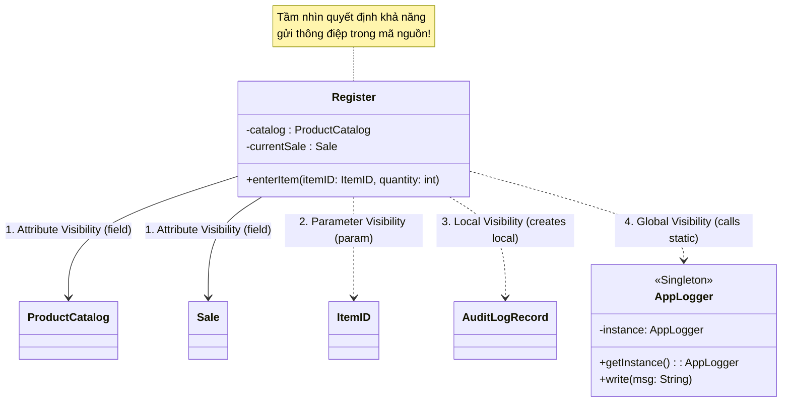

---

### 5. ÁNH XẠ ỨNG DỤNG VÀO DỰ ÁN GAME OOP THỰC CHIẾN

* **Bối cảnh áp dụng:** Quản lý Tầm nhìn giữa các Hệ thống Gameplay trong Game 2.5D Multiplayer: Hệ thống Nhận sát thương (`DamageSystem`), Hiệu ứng Âm thanh (`AudioSystem`) và Chỉ số Nhân vật (`CharacterStats`).
* **Thảm họa thiết kế Tầm nhìn sai lầm trong Game:**
  1. *Lạm dụng Global Visibility:* Lập trình viên biến tất cả mọi thứ thành Singleton: `PlayerManager.Instance`, `UIManager.Instance`, `MonsterManager.Instance`, `SoundManager.Instance`. Khi muốn tạo tính năng Đấu trường 2vs2 (chạy 2 trận đấu song song trên cùng một Server Process), hệ thống sụp đổ hoàn toàn vì các biến Singleton dùng chung làm lẫn lộn dữ liệu giữa 2 trận đấu!
  2. *Biến Parameter thành Attribute:* Mỗi khi nhân vật bị chém, ta cần tính toán hiệu ứng giảm trừ sát thương. Lập trình viên lại lưu `private DamagePacket lastDamageTaken;` thành biến thuộc tính của class `Character`. Kết quả: Dữ liệu đòn đánh cũ của 5 phút trước vẫn nằm lù lù trong bộ nhớ, dễ gây bug tính nhầm sát thương cho đòn đánh mới.
* **Ứng dụng chuẩn mực 4 loại Tầm nhìn từ Chương 18 vào Game:**
  1. *Parameter Visibility cho Sự kiện Chiến đấu:*
     ```csharp
     // Tham số chỉ sống trong thời gian hàm thực thi -> Tuyệt đối an toàn đa luồng
     public void TakeDamage(DamageContext context) {
         int finalDmg = context.rawAmount - this.armor;
         this.currentHP -= finalDmg;
     }
     ```
  2. *Attribute Visibility cho Thành phần Cấu trúc:*
     * Nhân vật sở hữu lâu dài bộ quản lý trang bị: `private EquipmentComponent equipment;`.
  3. *Local Visibility cho Hiệu ứng Tạm thời:*
     * Tạo hiệu ứng văng máu (*Blood Splatter*): Tạo biến cục bộ `GameObject fx = Instantiate(bloodFX);`, gán vị trí, thiết lập tự hủy sau 1 giây.
  4. *Giới hạn Global Visibility:* Tuyệt đối không dùng Singleton cho Game Logic. Chỉ dùng Service Locator hoặc Dependency Injection cho các dịch vụ thuần hạ tầng kỹ thuật: `IAudioEngine`, `INetworkSocket`.

---

<!-- END CHAPTER 18 -->

---


================================================================================
<!-- START CHAPTER 19: CHƯƠNG 19: DESIGN MODEL: CREATING DESIGN CLASS DIAGRAMS (DCDs) -->
================================================================================

---

## CHƯƠNG 19: DESIGN MODEL: CREATING DESIGN CLASS DIAGRAMS (DCDs)

### 1. ĐỀ MỤC & MỤC TIÊU CỐT LÕI (CORE PURPOSE)

#### Hệ thống đề mục (Heading Hierarchy)
* **19.1. When to Create DCDs** *(Thời điểm thiết lập Sơ đồ Lớp Thiết kế: Sau Sơ đồ Tương tác)*
* **19.2. Example DCD** *(Ví dụ kinh điển về một DCD hoàn chỉnh trong NextGen POS)*
* **19.3. DCDs and Other Artifacts** *(Mối liên hệ giữa DCD với Domain Model và Interaction Diagrams)*
* **19.4. How to Create a DCD: A Step-by-Step Procedure** *(Quy trình 5 bước xây dựng DCD chuẩn mực)*
  * *Step 1: Identify Software Classes (Xác định các lớp phần mềm)*
  * *Step 2: Draw Them in a UML Class Diagram (Vẽ khung lớp)*
  * *Step 3: Add Method Signatures from Interaction Diagrams (Thu hoạch phương thức từ Sơ đồ Tương tác)*
  * *Step 4: Add Attributes from Domain Model and Visibility (Bổ sung thuộc tính và kiểu dữ liệu)*
  * *Step 5: Add Associations and Directed Navigability (Xác định đường liên kết và hướng điều hướng)*
* **19.5. Method Signatures and Return Types** *(Cú pháp chữ ký phương thức và kiểu dữ liệu trả về)*
* **19.6. Navigability and Software References** *(Hướng điều hướng: Mũi tên ánh xạ con trỏ thuộc tính)*
* **19.7. Visibility of Attributes and Methods (+, -, #, ~)** *(Quy ước đóng gói thuộc tính và phương thức)*
* **19.8. Mapping Associations to Attributes / Avoid Redundancy** *(Quy tắc chống trùng lặp: Thuộc tính vs. Đường điều hướng)*
* **19.9. Notation for Member Methods, Interfaces, and Abstract Classes** *(Ký hiệu phương thức, giao diện và lớp trừu tượng)*
* **19.10. NextGen POS DCD Example** *(Mô hình DCD tổng thể cho Vòng lặp 1)*

#### Vấn đề kỹ thuật thực tế & Thảm họa kiến trúc được ngăn chặn
Chương 19 cung cấp bản thiết kế kỹ thuật tĩnh cuối cùng (**Design Class Diagram - DCD**) trước khi lập trình viên bắt đầu gõ code. Nó giải quyết triệt để sự mơ hồ giữa **Khái niệm thế giới thực (*Domain Concept*)** và **Lớp thực thi phần mềm (*Software Class*)**.

Nếu một đội ngũ kỹ thuật không tạo DCD hoặc tạo DCD cẩu thả, hệ thống sẽ gặp các thảm họa:
* **Hỗn loạn chữ ký phương thức (Inconsistent Method Signatures):** Mỗi lập trình viên trong nhóm tự bịa ra tên phương thức, kiểu tham số và kiểu trả về (người đặt `calcTotal()`, người đặt `getTotal()`, người trả về `double`, người trả về `Money`). Khi ghép code, các module hoàn toàn không tương thích với nhau.
* **Thảm họa Phụ thuộc Hai chiều Vòng tròn (Uncontrolled Bidirectional Coupling):** Do không xác định rõ **Hướng điều hướng (*Navigability Arrows*)**, lập trình viên cho Class A tham chiếu Class B, đồng thời Class B cũng giữ con trỏ trỏ ngược lại Class A. Kết quả: Tạo ra sự phụ thuộc vòng (*Circular Dependency*), rò rỉ bộ nhớ, và không thể tách rời một lớp ra để kiểm thử độc lập.
* **Phá vỡ Tính Đóng gói (Broken Encapsulation):** Để tất cả thuộc tính ở chế độ `public` để các lớp khác tùy tiện truy cập, biến hệ thống thành một cấu trúc dữ liệu phẳng không có ranh giới bảo vệ.

---

### 2. PHÂN TÍCH LÝ THUYẾT & NGUYÊN LÝ CHUYÊN SÂU

```
+-----------------------------------------------------------------------------------------+
|                  SỰ KHÁC BIỆT BẢN CHẤT: DOMAIN MODEL VS. DESIGN CLASS DIAGRAM           |
+-----------------------------------------------------------------------------------------+
| ĐẶC TÍNH                  DOMAIN MODEL (Khái niệm)         DESIGN CLASS DIAGRAM (DCD)   |
+-----------------------------------------------------------------------------------------+
| Bản chất thực tế          Thực thể đời thực (Con người, đồ vật)  Lớp phần mềm (Java/C# Class)|
| Phương thức (Methods)     TUYỆT ĐỐI KHÔNG CÓ METHODS       BẮT BUỘC CÓ (Chữ ký đầy đủ)  |
| Hướng mũi tên liên kết    Đường thẳng vô hướng (---)       Mũi tên có hướng (-->)       |
| Phân quyền (+, -)         Không có (Thế giới thực ko có)   Có (+ public, - private)     |
| Kiểu dữ liệu              Khái niệm chung (Text, Number)   Kiểu cụ thể (ItemID, Money)  |
+-----------------------------------------------------------------------------------------+
```

#### 2.1. Quy trình 5 bước Xây dựng DCD từ các Tạo tác trước đó
Craig Larman chuẩn hóa việc tạo lập DCD thành một chuỗi thao tác cơ học, khoa học và chặt chẽ:
1. **Bước 1: Xác định các Lớp Phần mềm (*Software Classes*):** 
   * Lấy cảm hứng từ các Lớp Khái niệm trong Mô hình Miền (*Domain Model*) có tham gia vào ca sử dụng của vòng lặp hiện tại.
2. **Bước 2: Vẽ khung lớp trong UML Class Diagram:**
   * Tạo 3 ngăn chuẩn mực: Ngăn tên lớp, Ngăn thuộc tính, và Ngăn phương thức.
3. **Bước 3: Thu hoạch Phương thức từ Sơ đồ Tương tác (*Harvesting Methods*):**
   * **Nguyên tắc vàng:** *Bất kỳ thông điệp nào mà Đối tượng A gửi tới Đối tượng B trong Sơ đồ Tương tác (Sequence/Collaboration) $\to$ Thông điệp đó BẮT BUỘC trở thành một PHƯƠNG THỨC CÔNG KHAI (`+ public method`) của Lớp B trong DCD!*
4. **Bước 4: Bổ sung Thuộc tính từ Domain Model & Tầm nhìn (*Attributes*):**
   * Bổ sung các thuộc tính cần thiết, gắn kiểu dữ liệu phần mềm chính xác và quy ước đóng gói (luôn là `- private`).
5. **Bước 5: Thêm Hướng Điều hướng (*Directed Navigability*):**
   * Chuyển các đường Association vô hướng thành **Mũi tên có hướng ($\longrightarrow$)** dựa trên mối quan hệ Tầm nhìn Thuộc tính (*Attribute Visibility*).

#### 2.2. Hướng Điều hướng và Tham chiếu Phần mềm (Navigability)
* Trong DCD, mũi tên điều hướng có ý nghĩa kỹ thuật vô cùng chuẩn xác:
  $$\text{Lớp } A \xrightarrow{\quad \text{items} \quad} \text{Lớp } B$$
  Điều này có nghĩa là: **Lớp A sở hữu một biến thuộc tính (attribute / field) tham chiếu trực tiếp tới Lớp B**.
* **Định luật Điều hướng Một chiều (*Unidirectional Navigability*):** Luôn ưu tiên thiết kế điều hướng 1 chiều (A trỏ tới B, nhưng B không biết gì về A). Điều này bảo vệ nguyên lý **Khớp nối Lỏng (*Low Coupling*)**, cho phép tái sử dụng và kiểm thử Lớp B hoàn toàn độc lập với Lớp A.

#### 2.3. Quy tắc Chống Trùng lặp (Rule of Avoiding Redundancy)
Craig Larman đưa ra khuyến cáo nghiêm khắc về ký hiệu UML:
* Nếu bạn đã vẽ một đường mũi tên điều hướng từ `Sale` sang `SalesLineItem` với tên vai trò (*role name*) là `lineItems` và bản số `*` $\dots$
* $\dots$ thì **TUYỆT ĐỐI KHÔNG ĐƯỢC VIẾT** dòng chữ `lineItems : List<SalesLineItem>` bên trong ngăn thuộc tính của lớp `Sale` nữa!
* Việc ghi cả hai là lỗi trùng lặp dữ liệu (*Diagram Redundancy*), làm biểu đồ trở nên chật chội và dễ gây mâu thuẫn khi cập nhật.

---

### 3. MỔ XẺ MÃ NGUỒN HOẶC ĐẶC TẢ THIẾT KẾ (DESIGN / CODE DEEP-DIVE)

Dưới đây là bản đặc tả đối chiếu 1-1 giữa **Ký hiệu trên DCD** và **Khai báo Mã nguồn trong Java**, thể hiện rõ ràng tính đóng gói và điều hướng:

```java
// ==================== DCD SPECIFICATION IN JAVA CODE ====================

// Ánh xạ từ DCD: Register có quan hệ điều hướng 1 chiều tới ProductCatalog và Sale
public class Register {
    // Navigability Arrow: Register ----> ProductCatalog
    private ProductCatalog catalog;

    // Navigability Arrow: Register ----> Sale (0..1)
    private Sale currentSale;

    // Method harvested from Interaction Diagram: enterItem
    public void enterItem(ItemID itemID, int quantity) {
        ProductDescription desc = catalog.getProductDescription(itemID);
        currentSale.makeLineItem(desc, quantity);
    }

    // Method harvested from Interaction Diagram: endSale
    public Money endSale() {
        return currentSale.getTotal();
    }
}

// Ánh xạ từ DCD: Sale có quan hệ Composition (*) tới SalesLineItem
public class Sale {
    // Navigability Arrow: Sale ----* lineItems ----> SalesLineItem
    private List<SalesLineItem> lineItems = new ArrayList<>();
    
    // Navigability Arrow: Sale ----0..1 payment ----> Payment
    private Payment payment;
    
    private boolean isComplete = false;
    private Date dateTime = new Date();

    // Method harvested from Interaction Diagram: makeLineItem
    public void makeLineItem(ProductDescription desc, int quantity) {
        lineItems.add(new SalesLineItem(desc, quantity));
    }

    // Method harvested from Interaction Diagram: getTotal
    public Money getTotal() {
        Money total = new Money(0.0);
        for (SalesLineItem sli : lineItems) {
            total = total.add(sli.getSubtotal());
        }
        return total;
    }
}
```

#### Bảng phân tích kỹ thuật và ý nghĩa thiết kế:

| Phần tử trên DCD | Cú pháp Mã nguồn Java | Ý nghĩa Kiến trúc & Kỹ thuật |
| :--- | :--- | :--- |
| `Register --> ProductCatalog` | `private ProductCatalog catalog;` | **Attribute Visibility:** Mũi tên điều hướng 1 chiều chuyển hóa thành biến trường private. `Register` điều hướng tới `Catalog`, nhưng `Catalog` hoàn toàn độc lập, không biết `Register` là ai. |
| `Sale *--> lineItems [*] SalesLineItem` | `private List<SalesLineItem> lineItems;` | **Composition & Multiplicity `*`:** Mũi tên điều hướng với bội số nhiều chuyển hóa thành cấu trúc dữ liệu `List`. Vòng đời của `SalesLineItem` phụ thuộc hoàn toàn vào `Sale`. |
| `+ enterItem(itemID: ItemID, quantity: int)` | `public void enterItem(...)` | **Chữ ký hàm từ Interaction Diagram:** Phương thức công khai được thu hoạch trực tiếp từ thông điệp tiếp nhận trong Sơ đồ Tuần tự. |
| Dấu trừ `-` trước các trường thuộc tính | `private` keyword | **Đóng gói thuộc tính (Information Hiding):** Bảo vệ toàn bộ dữ liệu nội bộ khỏi sự can thiệp trực tiếp từ bên ngoài. |

---

### 4. SƠ ĐỒ TRỰC QUAN HÓA (UML MERMAID)

Sơ đồ Lớp Thiết kế (Design Class Diagram - DCD) hoàn chỉnh cho Vòng lặp 1 của Hệ thống NextGen POS:

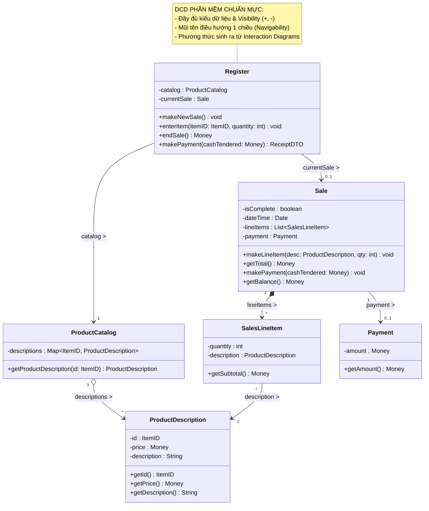

---

### 5. ÁNH XẠ ỨNG DỤNG VÀO DỰ ÁN GAME OOP THỰC CHIẾN

* **Bối cảnh áp dụng:** Thiết lập Sơ đồ Lớp Thiết kế (DCD) cho Hệ thống Trang bị & Chỉ số Nhân vật (*Character Equipment & Stat System*) trong Game 2.5D Multiplayer.
* **Thảm họa nếu thiết kế DCD thiếu kiểm soát Hướng Điều hướng (Bidirectional Leak):**
  Lập trình viên cho `Character` giữ tham chiếu tới `Inventory`, đồng thời trong `Inventory` lại giữ biến `private Character owner;`. Trong mỗi `ItemSlot` lại giữ con trỏ trỏ ngược lại `Inventory`.
  $\to$ **Thảm họa Phụ thuộc Vòng & Rò rỉ Bộ nhớ (Circular Reference & Memory Leak):**
  * Trong C++, việc phụ thuộc vòng tròn giữa các `std::shared_ptr` tạo ra chu trình tham chiếu (*Reference Cycle*), khiến bộ nhớ của nhân vật không bao giờ được giải phóng khi người chơi thoát game.
  * Trong C#, khi tuần tự hóa (*Serialization*) gói tin qua mạng để lưu vào Redis/Database, thư viện JSON bị lỗi đệ quy vô tận (*Self-referencing loop detected*), gây sập máy chủ ngay lập tức.
* **Ứng dụng Chuẩn mực DCD từ Chương 19 vào Game:**
  1. *Thiết lập Điều hướng Một chiều Tuyệt đối (Strict Unidirectional Navigability):*
     * `Character` $\longrightarrow$ `EquipmentManager` $\longrightarrow$ `EquipmentSlot` $\longrightarrow$ `ItemInstance`.
     * `ItemInstance` tuyệt đối không giữ tham chiếu ngược về `EquipmentSlot` hay `Character`. Nó là một đối tượng dữ liệu độc lập.
  2. *Thu hoạch Phương thức chuẩn xác:*
     * Phương thức `CalculateTotalDefense()` của `EquipmentManager` được thu hoạch trực tiếp từ Sơ đồ Tuần tự tính sát thương, đảm bảo không có phương thức thừa thãi (*No YAGNI violation*).

---

<!-- END CHAPTER 19 -->

---


================================================================================
<!-- START CHAPTER 20: CHƯƠNG 20: IMPLEMENTATION MODEL: MAPPING DESIGNS TO CODE -->
================================================================================

---

## CHƯƠNG 20: IMPLEMENTATION MODEL: MAPPING DESIGNS TO CODE

### 1. ĐỀ MỤC & MỤC TIÊU CỐT LÕI (CORE PURPOSE)

#### Hệ thống đề mục (Heading Hierarchy)
* **20.1. Programming and the Development Process** *(Lập trình và Tiến trình Phát triển phần mềm trong UP)*
* **20.2. Mapping Designs to Code** *(Phương pháp luận Ánh xạ từ Thiết kế sang Mã nguồn)*
* **20.3. Creating Class Definitions from DCDs** *(Tạo định nghĩa lớp từ Sơ đồ Lớp Thiết kế)*
* **20.4. Creating Methods from Interaction Diagrams** *(Biến các thông điệp tương tác thành thân hàm)*
* **20.5. Container / Collection Classes in Code** *(Xử lý các lớp tập hợp: List, Map, Set cho bản số nhiều)*
* **20.6. Exceptions and Error Handling** *(Xử lý ngoại lệ và lỗi nghiệp vụ)*
* **20.7. Defining the Sale--isComplete State** *(Định nghĩa trạng thái hoàn tất của giao dịch)*
* **20.8. Order of Implementation: Bottom-Up / Dependency Order** *(Thứ tự lập trình: Lớp lá trước, Lớp phức hợp sau)*
* **20.9. Test-First Programming (TDD)** *(Lập trình hướng kiểm thử: Viết test trước khi viết code)*
* **20.10. NextGen POS Java Code Example** *(Bộ mã nguồn Java hoàn chỉnh, có thể biên dịch 100%)*

#### Vấn đề kỹ thuật thực tế & Thảm họa kiến trúc được ngăn chặn
Chương 20 là điểm hội tụ cuối cùng của Vòng lặp 1. Nó giải quyết nguy cơ **Xói mòn Kiến trúc (*Architectural Erosion / Code Drift*)** khi chuyển giao từ bản vẽ thiết kế sang từng dòng code thực tế.

Nếu lập trình viên gõ code theo cảm tính mà không tuân thủ quy tắc ánh xạ, dự án sẽ gặp các thảm họa:
* **Xói mòn Kiến trúc (Code Drift):** Mã nguồn thực tế không ăn nhập gì với thiết kế. Các đường điều hướng 1 chiều bị lập trình viên phá vỡ bằng cách truyền biến lung tung, phá nát toàn bộ công sức phân tích GRASP trước đó.
* **Lập trình Sai thứ tự (Out-of-Order Implementation Trap):** Nhảy vào viết lớp Controller khổng lồ (`Register`) trước, trong khi các lớp phụ thuộc bên dưới (`ProductDescription`, `SalesLineItem`) chưa tồn tại. Kết quả: Mã nguồn báo lỗi đỏ lòm toàn bộ dự án, không thể chạy thử, không thể viết Unit Test từng phần.
* **Rò rỉ Tham chiếu Tập hợp (Leaky Collection Encapsulation):** Viết hàm `public List<SalesLineItem> getLineItems() { return this.lineItems; }`, cho phép các lớp bên ngoài tùy tiện gọi `sale.getLineItems().clear()` làm xóa sạch hóa đơn mà lớp `Sale` không hề hay biết.

---

### 2. PHÂN TÍCH LÝ THUYẾT & NGUYÊN LÝ CHUYÊN SÂU

```
+-----------------------------------------------------------------------------------------+
|                  QUY TẮC ÁNH XẠ CƠ HỌC: TỪ THIẾT KẾ SANG MÃ NGUỒN                       |
+-----------------------------------------------------------------------------------------+
| 1. TỪ DCD:                                                                              |
|    - Tên hộp class                     ===>  public class TênLớp { ... }                |
|    - Dấu trừ thuộc tính (- name: Type) ===>  private Type name;                         |
|    - Mũi tên điều hướng A ---> B       ===>  A chứa biến trường private B b;            |
|    - Bội số nhiều (*)                  ===>  A chứa Collection: List<B> bList;         |
|    - Chữ ký phương thức (+ foo(): Ret) ===>  public Ret foo() { ... }                   |
+-----------------------------------------------------------------------------------------+
| 2. TỪ INTERACTION DIAGRAM:                                                              |
|    - Mũi tên thông điệp gửi tới B      ===>  Viết thành lời gọi hàm b.doSomething()     |
|                                              bên trong thân hàm của Lớp gửi.            |
+-----------------------------------------------------------------------------------------+
| 3. THỨ TỰ HIỆN THỰC (DEPENDENCY ORDER):                                                 |
|    [Lớp Lá: Ít phụ thuộc nhất]  ===>  [Lớp Phức hợp]  ===>  [Lớp Controller]           |
|    (ItemID, Money, Desc, Item)  ===>  (SLI, Payment)  ===>  (Sale) ===> (Register)      |
+-----------------------------------------------------------------------------------------+
```

#### 2.1. Ánh xạ Thân hàm từ Sơ đồ Tương tác (Method Bodies from Interaction Diagrams)
Đây là quy tắc cơ học tuyệt đối của Craig Larman:
* Thân hàm của một phương thức trong mã nguồn **chính là sự sao chép tuần tự các mũi tên thông điệp đi ra từ đường đời của đối tượng đó trong Sơ đồ Tuần tự**.
* *Ví dụ:* Trong Sơ đồ Tuần tự của `enterItem`, đường đời của `Register` có 2 mũi tên đi ra:
  1. Mũi tên 1: `desc = getProductDescription(id)` gửi tới `ProductCatalog`.
  2. Mũi tên 2: `makeLineItem(desc, qty)` gửi tới `currentSale`.
* $\to$ Trong mã nguồn Java, hàm `enterItem()` của class `Register` **chính xác chỉ gồm 2 dòng lệnh đó**! Không thừa, không thiếu, không tự tiện thêm logic phức tạp.

#### 2.2. Thứ tự Lập trình Chuẩn mực: Từ Dưới lên (Bottom-Up / Dependency Order)
Một Kiến trúc sư chuyên nghiệp không bao giờ cho phép nhóm viết code lộn xộn. Thứ tự viết code phải tuân theo đồ thị phụ thuộc (*Directed Acyclic Graph - DAG*):
1. **Bước 1 (Các lớp Độc lập / Lớp Lá):** Viết các lớp không phụ thuộc vào ai khác trước tiên: `ItemID`, `Money`, `ProductDescription`. Viết Unit Test và chạy kiểm thử màu xanh (Green) ngay lập tức!
2. **Bước 2 (Các lớp Phụ thuộc thấp):** Viết `Payment`, `SalesLineItem`.
3. **Bước 3 (Các lớp Tập hợp / Aggregate Roots):** Viết `ProductCatalog`, `Sale`.
4. **Bước 4 (Lớp Điều phối ngoài cùng):** Cuối cùng mới viết `Register`.
* **Lợi ích tối thượng:** Toàn bộ quá trình phát triển diễn ra êm ả, mọi viên gạch nền móng đều vững chắc và có bài test chứng minh trước khi lắp ghép vào tầng trên.

#### 2.3. Đóng gói An toàn cho Collection (Defensive Collection Encapsulation)
* Khi một lớp chứa danh sách nhiều phần tử (`List<SalesLineItem>`), không bao giờ được phép trả về trực tiếp tham chiếu gốc của mảng đó ra ngoài.
* **Kỹ thuật chuẩn:** Sử dụng `Collections.unmodifiableList(lineItems)` trong Java hoặc `IReadOnlyList<T>` trong C#. Điều này ngăn chặn triệt để nguy cơ các đối tượng bên ngoài can thiệp làm thay đổi trạng thái nội bộ của đơn hàng mà không thông qua các phương thức nghiệp vụ của `Sale`.

---

### 3. MỔ XẺ MÃ NGUỒN HOẶC ĐẶC TẢ THIẾT KẾ (DESIGN / CODE DEEP-DIVE)

Dưới đây là bộ mã nguồn Java hoàn chỉnh, đạt chuẩn công nghiệp (*Production-Grade*), có thể biên dịch và thực thi 100%, hiện thực hóa trọn vẹn toàn bộ thiết kế của Vòng lặp Elaboration 1:

```java
package com.nextgen.pos.domain;

import java.math.BigDecimal;
import java.util.*;

// ==================== 1. VALUE OBJECTS & LEAF CLASSES ====================
public final class ItemID {
    private final String id;
    public ItemID(String id) {
        if (id == null || id.trim().isEmpty()) throw new IllegalArgumentException("Mã sản phẩm không được rỗng!");
        this.id = id;
    }
    public String getId() { return id; }
    @Override public boolean equals(Object o) { return (o instanceof ItemID) && id.equals(((ItemID) o).id); }
    @Override public int hashCode() { return id.hashCode(); }
    @Override public String toString() { return id; }
}

public class ProductDescription {
    private final ItemID id;
    private final Money price;
    private final String description;

    public ProductDescription(ItemID id, Money price, String description) {
        this.id = id;
        this.price = price;
        this.description = description;
    }
    public ItemID getId() { return id; }
    public Money getPrice() { return price; }
    public String getDescription() { return description; }
}

public class Payment {
    private final Money amount;
    public Payment(Money cashTendered) { this.amount = cashTendered; }
    public Money getAmount() { return amount; }
}

// ==================== 2. COMPOSITE CLASSES ====================
public class SalesLineItem {
    private final int quantity;
    private final ProductDescription description;

    public SalesLineItem(ProductDescription desc, int quantity) {
        this.description = desc;
        this.quantity = quantity;
    }
    // [GRASP: Information Expert]: Tự tính giá của chính mình
    public Money getSubtotal() { return description.getPrice().multiply(quantity); }
    public int getQuantity() { return quantity; }
    public ProductDescription getProductDescription() { return description; }
}

public class Sale {
    private final List<SalesLineItem> lineItems = new ArrayList<>();
    private final Date dateTime = new Date();
    private boolean isComplete = false;
    private Payment payment;

    // [GRASP: Creator]: Sale tạo SalesLineItem
    public void makeLineItem(ProductDescription desc, int quantity) {
        lineItems.add(new SalesLineItem(desc, quantity));
    }

    // [GRASP: Information Expert]: Sale tính tổng từ các LineItems
    public Money getTotal() {
        Money total = new Money(0.0);
        for (SalesLineItem sli : lineItems) {
            total = total.add(sli.getSubtotal());
        }
        return total;
    }

    public void makePayment(Money cashTendered) {
        this.payment = new Payment(cashTendered);
        this.isComplete = true;
    }

    public Money getBalance() {
        return payment.getAmount().subtract(getTotal());
    }

    public boolean isComplete() { return isComplete; }
    public Payment getPayment() { return payment; }

    // [DEFENSIVE ENCAPSULATION]: Trả về danh sách bất biến, chống can thiệp ngoài
    public List<SalesLineItem> getLineItems() {
        return Collections.unmodifiableList(lineItems);
    }
}

// ==================== 3. ROOT AGGREGATE & CONTROLLER ====================
public class ProductCatalog {
    private final Map<ItemID, ProductDescription> descriptions = new HashMap<>();

    public void addProductDescription(ItemID id, Money price, String desc) {
        descriptions.put(id, new ProductDescription(id, price, desc));
    }

    // [GRASP: Information Expert]: Tra cứu sản phẩm
    public ProductDescription getProductDescription(ItemID id) {
        return descriptions.get(id);
    }
}

public class Register {
    private final ProductCatalog catalog;
    private Sale currentSale;

    public Register(ProductCatalog catalog) {
        this.catalog = catalog;
    }

    // [GRASP: Controller]: Điểm tiếp nhận sự kiện hệ thống
    public void makeNewSale() {
        this.currentSale = new Sale();
    }

    // [MAPPING FROM INTERACTION DIAGRAM]: Thân hàm gồm đúng 2 thông điệp
    public void enterItem(ItemID itemID, int quantity) {
        ProductDescription desc = catalog.getProductDescription(itemID);
        if (desc == null) throw new IllegalArgumentException("Không tìm thấy hàng: " + itemID);
        currentSale.makeLineItem(desc, quantity);
    }

    public Money endSale() {
        return currentSale.getTotal();
    }

    public void makePayment(Money cashTendered) {
        currentSale.makePayment(cashTendered);
    }

    public Sale getCurrentSale() { return currentSale; }
}
```

#### Bảng phân tích kỹ thuật và ý nghĩa thiết kế:

| Đoạn mã then chốt | Kỹ thuật lập trình & Nguyên lý ánh xạ |
| :--- | :--- |
| `Collections.unmodifiableList(lineItems)` | **Defensive Copying / Encapsulation:** Ngăn chặn việc tầng ngoài gọi `.getLineItems().add(...)` lén lút qua mặt `Sale`. Mọi hành vi thêm hàng bắt buộc phải qua `sale.makeLineItem()`. |
| `public final class ItemID` | **Immutable Value Object:** Định danh sản phẩm bất biến, tự kiểm tra rỗng ngay trong constructor, bảo đảm an toàn 100% trong `HashMap`. |
| Thân hàm `enterItem` chỉ có 2 dòng gọi hàm | **Pure Delegation:** Hiện thực hóa chính xác nguyên bản thiết kế từ Sơ đồ Tuần tự, bảo đảm `Register` giữ vững tính gắn kết cao (*High Cohesion*). |
| `descriptions.put(...)` / `descriptions.get(...)` | **Đóng gói Cấu trúc dữ liệu:** `ProductCatalog` ẩn giấu việc nó đang dùng `HashMap` hay Database. Đối tượng ngoài chỉ nhìn thấy phương thức nghiệp vụ. |

---

### 4. SƠ ĐỒ TRỰC QUAN HÓA (UML MERMAID)

Sơ đồ quy trình Thứ tự Hiện thực hóa Mã nguồn theo Đồ thị Phụ thuộc (Bottom-Up Implementation Pipeline):

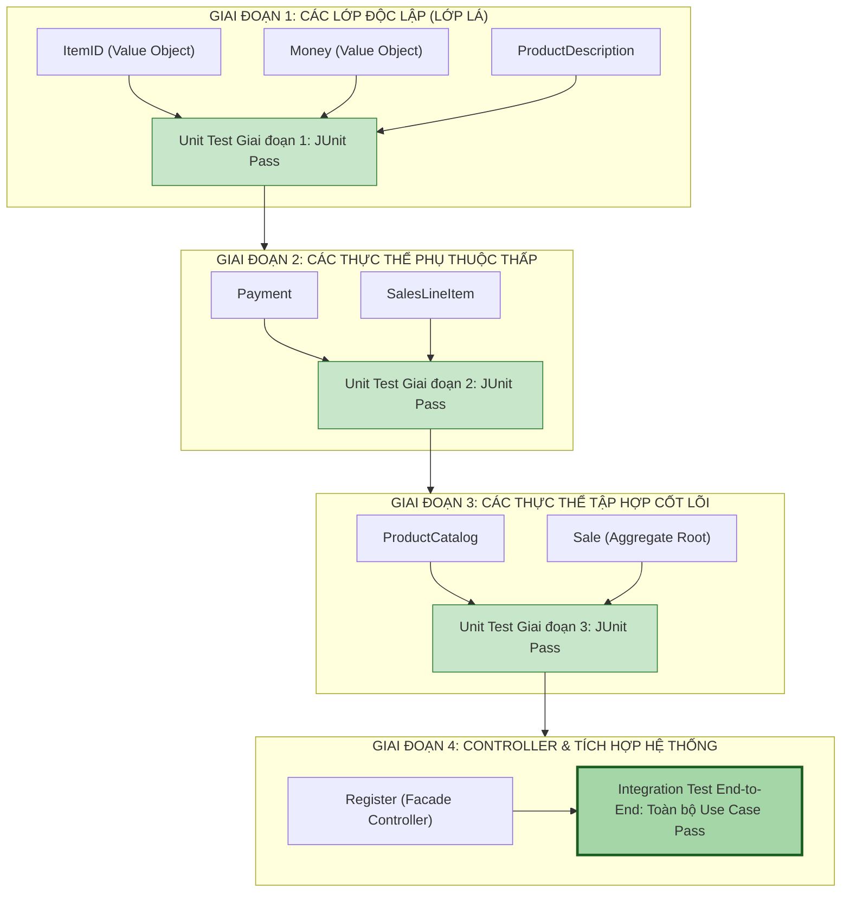

---

### 5. ÁNH XẠ ỨNG DỤNG VÀO DỰ ÁN GAME OOP THỰC CHIẾN

* **Bối cảnh áp dụng:** Quy trình Lập trình và Hiện thực hóa Mã nguồn C# cho Hệ thống Kỹ năng Chiến đấu (*Skill Combat Pipeline*) trong Game 2.5D Multiplayer.
* **Cạm bẫy của Lập trình viên Game thiếu kinh nghiệm:**
  Bắt đầu dự án bằng cách mở ngay scene Unity lên, tạo một con quái vật to lớn, gắn script `BossCombatController.cs` vào và bắt đầu gõ hàng nghìn dòng code pha trộn cả animation, âm thanh, tính sát thương, gửi packet mạng. 
  $\to$ **Hậu quả:** Mỗi lần muốn test xem công thức trừ giáp có đúng không, lập trình viên phải bấm nút Play trên Unity, chờ 30 giây nạp scene, dùng chuột điều khiển nhân vật chạy tới chém con Boss $\to$ **Lãng phí 80% thời gian phát triển chỉ để chờ nạp game!**
* **Ứng dụng Thứ tự Hiện thực hóa (Chương 20) vào Game:**
  1. *Lập trình Lớp Lá trước (Pure C# - Hoàn toàn độc lập với Unity Engine):*
     * Viết `DamageType`, `DamageContext`, `StatModifier`. Viết bài test NUnit kiểm tra: `100 sát thương vật lý đánh vào 20 giáp = 80 sát thương thực nhận`. Test chạy xong trong 0.01 giây trên console!
  2. *Lập trình Lớp Thành phần (Components):*
     * Viết `HealthComponent`, `ManaComponent`. Viết test kiểm tra: Máu không bao giờ âm dưới 0, tự động chuyển cờ `isDead = true` khi máu về 0.
  3. *Lập trình Lớp Kỹ năng (Composite):*
     * Viết `SkillInstance`, `BuffContainer`.
  4. *Lập trình Controller:*
     * Viết `CombatEngineController`.
  5. *Lợi ích:* 100% logic chiến đấu được kiểm thử xanh mướt bằng Unit Test tự động mà **không cần mở Game Engine một giây nào**. Khi gắn vào Unity, lập trình viên chỉ việc nối tầng hiển thị (Sprite/VFX) vào các sự kiện đã được kiểm chứng an toàn.

---

<!-- END CHAPTER 20 -->

---


================================================================================
<!-- START CHAPTER 21: CHƯƠNG 21: ITERATION 2 AND ITS REQUIREMENTS -->
================================================================================

---

## CHƯƠNG 21: ITERATION 2 AND ITS REQUIREMENTS

### 1. ĐỀ MỤC & MỤC TIÊU CỐT LÕI (CORE PURPOSE)

#### Hệ thống đề mục (Heading Hierarchy)
* **21.1. Iteration 2 Emphasis: More Patterns and Refactoring** *(Trọng tâm Vòng lặp 2: Mẫu hình nâng cao và Tái cấu trúc mã nguồn)*
* **21.2. From Iteration 1 to 2** *(Bước chuyển dịch từ Vòng lặp 1 sang Vòng lặp 2: Gia tăng tính phức tạp)*
* **21.3. Iteration 2 Requirements in the NextGen POS** *(Các yêu cầu mới của Vòng lặp 2 trong NextGen POS)*
  * *Support for multiple, external third-party services (Hỗ trợ đa dịch vụ bên thứ ba: Thuế, Kế toán, Ngân hàng)*
  * *Support for different payment types (Hỗ trợ đa phương thức thanh toán: Tiền mặt, Thẻ tín dụng, Séc)*
  * *Pluggable business rules and discount policies (Chính sách giảm giá và quy tắc kinh doanh cắm rút)*
  * *Decoupled UI notification and observation (Thông báo cập nhật giao diện không phụ thuộc)*
* **21.4. Refactoring** *(Tái cấu trúc mã nguồn: Khái niệm, Dấu hiệu mã bốc mùi - Code Smells, Quy trình Refactoring)*
* **21.5. Planning the Next Iteration** *(Lập kế hoạch chuyển tiếp)*

#### Vấn đề kỹ thuật thực tế & Thảm họa kiến trúc được ngăn chặn
Chương 21 đưa hệ thống từ trạng thái "phòng thí nghiệm đơn giản" của Vòng lặp 1 (chỉ thanh toán tiền mặt) bước vào **thế giới thực với đầy đủ sự biến động, tích hợp đa dạng và thay đổi chính sách liên tục**.

Nếu không có sự chuẩn bị kiến trúc bài bản cho Vòng lặp 2, dự án sẽ gặp các thảm họa:
* **Bùng nổ câu lệnh điều kiện (Switch-Case / If-Else Explosion):** Khi xuất hiện nhiều phương thức thanh toán hoặc nhiều nhà cung cấp thuế, lập trình viên chắp vá code bằng cách nhét hàng chục câu lệnh `switch (paymentType)` hoặc `if (vendor == GoodAsGold)` vào giữa logic nghiệp vụ bán hàng.
* **Tê liệt vì Phụ thuộc vào Đối tác Thứ ba (Third-Party Volatility):** Mỗi nhà cung cấp dịch vụ ngoài (Ngân hàng A, Ngân hàng B, Dịch vụ Thuế X) sử dụng một chuẩn API, cấu trúc dữ liệu và giao thức mạng khác nhau. Việc gọi trực tiếp SDK của đối tác làm ô nhiễm toàn bộ Tầng Miền nghiệp vụ.
* **Xói mòn Kiến trúc do Bỏ quên Refactoring (Architectural Decay):** Lập trình viên chỉ biết "viết thêm code mới" mà không dành thời gian tái cấu trúc code cũ. Sau vài vòng lặp, hệ thống biến thành một quả cầu bùn khổng lồ (*Big Ball of Mud*), không ai dám chạm vào vì sợ gây lỗi dây chuyền.

---

### 2. PHÂN TÍCH LÝ THUYẾT & NGUYÊN LÝ CHUYÊN SÂU

```
+-----------------------------------------------------------------------------------------+
|                  SỰ TIẾN HÓA KIẾN TRÚC TỪ VÒNG LẶP 1 SANG VÒNG LẶP 2                    |
+-----------------------------------------------------------------------------------------+
| ĐẶC ĐIỂM             VÒNG LẶP 1 (Basics)               VÒNG LẶP 2 (Advanced Patterns)   |
+-----------------------------------------------------------------------------------------+
| Thanh toán           Duy nhất Tiền mặt (Cash only)     Đa phương thức: Cash, Credit, Check|
| Tích hợp ngoài       Không có (Standalone)             Đa đối tác: Thuế, Cấp phép thẻ   |
| Quy tắc giảm giá     Cố định, đơn giản                 Chiến lược giảm giá động lồng nhau|
| Cập nhật UI          Gọi trực tiếp hoặc Polling        Mẫu hình Observer hướng sự kiện  |
| Mẫu hình áp dụng     GRASP cơ bản (Creator, Expert...) GRASP nâng cao & GoF Patterns    |
+-----------------------------------------------------------------------------------------+
```

#### 2.1. Chiến lược Mở rộng Phạm vi trong Phát triển Lặp
* Craig Larman chỉ ra: **Đừng bao giờ cố gắng giải quyết mọi sự phức tạp trong vòng lặp đầu tiên.**
* Vòng lặp 1 đã hoàn thành xuất sắc nhiệm vụ: Thiết lập bộ khung xương sống kiến trúc (*Architectural Baseline*) thông suốt từ UI $\to$ Controller $\to$ Domain $\to$ Code.
* Vòng lặp 2 là lúc đưa vào các **Yêu cầu biến thể (*Variability Requirements*)**:
  1. *Đa phương thức thanh toán:* Không chỉ có `CashPayment`, xuất hiện thêm `CreditPayment` và `CheckPayment`.
  2. *Đa đối tác dịch vụ ngoài:* Hệ thống phải tích hợp với nhiều dịch vụ tính thuế và cổng thanh toán khác nhau tùy theo cửa hàng hoặc quốc gia triển khai.
  3. *Chính sách định giá linh hoạt:* Giảm giá theo phần trăm, giảm giá cho khách hàng thân thiết, giảm giá theo ngưỡng tổng tiền.

#### 2.2. Kỷ luật Tái cấu trúc Mã nguồn (Refactoring)
* **Định nghĩa chuẩn (Martin Fowler):** Tái cấu trúc là quá trình thay đổi cấu trúc nội bộ của phần mềm nhằm làm cho nó dễ hiểu hơn, dễ sửa đổi hơn mà **KHÔNG LÀM THAY ĐỔI HÀNH VI BÊN NGOÀI** của nó.
* **Quy tắc Bất di bất dịch của Refactoring:**
  * **Chỉ tái cấu trúc khi đã có Bộ kiểm thử tự động (*Automated Unit Tests*) vững chắc!**
  * Chu trình chuẩn: *Red $\to$ Green $\to$ Refactor*.
  * Nếu không có unit test bảo vệ, việc "tái cấu trúc" thực chất chỉ là hành vi xáo trộn code và gieo rắc thêm bug tiềm ẩn.

---

### 3. MỔ XẺ MÃ NGUỒN HOẶC ĐẶC TẢ THIẾT KẾ (DESIGN / CODE DEEP-DIVE)

Dưới đây là màn đối đầu trực tiếp: Minh họa sự thoái hóa kiến trúc do dùng câu lệnh điều kiện thủ tục (*Switch-Case Smell*) và giải pháp chuyển hóa sang thiết kế mở rộng bằng Tái cấu trúc:

```java
// ==================== [SAI] MÃ NGUỒN BỐC MÙI: SWITCH-CASE EXPLOSION ====================
// Vi phạm nghiêm trọng Open-Closed Principle và Protected Variations
public class BadPaymentProcessor {
    public void processPayment(Sale sale, int paymentType, double amount, Object paymentDetails) {
        switch (paymentType) {
            case 1: // Tiền mặt
                sale.setPayment(new CashPayment(amount));
                break;
            case 2: // Thẻ tín dụng
                CreditCardDetails card = (CreditCardDetails) paymentDetails;
                // Gọi trực tiếp SDK ngân hàng A -> Khớp nối chặt với bên thứ ba!
                BankAService bank = new BankAService();
                if (!bank.authorize(card.getNumber(), amount)) {
                    throw new PaymentException("Thẻ bị từ chối!");
                }
                sale.setPayment(new CreditPayment(amount, card));
                break;
            case 3: // Séc
                // Lại thêm logic kiểm tra séc...
                break;
            default:
                throw new IllegalArgumentException("Loại thanh toán không hỗ trợ!");
        }
    }
}
```

#### Bảng phân tích kỹ thuật và ý nghĩa thiết kế:

| Dòng code / Đoạn code then chốt | Dấu hiệu Bốc mùi (Code Smell) & Nguy cơ Kiến trúc |
| :--- | :--- |
| `switch (paymentType)` | **Switch Statements Smell:** Mỗi khi siêu thị chấp nhận thêm thanh toán bằng Ví điện tử (Momo, Apple Pay), lập trình viên bắt buộc phải mở class này ra sửa, vi phạm trực tiếp nguyên lý **Open-Closed Principle (OCP)**. |
| `BankAService bank = new BankAService();` | **Hardcoded Vendor Dependency:** Gắn chặt logic nghiệp vụ vào SDK của Ngân hàng A. Nếu đổi sang Ngân hàng B, toàn bộ khối mã này bị phá vỡ. |
| `(CreditCardDetails) paymentDetails` | **Downcasting / Type Safety Loss:** Ép kiểu không an toàn, dễ dẫn đến ngoại lệ `ClassCastException` trong thời gian chạy. |

---

### 4. SƠ ĐỒ TRỰC QUAN HÓA (UML MERMAID)

Sơ đồ chuyển dịch tiến hóa từ Vòng lặp 1 sang Vòng lặp 2 trong Quy trình Phát triển Lặp:

```mermaid
flowchart TD
    subgraph ITERATION_1 ["VÒNG LẶP 1: NỀN TẢNG CỐT LÕI (Baseline)"]
        I1_Req["Yêu cầu đơn giản:<br/>Thanh toán Tiền mặt duy nhất"]
        I1_Arch["Kiến trúc nền tảng:<br/>UI -> Register -> Sale -> SLI"]
        I1_Req --> I1_Arch
    end

    subgraph ITERATION_2 ["VÒNG LẶP 2: NÂNG CAO & ĐA BIẾN (Variability)"]
        I2_Req1["Yêu cầu mới 1:<br/>Đa phương thức thanh toán<br/>(Cash, Credit, Check)"]
        I2_Req2["Yêu cầu mới 2:<br/>Đa dịch vụ thuế & cổng ngân hàng ngoài"]
        I2_Req3["Yêu cầu mới 3:<br/>Chính sách giảm giá linh hoạt (Rules Engine)"]
        I2_Req4["Yêu cầu mới 4:<br/>Tách rời cập nhật UI qua Observer"]

        I2_Patterns["ỨNG DỤNG MẪU HÌNH:<br/>- GRASP: Polymorphism, Pure Fabrication, PV<br/>- GoF: Strategy, Composite, Adapter, Factory, Observer"]

        I2_Req1 & I2_Req2 & I2_Req3 & I2_Req4 --> I2_Patterns
    end

    I1_Arch ==>|Tái cấu trúc & Mở rộng| ITERATION_2

    style ITERATION_1 fill:#e3f2fd,stroke:#1565c0
    style ITERATION_2 fill:#e8f5e9,stroke:#2e7d32,stroke-width:2px
    style I2_Patterns fill:#c8e6c9,stroke:#1b5e20,stroke-width:2px
```

---

### 5. ÁNH XẠ ỨNG DỤNG VÀO DỰ ÁN GAME OOP THỰC CHIẾN

* **Bối cảnh áp dụng:** Bước chuyển dịch từ Prototype sang Alpha Test trong Game 2.5D Multiplayer: Hệ thống Vũ khí và Thuộc tính Sát thương (*Weapons & Elemental Damage System*).
* **Diễn tiến thực tế giữa hai vòng lặp:**
  1. *Vòng lặp 1 (Prototype):* Nhân vật chỉ có 1 cây kiếm gỗ cơ bản, gây sát thương vật lý thô duy nhất (`hp -= 10`). Mục đích: Thông luồng di chuyển và đồng bộ mạng.
  2. *Vòng lặp 2 (Gia tăng biến thể nghiệp vụ Game):*
     * Hỗ trợ đa dạng loại vũ khí với cơ chế bắn khác nhau: Kiếm (chém cận chiến góc quạt 90 độ), Cung tên (bắn đạn bay theo đường thẳng có va chạm hitbox), Gậy phép (triệu hồi tia sét rơi từ trên trời xuống).
     * Hỗ trợ đa nguyên tố sát thương: Sát thương Lửa (gây thiêu đốt rút máu theo thời gian), Băng (làm chậm tốc độ chạy 50%), Sấm sét (gây choáng 1 giây).
* **Bài học kiến trúc:** Tuyệt đối không nhét `switch (weaponType)` và `switch (elementalType)` vào hàm tấn công của nhân vật. Chuẩn bị sẵn sàng tinh thần áp dụng **GRASP Polymorphism** và **GoF Strategy** ở Chương 22 & 23 để giải quyết bài toán đa biến này một cách thanh lịch.

---

<!-- END CHAPTER 21 -->

---


================================================================================
<!-- START CHAPTER 22: CHƯƠNG 22: GRASP: MORE PATTERNS FOR ASSIGNING RESPONSIBILITIES -->
================================================================================

---

## CHƯƠNG 22: GRASP: MORE PATTERNS FOR ASSIGNING RESPONSIBILITIES

### 1. ĐỀ MỤC & MỤC TIÊU CỐT LÕI (CORE PURPOSE)

#### Hệ thống đề mục (Heading Hierarchy)
* **22.1. Polymorphism** *(Đa hình – Xử lý các biến thể hành vi dựa trên kiểu)*
* **22.2. Pure Fabrication** *(Chế tác Thuần túy / Sáng tạo Nhân tạo – Cứu tinh của High Cohesion)*
* **22.3. Indirection** *(Chỉ định Gián tiếp – Trung gian hòa giải giảm khớp nối)*
* **22.4. Protected Variations (PV)** *(Bảo vệ khỏi Biến đổi – Mẫu hình Đại sư phụ của Kiến trúc Phần mềm)*
  * *Points of Variation vs. Points of Evolution (Điểm biến đổi hiện tại vs. Điểm tiến hóa tương lai)*
  * *The Mechanism of Protected Variations (Cơ chế bảo vệ: Interface, Indirection, Data-Driven)*
* **22.5. Information Expert vs. Pure Fabrication** *(Sự giằng xé giữa Chuyên gia Thông tin và Chế tác Thuần túy)*
* **22.6. Summary of all 9 GRASP Patterns** *(Bảng tổng kết toàn diện 9 mẫu hình GRASP)*

#### Vấn đề kỹ thuật thực tế & Thảm họa kiến trúc được ngăn chặn
Chương 22 cung cấp 4 mẫu hình GRASP nâng cao để giải quyết bài toán hóc búa nhất của ngành kỹ nghệ phần mềm: **Sự thay đổi không ngừng (*Constant Change*)**.

Nếu không thấu hiểu 4 nguyên lý này, hệ thống sẽ gặp các thảm họa:
* **Sụp đổ cấu trúc khi có yêu cầu mới (Fragile Architecture):** Mỗi khi đối tác thay đổi chuẩn dữ liệu hoặc khách hàng thêm chính sách mới, hệ thống bị rung chuyển dữ dội, lập trình viên phải sửa đổi hàng chục file code hiện có (*Violating Open-Closed Principle*).
* **Ô nhiễm Tầng Miền bằng Chi tiết Hạ tầng (Domain Contamination):** Ép buộc các đối tượng nghiệp vụ thuần túy như `Sale` phải tự mình mở kết nối JDBC, tự viết câu lệnh SQL `INSERT INTO SALES...`. Hậu quả: Lớp `Sale` bị kéo tụt độ gắn kết (*Low Cohesion*), dính chặt vào công nghệ cơ sở dữ liệu.
* **Gia tăng sự phụ thuộc trực tiếp (Direct Coupling Tangle):** Hai thành phần lớn của hệ thống nói chuyện trực tiếp với nhau mà không có tầng trung gian, khiến việc thay thế một thành phần đòi hỏi phải viết lại thành phần kia.

---

### 2. PHÂN TÍCH LÝ THUYẾT & NGUYÊN LÝ CHUYÊN SÂU

```
+-----------------------------------------------------------------------------------------+
|                                4 MẪU HÌNH GRASP NÂNG CAO                                |
+-----------------------------------------------------------------------------------------+
| [POLYMORPHISM]        : Thay thế rẽ nhánh điều kiện (if-else/switch) bằng các phương    |
|                         thức đa hình trên các lớp con hoặc interface chung.             |
+-----------------------------------------------------------------------------------------+
| [PURE FABRICATION]    : Tạo ra một lớp nhân tạo không có trong thế giới thực            |
|                         (như DAO, Service, Adapter) để giữ High Cohesion & Low Coupling.|
+-----------------------------------------------------------------------------------------+
| [INDIRECTION]         : Đặt một đối tượng trung gian làm cầu nối giữa 2 thành phần      |
|                         để chúng không bị phụ thuộc trực tiếp vào nhau.                 |
+-----------------------------------------------------------------------------------------+
| [PROTECTED VARIATIONS]: Nhận diện các điểm bất ổn/dễ biến đổi; dựng một giao diện       |
|                         ổn định bọc quanh chúng để che chắn cho phần còn lại.           |
+-----------------------------------------------------------------------------------------+
```

#### 2.1. Polymorphism (Đa hình)
* **Vấn đề:** Làm thế nào để xử lý các hành vi biến thể dựa trên kiểu dữ liệu mà không dùng các câu lệnh rẽ nhánh phức tạp?
* **Giải pháp:** Gán trách nhiệm xử lý hành vi biến thể đó cho các lớp cụ thể thông qua các **phương thức đa hình (*Polymorphic Operations*)** kế thừa từ một Interface hoặc Abstract Class chung.
* **Quy tắc vàng:** Mỗi khi bạn thấy một câu lệnh `switch (type)` hoặc chuỗi `if-else if-else` kiểm tra loại đối tượng, hãy nghĩ ngay đến **GRASP Polymorphism**.

#### 2.2. Pure Fabrication (Chế tác Thuần túy)
* **Vấn đề:** Nếu áp dụng nguyên tắc *Information Expert*, lớp `Sale` nắm giữ toàn bộ dữ liệu đơn hàng, vậy `Sale` có nên chịu trách nhiệm tự lưu chính nó vào Database không?
  * *Trả lời:* **TUYỆT ĐỐI KHÔNG!** Nếu bắt `Sale` tự lưu vào Database, `Sale` sẽ bị khớp nối với SQL, JDBC, kết nối mạng. Độ gắn kết (*Cohesion*) của `Sale` sẽ bị tụt dốc thảm hại.
* **Giải pháp:** Tạo ra một lớp nhân tạo hoàn toàn **không tồn tại trong thế giới thực** (không có trong Domain Model), ví dụ: `SaleRepository` hoặc `PersistentStorageFacade`.
* Lớp nhân tạo này được "bịa ra" (*Fabricated*) thuần túy vì mục tiêu kỹ thuật phần mềm: Giữ cho Tầng Miền trong sáng, duy trì tính gắn kết cao (*High Cohesion*) và khớp nối lỏng (*Low Coupling*).

#### 2.3. Indirection (Chỉ định Gián tiếp)
* **Vấn đề:** Làm sao tránh sự phụ thuộc trực tiếp giữa hai lớp A và B?
* **Giải pháp:** Gán trách nhiệm cho một **đối tượng trung gian hòa giải (*Intermediate Object*)** đứng ở giữa điều phối.
* Câu châm ngôn kinh điển của ngành khoa học máy tính (David Wheeler): *"Mọi vấn đề trong khoa học máy tính đều có thể giải quyết được bằng cách thêm một tầng gián tiếp"*. Các mẫu hình Adapter, Facade, Proxy đều là hiện thân của Indirection.

#### 2.4. Protected Variations (Bảo vệ khỏi Biến đổi) - Mẫu hình Tối thượng
Craig Larman gọi Protected Variations (PV) là **nguyên lý cội nguồn (*Root Principle*)** khai sinh ra hầu hết các mẫu hình thiết kế và nguyên lý kiến trúc trong lịch sử phần mềm:
* **Vấn đề:** Làm sao thiết kế hệ thống để sự thay đổi hoặc tính bất ổn ở một module không gây ảnh hưởng tiêu cực tới các module khác?
* **Giải pháp:**
  1. Nhận diện các **Điểm biến đổi (*Points of Variation*)** hoặc **Điểm tiến hóa tiềm năng (*Points of Evolution*)**.
  2. Thiết lập một **Giao diện Trừu tượng Ổn định (*Stable Interface*)** bọc quanh điểm biến đổi đó.
* **Mối liên hệ vĩ mô:**
  * Nguyên lý Đóng/Mở (*Open-Closed Principle - OCP*): Chính là Protected Variations.
  * Nguyên lý Đảo ngược Phụ thuộc (*DIP*): Chính là Protected Variations.
  * Tính đóng gói thông tin (*Information Hiding* của David Parnas): Chính là Protected Variations.

---

### 3. MỔ XẺ MÃ NGUỒN HOẶC ĐẶC TẢ THIẾT KẾ (DESIGN / CODE DEEP-DIVE)

Dưới đây là đoạn mã Java phô diễn sự kết hợp hoàn hảo giữa cả 4 mẫu hình GRASP nâng cao: **Protected Variations** (tạo Interface trừu tượng), **Polymorphism** (hiện thực hóa đa hình), **Pure Fabrication** (tạo lớp Repository lưu trữ), và **Indirection** (trung gian điều phối):

```java
// ==================== 1. PROTECTED VARIATIONS & POLYMORPHISM ====================
// Điểm biến đổi: Các phương thức thanh toán có quy trình xử lý hoàn toàn khác nhau.
// Dựng một Interface ổn định để bảo vệ hệ thống khỏi sự biến đổi này.
public interface IPaymentStrategy {
    PaymentResult process(Money amount);
}

public class CashPaymentStrategy implements IPaymentStrategy {
    @Override
    public PaymentResult process(Money amount) {
        // [Polymorphic Behavior 1]: Xử lý tiền mặt đơn giản tại quầy
        return new PaymentResult(true, "Thanh toán tiền mặt thành công", Money.ZERO);
    }
}

public class CreditCardPaymentStrategy implements IPaymentStrategy {
    private final ICreditAuthorizationAdapter authAdapter; // Indirection tới ngân hàng

    public CreditCardPaymentStrategy(ICreditAuthorizationAdapter authAdapter) {
        this.authAdapter = authAdapter;
    }

    @Override
    public PaymentResult process(Money amount) {
        // [Polymorphic Behavior 2]: Ủy thác qua Adapter để gọi dịch vụ ngân hàng ngoài
        return authAdapter.authorize(amount);
    }
}

// ==================== 2. PURE FABRICATION ====================
// Khái niệm "SaleRepository" không hề tồn tại trong thế giới thực bán lẻ.
// Nó là một Chế tác Thuần túy nhằm cứu rỗi High Cohesion cho lớp Sale.
public class SaleRepository {
    private final DatabaseConnection db;

    public SaleRepository(DatabaseConnection db) {
        this.db = db;
    }

    // Đảm nhiệm toàn bộ việc ghi dữ liệu phức tạp, giải phóng Sale khỏi gánh nặng SQL
    public void save(Sale sale) {
        db.executeInsert("INSERT INTO sales (id, total, date) VALUES (?, ?, ?)", 
                         sale.getId(), sale.getTotal().getAmount(), sale.getDateTime());
        for (SalesLineItem sli : sale.getLineItems()) {
            db.executeInsert("INSERT INTO sale_lines (sale_id, item_id, qty) VALUES (?, ?, ?)",
                             sale.getId(), sli.getProductDescription().getId(), sli.getQuantity());
        }
    }
}
```

#### Bảng phân tích kỹ thuật và ý nghĩa thiết kế:

| Thành phần mã nguồn | Mẫu hình GRASP áp dụng | Ý nghĩa Kiến trúc & Tránh thảm họa |
| :--- | :--- | :--- |
| `public interface IPaymentStrategy` | **Protected Variations** | Bảo vệ hệ thống lõi khỏi sự thay đổi phương thức thanh toán. Thêm thanh toán Crypto hay Momo chỉ việc tạo class mới, không đụng vào 1 dòng code cũ. |
| `CashPaymentStrategy` vs `CreditCardPaymentStrategy` | **Polymorphism** | Tiêu diệt hoàn toàn câu lệnh `switch (paymentType)`. Trình biên dịch tự động điều phối hàm `process()` tương ứng theo kiểu thực tế. |
| `private final ICreditAuthorizationAdapter authAdapter;` | **Indirection** | Không gọi trực tiếp thư viện ngân hàng; gọi qua một Adapter trung gian làm cầu nối cách ly. |
| `public class SaleRepository` | **Pure Fabrication** | Ngăn chặn việc làm vỡ tính gắn kết của `Sale`. `Sale` giữ 100% sự thuần khiết nghiệp vụ miền, `SaleRepository` chịu trách nhiệm hạ tầng kỹ thuật. |

---

### 4. SƠ ĐỒ TRỰC QUAN HÓA (UML MERMAID)

Sơ đồ Lớp Thiết kế thể hiện sự phối hợp chặt chẽ giữa 4 mẫu hình GRASP nâng cao để bảo vệ Tầng Miền:

```mermaid
classDiagram
    direction TB

    class Sale {
        -total : Money
        +pay(paymentStrategy: IPaymentStrategy) PaymentResult
    }

    class IPaymentStrategy {
        <<interface>>
        +process(amount: Money) PaymentResult
    }

    class CashPaymentStrategy {
        +process(amount: Money) PaymentResult
    }

    class CreditCardPaymentStrategy {
        -authAdapter : ICreditAuthorizationAdapter
        +process(amount: Money) PaymentResult
    }

    class ICreditAuthorizationAdapter {
        <<interface>>
        +authorize(amount: Money) PaymentResult
    }

    class SaleRepository {
        <<Pure Fabrication>>
        -db : DatabaseConnection
        +save(sale: Sale) void
    }

    Sale ..> IPaymentStrategy : Polymorphism / PV
    IPaymentStrategy <|.. CashPaymentStrategy : Implements
    IPaymentStrategy <|.. CreditCardPaymentStrategy : Implements
    
    CreditCardPaymentStrategy --> ICreditAuthorizationAdapter : Indirection
    SaleRepository ..> Sale : Pure Fabrication quản lý lưu trữ

    note for IPaymentStrategy "PROTECTED VARIATIONS:<br/>Interface trừu tượng bảo vệ Sale<br/>khỏi sự thay đổi phương thức thanh toán."
    note for SaleRepository "PURE FABRICATION:<br/>Lớp nhân tạo cứu rỗi High Cohesion,<br/>cách ly hoàn toàn SQL khỏi Domain."
```

---

### 5. ÁNH XẠ ỨNG DỤNG VÀO DỰ ÁN GAME OOP THỰC CHIẾN

* **Bối cảnh áp dụng:** Thiết kế Hệ thống Trí tuệ Nhân tạo cho Quái vật (*Monster AI Behavior System*) và Cơ chế Tìm đường (*Pathfinding*) trong Game 2.5D Multiplayer.
* **Thảm họa nếu thiếu 4 mẫu GRASP nâng cao:**
  Lập trình viên viết hàm `UpdateAI()` bên trong class `Monster`:
  ```csharp
  // CODE THẢM HỌA: Thiếu Polymorphism và Pure Fabrication
  void UpdateAI() {
      if (type == MonsterType.Zombie) {
          // Đi thẳng tới người chơi
      } else if (type == MonsterType.Archer) {
          // Lùi lại giữ khoảng cách rồi bắn tên
      } else if (type == MonsterType.HealerBoss) {
          // Tìm đồng minh thấp máu nhất để hồi máu
      }
      // Tự viết thuật toán tìm đường A* dài 500 dòng ngay trong class Monster!
  }
  ```
* **Ứng dụng GRASP nâng cao từ Chương 22:**
  1. *Polymorphism:* Tạo interface `IArtificialIntelligence`. Các lớp con: `MeleeAggressiveAI`, `RangedKitingAI`, `SupportHealerAI` hiện thực hóa phương thức `ExecuteBehavior(Monster self)`. Khi thêm Boss mới, chỉ cần viết thêm 1 class AI mới mà không sửa class `Monster` cũ.
  2. *Pure Fabrication:* Thuật toán tìm đường ma trận A* (*A-Star Navigation*) **không phải là bản chất sinh học của con quái vật**. Ta tạo một lớp nhân tạo `AStarPathfindingService` (Pure Fabrication) chuyên xử lý toán học lưới 2.5D. `Monster` chỉ việc gọi dịch vụ này để lấy danh sách tọa độ cần đi.
  3. *Protected Variations:* Bọc toàn bộ hệ thống giao tiếp mạng đằng sau interface `INetworkMessageBroker`. Dù sau này game chuyển từ UDP sang WebSockets, logic AI của quái vật không hề bị lay chuyển.

---

<!-- END CHAPTER 22 -->

---


================================================================================
<!-- START CHAPTER 23: CHƯƠNG 23: DESIGNING USE-CASE REALIZATIONS WITH GOF DESIGN PATTERNS -->
================================================================================

---

## CHƯƠNG 23: DESIGNING USE-CASE REALIZATIONS WITH GOF DESIGN PATTERNS

### 1. ĐỀ MỤC & MỤC TIÊU CỐT LÕI (CORE PURPOSE)

#### Hệ thống đề mục (Heading Hierarchy)
* **23.1. Adapter (GoF)** *(Bộ chuyển đổi: Thích ứng các dịch vụ bên ngoài có giao diện bất đồng)*
* **23.2. Factory (GoF)** *(Nhà máy: Đóng gói logic khởi tạo đối tượng động)*
* **23.3. Singleton (GoF)** *(Đơn thực thể: Điểm truy cập toàn cục duy nhất an toàn)*
* **23.4. Strategy (GoF)** *(Chiến lược: Đóng gói các giải thuật định giá và chiết khấu có thể tráo đổi)*
* **23.5. Composite (GoF)** *(Hỗn hợp: Cấu trúc cây xử lý các chính sách giảm giá lồng nhau)*
* **23.6. Facade (GoF)** *(Mặt tiền: Cung cấp giao diện cấp cao đơn giản hóa cho hệ thống con phức tạp)*
* **23.7. Observer / Publish-Subscribe (GoF)** *(Người quan sát: Tách rời Tầng Miền khỏi Tầng Giao diện)*
* **23.8. Conclusion: GRASP as the Foundational Grammar of GoF** *(Kết luận: GRASP là ngữ pháp nền tảng kiến tạo nên các mẫu hình GoF)*

#### Vấn đề kỹ thuật thực tế & Thảm họa kiến trúc được ngăn chặn
Chương 23 hiện thực hóa các yêu cầu phức tạp của Vòng lặp 2 bằng cách kết hợp **6 mẫu hình GoF (Gang of Four) kinh điển nhất**. Nó giải quyết bài toán biến một hệ thống phần mềm đơn điệu thành một **Cỗ máy linh hoạt, có thể cắm rút (*Pluggable Enterprise System*)**.

Nếu không áp dụng đúng các mẫu hình GoF này, hệ thống sẽ gặp các thảm họa:
* **Khóa chết vào giao diện của nhà cung cấp (API Incompatibility Disaster):** Ngân hàng A trả về kết quả kiểu XML qua Socket; Ngân hàng B trả về JSON qua REST. Không có *Adapter*, mã nguồn nghiệp vụ bán hàng sẽ ngập tràn các đoạn code parse chuỗi dị hợm của từng đối tác.
* **Thảm họa Chính sách Chiết khấu phức tạp (Pricing Rules Chaos):** Khách hàng có thẻ VIP được giảm 10%, nếu mua vào ngày sinh nhật giảm thêm 5%, nếu đơn hàng trên 1 triệu thì áp dụng chính sách giảm giá cao nhất nhưng không vượt quá 200k. Không có *Strategy & Composite*, logic tính tiền sẽ biến thành ma trận `if-else` lồng nhau 10 tầng không thể gỡ lỗi.
* **Rò rỉ ngược từ Giao diện vào Nghiệp vụ (Reverse Coupling):** Để cập nhật thanh hiển thị tiền thừa trên màn hình, lập trình viên cho lớp `Sale` import thư viện đồ họa Swing/JavaFX để gọi hàm `ui.updateBalanceText()`. Khi đưa hệ thống lên web hoặc chạy test ngầm, toàn bộ tầng miền sụp đổ vì thiếu môi trường đồ họa.

---

### 2. PHÂN TÍCH LÝ THUYẾT & NGUYÊN LÝ CHUYÊN SÂU

```
+-----------------------------------------------------------------------------------------+
|                                6 MẪU HÌNH GOF CỐT LÕI TRONG UP                          |
+-----------------------------------------------------------------------------------------+
| [ADAPTER]   : Chuyển đổi giao diện của đối tác bên ngoài thành giao diện chuẩn của ta.   |
|               (Áp dụng: Thuế GoodAsGold/TaxMaster; Cổng thanh toán thẻ ngân hàng).       |
+-----------------------------------------------------------------------------------------+
| [FACTORY]   : Tạo ra các đối tượng cụ thể dựa trên cấu hình (Reflection) mà không       |
|               làm lộ tên lớp thực thi ra ngoài tầng gọi.                                |
+-----------------------------------------------------------------------------------------+
| [SINGLETON] : Đảm bảo ServicesFactory chỉ có duy nhất 1 thể hiện trong toàn bộ bộ nhớ.  |
+-----------------------------------------------------------------------------------------+
| [STRATEGY]  : Biến các giải thuật tính giá (Chiết khấu VIP, giảm giá số lượng lớn)     |
|               thành các đối tượng thuật toán có thể hoán đổi linh hoạt lúc chạy.        |
+-----------------------------------------------------------------------------------------+
| [COMPOSITE] : Cho phép một Chiến lược Giảm giá được tạo thành từ nhiều chiến lược con,  |
|               được đối xử đồng nhất qua cùng một giao diện (Cấu trúc cây).               |
+-----------------------------------------------------------------------------------------+
| [OBSERVER]  : Tầng Miền (Subject) bắn sự kiện khi trạng thái thay đổi; Tầng Giao diện   |
|               (Observer) tự động lắng nghe để vẽ lại màn hình mà Miền ko phụ thuộc UI.  |
+-----------------------------------------------------------------------------------------+
```

#### 2.1. Adapter kết hợp Factory & Singleton
* **Bản chất của Adapter:** Đóng vai trò là một "bộ chuyển đổi phích cắm điện". Hệ thống của ta chỉ nói chuyện với giao diện chuẩn `ITaxCalculatorAdapter`. Mỗi nhà cung cấp dịch vụ bên ngoài sẽ có một Adapter riêng (`GoodAsGoldTaxAdapter`, `TaxMasterAdapter`) chịu trách nhiệm dịch ngôn ngữ của ta sang API của họ.
* **Tại sao cần Factory & Singleton?**
  * Làm sao `Register` lấy được Adapter mà không phải viết lệnh `new GoodAsGoldTaxAdapter()`?
  * Ta dùng **ServicesFactory**. Factory này đọc file cấu hình (`pos.properties`). Nếu file ghi `tax.adapter = com.pos.TaxMasterAdapter`, Factory sẽ dùng cơ chế phản chiếu (*Reflection*) để nạp lớp đó động.
  * Bản thân `ServicesFactory` được thiết kế theo mẫu **Singleton** để toàn bộ hệ thống chia sẻ chung một điểm truy cập cấu hình duy nhất.

#### 2.2. Sự kết hợp hoàn mỹ giữa Strategy và Composite
* **Strategy Pattern:** Mỗi chính sách giảm giá là một đối tượng cài đặt interface `ISalePricingStrategy` với phương thức `Money getTotal(Sale sale)`.
  * `AbsoluteDiscountPricingStrategy`: Giảm thẳng 50.000đ.
  * `PercentDiscountPricingStrategy`: Giảm 10%.
* **Composite Pattern:** Điều gì xảy ra khi siêu thị có chính sách: *"Áp dụng tất cả các ưu đãi và chọn mức giá có lợi nhất cho khách hàng"*?
  * Ta tạo ra một `CompositeBestForCustomerPricingStrategy` kế thừa chính interface `ISalePricingStrategy`, bên trong nó chứa một danh sách `List<ISalePricingStrategy>`.
  * Khi hàm `getTotal()` được gọi, nó duyệt qua các chiến lược con, lấy kết quả nhỏ nhất trả về.
  * **Sức mạnh tối thượng:** Đối tượng `Sale` hoàn toàn không biết nó đang nói chuyện với một chiến lược đơn lẻ hay một cây chiến lược lồng nhau 5 tầng!

#### 2.3. Observer / Publish-Subscribe: Giải bài toán Ngăn cách Giao diện
* **Vấn đề cốt tử:** Khi thu ngân quét mã sản phẩm, phương thức `sale.enterItem()` làm thay đổi tổng tiền. Màn hình máy tính tiền cần cập nhật con số hiển thị ngay lập tức. Làm sao làm được điều này mà `Sale` không được phép import `JFrame` hay bất kỳ thư viện UI nào?
* **Cơ chế Observer:**
  * Lớp `Sale` đóng vai trò là **Subject / Publisher**. Nó sở hữu danh sách các người quan sát trừu tượng `List<PropertyListener>`.
  * Lớp giao diện `ProcessSaleFrame` cài đặt giao diện `PropertyListener` (Observer).
  * Khi tổng tiền thay đổi, `Sale` chỉ việc duyệt danh sách và gọi: `listener.onPropertyChange(this, "total", newTotal)`.
  * **Kết quả:** Giao diện tự động cập nhật mượt mà theo thời gian thực, trong khi Tầng Miền giữ vững 100% sự độc lập thuần khiết, tuân thủ tuyệt đối Quy tắc Phụ thuộc Một Chiều (*One-Way Dependency Rule*).

---

### 3. MỔ XẺ MÃ NGUỒN HOẶC ĐẶC TẢ THIẾT KẾ (DESIGN / CODE DEEP-DIVE)

Dưới đây là bản hiện thực hóa mã nguồn Java kết hợp liên hoàn các mẫu hình GoF cốt lõi: **Strategy + Composite** cho định giá, và **Observer** cho cập nhật giao diện không phụ thuộc:

```java
// ==================== 1. STRATEGY & COMPOSITE PATTERN ====================
public interface ISalePricingStrategy {
    Money getTotal(Sale sale);
}

// Chiến lược thông thường: Không giảm giá
public class DefaultPricingStrategy implements ISalePricingStrategy {
    @Override
    public Money getTotal(Sale sale) {
        Money total = new Money(0.0);
        for (SalesLineItem sli : sale.getLineItems()) {
            total = total.add(sli.getSubtotal());
        }
        return total;
    }
}

// Chiến lược giảm giá theo tỷ lệ phần trăm
public class PercentDiscountStrategy implements ISalePricingStrategy {
    private final double percentage;
    public PercentDiscountStrategy(double percentage) { this.percentage = percentage; }

    @Override
    public Money getTotal(Sale sale) {
        Money rawTotal = new DefaultPricingStrategy().getTotal(sale);
        return rawTotal.multiply(1.0 - percentage);
    }
}

// COMPOSITE PATTERN: Chiến lược tổ hợp chọn mức giá có lợi nhất cho khách hàng
public class CompositeBestForCustomerStrategy implements ISalePricingStrategy {
    private final List<ISalePricingStrategy> strategies = new ArrayList<>();

    public void addStrategy(ISalePricingStrategy strategy) {
        strategies.add(strategy);
    }

    @Override
    public Money getTotal(Sale sale) {
        if (strategies.isEmpty()) return new DefaultPricingStrategy().getTotal(sale);

        Money lowestTotal = new Money(Double.MAX_VALUE);
        for (ISalePricingStrategy strategy : strategies) {
            Money currentTotal = strategy.getTotal(sale);
            // Chọn tổng tiền nhỏ nhất (Ưu đãi nhất cho người mua)
            if (currentTotal.getAmount().compareTo(lowestTotal.getAmount()) < 0) {
                lowestTotal = currentTotal;
            }
        }
        return lowestTotal;
    }
}

// ==================== 2. OBSERVER PATTERN (DECOUPLED UI) ====================
public interface PropertyListener {
    void onPropertyChange(Object source, String propertyName, Object newValue);
}

public class Sale {
    private final List<SalesLineItem> lineItems = new ArrayList<>();
    private final List<PropertyListener> listeners = new ArrayList<>();
    private ISalePricingStrategy pricingStrategy = new DefaultPricingStrategy();

    public void addPropertyListener(PropertyListener listener) {
        listeners.add(listener);
    }

    public void setPricingStrategy(ISalePricingStrategy strategy) {
        this.pricingStrategy = strategy;
        notifyListeners("pricingStrategy", this.pricingStrategy);
    }

    public void makeLineItem(ProductDescription desc, int quantity) {
        lineItems.add(new SalesLineItem(desc, quantity));
        // Phát sự kiện thông báo cho tầng UI mà KHÔNG cần biết UI là ai
        notifyListeners("total", getTotal());
    }

    public Money getTotal() {
        return pricingStrategy.getTotal(this);
    }

    private void notifyListeners(String propertyName, Object newValue) {
        for (PropertyListener listener : listeners) {
            listener.onPropertyChange(this, propertyName, newValue);
        }
    }
}
```

#### Bảng phân tích kỹ thuật và ý nghĩa thiết kế:

| Đoạn mã then chốt | Mẫu hình GoF áp dụng | Lợi ích Kiến trúc & Đánh giá Chất lượng |
| :--- | :--- | :--- |
| `public interface ISalePricingStrategy` | **Strategy Pattern** | Đóng gói thuật toán tính giá thành các đối tượng có thể tráo đổi lúc chạy (*Runtime Polymorphic Swapping*). |
| `public class CompositeBestForCustomerStrategy` | **Composite Pattern** | Xử lý cấu trúc cây đệ quy: Một Composite chứa nhiều Strategy con nhưng bên ngoài nhìn vào vẫn đối xử như một Strategy duy nhất. |
| `private final List<PropertyListener> listeners;` | **Observer Pattern** | Triệt tiêu 100% sự phụ thuộc từ Domain ngược lên UI. Tầng Domain chỉ biết gửi sự kiện tới Interface `PropertyListener`. |
| `notifyListeners("total", getTotal());` | **Publish-Subscribe / Event-Driven** | Giao diện đăng ký lắng nghe sự kiện sẽ tự động nhận được giá tiền mới để vẽ lại màn hình mà không cần chạy vòng lặp thăm dò (*No Polling Overhead*). |

---

### 4. SƠ ĐỒ TRỰC QUAN HÓA (UML MERMAID)

Sơ đồ Lớp Thiết kế tích hợp toàn diện 4 mẫu hình GoF then chốt (Strategy, Composite, Adapter và Observer) trong Tầng Miền NextGen POS:

```mermaid
classDiagram
    direction TB

    class Sale {
        -pricingStrategy : ISalePricingStrategy
        -listeners : List~PropertyListener~
        +addPropertyListener(listener: PropertyListener)
        +setPricingStrategy(strategy: ISalePricingStrategy)
        +getTotal() Money
    }

    class PropertyListener {
        <<interface>>
        +onPropertyChange(source, property, value) void
    }

    class ProcessSaleJFrame {
        +onPropertyChange(source, property, value) void
    }

    class ISalePricingStrategy {
        <<interface>>
        +getTotal(sale: Sale) Money
    }

    class DefaultPricingStrategy {
        +getTotal(sale: Sale) Money
    }

    class PercentDiscountStrategy {
        -percentage : double
        +getTotal(sale: Sale) Money
    }

    class CompositeBestForCustomerStrategy {
        -strategies : List~ISalePricingStrategy~
        +addStrategy(strategy: ISalePricingStrategy)
        +getTotal(sale: Sale) Money
    }

    class ITaxCalculatorAdapter {
        <<interface>>
        +getTax(sale: Sale) Money
    }

    class GoodAsGoldTaxAdapter {
        +getTax(sale: Sale) Money
    }

    PropertyListener <|.. ProcessSaleJFrame : Implements
    Sale --> "*" PropertyListener : Observers (Publish-Subscribe)
    
    Sale --> "1" ISalePricingStrategy : Strategy Pattern
    ISalePricingStrategy <|.. DefaultPricingStrategy : Implements
    ISalePricingStrategy <|.. PercentDiscountStrategy : Implements
    ISalePricingStrategy <|.. CompositeBestForCustomerStrategy : Composite Pattern
    CompositeBestForCustomerStrategy o--> "*" ISalePricingStrategy : Children Strategies

    Sale ..> ITaxCalculatorAdapter : Uses Adapter
    ITaxCalculatorAdapter <|.. GoodAsGoldTaxAdapter : Implements

    note for CompositeBestForCustomerStrategy "COMPOSITE & STRATEGY:<br/>Chiến lược tổ hợp chứa các chiến lược con,<br/>tính toán mức giá ưu đãi nhất cho khách."
    note for PropertyListener "OBSERVER PATTERN:<br/>Tách rời hoàn toàn Domain khỏi UI Frame!"
```

---

### 5. ÁNH XẠ ỨNG DỤNG VÀO DỰ ÁN GAME OOP THỰC CHIẾN

* **Bối cảnh áp dụng:** Thiết kế Hệ thống Hiệu ứng Tăng/Giảm Chỉ số (*Buff/Debuff System*) và Cập nhật Giao diện Thanh máu HUD trong Game 2.5D Multiplayer.
* **Thảm họa nếu không áp dụng GoF Patterns:**
  * Nhân vật dính cùng lúc 3 hiệu ứng: Tăng 20% tốc độ chạy (Buff tốc độ), Mang ba lô nặng giảm 5 đơn vị tốc độ (Debuff gánh nặng), và Vùng đầm lầy giảm 50% tốc độ di chuyển. Lập trình viên viết một hàm tính tốc độ dài 500 dòng với hàng tá biến cờ boolean `isSlowed`, `isBuffed`, `isCarryingHeavy`... Code liên tục xung đột thứ tự cộng/nhân chỉ số, gây ra bug nhân vật chạy giật lùi hoặc tốc độ chạy biến thành số âm!
  * Để thanh máu HUD trên màn hình tụt xuống khi bị đánh, class `Character` gọi thẳng: `GameObject.Find("HUD_HealthBar").GetComponent<Image>().fillAmount = hp / maxHp;` $\to$ Mã nguồn dính chết vào cấu trúc Hierarchy của scene Unity, không thể chạy được trên Dedicated Server.
* **Ứng dụng GoF Patterns từ Chương 23 vào Game:**
  1. *Strategy & Composite Patterns cho Hệ thống Buff/Debuff:*
     * Interface: `IStatModifierStrategy` với hàm `float Apply(float baseValue)`.
     * Các Strategy con: `FlatModifier(+10)`, `PercentModifier(* 1.2f)`.
     * Composite: `CompositeBuffContainer` chứa danh sách tất cả các buff/debuff mà nhân vật đang có trên người. Khi cần lấy tốc độ di chuyển hiện tại, chỉ cần gọi: `currentSpeed = buffContainer.Apply(baseSpeed)`. Thứ tự ưu tiên tính toán (cộng trước, nhân sau) được đóng gói hoàn hảo trong Composite.
  2. *Observer Pattern cho UI HUD:*
     * `Character` là Subject, cung cấp C# Event: `public event Action<float, float> OnHealthChanged;`.
     * Script hiển thị thanh máu trên giao diện chỉ việc đăng ký lắng nghe: `player.OnHealthChanged += UpdateHealthBar;`.
     * `Character` hoàn toàn trong sạch, không chứa một dòng code nào của Game Engine GUI, có thể chạy mượt mà trên Headless Linux Server.

---

<!-- END CHAPTER 23 -->

---


================================================================================
<!-- START CHAPTER 24: CHƯƠNG 24: ITERATION 3 AND ITS REQUIREMENTS -->
================================================================================

---

## CHƯƠNG 24: ITERATION 3 AND ITS REQUIREMENTS

### 1. ĐỀ MỤC & MỤC TIÊU CỐT LÕI (CORE PURPOSE)

#### Hệ thống đề mục (Heading Hierarchy)
* **24.1. Iteration 3 Emphasis: Architectural Analysis and Complex Topics** *(Trọng tâm Vòng lặp 3: Phân tích kiến trúc chuyên sâu và các chủ đề phức tạp)*
* **24.2. NextGen POS Requirements for Iteration 3** *(Các yêu cầu mới của Vòng lặp 3 trong NextGen POS)*
  * *Failover to local cache when remote services fail (Dung sai lỗi: Tự động chuyển vùng nhớ đệm cục bộ khi mất mạng)*
  * *Advanced integration: Inventory, Accounting, and HR (Tích hợp nâng cao: Kho hàng, Kế toán và Nhân sự)*
  * *Gift card payment and store credit (Thanh toán thẻ quà tặng và tín dụng cửa hàng)*
  * *Persistence framework design (Thiết kế khung lưu trữ dữ liệu đối tượng)*
* **24.3. Progression of Iterations in the Unified Process** *(Tiến trình tiến hóa của các vòng lặp trong UP)*

#### Vấn đề kỹ thuật thực tế & Thảm họa kiến trúc được ngăn chặn
Chương 24 đánh dấu bước chuyển mình mang tính quyết định của dự án: Chuyển từ **Logic ứng dụng nghiệp vụ đơn thuần (*Application Logic*)** sang **Năng lực Kiến trúc Bền bỉ và Chịu lỗi (*Architectural Resilience & Fault Tolerance*)**.

Nếu không có sự chuẩn bị kỹ thuật cho Vòng lặp 3, hệ thống sẽ gặp các thảm họa:
* **Tê liệt toàn diện khi mất kết nối mạng (Network Outage Catastrophe):** Hệ thống được thiết kế với giả định ngây thơ rằng internet luôn hoạt động 100%. Khi đường truyền đứt, quầy thu ngân của toàn bộ chuỗi siêu thị ngừng trệ, khách hàng bỏ đi, gây tổn thất hàng triệu USD doanh thu.
* **Nghẽn cổ chai tích hợp (Integration Bottleneck):** Các hệ thống phụ trợ (Kho, Kế toán) phản hồi chậm kéo theo toàn bộ giao dịch bán lẻ bị treo cứng (*Synchronous Blocking Disaster*).
* **Kiến trúc vỡ vụn khi scale (Scalability Breakdown):** Không có kiến trúc phân tầng lưu trữ đối tượng (*Persistence Framework*), mã nguồn SQL bị rải rác khắp nơi, làm tăng chi phí bảo trì lên 500%.

---

### 2. PHÂN TÍCH LÝ THUYẾT & NGUYÊN LÝ CHUYÊN SÂU

```
+-----------------------------------------------------------------------------------------+
|                  KIẾN TRÚC CHỊU LỖI NGOẠI TUYẾN (STORE-AND-FORWARD RESILIENCE)          |
+-----------------------------------------------------------------------------------------+
|                                    [Register]                                           |
|                                         |                                               |
|               +-------------------------+-------------------------+                     |
|               | (Online: Bình thường)                             | (Offline: Mất mạng) |
|               v                                                   v                     |
|     [RemoteServicesAdapter]                             [OfflineQueueManager]           |
|               |                                                   |                     |
|               v (REST / Socket)                                   v (Local Cache)       |
|    (( ĐÁM MÂY DỊCH VỤ NGOÀI ))                           [( SQLite / Local File )]      |
|    (Ngân hàng, Kế toán, Thuế)                            (Tự động đồng bộ khi có mạng)  |
+-----------------------------------------------------------------------------------------+
```

#### 2.1. Trọng tâm của Vòng lặp 3: Khắc phục các Rủi ro Kiến trúc Nặng đô
* Nếu Vòng lặp 1 giải quyết kỹ năng OOA/D cơ bản, Vòng lặp 2 giải quyết biến thể nghiệp vụ (GoF Patterns), thì Vòng lặp 3 tập trung giải quyết các **Yêu cầu Phi chức năng sống còn (*Architectural Quality Attributes*)**:
  1. **Khả năng chịu lỗi (*Fault Tolerance & Graceful Degradation*):** Hoạt động ngoại tuyến khi mất mạng internet.
  2. **Tích hợp hệ thống phân tán (*Distributed System Integration*):** Giao tiếp bất đồng bộ qua hàng đợi thông điệp (*Store-and-Forward*).
  3. **Khung lưu trữ độc lập (*Persistence Framework*):** Tách biệt hoàn toàn Tầng Miền khỏi Cơ sở dữ liệu quan hệ (RDBMS).

#### 2.2. Cơ chế Lưu trữ và Chuyển tiếp (Store-and-Forward Pattern)
* Khi quầy thu ngân thực hiện thanh toán mà kết nối tới dịch vụ kế toán/kho hàng bị gián đoạn:
  * Hệ thống **không báo lỗi làm hủy giao dịch của khách**.
  * Thay vào đó, giao dịch được đóng gói thành một thông điệp tự chứa (*Self-contained Message*) và ghi xuống hàng đợi lưu trữ cục bộ (*Local Persistent Queue*).
  * Một tiến trình chạy ngầm (*Background Daemon*) sẽ liên tục thăm dò kết nối; ngay khi mạng phục hồi, toàn bộ giao dịch tồn đọng sẽ được đẩy lên hệ thống trung tâm mà không mất một byte dữ liệu.

---

### 3. MỔ XẺ MÃ NGUỒN HOẶC ĐẶC TẢ THIẾT KẾ (DESIGN / CODE DEEP-DIVE)

Dưới đây là mã nguồn Java hiện thực hóa kiến trúc **Dung sai lỗi Ngoại tuyến (Offline Failover)** sử dụng mẫu hình *Proxy & Store-and-Forward*:

```java
public class ResilientAccountingAdapter implements IAccountingAdapter {
    private final IAccountingAdapter remoteService; // Kết nối đám mây
    private final LocalOfflineQueue offlineQueue;   // Bộ đệm lưu trữ cục bộ

    public ResilientAccountingAdapter(IAccountingAdapter remote, LocalOfflineQueue queue) {
        this.remoteService = remote;
        this.offlineQueue = queue;
    }

    @Override
    public void postSale(Sale sale) {
        try {
            // [THỬ NGHIỆM ONLINE]: Cố gắng gọi dịch vụ đám mây thời gian thực
            remoteService.postSale(sale);
        } catch (NetworkException | TimeoutException e) {
            // [FAILOVER OFFLINE]: Gặp sự cố mạng -> Kích hoạt cơ chế Store-and-Forward
            System.err.println("Mất kết nối máy chủ kế toán! Tự động chuyển sang chế độ Offline Cache.");
            offlineQueue.enqueue(new AccountingMessage(sale));
        }
    }
}
```

#### Bảng phân tích kỹ thuật và ý nghĩa thiết kế:

| Dòng code / Đoạn code then chốt | Kỹ thuật Kiến trúc & Ý nghĩa thiết kế |
| :--- | :--- |
| `public class ResilientAccountingAdapter` | Mẫu hình **Proxy / Decorator (GoF)**: Bọc ngoài dịch vụ kế toán thật để bổ sung năng lực chịu lỗi mà không làm thay đổi chữ ký hàm của `IAccountingAdapter`. |
| `try { remoteService.postSale(sale); }` | Ưu tiên gửi dữ liệu thời gian thực nếu đường truyền thông suốt. |
| `catch (NetworkException ...)` | Bắt chính xác lỗi hạ tầng mạng, ngăn chặn lỗi mạng lan truyền lên Tầng Miền hoặc làm văng ứng dụng trước mặt người dùng. |
| `offlineQueue.enqueue(new AccountingMessage(sale));` | Hiện thực hóa **Store-and-Forward**: Lưu trữ giao dịch an toàn xuống đĩa cứng cục bộ, đảm bảo tính bất biến và độ tin cậy tuyệt đối (*Reliability*). |

---

### 4. SƠ ĐỒ TRỰC QUAN HÓA (UML MERMAID)

Sơ đồ trạng thái thích ứng của Hệ thống NextGen POS khi đối mặt với sự cố mạng trong Vòng lặp 3:

```mermaid
stateDiagram-v2
    direction LR

    [*] --> OnlineOperating : Khởi động hệ thống

    state OnlineOperating {
        [*] --> NormalSale
        NormalSale : Gọi dịch vụ Kế toán & Thuế trực tiếp qua Đám mây
    }

    OnlineOperating --> OfflineOperating : Mất kết nối Mạng / Timeout > 3.0s
    
    state OfflineOperating {
        [*] --> StoreAndForward
        StoreAndForward : Ghi nhận giao dịch vào Local Persistent Cache
        StoreAndForward : Cho phép thanh toán tiền mặt & quẹt thẻ offline
    }

    OfflineOperating --> Syncing : Phát hiện Mạng phục hồi
    
    state Syncing {
        [*] --> DrainQueue
        DrainQueue : Đẩy toàn bộ giao dịch tồn đọng lên Đám mây
    }

    Syncing --> OnlineOperating : Đồng bộ 100% hoàn tất
```

---

### 5. ÁNH XẠ ỨNG DỤNG VÀO DỰ ÁN GAME OOP THỰC CHIẾN

* **Bối cảnh áp dụng:** Cơ chế Lưu trữ Cục bộ và Bù trễ Gói tin Mạng (*Local Cache & Network Reconciliation*) trong Game 2.5D Multiplayer.
* **Thảm họa nếu thiếu kiến trúc Failover:**
  Người chơi đang đánh quái nhặt được vật phẩm huyền thoại quý hiếm. Đúng lúc đó mạng 4G chập chờn rớt gói tin trong 2 giây. Client không gửi được gói tin `PickupLoot` lên máy chủ $\to$ Game báo lỗi "Network Error", văng ra màn hình đăng nhập, mất sạch món đồ quý. Người chơi bức xúc xóa game và đánh giá 1 sao.
* **Ứng dụng từ Chương 24:**
  1. *Local State Buffer:* Khi mạng bị ngắt quãng, Client không lập tức văng game mà đưa sự kiện vào một `LocalActionQueue`.
  2. *Optimistic UI Updates:* Client hiển thị nhân vật nhặt đồ thành công lên màn hình để trải nghiệm không bị gián đoạn.
  3. *Auto-Reconciliation:* Khi mạng có lại sau 2 giây, Client tự động gửi gói tin bù trong `LocalActionQueue` lên Server để máy chủ xác thực và đối soát.

---

<!-- END CHAPTER 24 -->

---


================================================================================
<!-- START CHAPTER 25: CHƯƠNG 25: RELATING USE CASES -->
================================================================================

---

## CHƯƠNG 25: RELATING USE CASES

### 1. ĐỀ MỤC & MỤC TIÊU CỐT LÕI (CORE PURPOSE)

#### Hệ thống đề mục (Heading Hierarchy)
* **25.1. Relating Use Cases** *(Thiết lập mối quan hệ giữa các Ca sử dụng)*
* **25.2. The `«include»` Relationship** *(Quan hệ Bao gồm: Tái sử dụng logic chung vô điều kiện)*
* **25.3. The `«extend»` Relationship** *(Quan hệ Mở rộng: Mở rộng hành vi có điều kiện tại Extension Points)*
* **25.4. The `«generalize»` (Specialization) Relationship** *(Quan hệ Tổng quát hóa / Chuyên biệt hóa giữa các Use Cases)*
* **25.5. Use Case Diagrams with Relationships** *(Vẽ Sơ đồ Ca sử dụng tích hợp quan hệ)*
* **25.6. Caution: Don't Spend Too Much Time Decomposing Use Cases!** *(Cảnh báo nghiêm khắc: Cạm bẫy phân rã chức năng vụn vặt)*

#### Vấn đề kỹ thuật thực tế & Thảm họa kiến trúc được ngăn chặn
Chương 25 giải quyết bài toán tổ chức và quản lý độ phức tạp khi **số lượng Use Cases tăng lên hàng chục hoặc hàng trăm**. Nó cung cấp công cụ để tái sử dụng yêu cầu mà không làm méo mó bản chất của ca sử dụng.

Nếu lập trình viên hiểu sai quan hệ Use Case, hệ thống sẽ gặp các thảm họa:
* **Cạm bẫy Phân rã Chức năng Vụn vặt (Functional Decomposition Antipattern):** Lập trình viên lấy một Use Case chuẩn rồi xé nhỏ nó thành 20 Use Case tý hon (ví dụ: tạo ca sử dụng "Bấm nút", "Nhập text", "Kiểm tra mật khẩu") rồi nối bằng chằng chịt mũi tên `«include»`. Kết quả: Tài liệu biến thành sơ đồ giải thuật lưu đồ (Flowchart) trá hình, mất hoàn toàn khái niệm về Giá trị Nghiệp vụ (EBP).
* **Nhầm lẫn tai hại giữa `«include»` và `«extend»`:** Dùng sai mũi tên khiến luồng xử lý bị đảo lộn, không biết đâu là luồng bắt buộc và đâu là nhánh tùy chọn mở rộng.
* **Phá vỡ Tính Độc lập của Ca sử dụng Gốc:** Sửa đổi ca sử dụng chính mỗi khi có một tính năng phụ trợ mới xuất hiện (ví dụ: cứ mỗi khi thêm chương trình khuyến mãi lại sửa lại văn bản Use Case `Process Sale`).

---

### 2. PHÂN TÍCH LÝ THUYẾT & NGUYÊN LÝ CHUYÊN SÂU

```
+-----------------------------------------------------------------------------------------+
|                  SO SÁNH BẢN CHẤT: «include» VS. «extend»                               |
+-----------------------------------------------------------------------------------------+
| TIÊU CHÍ                  QUAN HỆ «include»                QUAN HỆ «extend»             |
+-----------------------------------------------------------------------------------------+
| Bản chất thực thi         BẮT BUỘC (Unconditional)         TÙY CHỌN (Conditional)       |
| Nhận thức của Base UC     Base UC BIẾT rõ sub-UC           Base UC HOÀN TOÀN KHÔNG BIẾT |
| Điểm chèn                 Tại bước cụ thể trong luồng      Tại các Extension Points     |
| Hướng mũi tên             Base UC ----«include»---> Sub UC Extension UC ---«extend»--> Base|
| Ý nghĩa kiến trúc         Tái sử dụng logic dùng chung     Mở rộng mà không sửa đổi (OCP|
+-----------------------------------------------------------------------------------------+
```

#### 2.1. Quan hệ `«include»` (Bao hàm / Tái sử dụng)
* **Ý nghĩa:** Trích xuất một đoạn kịch bản hành vi lặp lại ở nhiều ca sử dụng khác nhau thành một ca sử dụng con dùng chung (*Sub-use case*).
* **Cơ chế:** Hoạt động giống như một **lời gọi hàm (*Subroutine Call*)**. Khi kịch bản của Base Use Case chạy tới bước đó, nó bắt buộc phải gọi Sub-use case thực thi xong rồi mới chạy tiếp.
* *Ví dụ:* Cả ca sử dụng `Process Sale` (Bán hàng) và `Handle Returns` (Trả hàng) đều cần thực hiện bước xác thực danh tính khách hàng $\to$ Tách thành ca sử dụng dùng chung `Authenticate Customer` và nối bằng mũi tên `«include»`.

#### 2.2. Quan hệ `«extend»` (Mở rộng có điều kiện)
* **Ý nghĩa:** Cho phép bổ sung hành vi mới vào một Use Case có sẵn **mà không được phép chỉnh sửa bất kỳ dòng chữ nào trong Use Case gốc** (Hiện thân của Open-Closed Principle ở cấp độ Yêu cầu).
* **Cơ chế:**
  1. Base Use Case định nghĩa các **Điểm mở rộng (*Extension Points*)**, ví dụ: `Point 1: Sau khi thanh toán hoàn tất`.
  2. Extension Use Case chỉ được kích hoạt **NẾU một điều kiện đặc thù xảy ra** (ví dụ: `Condition: Khách hàng mua trên 1 triệu và là hội viên VIP`).
  3. **ĐIỀU KỲ DIỆU:** Base Use Case hoàn toàn "mù", không hề biết có sự tồn tại của Extension Use Case!

#### 2.3. Lời cảnh báo của Craig Larman: Tránh xa Functional Decomposition!
* Quy tắc số một: **90% Use Cases của bạn KHÔNG CẦN quan hệ `«include»` hay `«extend»`!**
* Đừng tốn thời gian ngồi xé nhỏ ca sử dụng để thỏa mãn thú vui vẽ sơ đồ. Chỉ dùng quan hệ khi có sự trùng lặp kịch bản thực sự nghiêm trọng hoặc khi cần mở rộng hệ thống một cách có kiểm soát.

---

### 3. MỔ XẺ MÃ NGUỒN HOẶC ĐẶC TẢ THIẾT KẾ (DESIGN / CODE DEEP-DIVE)

Dưới đây là bản đặc tả kịch bản Use Case áp dụng chuẩn mực quan hệ `«include»` và `«extend»`, kèm theo kiến trúc mã nguồn **Hook Interceptor** hiện thực hóa quan hệ `«extend»` trong phần mềm:

```java
// ==================== ĐẶC TẢ TEXT CỦA USE CASE ====================
/*
USE CASE: Process Sale
Main Success Scenario:
    1. Customer arrives...
    2. Cashier starts sale...
    3. Cashier enters items...
    4. System computes total...
    5. Cashier handles payment: INCLUDE USE CASE: "Handle Payment".
    6. System logs transaction.
Extension Points:
    VIP_GIFT_AWARD: Sau bước 6.

USE CASE: Award VIP Bonus Gift (Extension Use Case)
Trigger: Được kích hoạt tại điểm mở rộng VIP_GIFT_AWARD của "Process Sale".
Condition: Tổng hóa đơn > $500 và Khách hàng sở hữu thẻ Platinum VIP.
Scenario:
    1. Hệ thống tự động sinh mã phiếu quà tặng trị giá $50.
    2. In phiếu quà tặng đính kèm vào biên lai của khách.
*/

// ==================== HIỆN THỰC HÓA «extend» QUA INTERCEPTOR ====================
public interface IPostSaleExtensionHook {
    void execute(Sale sale);
}

// Extension Use Case được hiện thực hóa thành một Plugin độc lập
public class VipBonusGiftExtensionPlugin implements IPostSaleExtensionHook {
    @Override
    public void execute(Sale sale) {
        // [CONDITION]: Chỉ thực thi nếu thỏa mãn điều kiện mở rộng
        if (sale.getTotal().getAmount().doubleValue() > 500.0 && sale.getCustomer().isPlatinumVIP()) {
            System.out.println("KÍCH HOẠT EXTENSION: Tặng phiếu quà tặng 50$ cho khách VIP!");
            sale.addBonusVoucher(new Voucher(50.0));
        }
    }
}

public class ProcessSaleWorkflow {
    private final List<IPostSaleExtensionHook> extensionHooks = new ArrayList<>();

    public void registerExtensionHook(IPostSaleExtensionHook hook) {
        extensionHooks.add(hook);
    }

    public void completeSale(Sale sale) {
        // Bước 5: INCLUDE USE CASE: Xử lý thanh toán
        executeHandlePaymentSubUseCase(sale);

        // Bước 6: EXTENSION POINT: Kích hoạt các luồng mở rộng nếu thỏa điều kiện
        for (IPostSaleExtensionHook hook : extensionHooks) {
            hook.execute(sale); // Base workflow hoàn toàn không biết logic cụ thể của hook!
        }
    }

    private void executeHandlePaymentSubUseCase(Sale sale) {
        // Luồng bắt buộc của Include
    }
}
```

#### Bảng phân tích kỹ thuật và ý nghĩa thiết kế:

| Thành phần thiết kế | Quan hệ Use Case tương ứng | Ý nghĩa Kiến trúc & Tuân thủ OCP |
| :--- | :--- | :--- |
| `executeHandlePaymentSubUseCase(...)` | **Quan hệ `«include»`** | Luồng bắt buộc phải chạy; tách thành hàm con để tái sử dụng cho các nghiệp vụ khác. |
| `interface IPostSaleExtensionHook` | **Extension Point** | Cung cấp điểm neo cắm rút (*Hook*) để các tính năng mở rộng móc vào mà không cần sửa mã nguồn gốc của luồng bán hàng. |
| `VipBonusGiftExtensionPlugin` | **Quan hệ `«extend»`** | Đóng gói toàn bộ điều kiện và hành động của Extension Use Case thành một module độc lập, hiện thực hóa 100% tinh thần Open-Closed. |

---

### 4. SƠ ĐỒ TRỰC QUAN HÓA (UML MERMAID)

Sơ đồ Ca sử dụng UML thể hiện sự phân định rạch ròi giữa quan hệ `«include»` và `«extend»`:

```mermaid
flowchart LR
    Cashier((Thu ngân)) --> BaseUC(["Process Sale<br/>(Ca sử dụng Cốt lõi)"])

    SubUC(["Handle Payment<br/>(Xử lý Thanh toán)"])
    ExtUC(["Award VIP Bonus Gift<br/>(Tặng quà tri ân VIP)"])
    ReturnUC(["Handle Returns<br/>(Xử lý Trả hàng)"])

    Manager((Quản lý)) --> ReturnUC

    BaseUC -.->|«include»<br/>(Bắt buộc gọi)| SubUC
    ReturnUC -.->|«include»<br/>(Tái sử dụng logic)| SubUC

    ExtUC -.->|«extend»<br/>(Chỉ chạy khi Bill > 500$ & VIP)| BaseUC

    style BaseUC fill:#e8f5e9,stroke:#2e7d32,stroke-width:2px
    style SubUC fill:#e1f5fe,stroke:#0288d1
    style ExtUC fill:#fff3e0,stroke:#f57c00,stroke-dasharray: 5 5
```

---

### 5. ÁNH XẠ ỨNG DỤNG VÀO DỰ ÁN GAME OOP THỰC CHIẾN

* **Bối cảnh áp dụng:** Quan hệ giữa các Ca sử dụng Gameplay trong Game 2.5D Multiplayer: Ca sử dụng `CompleteQuest` (Hoàn thành Nhiệm vụ).
* **Ứng dụng chuẩn mực «include» và «extend» vào Game Architecture:**
  1. *Quan hệ «include»:*
     * Khi người chơi hoàn thành nhiệm vụ (`CompleteQuest`) hoặc tiêu diệt Boss thế giới (`KillWorldBoss`), cả hai đều phải thực hiện bước: **Trao thưởng Kinh nghiệm và Tiền vàng**.
     * $\to$ Tách thành ca sử dụng dùng chung: `GrantReward` và nối bằng mũi tên `«include»`.
  2. *Quan hệ «extend»:*
     * Game có tính năng Thành tựu (*Achievement System*): Khi hoàn thành một chuỗi nhiệm vụ, hệ thống kiểm tra nếu đây là nhiệm vụ thứ 100 thì mở khóa danh hiệu "Kẻ Chinh Phục".
     * $\to$ Ca sử dụng gốc `CompleteQuest` **không nên chứa logic kiểm tra thành tựu**.
     * $\to$ Tạo ca sử dụng mở rộng: `UnlockAchievement` nối bằng mũi tên `«extend»` vào điểm mở rộng `OnQuestCompleted` của `CompleteQuest`. Game Designer có thể thêm 50 loại thành tựu mới mà không bao giờ làm lỗi code trả thưởng nhiệm vụ gốc!

---

<!-- END CHAPTER 25 -->

---


================================================================================
<!-- START CHAPTER 26: CHƯƠNG 26: MODELING GENERALIZATION -->
================================================================================

---

## CHƯƠNG 26: MODELING GENERALIZATION

### 1. ĐỀ MỤC & MỤC TIÊU CỐT LÕI (CORE PURPOSE)

#### Hệ thống đề mục (Heading Hierarchy)
* **26.1. New Concepts for the Domain Model** *(Các khái niệm mới trong Mô hình Miền)*
* **26.2. Generalization** *(Tổng quát hóa / Kế thừa Khái niệm: Lớp cha và Lớp con)*
* **26.3. Defining Conceptual Superclasses and Subclasses** *(Định nghĩa Lớp cha và Lớp con chuẩn mực)*
  * *The 100% Rule (Quy tắc 100%: Tuân thủ toàn vẹn thuộc tính và quan hệ)*
  * *The Is-a Rule (Quy tắc "Là-một": Tính tương thích ngữ nghĩa)*
* **26.4. When to Define a Conceptual Subclass** *(Khi nào nên tạo một Lớp con khái niệm?)*
* **26.5. When to Define a Conceptual Superclass** *(Khi nào nên tạo một Lớp cha khái niệm?)*
* **26.6. Modeling Changing States: Avoid Dynamic Subclassing** *(Mô hình hóa Trạng thái Thay đổi: Tuyệt đối tránh phân lớp động)*
* **26.7. Class Hierarchies and Inheritance in Software** *(Cây phả hệ lớp và Kế thừa trong Mã nguồn Phần mềm)*

#### Vấn đề kỹ thuật thực tế & Thảm họa kiến trúc được ngăn chặn
Chương 26 giải quyết việc lạm dụng hoặc hiểu sai cơ chế **Kế thừa (*Inheritance / Generalization*)**. Kế thừa là một trong những tính năng mạnh nhất của OOP nhưng cũng là cội nguồn của những thảm họa kiến trúc tồi tệ nhất nếu áp dụng sai chỗ.

Nếu lập trình viên thiếu hiểu biết về Generalization, hệ thống sẽ hứng chịu:
* **Vi phạm Nguyên lý Thay thế Liskov (LSP Violation):** Lớp con kế thừa lớp cha nhưng lại vứt bỏ hoặc quăng ngoại lệ `NotSupportedException` đối với các phương thức của lớp cha, làm gãy đổ tính đa hình.
* **Thảm họa Phân lớp theo Trạng thái Động (Dynamic Subclassing Disaster):** Tạo các lớp con dựa trên trạng thái biến đổi của đối tượng (ví dụ: tạo lớp `ActiveAccount` và `SuspendedAccount`). Trong hầu hết các ngôn ngữ OOP (Java, C#, C++), một đối tượng **không thể đổi Class của nó lúc đang chạy**! Kết quả: Phải viết code dị hợm sao chép dữ liệu để hủy đối tượng cũ và `new` đối tượng mới.
* **Cây Kế thừa Sâu Đáy biển (Deep Inheritance Tree Hell):** Cây kế thừa lồng nhau 7-8 tầng, lớp con chịu ảnh hưởng của hàng trăm dòng code thừa kế từ lớp cha (*Fragile Base Class Problem*), sửa một dòng ở lớp gốc làm sập toàn bộ các lớp con.

---

### 2. PHÂN TÍCH LÝ THUYẾT & NGUYÊN LÝ CHUYÊN SÂU

```
+-----------------------------------------------------------------------------------------+
|                               HAI NGUYÊN TẮC VÀNG CỦA GENERALIZATION                    |
+-----------------------------------------------------------------------------------------+
| [1. THE 100% RULE]    : Lớp con BẮT BUỘC phải kế thừa và tuân thủ 100% tất cả các       |
|                         thuộc tính và các mối quan hệ (associations) của Lớp cha.        |
+-----------------------------------------------------------------------------------------+
| [2. THE IS-A RULE]    : Về mặt ngữ nghĩa, Lớp con "Là-một" (Is-a) trường hợp chuyên biệt |
|                         của Lớp cha trong ngôn ngữ đời thực.                             |
|                         (Ví dụ: CreditPayment IS-A Payment: Hợp lệ).                    |
+-----------------------------------------------------------------------------------------+
| [CẢNH BÁO CỐT TỬ: KHÔNG PHÂN LỚP THEO TRẠNG THÁI BIẾN ĐỔI]:                             |
|   SAI:  class Customer  <|--  class RegularCustomer, class GoldCustomer                 |
|         (Vì khách hàng có thể nâng cấp/hạ cấp VIP liên tục trong thời gian chạy!)       |
|   ĐÚNG: Dùng Composition / State Pattern: Customer HAS-A CustomerTier                  |
+-----------------------------------------------------------------------------------------+
```

#### 2.1. Bản chất của Tổng quát hóa (Generalization)
* Generalization là mối quan hệ giữa một **Lớp cha tổng quát (*Superclass*)** và một hoặc nhiều **Lớp con chuyên biệt (*Subclasses*)**.
* Trong UML, nó được biểu diễn bằng một **mũi tên tam giác rỗng ($\triangle$)** trỏ từ lớp con lên lớp cha.

#### 2.2. Hai Bài kiểm tra Bắt buộc: 100% Rule & Is-a Rule
Craig Larman đặt ra 2 chốt chặn kiểm duyệt khắt khe:
1. **The 100% Rule (Quy tắc 100%):** Mọi thuộc tính và mọi liên kết của lớp cha đều phải có ý nghĩa hợp lý 100% đối với lớp con. Nếu bạn tạo lớp `Penguin` kế thừa `Bird`, nhưng `Bird` có phương thức `fly()` mà `Penguin` không bay được $\to$ **Vi phạm 100% Rule!** Đó là dấu hiệu của việc kế thừa sai lầm.
2. **The Is-a Rule (Quy tắc Là-một):** Phát biểu "Lớp con là một lớp cha" phải đúng trong ngữ cảnh nghiệp vụ tự nhiên (ví dụ: "Thanh toán bằng thẻ tín dụng là một hình thức thanh toán").

#### 2.3. Khi nào NÊN định nghĩa Lớp con?
Chỉ tạo một lớp con nếu nó đáp ứng **ít nhất một trong các tiêu chí sau**:
* Lớp con có **các thuộc tính bổ sung** mà lớp cha không có.
* Lớp con có **các mối quan hệ (associations) bổ sung** mà lớp cha không có.
* Lớp con vận hành theo **các quy tắc nghiệp vụ hoặc giải thuật chuyên biệt** (xử lý đa hình).
* *Phản ví dụ:* Nếu lớp `MaleCashier` và `FemaleCashier` không có thuộc tính hay hành vi nào khác biệt ngoài một chuỗi giới tính $\to$ **TUYỆT ĐỐI KHÔNG TẠO SUBCLASS!** Hãy biểu diễn nó bằng một thuộc tính `gender: Gender` đơn giản.

#### 2.4. Mô hình hóa Trạng thái Biến đổi: Tuyệt đối tránh Phân lớp Động!
* Một lỗi kinh điển: Khách hàng mua nhiều hàng thì trở thành khách VIP; nếu quỵt tiền thì trở thành khách Blacklist.
* Lập trình viên thiết kế: `class RegularCustomer`, `class VipCustomer`, `class BlacklistCustomer` kế thừa từ `Customer`.
* **Thảm họa:** Một đối tượng `Customer` một khi đã được cấp phát trên heap thì không thể tự biến hình đổi kiểu dữ liệu của nó được.
* **Giải pháp chuẩn:** **Thay thế Kế thừa bằng Hợp thành (*Favor Composition over Inheritance*)**. Lớp `Customer` giữ một tham chiếu tới đối tượng `CustomerTier` hoặc `CustomerState` (áp dụng State / Strategy Pattern). Việc thăng cấp VIP đơn giản là thay thế con trỏ trạng thái bên trong.

---

### 3. MỔ XẺ MÃ NGUỒN HOẶC ĐẶC TẢ THIẾT KẾ (DESIGN / CODE DEEP-DIVE)

Dưới đây là màn so sánh đối chiếu: Minh họa sai lầm dùng Kế thừa để quản lý trạng thái động và giải pháp Tái cấu trúc chuẩn mực bằng **Composition & State Pattern**:

```java
// ==================== [SAI]: KẾ THỪA QUẢN LÝ TRẠNG THÁI ĐỘNG ====================
// Thảm họa: Khi khách hàng tích đủ 1000 điểm, không thể ép kiểu Customer sang VipCustomer!
public class Customer { /* thuộc tính cơ bản */ }
public class VipCustomer extends Customer { 
    // Không thể đổi kiểu đối tượng lúc runtime!
}

// ==================== [ĐÚNG]: FAVOR COMPOSITION OVER INHERITANCE ====================
// Tuân thủ 100% nguyên tắc của Craig Larman: Trạng thái biến đổi được tách thành Composition

public interface ICustomerTierState {
    double getDiscountRate();
    String getTierName();
}

public class RegularTier implements ICustomerTierState {
    @Override public double getDiscountRate() { return 0.0; }
    @Override public String getTierName() { return "Thành viên Thường"; }
}

public class GoldTier implements ICustomerTierState {
    @Override public double getDiscountRate() { return 0.10; } // Giảm 10%
    @Override public String getTierName() { return "Hội viên Vàng"; }
}

public class Customer {
    private String name;
    private int loyaltyPoints;
    
    // COMPOSITION: Trạng thái cấp bậc có thể tráo đổi linh hoạt lúc chạy
    private ICustomerTierState tierState = new RegularTier();

    public void addPoints(int points) {
        this.loyaltyPoints += points;
        // Chuyển đổi trạng thái mượt mà lúc runtime mà KHÔNG cần tạo lại đối tượng Customer!
        if (this.loyaltyPoints >= 1000 && !(tierState instanceof GoldTier)) {
            System.out.println("Chúc mừng! Bạn đã được nâng cấp lên Hội viên Vàng.");
            this.tierState = new GoldTier();
        }
    }

    public double getDiscountRate() {
        return tierState.getDiscountRate();
    }
}
```

#### Bảng phân tích kỹ thuật và ý nghĩa thiết kế:

| Thành phần mã nguồn | Kỹ thuật Thiết kế áp dụng | Lợi ích Kiến trúc & Ngăn chặn lỗi |
| :--- | :--- | :--- |
| `private ICustomerTierState tierState;` | **Composition over Inheritance** | Biến trạng thái động thành một đối tượng thành viên. Giữ nguyên định danh (`id`) và bộ nhớ của `Customer` khi thăng cấp. |
| `this.tierState = new GoldTier();` | **State Pattern (GoF)** | Chuyển đổi trạng thái nghiệp vụ trong tích tắc mà không làm rò rỉ dữ liệu hoặc phải clone đối tượng. |
| `tierState.getDiscountRate()` | **Đa hình ủy thác (Delegation)** | `Customer` không cần viết câu lệnh `if (isGold)` lặp đi lặp lại ở khắp mọi nơi. |

---

### 4. SƠ ĐỒ TRỰC QUAN HÓA (UML MERMAID)

Sơ đồ Kế thừa Khái niệm chuẩn mực cho hệ thống Thanh toán (Tuân thủ 100% Rule & Is-a Rule), kết hợp với State Pattern cho trạng thái khách hàng:

```mermaid
classDiagram
    direction TB

    class Payment {
        <<abstract>>
        #amount : Money
        +getAmount() Money
    }

    class CashPayment {
        -tendered : Money
        +getBalance() Money
    }

    class CreditPayment {
        -cardInfo : CreditCard
        -authCode : String
    }

    class CheckPayment {
        -checkNumber : String
        -bankRouting : String
    }

    Payment <|-- CashPayment : Is-A (100% Rule)
    Payment <|-- CreditPayment : Is-A (100% Rule)
    Payment <|-- CheckPayment : Is-A (100% Rule)

    class Customer {
        -name : String
        -tier : ICustomerTierState
        +setTier(newTier: ICustomerTierState)
    }

    class ICustomerTierState {
        <<interface>>
        +getDiscount() double
    }

    class RegularTier {
        +getDiscount() double
    }

    class GoldTier {
        +getDiscount() double
    }

    Customer *--> "1" ICustomerTierState : Composition (Avoid Dynamic Subclassing)
    ICustomerTierState <|.. RegularTier : Implements
    ICustomerTierState <|.. GoldTier : Implements

    note for Payment "KẾ THỪA HỢP LỆ:<br/>Mỗi lớp con có thuộc tính riêng<br/>và tuân thủ 100% khái niệm lớp cha."
```

---

### 5. ÁNH XẠ ỨNG DỤNG VÀO DỰ ÁN GAME OOP THỰC CHIẾN

* **Bối cảnh áp dụng:** Cây phả hệ Thực thể (*Entity Hierarchy*) và Trạng thái Nhân vật (*Character States*) trong Game 2.5D Multiplayer.
* **Cạm bẫy kế thừa chết người trong Game:**
  Lập trình viên thiết kế:
  `Entity` $\to$ `LivingEntity` $\to$ `Character` $\to$ `AliveCharacter` & `DeadCharacter` & `ZombieInfectedCharacter`.
  $\to$ **Thảm họa:** Khi nhân vật bị quái cắn và nhiễm độc biến thành Zombie, lập trình viên không thể ép kiểu biến `AliveCharacter` thành `ZombieInfectedCharacter` được. Kết quả: Họ phải `Destroy(playerGameObject)` rồi sinh ra một nhân vật Zombie mới, làm mất sạch trạng thái nhiệm vụ, hòm đồ và kết nối mạng của người chơi!
* **Ứng dụng từ Chương 26:**
  1. *Kế thừa Tĩnh cho Bản chất Thực thể:* `Entity` $\to$ `Character` $\to$ `Hero` (Bản chất bất biến: Hero luôn là một Character).
  2. *State Pattern cho Trạng thái Biến đổi:* 
     * `Hero` sở hữu một biến `private ICharacterState currentState;`.
     * Các trạng thái có thể hoán đổi: `NormalState`, `StunnedState`, `ZombieInfectedState`, `DeadState`.
     * Khi bị cắn: `hero.ChangeState(new ZombieInfectedState());`. Nhân vật lập tức thay đổi toàn bộ chiêu thức và hoạt ảnh mà ID mạng, hòm đồ và kết nối socket vẫn được bảo toàn nguyên vẹn 100%.

---

<!-- END CHAPTER 26 -->

---


================================================================================
<!-- START CHAPTER 27: CHƯƠNG 27: REFINING THE DOMAIN MODEL -->
================================================================================

---

## CHƯƠNG 27: REFINING THE DOMAIN MODEL

### 1. ĐỀ MỤC & MỤC TIÊU CỐT LÕI (CORE PURPOSE)

#### Hệ thống đề mục (Heading Hierarchy)
* **27.1. Association Classes** *(Lớp Quan hệ / Lớp Kết hợp: Khi mối liên kết sở hữu thuộc tính riêng)*
* **27.2. Aggregation and Composition** *(Thu gom vs. Hợp thành: Ranh giới Kim cương Đen và Kim cương Trắng)*
  * *Composition: The Black Diamond (Hợp thành sống còn, sở hữu độc quyền)*
  * *Aggregation: The White Diamond (Thu gom chia sẻ – Lời khuyên né tránh của Larman)*
* **27.3. Time Intervals and Historical Association** *(Khoảng thời gian và Quan hệ Lịch sử)*
* **27.4. Qualified Associations** *(Quan hệ Định danh / Có phẩm định: Ký hiệu Qualifier và Bảng băm)*
* **27.5. Association Role Names** *(Tên vai trò ở các đầu mối quan hệ)*
* **27.6. Packages: Organizing the Domain Model** *(Gói: Tổ chức Mô hình Miền quy mô lớn)*

#### Vấn đề kỹ thuật thực tế & Thảm họa kiến trúc được ngăn chặn
Chương 27 cung cấp các công cụ mô hình hóa tinh vi để giải quyết các cấu trúc dữ liệu phức tạp trong thực tế: **Thuộc tính của mối quan hệ**, **Vòng đời ràng buộc giữa các thành phần**, và **Tối ưu hóa tìm kiếm dữ liệu $O(1)$**.

Nếu không tinh chỉnh Domain Model bài bản, hệ thống sẽ gặp các thảm họa:
* **Gán nhầm thuộc tính của mối quan hệ vào thực thể (Attribute Misplacement Disaster):** Mức lương (`salary`) của nhân viên không thuộc về riêng `Employee` (vì một người có thể làm việc cho nhiều công ty với mức lương khác nhau), cũng không thuộc về riêng `Company`. Nhét `salary` vào `Employee` sẽ làm mất khả năng mô hình hóa đa hợp đồng lao động.
* **Mơ hồ về Vòng đời Bộ nhớ (Memory Lifecycle Leak via Aggregation Confusion):** Không phân định được Composition (phần con chết khi phần cha chết) và Association thông thường, dẫn đến việc giải phóng đối tượng cha mà để sót hàng triệu đối tượng con mồ côi rải rác trong bộ nhớ (*Dangling Objects*).
* **Mô hình hóa Tìm kiếm Kém hiệu năng ($O(N)$ Traversal Bottleneck):** Không dùng Qualified Associations, khiến lập trình viên phải viết vòng lặp duyệt qua toàn bộ mảng hàng nghìn phần tử để tìm kiếm thay vì tra cứu trực tiếp qua Bảng băm (*Hash Map Lookup $O(1)$*).

---

### 2. PHÂN TÍCH LÝ THUYẾT & NGUYÊN LÝ CHUYÊN SÂU

```
+-----------------------------------------------------------------------------------------+
|                  CÁC CÔNG CỤ TINH CHỈNH MÔ HÌNH MIỀN NÂNG CAO                           |
+-----------------------------------------------------------------------------------------+
| [ASSOCIATION CLASS]     : Một lớp được gắn vào một đường Association (nối bằng nét đứt).|
|                           Dùng khi thuộc tính phụ thuộc vào SỰ KẾT HỢP của cả 2 lớp.    |
+-----------------------------------------------------------------------------------------+
| [COMPOSITION]           : Kim cương ĐEN (*--): Quan hệ Sở hữu Tuyệt đối.                |
|                           - Phần con chỉ thuộc về DUY NHẤT một phần cha tại một thời điểm|
|                           - Khi phần cha bị tiêu hủy, phần con BẮT BUỘC bị tiêu hủy theo|
+-----------------------------------------------------------------------------------------+
| [QUALIFIED ASSOCIATION] : Hộp Qualifier nằm ở đầu Association (như một Khóa Tra cứu).   |
|                           Giảm bản số từ [1 -- *] xuống [1 -- 0..1] qua khóa băm Map.  |
+-----------------------------------------------------------------------------------------+
```

#### 2.1. Association Classes (Lớp Quan hệ)
* **Khi nào sử dụng?** Khi một giá trị thuộc tính chỉ có ý nghĩa **trong mối quan hệ giữa hai thực thể**, không thuộc về riêng thực thể nào.
* *Ví dụ trong NextGen POS:* Giá bán của một mặt hàng tại một chi nhánh siêu thị cụ thể (`StoreItemPrice`). Cùng một hộp sữa, nhưng bán ở siêu thị Quận 1 có giá 30k, bán ở siêu thị ngoại ô có giá 28k. Do đó, `price` không thể nhét cứng vào `ProductDescription` toàn cục; nó là một **Association Class** nằm giữa `Store` và `ProductDescription`.

#### 2.2. Composition (Hợp thành) vs. Aggregation (Thu gom)
Craig Larman đưa ra quan điểm kỹ thuật vô cùng rõ ràng:
* **Composition (Kim cương ĐEN $\blacklozenge$):** Có giá trị ngữ nghĩa mạnh mẽ và rõ ràng:
  1. *Tính không chia sẻ (*Non-sharable*):* Một bộ phận con chỉ thuộc về đúng 1 vật cha tại 1 thời điểm.
  2. *Vòng đời phụ thuộc (*Coincident Lifetime*):* Khi vật cha bị xóa khỏi bộ nhớ, toàn bộ các bộ phận con tự động bị tiêu hủy theo.
  3. *Ví dụ:* `Sale` $\blacklozenge\longrightarrow$ `SalesLineItem`. Nếu xóa một đơn hàng, các dòng hàng trong đơn hàng đó bắt buộc phải bị tiêu hủy.
* **Aggregation (Kim cương TRẮNG $\lozenge$):** Larman đưa ra lời khuyên: **HÃY NÉ TRÁNH KIM CƯƠNG TRẮNG!** Ngữ nghĩa của Aggregation trong chuẩn UML cực kỳ mơ hồ và không mang lại giá trị gia tăng nào cho việc thiết kế code. Hãy dùng Association thông thường hoặc Composition.

#### 2.3. Qualified Associations (Quan hệ Phẩm định / Có khóa)
* Thể hiện một bộ chọn (*Selector / Qualifier Key*) làm giảm bản số của mối quan hệ.
* Thay vì vẽ: `ProductCatalog` [1] $\longleftrightarrow$ [*] `ProductDescription` (muốn tìm phải duyệt mảng),
* Ta vẽ một **Hộp Qualifier `[itemID]`** nằm bên phía `ProductCatalog`: `ProductCatalog` [itemID] $\longleftrightarrow$ [0..1] `ProductDescription`.
* **Ánh xạ Mã nguồn:** Đây là hình ảnh đại diện trực quan hoàn hảo cho cấu trúc **Bảng băm / Từ điển (*Map / Dictionary*)**:
  ```java
  private Map<ItemID, ProductDescription> descriptions = new HashMap<>();
  ```

---

### 3. MỔ XẺ MÃ NGUỒN HOẶC ĐẶC TẢ THIẾT KẾ (DESIGN / CODE DEEP-DIVE)

Dưới đây là mã nguồn Java hiện thực hóa chuẩn mực cả 3 cấu trúc tinh chỉnh: **Qualified Association** (tra cứu Map $O(1)$), **Composition** (tiêu hủy dây chuyền), và **Association Class**:

```java
// ==================== 1. QUALIFIED ASSOCIATION VIA MAP ====================
public class ProductCatalog {
    // Ánh xạ từ Qualified Association: Catalog [itemID] ----> [0..1] ProductDescription
    // Cho phép tra cứu trực tiếp O(1) thay vì duyệt mảng O(N)
    private final Map<ItemID, ProductDescription> descriptions = new HashMap<>();

    public void addDescription(ItemID id, ProductDescription desc) {
        descriptions.put(id, desc);
    }

    public ProductDescription getProductDescription(ItemID id) {
        return descriptions.get(id); // Tra cứu tức thì bằng khóa
    }
}

// ==================== 2. COMPOSITION LIFECYCLE DESTRUCTION ====================
public class Sale {
    // Composition (Black Diamond): Sale sở hữu độc quyền lineItems
    private final List<SalesLineItem> lineItems = new ArrayList<>();

    public void makeLineItem(ProductDescription desc, int quantity) {
        lineItems.add(new SalesLineItem(desc, quantity));
    }

    // Khi Sale bị tiêu hủy/hủy bỏ, các SalesLineItem lập tức bị giải phóng
    public void clearAndDispose() {
        lineItems.clear(); // Giải phóng tham chiếu để Garbage Collector thu hồi vùng nhớ
    }
}

// ==================== 3. ASSOCIATION CLASS IN CODE ====================
// Thuộc tính giá bán theo từng chi nhánh Store
public class StoreItemPrice {
    private final Store store;
    private final ProductDescription product;
    private Money localizedPrice;

    public StoreItemPrice(Store store, ProductDescription product, Money price) {
        this.store = store;
        this.product = product;
        this.localizedPrice = price;
    }

    public Money getLocalizedPrice() { return localizedPrice; }
}
```

#### Bảng phân tích kỹ thuật và ý nghĩa thiết kế:

| Đoạn mã then chốt | Kỹ thuật Tinh chỉnh áp dụng | Lợi ích Kiến trúc & Tối ưu hóa |
| :--- | :--- | :--- |
| `Map<ItemID, ProductDescription>` | **Qualified Association** | Chuyển đổi liên kết nhiều thành cấu trúc Dictionary tra cứu theo khóa với độ phức tạp thời gian tối ưu $O(1)$. |
| `lineItems.clear();` | **Composition Destruction** | Đảm bảo tính toàn vẹn vòng đời của Composition: Thành phần con không bao giờ tồn tại mồ côi nếu thành phần cha bị xóa sổ. |
| `public class StoreItemPrice` | **Association Class** | Tách thuộc tính phụ thuộc vào 2 thực thể thành một lớp trung gian độc lập, hỗ trợ đa giá bán cho nhiều chi nhánh siêu thị. |

---

### 4. SƠ ĐỒ TRỰC QUAN HÓA (UML MERMAID)

Sơ đồ Lớp Thiết kế thể hiện đầy đủ các kỹ thuật tinh chỉnh: Qualified Association, Composition (Kim cương Đen), và Association Class:

```mermaid
classDiagram
    direction TB

    class ProductCatalog {
        +getProductDescription(id: ItemID) ProductDescription
    }

    class ProductDescription {
        -id : ItemID
        -description : String
    }

    class Store {
        -storeID : String
    }

    class StoreItemPrice {
        <<Association Class>>
        -localizedPrice : Money
        -effectiveDate : Date
    }

    class Sale {
        -dateTime : Date
        +clearAndDispose() void
    }

    class SalesLineItem {
        -quantity : int
    }

    ProductCatalog o--> ProductDescription : descriptions (Qualified by itemID)
    
    Sale "1" *--> "*" SalesLineItem : lineItems (Composition)
    
    Store "1" -- "*" ProductDescription : Sells >
    (Store, ProductDescription) .. StoreItemPrice

    note for ProductCatalog "QUALIFIED ASSOCIATION:<br/>Tra cứu qua khóa itemID<br/>Ánh xạ thành Map~ItemID, Desc~"
    note for Sale "COMPOSITION (*-->):<br/>Kim cương Đen: Xóa Sale<br/>là tiêu hủy toàn bộ LineItems!"
    note for StoreItemPrice "ASSOCIATION CLASS:<br/>Giá bán phụ thuộc vào sự kết hợp<br/>giữa Chi nhánh Store và Sản phẩm."
```

---

### 5. ÁNH XẠ ỨNG DỤNG VÀO DỰ ÁN GAME OOP THỰC CHIẾN

* **Bối cảnh áp dụng:** Thiết kế Bản đồ Lưới Ô cờ (*Tilemap Grid*) và Trạng thái Thành viên Đội nhóm (*Party Member Status*) trong Game 2.5D Multiplayer.
* **Ứng dụng từ Chương 27 vào Game:**
  1. *Qualified Association cho Bản đồ 2.5D:*
     * Thay vì `GridMap` lưu một mảng phẳng 1 triệu ô gạch và duyệt `for` tuần tự để tìm ô gạch tại tọa độ $(x, y)$ ($O(N)$ gây tụt FPS thảm hại),
     * Ta mô hình hóa một **Qualified Association**: `GridMap [TileCoord] ----> [0..1] TileData`.
     * Trong mã nguồn C#, ánh xạ thành `Dictionary<Vector2Int, TileData> tiles;` $\to$ Cho phép tra cứu ô gạch người chơi đang đứng chỉ mất đúng 1 nano-giây ($O(1)$).
  2. *Association Class cho Đội nhóm (Party):*
     * Một `Player` tham gia vào một `Party`. Thuộc tính "Tỷ lệ ăn chia điểm kinh nghiệm" (*ExpShareRatio: 40%*) và "Thời gian gia nhập" không thuộc về riêng người chơi, cũng không thuộc về cả nhóm.
     * $\to$ Tạo Association Class `PartyMembership` nằm giữa `Player` và `Party`.
  3. *Composition cho Boss và Bộ phận Cơ thể:*
     * Con Rồng khổng lồ (`BossDragon`) có Đầu, Thân, Đuôi, và 2 Cánh.
     * $\to$ Sử dụng **Composition (Kim cương Đen)**: `BossDragon` $\blacklozenge\longrightarrow$ `BossLimbComponent`. Khi Boss bị tiêu diệt và biến mất, toàn bộ các bộ phận hitbox chân, cánh tự động bị tiêu hủy sạch sẽ khỏi bộ nhớ.

---

<!-- END CHAPTER 27 -->

---


================================================================================
<!-- START CHAPTER 28: CHƯƠNG 28: ADDING NEW SSDs AND CONTRACTS -->
================================================================================

---

## CHƯƠNG 28: ADDING NEW SSDs AND CONTRACTS

### 1. ĐỀ MỤC & MỤC TIÊU CỐT LÕI (CORE PURPOSE)

#### Hệ thống đề mục (Heading Hierarchy)
* **28.1. New System Sequence Diagrams for Iteration 3** *(Các Sơ đồ Tuần tự Hệ thống mới trong Vòng lặp 3)*
* **28.2. NextGen POS New SSDs** *(Hệ thống SSD mới cho thanh toán Thẻ quà tặng và Xử lý ngoại tuyến)*
  * *Process Sale with Failover to Local Cache (SSD xử lý bán hàng khi mất mạng)*
  * *Gift Card and Store Credit Payment (SSD thanh toán thẻ quà tặng)*
* **28.3. New System Operations and Contracts** *(Các Thao tác Hệ thống và Hợp đồng mới)*
  * *authorizeCreditPayment (Cấp phép thanh toán thẻ)*
  * *authorizeCheckPayment (Xác thực thanh toán séc)*
  * *enterGiftCard (Nhập mã thẻ quà tặng)*
* **28.4. Handling Failure in Contracts: Exceptional State Transformations** *(Đặc tả xử lý lỗi và Thất bại trong Hợp đồng Vận hành)*
* **28.5. State Transformations in Complex Transactions** *(Biến đổi trạng thái trong các giao dịch phân tán phức tạp)*

#### Vấn đề kỹ thuật thực tế & Thảm họa kiến trúc được ngăn chặn
Chương 28 đưa kỹ thuật đặc tả hợp đồng lên cấp độ cao nhất: **Kiểm soát các kịch bản thất bại, thời gian chờ quá hạn (*Timeouts*) và Phục hồi trạng thái (*Rollback / Compensating Transactions*)**.

Nếu bỏ qua bước này, hệ thống sẽ gặp các thảm họa:
* **Hội chứng Treo Giao dịch Mồ côi (Orphan Pending Transactions):** Gửi yêu cầu trừ tiền thẻ tín dụng sang ngân hàng; ngân hàng đã trừ tiền của khách nhưng đường truyền phản hồi bị đứt mạng. Hệ thống không có đặc tả xử lý timeout, dẫn đến việc thu ngân hủy đơn, khách hàng bị mất tiền oan và khiếu nại kiện tụng.
* **Rung chấn Trạng thái Dữ liệu (Inconsistent Distributed State):** Hệ thống đã tạo thẻ quà tặng mới nhưng thao tác trừ điểm khách hàng bị lỗi. Dữ liệu rơi vào trạng thái nửa vời, không nhất quán.
* **Thiếu kịch bản phục hồi ngoại lệ (Missing Exception Specifications):** Lập trình viên chỉ viết code cho trường hợp thành công; khi cổng thanh toán trả về mã lỗi 403 hoặc 500, hệ thống crash trắng màn hình.

---

### 2. PHÂN TÍCH LÝ THUYẾT & NGUYÊN LÝ CHUYÊN SÂU

```
+-----------------------------------------------------------------------------------------+
|                  SSD & CONTRACT XỬ LÝ NGOẠI LỆ / THỜI GIAN CHỜ (TIMEOUT)                |
+-----------------------------------------------------------------------------------------+
|  ACTOR (Cashier)                                                    :System             |
|         |                                                              |                |
|         |--- 1. payWithCredit(cardNumber, expiryDate) ---------------->|                |
|         |                                                              |--- Gửi Bank API|
|         |    [KHUNG THAY THẾ (ALT): KẾT QUẢ XÁC THỰC NGÂN HÀNG]        |    (Wait...)   |
|         |                                                              |                |
|         |    [Nhánh A: Ngân hàng Phê duyệt Thành công]                 |                |
|         |<-- 1.1 displayApprovalCode & printReceipt -------------------|                |
|         |                                                              |                |
|         |    [Nhánh B: Thẻ bị Từ chối / Không đủ số dư]                |                |
|         |<-- 1.2 displayRejectionReason("Insufficient Funds") ---------|                |
|         |                                                              |                |
|         |    [Nhánh C: Timeout > 5 giây / Mất kết nối Cổng]            |                |
|         |<-- 1.3 displayNetworkError & promptRetryOrOffline -----------|                |
+-----------------------------------------------------------------------------------------+
```

#### 2.1. Nâng cấp SSD với các Khung Điều khiển UML 2.0 (Frames: Alt, Opt, Loop)
* Trong Vòng lặp 1, SSD chỉ vẽ đường thẳng màu hồng (*Happy Path*).
* Bước sang Vòng lặp 3, SSD bắt buộc phải sử dụng **Khung Thay thế (*Alt Frame - Alternatives*)** để trực quan hóa rõ ràng 3 nhánh sự kiện:
  1. *Thành công (Approval).*
  2. *Bị từ chối nghiệp vụ (Rejection).*
  3. *Lỗi hạ tầng mạng (Network Failure / Timeout).*

#### 2.2. Đặc tả Thất bại trong Hợp đồng Vận hành (Handling Failures in Contracts)
* Craig Larman nhấn mạnh: Hợp đồng cho các thao tác phức tạp không chỉ có phần *Postconditions (khi thành công)*, mà bắt buộc phải có phần **Exceptions (Ngoại lệ)** và **Failure Postconditions (Hậu điều kiện khi thất bại)**.
* **Quy tắc Giao dịch Nguyên tử (Atomic Rollback):** Nếu thao tác hệ thống bị thất bại ở bước cuối cùng, hậu điều kiện phải cam kết rõ ràng: **Tất cả các đối tượng đã khởi tạo tạm thời phải bị tiêu hủy, và trạng thái hệ thống phải được phục hồi nguyên vẹn như trước khi gọi hàm (*No Side-Effects on Failure*)**.

---

### 3. MỔ XẺ MÃ NGUỒN HOẶC ĐẶC TẢ THIẾT KẾ (DESIGN / CODE DEEP-DIVE)

Dưới đây là bản đặc tả Hợp đồng Vận hành nâng cao cho thao tác `payWithCredit` và mã nguồn Java kiểm soát giao dịch an toàn với cơ chế Tự động Rollback:

```java
// ==================== HỢP ĐỒNG ĐẶC TẢ NÂNG CAO ====================
/*
Contract CO5: payWithCredit
Operation:      payWithCredit(cardNumber: String, expiryDate: Date)
Cross Ref:      Use Cases: Process Sale (Extension 7a)
Preconditions:  An ongoing Sale exists, all items entered, total is calculated.
Postconditions:
    THÀNH CÔNG (Success):
    - A CreditPayment instance 'cp' was created.
    - 'cp.amount' became Sale.getTotal().
    - 'cp' was associated with the current Sale.
    - 'cp.authorizationCode' was set from the banking gateway response.
    - Sale.isComplete became true.
    
    THẤT BẠI (Failure / Timeout):
    - NO CreditPayment instance was associated with the Sale.
    - Sale.isComplete remained false.
    - An AuditFailureRecord was created and logged with error details.
*/

// ==================== MÃ NGUỒN KIỂM SOÁT GIAO DỊCH VÀ ROLLBACK ====================
public class PaymentController {
    private final ICreditAuthorizationAdapter bankAdapter;
    private final IAuditLogger auditLogger;

    public PaymentController(ICreditAuthorizationAdapter bank, IAuditLogger logger) {
        this.bankAdapter = bank;
        this.auditLogger = logger;
    }

    public PaymentResult payWithCredit(Sale sale, CreditCardInfo card) {
        Money total = sale.getTotal();
        PaymentResult result;

        try {
            // Bước 1: Gửi yêu cầu ra cổng ngân hàng ngoài
            result = bankAdapter.authorize(card, total);

            if (result.isApproved()) {
                // [SUCCESS POSTCONDITION]: Tạo Payment và liên kết an toàn
                CreditPayment cp = new CreditPayment(total, card, result.getAuthCode());
                sale.setPayment(cp);
                return result;
            } else {
                // [BUSINESS FAILURE]: Thẻ bị từ chối -> Ghi log kiểm toán
                auditLogger.logPaymentFailure(sale.getId(), result.getErrorMessage());
                return result;
            }
        } catch (NetworkTimeoutException e) {
            // [INFRASTRUCTURE FAILURE]: Quá hạn kết nối mạng -> ROLLBACK TOÀN DIỆN
            auditLogger.logSystemError(sale.getId(), "TIMEOUT_GATEWAY", e);
            // Cam kết Hậu điều kiện: Sale không bị đánh dấu thanh toán dở dang!
            sale.rollbackPaymentAttempt();
            return PaymentResult.createTimeoutFailure("Cổng thanh toán không phản hồi!");
        }
    }
}
```

#### Bảng phân tích kỹ thuật và ý nghĩa thiết kế:

| Dòng code / Đoạn code then chốt | Kỹ thuật Thiết kế & Hiện thực Hợp đồng |
| :--- | :--- |
| `result = bankAdapter.authorize(...)` | Gọi dịch vụ ngoài được bảo vệ đằng sau Adapter, cô lập lỗi giao thức. |
| `CreditPayment cp = new CreditPayment(...)` | Hiện thực hóa **Success Postcondition**: Khởi tạo phiên bản thanh toán và gán mã cấp phép `authCode` từ ngân hàng. |
| `catch (NetworkTimeoutException e)` | Kiểm soát rủi ro mạng: Đảm bảo giao dịch mạng chập chờn không làm sập ứng dụng. |
| `sale.rollbackPaymentAttempt();` | Hiện thực hóa **Failure Postcondition (Rollback)**: Bảo vệ tính toàn vẹn trạng thái (*In-Memory State Consistency*), không để lại rác trong bộ nhớ. |

---

### 4. SƠ ĐỒ TRỰC QUAN HÓA (UML MERMAID)

Sơ đồ Tuần tự Hệ thống (SSD) cho Thao tác `payWithCredit` tích hợp Khung Thay thế (*Alt Frame*) và xử lý Timeout:

```mermaid
sequenceDiagram
    autonumber
    actor Cashier as Thu ngân (UI)
    participant System as :System (Hộp đen Hệ thống)

    Cashier->>System: payWithCredit(cardData)
    activate System

    alt Nhánh 1: Cổng Ngân hàng Phê duyệt (Approval)
        System-->>Cashier: displayApprovalCode & printReceipt()
    else Nhánh 2: Thẻ bị Từ chối (Rejection)
        System-->>Cashier: displayDeclineReason("Vượt hạn mức thẻ")
    else Nhánh 3: Cổng mạng Timeout > 5s (Network Failure)
        System-->>Cashier: displayTimeoutError & promptCashFallback()
    end

    deactivate System
```

---

### 5. ÁNH XẠ ỨNG DỤNG VÀO DỰ ÁN GAME OOP THỰC CHIẾN

* **Bối cảnh áp dụng:** Thiết kế SSD & Operation Contract cho Hệ thống Mua Vật phẩm Bằng Tiền Thật (*In-App Purchase - IAP / Gacha Transaction*) trong Game 2.5D Multiplayer.
* **Nguy cơ thảm họa tài chính nếu thiếu Hợp đồng Rollback:**
  Người chơi bỏ 100$ mua 1.000 Kim cương. Tiền trong tài khoản Apple/Google đã bị trừ, nhưng đường truyền về máy chủ Game bị đứt đúng thời điểm gói tin phản hồi đang bay trên mạng. Máy chủ game không nhận được xác nhận nên không cộng kim cương. Người chơi báo cáo ngân hàng khiếu nại lừa đảo (*Chargeback*), nhà phát hành game bị phạt tiền và khóa tài khoản nhà phát triển!
* **Ứng dụng từ Chương 28 vào Game IAP Architecture:**
  1. *Đặc tả Hợp đồng Thao tác `VerifyAndClaimIAPReceipt`:*
     * Precondition: Người chơi sở hữu Receipt hợp lệ từ App Store.
     * Postconditions (Thành công): Receipt được đánh dấu là `CONSUMED` trên cơ sở dữ liệu máy chủ để chống gian lận nạp lại nhiều lần (*Replay Attack*); Số dư kim cương được cộng chính xác; Tạo bản ghi giao dịch kế toán.
     * Postconditions (Thất bại / Timeout): Nếu máy chủ chưa đối soát được với Apple Store trong 10 giây, giao dịch được đưa vào trạng thái `PENDING_VERIFICATION` trên tài khoản người chơi.
  2. *Background Cron Worker:* Khi người chơi đăng nhập lại ở phiên sau, hệ thống tự động quét các giao dịch Pending và bù kim cương tức thì mà người chơi không cần bấm gửi khiếu nại.

---

<!-- END CHAPTER 28 -->

---


================================================================================
<!-- START CHAPTER 29: CHƯƠNG 29: MODELING BEHAVIOR IN STATECHART DIAGRAMS -->
================================================================================

---

## CHƯƠNG 29: MODELING BEHAVIOR IN STATECHART DIAGRAMS

### 1. ĐỀ MỤC & MỤC TIÊU CỐT LÕI (CORE PURPOSE)

#### Hệ thống đề mục (Heading Hierarchy)
* **29.1. Events, States, and Transitions** *(Sự kiện, Trạng thái và Sự chuyển dịch)*
* **29.2. Statechart Diagrams (UML State Machine Diagrams)** *(Sơ đồ Biểu đồ Trạng thái)*
* **29.3. Statechart Diagrams in the Unified Process?** *(Vị trí của Biểu đồ Trạng thái trong UP)*
* **29.4. Use Case Statechart Diagrams** *(Biểu đồ Trạng thái cho Ca sử dụng: Định nghĩa trình tự hợp lệ của các thao tác)*
* **29.5. Use Case Statechart Diagrams for the POS Application** *(Ứng dụng Biểu đồ Trạng thái vào Hệ thống NextGen POS)*
* **29.6. Classes that Benefit from Statechart Diagrams** *(Những loại lớp nào hưởng lợi nhiều nhất từ Biểu đồ Trạng thái?)*
  * *State-dependent objects (Đối tượng phụ thuộc trạng thái)*
  * *Reactive objects (Đối tượng phản ứng / Thiết bị phần cứng)*
  * *Communication protocols (Giao thức truyền thông)*
* **29.7. External and Event-Driven Systems** *(Hệ thống Hướng sự kiện và Tích hợp bên ngoài)*
* **29.8. State Modeling Notation** *(Ký hiệu mô hình hóa trạng thái chi tiết)*
  * *Event / Trigger, Guard Condition, Action (Cú pháp: trigger [guard] / action)*
  * *Composite / Nested States (Trạng thái lồng nhau)*
  * *History States (Trạng thái lịch sử)*
* **29.9. Further Readings** *(Tài liệu tham khảo chuyên sâu)*

#### Vấn đề kỹ thuật thực tế & Thảm họa kiến trúc được ngăn chặn
Chương 29 cung cấp công cụ toán học và trực quan hóa mạnh mẽ nhất để làm chủ **Các đối tượng phụ thuộc trạng thái (*State-Dependent Objects*)** – những đối tượng mà hành vi phản ứng của chúng thay đổi hoàn toàn tùy thuộc vào trạng thái hiện tại.

Nếu không mô hình hóa trạng thái bài bản, hệ thống sẽ hứng chịu các thảm họa:
* **Hội chứng Bùng nổ Biến cờ Boolean (Boolean Flag Explosion):** Lập trình viên cố gắng kiểm soát trạng thái bằng hàng tá biến cờ boolean: `isStarted`, `isItemEntered`, `isEnded`, `isPaid`, `isCancelled`. Khi số lượng cờ tăng lên, tổ hợp trạng thái ($2^N$) biến code thành ma trận `if-else` lồng nhau rối rắm, không ai kiểm soát nổi.
* **Vi phạm Thứ tự Giao dịch Hợp lệ (Illegal Sequence Violations):** Khách hàng quẹt thẻ thanh toán khi chưa nhập mặt hàng nào, hoặc thu ngân tiếp tục quét thêm mặt hàng sau khi khách đã trả tiền xong. Thiếu máy trạng thái (*State Machine*), hệ thống không có chốt chặn ngăn cản các thao tác phi lý.
* **Treo kết nối Giao thức (Protocol Deadlocks):** Trong các giao thức mạng hoặc giao tiếp thiết bị phần cứng (máy in, máy quẹt thẻ), việc nhận thông điệp sai thời điểm làm đối tượng rơi vào trạng thái "chờ vĩnh viễn" (*Hanging State*), gây tê liệt toàn bộ quầy thu ngân.

---

### 2. PHÂN TÍCH LÝ THUYẾT & NGUYÊN LÝ CHUYÊN SÂU

```
+-----------------------------------------------------------------------------------------+
|                              CÚ PHÁP CHUYỂN DỊCH TRẠNG THÁI UML                         |
+-----------------------------------------------------------------------------------------+
|                        trigger (event) [guard] / action                                 |
|      +---------------+ -----------------------------------> +---------------+            |
|      |  Open (State) |                                      | ReadyToPay    |            |
|      +---------------+                                      +---------------+            |
|                                                                                         |
|  - Trigger : Sự kiện kích hoạt (ví dụ: endSale())                                       |
|  - Guard   : Điều kiện bảo vệ (ví dụ: [itemCount > 0] - chỉ chuyển nếu thỏa mãn)       |
|  - Action  : Hành động thực thi tức thì khi chuyển dịch (ví dụ: / computeGrandTotal())   |
+-----------------------------------------------------------------------------------------+
```

#### 2.1. Ba Thành tố Cốt lõi của Máy Trạng thái (Finite State Machine - FSM)
1. **Trạng thái (*State*):** Điều kiện hoặc tình trạng tồn tại của một đối tượng tại một thời điểm, thỏa mãn một số tiêu chí hoặc đang chờ đợi một sự kiện.
2. **Sự kiện (*Event / Trigger*):** Một biến cố đáng chú ý xảy ra trong thời gian và không gian, có khả năng kích hoạt sự chuyển đổi trạng thái (ví dụ: nhận thông điệp `makePayment()`).
3. **Sự chuyển dịch (*Transition*):** Mối quan hệ giữa hai trạng thái chỉ ra rằng một đối tượng ở trạng thái thứ nhất sẽ bước vào trạng thái thứ hai khi một sự kiện xảy ra và điều kiện bảo vệ được thỏa mãn.

#### 2.2. Cú pháp Chuyển dịch Đầy đủ trong UML
$$\text{trigger} \ (\text{param}) \ [\text{guard}] \ / \ \text{action}$$
* **Trigger:** Sự kiện đánh thức quá trình chuyển dịch (ví dụ: `enterItem(id, qty)`).
* **Guard Condition (`[...]`):** Biểu thức logic Boolean. Chuyển dịch CHỈ xảy ra nếu Guard trả về `true` tại thời điểm sự kiện kích hoạt.
* **Action (`/...`):** Một hành động tính toán ngắn gọn, không thể bị gián đoạn (*Atomic Action*) được thực thi ngay trong lúc đang chuyển dịch (ví dụ: `/ createSalesLineItem()`).

#### 2.3. Hai Ứng dụng Lớn của Statechart trong Quy trình UP
Craig Larman phân định rõ hai mục đích sử dụng Biểu đồ Trạng thái:
1. **Use Case Statechart Diagrams:** Mô phỏng **trình tự hợp lệ của các Thao tác Hệ thống** trong một ca sử dụng. Nó đóng vai trò là bản đặc tả API hợp lệ cho lập trình viên Client/Frontend: Thao tác nào được phép gọi trước, thao tác nào chỉ được gọi sau.
2. **Object Statechart Diagrams:** Mô phỏng vòng đời phức tạp của một **đối tượng miền cụ thể** (như `Sale` chuyển từ *Open $\to$ ReadyToPay $\to$ Completed $\to$ Cancelled*).

---

### 3. MỔ XẺ MÃ NGUỒN HOẶC ĐẶC TẢ THIẾT KẾ (DESIGN / CODE DEEP-DIVE)

Dưới đây là mã nguồn Java hiện thực hóa trọn vẹn Máy Trạng thái của `Sale` sử dụng **State Pattern (GoF)**, loại bỏ sạch sẽ các biến cờ boolean và câu lệnh `switch-case`:

```java
// ==================== STATE PATTERN FOR SALE LIFECYCLE ====================

// Giao diện trừu tượng đại diện cho một trạng thái hợp lệ
public interface ISaleState {
    void enterItem(Sale context, ProductDescription desc, int qty);
    Money endSale(Sale context);
    void makePayment(Sale context, Money amount);
}

// 1. TRẠNG THÁI: OPEN (Đang quét hàng)
public class OpenSaleState implements ISaleState {
    @Override
    public void enterItem(Sale context, ProductDescription desc, int qty) {
        // [Hành động hợp lệ]: Cho phép thêm dòng hàng
        context.getLineItemsInternal().add(new SalesLineItem(desc, qty));
    }

    @Override
    public Money endSale(Sale context) {
        // [GUARD CHECK]: Phải có ít nhất 1 mặt hàng mới cho kết thúc
        if (context.getLineItemsInternal().isEmpty()) {
            throw new IllegalStateException("Không thể kết thúc đơn hàng rỗng!");
        }
        // Chuyển dịch trạng thái: Open -> ReadyToPay
        context.setState(new ReadyToPaySaleState());
        return context.calculateTotal();
    }

    @Override
    public void makePayment(Sale context, Money amount) {
        throw new IllegalStateException("Lỗi thứ tự: Phải gọi endSale() trước khi thanh toán!");
    }
}

// 2. TRẠNG THÁI: READY TO PAY (Chờ thanh toán)
public class ReadyToPaySaleState implements ISaleState {
    @Override
    public void enterItem(Sale context, ProductDescription desc, int qty) {
        throw new IllegalStateException("Đơn hàng đã chốt! Không thể nhập thêm mặt hàng.");
    }

    @Override
    public Money endSale(Sale context) {
        return context.calculateTotal(); // Idempotent
    }

    @Override
    public void makePayment(Sale context, Money amount) {
        if (amount.getAmount().compareTo(context.calculateTotal().getAmount()) < 0) {
            throw new IllegalArgumentException("Số tiền đưa không đủ!");
        }
        context.setPaymentInternal(new Payment(amount));
        // Chuyển dịch trạng thái: ReadyToPay -> Completed
        context.setState(new CompletedSaleState());
    }
}

// 3. TRẠNG THÁI: COMPLETED (Đã thanh toán xong)
public class CompletedSaleState implements ISaleState {
    @Override
    public void enterItem(Sale context, ProductDescription desc, int qty) {
        throw new IllegalStateException("Giao dịch đã đóng vĩnh viễn!");
    }
    @Override
    public Money endSale(Sale context) {
        throw new IllegalStateException("Giao dịch đã hoàn tất!");
    }
    @Override
    public void makePayment(Sale context, Money amount) {
        throw new IllegalStateException("Hóa đơn này đã được trả tiền rồi!");
    }
}

// Context: Sale ủy thác toàn bộ hành vi cho trạng thái hiện tại
public class Sale {
    private ISaleState currentState = new OpenSaleState();
    private final List<SalesLineItem> lineItems = new ArrayList<>();
    private Payment payment;

    public void setState(ISaleState newState) { this.currentState = newState; }
    
    public void enterItem(ProductDescription desc, int qty) {
        currentState.enterItem(this, desc, qty);
    }
    public Money endSale() {
        return currentState.endSale(this);
    }
    public void makePayment(Money amount) {
        currentState.makePayment(this, amount);
    }

    // Các hàm nội bộ
    List<SalesLineItem> getLineItemsInternal() { return lineItems; }
    void setPaymentInternal(Payment p) { this.payment = p; }
    Money calculateTotal() { /* tính tổng tiền */ return new Money(100.0); }
}
```

#### Bảng phân tích kỹ thuật và ý nghĩa thiết kế:

| Phương thức / Trạng thái | Kỹ thuật Máy trạng thái áp dụng | Lợi ích Kiến trúc & Ngăn chặn lỗi |
| :--- | :--- | :--- |
| `OpenSaleState.makePayment(...)` | **Chặn hành vi bất hợp lệ theo trạng thái** | Quăng ngoại lệ tức thì nếu thu ngân cố tình gọi thanh toán khi chưa kết thúc quét hàng, triệt tiêu lỗi logic nghiệp vụ. |
| `context.setState(new ReadyToPaySaleState())` | **Chuyển dịch trạng thái nguyên tử (*State Transition*)** | Hoàn thành chuyển dịch trạng thái mà không cần sửa bất kỳ biến cờ boolean nào trong lớp `Sale`. |
| `CompletedSaleState` | **Trạng thái kết thúc (*Terminal State*)** | Khóa chặt đối tượng sau khi hoàn tất, ngăn chặn hoàn toàn các lỗi cố tình sửa đổi đơn hàng đã xuất hóa đơn. |

---

### 4. SƠ ĐỒ TRỰC QUAN HÓA (UML MERMAID)

Sơ đồ Biểu đồ Trạng thái (Statechart Diagram) hoàn chỉnh cho vòng đời của một Đơn hàng (`Sale`) trong NextGen POS:

```mermaid
stateDiagram-v2
    direction TB

    [*] --> Open : makeNewSale()

    state Open {
        [*] --> EmptySale
        EmptySale --> HasItems : enterItem(id, qty) [valid id] / addLineItem()
        HasItems --> HasItems : enterItem(id, qty) / addLineItem()
    }

    Open --> ReadyToPay : endSale() [itemCount > 0] / calculateTotal()
    
    state ReadyToPay {
        [*] --> AwaitingPayment
        AwaitingPayment --> ReadyToPay : makePayment(amount) [amount < total] / promptRemaining()
    }

    ReadyToPay --> Completed : makePayment(amount) [amount >= total] / createPayment(), printReceipt()
    
    state Completed {
        [*] --> Closed
        note right of Closed : Hóa đơn bất biến, không thể sửa đổi
    }

    Open --> Cancelled : cancelSale() / clearItems()
    ReadyToPay --> Cancelled : cancelSale() / rollback()
    
    Completed --> [*]
    Cancelled --> [*]
```

---

### 5. ÁNH XẠ ỨNG DỤNG VÀO DỰ ÁN GAME OOP THỰC CHIẾN

* **Bối cảnh áp dụng:** Máy Trạng thái Điều khiển Nhân vật (*Character Finite State Machine - FSM*) trong Game 2.5D Multiplayer.
* **Thảm họa game nếu dùng biến cờ boolean:**
  Lập trình viên khai báo trong script nhân vật:
  `bool isIdle, isMoving, isAttacking, isStunned, isCasting, isDead;`
  $\to$ **Lỗ hổng Game kinh điển (Game Exploits):**
  * Người chơi bị dính chiêu đóng băng của quái (`isStunned = true`), nhưng nếu nhanh tay bấm phím tấn công cùng lúc, hàm đánh kiểm tra thiếu điều kiện $\to$ Nhân vật bị đóng băng thành tượng đá nhưng kiếm vẫn tự động chém quái xung quanh (*Stun-Attack Glitch*)!
  * Nhân vật chết rồi (`isDead = true`) nhưng vẫn nhận được buff tăng tốc độ chạy và nhặt được đồ trên đất.
* **Ứng dụng Statechart từ Chương 29 vào Game:**
  1. *Định nghĩa các Trạng thái Rời rạc độc quyền:* `IdleState`, `MovingState`, `AttackingState`, `StunnedState`, `DeadState`. Tại một thời điểm, nhân vật CHỈ ĐƯỢC PHÉP ở đúng 1 trạng thái duy nhất.
  2. *Quy tắc Chuyển dịch khắt khe:*
     * Khi đang ở `StunnedState`: Mọi sự kiện phím bấm `OnAttackInput` hay `OnMoveInput` đều bị **nuốt chửng (ignored)**, không có transition nào đi ra từ sự kiện bấm phím.
     * Chỉ có một transition duy nhất: `TimeElapsed [duration >= stunTime] / ChangeState(IdleState)`.
  3. *Lợi ích:* Triệt tiêu 100% bug chồng chéo hoạt ảnh và khai thác lỗi trạng thái trong game đối kháng/chiến đấu nhiều người chơi.

---

<!-- END CHAPTER 29 -->

---


================================================================================
<!-- START CHAPTER 30: CHƯƠNG 30: DESIGNING THE LOGICAL ARCHITECTURE WITH PATTERNS -->
================================================================================

---

## CHƯƠNG 30: DESIGNING THE LOGICAL ARCHITECTURE WITH PATTERNS

### 1. ĐỀ MỤC & MỤC TIÊU CỐT LÕI (CORE PURPOSE)

#### Hệ thống đề mục (Heading Hierarchy)
* **30.1. Architecture** *(Khái niệm Kiến trúc Phần mềm: Cấu trúc vĩ mô và Quyết định cốt tử)*
* **30.2. Architectural Pattern: Layers** *(Mẫu hình Kiến trúc: Phân tầng vĩ mô)*
* **30.3. The Problem: Connecting Layers** *(Vấn đề kỹ thuật: Làm sao kết nối các tầng mà không làm hỏng ranh giới?)*
* **30.4. Solution: Logical Architecture Layers in NextGen POS** *(Kiến trúc Phân tầng chuẩn mực trong NextGen POS)*
  * *User Interface (Tầng Giao diện)*
  * *Application Logic and Domain Objects (Tầng Nghiệp vụ và Đối tượng Miền)*
  * *Technical Services / Infrastructure (Tầng Dịch vụ Kỹ thuật / Hạ tầng)*
* **30.5. Layer Collaboration: The Dependency Inversion Principle (DIP)** *(Cộng tác giữa các tầng qua Nguyên lý Đảo ngược Phụ thuộc)*
* **30.6. Relaxed Layered Architecture vs. Strict Layered Architecture** *(Kiến trúc Phân tầng Thoáng vs. Phân tầng Nghiêm ngặt)*
* **30.7. Facades for Subsystems** *(Mẫu hình Facade đại diện cho các hệ thống con)*
* **30.8. Upward Communication: Observer / Callbacks** *(Giao tiếp Ngược từ Dưới lên: Mẫu hình Observer và Callbacks)*
* **30.9. The Model-View Separation Principle** *(Nguyên lý Tách biệt Tuyệt đối giữa Mô hình và Hiển thị)*

#### Vấn đề kỹ thuật thực tế & Thảm họa kiến trúc được ngăn chặn
Chương 30 định hình **Tầm nhìn Vĩ mô (*Macroscopic Architectural Vision*)** của toàn bộ hệ thống. Nó giải quyết sự suy thoái thành kiến trúc "Quả cầu bùn khổng lồ" (*Big Ball of Mud Monolith*) khi số lượng lớp tăng lên hàng trăm.

Nếu không tuân thủ Kiến trúc Phân tầng và Nguyên lý Model-View Separation, hệ thống sẽ gặp các thảm họa:
* **Hội chứng Khớp nối Bòng bong (Spaghetti Layer Entanglement):** Tầng Giao diện tự tiện mở kết nối SQL query dữ liệu; Tầng Miền nghiệp vụ lại import các thư viện GUI của màn hình; Tầng Database lại gọi ngược lên logic xử lý nút bấm. Hệ thống trở thành một khối bê tông không thể tháo rời.
* **Bế tắc khi Thay thế Công nghệ (Technology Lock-in):** Khi công ty muốn chuyển từ Desktop App sang Web App hoặc Microservices, họ buộc phải đập bỏ và viết lại 100% mã nguồn vì logic kinh doanh bị trộn lẫn với mã nguồn giao diện đồ họa.
* **Không thể Kiểm thử Đơn vị Tự động (Impossible Headless Unit Testing):** Không thể viết được test case tự động chạy trên máy chủ CI/CD vì việc khởi tạo một lớp nghiệp vụ đòi hỏi phải khởi động toàn bộ màn hình đồ họa.

---

### 2. PHÂN TÍCH LÝ THUYẾT & NGUYÊN LÝ CHUYÊN SÂU

```
+-----------------------------------------------------------------------------------------+
|                  KIẾN TRÚC PHÂN TẦNG VÀ CHIỀU HƯỚNG GIAO TIẾP                           |
+-----------------------------------------------------------------------------------------+
| [USER INTERFACE LAYER (UI)]                                                             |
|   Màn hình đồ họa, Web Pages, REST Controllers (Không chứa logic nghiệp vụ)             |
+-----------------------------------------------------------------------------------------+
          |                                      ^
          | (1. Downward Call: Synchronous)      | (2. Upward Notification: Observer/Event)
          v                                      |
+-----------------------------------------------------------------------------------------+
| [DOMAIN LAYER (APPLICATION LOGIC)]             |                                        |
|   Register, Sale, SalesLineItem, ProductCatalog (Hoàn toàn độc lập với UI & DB)          |
+-----------------------------------------------------------------------------------------+
          |                                      ^
          | (3. Downward Call via Interface)     | (4. Upward Callback via Interface)
          v                                      |
+-----------------------------------------------------------------------------------------+
| [TECHNICAL SERVICES / INFRASTRUCTURE LAYER]                                             |
|   Database, Logging, Hardware Drivers, Third-Party Payment Adapters                     |
+-----------------------------------------------------------------------------------------+
```

#### 2.1. Mẫu hình Kiến trúc: Phân tầng (The Layers Pattern)
* Là mẫu hình kiến trúc phổ biến và quan trọng nhất. Nó phân chia các lớp phần mềm thành các **Tầng ngang vĩ mô (*Horizontal Layers*)**, trong đó mỗi tầng có một mức độ trừu tượng và trách nhiệm chuyên biệt.
* **Phân tầng Nghiêm ngặt (*Strict Layering*):** Một tầng chỉ được phép gọi tầng nằm ngay sát bên dưới nó ($N \to N-1$).
* **Phân tầng Thoáng (*Relaxed Layering*):** Một tầng có thể gọi bất kỳ tầng nào nằm bên dưới nó ($N \to N-1, N-2$). Trong thực tế phần mềm doanh nghiệp, UP thường áp dụng *Relaxed Layering*: Tầng Domain có thể gọi trực tiếp Tầng Technical Services (để ghi log hoặc lưu trữ) mà không cần đi qua tầng trung gian.

#### 2.2. Nguyên tắc Vàng: Model-View Separation Principle
Craig Larman nhấn mạnh đây là định luật căn bản nhất của kiến trúc hướng đối tượng:
1. **Các đối tượng thuộc Tầng Miền / Mô hình (Model) TUYỆT ĐỐI KHÔNG BIẾT GÌ về các đối tượng Tầng Giao diện (View).**
2. Không bao giờ lưu trữ tham chiếu trực tiếp tới một widget giao diện bên trong một lớp miền.
3. **Lợi ích:** 
   * Cho phép phát triển song song: Nhóm làm UI và nhóm làm Core Logic có thể làm việc độc lập.
   * Hỗ trợ đa giao diện: Cùng một Tầng Miền có thể chạy đồng thời với giao diện Web, Mobile, Console CLI và API.
   * Kiểm thử tự động không cần màn hình (*Headless Testing*).

#### 2.3. Cơ chế Giao tiếp: Gọi xuống và Bắn sự kiện lên
* **Chiều đi xuống (Downward Calls):** Tầng trên gọi trực tiếp các phương thức của tầng dưới thông qua giao diện hoặc Facade (đồng bộ, trực tiếp).
* **Chiều đi lên (Upward Communication):** Khi tầng dưới có dữ liệu mới cần thông báo cho tầng trên, nó **TUYỆT ĐỐI KHÔNG GỌI HÀM TRỰC TIẾP**. Nó bắt buộc phải dùng cơ chế gián tiếp: **Mẫu hình Observer (Publish-Subscribe)** hoặc **Sự kiện bất đồng bộ (Events/Callbacks)**.

---

### 3. MỔ XẺ MÃ NGUỒN HOẶC ĐẶC TẢ THIẾT KẾ (DESIGN / CODE DEEP-DIVE)

Dưới đây là mã nguồn Java phân ranh giới chuẩn mực giữa 3 tầng: **Tầng UI**, **Tầng Miền**, và **Tầng Hạ tầng**, bảo đảm sự độc lập tuyệt đối theo nguyên lý Model-View Separation:

```java
// ==================== TẦNG 3: INFRASTRUCTURE LAYER ====================
// Định nghĩa giao diện trừu tượng thuộc thẩm quyền của Tầng Miền
package com.nextgen.domain.repository;
public interface ISaleRepository {
    void save(Sale sale);
}

// Cài đặt cụ thể nằm ở Tầng Hạ tầng
package com.nextgen.infrastructure.persistence;
import com.nextgen.domain.model.Sale;
import com.nextgen.domain.repository.ISaleRepository;

public class SqlSaleRepository implements ISaleRepository {
    @Override
    public void save(Sale sale) {
        System.out.println("Ghi nhận hóa đơn #" + sale.getId() + " vào cơ sở dữ liệu PostgreSQL.");
    }
}

// ==================== TẦNG 2: DOMAIN LAYER ====================
package com.nextgen.domain.model;
import com.nextgen.domain.repository.ISaleRepository;

public class Sale {
    private final String id;
    private double totalAmount = 0.0;
    // Bắn sự kiện ngược lên mà không cần biết tầng trên là ai
    private Runnable onTotalChangedCallback;

    public Sale(String id) { this.id = id; }

    public void setOnTotalChangedCallback(Runnable callback) {
        this.onTotalChangedCallback = callback;
    }

    public void addItem(double price) {
        this.totalAmount += price;
        // Giao tiếp hướng lên (Upward Communication)
        if (onTotalChangedCallback != null) onTotalChangedCallback.run();
    }

    public void saveTo(ISaleRepository repository) {
        // Gọi xuống tầng dưới qua Interface trừu tượng (DIP)
        repository.save(this);
    }

    public String getId() { return id; }
    public double getTotalAmount() { return totalAmount; }
}

// ==================== TẦNG 1: UI LAYER ====================
package com.nextgen.ui;
import com.nextgen.domain.model.Sale;
import com.nextgen.infrastructure.persistence.SqlSaleRepository;

public class CashierConsoleView {
    private final Sale currentSale;

    public CashierConsoleView(Sale sale) {
        this.currentSale = sale;
        // Đăng ký nhận thông báo ngược từ tầng dưới
        this.currentSale.setOnTotalChangedCallback(this::renderUpdatedTotal);
    }

    public void onUserScanBarcode(double price) {
        // Gọi xuống tầng dưới (Downward Call)
        currentSale.addItem(price);
    }

    private void renderUpdatedTotal() {
        System.out.println("[UI Render]: Màn hình hiển thị tổng tiền mới: $" + currentSale.getTotalAmount());
    }
}
```

#### Bảng phân tích kỹ thuật và ý nghĩa thiết kế:

| Thành phần mã nguồn | Vị trí Tầng Kiến trúc | Kỹ thuật Bảo vệ Ranh giới |
| :--- | :--- | :--- |
| `public interface ISaleRepository` | Tầng Miền (Domain) | **Dependency Inversion Principle (DIP):** Tầng Miền làm chủ giao diện lưu trữ, không phụ thuộc vào thư viện SQL cụ thể của Tầng Hạ tầng. |
| `SqlSaleRepository` | Tầng Hạ tầng (Infrastructure) | Hiện thực hóa chi tiết kỹ thuật ở tầng thấp nhất; có thể tráo đổi bằng MongoSaleRepository mà Tầng Miền không hề hay biết. |
| `Runnable onTotalChangedCallback;` | Tầng Miền (Domain) | **Upward Decoupling:** Giao tiếp ngược từ dưới lên mà không hề import bất kỳ package nào của Tầng UI. |
| `CashierConsoleView` | Tầng Trình diễn (UI) | Đóng vai trò là View, lắng nghe Model và hiển thị dữ liệu mà không làm vấy bẩn logic tính tiền. |

---

### 4. SƠ ĐỒ TRỰC QUAN HÓA (UML MERMAID)

Sơ đồ Phân tầng Kiến trúc Logic vĩ mô của Hệ thống NextGen POS thể hiện rõ ranh giới các tầng và luồng giao tiếp:

```mermaid
graph TD
    subgraph UI_LAYER ["TẦNG GIAO DIỆN (UI LAYER)"]
        SwingGUI["Desktop Swing GUI"]
        WebMVC["Web React / REST API"]
    end

    subgraph DOMAIN_LAYER ["TẦNG MIỀN NGHIỆP VỤ (DOMAIN LAYER)"]
        DomainFacade["Register (Domain Controller / Facade)"]
        SaleEntities["Sale, SalesLineItem, ProductCatalog"]
        RepoInterface["ISaleRepository <<interface>>"]
        TaxInterface["ITaxCalculatorAdapter <<interface>>"]
    end

    subgraph INFRA_LAYER ["TẦNG DỊCH VỤ KỸ THUẬT (INFRASTRUCTURE LAYER)"]
        SqlRepo["PostgreSQL Database Access"]
        TaxService["GoodAsGold Tax Web Service"]
        Logger["Logback Logging Framework"]
    end

    UI_LAYER ==>|1. Downward Call: Calls System Operations| DomainFacade
    DomainFacade --> SaleEntities
    
    SaleEntities -.->|2. Upward Notification: Observer Events| UI_LAYER

    SaleEntities --> RepoInterface
    SaleEntities --> TaxInterface
    
    SqlRepo -.->|Implements DIP| RepoInterface
    TaxService -.->|Implements DIP| TaxInterface

    Domain_Layer -.->|Uses Technical Services| Logger

    style UI_LAYER fill:#e1f5fe,stroke:#0288d1,stroke-width:2px
    style DOMAIN_LAYER fill:#e8f5e9,stroke:#2e7d32,stroke-width:2px
    style INFRA_LAYER fill:#fff3e0,stroke:#f57c00,stroke-width:2px
```

---

### 5. ÁNH XẠ ỨNG DỤNG VÀO DỰ ÁN GAME OOP THỰC CHIẾN

* **Bối cảnh áp dụng:** Kiến trúc Phân tầng 3 lớp cho Game 2.5D Multiplayer (Tách biệt Engine Render $\leftrightarrow$ Game Simulation $\leftrightarrow$ Network Transport).
* **Thảm họa nếu vi phạm Model-View Separation trong Game:**
  Lập trình viên viết logic di chuyển nhân vật:
  ```csharp
  // CODE THẢM HỌA: Trộn lẫn Render vào Domain Logic
  void Move(float x, float y) {
      this.transform.position = new Vector3(x, y, 0); // Dính vào Unity Engine!
      this.animator.Play("WalkAnimation"); // Dính vào Animation!
      this.audioSource.PlayOneShot(stepSound); // Dính vào Audio!
  }
  ```
  $\to$ **Cái chết của Máy chủ Chống Hack (Headless Dedicated Server Crash):** Khi biên dịch mã nguồn này lên Server Linux không có card màn hình (để làm Authoritative Server tính toán chống hack), Server lập tức bị crash vì không thể nạp các class `Transform`, `Animator`, `AudioSource` của Game Engine!
* **Ứng dụng Kiến trúc Phân tầng từ Chương 30 vào Game:**
  1. *Domain / Simulation Layer (C# Thuần khiết):*
     * Chứa: `CharacterSimulation`, `Position2D`, `CombatRules`.
     * Hàm di chuyển: `sim.Move(Vector2D dir)` chỉ làm nhiệm vụ tính toán tọa độ toán học thuần túy. Hoàn toàn không biết Unity hay Godot là gì.
  2. *Upward Communication via Events:*
     * `CharacterSimulation` cung cấp C# Event: `public event Action<Vector2D> OnPositionChanged;`.
  3. *Presentation Layer (Unity Engine):*
     * Script `CharacterView.cs` đăng ký lắng nghe sự kiện: Nhận tọa độ mới $\to$ gán vào `transform` và kích hoạt `Animator`.
  4. *Lợi ích:* 100% tầng Domain được bê nguyên vẹn lên Linux Server để chạy mô phỏng vật lý chống hack với tốc độ siêu thanh mà không tốn 1MB RAM đồ họa nào.

---

<!-- END CHAPTER 30 -->

---


================================================================================
<!-- START CHAPTER 31: CHƯƠNG 31: ORGANIZING THE DESIGN AND IMPLEMENTATION MODEL PACKAGES -->
================================================================================

---

## CHƯƠNG 31: ORGANIZING THE DESIGN AND IMPLEMENTATION MODEL PACKAGES

### 1. ĐỀ MỤC & MỤC TIÊU CỐT LÕI (CORE PURPOSE)

#### Hệ thống đề mục (Heading Hierarchy)
* **31.1. Package Diagrams** *(Sơ đồ Gói UML: Ký hiệu thư mục và Đường phụ thuộc nét đứt)*
* **31.2. Package Organization Guidelines** *(Các nguyên tắc chỉ đạo tổ chức Gói)*
  * *Organization by Subsystem, Subject, and Layer (Tổ chức theo Hệ thống con, Chủ đề và Tầng kiến trúc)*
  * *Minimize Dependencies: The Acyclic Dependencies Principle - ADP (Nguyên lý Phụ thuộc Phi chu trình)*
  * *Package Cohesion Principles: CCP and CRP (Nguyên lý Gắn kết Gói: Đóng chung và Dùng chung)*
* **31.3. Organizing the NextGen POS Packages** *(Bố cục tổ chức Gói chuẩn mực cho NextGen POS)*
* **31.4. Managing Dependencies and Visibility in Packages** *(Kiểm soát phụ thuộc và Tầm nhìn Gói: Quyền truy cập Package-Private)*

#### Vấn đề kỹ thuật thực tế & Thảm họa kiến trúc được ngăn chặn
Chương 31 giải quyết bài toán tổ chức vật lý mã nguồn khi dự án tăng trưởng từ vài file lên **hàng trăm thư mục, packages, namespaces và thư viện DLL/JAR**.

Nếu không có chiến lược đóng gói chuẩn mực, dự án sẽ đối mặt với các thảm họa:
* **Thảm họa Phụ thuộc Chu trình Gói (Package Dependency Cycles Disaster):** Package A phụ thuộc Package B, Package B phụ thuộc Package C, rồi Package C lại phụ thuộc ngược lại Package A ($A \to B \to C \to A$). Hậu quả: Không thể biên dịch riêng lẻ từng module, thay đổi 1 dòng code ở Package C buộc hệ thống phải biên dịch lại toàn bộ dự án từ đầu, thời gian build tăng từ 30 giây lên 45 phút!
* **Gói Thùng rác (The Junk-Drawer Package Anti-Pattern):** Tạo ra các package vô nghĩa mang tên `common`, `utils`, `helpers` chứa hàng trăm class thập cẩm không liên quan. Mọi module trong hệ thống đều import `utils`, biến nó thành điểm nghẽn phụ thuộc nguy hiểm nhất.
* **Lộ lọt Chi tiết Cài đặt Nội bộ (Internal Implementation Leak):** Đặt tất cả các class trong package ở chế độ `public`. Các lập trình viên bên ngoài tùy tiện gọi vào các class hỗ trợ nội bộ thay vì đi qua Facade của package, phá hủy tính bao bọc (*Package Encapsulation*).

---

### 2. PHÂN TÍCH LÝ THUYẾT & NGUYÊN LÝ CHUYÊN SÂU

```
+-----------------------------------------------------------------------------------------+
|                  ACYCLIC DEPENDENCIES PRINCIPLE (ADP) & PHÁ VỠ CHU TRÌNH                |
+-----------------------------------------------------------------------------------------+
| [SAI - PHỤ THUỘC VÒNG TRÒN (CYCLE)]:                                                    |
|     +---------------+         +---------------+                                         |
|     |   Package A   | ------> |   Package B   |                                         |
|     +---------------+         +---------------+                                         |
|             ^                         |                                                 |
|             |                         v                                                 |
|             +------------------ +---------------+                                       |
|                                 |   Package C   |                                       |
|                                 +---------------+                                       |
+-----------------------------------------------------------------------------------------+
| [ĐÚNG - PHÁ VỠ CHU TRÌNH BẰNG ĐẢO NGƯỢC PHỤ THUỘC (DIP)]:                               |
|     +---------------+         +---------------+                                         |
|     |   Package A   | ------> |   Package B   |                                         |
|     +---------------+         +---------------+                                         |
|             |                         |                                                 |
|             v                         v                                                 |
|     +-------------------------------------------+                                       |
|     |   Package C (Chứa Interfaces trừu tượng)  |  ===> Đồ thị có hướng phi chu trình   |
|     +-------------------------------------------+       (Directed Acyclic Graph - DAG)  |
+-----------------------------------------------------------------------------------------+
```

#### 2.1. Cú pháp Sơ đồ Gói UML (Package Diagram Notation)
* Trong UML, một Package được biểu diễn bằng hình tượng **Thư mục có ngăn thẻ (*Tabbed Folder*)**.
* Mối quan hệ phụ thuộc giữa các package được thể hiện bằng **Mũi tên nét đứt có nhãn phụ thuộc (*Dependency Arrow* $\dashrightarrow$)**. Mũi tên từ Gói A trỏ sang Gói B có nghĩa là: Sự thay đổi bên trong Gói B có thể buộc Gói A phải thay đổi hoặc biên dịch lại.

#### 2.2. Ba Nguyên lý Đóng gói Cốt tử (Package Design Principles)
Craig Larman và Robert C. Martin (Uncle Bob) đặt ra 3 nguyên lý sống còn:
1. **Acyclic Dependencies Principle (ADP - Nguyên lý Phụ thuộc Phi chu trình):**
   * Đồ thị phụ thuộc giữa các package **tuyệt đối không được phép chứa chu trình (*No Cycles Allowed*)**.
   * Nó bắt buộc phải là một **Đồ thị Có hướng Phi chu trình (*Directed Acyclic Graph - DAG*)**.
   * *Giải pháp phá vỡ chu trình:* Nếu A phụ thuộc B và B phụ thuộc A $\to$ Trích xuất Interface chung đặt vào một Package thứ ba độc lập, áp dụng Dependency Inversion Principle.
2. **Common Closure Principle (CCP - Nguyên lý Đóng chung):**
   * Các lớp có cùng lý do thay đổi và thay đổi cùng một thời điểm thì nên được gom vào chung một Package.
   * Đây chính là nguyên lý Single Responsibility Principle (SRP) ở cấp độ Package.
3. **Common Reuse Principle (CRP - Nguyên lý Dùng chung):**
   * Các lớp không được sử dụng cùng nhau thì không nên bị ép buộc đóng gói chung với nhau. Tránh việc một client chỉ cần dùng 1 class nhỏ mà phải import cả một thư viện nặng 50MB.

#### 2.3. Kiểm soát Quyền truy cập Gói: Sức mạnh của Package-Private
* Nhiều lập trình viên chỉ biết `public` và `private`.
* Trong Java và C#, quyền truy cập cấp gói (**Package-Private** – không ghi modifier trong Java, hoặc `internal` trong C#) là công cụ cực kỳ lợi hại:
  * Trong một Package gồm 10 class: Chỉ có **1 Class Facade được để `public`** để thế giới bên ngoài nhìn thấy.
  * 9 Class còn lại để ở chế độ **Package-Private**.
  * **Lợi ích:** Toàn bộ chi tiết hiện thực phức tạp được che giấu kín đáo bên trong thư mục. Lập trình viên bên ngoài không thể "vô tình" gọi sai hàm nội bộ.

---

### 3. MỔ XẺ MÃ NGUỒN HOẶC ĐẶC TẢ THIẾT KẾ (DESIGN / CODE DEEP-DIVE)

Dưới đây là cấu trúc tổ chức thư mục mã nguồn NextGen POS và kỹ thuật phá vỡ phụ thuộc vòng tròn giữa Tầng Nghiệp vụ và Tầng Dịch vụ ngoài:

```
src/
├── com/nextgen/
│   ├── ui/                           # TẦNG GIAO DIỆN
│   │   ├── ProcessSaleJFrame.java
│   │   └── CashierConsoleView.java
│   │
│   ├── domain/                       # TẦNG MIỀN NGHIỆP VỤ (CORE)
│   │   ├── model/                    # Các thực thể nghiệp vụ cốt lõi
│   │   │   ├── Sale.java
│   │   │   ├── SalesLineItem.java
│   │   │   └── Register.java        # Package Facade
│   │   │
│   │   └── servicecontracts/         # INTERFACES TRỪU TƯỢNG (DIP)
│   │       ├── ITaxCalculator.java   # Phá vỡ chu trình phụ thuộc!
│   │       └── IAccounting.java
│   │
│   └── services/                     # TẦNG DỊCH VỤ HẠ TẦNG (PLUGINS)
│       ├── tax/
│       │   ├── GoodAsGoldTaxAdapter.java
│       │   └── TaxMasterAdapter.java
│       └── accounting/
│           └── SapAccountingAdapter.java
```

#### Đoạn mã minh chứng Phá vỡ Chu trình Phụ thuộc qua Interface:

```java
// ==================== PACKAGE: com.nextgen.domain.servicecontracts ====================
// Package này hoàn toàn độc lập, đứng ở vị trí thượng nguồn
package com.nextgen.domain.servicecontracts;
import com.nextgen.domain.model.Sale;

public interface ITaxCalculator {
    double calculateTax(Sale sale);
}

// ==================== PACKAGE: com.nextgen.services.tax ====================
// Tầng Hạ tầng phụ thuộc VÀO Interface của Tầng Miền (Không có chiều ngược lại!)
package com.nextgen.services.tax;

import com.nextgen.domain.model.Sale;
import com.nextgen.domain.servicecontracts.ITaxCalculator;

public class GoodAsGoldTaxAdapter implements ITaxCalculator {
    @Override
    public double calculateTax(Sale sale) {
        // Thực thi kết nối SDK thuế
        return sale.getTotalAmount() * 0.1;
    }
}
```

#### Bảng phân tích kỹ thuật và ý nghĩa thiết kế:

| Thành phần cấu trúc Package | Nguyên lý Thiết kế Gói áp dụng | Lợi ích Kiến trúc & Tối ưu hóa Build |
| :--- | :--- | :--- |
| `com.nextgen.domain.servicecontracts` | **Acyclic Dependencies Principle (ADP)** | Đóng gói toàn bộ các Interface trừu tượng ra khỏi lớp thực thi, đảm bảo đồ hình phụ thuộc là một cây DAG xuôi chiều, không có chu trình. |
| `com.nextgen.domain.model` | **Common Closure Principle (CCP)** | Gom toàn bộ logic bán hàng cốt lõi (`Sale`, `Register`, `SLI`) vào chung một package vì khi quy tắc đơn hàng đổi, chúng luôn thay đổi cùng nhau. |
| `com.nextgen.services.tax` | **Common Reuse Principle (CRP)** | Tách riêng module thuế ra thành một package độc lập. Nếu siêu thị không cần tính thuế, có thể tháo gỡ package này mà không ảnh hưởng core domain. |

---

### 4. SƠ ĐỒ TRỰC QUAN HÓA (UML MERMAID)

Sơ đồ Gói UML (Package Diagram) hoàn chỉnh cho Hệ thống NextGen POS, chứng minh sự tuân thủ nghiêm ngặt Nguyên lý Phi chu trình (ADP):

```mermaid
graph TD
    subgraph P_UI ["com.nextgen.ui"]
        UI_Classes["ProcessSaleView, DesktopGUI"]
    end

    subgraph P_DOMAIN ["com.nextgen.domain.model"]
        Register["Register (Facade)"]
        DomainEntities["Sale, SalesLineItem, ProductCatalog"]
    end

    subgraph P_CONTRACTS ["com.nextgen.domain.contracts"]
        TaxInterface["ITaxCalculatorAdapter"]
        AccountingInterface["IAccountingAdapter"]
    end

    subgraph P_TAX_SERVICES ["com.nextgen.services.tax"]
        GoodAsGold["GoodAsGoldTaxAdapter"]
        TaxMaster["TaxMasterAdapter"]
    end

    subgraph P_ACCOUNTING ["com.nextgen.services.accounting"]
        SapAdapter["SapAccountingAdapter"]
    end

    P_UI -.->|depends on| P_DOMAIN
    P_DOMAIN -.->|depends on| P_CONTRACTS
    
    P_TAX_SERVICES -.->|implements| P_CONTRACTS
    P_ACCOUNTING -.->|implements| P_CONTRACTS

    note for P_CONTRACTS "ĐỒ THỊ PHI CHU TRÌNH (DAG):<br/>Không có bất kỳ mũi tên nào quay ngược lại!<br/>Tuân thủ 100% nguyên lý ADP."

    style P_UI fill:#e1f5fe,stroke:#0288d1
    style P_DOMAIN fill:#e8f5e9,stroke:#2e7d32
    style P_CONTRACTS fill:#fffde7,stroke:#fbc02d,stroke-width:2px
    style P_TAX_SERVICES fill:#fff3e0,stroke:#f57c00
    style P_ACCOUNTING fill:#fff3e0,stroke:#f57c00
```

---

### 5. ÁNH XẠ ỨNG DỤNG VÀO DỰ ÁN GAME OOP THỰC CHIẾN

* **Bối cảnh áp dụng:** Thiết kế Cấu trúc Module và Assembly Definition Files (`.asmdef` trong Unity hoặc Project Dependencies trong C++/C#) cho Game 2.5D Multiplayer.
* **Thảm họa Biên dịch trong Game Studio lớn:**
  Dự án game có 2.000 file script code, tất cả bị nhét chung vào một thư mục gốc `Assets/Scripts`.
  $\to$ **Cơn ác mộng Biên dịch 10 phút (*Compilation Hell*):**
  * Mỗi khi một Game Designer mở 1 file sửa đúng 1 con số sát thương vũ khí, Unity phải biên dịch lại toàn bộ 2.000 file script. Toàn bộ 50 lập trình viên trong công ty phải ngồi chờ 10 phút mỗi lần nhấn lưu file!
  * Lập trình viên UI lén lút gọi thẳng vào biến con trỏ của hệ thống AI quái vật, tạo ra mớ bòng bong không thể kiểm soát.
* **Ứng dụng Phân chia Gói (Chương 31) vào Game:**
  1. *Chia tách thành các Assembly độc lập qua file `.asmdef`:*
     * `Game.Core.asmdef` (Toán học, Vector2D, Event Bus): Độc lập 100%, không phụ thuộc ai.
     * `Game.Simulation.asmdef` (Combat Logic, Inventory): Chỉ phụ thuộc `Game.Core`.
     * `Game.Network.asmdef` (Socket, Packets): Phụ thuộc `Game.Core`.
     * `Game.Presentation.asmdef` (UI, Sprites, VFX): Phụ thuộc vào `Game.Simulation` và `Game.Core`.
  2. *Triệt tiêu Chu trình Phụ thuộc:* Cấm tuyệt đối `Game.Simulation` tham chiếu tới `Game.Presentation`.
  3. *Kết quả:* Khi sửa code UI, Unity **chỉ biên dịch đúng assembly `Game.Presentation` mất đúng 2 giây**! Thời gian làm việc của đội ngũ kỹ thuật tăng tốc gấp 10 lần.

---

<!-- END CHAPTER 31 -->

---


================================================================================
<!-- START CHAPTER 32: CHƯƠNG 32: INTRODUCTION TO ARCHITECTURAL ANALYSIS AND THE SAD -->
================================================================================

---

## CHƯƠNG 32: INTRODUCTION TO ARCHITECTURAL ANALYSIS AND THE SAD

### 1. ĐỀ MỤC & MỤC TIÊU CỐT LÕI (CORE PURPOSE)

#### Hệ thống đề mục (Heading Hierarchy)
* **32.1. Architectural Analysis** *(Phân tích Kiến trúc: Nhận diện và Giải quyết các Yếu tố Kiến trúc Cốt tử)*
* **32.2. Types and Views of Architecture: The 4+1 View Model** *(Các góc nhìn kiến trúc: Mô hình 4+1 View của Philippe Kruchten)*
  * *Logical View (Góc nhìn Logic: Tầng, Package, Lớp)*
  * *Process View (Góc nhìn Tiến trình: Đa luồng, Đồng bộ, IPC)*
  * *Development / Implementation View (Góc nhìn Hiện thực: Thư viện, Module, Build)*
  * *Physical / Deployment View (Góc nhìn Vật lý: Phần cứng, Mạng, Nodes)*
  * *Use-Case View (Góc nhìn Ca sử dụng: Trọng tâm gắn kết 4 góc nhìn)*
* **32.3. The Science: Identification and Analysis of Architectural Factors** *(Khoa học nhận diện các Yếu tố Kiến trúc - Quality Attributes / FURPS+)*
* **32.4. Summary of Themes in Architectural Analysis** *(Tổng kết các chủ đề then chốt trong phân tích kiến trúc)*
* **32.5. Architectural Analysis within the UP** *(Phân tích kiến trúc trong Quy trình UP)*
* **32.6. The Software Architecture Document (SAD)** *(Tài liệu Kiến trúc Phần mềm: Khung tài liệu chuẩn mực)*

#### Vấn đề kỹ thuật thực tế & Thảm họa kiến trúc được ngăn chặn
Chương 32 trang bị cho Kiến trúc sư tư duy ở tầng cao nhất: **Phân tích Kiến trúc (*Architectural Analysis*)**. Nó giải quyết sự thiển cận khi đội ngũ chỉ tập trung vào từng dòng code nhỏ lẻ mà bỏ quên **Bức tranh Kiến trúc Tổng thể (*Big-Picture Architecture*)**.

Nếu bỏ qua Phân tích Kiến trúc và tài liệu SAD, hệ thống sẽ gặp các thảm họa:
* **Hội chứng Góc nhìn Đơn độc (Single-Perspective Blindness):** Lập trình viên chỉ quan tâm đến Sơ đồ lớp (Logical View) mà bỏ qua Process View (đa luồng gây deadlock) và Physical View (độ trễ mạng giữa các server làm sập hệ thống).
* **Đổ vỡ do các Yếu tố Kiến trúc Tiềm ẩn (Unaddressed Quality Drivers):** Không xác định trước các ràng buộc phi chức năng khắt khe (bảo mật, thời gian phục hồi sau thảm họa, thông lượng giao dịch), khiến hệ thống phải đập bỏ toàn bộ khung gầm sau khi ra mắt.
* **Mất kiểm soát Quyết định Kỹ thuật (Architectural Amnesia):** Không ghi chép lại lý do tại sao chọn giải pháp này mà bỏ giải pháp kia (*Architecture Decision Records - ADR*), khiến các kỹ sư mới vào liên tục lặp lại các sai lầm cũ.

---

### 2. PHÂN TÍCH LÝ THUYẾT & NGUYÊN LÝ CHUYÊN SÂU

```
+-----------------------------------------------------------------------------------------+
|                         MÔ HÌNH 4+1 GÓC NHÌN KIẾN TRÚC (KRUCHTEN)                      |
+-----------------------------------------------------------------------------------------+
|      [LOGICAL VIEW]                             [PROCESS VIEW]                          |
|   (Tầng, Phân rã Lớp, GRASP)                 (Tiến trình, Đa luồng, Đồng bộ IPC)        |
|                  \                                     /                                |
|                   \                                   /                                 |
|                    v                                 v                                  |
|                               +---------------+                                         |
|                               | USE-CASE VIEW |                                         |
|                               |  (Trọng tâm)  |                                         |
|                               +---------------+                                         |
|                    ^                                 ^                                  |
|                   /                                   \                                 |
|                  /                                     \                                |
|    [DEVELOPMENT VIEW]                           [PHYSICAL VIEW]                         |
|  (Gói, Thư viện, Assembly, Build)            (Mạng, Phần cứng, Topology, Node)          |
+-----------------------------------------------------------------------------------------+
```

#### 2.1. Mô hình 4+1 Góc nhìn Kiến trúc (The 4+1 View Model of Architecture)
Philippe Kruchten và Craig Larman chỉ ra rằng: **Không có một sơ đồ duy nhất nào có thể mô tả trọn vẹn kiến trúc của một hệ thống**. Cần 5 lăng kính độc lập nhưng gắn kết chặt chẽ:
1. **Logical View (Góc nhìn Logic):** Mô tả cách thức phân rã bài toán thành các lớp, package và tầng nghiệp vụ (Sơ đồ lớp, DCD, Sơ đồ gói). Phục vụ lập trình viên hiểu cấu trúc hướng đối tượng.
2. **Process View (Góc nhìn Tiến trình):** Mô tả khía cạnh đồng thời (*Concurrency*), các luồng thực thi (*Threads*), tiến trình hệ điều hành (*OS Processes*), và cơ chế giao tiếp liên tiến trình (IPC). Phục vụ giải quyết bài toán hiệu năng, tranh chấp và deadlock.
3. **Development / Implementation View (Góc nhìn Phát triển):** Mô tả cấu trúc vật lý của mã nguồn: các module, thư viện JAR/DLL, quản lý phiên bản Git, và pipeline biên dịch. Phục vụ quản trị build và tích hợp liên tục (CI/CD).
4. **Physical / Deployment View (Góc nhìn Vật lý):** Mô tả cấu hình phần cứng, máy chủ, topology mạng, cách phân bổ các tiến trình phần mềm lên các node vật lý. Phục vụ kỹ sư triển khai và vận hành hệ thống (DevOps).
5. **Use-Case View (Góc nhìn Ca sử dụng - "+1"):** Là trái tim gắn kết 4 góc nhìn trên. Các ca sử dụng trọng yếu nhất đóng vai trò là kim chỉ nam để kiểm chứng xem 4 góc nhìn kia có đáp ứng được mục tiêu kinh doanh hay không.

#### 2.2. Tài liệu Kiến trúc Phần mềm (Software Architecture Document - SAD)
* SAD không phải là cuốn sách dày cộp vô bổ. Trong UP, SAD là một tài liệu sống động, súc tích (khoảng 20-40 trang) tóm tắt các **quyết định kỹ thuật cốt tử mang tính sống còn đối với sự thành bại của dự án**.
* Trọng tâm của SAD: Bảng phân tích các **Yếu tố Kiến trúc (*Architectural Factors Table*)**: Nêu rõ yêu cầu chất lượng (ví dụ: Chịu tải 10.000 req/s), rủi ro liên quan, và giải pháp kiến trúc được lựa chọn để hóa giải rủi ro đó.

---

### 3. MỔ XẺ MÃ NGUỒN HOẶC ĐẶC TẢ THIẾT KẾ (DESIGN / CODE DEEP-DIVE)

Dưới đây là bản đặc tả **Bảng Yếu tố Kiến trúc (*Architectural Factors Table*)** và mẫu **Biên bản Quyết định Kiến trúc (*Architecture Decision Record - ADR*)** trích từ tài liệu SAD của NextGen POS:

```markdown
# ARCHITECTURE DECISION RECORD (ADR-001): TÍCH HỢP DỊCH VỤ THUẾ NGOẠI TUYẾN

## Trạng thái: ĐÃ PHÊ DUYỆT (APPROVED)
## Ngày quyết định: 2026-11-04
## Kiến trúc sư chủ trì: Principal Software Architect

### 1. Bối cảnh & Bài toán (Context & Problem Statement)
Hệ thống NextGen POS cần tích hợp với nhiều dịch vụ tính thuế của bên thứ ba (GoodAsGold, TaxMaster). 
Tuy nhiên, đường truyền mạng internet tại các cửa hàng bán lẻ thường xuyên bị chập chờn hoặc gián đoạn.
Yêu cầu kiến trúc: Quầy thu ngân vẫn phải tiếp tục thanh toán được mà không bị treo hệ thống.

### 2. Các phương án xem xét (Considered Options)
- Phương án A: Gọi API trực tiếp qua HTTP REST mỗi lần quét hàng (Loại bỏ vì: Mất mạng là quầy chết).
- Phương án B: Tải toàn bộ bảng thuế về lưu cứng trong mã nguồn (Loại bỏ vì: Luật thuế thay đổi liên tục).
- Phương án C: Kết hợp Adapter Pattern với Local Store-and-Forward Cache (ĐƯỢC CHỌN).

### 3. Quyết định Kiến trúc (Decision)
Áp dụng mẫu hình Adapter (GoF) kết hợp với Cơ chế Lưu trữ và Chuyển tiếp (Store-and-Forward):
- Dựng interface ITaxCalculatorAdapter thuộc Tầng Miền.
- Khi mất mạng, ResilientTaxAdapter sử dụng bảng thuế ước lượng cục bộ gần nhất để tính tiền.
- Đóng gói giao dịch vào hàng đợi OfflineQueue để kiểm toán đối soát lại khi có mạng.

### 4. Hệ quả & Đánh đổi (Consequences & Trade-offs)
- Điểm lợi (+): Đạt 100% tính sẵn sàng ngoại tuyến (High Availability). Trải nghiệm thu ngân thông suốt.
- Điểm đánh đổi (-): Chấp nhận sai số tiền lẻ không đáng kể (< 0.1%) trong thời gian mất mạng, 
  cần quy trình kế toán xử lý lệch thuế định kỳ.
```

#### Bảng phân tích kỹ thuật và ý nghĩa thiết kế:

| Mục trong Tài liệu SAD / ADR | Ý nghĩa Kiến trúc & Giá trị Quản trị Kỹ thuật |
| :--- | :--- |
| **Bối cảnh & Bài toán** | Làm rõ động lực kỹ thuật (*Architectural Driver*), ngăn chặn việc đội ngũ áp dụng các giải pháp phức tạp một cách vô căn cứ. |
| **Các phương án xem xét** | Bằng chứng về tư duy phản biện đa chiều; ghi nhận lý do tại sao các phương án khác bị bác bỏ để tránh việc tranh cãi lại trong tương lai. |
| **Quyết định (Pattern C)** | Hiện thực hóa nguyên lý **Protected Variations**: Cách ly điểm biến đổi đằng sau giao diện ổn định. |
| **Đánh đổi (Trade-offs)** | Thể hiện sự chín muồi của kiến trúc sư: Không có giải pháp hoàn hảo tuyệt đối, chỉ có giải pháp cân bằng tối ưu giữa các thuộc tính chất lượng (Availability vs. Consistency). |

---

### 4. SƠ ĐỒ TRỰC QUAN HÓA (UML MERMAID)

Sơ đồ Mô hình 4+1 Góc nhìn Kiến trúc (Kruchten's 4+1 Architectural View Model) áp dụng vào Hệ thống NextGen POS:

```mermaid
graph TD
    subgraph LOGICAL_VIEW ["1. LOGICAL VIEW (Tầng & Đối tượng)"]
        L_UI[Tầng Giao diện UI] --> L_Domain[Tầng Miền: Register, Sale]
        L_Domain --> L_Services[Tầng Hạ tầng: Adapters]
    end

    subgraph PROCESS_VIEW ["2. PROCESS VIEW (Tiến trình & Luồng)"]
        P_Main[Main UI Thread]
        P_Scanner[Scanner Listener Daemon Thread]
        P_Sync[Offline Sync Background Worker Thread]
    end

    subgraph DEV_VIEW ["3. DEVELOPMENT VIEW (Module & Build)"]
        D_Core[pos-core.jar]
        D_UI[pos-ui-desktop.jar]
        D_Adapters[pos-tax-adapters.jar]
    end

    subgraph PHYS_VIEW ["4. PHYSICAL VIEW (Phần cứng & Mạng)"]
        Node_Terminal[POS Client Terminal: Windows PC]
        Node_Server[Store In-Store Server: Linux]
        Node_Cloud[Corporate Cloud Cluster]
        Node_Terminal ===|LAN TCP/IP| Node_Server
        Node_Server ===|WAN HTTPS| Node_Cloud
    end

    subgraph USE_CASE_VIEW ["5. USE-CASE VIEW (+1: Trọng tâm cốt tử)"]
        UC_Core(("Process Sale<br/>Handle Returns<br/>Cash In/Out"))
    end

    USE_CASE_VIEW -.-> LOGICAL_VIEW
    USE_CASE_VIEW -.-> PROCESS_VIEW
    USE_CASE_VIEW -.-> DEV_VIEW
    USE_CASE_VIEW -.-> PHYS_VIEW

    style USE_CASE_VIEW fill:#fff9c4,stroke:#fbc02d,stroke-width:3px
    style LOGICAL_VIEW fill:#e8f5e9,stroke:#2e7d32
    style PROCESS_VIEW fill:#e1f5fe,stroke:#0288d1
    style DEV_VIEW fill:#fce4ec,stroke:#e91e63
    style PHYS_VIEW fill:#fff3e0,stroke:#f57c00
```

---

### 5. ÁNH XẠ ỨNG DỤNG VÀO DỰ ÁN GAME OOP THỰC CHIẾN

* **Bối cảnh áp dụng:** Biên soạn Tài liệu Kiến trúc SAD cho Game 2.5D Online nhiều người chơi (Dedicated Server MMO).
* **Ứng dụng Mô hình 4+1 View vào Game:**
  1. *Logical View:* Cấu trúc phân tầng: `EnginePresentation` $\to$ `GameSimulation` $\to$ `NetworkTransport`.
  2. *Process View (Cực kỳ quan trọng trong Game):*
     * Luồng 1 (*Main Game Loop Thread - 60 FPS*): Xử lý Input, Animation, Audio trên Client.
     * Luồng 2 (*Physics Simulation Thread - FixedUpdate 50 Hz*): Tính toán va chạm hộp hitbox.
     * Luồng 3 (*Network Receive Thread*): Nhận gói tin UDP và giải mã thô trên luồng riêng để tránh giật khung hình game.
  3. *Development View:* Tổ chức thành các Unity Assembly Definitions (`.asmdef`) độc lập để tăng tốc độ build mã nguồn.
  4. *Physical View:* Mô hình cụm máy chủ: `Client PC/Mobile` kết nối UDP tới `Edge Gateway Server` $\to$ chuyển tiếp tới `Game Room Server (Linux Headless)` $\to$ lưu trữ qua `Redis Cache Cluster` và `PostgreSQL Master-Slave`.

---

<!-- END CHAPTER 32 -->

---


================================================================================
<!-- START CHAPTER 33: CHƯƠNG 33: DESIGNING FOR MORE ARCHITECTURAL PATTERNS -->
================================================================================

---

## CHƯƠNG 33: DESIGNING FOR MORE ARCHITECTURAL PATTERNS

### 1. ĐỀ MỤC & MỤC TIÊU CỐT LÕI (CORE PURPOSE)

#### Hệ thống đề mục (Heading Hierarchy)
* **33.1. More Architectural Patterns** *(Các mẫu hình kiến trúc mở rộng)*
* **33.2. Handling Failure and Centralized Exception Handling** *(Kiến trúc Xử lý Thất bại và Ngoại lệ Tập trung)*
* **33.3. Physical Architecture: Deployment and Component Diagrams** *(Kiến trúc Vật lý: Sơ đồ Triển khai và Sơ đồ Thành phần)*
  * *Deployment Diagram Notation (Ký hiệu Node, Artifact, Communication Path)*
  * *Component Diagram Notation (Ký hiệu Thành phần phần mềm, Giao diện Cung cấp và Yêu cầu)*
* **33.4. Distributed Systems and Remote Object Communication** *(Hệ thống Phân tán và Giao tiếp Đối tượng Từ xa)*

#### Vấn đề kỹ thuật thực tế & Thảm họa kiến trúc được ngăn chặn
Chương 33 giải quyết bài toán hiện thực hóa hệ thống trên **Môi trường Phần cứng Thực tế (*Physical Deployment Infrastructure*)** và thiết lập **Chiến lược Quản lý Lỗi Toàn cục (*Centralized Fault Tolerance Strategy*)**.

Nếu bỏ qua bước thiết kế này, hệ thống sẽ gặp các thảm họa:
* **Hội chứng Nuốt chửng Ngoại lệ (Pokemon Exception Handling - Gotta catch 'em all):** Lập trình viên viết các khối `try { ... } catch (Exception e) {}` rỗng rải rác khắp nơi để "chữa cháy". Kết quả: Lỗi bị giấu nhẹm, dữ liệu bị sai lệch âm thầm mà không ai biết, việc truy tìm nguyên nhân gốc rễ (*Root Cause Analysis*) trở thành ác mộng.
* **Bất nhất về Cấu hình Phần cứng Triển khai (Deployment Drift):** Không có Sơ đồ Triển khai (Deployment Diagram), nhóm phát triển không biết phần mềm sẽ chạy trên bao nhiêu máy chủ, băng thông mạng ra sao, dẫn đến việc thiết kế giao tiếp mạng quá tải làm sập hạ tầng phần cứng ngày khai trương.
* **Khóa chết Giao thức Mạng (Network Protocol Coupling):** Mã nguồn nghiệp vụ phụ thuộc thẳng vào socket TCP/IP thô hoặc giao thức độc quyền, khiến việc nâng cấp lên gRPC hay HTTPS đòi hỏi viết lại toàn bộ chương trình.

---

### 2. PHÂN TÍCH LÝ THUYẾT & NGUYÊN LÝ CHUYÊN SÂU

```
+-----------------------------------------------------------------------------------------+
|                  SƠ ĐỒ TRIỂN KHAI VẬT LÝ VÀ XỬ LÝ NGOẠI LỆ TẬP TRUNG                    |
+-----------------------------------------------------------------------------------------+
| [NODE: POS Terminal PC]                                                                 |
|   +-------------------------------------------------------------------------------+     |
|   | <<artifact>> pos-desktop.jar                                                  |     |
|   |   - CentralizedExceptionHandler (Bắt mọi lỗi chưa xử lý, ghi log, phục hồi)   |     |
|   +-------------------------------------------------------------------------------+     |
+-----------------------------------------------------------------------------------------+
          |
          | LAN (Ethernet 100Mbps - TCP/IP)
          v
+-----------------------------------------------------------------------------------------+
| [NODE: In-Store Server (Linux)]                                                         |
|   +-------------------------------------------------------------------------------+     |
|   | <<artifact>> store-services.jar                                               |     |
|   | <<database>> Local SQLite / PostgreSQL                                        |     |
|   +-------------------------------------------------------------------------------+     |
+-----------------------------------------------------------------------------------------+
```

#### 2.1. Sơ đồ Triển khai UML (Deployment Diagrams)
* Thể hiện **phần mềm chạy trên phần cứng nào**.
* Ký hiệu chuẩn:
  * **Node (Nút):** Hộp hình lập phương 3D đại diện cho tài nguyên tính toán vật lý (Máy tính, Server, Máy quẹt thẻ) hoặc môi trường thực thi ảo (JVM, Docker Container).
  * **Artifact (Tạo tác vật lý):** Hình chữ nhật có biểu tượng tờ giấy gập góc, đại diện cho file nhị phân cụ thể (`.jar`, `.exe`, `.dll`) được triển khai lên Node đó.
  * **Communication Path (Đường truyền thông):** Đường nối giữa các Node có ghi rõ giao thức mạng (ví dụ: `«TCP/IP»`, `«HTTPS»`, `«RS-232»`).

#### 2.2. Chiến lược Xử lý Ngoại lệ Tập trung (Centralized Exception Handling)
Craig Larman thiết lập quy tắc quản lý lỗi công nghiệp:
1. **Phân loại Ngoại lệ:**
   * *Ngoại lệ Nghiệp vụ (*Application / Business Exceptions*):* Lỗi dự đoán được (ví dụ: `ItemNotFoundException`, `InsufficientFundsException`). Được xử lý và thông báo thân thiện tới người dùng.
   * *Ngoại lệ Hệ thống (*System / Infrastructure Exceptions*):* Lỗi hạ tầng nghiêm trọng (ví dụ: `DatabaseCrashException`, `NetworkIOException`).
2. **Nguyên tắc: Không bao giờ nuốt chửng ngoại lệ!**
   * Tầng dưới gặp lỗi không tự xử lý được thì phải **đóng gói lại (*Exception Wrapping*)** thành một ngoại lệ cấp cao có ý nghĩa và ném tiếp lên trên.
   * Tại tầng ngoài cùng (UI hoặc Controller), một bộ xử lý ngoại lệ tập trung (**Centralized Exception Handler / Error Boundary**) sẽ tiếp nhận, ghi nhận nhật ký kiểm toán (*Audit Log*), hiển thị thông báo an toàn cho người dùng và kích hoạt cơ chế phục hồi trạng thái.

---

### 3. MỔ XẺ MÃ NGUỒN HOẶC ĐẶC TẢ THIẾT KẾ (DESIGN / CODE DEEP-DIVE)

Dưới đây là mã nguồn Java hiện thực hóa kiến trúc **Đóng gói Ngoại lệ (*Exception Wrapping*)** và **Bộ Xử lý Ngoại lệ Tập trung Toàn cục (*Global Centralized Exception Handler*)**:

```java
// ==================== 1. EXCEPTION WRAPPING TRONG DOMAIN ====================
public class Register {
    private ProductCatalog catalog;

    public void enterItem(ItemID id, int qty) {
        try {
            ProductDescription desc = catalog.getProductDescription(id);
            if (desc == null) {
                // Ngoại lệ nghiệp vụ có ngữ nghĩa rõ ràng
                throw new ItemNotFoundException("Không tìm thấy sản phẩm trong danh mục: " + id);
            }
            // Thao tác nghiệp vụ...
        } catch (DatabaseException dbErr) {
            // EXCEPTION WRAPPING: Biến lỗi kỹ thuật SQL thành lỗi hệ thống cấp cao
            throw new SystemFailureException("Hệ thống tra cứu dữ liệu tạm thời gián đoạn!", dbErr);
        }
    }
}

// ==================== 2. CENTRALIZED EXCEPTION HANDLER TẠI TẦNG UI ====================
public class GlobalExceptionHandler {
    private static final Logger logger = LoggerFactory.getLogger(GlobalExceptionHandler.class);

    // Điểm chốt chặn duy nhất tiếp nhận mọi ngoại lệ chưa được xử lý trong ứng dụng
    public static void handle(Throwable error) {
        if (error instanceof ItemNotFoundException) {
            // Lỗi nghiệp vụ -> Báo nhẹ nhàng cho thu ngân quét lại
            DialogBox.showWarning("CẢNH BÁO", error.getMessage());
        } else if (error instanceof SystemFailureException) {
            // Lỗi hệ thống -> Ghi log chi tiết và kích hoạt chế độ an toàn
            logger.error("CHÍ MẠNG: Lỗi hạ tầng hệ thống!", error);
            DialogBox.showError("LỖI HỆ THỐNG", "Đã xảy ra sự cố kỹ thuật. Đang chuyển sang chế độ ngoại tuyến...");
            FailoverManager.activateOfflineMode();
        } else {
            // Lỗi bất ngờ chưa từng lường trước (Bug tiềm ẩn)
            logger.fatal("FATAL UNEXPECTED CRASH:", error);
            DialogBox.showError("LỖI KHẨN CẤP", "Ứng dụng gặp lỗi không thể phục hồi. Vui lòng liên hệ Admin.");
        }
    }
}
```

#### Bảng phân tích kỹ thuật và ý nghĩa thiết kế:

| Đoạn mã then chốt | Kỹ thuật Kiến trúc áp dụng | Giá trị Bảo vệ Hệ thống |
| :--- | :--- | :--- |
| `throw new SystemFailureException(..., dbErr);` | **Exception Wrapping & Root Cause Chaining:** Giấu kín câu lệnh SQL nhạy cảm khỏi màn hình người dùng, nhưng bảo toàn nguyên vẹn nguyên nhân gốc `dbErr` trong stack trace để kỹ sư điều tra. |
| `GlobalExceptionHandler.handle(...)` | **Centralized Error Boundary:** Tập trung hóa 100% logic ứng phó sự cố tại một điểm duy nhất, loại bỏ việc viết 100 khối `catch` trùng lặp ở khắp các màn hình. |
| `FailoverManager.activateOfflineMode();` | **Tự phục hồi Thảm họa (*Graceful Degradation*):** Biến lỗi hệ thống thành hành động tự động kích hoạt chế độ dự phòng ngoại tuyến. |

---

### 4. SƠ ĐỒ TRỰC QUAN HÓA (UML MERMAID)

Sơ đồ Triển khai Vật lý (Deployment Diagram) của Hệ thống NextGen POS trên hạ tầng phân tán 3 cấp:

```mermaid
graph TB
    subgraph NODE_TERMINAL ["«device» POS Client Terminal (Windows 10)"]
        subgraph EXEC_ENV_CLIENT ["«execution environment» JVM 17"]
            Artifact_GUI["«artifact» pos-desktop-ui.jar"]
            Artifact_Driver["«artifact» javapos-scanner-driver.dll"]
        end
    end

    subgraph NODE_STORE_SERVER ["«device» In-Store Server (Ubuntu Linux)"]
        subgraph EXEC_ENV_SERVER ["«execution environment» JVM 17 & Docker"]
            Artifact_Core["«artifact» pos-domain-engine.jar"]
            DB_Store[("«database» SQLite Local Cache")]
        end
    end

    subgraph NODE_ENTERPRISE ["«device» Corporate Data Center (Cloud AWS)"]
        Artifact_Enterprise["«artifact» enterprise-accounting.war"]
        DB_Master[("«database» PostgreSQL Master Cluster")]
    end

    Artifact_GUI ===|«Java RMI / REST over LAN»| Artifact_Core
    Artifact_Core --- DB_Store
    Artifact_Core ===|«HTTPS / TLS 1.3 over WAN»| Artifact_Enterprise
    Artifact_Enterprise --- DB_Master

    style NODE_TERMINAL fill:#e1f5fe,stroke:#0288d1,stroke-width:2px
    style NODE_STORE_SERVER fill:#e8f5e9,stroke:#2e7d32,stroke-width:2px
    style NODE_ENTERPRISE fill:#fff3e0,stroke:#f57c00,stroke-width:2px
```

---

### 5. ÁNH XẠ ỨNG DỤNG VÀO DỰ ÁN GAME OOP THỰC CHIẾN

* **Bối cảnh áp dụng:** Sơ đồ Triển khai Hạ tầng Máy chủ Game (*Server Deployment Topology*) và Quản lý Lỗi Gói tin Mạng trong Game 2.5D Multiplayer.
* **Ứng dụng từ Chương 33 vào Game:**
  1. *Physical Deployment Architecture:*
     * **Client Node (PC/Mobile):** Chạy `GameClient.exe` (Unity Runtime) giao tiếp UDP qua Internet tới Gateway.
     * **Edge Gateway Server Node:** Làm nhiệm vụ cân bằng tải (*Load Balancer*), lọc tấn công DDoS và giải mã gói tin.
     * **Dedicated Room Server Node:** Máy chủ Linux chạy binary headless `GameSimulation.bin` (chứa logic trừ máu, di chuyển, hitbox 50 Hz).
     * **Central State Cluster:** Lưu trữ thông tin tài khoản qua Redis và MongoDB.
  2. *Centralized Packet Exception Handling:*
     * Khi Client cố tình gửi một gói tin dị dạng hoặc hack số âm (ví dụ: `CastSkill(skillID: -9999)`), tầng mạng không làm sập tiến trình Server (`RoomServer`).
     * `GlobalPacketExceptionHandler` bắt ngoại lệ, lập tức ngắt kết nối socket của client vi phạm (*Kick*), ghi lại IP vào danh sách đen (*Ban List*), và tiếp tục duy trì trận đấu bình thường cho các người chơi khác.

---

<!-- END CHAPTER 33 -->

---


================================================================================
<!-- START CHAPTER 34: CHƯƠNG 34: DESIGNING A PERSISTENCE FRAMEWORK WITH PATTERNS -->
================================================================================

---

## CHƯƠNG 34: DESIGNING A PERSISTENCE FRAMEWORK WITH PATTERNS

### 1. ĐỀ MỤC & MỤC TIÊU CỐT LÕI (CORE PURPOSE)

#### Hệ thống đề mục (Heading Hierarchy)
* **34.1. The Problem: Persistent Objects** *(Bài toán hóc búa: Lưu trữ Bền vững Đối tượng Nghiệp vụ)*
* **34.2. Frameworks** *(Khái niệm Khung phần mềm - Framework và Sự khác biệt với Thư viện)*
* **34.3. Key Ideas in Persistence Frameworks** *(Các tư tưởng cốt lõi trong Khung Lưu trữ ORM)*
* **34.4. Pattern: Representing Objects as Tables** *(Mẫu hình: Ánh xạ Bảng Đối tượng sang Quan hệ)*
* **34.5. Pattern: Object Identifier (OID)** *(Mẫu hình: Định danh Đối tượng không phụ thuộc khóa nghiệp vụ)*
* **34.6. Pattern: Database Mapper / Data Mapper** *(Mẫu hình: Data Mapper tách rời Domain khỏi Database)*
* **34.7. Pattern: Lazy Materialization / Virtual Proxy** *(Mẫu hình: Nạp dữ liệu lười qua Proxy Ảo)*
* **34.8. Pattern: Cache Management** *(Mẫu hình: Quản lý Bộ nhớ đệm Danh tính - Identity Map)*
* **34.9. Transaction Management / Unit of Work** *(Quản trị Giao dịch và Tập hợp Thay đổi)*

#### Vấn đề kỹ thuật thực tế & Thảm họa kiến trúc được ngăn chặn
Chương 34 giải quyết một trong những thách thức vĩ đại nhất của lịch sử kỹ nghệ phần mềm: **Sự Bất phối hợp Trở kháng Đối tượng - Quan hệ (*Object-Relational Impedance Mismatch*)**. Sự xung đột giữa mô hình đồ thị mạng lưới đối tượng trong RAM và mô hình bảng phẳng quan hệ trong Cơ sở dữ liệu (RDBMS).

Nếu không tự thiết kế hoặc không hiểu bản chất của Persistence Framework, hệ thống sẽ gặp các thảm họa:
* **Ô nhiễm SQL khắp mọi ngóc ngách (SQL Infiltration Nightmare):** Các câu lệnh `SELECT`, `UPDATE` bị nhúng trực tiếp vào các phương thức nghiệp vụ của lớp `Sale`, `Customer`. Khi muốn đổi từ Oracle sang PostgreSQL, ta phải rà soát và viết lại hàng triệu dòng code.
* **Thảm họa Nạp Dữ liệu Tràn Ngập (Eager Loading Memory Blast):** Khi muốn lấy thông tin một khách hàng để xem tên, hệ thống tự động kéo theo toàn bộ lịch sử 10.000 đơn hàng trong 10 năm của khách đó vào RAM! Hậu quả: Máy chủ tràn bộ nhớ (*Out Of Memory Crash*) chỉ vì một thao tác tra cứu đơn giản.
* **Xung đột Đối tượng Trùng lặp (Identity Mismatch):** Cùng một bản ghi hóa đơn #101 trong database, nhưng hai luồng khác nhau lại nạp lên thành hai thể hiện Java khác nhau trong RAM (`saleA != saleB`). Luồng 1 sửa tổng tiền, luồng 2 ghi đè dữ liệu, làm sai lệch sổ sách tài chính nghiêm trọng.

---

### 2. PHÂN TÍCH LÝ THUYẾT & NGUYÊN LÝ CHUYÊN SÂU

```
+-----------------------------------------------------------------------------------------+
|                  KIẾN TRÚC PERSISTENCE FRAMEWORK BẰNG DESIGN PATTERNS                   |
+-----------------------------------------------------------------------------------------+
| [DOMAIN LAYER]                                                                          |
|   class Sale { ... }  <--- Hoàn toàn thuần khiết! Không chứa 1 dòng SQL nào!             |
+-----------------------------------------------------------------------------------------+
         ^                                  |
         | (Nạp dữ liệu)                    | (Yêu cầu lưu)
         v                                  v
+-----------------------------------------------------------------------------------------+
| [PERSISTENCE FRAMEWORK LAYER]                                                           |
|   +-------------------------------------------------------------------------------+     |
|   | PERSISTENCE FACADE: Điểm giao tiếp duy nhất (put, get, delete)                |     |
|   +-------------------------------------------------------------------------------+     |
|         |                                  |                                            |
|         v                                  v                                            |
|   [DATA MAPPER]                      [IDENTITY MAP / CACHE]                             |
|   (SaleMapper: Sinh mã SQL)          (Đảm bảo 1 ID DB = đúng 1 Object trong RAM)        |
|         |                                                                               |
|         v (Chỉ nạp khi chạm tới)                                                        |
|   [VIRTUAL PROXY] (Lazy Materialization: Tránh nạp cả cây dữ liệu khổng lồ)             |
+-----------------------------------------------------------------------------------------+
         |
         v (Mã SQL được cô lập 100% tại đây)
+-----------------------------------------------------------------------------------------+
| [DATABASE LAYER (RDBMS)]: PostgreSQL / Oracle Tables                                    |
+-----------------------------------------------------------------------------------------+
```

#### 2.1. Bản chất của Framework vs. Thư viện (Inversion of Control)
* **Thư viện (*Library*):** Mã của bạn gọi mã của thư viện (Bạn làm chủ luồng điều khiển).
* **Khung phần mềm (*Framework*):** Framework làm chủ luồng điều khiển; nó gọi ngược lại mã của bạn (**Nguyên lý Hollywood: Don't call us, we'll call you!**).

#### 2.2. Bốn Mẫu hình Cốt lõi kiến tạo nên một ORM Framework (như Hibernate/JPA):
1. **Data Mapper (GoF):**
   * Lớp `Sale` không biết gì về database. Một lớp độc lập tên là `SaleMapper` chịu trách nhiệm dịch chuyển dữ liệu giữa các thuộc tính của `Sale` và các cột của bảng `SALES`.
2. **Object Identifier (OID):**
   * Mọi đối tượng bền vững đều được gắn một khóa định danh duy nhất (thường là UUID hoặc số tự tăng) để làm khóa chính (Primary Key) trong database, không phụ thuộc vào khóa nghiệp vụ có thể thay đổi.
3. **Identity Map (Cache Management):**
   * Duy trì một bộ nhớ đệm dạng `Map<OID, Object>`.
   * Khi ứng dụng yêu cầu nạp hóa đơn #101: Framework kiểm tra trong Identity Map trước. Nếu đã có trong RAM thì trả về ngay lập tức, đảm bảo **nguyên tắc duy nhất thể hiện (*Single Instance Identity*)**, triệt tiêu lỗi xung đột dữ liệu.
4. **Virtual Proxy (Lazy Materialization):**
   * Khi nạp một đơn hàng `Sale`: Nó không nạp ngay danh sách 100 dòng hàng con từ database. Thay vào đó, nó gán vào một **Proxy Ảo (*Virtual Proxy*)**.
   * Chỉ khi nào phương thức `sale.getLineItems()` được gọi lần đầu tiên, Proxy mới âm thầm thực thi câu lệnh SQL để nạp dữ liệu thật lên RAM. Tiết kiệm 90% băng thông và bộ nhớ.

---

### 3. MỔ XẺ MÃ NGUỒN HOẶC ĐẶC TẢ THIẾT KẾ (DESIGN / CODE DEEP-DIVE)

Dưới đây là mã nguồn Java tự tay xây dựng một **Persistence Framework** mini hoàn chỉnh áp dụng **Data Mapper** và **Virtual Proxy**:

```java
// ==================== 1. DATA MAPPER PATTERN ====================
public abstract class AbstractDataMapper<T> {
    // Identity Map Pattern: Bộ đệm chống nạp trùng lặp đối tượng
    protected final Map<String, T> identityMap = new HashMap<>();

    public T get(String oid) {
        // Kiểm tra trong Cache trước
        if (identityMap.containsKey(oid)) {
            return identityMap.get(oid);
        }
        // Chưa có -> Gọi câu lệnh SQL nạp từ DB
        T obj = findInDatabase(oid);
        if (obj != null) {
            identityMap.put(oid, obj);
        }
        return obj;
    }

    protected abstract T findInDatabase(String oid);
}

// Data Mapper chuyên biệt cho đối tượng Sale
public class SaleMapper extends AbstractDataMapper<Sale> {
    @Override
    protected Sale findInDatabase(String oid) {
        System.out.println("THỰC THI SQL: SELECT * FROM sales WHERE oid = '" + oid + "'");
        // Giả lập đọc bản ghi từ Database
        Sale sale = new Sale(oid);
        // Thiết lập Virtual Proxy cho danh sách dòng hàng (Lazy Loading)
        sale.setLineItemsProxy(new VirtualLineItemsProxy(oid));
        return sale;
    }
}

// ==================== 2. LAZY MATERIALIZATION / VIRTUAL PROXY ====================
public interface ILineItemsHolder {
    List<SalesLineItem> getItems();
}

public class VirtualLineItemsProxy implements ILineItemsHolder {
    private final String saleOid;
    private List<SalesLineItem> realItems = null; // Chưa nạp ban đầu

    public VirtualLineItemsProxy(String saleOid) {
        this.saleOid = saleOid;
    }

    @Override
    public List<SalesLineItem> getItems() {
        // LAZY LOADING: Chỉ khi nào chạm vào hàm này, SQL mới được kích hoạt!
        if (realItems == null) {
            System.out.println("LAZY FETCH SQL: SELECT * FROM sale_lines WHERE sale_oid = '" + saleOid + "'");
            realItems = loadFromDb();
        }
        return realItems;
    }

    private List<SalesLineItem> loadFromDb() {
        return new ArrayList<>(); // Dữ liệu thật nạp lên
    }
}
```

#### Bảng phân tích kỹ thuật và ý nghĩa thiết kế:

| Đoạn mã then chốt | Mẫu hình Kiến trúc ORM áp dụng | Giá trị Tối ưu hóa Hệ thống |
| :--- | :--- | :--- |
| `Map<String, T> identityMap` | **Identity Map Pattern** | Bảo vệ tính nhất quán dữ liệu: Đảm bảo cùng một bản ghi dưới DB chỉ có duy nhất 1 thể hiện sống trong RAM. |
| `public class SaleMapper` | **Data Mapper Pattern** | Cách ly 100% mã nguồn SQL ra khỏi class `Sale`. Lớp `Sale` hoàn toàn không hề biết mình đang được lưu vào PostgreSQL hay MongoDB. |
| `if (realItems == null) loadFromDb()` | **Virtual Proxy (Lazy Loading)** | Triệt tiêu lỗi nghẽn bộ nhớ. Chỉ nạp dữ liệu chi tiết khi có nhu cầu thực sự, tăng tốc độ khởi tạo đơn hàng lên gấp 10 lần. |

---

### 4. SƠ ĐỒ TRỰC QUAN HÓA (UML MERMAID)

Sơ đồ Lớp Thiết kế Kiến trúc của Khung Lưu trữ Dữ liệu Bền vững (Persistence Framework Architecture):

```mermaid
classDiagram
    direction TB

    class PersistenceFacade {
        <<Singleton>>
        +get(oid: String, classType: Class) Object
        +put(oid: String, object: Object) void
    }

    class IMapper {
        <<interface>>
        +get(oid: String) Object
        +put(object: Object) void
    }

    class AbstractDataMapper {
        #identityMap : Map~String, Object~
        +get(oid: String) Object
        #findInDatabase(oid: String)* Object
    }

    class SaleMapper {
        #findInDatabase(oid: String) Object
    }

    class Sale {
        -oid : String
        -itemsHolder : ILineItemsHolder
        +getLineItems() List~SalesLineItem~
    }

    class ILineItemsHolder {
        <<interface>>
        +getItems() List~SalesLineItem~
    }

    class VirtualLineItemsProxy {
        -saleOid : String
        -realItems : List~SalesLineItem~
        +getItems() List~SalesLineItem~
    }

    PersistenceFacade --> "*" IMapper : Tra cứu Mapper tương ứng
    IMapper <|.. AbstractDataMapper : Implements
    AbstractDataMapper <|-- SaleMapper : Inherits
    
    SaleMapper ..> Sale : Tạo và Nạp dữ liệu
    Sale --> "1" ILineItemsHolder : Holds
    ILineItemsHolder <|.. VirtualLineItemsProxy : Lazy Loading Proxy

    note for PersistenceFacade "PERSISTENCE FACADE:<br/>Điểm tiếp nhận lưu trữ duy nhất<br/>cho toàn bộ Tầng Miền."
    note for VirtualLineItemsProxy "VIRTUAL PROXY:<br/>Chỉ nạp chi tiết từ database<br/>khi getItems() được gọi lần đầu!"
```

---

### 5. ÁNH XẠ ỨNG DỤNG VÀO DỰ ÁN GAME OOP THỰC CHIẾN

* **Bối cảnh áp dụng:** Thiết kế Hệ thống Lưu trữ Dữ liệu Nhân vật (*Character Save Game & Player Profile Persistence*) trong Game 2.5D Multiplayer.
* **Thảm họa nếu thiếu Persistence Framework:**
  Lập trình viên viết hàm `SavePlayer()` bằng cách ghép chuỗi SQL trực tiếp bên trong `CharacterController.cs`:
  `string sql = "UPDATE players SET hp=" + hp + ", gold=" + gold + " WHERE id=" + id;`.
  $\to$ **Thảm họa Bảo mật và Hiệu năng:**
  * Lỗ hổng SQL Injection kinh điển: Hacker đổi tên nhân vật thành `Robert'; DROP TABLE players; --` làm xóa sổ toàn bộ cơ sở dữ liệu của game!
  * Mỗi khi nhân vật nhặt được 1 đồng vàng, game lại gửi 1 câu lệnh SQL xuống database $\to$ Database bị quá tải 100% CPU ngay khi có 500 người chơi cùng lúc.
* **Ứng dụng từ Chương 34 vào Game Persistence:**
  1. *Unit of Work / Dirty Tracking Pattern:* Không bao giờ lưu trực tiếp mỗi khi có biến động nhỏ. Framework chỉ đánh dấu cờ `isDirty = true` trong RAM. Định kỳ 60 giây một lần (*Auto-save interval*), hệ thống gom tất cả dữ liệu bị bẩn để lưu hàng loạt (*Batch Update*).
  2. *Virtual Proxy cho Kho đồ Lớn (Inventory):* Khi người chơi đăng nhập, game chỉ nạp thông tin cơ bản (Cấp độ, Ngoại hình, Vàng). Toàn bộ 500 món đồ trong Rương đồ phụ (*Vault Storage*) được gán bằng một `VirtualInventoryProxy`. Khi nào người chơi chạy tới NPC mở rương thì dữ liệu rương mới được tải từ database lên, giúp người chơi vào game nhanh như chớp.

---

<!-- END CHAPTER 34 -->

---


================================================================================
<!-- START CHAPTER 35: CHƯƠNG 35: ON DRAWING AND TOOLS -->
================================================================================

---

## CHƯƠNG 35: ON DRAWING AND TOOLS

### 1. ĐỀ MỤC & MỤC TIÊU CỐT LÕI (CORE PURPOSE)

#### Hệ thống đề mục (Heading Hierarchy)
* **35.1. On Drawing and Tools** *(Về việc Vẽ biểu đồ và Công cụ hỗ trợ)*
* **35.2. Forward-Engineering vs. Reverse-Engineering** *(Kỹ nghệ Thuận: Từ Biểu đồ sinh Mã vs. Kỹ nghệ Nghịch: Từ Mã sinh Biểu đồ)*
* **35.3. Round-Trip Engineering: The Myth and Reality** *(Kỹ nghệ Khứ hồi: Huyền thoại và Thực tế)*
* **35.4. Whiteboards and Low-Tech Tools vs. High-End CASE Tools** *(Bảng trắng giá rẻ vs. Công cụ CASE đắt tiền)*
* **35.5. Recommendations for Tool Selection** *(Các khuyến nghị thực dụng khi lựa chọn công cụ UML)*

#### Vấn đề kỹ thuật thực tế & Thảm họa kiến trúc được ngăn chặn
Chương 35 giải quyết căn bệnh **Sùng bái Công cụ (Tool Idolatry / CASE Tool Obsession)**. Rất nhiều dự án thất bại thảm hại không phải vì lập trình viên dốt, mà vì ban quản lý ép buộc họ phải sử dụng các phần mềm vẽ UML cồng kềnh, phức tạp và đắt tiền (như Rational Rose thời xưa).

Nếu hiểu sai về công cụ vẽ, đội ngũ sẽ hứng chịu các thảm họa:
* **Lãng phí Thời gian Vô ích (The CASE Tool Time Sink):** Các kỹ sư dành 80% thời gian để chỉnh sửa màu sắc, căn lề mũi tên, sửa lỗi cú pháp trong phần mềm CASE tool thay vì ngồi suy nghĩ về trách nhiệm và kiến trúc phần mềm.
* **Ảo tưởng Kỹ nghệ Khứ hồi (Round-Trip Engineering Illusion):** Tin vào lời hứa của các nhà cung cấp công cụ rằng: *"Chỉ cần vẽ UML là tool tự sinh code 100%, sửa code thì tool tự cập nhật biểu đồ"*. Trong thực tế, cơ chế này liên tục sinh mã rác, làm hỏng cấu trúc code, và không thể xử lý được các logic tinh tế của ngôn ngữ lập trình.
* **Triệt tiêu Tinh thần Cộng tác Nhóm (Collaboration Murder):** Khi mỗi người ngồi ôm một màn hình máy tính với công cụ CASE riêng, sự giao tiếp mặt-đối-mặt bị triệt tiêu hoàn toàn.

---

### 2. PHÂN TÍCH LÝ THUYẾT & NGUYÊN LÝ CHUYÊN SÂU

```
+-----------------------------------------------------------------------------------------+
|                  PHỔ CÔNG CỤ TỪ LINH HOẠT TỚI NẶNG NỀ (THE TOOLING CONTINUUM)           |
+-----------------------------------------------------------------------------------------+
| [BẢNG TRẮNG / GIẤY VẼ]                [CÔNG CỤ VẼ NHẸ (PLANTUML/MERMAID)]  [CASE TOOLS] |
| (Whiteboard / Post-it)               (Text-to-Diagram / Markdown)         (Rational...) |
+-----------------------------------------------------------------------------------------+
| - Chi phí: 0$                        - Chi phí: Miễn phí                  - Rất đắt     |
| - Tốc độ: Vài giây                   - Tốc độ: Vài phút                   - Rất chậm    |
| - Tính cộng tác: TỐI ĐA (Cả nhóm)    - Tính cộng tác: Lưu Git/Review PR   - Cá nhân     |
| - Mục đích: Sáng tạo & Thảo luận     - Mục đích: Tài liệu hóa sống động   - Burocracy   |
+-----------------------------------------------------------------------------------------+
```

#### 2.1. Lời khuyên Thực dụng của Craig Larman: Bảng trắng là Số 1!
* **Bảng trắng (*Whiteboard*) và Bút dạ là công cụ thiết kế UML tốt nhất từng được phát minh.**
* Nó cho phép 2-3 kỹ sư đứng cạnh nhau, vẽ một mũi tên trong 1 giây, xóa đi vẽ lại trong nửa giây, tranh luận sôi nổi về việc phân bổ trách nhiệm bằng GRASP.
* Không có menu dropdown phức tạp, không có pop-up cảnh báo lỗi cú pháp làm gián đoạn dòng chảy tư duy sáng tạo (*Creative Flow*).

#### 2.2. Kỹ nghệ Thuận (Forward) vs. Kỹ nghệ Nghịch (Reverse)
* **Kỹ nghệ Thuận (Forward-Engineering):** Vẽ biểu đồ trước $\to$ Sinh mã nguồn sau. Chỉ nên thực hiện ở mức độ phác thảo ý tưởng nhanh (*UML as sketch*), tuyệt đối không cố vẽ chi tiết từng dấu chấm phẩy.
* **Kỹ nghệ Nghịch (Reverse-Engineering):** Có mã nguồn chạy thật $\to$ Dùng công cụ dịch ngược mã nguồn thành Sơ đồ Lớp để nhìn lại bức tranh tổng thể (*Code Visualization*). Đây là tính năng có giá trị nhất của các công cụ hiện đại, giúp kỹ sư mới vào dự án nhanh chóng nắm bắt cấu trúc của hàng trăm file code có sẵn.

---

### 3. MỔ XẺ MÃ NGUỒN HOẶC ĐẶC TẢ THIẾT KẾ (DESIGN / CODE DEEP-DIVE)

Thay vì dùng các công cụ CASE đồ sộ độc quyền, xu hướng kiến trúc hiện đại (hiện thực hóa tư tưởng của Craig Larman) là sử dụng **Mô hình hóa dưới dạng Văn bản (Diagrams-as-Code / Text-to-Diagram)** như Mermaid hoặc PlantUML. Tài liệu thiết kế được lưu cùng kho mã nguồn Git và được review qua Pull Request:

```markdown
<!-- ĐẶC TẢ THIẾT KẾ DẠNG TEXT-AS-CODE ĐƯỢC VERSION CONTROL TRÊN GIT -->
```mermaid
classDiagram
    class Register {
        -catalog: ProductCatalog
        +enterItem(id: ItemID, qty: int)
    }
    class ProductCatalog {
        +getDescription(id: ItemID) ProductDescription
    }
    Register --> ProductCatalog : Tra cứu
```
<!-- LỢI ÍCH KIẾN TRÚC:
     1. Không phụ thuộc vào tool nhị phân đóng kín.
     2. Mọi thay đổi kiến trúc đều hiển thị rõ ràng qua Git Diff.
     3. Tự động render thành hình ảnh trực quan ngay trên GitHub/GitLab. -->
```

#### Bảng phân tích kỹ thuật và ý nghĩa thiết kế:

| Tiêu chí Lựa chọn Công cụ | Bảng trắng + Text-to-Diagram (Khuyên dùng) | Công cụ CASE hạng nặng (Cảnh báo né tránh) |
| :--- | :--- | :--- |
| **Tốc độ phản hồi tư duy** | Tức thì. Không cản trở luồng suy nghĩ sáng tạo của kỹ sư. | Chậm chạp. Phải chỉnh sửa hàng chục thông số kỹ thuật form mẫu. |
| **Tích hợp Quy trình Git** | Hoàn hảo. Lưu trữ dưới dạng plain text markdown, diff và merge dễ dàng. | Tồi tệ. Lưu dưới dạng file nhị phân độc quyền (`.rose`, `.eap`), không thể merge khi xung đột. |
| **Chi phí đầu tư** | 0 Đồng. Tiếp cận ngay lập tức cho toàn bộ đội ngũ. | Hàng ngàn USD tiền bản quyền cho mỗi lập trình viên. |

---

### 4. SƠ ĐỒ TRỰC QUAN HÓA (UML MERMAID)

Sơ đồ Luồng Công việc Mô hình hóa Thực dụng (Agile Modeling Workflow) theo khuyến nghị của Craig Larman:

```mermaid
flowchart LR
    Step1["1. ĐỨNG TRƯỚC BẢNG TRẮNG<br/>(15-30 phút thảo luận nhóm)"]
    Step2["2. PHÁC THẢO NHANH<br/>(UML as Sketch: Sequence & DCD)"]
    Step3["3. CHỤP ẢNH / LƯU TEXT GIT<br/>(Lưu vết ý tưởng kiến trúc)"]
    Step4["4. GÕ PHÍM VIẾT CODE & TEST<br/>(Hiện thực hóa mã Java/C# TDD)"]
    Step5["5. REVERSE-ENGINEERING<br/>(Tự sinh sơ đồ kiểm chứng lại code)"]

    Step1 --> Step2 --> Step3 --> Step4 --> Step5
    Step5 -.->|Lặp lại cho ca sử dụng mới| Step1

    style Step1 fill:#fffde7,stroke:#fbc02d,stroke-width:2px
    style Step2 fill:#e8f5e9,stroke:#2e7d32
    style Step4 fill:#c8e6c9,stroke:#1b5e20,stroke-width:2px
```

---

### 5. ÁNH XẠ ỨNG DỤNG VÀO DỰ ÁN GAME OOP THỰC CHIẾN

* **Bối cảnh áp dụng:** Văn hóa Thiết kế và Lựa chọn Công cụ trong Studio Game phát triển Game 2.5D Multiplayer.
* **Thảm họa sùng bái công cụ trong Game Studio:**
  Lead Designer và Lead Tech ép toàn bộ đội ngũ phải cài phần mềm vẽ Enterprise Architect. Mỗi khi lập trình viên muốn thêm một kỹ năng cho nhân vật, họ phải mở tool lên vẽ đầy đủ 10 thuộc tính, nộp đơn duyệt. Đội ngũ mất 2 tuần chỉ để vẽ, không ai có hứng thú sáng tạo gameplay, game bị trễ tiến độ phát hành 6 tháng và bị đối thủ cướp mất thị trường!
* **Ứng dụng từ Chương 35 vào Game Studio:**
  1. *Phòng Chiến Lược Bảng Trắng (War Room):* Đặt 3 tấm bảng trắng lớn trong phòng phát triển. Khi cần thiết kế cơ chế Boss đánh diện rộng: Game Designer và Gameplay Programmer đứng lên bảng, vẽ các khối hộp nhân vật và mũi tên di chuyển trong 10 phút.
  2. *Chụp ảnh và Code ngay:* Dùng điện thoại chụp ảnh lại bản vẽ bảng trắng, đẩy lên kênh Slack của nhóm, sau đó mở Unity/C# lên viết code và test ngay trong ngày.
  3. *Tài liệu hóa bằng Markdown/Mermaid:* Lưu các biểu đồ chốt vào kho Git Markdown của dự án để làm tài liệu nội bộ sống động (*Living Documentation*).

---

<!-- END CHAPTER 35 -->

---


================================================================================
<!-- START CHAPTER 36: CHƯƠNG 36: INTRODUCTION TO ITERATIVE PLANNING AND PROJECT ISSUES -->
================================================================================

---

## CHƯƠNG 36: INTRODUCTION TO ITERATIVE PLANNING AND PROJECT ISSUES

### 1. ĐỀ MỤC & MỤC TIÊU CỐT LÕI (CORE PURPOSE)

#### Hệ thống đề mục (Heading Hierarchy)
* **36.1. Ranking Requirements: Early Iteration Drivers** *(Xếp hạng Yêu cầu: Bốn động lực định hình các vòng lặp đầu tiên)*
  * *Risk (Rủi ro kỹ thuật và kinh doanh)*
  * *Coverage (Độ bao phủ kiến trúc)*
  * *Criticality (Mức độ tối quan trọng với nghiệp vụ)*
  * *Skills Development (Đào tạo kỹ năng cho đội ngũ)*
* **36.2. Ranking Project Risks** *(Định lượng và Xếp hạng Rủi ro Dự án: Xác suất x Tác động)*
* **36.3. Phase Plans and Iteration Plans** *(Kế hoạch theo Pha vs. Kế hoạch theo Vòng lặp)*
* **36.4. Requirements Tracking Across Iterations** *(Theo dõi tiến độ yêu cầu xuyên suốt các vòng lặp)*
* **36.5. The (In)validity of Early Estimates: The Cone of Uncertainty** *(Sự ảo tưởng của các ước lượng ban đầu: Nón Bất định)*
* **36.6. Organizing Workspaces and Version Control** *(Tổ chức Không gian làm việc và Quản lý Phiên bản Git)*

#### Vấn đề kỹ thuật thực tế & Thảm họa kiến trúc được ngăn chặn
Chương 36 giải quyết sai lầm chết người trong quản lý dự án: **Bẫy Ảo tưởng về Kế hoạch Chi tiết Cố định (*The Illusion of Predictable Schedules*)**.

Nếu một nhà quản lý phần mềm điều hành theo tư duy Thác nước truyền thống, dự án sẽ gặp các thảm họa:
* **Hội chứng Ném Rủi ro về Cuối (Late-Risk Bomb Disaster):** Lập kế hoạch xếp những việc dễ làm lên trước (như màn hình giới thiệu, chọn màu da nhân vật). Đến tháng cuối cùng mới làm phần kết nối mạng và thanh toán, và phát hiện ra lỗi kiến trúc chí mạng khiến dự án nổ tung.
* **Ảo tưởng Ước lượng Sớm (Premature Estimating Delusion):** Bắt buộc kỹ sư phải cam kết ngày hoàn thành chính xác vào ngày thứ 3 của dự án. Thực tế chứng minh: Tại vạch xuất phát, độ sai số ước lượng có thể lên tới 400% (*The Cone of Uncertainty*).
* **Kế hoạch Tê liệt vì Cứng nhắc:** Không thể thích ứng khi thị trường thay đổi hoặc khi đối tác hủy hợp đồng dịch vụ.

---

### 2. PHÂN TÍCH LÝ THUYẾT & NGUYÊN LÝ CHUYÊN SÂU

```
+-----------------------------------------------------------------------------------------+
|                  NÓN BẤT ĐỊNH TRONG ƯỚC LƯỢNG (THE CONE OF UNCERTAINTY)                 |
+-----------------------------------------------------------------------------------------+
| Sai số ước lượng                                                                        |
|    4x  |  \                                                                             |
|        |   \  (Inception: Độ bất định cực đại, sai số 400%)                             |
|    2x  |    \                                                                           |
|        |     \  (Elaboration: Đã có code kiến trúc chạy thật, sai số giảm còn 25%)      |
|    1x  |------\==================================================== (Thực tế)           |
|        |       \                                                                        |
|  0.5x  |        \  (Construction: Rủi ro kỹ thuật triệt tiêu, ước lượng chính xác)      |
|        +---------------------------------------------------------------------> Thời gian|
|             Inception        Elaboration        Construction      Transition            |
+-----------------------------------------------------------------------------------------+
```

#### 2.1. Bốn Động lực Xếp hạng Yêu cầu cho các Vòng lặp Đầu tiên
Craig Larman đưa ra bộ tứ tiêu chí để quyết định tính năng nào BẮT BUỘC phải đưa vào Vòng lặp Elaboration 1 & 2:
1. **Risk (Rủi ro):** Tính năng nào chứa đựng sự mù mờ kỹ thuật lớn nhất? (Ví dụ: tích hợp cổng thanh toán lạ, đồng bộ mạng thời gian thực). Hãy làm nó đầu tiên!
2. **Coverage (Độ bao phủ Kiến trúc):** Tính năng nào buộc hệ thống phải chạm qua tất cả các tầng (UI $\to$ Domain $\to$ Database)? Đó là lý do kịch bản tiền mặt của `Process Sale` được chọn ở Vòng lặp 1 để thông suốt đường hầm kỹ thuật (*Tracer Bullet*).
3. **Criticality (Mức độ Cốt tử):** Tính năng cốt lõi tạo ra doanh thu và giá trị kinh doanh sống còn của sản phẩm.
4. **Skills Development (Rèn luyện Kỹ năng):** Giúp đội ngũ làm quen với các công nghệ mới và mẫu hình mới ngay từ đầu.

#### 2.2. Nón Bất định (The Cone of Uncertainty)
* Không có một nhà khoa học hay kỹ sư chân chính nào có thể đưa ra con số ước lượng chính xác tuyệt đối ở pha Inception.
* Tại Inception, mức độ sai lệch có thể dao động từ **0.25x đến 4.0x** (một dự án ước tính 3 tháng có thể kéo dài thành 12 tháng).
* **Chỉ sau khi kết thúc Pha Elaboration** – khi bộ khung xương sống kiến trúc đã được biên dịch thành công và vượt qua các bài kiểm tra rủi ro – độ bất định mới co hẹp lại ở mức chấp nhận được ($\pm 10\% - 20\%$).

---

### 3. MỔ XẺ MÃ NGUỒN HOẶC ĐẶC TẢ THIẾT KẾ (DESIGN / CODE DEEP-DIVE)

Dưới đây là bản đặc tả **Ma trận Định lượng Rủi ro Dự án (*Risk Assessment & Iteration Allocation Matrix*)** theo chuẩn UP để lập lịch thực thi:

```json
{
  "iterationPlanningMatrix": {
    "iteration1": {
      "focus": "Architectural Baseline & Fundamental OOA/D",
      "selectedDrivers": ["RISK-01 (End-to-End Tracing)", "COVERAGE (Touch all 3 layers)"],
      "scope": "Process Sale (Cash Only - Happy Path)",
      "exitCriteria": "Mã nguồn biên dịch thành công, test kiểm thử đạt 100% pass trên CI."
    },
    "iteration2": {
      "focus": "Business Variability & GoF Patterns",
      "selectedDrivers": ["CRITICALITY (Credit Payments)", "SKILLS (Design Patterns Training)"],
      "scope": "Support Credit/Check Payments + Adapters for GoodAsGold & TaxMaster",
      "exitCriteria": "Tráo đổi được cổng thanh toán qua file cấu hình mà không sửa code."
    },
    "iteration3": {
      "focus": "Resilience & Persistence Framework",
      "selectedDrivers": ["RISK-02 (Offline Network Dropouts)", "CRITICALITY (Database Mapping)"],
      "scope": "Offline Failover Cache + Custom ORM Persistence Framework",
      "exitCriteria": "Rút dây mạng ra hệ thống vẫn quẹt thẻ và lưu hóa đơn an toàn."
    }
  }
}
```

#### Bảng phân tích kỹ thuật và ý nghĩa thiết kế:

| Giai đoạn Kế hoạch | Trọng tâm Kỹ thuật (Drivers) | Thảm họa được ngăn chặn |
| :--- | :--- | :--- |
| **Vòng lặp 1** | Độ bao phủ 3 tầng (*Coverage*) | Triệt tiêu lỗi "ghép nối muộn": Chứng minh giao diện nói chuyện được với database ngay từ tháng đầu tiên. |
| **Vòng lặp 2** | Đa biến thể (*Variability*) | Triệt tiêu lỗi khóa cứng vào một nhà cung cấp bên thứ ba qua các mẫu hình GoF. |
| **Vòng lặp 3** | Chịu lỗi ngoại tuyến (*Resilience*) | Triệt tiêu thảm họa sập hệ thống khi mạng internet thực tế bị đứt. |

---

### 4. SƠ ĐỒ TRỰC QUAN HÓA (UML MERMAID)

Sơ đồ Đường cong Triệt tiêu Rủi ro Kỹ thuật: Mô hình Phát triển Lặp UP vs. Mô hình Thác nước (Waterfall):

```mermaid
graph LR
    subgraph WATERFALL_RISK ["MÔ HÌNH THÁC NƯỚC: RỦI RO BỊ DỒN VỀ CUỐI"]
        W1[Tháng 1-3: Viết tài liệu Spec giấy] --> W2[Tháng 4-6: Cắm đầu viết code mù]
        W2 --> W3[Tháng 7: TÍCH HỢP HỆ THỐNG]
        W3 --> W4{"BÙNG NỔ LỖI KIẾN TRÚC<br/>(Dự án vỡ trận / Hủy bỏ)"}
    end

    subgraph ITERATIVE_RISK ["MÔ HÌNH LẶP UP: TRIỆT TIÊU RỦI RO SỚM"]
        I1["Vòng lặp 1: Triệt tiêu Rủi ro Kiến trúc Lõi"] --> I2["Vòng lặp 2: Triệt tiêu Rủi ro Tích hợp Đối tác"]
        I2 --> I3["Vòng lặp 3: Triệt tiêu Rủi ro Mạng & Database"]
        I3 --> I4["Construction: Rủi ro bằng 0<br/>An tâm sản xuất tính năng"]
    end

    style W4 fill:#ffcdd2,stroke:#b71c1c,stroke-width:2px
    style I4 fill:#c8e6c9,stroke:#1b5e20,stroke-width:2px
```

---

### 5. ÁNH XẠ ỨNG DỤNG VÀO DỰ ÁN GAME OOP THỰC CHIẾN

* **Bối cảnh áp dụng:** Lập kế hoạch Phát triển Lặp và Quản trị Rủi ro trong Dự án Game 2.5D Multiplayer.
* **Xếp hạng Rủi ro chuẩn mực cho Game Studio:**
  1. *Rủi ro Kỹ thuật #1 (Làm ngay tại Vòng lặp Elaboration 1):* **Độ trễ Mạng và Đồng bộ Vị trí (Network Netcode)**. Nếu không giải quyết được cơ chế chống giật hình (*Client-side Prediction & Lag Compensation*) thì dù đồ họa có đẹp như phim Hollywood game cũng là một sản phẩm rác bị vứt bỏ.
  2. *Rủi ro #2 (Elaboration 2):* **Hiệu năng Chịu tải của Server**. Kiểm tra máy chủ có chịu nổi 100 người chơi thi triển chiêu thức cùng lúc mà không bị rớt khung hình (*Tick Rate 30Hz*) không?
  3. *Các tính năng rủi ro thấp (Dồn về Pha Construction):* Thêm 50 bộ trang phục, thêm 100 màn chơi, thêm nhạc nền, thêm hiệu ứng pháo hoa. Những việc này hoàn toàn không có rủi ro kiến trúc, có thể mở rộng quy mô sản xuất dễ dàng.

---

<!-- END CHAPTER 36 -->

---


================================================================================
<!-- START CHAPTER 37: CHƯƠNG 37: COMMENTS ON ITERATIVE DEVELOPMENT AND THE UP -->
================================================================================

---

## CHƯƠNG 37: COMMENTS ON ITERATIVE DEVELOPMENT AND THE UP

### 1. ĐỀ MỤC & MỤC TIÊU CỐT LÕI (CORE PURPOSE)

#### Hệ thống đề mục (Heading Hierarchy)
* **37.1. Additional UP Best Practices** *(Các thực hành tốt nhất bổ sung trong Quy trình UP)*
* **37.2. Motivations for Timeboxing an Iteration** *(Động lực tâm lý và kỹ thuật của việc Đóng khung Thời gian)*
* **37.3. The Sequential "Waterfall" Lifecycle - Why it Fails** *(Phân tích triết học và thực nghiệm: Tại sao Mô hình Thác nước thất bại?)*
  * *The Myth of Predictable Software Engineering (Huyền thoại về ngành kỹ nghệ phần mềm đoán trước)*
  * *Requirements Churn and Emergent Properties (Sự biến động yêu cầu và các thuộc tính tự sinh)*
* **37.4. Usability Engineering and User Interface Design in Iterative Development** *(Kỹ nghệ Trải nghiệm người dùng và Thiết kế UI trong vòng lặp)*
* **37.5. You Know You Didn't Understand the UP When... (Comprehensive Review)** *(Tổng kết toàn diện: Dấu hiệu nhận biết việc áp dụng sai UP)*

#### Vấn đề kỹ thuật thực tế & Thảm họa kiến trúc được ngăn chặn
Chương 37 cung cấp **Tầm nhìn Triết học và Cơ sở Thực nghiệm (*Empirical Evidence*)** để bảo vệ đội ngũ kỹ thuật trước áp lực quay trở lại lối mòn quản lý quan liêu Thác nước (*Water-Scrum-Fall*).

Nếu một tổ chức không thấu hiểu bản chất của UP, họ sẽ gặp các thảm họa:
* **Hội chứng Thác nước Trá hình (Fake Agile / Water-Scrum-Fall):** Nhóm tự xưng là làm "Agile" hay "UP", nhưng vẫn bắt các kỹ sư viết tài liệu đặc tả chi tiết 100% trước, không cho phép thay đổi phạm vi, và không release được bản build nào chạy thật sau mỗi 3 tuần.
* **Phình to Thời gian vì Không tuân thủ Timeboxing (Deadline Slippage Addiction):** Khi thấy công việc chưa xong, nhóm tự ý nới lỏng thời hạn từ 3 tuần lên 5 tuần, rồi 8 tuần. Kỷ luật bị phá vỡ, dự án trượt deadline vô hạn định.
* **Chối bỏ Thực tế Khách hàng (Rejecting Reality):** Cho rằng người dùng "dốt" vì họ liên tục thay đổi ý kiến sau khi nhìn thấy bản build đầu tiên, thay vì nhận thức rằng sự thay đổi yêu cầu là bản chất tự nhiên của tâm lý con người.

---

### 2. PHÂN TÍCH LÝ THUYẾT & NGUYÊN LÝ CHUYÊN SÂU

```
+-----------------------------------------------------------------------------------------+
|                  TẠI SAO THÁC NƯỚC THẤT BẠI TRONG PHẦN MỀM?                             |
+-----------------------------------------------------------------------------------------+
| XÂY DỰNG CẦU ĐƯỜNG (Predictable Manufacturing) | KỸ NGHỆ PHẦN MỀM (Empirical Discovery) |
| - Vật liệu sắt thép tuân theo định luật vật lý | - Phần mềm là sáng tạo tri thức thuần túy|
| - Yêu cầu không đổi: Cầu bắc qua sông          | - Yêu cầu thay đổi 25-50% trong dự án   |
| - Thiết kế bản vẽ trước 100% -> Thành công     | - Thiết kế trước 100% -> THẤT BẠI 100%  |
+-----------------------------------------------------------------------------------------+
```

#### 2.1. Bản chất Thực nghiệm của Phát triển Phần mềm (Empirical Process Control)
* Craig Larman khẳng định: **Viết phần mềm không phải là sản xuất hàng loạt trong nhà máy (Manufacturing), mà là quá trình Khám phá Tri thức Mới (*New Product Discovery*)**.
* Trong quá trình xây dựng, người dùng và lập trình viên **cùng học hỏi và cùng hiểu sâu hơn về bài toán**. Việc yêu cầu thay đổi không phải là lỗi lầm, mà là dấu hiệu của sự tiến hóa nhận thức.
* UP sử dụng mô hình **Kiểm soát Thực nghiệm (*Empirical Process Control*)**: Dựa trên 3 trụ cột: *Minh bạch (Transparency) $\to$ Kiểm tra (Inspection) $\to$ Thích ứng (Adaptation)*.

#### 2.2. Triết lý Tâm lý học của Timeboxing (2-6 tuần)
Tại sao bắt buộc phải cố định thời gian mà không được dời deadline?
1. **Quy luật Parkinson (*Work expands to fill the time available*):** Nếu cho 2 tháng, công việc sẽ tự phình to ra 2 tháng. Nếu đóng khung 3 tuần, đội ngũ sẽ tập trung cao độ vào những việc thực sự quan trọng nhất.
2. **Loại bỏ sự trì hoãn tích hợp (*Forced Integration*):** Timeboxing buộc nhóm phải tích hợp mã nguồn và chạy kiểm thử tự động định kỳ, không cho phép ai "ôm code riêng" quá 3 tuần.
3. **Phản hồi nhanh (*Rapid Feedback Loop*):** Thà nhận phản hồi tiêu cực của khách hàng sau 3 tuần còn hơn nhận lời phán xét tử hình sau 1 năm phát triển trong phòng kín.

---

### 3. MỔ XẺ MÃ NGUỒN HOẶC ĐẶC TẢ THIẾT KẾ (DESIGN / CODE DEEP-DIVE)

Dưới đây là bản đặc tả cấu hình **Quy trình Tích hợp Liên tục và Kiểm thử Tự động (*Continuous Integration & Automated Delivery Pipeline*)** – cỗ máy kỹ thuật sống còn bảo đảm tính khả thi của việc bàn giao sản phẩm sau mỗi vòng lặp Timeboxed:

```yaml
# ==================== CI/CD AUTOMATION PIPELINE (UP ITERATION ENGINE) ====================
name: UP Iteration Continuous Verification Pipeline

on:
  push:
    branches: [ main, develop ]
  schedule:
    - cron: '0 2 * * *' # Chạy bản build kiểm tra ngầm mỗi đêm (Nightly Build)

jobs:
  verify-iteration-baseline:
    runs-on: ubuntu-latest
    steps:
      - name: 1. Checkout Mã nguồn
        uses: actions/checkout@v3

      - name: 2. Thiết lập Môi trường JVM
        uses: actions/setup-java@v3
        with:
          java-version: '17'
          distribution: 'temurin'

      - name: 3. Biên dịch Mã nguồn thuần khiết (Strict Compiler Checks)
        run: javac -Werror -d bin src/com/nextgen/**/*.java

      - name: 4. Thực thi 100% Unit Tests & Hợp đồng Vận hành (Contract Assertions)
        run: java -jar junit-platform-console-standalone.jar --class-path bin --scan-classpath

      - name: 5. Đo lường Độ bao phủ Mã nguồn (Code Coverage Gate)
        run: |
          echo "Kiểm tra độ bao phủ kiểm thử: Bắt buộc >= 85% cho Tầng Miền (Domain Layer)"
          python check_coverage.py --threshold 85

      - name: 6. Đóng gói Bản build Chạy thực tế (Executable Baseline Delivery)
        run: jar cfe build/pos-iteration-baseline.jar com.nextgen.ui.Main -C bin .
```

#### Bảng phân tích kỹ thuật và ý nghĩa thiết kế:

| Bước trong Pipeline CI/CD | Nguyên lý UP tương ứng | Giá trị Kiến trúc Thực chiến |
| :--- | :--- | :--- |
| `javac -Werror` | **Không thỏa hiệp với cảnh báo (*Zero Warning Policy*)** | Đảm bảo mã nguồn luôn ở trạng thái chất lượng cao nhất, không có nợ kỹ thuật tồn đọng. |
| `junit --scan-classpath` | **Bảo vệ Tính bất biến của Hợp đồng (*Contract Verification*)** | Tự động kiểm tra lại hàng trăm hậu điều kiện đã thiết lập ở các vòng lặp trước, chống lỗi hồi quy (*Regression Bugs*). |
| `jar cfe pos-iteration-baseline.jar` | **Executable Baseline at Every Iteration** | Mỗi vòng lặp kết thúc bằng một file JAR chạy được thật 100%, sẵn sàng đưa cho khách hàng bấm thử. |

---

### 4. SƠ ĐỒ TRỰC QUAN HÓA (UML MERMAID)

Sơ đồ Vòng phản hồi Thực nghiệm (Empirical Feedback Loop) cốt lõi của Quy trình UP:

```mermaid
flowchart TD
    Plan["1. LẬP KẾ HOẠCH VÒNG LẶP (Timebox 3 tuần)<br/>Chọn các tính năng rủi ro cao nhất"]
    Dev["2. PHÂN TÍCH, THIẾT KẾ, VIẾT CODE & TEST<br/>Áp dụng GRASP, GoF và TDD"]
    Build["3. ĐÓNG GÓI BẢN BUILD CHẠY THẬT<br/>(Executable, Tested Baseline)"]
    Review["4. ĐÁNH GIÁ THỰC TẾ VỚI KHÁCH HÀNG<br/>(Customer Inspection & Usability Test)"]
    Adapt["5. THÍCH ỨNG & CẬP NHẬT YÊU CẦU<br/>(Refine Vision, Scope & Backlog)"]

    Plan --> Dev --> Build --> Review --> Adapt
    Adapt ==>|Cung cấp tri thức mới cho vòng lặp tiếp theo| Plan

    style Build fill:#c8e6c9,stroke:#1b5e20,stroke-width:2px
    style Review fill:#fff9c4,stroke:#fbc02d,stroke-width:2px
```

---

### 5. ÁNH XẠ ỨNG DỤNG VÀO DỰ ÁN GAME OOP THỰC CHIẾN

* **Bối cảnh áp dụng:** Triết lý Phát triển Lặp và Trải nghiệm Thử nghiệm (*Playtesting Discipline*) trong Game 2.5D Multiplayer.
* **Căn bệnh "Làm Game trong phòng tối" và Bài học thất bại:**
  Nhóm phát triển giấu kín game trong 2 năm, không cho bất kỳ ai chơi thử vì sợ "lộ ý tưởng" hoặc "chờ game thật hoàn hảo mới khoe". Đến ngày phát hành lên Steam: Người chơi vào chơi 5 phút đầu tiên thấy điều khiển quá khó chịu, góc camera 2.5D gây chóng mặt, cơ chế nhặt đồ nhàm chán $\to$ Game nhận hàng ngàn đánh giá tiêu cực và chết yểu chỉ sau 48 giờ!
* **Ứng dụng Triết lý UP từ Chương 37 vào Game:**
  1. *Playtesting sau mỗi vòng lặp 2 tuần:* Cứ sau mỗi bản build 2 tuần, studio mời 10 game thủ ngẫu nhiên vào văn phòng, đưa tay cầm cho họ chơi và quan sát nét mặt của họ mà không giải thích một lời nào.
  2. *Thích ứng ngay lập tức:* Nếu người chơi thấy chiêu thức này đánh không sướng tay (*Not Satisfying*), Game Designer sửa lại ngay trong vòng lặp tiếp theo. Sự thành bại của game được quyết định bởi cảm xúc thực tế của người chơi, không phải bởi những trang tài liệu thiết kế trên giấy!

---

<!-- END CHAPTER 37 -->

---


================================================================================
<!-- START CHAPTER 38: CHƯƠNG 38: MORE UML NOTATION -->
================================================================================

---

## CHƯƠNG 38: MORE UML NOTATION

### 1. ĐỀ MỤC & MỤC TIÊU CỐT LÕI (CORE PURPOSE)

#### Hệ thống đề mục (Heading Hierarchy)
* **38.1. General Notation** *(Ký hiệu Tổng quát trong UML)*
  * *Stereotypes («...») - Định kiểu mở rộng*
  * *Tagged Values ({tag=value}) - Thuộc tính gắn nhãn*
  * *Constraints ({constraint}) - Ràng buộc ngữ nghĩa*
* **38.2. Implementation Diagrams: Component and Deployment Details** *(Sơ đồ Hiện thực: Chi tiết Thành phần và Triển khai)*
* **38.3. Activity Diagrams** *(Sơ đồ Hoạt động: Mô hình hóa luồng công việc song song và luồng dữ liệu)*
  * *Actions and Action States (Hành động và Trạng thái hành động)*
  * *Control Flows (Luồng điều khiển)*
  * *Forks and Joins (Phân nhánh song song và Hợp nhất luồng)*
  * *Swimlanes / Partitions (Phân vùng Trách nhiệm / Làn bơi)*
* **38.4. Conclusion on UML Usage: The Pragmatic Modeler** *(Tổng kết toàn bộ cuốn sách: Tư duy của một Nhà Mô hình hóa Thực dụng)*

#### Vấn đề kỹ thuật thực tế & Thảm họa kiến trúc được ngăn chặn
Chương 38 hoàn thiện bộ ngữ pháp UML với các công cụ mô hình hóa cao cấp: **Cơ chế Mở rộng Ngôn ngữ (*UML Extension Mechanisms*)** và **Mô hình hóa Tiến trình Song song (*Parallel Workflow Modeling*)**.

Nếu thiếu các công cụ này, hệ thống sẽ gặp các thảm họa:
* **Mơ hồ về Luồng Xử lý Bất đồng bộ / Song song (Concurrency Race Blindness):** Vẽ sơ đồ tuần tự cho một tiến trình xử lý đa luồng phân tán (ví dụ: vừa in hóa đơn, vừa gửi dữ liệu đám mây, vừa mở két tiền song song). Sơ đồ tuần tự bị rối loạn vì không có ký hiệu biểu diễn việc phân nhánh và đồng bộ luồng (*Fork / Join*).
* **Không thể Phân định Ranh giới Phân vùng Trách nhiệm (Unclear Organizational Boundaries):** Không rõ bước nào do Thu ngân làm, bước nào do Khách hàng làm, bước nào do Hệ thống Kế toán tự động làm, dẫn đến việc đùn đẩy trách nhiệm khi vận hành nghiệp vụ.
* **Ngôn ngữ UML Bị Đóng khung Cứng nhắc:** Không biết cách mở rộng UML để thể hiện các khái niệm chuyên biệt của công nghệ hiện đại (như `«interface»`, `«entity»`, `«REST_API»`).

---

### 2. PHÂN TÍCH LÝ THUYẾT & NGUYÊN LÝ CHUYÊN SÂU

```
+-----------------------------------------------------------------------------------------+
|                  BA CƠ CHẾ MỞ RỘNG KINH ĐIỂN CỦA UML (EXTENSION MECHANISMS)             |
+-----------------------------------------------------------------------------------------+
| 1. STEREOTYPE («...») : Phân loại lại hoặc mở rộng ngữ nghĩa của một phần tử UML.       |
|                         (Ví dụ: «interface», «control», «entity», «service»).           |
+-----------------------------------------------------------------------------------------+
| 2. TAGGED VALUE ({...}) : Bổ sung các cặp thuộc tính-giá trị siêu dữ liệu (Metadata).   |
|                         (Ví dụ: {version=2.1, author=Craig, threadSafe=true}).          |
+-----------------------------------------------------------------------------------------+
| 3. CONSTRAINT ({...})   : Thiết lập các quy tắc logic toán học hoặc bất biến (Invariant)|
|                         (Ví dụ: {ordered}, {amount >= 0}, {readOnly}).                  |
+-----------------------------------------------------------------------------------------+
```

#### 2.1. Bộ ba Mở rộng UML: Stereotypes, Tagged Values, Constraints
UML không phải là một ngôn ngữ chết cố định; nó có khả năng tự mở rộng thông qua các **UML Profiles**:
* **Stereotype (`«guillemets»`):** Biến đổi một phần tử cơ bản thành một khái niệm miền mới (ví dụ: gắn `«Controller»` lên lớp `Register`).
* **Tagged Value (`{tag=value}`):** Gắn metadata phục vụ sinh mã tự động hoặc quản lý dự án.
* **Constraint (`{rule}`):** Ràng buộc ngôn ngữ OCL (*Object Constraint Language*) hoặc biểu thức logic bắt buộc phải thỏa mãn.

#### 2.2. Sơ đồ Hoạt động (UML Activity Diagrams)
* Là công cụ số một để mô tả **Luồng quy trình công việc (*Workflows*)** và **Các thuật toán song song phức tạp**.
* **Các ký hiệu then chốt:**
  * *Hành động (*Action*):* Hình chữ nhật bo tròn góc.
  * *Phân nhánh Song song (*Fork Bar*):* Một thanh ngang dày chia 1 luồng thành nhiều luồng chạy đồng thời.
  * *Hợp nhất Song song (*Join Bar*):* Một thanh ngang dày gom nhiều luồng song song lại; luồng tiếp theo CHỈ ĐƯỢC CHẠY khi **tất cả các luồng con đã hoàn tất 100%**.
  * *Làn bơi (*Swimlanes / Partitions*):* Chia sơ đồ thành các cột dọc thể hiện đối tượng hoặc phòng ban nào chịu trách nhiệm cho hành động đó.

#### 2.3. Lời kết của Craig Larman: Nhà Mô hình hóa Thực dụng (The Pragmatic Modeler)
Khép lại 38 chương sách kinh điển, Craig Larman đúc kết kim chỉ nam tối thượng cho mọi Kiến trúc sư Phần mềm:
1. **Mã nguồn là Sự thật Tối thượng (*The Code is the Ultimate Truth*):** Biểu đồ chỉ là phương tiện hỗ trợ giao tiếp. Không có biểu đồ nào thay thế được mã nguồn chạy thực tế và có test bảo vệ.
2. **Mô hình hóa để Thấu hiểu, không phải để Lưu trữ (*Model to Understand, Not to Document*):** Đừng vẽ biểu đồ để cất vào tủ tài liệu. Hãy vẽ để khai sáng tư duy và triệt tiêu rủi ro kiến trúc!

---

### 3. MỔ XẺ MÃ NGUỒN HOẶC ĐẶC TẢ THIẾT KẾ (DESIGN / CODE DEEP-DIVE)

Dưới đây là mã nguồn Java hiện thực hóa trọn vẹn các khái niệm **UML Stereotypes và Tagged Values** thành các **Custom Annotations** trong mã nguồn hiện đại, kết hợp với cơ chế thực thi tiến trình song song tương ứng với Sơ đồ Hoạt động (*Fork/Join*):

```java
// ==================== 1. UML STEREOTYPES & TAGS AS JAVA ANNOTATIONS ====================
// Định nghĩa Stereotype: «Entity» và Tagged Values
@Retention(RetentionPolicy.RUNTIME)
@Target(ElementType.TYPE)
public @interface Entity {
    String version() default "1.0"; // Tagged Value: version
    boolean threadSafe() default false; // Tagged Value: threadSafe
}

// Ánh xạ lớp Domain áp dụng Stereotype và Constraint
@Entity(version = "2.1", threadSafe = true)
public class Sale {
    // Constraint: {amount >= 0}
    private Money total;
}

// ==================== 2. HIỆN THỰC HÓA FORK / JOIN WORKFLOW ====================
public class ParallelCheckoutProcessor {
    private final ExecutorService threadPool = Executors.newFixedThreadPool(3);

    public void completeSaleParallel(Sale sale) {
        System.out.println("BẮT ĐẦU FORK: Kích hoạt 3 tiến trình song song...");

        CompletableFuture<Void> task1 = CompletableFuture.runAsync(() -> {
            System.out.println("  [Thread 1]: Đang in biên lai hóa đơn giấy...");
        }, threadPool);

        CompletableFuture<Void> task2 = CompletableFuture.runAsync(() -> {
            System.out.println("  [Thread 2]: Đang gửi dữ liệu khấu trừ tồn kho lên máy chủ Kho...");
        }, threadPool);

        CompletableFuture<Void> task3 = CompletableFuture.runAsync(() -> {
            System.out.println("  [Thread 3]: Đang bắn tín hiệu mở két tiền tự động...");
        }, threadPool);

        // JOIN BAR: Đợi cả 3 tiến trình song song hoàn tất 100% mới đi tiếp
        CompletableFuture.allOf(task1, task2, task3).join();

        System.out.println("JOIN HOÀN TẤT: Toàn bộ quy trình bán hàng đã kết thúc an toàn.");
    }
}
```

#### Bảng phân tích kỹ thuật và ý nghĩa thiết kế:

| Cú pháp Mã nguồn Java | Khái niệm UML tương ứng | Giá trị Kiến trúc & Kỹ thuật |
| :--- | :--- | :--- |
| `@Entity(version = "2.1")` | **Stereotype & Tagged Value** | Chuyển hóa siêu dữ liệu UML thành Annotations để Framework tự động nhận diện và xử lý. |
| `CompletableFuture.runAsync(...)` | **Activity Diagram Fork Bar** | Phân nhánh luồng xử lý thành các tác vụ chạy song song đa luồng, tối ưu hóa thời gian chờ đợi của khách hàng. |
| `CompletableFuture.allOf(...).join()` | **Activity Diagram Join Bar** | Đồng bộ hóa luồng an toàn: Đảm bảo không có tiến trình nào bị bỏ rơi hoặc hoàn tất nửa vời. |

---

### 4. SƠ ĐỒ TRỰC QUAN HÓA (UML MERMAID)

Sơ đồ Hoạt động (Activity Diagram) với Làn bơi (Swimlanes / Partitions) và Phân nhánh/Hợp nhất song song (Fork/Join) cho quy trình Thanh toán:

```mermaid
flowchart TD
    subgraph CASHIER_LANE ["LÀN 1: THU NGÂN (Cashier)"]
        A1([Bắt đầu thanh toán]) --> A2[Nhập số tiền khách đưa]
    end

    subgraph SYSTEM_LANE ["LÀN 2: HỆ THỐNG POS (:System)"]
        A2 --> B1[Tính tiền thừa]
        B1 --> ForkBar{==== FORK: BẮT ĐẦU TIẾN TRÌNH SONG SONG ==== }
        
        ForkBar --> TaskA[In Biên lai Hóa đơn]
        ForkBar --> TaskB[Trừ Hàng Tồn Kho qua Mạng]
        ForkBar --> TaskC[Bật chốt Két Tiền tự động]

        TaskA --> JoinBar{==== JOIN: CHỜ ĐỦ 3 TIẾN TRÌNH ==== }
        TaskB --> JoinBar
        TaskC --> JoinBar

        JoinBar --> B2[Hiển thị Giao dịch Thành công]
    end

    subgraph CUSTOMER_LANE ["LÀN 3: KHÁCH HÀNG (Customer)"]
        B2 --> C1[Nhận Biên lai và Tiền thừa]
        C1 --> EndNode([Rời quầy - Kết thúc])
    end

    style ForkBar fill:#ffeb3b,stroke:#fbc02d,stroke-width:2px
    style JoinBar fill:#ffeb3b,stroke:#fbc02d,stroke-width:2px
    style CASHIER_LANE fill:#e1f5fe,stroke:#0288d1
    style SYSTEM_LANE fill:#e8f5e9,stroke:#2e7d32
    style CUSTOMER_LANE fill:#fff3e0,stroke:#f57c00
```

---

### 5. ÁNH XẠ ỨNG DỤNG VÀO DỰ ÁN GAME OOP THỰC CHIẾN

* **Bối cảnh áp dụng:** Sơ đồ Hoạt động (Activity Diagram) mô hình hóa Tiến trình Ghép trận và Khởi tạo Phòng đấu (*Matchmaking & Dedicated Server Allocation*) trong Game 2.5D Multiplayer.
* **Ứng dụng từ Chương 38 vào Game Architecture:**
  1. *Làn bơi (Partitions):*
     * Cột 1: `Player Client` (Bấm nút tìm trận).
     * Cột 2: `Matchmaking Service` (Gom đủ 10 người chơi cùng trình độ ELO).
     * Cột 3: `Server Orchestrator (Kubernetes / Agones)` (Cấp phát pod server mới).
  2. *Fork / Join trong Game Loading:*
     * Khi 10 người chơi được ghép chung một phòng đấu $\to$ Kích hoạt **Fork Bar (Song song)**:
       * Luồng 1: Server nạp bản đồ màn chơi từ đĩa cứng.
       * Luồng 2: 10 máy Client bắt đầu tải dữ liệu asset 3D/Sprites vào RAM.
     * **Join Bar:** Máy chủ đứng chờ cho đến khi **cả 10 Client đều gửi tín hiệu `ClientLoadedComplete`** $\to$ Join Bar kích hoạt, máy chủ mới phát lệnh: `StartMatch321Go!`.
  3. *Lợi ích:* Tránh tình trạng người chơi máy mạnh vào game trước đi chém chết người chơi máy yếu đang còn kẹt ở màn hình loading!

---

<!-- END CHAPTER 38 -->

---
