# 📚 BÓC TÁCH TOÀN TẬP: IMPLEMENTING DOMAIN-DRIVEN DESIGN (IDDD)
> **Tác giả:** Vaughn Vernon (Cuốn Sách Đỏ - "Red Book" của cộng đồng DDD)  
> **Người thực hiện:** Chuyên gia Kiến trúc Phần mềm Cao cấp (Principal Software Architect) kiêm Giảng viên OOAD  
> **Dự án Ánh xạ Thực chiến:** Game 2.5D OOP Multiplayer (UML-Patterns-Mastery)  
> **Quy chuẩn:** Bóc tách chuyên sâu qua 10 Đợt chạy liên tục, bao trọn 14 Chương và Phụ lục A với 5 phần chuẩn mực (Đề mục & Vấn đề cốt lõi · Lý thuyết chuyên sâu · Bảng mổ xẻ Code · Sơ đồ Mermaid · Ánh xạ Game OOP).

---

## 📑 MỤC LỤC TOÀN TẬP 14 CHƯƠNG & PHỤ LỤC A

1. [Đợt 1: Chương 1 (Getting Started with DDD) & Chương 2 (Domains, Subdomains, and Bounded Contexts)](#đợt-1--10-bóc-tách-chuyên-sâu-chương-1--chương-2)
2. [Đợt 2: Chương 3 (Context Maps) & Chương 4 - Phần 1 (Architecture: Layers, DIP, Hexagonal, SOA, REST)](#đợt-2--10-bóc-tách-chuyên-sâu-chương-3--chương-4-phần-1)
3. [Đợt 3: Chương 4 - Phần 2 (Architecture: CQRS, EDA, Sagas, Event Sourcing, Data Fabric)](#đợt-3--10-bóc-tách-chuyên-sâu-chương-4-phần-2)
4. [Đợt 4: Chương 5 (Entities) & Chương 6 (Value Objects)](#đợt-4--10-bóc-tách-chuyên-sâu-chương-5--chương-6)
5. [Đợt 5: Chương 7 (Services) & Chương 8 (Domain Events)](#đợt-5--10-bóc-tách-chuyên-sâu-chương-7--chương-8)
6. [Đợt 6: Chương 9 (Modules) & Chương 10 - Phần 1 (Aggregates: Scrum Core Domain & 4 Rules of Thumb)](#đợt-6--10-bóc-tách-chuyên-sâu-chương-9--chương-10-phần-1)
7. [Đợt 7: Chương 10 - Phần 2 (Aggregates: Break Rules, Discovery, BOTE, Implementation)](#đợt-7--10-bóc-tách-chuyên-sâu-chương-10-phần-2)
8. [Đợt 8: Chương 11 (Factories) & Chương 12 (Repositories: Collection vs. Persistence, ORM & NoSQL)](#đợt-8--10-bóc-tách-chuyên-sâu-chương-11--chương-12)
9. [Đợt 9: Chương 13 (Integrating Bounded Contexts: RESTful, Messaging, Sagas, Time-out Trackers)](#đợt-9--10-bóc-tách-chuyên-sâu-chương-13)
10. [Đợt 10: Chương 14 (Application: UI, DTOs, Application Services) & Appendix A (A+ES: Aggregates + Event Sourcing)](#đợt-10--10-bóc-tách-chuyên-sâu-chương-14--appendix-a)

---


<br/><br/>

---\n

# ĐỢT 1 / 10: BÓC TÁCH CHUYÊN SÂU CHƯƠNG 1 & CHƯƠNG 2
**Sách:** *Implementing Domain-Driven Design (IDDD)* — **Tác giả:** *Vaughn Vernon*

---

## CHƯƠNG 1: GETTING STARTED WITH DDD (BẮT ĐẦU VỚI THIẾT KẾ HƯỚNG MIỀN)

### 1. ĐỀ MỤC & MỤC TIÊU CỐT LÕI (CORE PURPOSE)

#### Hệ thống đề mục đầy đủ theo sách gốc:
* **Can I DDD?** (Tôi có thể áp dụng DDD không?)
* **Why You Should Do DDD** (Tại sao bạn nên thực hành DDD)
  * *Determining the Health of Your Domain Model* (Xác định sức khỏe của Mô hình Miền)
  * *Anemia-Induced Memory Loss* (Chứng mất trí nhớ do Thiếu máu mô hình)
* **How to Do DDD** (Làm thế nào để thực hành DDD)
  * *Ubiquitous Language* (Ngôn ngữ Chung / Ngôn ngữ Phổ quát)
* **The Business Value of Using DDD** (Giá trị kinh doanh của việc sử dụng DDD)
  1. *The Organization Gains a Useful Model of Its Domain* (Tổ chức có được một mô hình hữu ích về miền nghiệp vụ)
  2. *A Refined, Precise Definition and Understanding of the Business Is Developed* (Phát triển sự hiểu biết và định nghĩa tinh chỉnh, chính xác về nghiệp vụ)
  3. *Domain Experts Contribute to Software Design* (Chuyên gia nghiệp vụ đóng góp vào thiết kế phần mềm)
  4. *A Better User Experience Is Gained* (Đạt được trải nghiệm người dùng tốt hơn)
  5. *Clean Boundaries Are Placed around Pure Models* (Đặt các ranh giới sạch sẽ xung quanh các mô hình thuần khiết)
  6. *Enterprise Architecture Is Better Organized* (Kiến trúc doanh nghiệp được tổ chức tốt hơn)
  7. *Agile, Iterative, Continuous Modeling Is Used* (Sử dụng mô hình hóa liên tục, lặp đi lặp lại và linh hoạt)
  8. *New Tools, Both Strategic and Tactical, Are Employed* (Áp dụng các công cụ mới, cả Chiến lược lẫn Chiến thuật)
* **The Challenges of Applying DDD** (Những thách thức khi áp dụng DDD)
  * *Creating a Common Language* (Tạo dựng một ngôn ngữ chung)
  * *Justification for Domain Modeling* (Sự biện minh/Lý do chính đáng cho việc mô hình hóa miền)
  * *Test-First Domain Modeling* (Mô hình hóa miền theo hướng kiểm thử trước)
* **Fiction, with Bucketfuls of Reality** (Câu chuyện giả tưởng nhưng chứa đầy thực tế — Giới thiệu Case Study *SaaSOvation*)
* **Wrap-Up** (Tổng kết)

#### Vấn đề kỹ thuật & nghiệp vụ cốt lõi và Thảm họa nếu không áp dụng:
* **Vấn đề giải quyết:** Chương 1 giải quyết sự đứt gãy nhận thức giữa **Chuyên gia nghiệp vụ (*Domain Experts*)** và **Lập trình viên (*Developers*)**, đồng thời cung cấp bộ tiêu chí định lượng (*DDD Scorecard*) để quyết định khi nào một dự án xứng đáng đầu tư DDD. Nó vạch trần căn bệnh kinh niên của ngành phần mềm: viết code theo kiểu thủ tục (*Procedural Transaction Script*) đội lốt hướng đối tượng (OOP).
* **Thảm họa kỹ thuật nếu không áp dụng:**
  1. **Mô hình miền thiếu máu (*Anemic Domain Model*) & Chứng mất trí nhớ do thiếu máu (*Anemia-Induced Memory Loss*):** Các lớp đối tượng miền chỉ chứa toàn các thuộc tính (`private fields`) cùng hàng loạt hàm `getter/setter` vô hồn (tư duy *JavaBeans* hoặc kéo thả *Visual Basic* kết nối thẳng vào Database). Toàn bộ logic nghiệp vụ bị đẩy hết ra tầng *Application Service* hoặc *Controller*. Hậu quả là không ai đọc vào class mà hiểu được quy tắc kinh doanh là gì; các phương thức `setA()`, `setB()` không thể diễn đạt ý định nghiệp vụ (*Intention-Revealing Interface*).
  2. **Rò rỉ và trùng lặp logic (*Violation of DRY & Tight Coupling*):** Khi đối tượng miền không tự bảo vệ trạng thái của mình, bất kỳ *Client/Service* nào gọi nó cũng phải tự viết lại các đoạn `if-else` kiểm tra hợp lệ. Khi quy tắc nghiệp vụ thay đổi, hệ thống phát sinh lỗi dây chuyền ở hàng chục Service khác nhau.
  3. **Áp dụng sai chỗ (*DDD-Lite* hoặc *Over-engineering*):** Áp dụng các mẫu chiến thuật phức tạp vào một bài toán chỉ thuần túy thêm-sửa-xóa (*CRUD*) gây lãng phí tài nguyên, hoặc ngược lại, nhồi nhét nghiệp vụ cực kỳ phức tạp vào mô hình bảng cơ sở dữ liệu trực tiếp khiến chi phí bảo trì tăng theo cấp số nhân.

---

### 2. PHÂN TÍCH LÝ THUYẾT & NGUYÊN LÝ CHUYÊN SÂU

#### A. Bảng điểm đánh giá dự án DDD (*DDD Project Scorecard*)
Vaughn Vernon nhấn mạnh: **Không phải mọi phần mềm đều cần DDD**. Trước khi bắt đầu, Kiến trúc sư phải chấm điểm hệ thống dựa trên 6 tiêu chí để tránh bẫy *Over-engineering* (điểm từ 0 đến 5 cho mỗi tiêu chí):
1. Toàn bộ ứng dụng hay phần cốt lõi này chỉ là hệ thống nhập xuất dữ liệu thông thường (*Data-centric CRUD*) trên các bảng DB? (Nếu có $\rightarrow$ 0 điểm, dùng *Transaction Script* hoặc *Active Record* cho nhanh).
2. Có dưới 30 thao tác nghiệp vụ đơn giản không? (Nếu chỉ là *Create/Update/Delete* cơ bản $\rightarrow$ 0-1 điểm).
3. Độ phức tạp của quy tắc nghiệp vụ có thay đổi thường xuyên và đòi hỏi sự cộng tác sâu với *Domain Experts* không? (Điểm cao: 4-5).
4. Ngôn ngữ chuyên ngành của miền bài toán có phong phú và khác biệt với ngôn ngữ kỹ thuật (như `Table`, `Row`, `Record`, `DTO`) không?
5. Tuổi thọ dự kiến của phần mềm có kéo dài nhiều năm và là lợi thế cạnh tranh sống còn của công ty không?
* **Nguyên lý:** Tổng điểm **$\ge 7$ điểm** mới nên đầu tư DDD hoàn chỉnh.

#### B. Bệnh lý *Anemic Domain Model* và *Anemia-Induced Memory Loss*
Được Martin Fowler đặt tên nhưng được Vaughn Vernon mổ xẻ ở cấp độ vi mô (code-level):
* **Nguyên nhân gốc rễ:** Lập trình viên bị "nhiễm độc" bởi tư duy hướng dữ liệu (*Data-driven thinking*) và các công cụ ORM (như Hibernate) hoặc đặc tả *JavaBeans* đòi hỏi mỗi thuộc tính phải có `getX()` và `setX()` công khai (`public`).
* **Cơ chế gây hại ("Mất trí nhớ nghiệp vụ"):** Giả sử chuyên gia nghiệp vụ yêu cầu: *"Khi khách hàng đổi tên và số điện thoại liên lạc, hệ thống phải kiểm tra định dạng và ghi nhận lịch sử thay đổi"*. Lập trình viên thiếu máu sẽ gọi `customer.setName(...)` và `customer.setPhone(...)` ở tầng giao diện hoặc tầng ứng dụng. Sáu tháng sau, một lập trình viên khác đọc vào class `Customer` chỉ thấy hai hàm `setName` và `setPhone` rời rạc — hoàn toàn **mất trí nhớ** về việc tại sao chúng được gọi, chúng có phải đi đôi với nhau không, hay có bất biến (*Invariant*) nào cần bảo vệ giữa chúng không.

#### C. Ngôn ngữ Phổ quát (*Ubiquitous Language - UL*)
Đây là trụ cột số 1 của DDD.
* **Cơ chế hoạt động:** Không tồn tại một "ngôn ngữ của bộ phận kinh doanh" rồi được BA dịch sang "ngôn ngữ tài liệu UML" rồi lại được Developer dịch sang "ngôn ngữ lập trình C#/Java". Chỉ có **MỘT ngôn ngữ duy nhất** được nói bởi cả nhóm (Domain Experts + Developers + QA) và **được khắc trực tiếp vào mã nguồn** (tên Class, tên Method, tên biến, tên Module, và kịch bản Unit Test).
* **Sự tiến hóa của UL:** Khởi đầu từ việc vẽ sơ đồ tự do trên bảng trắng (*Whiteboard*), xây dựng từ điển thuật ngữ (*Glossary*), viết các kịch bản kiểm thử chấp nhận (*Acceptance Tests*), nhưng đích đến tối thượng của UL là **Mô hình mã nguồn (*Code Model*)**. Nếu một thuật ngữ không thể hiện diện rõ ràng trong code hoặc khi đọc code lên mà chuyên gia nghiệp vụ không hiểu, tức là *Ubiquitous Language* đã thất bại.

#### D. Khởi đầu Case Study: Công ty *SaaSOvation*
Cuốn sách dẫn dắt người đọc qua công ty phần mềm giả tưởng **SaaSOvation** chuyên cung cấp sản phẩm SaaS đa người thuê (*Multi-tenant*):
1. Sản phẩm đầu tiên: **CollabOvation** (Nền tảng cộng tác doanh nghiệp: *Forums*, *Discussions*, *Shared Calendars*, *Blogs*).
2. Sản phẩm thứ hai (Trọng tâm và phức tạp hơn): **ProjectOvation** (Hệ thống quản lý dự án chuẩn *Scrum*: *Product*, *BacklogItem*, *Release*, *Sprint*, *Task*).
Ở Chương 1, đội ngũ *SaaSOvation* bắt đầu bằng việc mắc lỗi kinh điển: dùng các phương thức kiểu `saveCustomer()` mang đậm mùi vị cơ sở dữ liệu (CRUD) thay vì lắng nghe cách chuyên gia nghiệp vụ mô tả hành vi thực sự của khách hàng.

---

### 3. MỔ XẺ MÃ NGUỒN & CẤU TRÚC THIẾT KẾ (CODE DEEP-DIVE)

Chương 1 trình bày màn đối đầu trực diện giữa **Thiết kế Thiếu máu (*Anemic Domain Model* - Sai lầm)** và **Thiết kế Giàu hành vi (*Rich Domain Model* phản ánh *Ubiquitous Language* - Chuẩn mực)** thông qua ví dụ quản lý thông tin `Customer` (trang 16–19 & 31–33).

#### ❌ Thiết kế SAI BAN ĐẦU: Anemic Domain Model + Transaction Script
```java
// 1. Thực thể Customer bị biến thành túi chứa dữ liệu (Data Holder / JavaBean)
public class Customer {
    private String personalName;
    private String postalAddress;
    private String primaryTelephone;
    private String secondaryTelephone;

    public String getPersonalName() { return personalName; }
    public void setPersonalName(String personalName) { this.personalName = personalName; }
    public String getPostalAddress() { return postalAddress; }
    public void setPostalAddress(String postalAddress) { this.postalAddress = postalAddress; }
    public String getPrimaryTelephone() { return primaryTelephone; }
    public void setPrimaryTelephone(String primaryTelephone) { this.primaryTelephone = primaryTelephone; }
    public String getSecondaryTelephone() { return secondaryTelephone; }
    public void setSecondaryTelephone(String secondaryTelephone) { this.secondaryTelephone = secondaryTelephone; }
}

// 2. Application Service ôm đồm toàn bộ chi tiết lắp ghép trạng thái và mang tên gọi kiểu CRUD
public class CustomerDaoService {
    @Transactional
    public void saveCustomer(
        String customerId,
        String customerFirstName, String customerLastName,
        String streetAddress1, String streetAddress2, String city, String stateOrProvince, String postalCode, String country,
        String homePhone, String mobilePhone) {

        Customer customer = customerDao.readCustomer(customerId);
        if (customer == null) {
            customer = new Customer();
            customer.setCustomerId(customerId);
        }

        // Bơm dữ liệu thô bạo từ bên ngoài thông qua hàng loạt hàm setter
        if (customerFirstName != null || customerLastName != null) {
            customer.setPersonalName(customerFirstName + " " + customerLastName);
        }
        if (streetAddress1 != null || city != null) {
            customer.setPostalAddress(streetAddress1 + " " + city + ", " + stateOrProvince);
        }
        if (homePhone != null) {
            customer.setPrimaryTelephone(homePhone);
        }
        if (mobilePhone != null) {
            customer.setSecondaryTelephone(mobilePhone);
        }

        customerDao.saveCustomer(customer);
    }
}
```

#### ✅ Thiết kế CHUẨN MỰC SAU REFACTOR: Rich Domain Model & Ubiquitous Language
```java
// 1. Thực thể Customer đóng gói hoàn toàn trạng thái và cung cấp Intention-Revealing Interface
public class Customer {
    private CustomerId customerId;
    private PersonalName personalName;
    private PostalAddress postalAddress;
    private Telephone primaryTelephone;
    private Telephone secondaryTelephone;

    public void changePersonalName(String aFirstName, String aLastName) {
        this.setPersonalName(new PersonalName(aFirstName, aLastName));
    }

    public void relocateTo(PostalAddress aPostalAddress) {
        if (aPostalAddress == null) {
            throw new IllegalArgumentException("Postal address is required for relocation.");
        }
        this.setPostalAddress(aPostalAddress);
    }

    public void changePrimaryTelephone(Telephone aTelephone) {
        this.setPrimaryTelephone(aTelephone);
    }

    public void disconnectSecondaryTelephone() {
        this.setSecondaryTelephone(null);
    }

    // Các hàm setter được giấu kín (private) để phục vụ Self-Encapsulation và ORM
    private void setPersonalName(PersonalName aPersonalName) {
        if (aPersonalName == null) {
            throw new IllegalArgumentException("Personal name cannot be null.");
        }
        this.personalName = aPersonalName;
    }
    private void setPostalAddress(PostalAddress aPostalAddress) {
        this.postalAddress = aPostalAddress;
    }
    // ...
}

// 2. Kịch bản kiểm thử phản ánh đúng ngôn ngữ của Domain Expert
public void testCustomerRelocation() {
    Customer customer = customerRepository.customerOfId(new CustomerId("12345"));
    
    customer.relocateTo(
        new PostalAddress(
            "123 Main Street", "Suite 100",
            "Boulder", "CO", "80301", "US"));
            
    assertEquals("Boulder", customer.postalAddress().city());
}
```

#### Bảng phân tích kỹ thuật & Ý nghĩa thiết kế:

| Dòng code / Đoạn code then chốt | Giải thích kỹ thuật & Nguyên lý thiết kế (DDD/OOP) được hiện thực hóa |
| :--- | :--- |
| `public void saveCustomer(...)` *(Bản sai)* | **Phản mẫu CRUD / Transaction Script:** Tên hàm `saveCustomer` với 11 tham số kiểu chuỗi (`String` - *Primitive Obsession*) hoàn toàn vô nghĩa về mặt nghiệp vụ. Chuyên gia nghiệp vụ không bao giờ nói *"Hãy lưu khách hàng vào DB"*, họ nói *"Khách hàng chuyển chỗ ở"* hoặc *"Khách hàng đổi tên"*. Hơn nữa, việc dùng chung một hàm `save` cho cả việc đổi tên lẫn đổi địa chỉ khiến ta không thể phân biệt được sự kiện nghiệp vụ nào vừa thực sự diễn ra. |
| `customer.setPostalAddress(...)` *(Bản sai)* | **Phá vỡ tính Đóng gói (*Encapsulation*) & Gây mất trí nhớ (*Anemia-Induced Memory Loss*):** Cho phép bất kỳ lớp nào bên ngoài ghi đè trực tiếp trạng thái nội tại của `Customer`. Đối tượng `Customer` trở nên thụ động, không thể tự kiểm chứng tính toàn vẹn (*Invariants*) của dữ liệu. |
| `public void relocateTo(PostalAddress aPostalAddress)` *(Bản chuẩn)* | **Giao diện bộc lộ ý định (*Intention-Revealing Interface*) & *Ubiquitous Language*:** Thay thế tên hàm kỹ thuật `setPostalAddress` bằng động từ nghiệp vụ `relocateTo` (chuyển địa điểm cư trú). Bất kỳ ai đọc dòng code này đều hiểu ngay hành vi kinh doanh đang xảy ra. |
| `new PostalAddress("123 Main Street", ...)` *(Bản chuẩn)* | **Khắc phục *Primitive Obsession* bằng *Value Object*:** Thay vì truyền rời rạc 6 biến `String` vào Service rồi nối chuỗi thủ công, ta gom nhóm các thuộc tính có liên quan chặt chẽ thành một khối bất biến (*Conceptual Whole*). Bản thân `PostalAddress` sẽ tự kiểm tra tính hợp lệ ngay trong hàm khởi tạo (*Constructor*). |
| `private void setPersonalName(...)` *(Bản chuẩn)* | **Tự đóng gói (*Self-Encapsulation*):** Giấu kín hàm `setter` ở mức `private`. Bên ngoài bắt buộc phải đi qua cổng hành vi nghiệp vụ `changePersonalName()`, trong khi nội bộ class vẫn có một điểm tập trung duy nhất để kiểm tra điều kiện tiên quyết (*Guard Clause*: `if (aPersonalName == null) throw...`) và tương thích mượt mà với cơ chế Reflection của ORM (Hibernate). |

---

### 4. SƠ ĐỒ TRỰC QUAN HÓA (BẮT BUỘC MÃ MERMAID)

Sơ đồ dưới đây trực quan hóa sự đối lập kiến trúc giữa **Anemic Domain Model** (nơi dữ liệu và hành vi bị xé lẻ) và **Rich Domain Model** theo chuẩn DDD (nơi *Ubiquitous Language* định hình hành vi đóng gói bên trong thực thể):

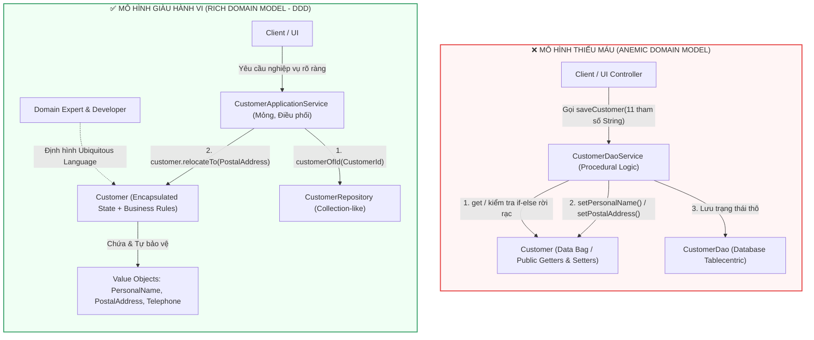

---

### 5. ÁNH XẠ ỨNG DỤNG VÀO DỰ ÁN GAME 2.5D OOP MULTIPLAYER

1. **Xóa sổ căn bệnh *Anemic Model* trong Thực thể Nhân vật (`PlayerCharacter` / `Monster`):**
   * *Sai lầm phổ biến trong Game OOP:* Biến class `Hero` thành một túi chứa dữ liệu với `public void setHp(int hp)`, `public void setMp(int mp)`, `public void setPosition(float x, float y)`. Sau đó ở khắp các class `SkillManager`, `TrapController`, `PoisonSystem` đều viết lại công thức `hero.setHp(hero.getHp() - damage)`. Kết quả: Khi thêm cơ chế *"Khiên bất tử (Invulnerability Shield)"* hoặc *"Giáp phản sát thương"*, lập trình viên quên sửa ở `PoisonSystem`, dẫn đến lỗi nhân vật bật khiên bất tử vẫn chết vì trúng độc!
   * *Áp dụng Chương 1:* Khóa toàn bộ `setHp`, `setMp` thành `private`. Cung cấp các phương thức phản ánh đúng *Ubiquitous Language* của Game Designer như `hero.absorbDamage(DamageSource source, DamageAmount amount)`, `hero.consumeManaForSkill(ManaCost cost)`, hoặc `hero.teleportTo(GridCoordinate target)`. Mọi quy tắc tính giáp, kháng phép, bất tử và kích hoạt trạng thái chết (`Die`) đều nằm gọn và thống nhất bên trong `Hero`.
2. **Áp dụng *DDD Scorecard* để phân bổ công sức trong dự án Game:**
   * Phần **Core Game Loop** (Hệ thống chiến đấu thời gian thực 2.5D, cơ chế kết hợp nguyên tố *Elemental Reaction*, tính toán va chạm *Hitbox/Hurtbox* và AI của Boss) có độ phức tạp quy tắc cực cao $\rightarrow$ Đạt điểm tuyệt đối trên *DDD Scorecard*, bắt buộc dùng **Rich Domain Model**.
   * Ngược lại, phần **Bảng xếp hạng tĩnh (*Leaderboard History*)**, **Cấu hình âm thanh/đồ họa (*Settings*)** hoặc **Nhật ký đăng nhập (*Login Logs*)** chỉ thuần túy là lưu và đọc dữ liệu $\rightarrow$ Điểm *DDD Scorecard* thấp, chỉ cần dùng cấu trúc đọc/ghi dữ liệu trực tiếp mà không cần dựng *Domain Model* phức tạp.

---
---

## CHƯƠNG 2: DOMAINS, SUBDOMAINS, AND BOUNDED CONTEXTS (MIỀN, MIỀN CON VÀ NGỮ CẢNH GIỚI HẠN)

### 1. ĐỀ MỤC & MỤC TIÊU CỐT LÕI (CORE PURPOSE)

#### Hệ thống đề mục đầy đủ theo sách gốc:
* **Big Picture** (Bức tranh toàn cảnh)
  * *Subdomains and Bounded Contexts at Work* (Cách thức hoạt động của Miền con và Ngữ cảnh giới hạn)
  * *Focus on the Core Domain* (Tập trung vào Miền cốt lõi)
* **Why Strategic Design Is So Incredibly Essential** (Tại sao Thiết kế Chiến lược lại tối quan trọng đến vậy)
* **Real-World Domains and Subdomains** (Các Miền và Miền con trong thế giới thực)
* **Making Sense of Bounded Contexts** (Hiểu thấu đáo về Ngữ cảnh giới hạn)
  * *Room for More than the Model* (Không gian cho nhiều thành phần hơn là chỉ Mô hình miền)
  * *Size of Bounded Contexts* (Kích thước của Ngữ cảnh giới hạn)
  * *Aligning with Technical Components* (Căn chỉnh với các thành phần kỹ thuật)
* **Sample Contexts** (Các Ngữ cảnh mẫu trong dự án *SaaSOvation*)
  * *Collaboration Context* (Ngữ cảnh Cộng tác)
  * *Identity and Access Context* (Ngữ cảnh Định danh và Truy cập)
  * *Agile Project Management Context* (Ngữ cảnh Quản lý Dự án Agile)
* **Wrap-Up** (Tổng kết)

#### Vấn đề kỹ thuật & nghiệp vụ cốt lõi và Thảm họa nếu không áp dụng:
* **Vấn đề giải quyết:** Làm thế nào để chia để trị một hệ thống doanh nghiệp khổng lồ thành các vùng mô hình độc lập, rõ ràng về mặt ngữ nghĩa? Chương 2 giúp phân biệt rạch ròi giữa **Không gian bài toán (*Problem Space* — gồm *Core Domain, Supporting Subdomain, Generic Subdomain*)** và **Không gian giải pháp (*Solution Space* — các *Bounded Contexts*)**.
* **Thảm họa kỹ thuật nếu không áp dụng:**
  1. **Quả cầu bùn lớn (*Big Ball of Mud*) & Tham vọng "Mô hình toàn năng" (*Single Unified Enterprise Model*):** Đội ngũ cố gắng xây dựng một mô hình duy nhất dùng chung cho toàn công ty. Một class `User` hay `Product` phải gánh hàng trăm thuộc tính và phương thức phục vụ cho cả Bảo mật, Diễn đàn, Kế toán, lẫn Quản lý Dự án.
  2. **Đa nghĩa ngôn ngữ (*Linguistic Ambiguity*) & *Object Schizophrenia* (Tâm thần phân liệt đối tượng):** Cùng một từ khóa (như `User`, `Account`, hay `Item`) nhưng ở bộ phận này mang ý nghĩa khác, bộ phận kia mang ý nghĩa khác. Khi nhét chung vào một class, đối tượng rơi vào trạng thái "tâm thần phân liệt" — chứa đầy các trường dữ liệu bằng `null` tùy thuộc vào việc nó đang được gọi ở màn hình nào.
  3. **Sai lầm thực tế của đội ngũ *SaaSOvation* trong sách:** Khi làm dự án đầu tiên (*CollabOvation*), vì chỉ biết *Tactical Patterns* (Entity, Repository) mà mù mờ về *Strategic Design*, một lập trình viên đã nhét toàn bộ các khái niệm quản lý người dùng, phân quyền bảo mật (`User`, `Role`, `Permission`) vào chung một chỗ với mô hình diễn đàn (`Forum`, `Discussion`, `Calendar`). Đến khi làm dự án thứ hai (*ProjectOvation*), họ lại nhét thêm các khái niệm `ProductOwner`, `TeamMember` của Scrum vào đống hỗn độn đó, suýt chút nữa làm sập toàn bộ dự án trước khi kịp tách thành 3 *Bounded Context* độc lập.

---

### 2. PHÂN TÍCH LÝ THUYẾT & NGUYÊN LÝ CHUYÊN SÂU

#### A. Không gian Bài toán (*Problem Space*) vs. Không gian Giải pháp (*Solution Space*)
Đây là sự phân định kiến trúc sắc bén nhất của Vaughn Vernon trong Chương 2:
1. **Không gian Bài toán (*Problem Space* = *Domain* + *Subdomains*):** Là thực tế kinh doanh của doanh nghiệp, tồn tại khách quan dù có phần mềm hay không. Khi phân tích *Problem Space*, ta chia bài toán lớn thành 3 loại **Miền con (*Subdomains*)**:
   * **Miền Cốt lõi (*Core Domain*):** Trái tim tạo ra sự khác biệt cạnh tranh và doanh thu chính cho doanh nghiệp (Với *SaaSOvation*, đó là *Collaboration* và sau đó là *Agile Project Management*). Đây là nơi phải tập trung những kỹ sư giỏi nhất và đầu tư DDD triệt để nhất.
   * **Miền Hỗ trợ (*Supporting Subdomain*):** Cần thiết để *Core Domain* hoạt động và có tính đặc thù riêng của công ty nên không thể mua sẵn phần mềm đóng gói (*Off-the-shelf*), nhưng không phải là vũ khí cạnh tranh cốt lõi (Ví dụ: phân hệ quản lý danh mục hoặc cấu hình khách hàng riêng).
   * **Miền Chung (*Generic Subdomain*):** Bài toán mà mọi công ty đều giống nhau (Ví dụ: *Identity & Access Management* — Đăng nhập, Mã hóa mật khẩu, Phân quyền RBAC; hoặc Cổng thanh toán, Gửi Email). Có thể mua sẵn, dùng thư viện mã nguồn mở, hoặc giao cho đội ngũ ít kinh nghiệm hơn phát triển.
2. **Không gian Giải pháp (*Solution Space* = *Bounded Contexts*):** Là kiến trúc phần mềm do chúng ta thiết kế ra để giải quyết bài toán.
   * **Ngữ cảnh Giới hạn (*Bounded Context*):** Là một **ranh giới ngữ nghĩa tường minh (*Explicit Semantic & Linguistic Boundary*)** mà bên trong đó, một *Domain Model* cụ thể và một *Ubiquitous Language* duy nhất có hiệu lực tuyệt đối. Mọi thuật ngữ bên trong một *Bounded Context* chỉ có **một nghĩa duy nhất, không nhập nhằng**.
   * **Tỷ lệ ánh xạ vàng:** Trong một hệ thống thiết kế tốt (Greenfield), chúng ta luôn hướng tới tỷ lệ **1 Subdomain : 1 Bounded Context**. Tuy nhiên, trong các hệ thống di sản (*Legacy Systems*), một *Bounded Context* khổng lồ thường chứa lẫn lộn nhiều *Subdomains* bên trong (được tách tạm bằng các *Modules/Packages*).

#### B. Bên trong một *Bounded Context* chứa những gì? (*Room for More than the Model*)
Nhiều người lầm tưởng *Bounded Context* chỉ chứa *Domain Model* (Entities, Value Objects). Vaughn Vernon làm rõ: Một *Bounded Context* là một đơn vị kiến trúc hoàn chỉnh, bao gồm:
* Giao diện người dùng (*User Interface* / *Web Controllers* / *RESTful Resources*) phục vụ riêng cho ngữ cảnh đó.
* Tầng Dịch vụ Ứng dụng (*Application Services*) điều phối luồng chạy và giao dịch (*Transactions*).
* Mô hình Miền (*Domain Model*).
* Hạ tầng lưu trữ riêng (*Infrastructure / Persistence* & *Database Schema* riêng biệt).

#### C. Kích thước và Sự căn chỉnh Kỹ thuật của *Bounded Context*
* **Kích thước (*Size*):** Không được quá to (biến thành *Big Ball of Mud*), nhưng cũng không được băm quá nhỏ (*Miniature Bounded Contexts* - ví dụ mỗi *Aggregate* tách thành một *Bounded Context* riêng sẽ gây thảm họa tích hợp mạng). Kích thước chuẩn: Vừa đủ để chứa một *Ubiquitous Language* thống nhất và được sở hữu bởi **một đội phát triển duy nhất (*One Team per Bounded Context*)** (hai đội không bao giờ cùng sửa chung một *Bounded Context*).
* **Căn chỉnh thành phần kỹ thuật (*Aligning with Technical Components*):** Mỗi *Bounded Context* nên tương ứng với **1 Project/Solution trên IDE**, biên dịch ra **1 Artifact độc lập (1 file `.jar` hoặc `.dll`)**, và sở hữu **1 Source Code Repository** riêng.

#### D. Sự tiến hóa của 3 *Bounded Contexts* mẫu trong *SaaSOvation*
Nhờ áp dụng *Strategic Design*, đội ngũ *SaaSOvation* đã đập bỏ mô hình hỗn tạp ban đầu và phân tách thành 3 *Bounded Contexts* sạch sẽ:
1. **`Identity and Access Context` (Generic Subdomain):** Quản lý `Tenant` (Tổ chức thuê bao), `User`, `Group`, `Role`, `Permission`. Ở đây, `User` gắn liền với mật khẩu băm (*Password Hash*) và thông tin định danh (`Person`).
2. **`Collaboration Context` (Core Domain 1):** Quản lý `Forum`, `Discussion`, `Post`, `Calendar`, `CalendarEntry`. Ở đây **không có class `User`!** Thay vào đó, ngữ cảnh này định nghĩa các khái niệm theo đúng vai trò cộng tác: `Author` (Tác giả bài viết), `Moderator` (Người điều phối), `Owner` (Chủ lịch), `Participant` (Người tham gia) — tất cả đều là các **Value Objects** nhẹ nhàng ánh xạ từ `Identity and Access Context` sang!
3. **`Agile Project Management Context` (Core Domain 2 - trọng tâm sách):** Quản lý `Product`, `BacklogItem`, `Release`, `Sprint`, `Task`. Ở đây cũng **không có class `User` hay `Author`**, mà chỉ có `ProductOwner` và `TeamMember`!

---

### 3. MỔ XẺ MÃ NGUỒN & CẤU TRÚC THIẾT KẾ (CODE DEEP-DIVE)

Trong Chương 2, sự khác biệt chí mạng giữa thiết kế thất bại và thiết kế thành công nằm ở việc **tách biệt khái niệm con người (`User`) theo từng *Bounded Context*** thay vì dùng chung một thực thể `User` khổng lồ cho toàn hệ thống (trang 73–84).

#### ❌ Thiết kế SAI BAN ĐẦU: Một class `User` "Thập cẩm" xuyên suốt mọi Subdomain (Unbounded Model)
```java
package com.saasovation.common.domain.model;

// THẢM HỌA: Một thực thể User gánh trách nhiệm của cả 3 Subdomains khác nhau!
public class User extends ConcurrencySafeEntity {
    private TenantId tenantId;
    private String username;
    private String passwordHash;         // Thuộc về Identity & Access
    private Set<Role> roles;             // Thuộc về Identity & Access
    
    // Rò rỉ khái niệm của Collaboration vào User
    private int forumPostsCount;
    private boolean canModerateDiscussions;
    public void postToForum(Forum aForum, String aSubject, String aBodyText) { ... }
    
    // Rò rỉ khái niệm của Agile Project Management (Scrum) vào User
    private boolean isScrumProductOwner;
    private Set<Task> assignedSprintTasks;
    public void estimateTaskHours(Task aTask, int hoursRemaining) { ... }
}
```

#### ✅ Thiết kế CHUẨN MỰC SAU REFACTOR: Phân tách thành 3 *Bounded Contexts* với *Ubiquitous Language* độc lập

```java
// ============================================================================
// CONTEXT 1: IDENTITY AND ACCESS CONTEXT (Generic Subdomain)
// Package: com.saasovation.identityaccess.domain.model.identity
// ============================================================================
public class User extends ConcurrencySafeEntity {
    private TenantId tenantId;
    private String username;
    private String password;
    private Enablement enablement;
    private Person person; // Chứa FullName, ContactInformation

    public UserDescriptor userDescriptor() {
        return new UserDescriptor(
            this.tenantId(),
            this.username(),
            this.person().emailAddress().address());
    }
    // Chỉ chứa các hành vi liên quan đến Bảo mật & Định danh (changePassword, defineEnablement...)
}

// ============================================================================
// CONTEXT 2: COLLABORATION CONTEXT (Core Domain 1)
// Package: com.saasovation.collaboration.domain.model.collaborator
// ============================================================================
// Không hề import class User của IdentityAccess! 
// Định nghĩa Value Object đại diện cho vai trò cộng tác viên trong diễn đàn:
public final class Moderator extends Collaborator {
    public Moderator(String aUsername, String aName, String anEmailAddress) {
        super(aUsername, aName, anEmailAddress);
    }
}

public final class Author extends Collaborator {
    public Author(String aUsername, String aName, String anEmailAddress) {
        super(aUsername, aName, anEmailAddress);
    }
}

// Package: com.saasovation.collaboration.domain.model.forum
public class Forum extends ConcurrencySafeEntity {
    private TenantId tenantId;
    private ForumId forumId;
    private Moderator moderator; // Chỉ làm việc với Moderator của Collaboration Context

    public void moderatePost(Post aPost, Moderator aModerator, String aSubject, String aBodyText) {
        this.assertClosed();
        this.assertModerator(aModerator);
        aPost.alterPostContent(aSubject, aBodyText);
    }

    private void assertModerator(Moderator aModerator) {
        if (!this.moderator().equals(aModerator)) {
            throw new IllegalArgumentException("User is not the assigned moderator of this forum.");
        }
    }
}

// ============================================================================
// CONTEXT 3: AGILE PROJECT MANAGEMENT CONTEXT (Core Domain 2)
// Package: com.saasovation.agilepm.domain.model.team
// ============================================================================
// Trong ngữ cảnh Scrum, "User" được mô hình hóa thành ProductOwner và TeamMember!
public class ProductOwner extends Member {
    public ProductOwner(TenantId aTenantId, String aUsername, String aFirstName, String aLastName, String anEmailAddress, Date anInitializedOn) {
        super(aTenantId, aUsername, aFirstName, aLastName, anEmailAddress, anInitializedOn);
    }
    public ProductOwnerId productOwnerId() {
        return new ProductOwnerId(this.tenantId(), this.username());
    }
}
```

#### Bảng phân tích kỹ thuật & Ý nghĩa thiết kế:

| Dòng code / Đoạn code then chốt | Giải thích kỹ thuật & Nguyên lý thiết kế (DDD/OOP) được hiện thực hóa |
| :--- | :--- |
| `package com.saasovation.identityaccess...` <br> `package com.saasovation.collaboration...` <br> `package com.saasovation.agilepm...` | **Căn chỉnh Kỹ thuật theo *Bounded Context* (*Technical Alignment*):** Tên gói cấp cao nhất sau tên công ty (`identityaccess`, `collaboration`, `agilepm`) phản ánh trực tiếp ranh giới các *Bounded Contexts*. Mỗi nhánh package này nằm trong một dự án/module biên dịch độc lập (`saasovation-identityaccess.jar`, `saasovation-collaboration.jar`, `saasovation-agilepm.jar`), ngăn chặn việc gọi chéo class trực tiếp. |
| `public class User` *(trong IdentityAccess)* | **Sự tinh khiết của Mô hình (*Model Purity*):** Trong `Identity and Access Context`, thực thể `User` chỉ tập trung 100% vào bài toán xác thực (`password`), trạng thái kích hoạt tài khoản (`Enablement`), và thông tin cá nhân (`Person`). Nó hoàn toàn không biết diễn đàn (`Forum`) hay dự án Scrum (`Sprint`, `Task`) là gì. |
| `public final class Moderator extends Collaborator` *(trong Collaboration)* | **Ngữ cảnh là Vua (*Context Is King*) & *Value Object Role*:** Trong ngữ cảnh Cộng tác, chuyên gia nghiệp vụ không quan tâm đến việc đổi mật khẩu hay phân quyền hệ thống của `User`. Họ chỉ quan tâm ai là `Author` (Tác giả đăng bài), ai là `Moderator` (Người kiểm duyệt). Do đó, `Moderator` và `Author` được thiết kế thành các **Value Objects** bất biến (`final`), không cần vòng đời phức tạp của một Entity. |
| `this.assertModerator(aModerator)` | **Biểu đạt quy tắc nghiệp vụ thuần khiết:** Phương thức `moderatePost` của `Forum` kiểm tra quyền kiểm duyệt chỉ bằng một phép so sánh giá trị đơn giản `this.moderator().equals(aModerator)` ngay trong bộ nhớ mà không cần phải chọc sang cơ sở dữ liệu bảo mật hay gọi các hàm kiểm tra `Role/Permission` rườm rà của hệ thống IAM. |
| `public class ProductOwner extends Member` *(trong AgilePM)* | **Cô lập sự thay đổi (*Isolation of Change*):** Trong ngữ cảnh Scrum (`AgilePM`), một người dùng đóng vai trò là `ProductOwner` hoặc `TeamMember`. Nhờ tách biệt hoàn toàn với `User` và `Moderator`, đội ngũ phát triển *ProjectOvation* có thể thoải mái thêm các hành vi đặc thù của Scrum vào `ProductOwner` hoặc `TeamMember` mà không sợ làm hỏng hệ thống diễn đàn *CollabOvation*. |

---

### 4. SƠ ĐỒ TRỰC QUAN HÓA (BẮT BUỘC MÃ MERMAID)

Sơ đồ dưới đây minh họa quá trình chuyển hóa kiến trúc của *SaaSOvation*: từ một mô hình hỗn độn ban đầu sang việc phân định rõ **Problem Space (Subdomains)** và ánh xạ vào **Solution Space (3 Bounded Contexts)** với sự biến đổi ngữ nghĩa của cùng một thực thể con người:

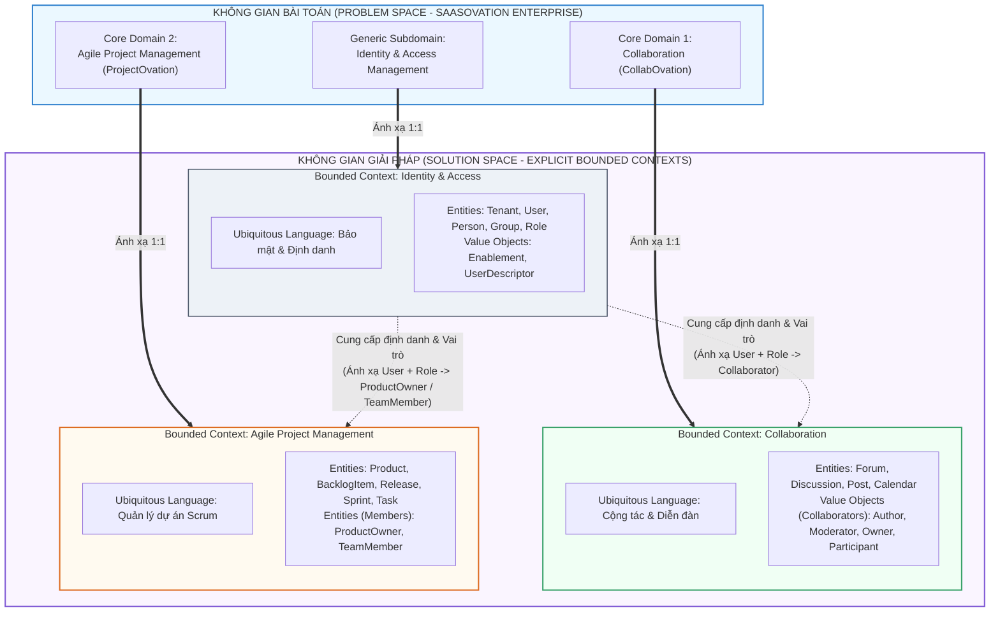

---

### 5. ÁNH XẠ ỨNG DỤNG VÀO DỰ ÁN GAME 2.5D OOP MULTIPLAYER

Chương 2 giải quyết trực tiếp **"cơn ác mộng `God Class Player`"** trong các dự án Game 2.5D nhiều người chơi:

1. **Đập vỡ *God Class `Player`* bằng *Bounded Contexts*:**
   * *Thảm họa thường gặp:* Lập trình viên tạo ra một class `Player` duy nhất dài 5.000 dòng code chứa tất cả mọi thứ: `username`, `passwordHash` (Đăng nhập), `eloRating`, `partyId` (Ghép trận), `inventorySlots`, `goldBalance` (Kinh tế/Túi đồ), và cả `currentHp`, `position25D`, `velocity`, `activeBuffs`, `hitbox` (Chiến đấu thời gian thực). Khi truyền object `Player` này qua lại giữa các hệ thống, bộ nhớ bị phình to và một sửa đổi nhỏ ở tính năng Chợ giao dịch (*Trading*) cũng làm lỗi biên dịch ở *Combat Engine*.
   * *Áp dụng Chương 2:* Chia kiến trúc Server/Client của Game thành các **Bounded Contexts** tách biệt với mô hình riêng cho "Người chơi":
     * **`Account & Auth Context` (Generic Subdomain):** Mô hình hóa là `Account` (chứa `AccountId`, `Credentials`, `BanStatus`).
     * **`Lobby & Matchmaking Context` (Supporting Subdomain):** Mô hình hóa người chơi là `MatchmakingContender` hoặc `PartyMember` (chứa `MMR/ELO`, `PreferredRole`, `ReadyStatus`, `PingLatency`). Hoàn toàn không biết HP, Mana hay tọa độ `X, Y, Z` là gì!
     * **`Economy & Inventory Context` (Supporting Subdomain):** Mô hình hóa người chơi là `InventoryHolder` hoặc `Trader` (chứa `Wallet`, `BagSlots`, `EquipmentLoadout`).
     * **`Real-Time Combat Context` (Core Domain):** Mô hình hóa người chơi là `Combatant` / `HeroActor` (chứa `Transform25D`, `VitalStats`, `SkillCooldowns`, `StatusEffects`). Khi bắt đầu trận đấu, hệ thống chỉ chuyển đổi dữ liệu trang bị từ `Inventory Context` thành các chỉ số chiến đấu bất biến (`CombatStatsSnapshot` Value Object) nạp vào `Combatant`.
2. **Bảo vệ *Core Domain* (Combat Engine 2.5D) khỏi độ trễ hạ tầng:**
   * Nhờ tách `Real-Time Combat Context` ra khỏi `Economy/Database Context`, toàn bộ vòng lặp chiến đấu (*Game Loop 60 ticks/s*) chỉ thao tác trên các đối tượng `Combatant` thuần khiết trong RAM mà không bao giờ bị nghẽn (*I/O Blocking*) bởi các truy vấn cơ sở dữ liệu của hệ thống Túi đồ hay Tài khoản.


<br/><br/>

---\n

# ĐỢT 2 / 10: BÓC TÁCH CHUYÊN SÂU CHƯƠNG 3 & CHƯƠNG 4 (PHẦN 1)
**Sách:** *Implementing Domain-Driven Design (IDDD)* — **Tác giả:** *Vaughn Vernon*

---

## CHƯƠNG 3: CONTEXT MAPS (BẢN ĐỒ NGỮ CẢNH)

### 1. ĐỀ MỤC & MỤC TIÊU CỐT LÕI (CORE PURPOSE)

#### Hệ thống đề mục đầy đủ theo sách gốc:
* **Why Context Maps Are So Essential** (Tại sao Bản đồ Ngữ cảnh lại tối quan trọng)
  * *Drawing Context Maps* (Vẽ Bản đồ Ngữ cảnh)
  * *Projects and Organizational Relationships* (Các mối quan hệ Dự án và Tổ chức)
* **Mapping the Three Contexts** (Lập bản đồ cho Ba Ngữ cảnh của *SaaSOvation*)
  * *Integrating Collaboration Context and Identity and Access Context* (Tích hợp Ngữ cảnh Cộng tác và Ngữ cảnh Định danh & Truy cập)
  * *Integrating Agile Project Management Context and Identity and Access Context* (Tích hợp Ngữ cảnh Quản lý Dự án Agile và Ngữ cảnh Định danh & Truy cập)
  * *Integrating Agile Project Management Context and Collaboration Context* (Tích hợp Ngữ cảnh Quản lý Dự án Agile và Ngữ cảnh Cộng tác)
* **Wrap-Up** (Tổng kết)

#### Vấn đề kỹ thuật & nghiệp vụ cốt lõi và Thảm họa nếu không áp dụng:
* **Vấn đề giải quyết:** Sau khi Chương 2 đã chia hệ thống thành các *Bounded Contexts* độc lập, câu hỏi sống còn tiếp theo là: **Làm thế nào để các *Bounded Contexts* này giao tiếp và trao đổi dữ liệu với nhau mà không làm ô nhiễm mô hình nội tại (*Ubiquitous Language*) của nhau?** Chương 3 cung cấp bộ công cụ **Context Mapping** gồm 9 mẫu quan hệ tổ chức và tích hợp kỹ thuật giữa các ngữ cảnh Thượng nguồn (*Upstream*) và Hạ nguồn (*Downstream*).
* **Thảm họa kỹ thuật nếu không áp dụng:**
  1. **Sự lây lan của Quả cầu bùn lớn (*Bleeding of the Big Ball of Mud*):** Khi tích hợp với một hệ thống cũ hoặc một phân hệ khác mà không có Lớp Chống Tham Nhũng (*Anticorruption Layer - ACL*), các khái niệm méo mó, cấu trúc bảng dữ liệu hoặc DTO của hệ thống ngoài sẽ tràn thẳng vào giữa *Core Domain*, phá hủy mọi nỗ lực thiết kế hướng đối tượng.
  2. **Khớp nối chặt giữa các Đội ngũ & Hệ thống (*Organizational & Technical Tight Coupling*):** Hệ thống Hạ nguồn (*Downstream*) phụ thuộc mù quáng vào mô hình của Thượng nguồn (*Upstream*). Mỗi khi đội Thượng nguồn đổi tên một trường JSON hoặc sửa API, toàn bộ hệ thống Hạ nguồn sập dây chuyền.
  3. **Bế tắc giao tiếp liên đội (*Inter-team Friction*):** Không xác định rõ quan hệ *Customer-Supplier* (Khách hàng - Nhà cung cấp) hay *Conformist* (Kẻ tuân phục), dẫn đến việc đội làm *Core Domain* phải chờ đợi đội làm hệ thống phụ trong vô vọng mà không biết cách tự xây dựng cơ chế chuyển đổi độc lập.

---

### 2. PHÂN TÍCH LÝ THUYẾT & NGUYÊN LÝ CHUYÊN SÂU

#### A. Bản chất của *Context Map* và Quan hệ *Upstream / Downstream*
* **Context Map không phải là sơ đồ kiến trúc phần cứng (Topology Diagram):** Nó là sơ đồ phản ánh **thực tại hiện hữu (*As-Is Reality*)** của cả hai chiều: **biên giới kỹ thuật giữa các mô hình** và **mối quan hệ chính trị/tổ chức giữa các nhóm phát triển**.
* **Thượng nguồn (*Upstream - U*) & Hạ nguồn (*Downstream - D*):**
  * **Upstream (U):** Là phía cung cấp dữ liệu/dịch vụ. Hành động của đội *Upstream* (thay đổi API, lịch trình phát hành, cấu trúc sự kiện) ảnh hưởng trực tiếp đến sự sống còn của *Downstream*.
  * **Downstream (D):** Là phía phụ thuộc và tiêu thụ dữ liệu từ *Upstream*, nhưng không gây ảnh hưởng ngược lại cho mô hình của *Upstream*.

#### B. 9 Mẫu Quan hệ Tổ chức & Tích hợp trên *Context Map*
Vaughn Vernon hệ thống hóa đầy đủ các mẫu từ Eric Evans và bổ sung kinh nghiệm thực chiến:
1. **Partnership (Quan hệ Đối tác):** Hai nhóm ở hai *Bounded Context* cùng thành công hoặc cùng thất bại (thường phụ thuộc vào chung một mốc phát hành sản phẩm). Cả hai phải lập kế hoạch tích hợp song hành và điều chỉnh mô hình theo nhu cầu của nhau.
2. **Shared Kernel (Nhân Dùng Chung):** Hai nhóm chia sẻ một tập con nhỏ của *Domain Model* (code và database/schema). Việc sửa đổi *Shared Kernel* bắt buộc phải có sự đồng thuận và chạy bộ test chung của cả hai nhóm. *(Vernon cảnh báo: Rất dễ bị lạm dụng thành thùng rác chứa code chung, chỉ nên dùng cực kỳ hạn chế).*
3. **Customer-Supplier Development (Phát triển Khách hàng - Nhà cung cấp):** *Downstream* đóng vai trò **Khách hàng (*Customer*)**, *Upstream* đóng vai trò **Nhà cung cấp (*Supplier*)**. Đội *Downstream* có tiếng nói trọng lượng trong việc yêu cầu *Upstream* cung cấp dữ liệu gì, ưu tiên tính năng nào vào Backlog và cùng định nghĩa bộ kiểm thử chấp nhận tự động (*Automated Acceptance Tests*).
4. **Conformist (Kẻ Tuân Phục):** Khi *Upstream* không có động lực phục vụ *Downstream* (ví dụ: một API khổng lồ bên ngoài hoặc một nhóm nội bộ quá bận rộn), nhưng mô hình của *Upstream* lại **đủ tốt và tương thích**, đội *Downstream* chấp nhận "tuân phục" — bê nguyên xi mô hình khái niệm của *Upstream* vào hệ thống của mình mà không tốn công dịch thuật.
5. **Anticorruption Layer - ACL (Lớp Chống Tham Nhũng):** Vũ khí phòng thủ mạnh nhất của *Downstream*! Khi phải tích hợp với một *Upstream* có mô hình khác biệt hoàn toàn hoặc là một *Big Ball of Mud*, đội *Downstream* dựng lên một bức tường cô lập (gồm các *Facades*, *Adapters*, và *Translators*). ACL giao tiếp với *Upstream* bằng ngôn ngữ của *Upstream*, sau đó **dịch (*Translate*)** hoàn toàn sang các *Entities / Value Objects* thuần khiết thuộc *Ubiquitous Language* của *Downstream*.
6. **Open Host Service - OHS (Dịch vụ Chủ Mở):** Khi một *Bounded Context* ở phía *Upstream* cần phục vụ cho hàng loạt hệ thống *Downstream* khác nhau, thay vì bắt mỗi nơi tự kết nối lắt nhắt, *Upstream* định nghĩa một giao thức/bộ API mở chuẩn hóa (dưới dạng RESTful Resources, RPC, hoặc Messaging Endpoints) để mọi hệ thống dễ dàng tích hợp.
7. **Published Language - PL (Ngôn ngữ Xuất Bản):** Thường đi cặp với *Open Host Service* (**OHS/PL**). Là một định dạng trao đổi thông tin chuẩn hóa, được tài liệu hóa rõ ràng và trung lập (như XML Schema, JSON Schema, Google Protocol Buffers, Atom Feeds, hoặc chuẩn ngành tài chính/y tế) để truyền tải dữ liệu và *Domain Events* qua mạng.
8. **Separate Ways (Đường Ai Nấy Đi):** Khi chi phí tích hợp giữa hai *Bounded Contexts* quá đắt đỏ mà giá trị nghiệp vụ thu lại không đáng kể, hai hệ thống quyết định cắt đứt mọi liên kết kỹ thuật, chấp nhận tự sinh dữ liệu hoặc để người dùng nhập tay ở hai nơi.
9. **Big Ball of Mud (Quả Cầu Bùn Lớn):** Hệ thống di sản nơi các mô hình bị trộn lẫn không còn biên giới, thay đổi một chỗ làm hỏng mười chỗ khác. Trên *Context Map*, ta phải khoanh vùng nó và tuyệt đối dùng **ACL** khi bắt buộc phải giao tiếp với nó.

#### C. Giải phẫu Bản đồ 3 Ngữ cảnh của *SaaSOvation*
Trong dự án thực tế của sách:
* **`Identity and Access Context` (Upstream - U)** cung cấp dịch vụ định danh thông qua **Open Host Service (OHS)** kết hợp **Published Language (PL)** (xuất bản RESTful Resources và *Domain Events* dưới dạng Atom Feeds / Messaging).
* **`Collaboration Context` (Downstream - D so với IAM, nhưng là Upstream - U so với AgilePM):**
  * Khi lấy thông tin người dùng từ `Identity and Access Context`, đội `Collaboration` thiết kế một **Anticorruption Layer (ACL)** tinh gọn đặt ẩn sau một `CollaboratorService` (Domain Service). ACL này gọi sang OHS của IAM, nhận về thông tin `User` và `Role`, rồi dịch ngay lập tức thành các Value Objects `Author`, `Moderator`, `Owner`, `Participant`.
* **`Agile Project Management Context` (Downstream - D so với cả IAM và Collaboration):**
  * Giao tiếp với `Identity and Access Context` qua Messaging để đồng bộ thông tin thành viên dự án thành `ProductOwner` và `TeamMember`.
  * Giao tiếp với `Collaboration Context` theo quan hệ **Customer-Supplier** (hoặc sự kiện bất đồng bộ): khi một `Product` hoặc `Sprint` mới được tạo trong `AgilePM`, nó gửi yêu cầu sang `Collaboration Context` để tự động khởi tạo một `Forum` và `Discussion` thảo luận cho sản phẩm đó!

---

### 3. MỔ XẺ MÃ NGUỒN & CẤU TRÚC THIẾT KẾ (CODE DEEP-DIVE)

Chương 3 (kết hợp chi tiết hiện thực hóa tại trang 95–110 và liên kết đến `UserInRoleAdapter`) minh họa cách thiết kế **Anticorruption Layer (ACL)** để dịch khái niệm từ `Identity and Access Context` (Upstream) sang `Collaboration Context` (Downstream) mà không làm bẩn Domain Model.

#### ❌ Thiết kế SAI BAN ĐẦU: Rò rỉ mô hình Thượng nguồn (*Upstream Leakage*) vào Hạ nguồn
```java
package com.saasovation.collaboration.application;

// SAI LẦM: Collaboration Context import trực tiếp class của IdentityAccess Context!
import com.saasovation.identityaccess.domain.model.identity.User;
import com.saasovation.identityaccess.domain.model.access.Role;

public class ForumApplicationService {
    public void startDiscussion(String aTenantId, String aForumId, String aUsername, String aSubject) {
        // Chọc thẳng sang Repository hoặc API của IdentityAccess và mang đối tượng ngoại lai về
        User user = identityAccessClient.getUser(aTenantId, aUsername);
        Role role = identityAccessClient.getRole(aTenantId, "ForumAuthor");
        
        if (!role.isInRole(user)) {
            throw new SecurityException("User cannot author discussions.");
        }
        
        Forum forum = forumRepository.forumOfId(new TenantId(aTenantId), new ForumId(aForumId));
        // Truyền thẳng đối tượng User của hệ thống bảo mật vào mô hình Diễn đàn!
        forum.startDiscussion(user, aSubject); 
    }
}
```

#### ✅ Thiết kế CHUẨN MỰC SAU REFACTOR: Cô lập hoàn toàn bằng *Domain Service Interface* + *Anticorruption Layer (Adapter + Translator)*

```java
// ============================================================================
// 1. TẦNG DOMAIN MODEL (COLLABORATION CONTEXT - DOWNSTREAM)
// Package: com.saasovation.collaboration.domain.model.collaborator
// Giao diện thuộc về Ubiquitous Language của Collaboration, hoàn toàn mù tịt về IAM!
// ============================================================================
public interface CollaboratorService {
    public Author authorFrom(Tenant aTenant, String anIdentity);
    public Creator creatorFrom(Tenant aTenant, String anIdentity);
    public Moderator moderatorFrom(Tenant aTenant, String anIdentity);
    public Owner ownerFrom(Tenant aTenant, String anIdentity);
    public Participant participantFrom(Tenant aTenant, String anIdentity);
}

// ============================================================================
// 2. TẦNG INFRASTRUCTURE: ANTICORRUPTION LAYER (ACL)
// Package: com.saasovation.collaboration.infrastructure.services
// Đóng vai trò Adapter & Translator nối với Open Host Service (OHS) của IAM
// ============================================================================
public class TranslatingCollaboratorService implements CollaboratorService {

    private UserInRoleAdapter userInRoleAdapter; // Adapter giao tiếp mạng với IAM

    public TranslatingCollaboratorService(UserInRoleAdapter aUserInRoleAdapter) {
        super();
        this.userInRoleAdapter = aUserInRoleAdapter;
    }

    @Override
    public Author authorFrom(Tenant aTenant, String anIdentity) {
        Author author =
            this.userInRoleAdapter()
                .toCollaborator(
                    aTenant,
                    anIdentity,
                    "Author",       // Tên Role cần kiểm tra bên IAM
                    Author.class);  // Kiểu Value Object đích cần dịch ra
        return author;
    }

    @Override
    public Moderator moderatorFrom(Tenant aTenant, String anIdentity) {
        Moderator moderator =
            this.userInRoleAdapter()
                .toCollaborator(
                    aTenant,
                    anIdentity,
                    "Moderator",
                    Moderator.class);
        return moderator;
    }
    // ... Tương tự cho Creator, Owner, Participant
}

// ============================================================================
// 3. TRANSLATOR NỘI BỘ BÊN TRONG ACL
// Chuyển đổi Published Language (JSON/Representations từ IAM) thành Value Object
// ============================================================================
public class CollaboratorTranslator {

    public <T extends Collaborator> T toCollaboratorFromRepresentation(
        String aUserInRoleRepresentation,
        Class<T> aCollaboratorClass) throws Exception {

        RepresentationReader reader = new RepresentationReader(aUserInRoleRepresentation);

        String username = reader.stringValue("username");
        String firstName = reader.stringValue("firstName");
        String lastName = reader.stringValue("lastName");
        String emailAddress = reader.stringValue("emailAddress");

        String name = (firstName + " " + lastName).trim();

        // Dùng Reflection hoặc Factory khởi tạo đúng Value Object (Author, Moderator...)
        Constructor<T> ctor = aCollaboratorClass.getConstructor(
            String.class, String.class, String.class);

        return ctor.newInstance(username, name, emailAddress);
    }
}
```

#### Bảng phân tích kỹ thuật & Ý nghĩa thiết kế:

| Dòng code / Đoạn code then chốt | Giải thích kỹ thuật & Nguyên lý thiết kế (DDD/OOP) được hiện thực hóa |
| :--- | :--- |
| `public interface CollaboratorService` | **Separated Interface (Giao diện tách biệt) & Dependency Inversion:** Đặt interface ngay trong package `domain.model.collaborator` của `Collaboration Context`. Phương thức `authorFrom(Tenant, String)` chỉ sử dụng các khái niệm nội tại của ngữ cảnh Cộng tác, giúp Domain Model không phụ thuộc vào bất kỳ thư viện mạng hay hệ thống ngoại vi nào. |
| `public class TranslatingCollaboratorService implements CollaboratorService` | **Anticorruption Layer (ACL) Facade:** Lớp cài đặt thực tế nằm ở tầng `infrastructure.services`. Đây là chốt chặn biên giới: bên trên nó nói ngôn ngữ của `Collaboration Context`, bên dưới nó ủy quyền cho `UserInRoleAdapter` để nói chuyện với `Identity and Access Context`. |
| `this.userInRoleAdapter().toCollaborator(aTenant, anIdentity, "Author", Author.class)` | **Mẫu Adapter trong ACL:** Đóng gói toàn bộ chi tiết kỹ thuật gọi HTTP REST đến *Open Host Service* của `Identity and Access Context` (ví dụ: `GET /tenants/{tenantId}/users/{username}/inRole/Author`). Nếu hệ thống IAM đổi từ REST sang gRPC hay Database, chỉ cần sửa `UserInRoleAdapter`, mô hình `Forum` không hề hay biết. |
| `public class CollaboratorTranslator` | **Mẫu Translator chuyển đổi *Published Language*:** Nhận chuỗi JSON (`aUserInRoleRepresentation` - *Published Language* của IAM), bóc tách các trường dữ liệu thô (`firstName`, `lastName`) và lắp ghép thành thuộc tính `name` phù hợp với cấu trúc hàm khởi tạo của Value Object `Author(username, name, emailAddress)`. |

---

### 4. SƠ ĐỒ TRỰC QUAN HÓA (BẮT BUỘC MÃ MERMAID)

Sơ đồ dưới đây tái hiện chính xác **Context Map tổng thể của 3 Bounded Contexts trong *SaaSOvation*** cùng luồng hoạt động bên trong **Anticorruption Layer (ACL)**:

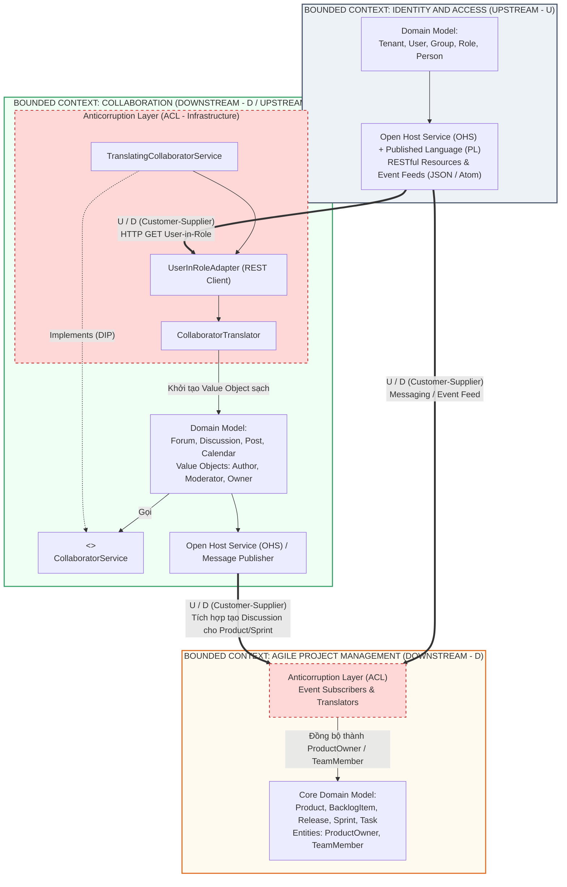

---

### 5. ÁNH XẠ ỨNG DỤNG VÀO DỰ ÁN GAME 2.5D OOP MULTIPLAYER

Trong kiến trúc dự án Game 2.5D OOP nhiều người chơi (như cấu trúc `core`, `combat`, `network`, `server`, `persistence` của nhóm):

1. **Dựng *Anticorruption Layer (ACL)* giữa `Network/Server Context` và `Real-Time Combat Context`:**
   * *Thảm họa nếu thiếu ACL:* Các gói tin mạng (`Packet`, `ByteBuffer`, `SocketChannel` hoặc chuỗi JSON `SnapshotDTO`) từ tầng `network` truyền thẳng vào bên trong class `Hero` hoặc `CombatManager`. Hệ quả là mô hình chiến đấu bị trói chặt vào định dạng gói tin mạng; khi đổi giao thức truyền tải (ví dụ tối ưu hóa từ chuỗi Text sang Binary Bitpacking), toàn bộ code chiến đấu bị lỗi!
   * *Áp dụng Chương 3:* Thiết lập quan hệ trên *Context Map*: Tầng `network` sử dụng **Published Language (PL)** là cấu trúc gói tin nhị phân/chuỗi phẳng. Ở biên giới đi vào `combat`, ta đặt một **ACL (`NetworkPacketTranslator` / `CombatCommandAdapter`)** chuyển đổi gói tin thô thành các đối tượng miền thuần khiết: `MoveIntent(DirectionVector)`, `CastSkillCommand(SkillSlot, AimAngle)`, hoặc `DamageEvent`.
2. **Dựng *ACL* bảo vệ `Core/Combat` khỏi thư viện Đồ họa AWT/Swing (`Render Context`):**
   * Đúng như hiến chương kiến trúc của dự án (*"Cấm `import java.awt.*` vào `core/combat/network/server/persistence`"*): `Render Context` (2.5D Renderer) là **Downstream (Conformist hoặc Customer)** đọc trạng thái của `Core/Combat` (Upstream). Trong `Core/Combat`, vị trí và khung va chạm chỉ được mô hình hóa bằng Value Objects toán học thuần khiết của miền (`Vector25D`, `BoundingBox`), tuyệt đối không dùng `java.awt.Rectangle` hay `java.awt.image.BufferedImage`. Tầng `Render` sẽ tự có `SpriteAdapter` ánh xạ tọa độ `(x, y, z)` của miền sang tọa độ điểm ảnh `(screenX, screenY)` và thứ tự vẽ (`Z-Index`).

---
---

## CHƯƠNG 4 (PHẦN 1): ARCHITECTURE — LAYERS, DIP, HEXAGONAL, SOA, REST (KIẾN TRÚC HỆ THỐNG - PHẦN 1)

### 1. ĐỀ MỤC & MỤC TIÊU CỐT LÕI (CORE PURPOSE)

#### Hệ thống đề mục đầy đủ theo sách gốc (Nửa đầu Chương 4 - Trang 113–138):
* **Interviewing the Successful CIO** (Phỏng vấn vị CIO thành công — Bối cảnh lựa chọn kiến trúc thực dụng)
* **Layers** (Kiến trúc Phân tầng truyền thống)
  * *Dependency Inversion Principle* (Nguyên lý Đảo ngược Phụ thuộc - DIP)
* **Hexagonal or Ports and Adapters** (Kiến trúc Lục giác hay Cổng và Bộ chuyển đổi)
* **Service-Oriented** (Kiến trúc Hướng Dịch vụ - SOA)
* **Representational State Transfer—REST** (Chuyển giao Trạng thái Đại diện - REST)
  * *REST as an Architectural Style* (REST như một Phong cách Kiến trúc)
  * *Key Aspects of a RESTful HTTP Server* (Các khía cạnh then chốt của một Máy chủ HTTP chuẩn REST)
  * *Key Aspects of a RESTful HTTP Client* (Các khía cạnh then chốt của một Máy khách HTTP chuẩn REST)
  * *REST and DDD* (Kết hợp REST và DDD)
  * *Why REST?* (Tại sao lại chọn REST?)

#### Vấn đề kỹ thuật & nghiệp vụ cốt lõi và Thảm họa nếu không áp dụng:
* **Vấn đề giải quyết:** Một *Domain Model* dù được thiết kế tinh xảo đến đâu cũng không thể sống lơ lửng trong chân không; nó cần một ngôi nhà kiến trúc (*Architectural Housing*) bao bọc để giao tiếp với người dùng, cơ sở dữ liệu và các hệ thống từ xa. Phần 1 của Chương 4 giải quyết bài toán: **Làm sao để kết nối Domain Model với thế giới bên ngoài (UI, Database, Web API) mà vẫn giữ cho Domain Model hoàn toàn trung lập và độc lập về mặt kiến trúc (*Architecturally Neutral Domain Model*)?**
* **Thảm họa kỹ thuật nếu không áp dụng:**
  1. **Sự phụ thuộc từ trên xuống truyền thống (*Top-Down Infrastructure Coupling*):** Trong kiến trúc 4 tầng cổ điển (UI $\rightarrow$ Application $\rightarrow$ Domain $\rightarrow$ Infrastructure), tầng *Domain* gọi trực tiếp xuống tầng *Infrastructure* (Database, ORM, Messaging). Hậu quả: Không thể chạy Unit Test cho *Domain Model* nếu không bật Database Server; công nghệ lưu trữ rò rỉ làm biến dạng thiết kế đối tượng.
  2. **Biến chất REST thành RPC qua HTTP (*RPC-over-HTTP Anti-pattern*) và Rò rỉ Mô hình Miền ra ngoài API:** Lập trình viên phơi bày trực tiếp các bảng dữ liệu hoặc *Domain Entities* nội bộ ra ngoài qua các hàm REST tự chế kiểu `/api/updateProductStatus`, tạo ra sự kết dính chặt chẽ (*Tight Coupling*) giữa mọi Client bên ngoài với cấu trúc bên trong của *Domain Model*. Khi Refactor một class trong *Domain Model*, hàng loạt ứng dụng Client bị sập!

---

### 2. PHÂN TÍCH LÝ THUYẾT & NGUYÊN LÝ CHUYÊN SÂU

#### A. Kiến trúc Phân tầng (*Layers Architecture*) & Bước ngoặt *Dependency Inversion Principle (DIP)*
1. **4 Tầng cổ điển trong DDD:**
   * **User Interface (Presentation Layer):** Hiển thị thông tin và tiếp nhận thao tác của người dùng (hoặc hệ thống ngoài).
   * **Application Layer:** Tầng điều phối mỏng (*Thin Orchestration Layer*). **Không chứa quy tắc nghiệp vụ (*No Business Logic*)!** Nhiệm vụ của nó là quản lý giao dịch (*Transactions*), kiểm tra bảo mật cấp ứng dụng, nạp *Aggregate* từ *Repository*, gọi phương thức hành vi trên *Aggregate*, và lưu lại.
   * **Domain Layer (Model):** Trái tim của phần mềm — chứa *Entities, Value Objects, Aggregates, Domain Services, Domain Events*.
   * **Infrastructure Layer:** Cung cấp năng lực kỹ thuật (Database ORM, gửi Message, gửi Email, gọi REST).
2. **Strict vs. Relaxed Layers & Cú lật ngược bằng DIP (Robert C. Martin):**
   * Trong phân tầng cổ điển, *Domain Layer* phụ thuộc vào *Infrastructure Layer*.
   * Khi áp dụng **Dependency Inversion Principle (DIP)**: *"Các module cấp cao không được phụ thuộc vào các module cấp thấp; cả hai phải phụ thuộc vào sự trừu tượng (Abstractions). Sự trừu tượng không được phụ thuộc vào chi tiết; chi tiết phải phụ thuộc vào sự trừu tượng."*
   * **Cách thực hiện trong DDD:** Mọi giao diện kho lưu trữ (*Repository Interfaces*, ví dụ `ProductRepository`) và dịch vụ miền (*Domain Service Interfaces*) đều được định nghĩa và thuộc sở hữu của **Domain Layer**. Tầng **Infrastructure** (ví dụ `HibernateProductRepository`) phải hướng mũi tên phụ thuộc **ngược lên trên** để thực thi (`implements`) các giao diện của *Domain Layer*! Thực chất, khi đã áp dụng DIP triệt để, *Domain Layer* nằm ở vị trí trung tâm/đáy độc lập hoàn toàn, còn *Infrastructure* trở thành tầng ngoài cùng phụ thuộc vào *Domain*.

#### B. Kiến trúc Lục giác (*Hexagonal Architecture* hay *Ports and Adapters* - Alistair Cockburn)
Vaughn Vernon khẳng định **Hexagonal Architecture** là mô hình miêu tả chính xác và ưu việt hơn hẳn *Layers Architecture* cho DDD:
* **Cấu trúc đồng tâm (Inside vs. Outside):**
  * **Vùng Lõi Bên Trong (*Inside*):** Gồm **Domain Model** ở chính giữa và **Application Layer** bao quanh. Vùng lõi này hoàn toàn tinh khiết, không chứa bất kỳ dòng code công nghệ ngoại vi nào.
  * **Vùng Bên Ngoài (*Outside*):** Thế giới hạ tầng, UI, Web, Database, Messaging Queue.
* **Cơ chế *Ports* (Cổng) và *Adapters* (Bộ chuyển đổi):**
  * **Port (Cổng):** Là quy ước/giao diện giao tiếp (chính là các API của *Application Service*, hoặc các *Repository Interfaces* của *Domain*).
  * **Primary / Driving Adapters (Bộ chuyển đổi chủ động - Đầu vào):** Đón nhận tín hiệu từ thế giới bên ngoài (HTTP Request từ trình duyệt, REST Client, hoặc Message từ RabbitMQ/ActiveMQ) và chuyển đổi thành lời gọi vào *Application Service* (Ví dụ: `ProductResource` dùng JAX-RS là một HTTP Adapter).
  * **Secondary / Driven Adapters (Bộ chuyển đổi bị động - Đầu ra):** Thực thi các *Ports* do vùng lõi yêu cầu để tương tác với cơ sở dữ liệu (MySQL/Hibernate Adapter, MongoDB Adapter) hoặc phát thông điệp ra ngoài.
* **Lợi ích tuyệt đối:** Bạn có thể tháo một *Adapter* giao diện Web ra và cắm một *Adapter* dòng lệnh (CLI) hoặc bộ *Automated Test Adapter* vào mà không phải sửa một dấu chấm phẩy nào trong *Application* và *Domain Model*!

#### C. Kiến trúc Hướng Dịch vụ (*Service-Oriented Architecture - SOA*) và DDD
* Vernon trích dẫn *SOA Manifesto*: Tư duy SOA chân chính ưu tiên **Giá trị kinh doanh hơn chiến lược kỹ thuật (*Business value over technical strategy*)** và **Tính tự trị hơn sự tập trung hóa (*Autonomy over centralization*)**.
* **Sự cộng hưởng giữa SOA và DDD:** Mỗi *Bounded Context* trong DDD chính là biên giới tự nhiên hoàn hảo để đóng gói một hoặc một nhóm **Business Services** có tính tự trị cao trong SOA, tránh được sai lầm biến SOA thành một mớ các hàm kỹ thuật nhỏ lẻ (*Fine-grained technical RPC endpoints*).

#### D. REST (*Representational State Transfer*) và Nghệ thuật Kết hợp với DDD
Phần này (được đóng góp chuyên sâu cùng chuyên gia Stefan Tilkov) giải quyết hiểu lầm tai hại nhất về REST trong DDD:
1. **4 Trụ cột của REST (Roy Fielding):**
   * Mọi thứ đều là **Tài nguyên (*Resources*)** được định danh bằng **URI** duy nhất.
   * Sử dụng **Giao diện đồng nhất (*Uniform Interface*)** với các động từ HTTP chuẩn (`GET`, `POST`, `PUT`, `DELETE`) và mã trạng thái HTTP chuẩn (`200 OK`, `201 Created`, `400 Bad Request`, `404 Not Found`, `409 Conflict`), chú trọng tính lũy đẳng (*Idempotency* của `GET`, `PUT`, `DELETE`).
   * Định dạng biểu diễn trung gian chuẩn hóa (**Media Types** như `application/json`, `application/vnd.saasovation+xml`).
   * **HATEOAS (*Hypermedia as the Engine of Application State*):** Các phản hồi từ Server chứa các liên kết (*Hypermedia Links*) dẫn dắt Client sang các trạng thái hợp lệ tiếp theo.
2. **Nguyên lý vàng khi kết hợp REST và DDD (Tại trang 136–138):**
   * **TUYỆT ĐỐI KHÔNG phơi bày trực tiếp các *Aggregates* của *Domain Model* thành các *REST Resources* 1-đối-1!**
   * *Tại sao?* Nếu bạn ánh xạ thẳng cấu trúc nội tại của `Product` Aggregate ra REST Resource, mọi sự tinh chỉnh (*Refactoring*) bên trong *Domain Model* sẽ làm gãy vỡ hợp đồng giao tiếp (*Contract*) với tất cả REST Clients bên ngoài!
   * **Giải pháp chuẩn DDD:** Hãy tạo một mô hình **Tài nguyên Truyền thông riêng biệt (*Separate Synthetic / Published Language Resources*)** ở tầng *Adapter* (dùng cho *Open Host Service*). Các *REST Resources* này phản ánh các kịch bản sử dụng (*Use Cases*) của Client, và bên dưới mới ủy quyền cho *Application Services* thao tác lên *Domain Model*.

---

### 3. MỔ XẺ MÃ NGUỒN & CẤU TRÚC THIẾT KẾ (CODE DEEP-DIVE)

Chúng ta sẽ mổ xẻ cách hiện thực hóa **Dependency Inversion Principle (DIP)** kết hợp với **Hexagonal Adapter cho RESTful HTTP (JAX-RS)** được trình bày trong Chương 4 (trang 121–129).

#### ❌ Thiết kế SAI BAN ĐẦU: Domain phụ thuộc vào Infrastructure & Phơi bày trực tiếp Domain Entity qua Web
```java
// 1. SAI LẦM: Domain Service hoặc Application Service khởi tạo trực tiếp lớp hạ tầng Hibernate!
package com.saasovation.agilepm.domain.model.product;
import com.saasovation.agilepm.infrastructure.persistence.HibernateProductRepository; // Vi phạm DIP!

public class ProductService {
    private HibernateProductRepository repository = new HibernateProductRepository();
    // ...
}

// 2. SAI LẦM: Trả trực tiếp Domain Aggregate Root ra ngoài REST API khiến cấu trúc nội bộ bị lộ!
@Path("/products")
public class BadProductController {
    @GET
    @Path("/{id}")
    @Produces(MediaType.APPLICATION_JSON)
    public Product getProductDirectly(@PathParam("id") String id) {
        // Khi serialize thẳng đối tượng Product sang JSON, mọi trường nội bộ đều bị phơi bày
        // Nếu đổi tên biến bên trong Product, mọi Client gọi API này sẽ sập!
        return productRepository.productOfId(new ProductId(id)); 
    }
}
```

#### ✅ Thiết kế CHUẨN MỰC SAU REFACTOR: Đảo ngược Phụ thuộc (DIP) & Cổng/Bộ chuyển đổi Lục giác (Hexagonal Port & Adapter)

```java
// ============================================================================
// 1. VÙNG LÕI: DOMAIN LAYER (Sở hữu Port Interface - Không phụ thuộc hạ tầng)
// Package: com.saasovation.agilepm.domain.model.product
// ============================================================================
public interface ProductRepository {
    public Product productOfId(TenantId aTenantId, ProductId aProductId);
    public void save(Product aProduct);
    // Chỉ sử dụng các kiểu dữ liệu thuần khiết của Domain Model
}

// ============================================================================
// 2. VÙNG NGOÀI (DRIVEN ADAPTER): INFRASTRUCTURE LAYER
// Package: com.saasovation.agilepm.infrastructure.persistence
// Phụ thuộc ngược vào Domain Layer theo đúng nguyên lý DIP
// ============================================================================
import com.saasovation.agilepm.domain.model.product.Product;
import com.saasovation.agilepm.domain.model.product.ProductId;
import com.saasovation.agilepm.domain.model.product.ProductRepository;
import com.saasovation.agilepm.domain.model.tenant.TenantId;

public class HibernateProductRepository implements ProductRepository {
    private SessionFactory sessionFactory;

    @Override
    public Product productOfId(TenantId aTenantId, ProductId aProductId) {
        Query query = this.session().createQuery(
            "from Product as _obj_ where _obj_.tenantId = ? and _obj_.productId = ?");
        query.setParameter(0, aTenantId);
        query.setParameter(1, aProductId);
        return (Product) query.uniqueResult();
    }

    @Override
    public void save(Product aProduct) {
        this.session().saveOrUpdate(aProduct);
    }
}

// ============================================================================
// 3. VÙNG NGOÀI (DRIVING ADAPTER): RESTful HTTP ADAPTER (JAX-RS Port Adapter)
// Package: com.saasovation.agilepm.port.adapter.rest
// Chuyển đổi yêu cầu HTTP thành lời gọi vào Application Service và trả về Published Language
// ============================================================================
@Path("/tenants/{tenantId}/products")
public class ProductResource {

    private ProductApplicationService productApplicationService;

    @GET
    @Path("/{productId}")
    @Produces({ "application/vnd.saasovation.projectovation+json" })
    public Response getProduct(
        @PathParam("tenantId") String aTenantId,
        @PathParam("productId") String aProductId,
        @Context Request aRequest) {

        Product product =
            this.productApplicationService()
                .product(aTenantId, aProductId);

        if (product == null) {
            throw new WebApplicationException(Response.Status.NOT_FOUND);
        }

        Response response = this.buildProductResponse(aRequest, product);
        return response;
    }

    private Response buildProductResponse(Request aRequest, Product aProduct) {
        // Kiểm tra bộ nhớ đệm HTTP (Conditional GET với EntityTag / Version của Aggregate)
        EntityTag etag = this.productEntityTag(aProduct);
        ResponseBuilder conditionalBuilder = aRequest.evaluatePreconditions(etag);

        if (conditionalBuilder != null) {
            return conditionalBuilder.build(); // Trả về HTTP 304 Not Modified
        }

        // Chuyển đổi sang đối tượng đại diện độc lập (Representation - Published Language)
        // Bảo vệ Domain Model khỏi bị phơi bày trực tiếp!
        Object serializer = ObjectSerializer.instance();
        String representation = serializer.serialize(new ProductRepresentation(aProduct));

        Response response =
            Response.ok(representation)
                    .tag(etag)
                    .build();

        return response;
    }
}
```

#### Bảng phân tích kỹ thuật & Ý nghĩa thiết kế:

| Dòng code / Đoạn code then chốt | Giải thích kỹ thuật & Nguyên lý thiết kế (DDD/OOP) được hiện thực hóa |
| :--- | :--- |
| `package com.saasovation.agilepm.domain.model.product;` <br> `public interface ProductRepository` | **Nguyên lý Đảo ngược Phụ thuộc (*Dependency Inversion Principle - DIP*):** Giao diện `ProductRepository` nằm ngay trong gói `domain.model.product` chứ không nằm ở gói `infrastructure`. Điều này khẳng định *Domain Layer* là người đặt ra luật chơi (Port), còn công nghệ lưu trữ chỉ là kẻ phục vụ. |
| `public class HibernateProductRepository implements ProductRepository` | **Secondary / Driven Adapter (Bộ chuyển đổi đầu ra):** Nằm ở tầng hạ tầng, đóng gói toàn bộ sự phức tạp của thư viện Hibernate (`SessionFactory`, câu truy vấn HQL). Khi chạy Unit Test cho Domain/Application, ta dễ dàng thay thế lớp này bằng `InMemoryProductRepository` chỉ mất 1 mili-giây để chạy. |
| `package com.saasovation.agilepm.port.adapter.rest;` <br> `public class ProductResource` | **Primary / Driving Adapter trong *Hexagonal Architecture*:** Tên package `.port.adapter.rest` thể hiện rõ kiến trúc Lục giác. Lớp này đóng vai trò một *Adapter* chuyển đổi giao thức HTTP/REST thành lời gọi hàm Java tới `ProductApplicationService`. |
| `@Produces({ "application/vnd.saasovation.projectovation+json" })` | **Vendor-Specific Media Type (*Published Language*):** Thay vì dùng `application/json` chung chung, việc định nghĩa Media Type riêng của doanh nghiệp giúp định danh rõ hợp đồng dữ liệu (*Published Language*) của *Open Host Service* và hỗ trợ quản lý phiên bản (*Versioning*) dễ dàng. |
| `EntityTag etag = this.productEntityTag(aProduct);` <br> `aRequest.evaluatePreconditions(etag);` | **Tận dụng tối đa sức mạnh của HTTP REST & Concurrency Version:** Kết hợp thuộc tính `concurrencyVersion` của DDD Aggregate để tạo `ETag` chuẩn HTTP. Nếu dữ liệu `Product` chưa thay đổi, Server lập tức trả về mã `304 Not Modified`, tiết kiệm băng thông mạng và tải xử lý. |
| `new ProductRepresentation(aProduct)` | **Tách biệt Tài nguyên REST khỏi Domain Model (*Decoupling Representation from Domain*):** Thay vì serialize thẳng thực thể `Product`, Adapter bọc nó qua lớp `ProductRepresentation`. Nếu ngày mai lập trình viên tách hoặc đổi tên thuộc tính bên trong `Product`, chỉ cần cập nhật hàm khởi tạo của `ProductRepresentation` để giữ nguyên định dạng JSON trả về cho các Client bên ngoài. |

---

### 4. SƠ ĐỒ TRỰC QUAN HÓA (BẮT BUỘC MÃ MERMAID)

Sơ đồ dưới đây kết hợp hai tư tưởng lớn nhất của Chương 4 (Phần 1): **Sự đảo chiều mũi tên phụ thuộc nhờ DIP** và **Kiến trúc Lục giác (Hexagonal / Ports and Adapters)** bao quanh *Domain Model*:

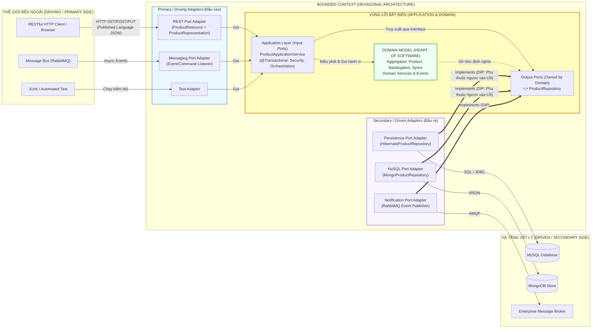

---

### 5. ÁNH XẠ ỨNG DỤNG VÀO DỰ ÁN GAME 2.5D OOP MULTIPLAYER

Kiến trúc Lục giác (*Hexagonal Architecture*) và *Dependency Inversion Principle (DIP)* trong Chương 4 chính là kim chỉ nam cho kiến trúc phân tầng của dự án Game 2.5D OOP nhiều người chơi của bạn:

1. **Biến `Core/Combat` thành trung tâm của Kiến trúc Lục giác (Hexagonal Core):**
   * **Vùng Lõi (*Inside Hexagon*):** Các package `core` và `combat` (chứa các thực thể nhân vật, 6 loại Mobs, 4 hệ nhân vật, quy tắc thu hẹp Vòng bo, máy trạng thái FSM) nằm ở trung tâm tuyệt đối. Chúng **không biết** màn hình hiển thị bằng thư viện `java.awt.Graphics2D` trên PC hay `android.graphics.Canvas` trên Mobile (`Android_Game`), và cũng **không biết** dữ liệu truyền qua mạng bằng Socket TCP/UDP hay chạy Offline một người chơi!
   * **Driving Adapters (Đầu vào):**
     * `KeyboardMouseInputAdapter` (PC) hoặc `TouchJoystickAdapter` (Android): Đọc sự kiện phần cứng và dịch thành các lệnh chuẩn gọi vào cổng đầu vào (`GameMatchApplicationService`).
     * `NetworkServerTickAdapter`: Nhận gói tin điều khiển từ nhiều người chơi qua mạng 4G/LAN và bơm vào vòng lặp xử lý của Server.
   * **Driven Adapters (Đầu ra - Áp dụng DIP):**
     * Trong `core/combat`, ta định nghĩa các Output Ports như `interface MatchStateBroadcaster` hoặc `interface MapConfigRepository`.
     * Ở tầng ngoài (`server`, `persistence`, `render`), các lớp `UdpSnapshotBroadcaster`, `JsonMapConfigLoader`, và `AwtIsometricRenderer` sẽ `implements` các interface đó.
2. **Lợi ích thực chiến cho Kiểm thử Tự động (Bộ Test 15/15 của dự án) & Đa nền tảng (PC + Android):**
   * Nhờ áp dụng **Hexagonal Architecture + DIP**, bạn có thể dùng chung **100% mã nguồn `core` và `combat`** cho cả bản PC (`Src_Game`) lẫn bản Mobile (`Android_Game`).
   * Khi chạy bộ kiểm thử tự động (`Tests` ở chế độ Headless không có màn hình đồ họa và không cần mở cổng mạng thật), bộ Test chỉ cần cắm các `Mock/InMemory Adapters` vào vùng lõi để kiểm tra toàn bộ logic chiến đấu, sát thương vòng bo, và AI của Bot với tốc độ hàng nghìn kịch bản mỗi giây!


<br/><br/>

---\n

# ĐỢT 3 / 10: BÓC TÁCH CHUYÊN SÂU CHƯƠNG 4 (PHẦN 2)
**Sách:** *Implementing Domain-Driven Design (IDDD)* — **Tác giả:** *Vaughn Vernon*

---

## CHƯƠNG 4 (PHẦN 2): ARCHITECTURE — CQRS, EVENT-DRIVEN ARCHITECTURE, SAGAS, EVENT SOURCING, DATA FABRIC (KIẾN TRÚC HỆ THỐNG - PHẦN 2)

### 1. ĐỀ MỤC & MỤC TIÊU CỐT LÕI (CORE PURPOSE)

#### Hệ thống đề mục đầy đủ theo sách gốc (Nửa sau Chương 4 - Trang 138–169):
* **Command-Query Responsibility Segregation, or CQRS** (Phân tách Trách nhiệm Lệnh - Truy vấn, hay CQRS)
  * *Examining Areas of CQRS* (Khảo sát các vùng thành phần của CQRS)
    * *The Client and Query Processor* (Máy khách và Bộ xử lý Truy vấn)
    * *The Query Model* (Mô hình Truy vấn / Mô hình Đọc)
    * *The Client Drives Command Processing* (Máy khách dẫn dắt việc xử lý Lệnh)
    * *Command Processors* (Các Bộ xử lý Lệnh — *Categorized, Dedicated, Message-Based*)
    * *The Command Model* (Mô hình Lệnh / Mô hình Ghi)
    * *An Event Subscriber Updates the Query Model* (Bộ đăng ký sự kiện cập nhật Mô hình Truy vấn)
  * *Dealing with an Eventually Consistent Query Model* (Xử lý Mô hình Truy vấn Nhất quán Cuối cùng)
* **Event-Driven Architecture** (Kiến trúc Hướng Sự kiện - EDA)
  * *Pipes and Filters* (Đường ống và Bộ lọc)
  * *Long-Running Processes, aka Sagas* (Các Tiến trình Chạy dài, hay còn gọi là Sagas)
  * *Event Sourcing* (Lưu trữ Nguồn Sự kiện)
* **Data Fabric and Grid-Based Distributed Computing** (Lưới Dữ liệu và Điện toán Phân tán dựa trên Grid)
  * *Data Replication* (Nhân bản Dữ liệu)
  * *Event-Driven Fabrics and Domain Events* (Lưới Hướng Sự kiện và Các Sự kiện Miền)
  * *Continuous Queries* (Truy vấn Liên tục)
  * *Distributed Processing* (Xử lý Phân tán)
* **Wrap-Up** (Tổng kết)

#### Vấn đề kỹ thuật & nghiệp vụ cốt lõi và Thảm họa nếu không áp dụng:
* **Vấn đề giải quyết:**
  1. **Mâu thuẫn bất đối xứng giữa Ghi (Transactional Write) và Đọc (Complex UI Read):** Trong DDD, các *Aggregates* được thiết kế chặt chẽ để bảo vệ bất biến (*Invariants*) khi thay đổi trạng thái (Ghi), và liên kết với nhau qua định danh (*Reference by Identity*). Nhưng giao diện người dùng (UI) lại thường xuyên cần hiển thị một bảng tổng hợp lấy dữ liệu từ 5–7 *Aggregates* khác nhau. Làm sao để hiển thị nhanh mà không phá nát ranh giới *Aggregate*? **CQRS** giải quyết triệt để mâu thuẫn này.
  2. **Điều phối quy trình nghiệp vụ trải dài qua nhiều *Bounded Contexts* phân tán:** Làm sao để thực hiện một quy trình kinh doanh gồm nhiều bước qua nhiều hệ thống độc lập mà không dùng Giao dịch Phân tán 2 pha (*Two-Phase Commit - 2PC*) gây nghẽn toàn cục? **Event-Driven Architecture (EDA)** và **Long-Running Processes (Sagas)** là câu trả lời.
  3. **Mất mát lịch sử trạng thái và giới hạn chịu tải:** Làm sao để lưu lại toàn bộ lịch sử nhân quả của mọi biến đổi trong hệ thống và mở rộng quy mô (*Scale-out*) trên hàng chục máy chủ RAM? **Event Sourcing** và **Data Fabric** giải quyết bài toán này.
* **Thảm họa kỹ thuật nếu không áp dụng:**
  1. **Biến dạng Domain Model vì chiều lòng UI (*UI-Driven Model Corruption*):** Để phục vụ một màn hình báo cáo phức tạp, lập trình viên móc nối trực tiếp các *Aggregates* lại với nhau, thêm hàng chục hàm `getter` và câu lệnh `JOIN` khổng lồ vào *Repository*, khiến *Aggregate* phình to và gây lỗi *LazyInitializationException* hoặc *N+1 Queries*.
  2. **Khóa chết hệ thống phân tán (*Distributed Lock / Blocking RPC Cascade*):** Dùng lời gọi đồng bộ nối tiếp nhau hoặc *Two-Phase Commit (2PC)* giữa các *Bounded Contexts*. Khi một dịch vụ phụ bị chậm hoặc sập, toàn bộ giao dịch ở *Core Domain* bị treo cứng.

---

### 2. PHÂN TÍCH LÝ THUYẾT & NGUYÊN LÝ CHUYÊN SÂU

#### A. CQRS (*Command-Query Responsibility Segregation*) — Từ Bertrand Meyer đến Greg Young & Udi Dahan
1. **Nguồn gốc từ CQS (*Command-Query Separation* - Bertrand Meyer):** Ở cấp độ phương thức (*Method level*), một hàm chỉ nên là **Command** (thay đổi trạng thái đối tượng, trả về `void`, không trả về dữ liệu) hoặc là **Query** (chỉ đọc dữ liệu, không gây tác dụng phụ *Side-Effect-Free*, không làm thay đổi trạng thái).
2. **Nâng cấp lên cấp độ Kiến trúc với CQRS:** Khi một mô hình duy nhất không thể vừa tối ưu cho việc kiểm tra quy tắc nghiệp vụ phức tạp (Write), vừa tối ưu cho việc truy vấn hiển thị đa chiều (Read), CQRS tách hệ thống thành **2 Mô hình độc lập**:
   * **Command Model (Write Model):** Chính là **DDD Domain Model** thuần khiết (*Aggregates, Entities, Value Objects*). Chỉ nhận các mệnh lệnh (**Commands** thể hiện đúng *Ubiquitous Language* như `CommitBacklogItemToSprintCommand`), kiểm tra các quy tắc bất biến (*Invariants*), lưu trạng thái và phát ra **Domain Events** (ví dụ `BacklogItemCommitted`).
   * **Query Model (Read Model):** Là mô hình dữ liệu phi chuẩn hóa (*Denormalized Data Model* — các bảng phẳng SQL View hoặc tài liệu NoSQL/JSON được thiết kế đo ni đóng giày cho từng màn hình UI). Query Processor đọc thẳng từ *Query Model* ra DTO để vẽ lên màn hình cực nhanh mà không cần đi qua *Domain Layer*!
3. **3 Phong cách thiết kế *Command Processor* (Bộ xử lý Lệnh):**
   * *Categorized Style (Phong cách phân nhóm):* Một *Application Service* gom nhóm nhiều phương thức xử lý cho các Command cùng chủ đề (ví dụ `AgilePmApplicationService` có hàm `planBacklogItem(PlanBacklogItemCommand)` và `scheduleRelease(ScheduleReleaseCommand)`).
   * *Dedicated Style (Phong cách chuyên biệt - Single Responsibility):* Mỗi lớp Handler chỉ xử lý đúng **1 loại Command duy nhất** thông qua giao diện `CommandHandler<TCommand>` (ví dụ `PlanBacklogItemCommandHandler`).
   * *Message-Based Style (Phong cách hướng thông điệp bất đồng bộ):* Client đẩy Command dưới dạng một tin nhắn vào *Messaging Bus*; Handler ở phía sau nhận và xử lý bất đồng bộ, giúp chịu tải đỉnh điểm (*Peak Load Leveling*).
4. **Cơ chế Đồng bộ & Xử lý Nhất quán Cuối cùng (*Eventual Consistency*):**
   * Khi *Command Model* thực thi xong lệnh và phát ra *Domain Event*, một *Event Subscriber* sẽ bắt sự kiện đó và cập nhật bảng dữ liệu bên *Query Model*.
   * Nếu truyền sự kiện qua mạng bất đồng bộ, sẽ có độ trễ vài chục mili-giây (*Eventual Consistency*) trước khi *Query Model* phản ánh dữ liệu mới. UI cần được thiết kế thông minh (ví dụ: hiển thị dữ liệu lạc quan *Optimistic UI*, báo trạng thái *"Đang xử lý..."*, hoặc gắn kèm *Version/Timestamp* để người dùng không bị bối rối khi màn hình chưa kịp làm mới).

#### B. Kiến trúc Hướng Sự kiện (*Event-Driven Architecture - EDA*)
1. **Pipes and Filters (Đường ống và Bộ lọc):**
   * Chia một luồng xử lý sự kiện phức tạp thành chuỗi các bộ lọc độc lập (**Filters** — mỗi bộ lọc chỉ làm một việc duy nhất theo *Single Responsibility Principle*) được nối với nhau bằng các kênh truyền thông điệp (**Pipes** — các Queue/Topic).
   * Trong sách, Vaughn Vernon minh họa hệ thống xử lý tin nhắn giọng nói (*Phone-in Voice Mail*): `AudioStreamReceiver` $\rightarrow$ *Pipe* $\rightarrow$ `SpeechToTextFilter` $\rightarrow$ *Pipe* $\rightarrow$ `TextAnalyzerFilter` $\rightarrow$ *Pipe* $\rightarrow$ `MessageSender`. Các *Filters* hoàn toàn không biết sự tồn tại của nhau, dễ dàng nhân bản (*Scale-out*) bộ lọc nào bị nghẽn cổ chai.
2. **Long-Running Processes, aka Sagas (Tiến trình Chạy dài / Sagas):**
   * Khi một quy trình kinh doanh kéo dài (từ vài giây đến vài ngày) và đi qua nhiều *Bounded Contexts* hoặc nhiều *Aggregates* phân tán, ta không thể mở một Database Transaction giữ khóa lâu như vậy.
   * **Cơ chế hoạt động của Saga (Process Manager):** Là một trình điều phối phản ứng theo sự kiện: Nhận `Domain Event 1` $\rightarrow$ phát đi `Command A` (hoặc `Event` tiếp theo) $\rightarrow$ chờ các nhánh hoàn tất.
   * **3 cách thiết kế Trình theo dõi trạng thái (*Tracker / Executive*) của Saga:**
     1. *Stateless Process (Choreography / Pipes & Filters):* Không có bộ điều phối trung tâm lưu trạng thái; mỗi bước tự nhận sự kiện trước và bắn sự kiện tiếp theo.
     2. *Dedicated Process Tracker Entity / Aggregate:* Tạo một thực thể chuyên biệt (ví dụ `ProductCreationProcessTracker`) lưu trong Database để theo dõi xem những nhánh sự kiện nào đã hoàn thành, kiểm soát *Timeout* (quá hạn) và phát lệnh **Bù trừ (*Compensating Action*)** nếu một nhánh bị lỗi.
     3. *Merged Tracker into Root Aggregate:* Gộp luôn trạng thái theo dõi tiến trình vào chính *Aggregate Root* khởi phát quy trình (Cách mà *SaaSOvation* áp dụng khi tích hợp `Product` của `AgilePM` với `Discussion` của `Collaboration Context`!).

#### C. Event Sourcing (Lưu trữ Nguồn Sự kiện)
* **Sự thay đổi tư duy căn bản:** Thay vì chỉ lưu **trạng thái hiện tại mới nhất (*Current State*)** của một *Aggregate* bằng câu lệnh `UPDATE` đè lên dòng dữ liệu cũ (làm mất toàn bộ lịch sử *tại sao* đối tượng lại có trạng thái đó), **Event Sourcing** lưu trữ **toàn bộ chuỗi các Domain Events đã từng xảy ra (*Append-Only Event Stream*)** kể từ lúc *Aggregate* được sinh ra!
* **Phục dựng trạng thái (*Reconstitution by Replaying Events*):** Khi cần nạp một *Aggregate* từ `EventStore` lên RAM, hệ thống đọc chuỗi sự kiện của nó (`ProductCreated` $\rightarrow$ `ProductBacklogItemPlanned` $\rightarrow$ `ProductDiscussionInitiated`) và **phát lại (*Replay*)** theo đúng thứ tự thời gian để tái tạo lại trạng thái hiện tại của *Aggregate*.
* **Snapshots (Ảnh chụp nhanh):** Để tránh phải phát lại hàng chục nghìn sự kiện cho một đối tượng sống quá lâu, hệ thống định kỳ lưu một bản chụp trạng thái (*Snapshot* tại phiên bản $N$), khi nạp chỉ cần lấy *Snapshot* gần nhất cộng với các sự kiện phát sinh sau phiên bản $N$.

#### D. Data Fabric and Grid-Based Distributed Computing (Lưới Dữ liệu Phân tán trên RAM)
Phần này (viết cùng chuyên gia Wes Williams về VMware GemFire và Oracle Coherence) giải quyết bài toán quy mô cực lớn:
* Thay vì dùng Database đĩa cứng làm trung tâm, **In-Memory Data Grid (IMDG / Data Fabric)** phân vùng (*Partition/Shard*) và nhân bản (*Replicate*) trực tiếp các *Aggregate Instances* trên bộ nhớ RAM của hàng chục máy chủ vật lý.
* Hỗ trợ **Continuous Queries (Truy vấn liên tục):** Client đăng ký một câu truy vấn với *Data Fabric*; ngay khi bất kỳ *Aggregate* nào trên lưới thay đổi thỏa mãn điều kiện truy vấn, *Data Fabric* tự động đẩy sự kiện cập nhật về cho Client theo thời gian thực.
* Hỗ trợ **Distributed Processing (Function Execution):** Thay vì kéo hàng triệu *Aggregates* qua mạng về ứng dụng để tính toán (**Move Data to Code**), ta gửi hàm xử lý đến chạy trực tiếp ngay trên các Node đang giữ dữ liệu trong RAM (**Move Code to Data**).

---

### 3. MỔ XẺ MÃ NGUỒN & CẤU TRÚC THIẾT KẾ (CODE DEEP-DIVE)

Chúng ta sẽ mổ xẻ 2 mẫu thiết kế kỹ thuật đặc sắc nhất của Chương 4 (Phần 2):
1. **CQRS Dedicated Command Handler & Event Subscriber cập nhật Read Model** (trang 141–146).
2. **Long-Running Process (Saga) hợp nhất trạng thái theo dõi vào Aggregate `Product`** trong dự án *SaaSOvation* (trang 154–159).

#### ❌ Thiết kế SAI BAN ĐẦU: Trộn lẫn Truy vấn Giao diện phức tạp vào Domain Aggregate & Gọi đồng bộ khóa cứng giữa 2 Bounded Contexts
```java
// 1. SAI LẦM KHI CHƯA CÓ CQRS: Bắt Domain Aggregate và Repository gánh câu lệnh JOIN phục vụ riêng cho 1 màn hình báo cáo UI
public class BacklogItem extends ConcurrencySafeEntity {
    // Nhồi nhét thêm các trường chỉ để hiển thị lên bảng tổng hợp của UI!
    private String sprintNameForUiDisplay;
    private String releaseNameForUiDisplay;
    private String productOwnerEmailForUi;
}

// 2. SAI LẦM KHI CHƯA CÓ SAGA/EDA: Gọi RPC đồng bộ chéo qua 2 Bounded Contexts trong cùng 1 Transaction!
@Transactional
public void newProductWithDiscussion(String tenantId, String productName) {
    Product product = new Product(new TenantId(tenantId), new ProductId(UUID.randomUUID().toString()), productName);
    productRepository.save(product);
    
    // NGUY HIỂM: Gọi HTTP đồng bộ sang Collaboration Context vàIdentityAccess Context!
    // Nếu mạng lag hoặc Collaboration Server đang bảo trì, việc tạo Product ở AgilePM bị Rollback và treo cứng!
    User owner = iamRestClient.getUserSync(tenantId, "owner1");
    DiscussionDTO disc = collaborationRestClient.createDiscussionSync(tenantId, owner.getEmail(), productName);
    product.setDiscussionId(disc.getId());
}
```

#### ✅ Thiết kế CHUẨN MỰC SAU REFACTOR: CQRS (Command Handler + Read Model Projection) & Event-Driven Saga

```java
// ============================================================================
// PHẦN A: KIẾN TRÚC CQRS CHUẨN MỰC (WRITE MODEL TÁCH BIỆT READ MODEL)
// ============================================================================

// 1. Dedicated Command Handler (Bên nhánh Command / Write Model)
public interface CommandHandler<TCommand> {
    public void handle(TCommand aCommand);
}

public class CommitBacklogItemToSprintCommandHandler
    implements CommandHandler<CommitBacklogItemToSprintCommand> {

    private BacklogItemRepository backlogItemRepository;
    private SprintRepository sprintRepository;

    @Override
    @Transactional
    public void handle(CommitBacklogItemToSprintCommand aCommand) {
        TenantId tenantId = new TenantId(aCommand.getTenantId());
        
        BacklogItem backlogItem =
            this.backlogItemRepository.backlogItemOfId(
                tenantId,
                new BacklogItemId(aCommand.getBacklogItemId()));

        Sprint sprint =
            this.sprintRepository.sprintOfId(
                tenantId,
                new SprintId(aCommand.getSprintId()));

        // Thực thi hành vi trên Domain Model -> Tự động bắn ra Domain Event: BacklogItemCommitted
        backlogItem.commitTo(sprint);
    }
}

// 2. Event Subscriber cập nhật bảng phẳng bên Query Model (Read Model Projection)
public class BacklogItemCommittedSubscriber implements DomainEventSubscriber<BacklogItemCommitted> {

    private JdbcTemplate queryModelJdbc; // Cập nhật thẳng vào bảng phẳng Denormalized của Read DB

    @Override
    public void handleEvent(BacklogItemCommitted aDomainEvent) {
        // Cập nhật bảng phẳng phục vụ màn hình hiển thị siêu tốc, không cần JOIN lúc đọc!
        this.queryModelJdbc.update(
            "UPDATE tbl_vw_sprint_backlog_items " +
            "SET sprint_id = ?, status = 'COMMITTED', committed_on = ? " +
            "WHERE tenant_id = ? AND backlog_item_id = ?",
            aDomainEvent.sprintId().id(),
            aDomainEvent.occurredOn(),
            aDomainEvent.tenantId().id(),
            aDomainEvent.backlogItemId().id());
    }

    @Override
    public Class<BacklogItemCommitted> subscribedToEventType() {
        return BacklogItemCommitted.class;
    }
}

// ============================================================================
// PHẦN B: LONG-RUNNING PROCESS (SAGA) TRONG SAASOVATION
// Hợp nhất trạng thái tiến trình (ProductDiscussion) vào Product Aggregate
// ============================================================================
public class Product extends ConcurrencySafeEntity {
    private TenantId tenantId;
    private ProductId productId;
    private String name;
    private ProductDiscussion productDiscussion; // Value Object theo dõi trạng thái Saga!
    private String discussionInitiationId;       // Mã định danh tương quan (Correlation ID) của Saga

    // Bước 1 của Saga: Yêu cầu khởi tạo Discussion và phát Domain Event bất đồng bộ
    public void requestDiscussion(DiscussionAvailability anAvailability) {
        if (!this.productDiscussion().availability().isReady()) {
            this.setProductDiscussion(
                ProductDiscussion.fromAvailability(anAvailability));

            // Tạo mã theo dõi tiến trình (Process / Correlation ID) và bắn Event ra Message Bus
            this.setDiscussionInitiationId( UUID.randomUUID().toString().toUpperCase() );

            DomainEventPublisher
                .instance()
                .publish(new ProductDiscussionRequested(
                    this.tenantId(),
                    this.productId(),
                    this.productOwnerId(),
                    this.name(),
                    this.description(),
                    this.productDiscussion().availability().isRequested(),
                    this.discussionInitiationId()));
        }
    }

    // Bước cuối của Saga: Khi nhận được sự kiện DiscussionStarted từ Collaboration Context trả về
    public void initiateDiscussion(DiscussionDescriptor aDescriptor) {
        if (aDescriptor == null) {
            throw new IllegalArgumentException("DiscussionDescriptor must not be null.");
        }
        if (this.productDiscussion().availability().isRequested()) {
            // Chuyển trạng thái Value Object sang READY kèm theo ID của Discussion bên Collaboration
            this.setProductDiscussion(
                this.productDiscussion().nowReady(aDescriptor));
        }
    }
}
```

#### Bảng phân tích kỹ thuật & Ý nghĩa thiết kế:

| Dòng code / Đoạn code then chốt | Giải thích kỹ thuật & Nguyên lý thiết kế (DDD/OOP) được hiện thực hóa |
| :--- | :--- |
| `public class CommitBacklogItemToSprintCommandHandler implements CommandHandler<...>` | **Dedicated Command Processor (CQRS Write Side) & Single Responsibility Principle (SRP):** Mỗi mệnh lệnh nghiệp vụ có một lớp xử lý độc lập. Giúp dễ dàng gắn thêm các *Decorators / Filters* (như Logging, Security, Transaction, Retry) bọc bên ngoài từng Command Handler mà không làm phình to một Application Service duy nhất. |
| `backlogItem.commitTo(sprint);` | **Bảo toàn tính tinh khiết của Command Model:** Bên nhánh Ghi (Write Model), `BacklogItem` chỉ tập trung kiểm tra quy tắc nghiệp vụ của Scrum và phát ra sự kiện `BacklogItemCommitted`, hoàn toàn không cần quan tâm giao diện người dùng (UI) sẽ hiển thị bảng danh sách như thế nào. |
| `UPDATE tbl_vw_sprint_backlog_items SET ...` *(Trong Subscriber)* | **Denormalized Query Model (CQRS Read Side):** Khi sự kiện `BacklogItemCommitted` nổ ra, Subscriber âm thầm cập nhật thẳng vào bảng View phi chuẩn hóa (`tbl_vw_sprint_backlog_items`). Khi người dùng mở màn hình Sprint, Query Processor chỉ cần `SELECT *` từ bảng phẳng này với tốc độ $O(1)$ mà không cần thực hiện bất kỳ phép `JOIN` nặng nề nào. |
| `private ProductDiscussion productDiscussion;` <br> `private String discussionInitiationId;` | **Merged Saga Tracker & Correlation ID:** Thay vì tạo một bảng Saga riêng cho quy trình đơn giản, `Product` sử dụng Value Object `ProductDiscussion` (với các trạng thái `NOT_REQUESTED` $\rightarrow$ `REQUESTED` $\rightarrow$ `READY` hoặc `FAILED`) kết hợp với `discussionInitiationId` (Correlation ID) để theo dõi tiến trình tạo cuộc thảo luận xuyên qua `Collaboration Context`. |
| `DomainEventPublisher.instance().publish(new ProductDiscussionRequested(...))` | **Temporal Decoupling (Tách biệt về mặt thời gian trong EDA/Saga):** Việc tạo `Product` trong `AgilePM` hoàn tất ngay lập tức mà không cần chờ `Collaboration Context` tạo xong `Discussion`. Nếu `Collaboration Context` đang tắt để bảo trì, sự kiện `ProductDiscussionRequested` nằm an toàn trong hàng đợi Message Broker và sẽ được xử lý ngay khi hệ thống đó sống lại! |
| `this.productDiscussion().nowReady(aDescriptor)` | **Hoàn tất chu trình Saga bất biến (*Eventual Consistency Achieved*):** Khi `Collaboration Context` tạo xong cuộc thảo luận và bắn trả về sự kiện `DiscussionStarted` (kèm theo `discussionInitiationId`), `AgilePM` bắt lấy sự kiện đó và gọi `product.initiateDiscussion(descriptor)` để khép kín quy trình. |

---

### 4. SƠ ĐỒ TRỰC QUAN HÓA (BẮT BUỘC MÃ MERMAID)

Chương 4 (Phần 2) có 2 luồng kiến trúc cực kỳ quan trọng, vì vậy chúng ta trực quan hóa bằng **2 sơ đồ Mermaid**: (1) Kiến trúc tổng thể **CQRS kết hợp Event Sourcing**, và (2) Sơ đồ tuần tự **Long-Running Process (Saga)** xuyên qua các *Bounded Contexts* của *SaaSOvation*:

#### Sơ đồ 4.1: Kiến trúc CQRS kết hợp Event Sourcing
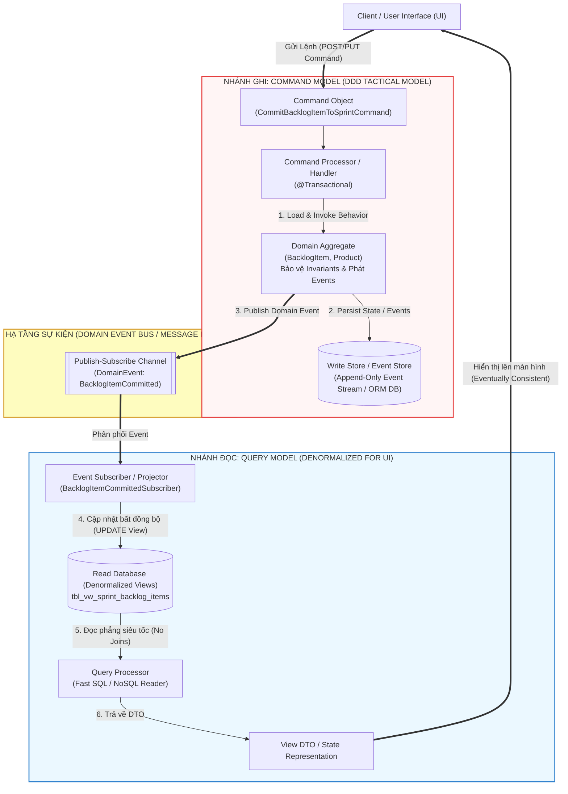

#### Sơ đồ 4.2: Sơ đồ Tuần tự (Sequence Diagram) của Tiến trình Chạy dài (Saga) trong *SaaSOvation*
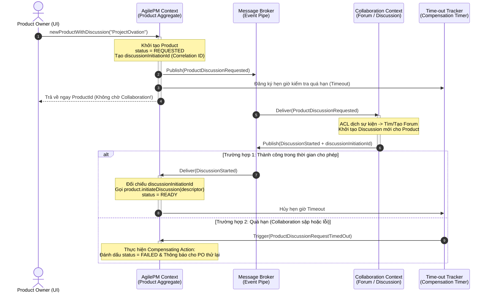

---

### 5. ÁNH XẠ ỨNG DỤNG VÀO DỰ ÁN GAME 2.5D OOP MULTIPLAYER

Chương 4 (Phần 2) cung cấp các mẫu kiến trúc đỉnh cao giải quyết bài toán hiệu năng 60 FPS trên Client, 20 Hz trên Server và đồng bộ mạng trong dự án Game 2.5D của bạn:

1. **Áp dụng *CQRS* để tách bạch *Combat Simulation (Write Model)* và *2.5D Isometric Rendering / HUD (Read Model)*:**
   * *Vấn đề trong Game:* Trong mỗi Tick của vòng lặp game, nhánh tính toán chiến đấu (*Combat Logic*) cần kiểm tra va chạm, trừ máu theo giáp, áp hiệu ứng làm chậm của Vòng bo trên các đối tượng `Hero` và `Mob` đầy đủ quy tắc. Trong khi đó, nhánh Đồ họa (`Render Pipeline 60 FPS`) và bảng thông tin `HUD / Minimap` chỉ cần đọc tọa độ `(x, y, z)`, mã hoạt ảnh (`spriteFrameId`) và phần trăm thanh máu đã được sắp xếp theo thứ tự chiều sâu (`Z-Sorted Renderables`).
   * *Giải pháp CQRS:*
     * **Command Side (Server / Logic Thread 20 Hz):** Nhận các `PlayerInputCommand` (`MoveCommand`, `AttackCommand`), chạy trên mô hình đối tượng `Combat` chuẩn OOP để đảm bảo không ai gian lận (*Anti-cheat invariants*).
     * **Query Side (Render Snapshot / Projection 60 FPS):** Sau mỗi Tick, hệ thống xuất ra một bản chiếu phẳng bất biến (`WorldRenderSnapshot` / `HUDReadModel` — kết hợp mẫu *Double Buffer* của Nystrom). Luồng vẽ đồ họa 2.5D và Minimap chỉ đọc thẳng từ `ReadModel` đã được sắp xếp sẵn theo trục $Y/Z$ này để vẽ lên màn hình cực nhanh mà không bao giờ tranh chấp khóa (*Lock Contention*) với luồng tính toán sát thương!
2. **Áp dụng *Event Sourcing* & *Command Stream* cho tính năng *Netcode Lag Compensation / Killcam / Replay*:**
   * Thay vì chỉ gửi toàn bộ trạng thái nặng nề qua mạng, việc ghi lại chuỗi sự kiện theo thời gian (`MatchStarted` $\rightarrow$ `PlayerMoved` $\rightarrow$ `SkillCast` $\rightarrow$ `ZoneShrunk` $\rightarrow$ `MobSlain`) kèm theo số thứ tự Tick (`tickNumber`) chính là **Event Sourcing**.
   * Nhờ chuỗi sự kiện bất biến này, Server có thể dễ dàng **tua ngược thời gian (*Rewind State*)** về thời điểm 100ms trước để kiểm tra xem cú bắn của người chơi có trúng mục tiêu khi mạng 4G bị trễ hay không (*Server-side Rewind Lag Compensation*), đồng thời cho phép phát lại toàn bộ trận đấu (*Match Replay*).
3. **Áp dụng *Long-Running Process (Saga)* kèm *Time-out Tracker* cho luồng *Sảnh chờ (Lobby) $\rightarrow$ Khởi tạo Trận đấu (Match Initialization)*:**
   * Khi 4 người chơi ở Sảnh chờ bấm "Bắt đầu trận": Một **Matchmaking Saga** được kích hoạt:
     1. Phát sự kiện `MatchInitializationRequested` (kèm `matchCorrelationId`).
     2. Chờ cả 4 máy khách tải xong bản đồ 66.000 px và gửi sự kiện `ClientMapLoaded` về.
     3. Đồng thời bật **Time-out Tracker** (ví dụ: 15 giây). Nếu sau 15 giây có 1 người chơi bị rớt mạng 4G không phản hồi `ClientMapLoaded`, Saga kích hoạt hành động bù trừ (*Compensation*): hủy phiên khởi tạo hoặc tự động thay thế vị trí đó bằng một `Bot` AI rồi phát sự kiện `MatchCountdownStarted` để trận đấu vẫn diễn ra mượt mà!


<br/><br/>

---\n

# ĐỢT 4 / 10: BÓC TÁCH CHUYÊN SÂU CHƯƠNG 5 & CHƯƠNG 6
**Sách:** *Implementing Domain-Driven Design (IDDD)* — **Tác giả:** *Vaughn Vernon*

---

## CHƯƠNG 5: ENTITIES (CÁC THỰC THỂ MIỀN)

### 1. ĐỀ MỤC & MỤC TIÊU CỐT LÕI (CORE PURPOSE)

#### Hệ thống đề mục đầy đủ theo sách gốc (Trang 171–218):
* **Why We Use Entities** (Tại sao chúng ta sử dụng Thực thể)
* **Unique Identity** (Định danh Duy nhất)
  * *User Provides Identity* (Người dùng cung cấp Định danh)
  * *Application Generates Identity* (Ứng dụng tự sinh Định danh)
  * *Persistence Mechanism Generates Identity* (Cơ chế Lưu trữ / Database sinh Định danh)
  * *Another Bounded Context Assigns Identity* (Một Ngữ cảnh Giới hạn khác cấp phát Định danh)
  * *When the Timing of Identity Generation Matters* (Khi thời điểm sinh Định danh đóng vai trò quyết định — *Early vs. Late Identity Generation*)
  * *Surrogate Identity* (Định danh Thay thế phục vụ ORM/Database)
  * *Identity Stability* (Tính ổn định bất biến của Định danh)
* **Discovering Entities and Their Intrinsic Characteristics** (Khám phá Thực thể và các Đặc tính Nội tại của chúng)
  * *Uncovering Entities and Properties* (Tìm ra Thực thể và Thuộc tính)
  * *Digging for Essential Behavior* (Đào sâu tìm kiếm Hành vi Cốt lõi)
  * *Roles and Responsibilities* (Vai trò và Trách nhiệm — chống lại *Object Schizophrenia*)
  * *Construction* (Khởi tạo Thực thể — *Constructors* & *Self-Encapsulation*)
  * *Validation* (Kiểm tra tính hợp lệ — *Attribute, Whole-Object, Deferred Validation, Design-by-Contract*)
  * *Change Tracking* (Theo dõi sự thay đổi trạng thái)
* **Wrap-Up** (Tổng kết)

#### Vấn đề kỹ thuật & nghiệp vụ cốt lõi và Thảm họa nếu không áp dụng:
* **Vấn đề giải quyết:** Khi nào một khái niệm trong bài toán cần được mô hình hóa thành một **Entity** (thay vì *Value Object*)? Làm thế nào để cấp phát và bảo vệ **Định danh Duy nhất (*Unique Identity*)** của nó xuyên suốt vòng đời biến đổi trạng thái, đồng thời thiết kế các hành vi nội tại, hàm khởi tạo và cơ chế tự kiểm tra hợp lệ (*Validation*) mà không bị cơ sở dữ liệu làm biến dạng?
* **Thảm họa kỹ thuật nếu không áp dụng:**
  1. **Lạm dụng Entity tràn lan do "Nhiễm độc CSDL" (*Database-Driven Entity Overuse*):** Lập trình viên nhìn đâu cũng thấy bảng Database có cột khóa chính `ID`, nên biến mọi thứ (từ Tên người, Địa chỉ, Tiền tệ, đến Khoảng thời gian) thành *Entity* có bảng riêng và `ID` riêng. Hậu quả là bộ nhớ bị phân mảnh, câu lệnh SQL chất chồng hàng chục phép `JOIN` vô nghĩa.
  2. **Sập cơ chế Tập hợp (`Set` / `HashMap`) do Sinh định danh muộn (*Late Identity Generation Bug*):** Khi để Database tự sinh ID (`AUTO_INCREMENT` / `SEQUENCE`) lúc `INSERT`, một đối tượng `Entity` mới khởi tạo bằng `new` trong bộ nhớ sẽ có `id == null`. Nếu thêm hai đối tượng mới này vào một tập hợp `java.util.Set<Entity>`, hàm `equals()` và `hashCode()` dựa trên `id` sẽ coi hai đối tượng khác nhau là một (làm mất phần tử thứ hai!), hoặc sau khi lưu vào DB thì `id` thay đổi khiến `hashCode` bị đổi và không bao giờ tìm lại được đối tượng trong `Set` nữa!
  3. **Sửa đổi Định danh từ bên ngoài (*Broken Identity Stability*):** Cho phép hàm `public void setId(...)` lộ ra ngoài, dẫn đến việc một lập trình viên vô tình ghi đè ID của thực thể đang sống, làm đứt gãy toàn bộ các liên kết tham chiếu trên hệ thống.

---

### 2. PHÂN TÍCH LÝ THUYẾT & NGUYÊN LÝ CHUYÊN SÂU

#### A. Bản chất của *Entity*: Định danh và Tính liên tục (*Identity & Continuity*)
* Một khái niệm chỉ được mô hình hóa thành **Entity** khi chúng ta quan tâm đến **Nó là ai (*Who it is* — Định danh duy nhất)** hơn là **Nó chứa thuộc tính gì (*What it is*)**, và nó có một vòng đời liên tục trải qua nhiều lần biến đổi trạng thái (*Mutability over Lifecycle*). Hai đối tượng `User` dù trùng cả họ tên lẫn ngày sinh vẫn là hai thực thể hoàn toàn khác nhau nếu có `UserId` khác nhau.

#### B. 4 Chiến lược Cấp phát Định danh (*Identity Generation Strategies*) & Thời điểm Sinh (*Timing*)
1. **User Provides Identity (Người dùng tự nhập):** Người dùng nhập các mã định danh tự nhiên (*Natural Keys*) như `username`, mã ISBN sách, mã SKU sản phẩm. *Rủi ro:* Người dùng nhập sai chính tả rồi đòi sửa lại! Mà định danh thì bắt buộc phải bất biến (*Immutable*). Giải pháp: Chỉ dùng làm thuộc tính tra cứu hoặc yêu cầu tạo mới/hủy cũ.
2. **Application Generates Identity (Ứng dụng tự sinh — Khuyên dùng nhất trong DDD):** Tầng ứng dụng hoặc *Repository* tự sinh định danh ngay trong bộ nhớ trước khi lưu xuống DB (thường dùng `UUID` / `GUID` kết hợp thông tin ngữ cảnh hoặc tiền tố).
   * *Ưu điểm tuyệt đối:* Hỗ trợ **Sinh định danh sớm (*Early Identity Generation*)** — thực thể có ngay định danh hợp lệ ngay khoảnh khắc được `new` ra đời, an toàn tuyệt đối khi đưa vào `Set` hoặc đính kèm vào *Domain Events* trước khi lưu DB!
3. **Persistence Mechanism Generates Identity (Cơ chế lưu trữ sinh):** Tận dụng Sequence của Oracle/PostgreSQL hoặc `AUTO_INCREMENT` của MySQL.
   * *Đánh đổi:* Với `AUTO_INCREMENT`, đây là **Sinh định danh muộn (*Late Identity Generation*)** — phải đợi `Repository.save()` và `flush()` xuống DB mới có ID. Với Oracle Sequence kết hợp cơ chế *Hi/Lo Algorithm* (cấp phát trước một dải số vào bộ nhớ), ta vẫn đạt được *Early Generation* với hiệu năng cao.
4. **Another Bounded Context Assigns Identity (Ngữ cảnh khác cấp phát):** Điển hình trong *SaaSOvation*, `Agile Project Management Context` nhận định danh của `ProductOwner` và `TeamMember` từ `username` do `Identity and Access Context` cấp phát.

#### C. Định danh Nghiệp vụ (*Domain Identity*) vs. Định danh Thay thế (*Surrogate Identity*)
* Trong DDD của Vaughn Vernon, mỗi Entity thường mang **2 loại định danh tách biệt**:
  1. **Domain Identity (Ví dụ: `ProductId`, `UserId`, `TenantId`):** Được thiết kế thành một **Value Object** có kiểu mạnh (*Strongly-typed Value Object*), hiển thị công khai trong *Ubiquitous Language* để các *Aggregates* và *Bounded Contexts* khác tham chiếu tới.
  2. **Surrogate Identity (Ví dụ: `private long id`):** Là khóa chính số nguyên 64-bit phục vụ thuần túy cho ORM (Hibernate) làm khóa ngoại (`Foreign Key`) nối bảng nhanh gọn dưới Database. Thuộc tính `id` này phải được **giấu kín (`private` / `protected`)** bên trong lớp cha `Entity` hoặc `Layer Supertype`, tuyệt đối không lộ ra cho tầng nghiệp vụ hay Client bên ngoài biết!

#### D. Khám phá Hành vi, Tự đóng gói (*Self-Encapsulation*) và Kiểm tra Hợp lệ (*Validation*)
* **Chống lại *Object Schizophrenia* (Tâm thần phân liệt đối tượng) bằng Ủy quyền Vai trò:** Khi một người vừa là `User`, vừa có thông tin cá nhân `Person`, thay vì dùng kế thừa đa tầng hoặc nhồi nhét tất cả vào một class, hãy tách thành các đối tượng đóng vai trò rõ ràng (`User` chứa tham chiếu tới `Person` và `Enablement`).
* **Self-Encapsulation trong Hàm khởi tạo (*Constructor*):** Ngay cả bên trong *Constructor* của Entity, **không bao giờ gán trực tiếp `this.name = aName;`**, mà phải gọi qua hàm setter nội bộ `this.setName(aName);`. Hàm `private/protected setName()` sẽ chứa các chốt chặn kiểm tra điều kiện (**Guards / Assertions** theo trường phái *Design-by-Contract* của Bertrand Meyer). Nhờ đó, không một thực thể nào có thể được khởi tạo ở trạng thái bất hợp lệ!
* **3 Cấp độ Validation trong DDD:**
  1. *Attribute Validation (Kiểm tra từng thuộc tính):* Dùng *Self-Encapsulation Guards* ngay trong các hàm `private setX()` (kiểm tra khác `null`, độ dài chuỗi, khoảng giá trị).
  2. *Whole-Object Validation (Kiểm tra toàn bộ đối tượng):* Khi tính hợp lệ phụ thuộc vào mối quan hệ giữa nhiều thuộc tính cùng lúc, và có những thời điểm đối tượng tạm thời chưa đủ dữ liệu, ta dùng **Deferred Validation (Kiểm tra trì hoãn)** kết hợp mẫu **Specification** hoặc **Notification Pattern** (thu thập toàn bộ danh sách lỗi thay vì ném Exception ngay ở lỗi đầu tiên).
  3. *Object Composition Validation:* Dùng *Domain Service* để kiểm tra tính hợp lệ trải dài qua nhiều đối tượng.

---

### 3. MỔ XẺ MÃ NGUỒN & CẤU TRÚC THIẾT KẾ (CODE DEEP-DIVE)

Chúng ta sẽ mổ xẻ cấu trúc thực thể `User` của `Identity and Access Context` kết hợp với lớp cơ sở `IdentifiedDomainObject` / `ConcurrencySafeEntity` và cơ chế `ValidationNotificationHandler` trong Chương 5 (trang 186–215).

#### ❌ Thiết kế SAI BAN ĐẦU: Định danh kiểu nguyên thủy (`long`), Cho phép sửa ID, và Gán trực tiếp không kiểm soát
```java
public class BadUser {
    private Long id; // Dùng chung khóa chính DB làm định danh nghiệp vụ (Chưa lưu DB thì id == null!)
    private String username;
    private String password;
    private boolean active;

    public BadUser(String username, String password) {
        // Không có Guard Clause kiểm tra null/rỗng!
        this.username = username;
        this.password = password; // Lưu mật khẩu thô (Clear-text password)!
    }

    // THẢM HỌA: Cho phép bên ngoài sửa đổi định danh của Entity đang sống!
    public void setId(Long id) { this.id = id; }
    public Long getId() { return id; }

    // THẢM HỌA: Khi vừa new BadUser() chưa lưu vào DB, id == null -> Ném NullPointerException hoặc làm hỏng HashSet!
    @Override
    public int hashCode() { return id.hashCode(); }
}
```

#### ✅ Thiết kế CHUẨN MỰC SAU REFACTOR: Tách *Surrogate ID* và *Domain ID*, *Self-Encapsulation Guards* & Hành vi giàu ngữ nghĩa

```java
// ============================================================================
// 1. LAYER SUPERTYPE: Giấu kín Surrogate Identity (id) và Version cho ORM
// Package: com.saasovation.common.domain.model
// ============================================================================
public abstract class IdentifiedDomainObject implements Serializable {
    private long id = -1L; // Surrogate ID chỉ phục vụ Hibernate, giấu kín khỏi Client!

    protected IdentifiedDomainObject() { super(); }

    protected long id() { return this.id; }
    private void setId(long anId) { this.id = anId; }
}

public abstract class ConcurrencySafeEntity extends IdentifiedDomainObject {
    private int concurrencyVersion;

    protected ConcurrencySafeEntity() { super(); }

    public int concurrencyVersion() { return this.concurrencyVersion; }
    public void setConcurrencyVersion(int aVersion) {
        this.failWhenConcurrencyViolation(aVersion);
        this.concurrencyVersion = aVersion;
    }

    public void failWhenConcurrencyViolation(int aVersion) {
        if (aVersion != this.concurrencyVersion()) {
            throw new IllegalStateException("Violation of optimistic concurrency!");
        }
    }
}

// ============================================================================
// 2. ENTITY CHUẨN MỰC: User trong Identity and Access Context
// Package: com.saasovation.identityaccess.domain.model.identity
// ============================================================================
public class User extends ConcurrencySafeEntity {
    private TenantId tenantId;      // Domain Identity phần 1 (Strongly-typed Value Object)
    private String username;        // Domain Identity phần 2 (Unique trong phạm vi Tenant)
    private String password;
    private Enablement enablement;  // Value Object đóng gói quy tắc kích hoạt/thời hạn
    private Person person;          // Entity con đảm nhận vai trò thông tin cá nhân

    public User(
        TenantId aTenantId,
        String aUsername,
        String aPassword,
        Enablement anEnablement,
        Person aPerson) {

        this();
        // SELF-ENCAPSULATION: Gọi qua các hàm protected/private setter để kích hoạt Guard Clauses!
        this.setTenantId(aTenantId);
        this.setUsername(aUsername);
        this.setEnablement(anEnablement);
        this.setPerson(aPerson);

        this.protectPassword("", aPassword);

        aPerson.internalOnlySetUser(this);

        DomainEventPublisher
            .instance()
            .publish(new UserRegistered(
                this.tenantId(),
                aUsername,
                aPerson.name(),
                aPerson.emailAddress().address()));
    }

    protected User() { super(); } // Phục vụ riêng cho cơ chế Reflection của Hibernate

    // HÀNH VI CỐT LÕI (ESSENTIAL BEHAVIOR): Thay đổi mật khẩu có kiểm chứng và mã hóa
    public void changePassword(String aCurrentPassword, String aChangedPassword) {
        AssertionConcern.assertArgumentNotEmpty(
            aCurrentPassword, "Current password must be provided.");
        AssertionConcern.assertArgumentEquals(
            this.password(),
            this.asEncryptedValue(aCurrentPassword),
            "Current password not confirmed.");

        this.protectPassword(aCurrentPassword, aChangedPassword);

        DomainEventPublisher
            .instance()
            .publish(new UserPasswordChanged(this.tenantId(), this.username()));
    }

    private void protectPassword(String aCurrentPassword, String aChangedPassword) {
        AssertionConcern.assertArgumentNotSame(
            aCurrentPassword, aChangedPassword, "The password is unchanged.");
        AssertionConcern.assertArgumentNotEmpty(
            aChangedPassword, "The password must be provided.");
        AssertionConcern.assertArgumentLength(
            aChangedPassword, 6, 64, "The password is too short or too long.");

        this.setPassword(this.asEncryptedValue(aChangedPassword));
    }

    // SELF-ENCAPSULATION GUARDS: Ngăn chặn trạng thái bất hợp lệ và khóa chặt Identity Stability!
    protected void setTenantId(TenantId aTenantId) {
        AssertionConcern.assertArgumentNotNull(aTenantId, "The tenantId is required.");
        this.tenantId = aTenantId;
    }

    protected void setUsername(String aUsername) {
        AssertionConcern.assertArgumentNotEmpty(aUsername, "The username is required.");
        AssertionConcern.assertArgumentLength(aUsername, 3, 250, "The username must be 3 to 250 characters.");
        this.username = aUsername;
    }

    // ĐỊNH DANH BẤT BIẾN: equals() và hashCode() dựa trên Domain Identity (tenantId + username), KHÔNG dựa trên Surrogate ID!
    @Override
    public boolean equals(Object anObject) {
        boolean equalObjects = false;
        if (anObject != null && this.getClass() == anObject.getClass()) {
            User typedObject = (User) anObject;
            equalObjects =
                this.tenantId().equals(typedObject.tenantId()) &&
                this.username().equals(typedObject.username());
        }
        return equalObjects;
    }

    @Override
    public int hashCode() {
        return (45217 * 269)
            + this.tenantId().hashCode()
            + this.username().hashCode();
    }
}
```

#### Bảng phân tích kỹ thuật & Ý nghĩa thiết kế:

| Dòng code / Đoạn code then chốt | Giải thích kỹ thuật & Nguyên lý thiết kế (DDD/OOP) được hiện thực hóa |
| :--- | :--- |
| `private long id = -1L;` <br> `protected long id() { return this.id; }` | **Giấu kín *Surrogate Identity* trong *Layer Supertype*:** Thuộc tính `id` kiểu `long` chỉ tồn tại để làm vui lòng cơ chế khóa chính/khóa ngoại của Hibernate dưới Database. Đặt mức truy cập `protected`/`private` giúp không một lớp nghiệp vụ nào bên ngoài bị cám dỗ sử dụng khóa chính DB làm định danh miền. |
| `this.setTenantId(aTenantId);` <br> `this.setUsername(aUsername);` *(Trong Constructor)* | **Self-Encapsulation & Design-by-Contract Guards:** Thay vì gán thẳng biến, hàm khởi tạo ủy quyền cho các hàm `protected setX()`. Mọi hàm `setX()` này đều chạy `AssertionConcern.assertArgumentNotNull/Length(...)`, đảm bảo tính bất biến (*Invariant*) ngay từ mili-giây đầu tiên đối tượng được sinh ra, đồng thời đóng băng định danh (*Identity Stability*) vì bên ngoài không thể gọi hàm `protected` này để sửa lại ID! |
| `protected User() { super(); }` | **Bảo vệ Tính toàn vẹn Khởi tạo trước ORM:** Hibernate yêu cầu một Constructor không tham số để tái tạo đối tượng từ DB. Bằng cách để mức `protected` (thay vì `public`), ta vừa cho phép Hibernate khởi tạo qua Reflection/Proxy, vừa cấm tiệt lập trình viên bên ngoài gọi `new User()` rỗng tạo ra thực thể "chết" thiếu định danh! |
| `public void changePassword(...)` & `private void protectPassword(...)` | **Essential Domain Behavior (Hành vi nghiệp vụ cốt lõi):** Thay vì phơi bày `setPassword()`, thực thể `User` tự kiểm tra mật khẩu hiện tại, tự kiểm tra độ dài mật khẩu mới, tự gọi dịch vụ băm mật khẩu (`asEncryptedValue`) và phát ra sự kiện miền `UserPasswordChanged`. Không có mật khẩu thô (*clear-text*) nào bị lưu trữ. |
| `this.tenantId().equals(typedObject.tenantId()) && this.username().equals(...)` | **So sánh Thực thể qua *Domain Identity* (*Early Identity Safety*):** Hàm `equals()` và `hashCode()` chỉ dựa trên bộ đôi định danh nghiệp vụ (`tenantId` + `username`), vốn đã có giá trị ngay lúc gọi `new User(...)`. Nhờ đó, đối tượng có thể được đưa vào `HashSet<User>` ngay lập tức trước khi lưu vào Database mà không bao giờ gặp lỗi mất phần tử! |

---

### 4. SƠ ĐỒ TRỰC QUAN HÓA (BẮT BUỘC MÃ MERMAID)

Sơ đồ Lớp (Class Diagram) dưới đây thể hiện kiến trúc phân cấp của một **Entity chuẩn DDD** trong *SaaSOvation*, tách biệt rõ ràng giữa **Surrogate Identity** (ở lớp cơ sở), **Domain Identity** (Value Object), **Role Composition** (`Person`, `Enablement`) và **Self-Encapsulated Guards**:

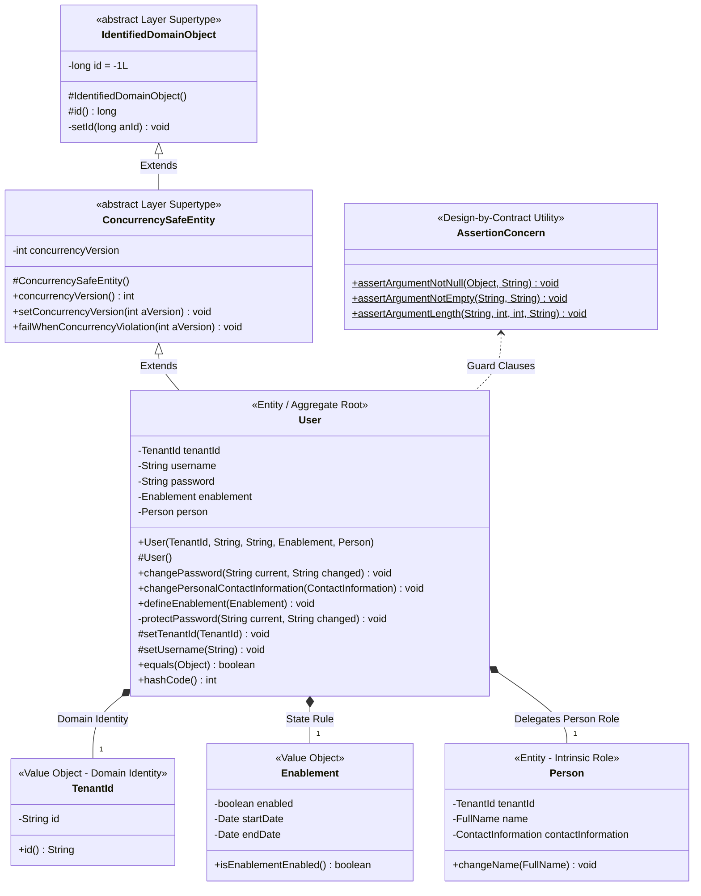

---

### 5. ÁNH XẠ ỨNG DỤNG VÀO DỰ ÁN GAME 2.5D OOP MULTIPLAYER

1. **Áp dụng *Early Application-Generated Identity* cho các Thực thể Động trên Bản đồ 66.000 px (`Hero`, `Mob`, `Projectile`, `LootDrop`):**
   * *Vấn đề trong Game Multiplayer:* Trong trận chiến tốc độ 20 Hz trên Server, mỗi giây có hàng chục quái vật (`Mobs` thuộc 6 chủng loại) được sinh ra (*Spawn*) hoặc vật phẩm rơi ra đất. Nếu chờ luồng Persistence ghi vào cơ sở dữ liệu để lấy ID thì Game Loop sẽ bị treo cứng!
   * *Áp dụng Chương 5:* Mọi thực thể trong trận đấu (`HeroEntity`, `MobEntity`) phải sử dụng **Application-Generated Domain Identity** (ví dụ: `EntityId` kết hợp `MatchId` + bộ đếm nguyên tử `AtomicInteger` hoặc `UUID` rút gọn). Ngay khoảnh khắc `MobFactory` khởi tạo một con quái vật mới trên RAM, nó đã có `MobId` duy nhất và bất biến để phát ngay vào gói tin `Snapshot` gửi cho 4 người chơi và đưa vào bảng băm không gian (`SpatialHashGrid` / `HashSet<MobEntity>`) mà không bao giờ bị lỗi băm (`hashCode` cố định suốt vòng đời).
2. **Chống *Object Schizophrenia* và bảo vệ *Invariants* bằng *Self-Encapsulation Guards* trên Hệ Nhân Vật:**
   * Thay vì để một class `Character` khổng lồ chứa hàng trăm biến `public` hoặc `setter` lỏng lẻo, hãy tách các đặc tính nội tại thành các thành phần có vai trò rõ ràng và khóa chặt bằng `AssertionConcern`: Không bao giờ cho phép khởi tạo một nhân vật có `maxHp <= 0`, `moveSpeed < 0` hay tọa độ nằm ngoài biên giới bản đồ `[0, 66000]`.

---
---

## CHƯƠNG 6: VALUE OBJECTS (CÁC ĐỐI TƯỢNG GIÁ TRỊ)

### 1. ĐỀ MỤC & MỤC TIÊU CỐT LÕI (CORE PURPOSE)

#### Hệ thống đề mục đầy đủ theo sách gốc (Trang 219–264):
* **Value Characteristics** (6 Đặc trưng Cốt lõi của Đối tượng Giá trị)
  * *Measures, Quantifies, or Describes* (Đo lường, Định lượng, hoặc Mô tả một thứ trong miền)
  * *Immutable* (Tính Bất biến tuyệt đối)
  * *Conceptual Whole* (Một chỉnh thể Khái niệm Trọn vẹn — *Whole Value*)
  * *Replaceability* (Tính có thể Thay thế toàn phần)
  * *Value Equality* (So sánh Bằng nhau dựa trên Giá trị thuộc tính)
  * *Side-Effect-Free Behavior* (Hành vi Không gây Tác dụng phụ)
* **Integrate with Minimalism** (Tích hợp giữa các Bounded Contexts với Chủ nghĩa Tối giản)
* **Standard Types Expressed as Values** (Biểu diễn các Kiểu Chuẩn / Danh mục bằng Value Objects & Java Enums)
* **Testing Value Objects** (Kiểm thử hướng miền cho Value Objects)
* **Implementation** (Hiện thực hóa chi tiết trong Java)
* **Persisting Value Objects** (Lưu trữ Value Objects xuống Cơ sở Dữ liệu mà không làm hỏng Mô hình)
  * *Reject Undue Influence of Data Model Leakage* (Từ chối sự ảnh hưởng sai trái của Rò rỉ Mô hình Dữ liệu)
  * *ORM and Single Value Objects* (ORM với một Value Object đơn lẻ)
  * *ORM and Many Values Serialized into a Single Column* (ORM với tập hợp Value Objects tuần tự hóa vào một cột)
  * *ORM and Many Values Backed by a Database Entity* (ORM với tập hợp Value Objects được chống lưng bởi thực thể DB ẩn — *Layer Supertype Trick*)
  * *ORM and Many Values Backed by a Join Table* (ORM với tập hợp Value Objects qua bảng nối)
  * *ORM and Enum-as-State Objects* (ORM với đối tượng Enum biểu diễn trạng thái)
* **Wrap-Up** (Tổng kết)

#### Vấn đề kỹ thuật & nghiệp vụ cốt lõi và Thảm họa nếu không áp dụng:
* **Vấn đề giải quyết:** Vaughn Vernon chỉ ra rằng các lập trình viên thường quá say mê *Entities* mà bỏ quên vũ khí sắc bén nhất của DDD: **Value Objects**. Chương 6 giải quyết câu hỏi: **Làm thế nào để gom nhóm các thuộc tính rời rạc thành những khối khái niệm bất biến, giàu hành vi toán học/nghiệp vụ, hoàn toàn không cần định danh (ID), và lưu trữ chúng xuống Database quan hệ (SQL) mà không để cấu trúc bảng làm ô nhiễm mô hình hướng đối tượng?**
* **Thảm họa kỹ thuật nếu không áp dụng:**
  1. **Ám ảnh Kiểu Nguyên thủy (*Primitive Obsession*):** Biểu diễn tiền tệ bằng một biến `double`, tên đầy đủ bằng 3 biến `String` rời rạc, tọa độ bằng `int x, int y`, hoặc điểm ưu tiên kinh doanh bằng `int`. Hệ quả là các hàm tính toán liên quan đến các giá trị này bị vứt vưởng khắp nơi trong các lớp `Utility` tĩnh (`StringUtils`, `MathHelper`) hoặc làm phình to *Entity*.
  2. **Lỗi Tham chiếu Chia sẻ (*Aliasing Bug*) do đối tượng Khả biến (*Mutable Object*):** Khi hai *Entities* cùng trỏ tới một đối tượng giá trị khả biến (như `java.util.Date` cũ), việc sửa giá trị ở nơi này sẽ âm thầm làm sai lệch trạng thái của thực thể ở nơi khác, gây ra những lỗi đồng thời (*Concurrency Bugs*) cực kỳ khó tìm.
  3. **Sự Rò rỉ Mô hình Dữ liệu (*Data Model Leakage*):** Vì bảng cơ sở dữ liệu cần khóa chính cho quan hệ `1-N` (ví dụ một `Group` chứa danh sách nhiều `GroupMember` Value Objects), lập trình viên đầu hàng trước ORM và biến `GroupMember` thành một `Entity` thực thụ trong Domain Model chỉ để chiều lòng Hibernate!

---

### 2. PHÂN TÍCH LÝ THUYẾT & NGUYÊN LÝ CHUYÊN SÂU

#### A. 6 Đặc trưng Vàng định nghĩa một *Value Object*
Hãy luôn ưu tiên thiết kế một khái niệm thành **Value Object** thay vì *Entity* nếu nó mang 6 đặc tính sau:
1. **Measures, Quantifies, or Describes (Đo lường, Định lượng hoặc Mô tả):** Nó không phải là một "vật thể có căn cước" mà là một thước đo hoặc mô tả đặc tính cho một vật thể khác (Ví dụ: `Money`, `FullName`, `BusinessPriority`, `StoryPoints`, `DateRange`).
2. **Immutable (Bất biến tuyệt đối):** Sau khi được khởi tạo qua *Constructor*, **không một thuộc tính nào của Value Object được phép thay đổi** trong suốt thời gian nó tồn tại. Mọi hàm `setter` đều bị cấm gọi từ bên ngoài. Nhờ bất biến, Value Objects tự động **an toàn đa luồng (*Thread-safe*)**, có thể chia sẻ tham chiếu thoải mái mà không cần `clone()`.
3. **Conceptual Whole (Chỉnh thể Khái niệm Trọn vẹn — Ward Cunningham):** Một giá trị tiền tệ `50.00` sẽ hoàn toàn vô nghĩa nếu đứng tách rời khỏi đơn vị tiền tệ `USD` hay `VND`. Do đó, `amount` và `currency` phải bị khóa chặt vào nhau trong một chỉnh thể `MonetaryValue(BigDecimal amount, Currency currency)`. Tương tự trong *ProjectOvation*, độ ưu tiên của một hạng mục (`BusinessPriority`) là chỉnh thể không thể tách rời của 4 thông số: *Benefit* (Lợi ích), *Penalty* (Thiệt hại nếu không làm), *Cost* (Chi phí), và *Risk* (Rủi ro).
4. **Replaceability (Khả năng Thay thế toàn phần):** Khi giá trị mà một *Entity* đang nắm giữ không còn đúng nữa, ta không sửa bên trong Value Object đó, mà **vứt bỏ toàn bộ thực thể Value Object cũ và gán đè bằng một Value Object mới tinh** (giống hệt như cách ta gán biến nguyên thủy `int a = 5; a = 6;`).
5. **Value Equality (Bằng nhau theo Giá trị):** Hai thực thể Value Object ở hai vùng nhớ khác nhau (`v1 != v2`) được coi là **hoàn toàn bằng nhau (`v1.equals(v2) == true`)** nếu tất cả các thuộc tính cấu thành nên chúng bằng nhau.
6. **Side-Effect-Free Behavior (Hành vi Không Tác dụng phụ - Functional Style):** Value Object không phải là cấu trúc `struct` câm lặng! Nó chứa rất nhiều hàm tính toán và biến đổi nghiệp vụ phức tạp. Nhưng vì nó **Bất biến**, mọi phương thức làm thay đổi giá trị của nó (như cộng hai số tiền, thêm chữ đệm vào `FullName`, hoặc dịch chuyển tọa độ) đều là các **Hàm Không Tác Dụng Phụ (*Side-Effect-Free Functions*)**: giữ nguyên đối tượng gốc và **trả về một thực thể Value Object mới** mang kết quả!

#### B. Chủ nghĩa Tối giản khi Tích hợp (*Integrate with Minimalism*) & Kiểu Chuẩn (*Standard Types*)
* Khi tích hợp dữ liệu từ *Upstream Bounded Context* sang *Downstream* (như từ `Identity and Access` sang `Collaboration`), hãy dùng **Value Objects tối giản** (như `Author`, `Moderator` chỉ chứa đúng 3 thuộc tính `username, name, emailAddress` cần thiết cho diễn đàn) để giảm thiểu trách nhiệm và loại bỏ nhu cầu đồng bộ trạng thái phức tạp.
* Với các **Kiểu Chuẩn (*Standard Types*)** phân loại đối tượng (như `BacklogItemType`: *Feature,Integration, Defect, Foundation* hoặc `BusinessPriorityRatings`), hãy tận dụng `enum` giàu hành vi của Java hoặc các Value Objects chia sẻ tĩnh để vừa đảm bảo an toàn kiểu (*Type-safety*), vừa gắn kèm được các công thức tính toán vào từng loại.

#### C. Chống lại *Data Model Leakage* khi Lưu trữ Value Objects xuống Database
Đây là phần thực chiến cực kỳ đắt giá của Chương 6 (trang 248–263):
* **Trường hợp 1 Value Object đơn lẻ trong Entity:** Dùng cơ chế *Embedded / Component* của ORM (như `<component>` hoặc `@Embedded` trong Hibernate) để trải phẳng các thuộc tính của Value Object (`FullName.firstName`, `FullName.lastName`) vào thẳng các cột cùng bảng với Entity cha (`tbl_person`).
* **Trường hợp một Tập hợp (`Set<ValueObject>`) nằm trong Entity:** Trong SQL, một tập hợp `1-N` thường cần bảng phụ có khóa chính. Làm sao để lưu `Set<GroupMember>` mà không biến `GroupMember` thành Entity? Vaughn Vernon đưa ra 2 kỹ thuật xuất sắc:
  1. *Many Values Serialized into a Single Column:* Tuần tự hóa (*Serialize*) cả danh sách Value Objects thành một chuỗi văn bản/JSON gọn nhẹ và lưu vào một cột `TEXT/VARCHAR` duy nhất trên bảng của Entity cha (không cần bảng phụ, không cần `JOIN`!).
  2. *Many Values Backed by a Database Entity (Kỹ thuật Surrogate Layer Supertype):* Cho Value Object kế thừa từ một lớp cơ sở `IdentifiedValueObject` chứa thuộc tính `private long id = -1L` (chỉ có getter/setter ở mức `package-private` hoặc `private` cho Hibernate đọc qua Reflection). Nhờ đó, đối với thế giới Domain Model bên ngoài, nó là một **Value Object bất biến 100%** (không ai thấy `id`), nhưng đối với Hibernate bên dưới, nó có khóa chính để lưu vào bảng phụ một cách trơn tru!

---

### 3. MỔ XẺ MÃ NGUỒN & CẤU TRÚC THIẾT KẾ (CODE DEEP-DIVE)

Chúng ta sẽ mổ xẻ 2 Value Objects tiêu biểu nhất trong sách: **`FullName`** (trang 243–248, minh họa *Immutability, Side-Effect-Free Functions, Self-Delegation*) và **`BusinessPriority`** (trang 239–244, minh họa *Conceptual Whole* và các phép tính định lượng nghiệp vụ trong *ProjectOvation*).

#### ❌ Thiết kế SAI BAN ĐẦU: *Primitive Obsession* & Đối tượng Khả biến (*Mutable Setter*)
```java
public class BadBacklogItem {
    // PRIMITIVE OBSESSION: Rải rác 4 biến int rời rạc trên thực thể BacklogItem
    private int priorityBenefit;
    private int priorityPenalty;
    private int priorityCost;
    private int priorityRisk;

    // Tính toán thủ công ngay trên Entity hoặc vứt ra hàm static bên ngoài
    public float calculatePriorityScore(int totalBenefit, int totalPenalty, int totalCost, int totalRisk) {
        return ((float)(priorityBenefit + priorityPenalty) / (totalBenefit + totalPenalty)) /
               ((float)(priorityCost + priorityRisk) / (totalCost + totalRisk));
    }
}
```

#### ✅ Thiết kế CHUẨN MỰC SAU REFACTOR: Value Objects Bất biến, Trọn vẹn Khái niệm & Không tác dụng phụ

```java
// ============================================================================
// 1. VALUE OBJECT MÔ TẢ & BIẾN ĐỔI KHÔNG TÁC DỤNG PHỤ: FullName
// Package: com.saasovation.identityaccess.domain.model.identity
// ============================================================================
public final class FullName extends AssertionConcern implements Serializable {

    private String firstName;
    private String lastName;

    public FullName(String aFirstName, String aLastName) {
        super();
        this.setFirstName(aFirstName);
        this.setLastName(aLastName);
    }

    // Copy Constructor (Hỗ trợ tạo bản sao an toàn)
    public FullName(FullName aFullName) {
        this(aFullName.firstName(), aFullName.lastName());
    }

    protected FullName() { super(); } // Chỉ phục vụ ORM (Hibernate Component)

    public String asFormattedName() {
        return this.firstName() + " " + this.lastName();
    }

    // SIDE-EFFECT-FREE FUNCTION: Không sửa đối tượng hiện tại! Trả về một FullName MỚI!
    public FullName withChangedFirstName(String aFirstName) {
        return new FullName(aFirstName, this.lastName());
    }

    public FullName withChangedLastName(String aLastName) {
        return new FullName(this.firstName(), aLastName);
    }

    public String firstName() { return this.firstName; }
    public String lastName() { return this.lastName; }

    // PRIVATE SETTERS + GUARDS: Khóa chặt tính Bất biến (Immutability) sau khi khởi tạo!
    private void setFirstName(String aFirstName) {
        this.assertArgumentNotEmpty(aFirstName, "First name is required.");
        this.assertArgumentLength(aFirstName, 1, 50, "First name must be 50 characters or less.");
        this.assertArgumentTrue(
            Pattern.matches("[A-Z][a-z]*", aFirstName),
            "First name must be at least one character in length, starting with a capital letter.");
        this.firstName = aFirstName;
    }

    private void setLastName(String aLastName) {
        this.assertArgumentNotEmpty(aLastName, "Last name is required.");
        this.assertArgumentLength(aLastName, 1, 50, "Last name must be 50 characters or less.");
        this.lastName = aLastName;
    }

    // VALUE EQUALITY: Hai FullName bằng nhau nếu mọi thuộc tính thành phần bằng nhau
    @Override
    public boolean equals(Object anObject) {
        boolean equalObjects = false;
        if (anObject != null && this.getClass() == anObject.getClass()) {
            FullName typedObject = (FullName) anObject;
            equalObjects =
                this.firstName().equals(typedObject.firstName()) &&
                this.lastName().equals(typedObject.lastName());
        }
        return equalObjects;
    }

    @Override
    public int hashCode() {
        return (59151 * 191) + this.firstName().hashCode() + this.lastName().hashCode();
    }
}

// ============================================================================
// 2. VALUE OBJECT ĐO LƯỜNG & ĐỊNH LƯỢNG PHỨC TẠP: BusinessPriority (Scrum Core Domain)
// Package: com.saasovation.agilepm.domain.model.product.backlogitem
// ============================================================================
public final class BusinessPriority extends AssertionConcern implements Serializable {

    private BusinessPriorityRatings ratings; // Chứa 4 điểm số: benefit, penalty, cost, risk

    public BusinessPriority(BusinessPriorityRatings aRatings) {
        super();
        this.setRatings(aRatings);
    }

    // Hành vi định lượng giàu nghiệp vụ (Rich Quantifying Behavior):
    public float costPercentage(BusinessPriorityTotals aTotals) {
        return (float) 100 * this.ratings().cost() / aTotals.totalCost();
    }

    public float priority(BusinessPriorityTotals aTotals) {
        float costAndRisk =
            this.costPercentage(aTotals) +
            (this.ratings().risk() * 100 / aTotals.totalRisk());

        return this.valuePercentage(aTotals) / costAndRisk;
    }

    public float totalValue() {
        return this.ratings().benefit() + this.ratings().penalty();
    }

    public float valuePercentage(BusinessPriorityTotals aTotals) {
        return (float) 100 * this.totalValue() / aTotals.totalValue();
    }

    public BusinessPriorityRatings ratings() { return this.ratings; }

    private void setRatings(BusinessPriorityRatings aRatings) {
        this.assertArgumentNotNull(aRatings, "The ratings must be provided.");
        this.ratings = aRatings;
    }
    // equals() và hashCode() dựa trên this.ratings()...
}
```

#### Bảng phân tích kỹ thuật & Ý nghĩa thiết kế:

| Dòng code / Đoạn code then chốt | Giải thích kỹ thuật & Nguyên lý thiết kế (DDD/OOP) được hiện thực hóa |
| :--- | :--- |
| `public final class FullName` | **Ngăn chặn Kế thừa làm phá vỡ Tính bất biến (*Final Class*):** Từ khóa `final` ở cấp độ class ngăn không cho bất kỳ lớp con nào kế thừa và ghi đè các phương thức làm biến chất tính bất biến (*Immutability*) hoặc phá vỡ quy tắc đối xứng của hàm `equals()` (`this.getClass() == anObject.getClass()`). |
| `public FullName withChangedFirstName(String aFirstName)` <br> `{ return new FullName(aFirstName, this.lastName()); }` | **Side-Effect-Free Function (Hàm Không Tác dụng phụ):** Khi người dùng muốn sửa tên riêng nhưng giữ nguyên họ, thay vì gọi `name.setFirstName("New")`, họ gọi `name = name.withChangedFirstName("New")`. Đối tượng `FullName` cũ hoàn toàn không bị thay đổi (an toàn cho mọi nơi khác đang tham chiếu tới nó), một thực thể `FullName` mới được sinh ra để thay thế (*Replaceability*). |
| `private void setFirstName(String aFirstName)` | **Immutability + Self-Encapsulation Guards:** Mọi hàm `setter` trên Value Object bắt buộc phải là `private`! Chúng chỉ được gọi duy nhất 1 lần từ bên trong *Constructor* để kiểm tra định dạng Regex (`[A-Z][a-z]*`) và độ dài trước khi niêm phong trạng thái. |
| `public final class BusinessPriority` & `BusinessPriorityRatings` | **Conceptual Whole (Chỉnh thể khái niệm) & Giảm tải cho Entity:** Toàn bộ 4 chỉ số đánh giá ưu tiên và các công thức toán học tính phần trăm chi phí (`costPercentage`), phần trăm giá trị (`valuePercentage`) và trọng số ưu tiên (`priority`) được rút khỏi thực thể `BacklogItem` và đóng gói trọn vẹn vào `BusinessPriority`. Giúp `BacklogItem` gọn nhẹ và `BusinessPriority` có thể được Unit Test độc lập dễ dàng. |
| `this.firstName().equals(typedObject.firstName()) && ...` | **Value Equality (So sánh theo Giá trị):** Khác hẳn với *Entity* (so sánh qua ID), `FullName` và `BusinessPriority` hoàn toàn không có ID; phép so sánh `equals()` và `hashCode()` kiểm tra trực tiếp từng thuộc tính giá trị bên trong. |

---

### 4. SƠ ĐỒ TRỰC QUAN HÓA (BẮT BUỘC MÃ MERMAID)

Sơ đồ dưới đây đối chiếu trực quan **Cơ chế hoạt động giữa Entity (Biến đổi tại chỗ & So sánh theo ID) và Value Object (Bất biến, Hàm không tác dụng phụ & Thay thế toàn phần)**, đồng thời chỉ rõ **Các chiến lược ánh xạ ORM chống rò rỉ dữ liệu (*Data Model Leakage*)**:

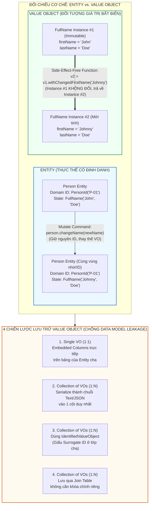

---

### 5. ÁNH XẠ ỨNG DỤNG VÀO DỰ ÁN GAME 2.5D OOP MULTIPLAYER

Chương 6 (Value Objects) là chìa khóa vàng giúp mã nguồn của dự án Game 2.5D loại bỏ 80% lỗi tính toán vật lý/sát thương và tối ưu hóa đồng bộ mạng:

1. **Biểu diễn Tọa độ Không gian, Vận tốc và Vòng bo bằng *Immutable Value Objects* (`Vector25D`, `BoundingBox`, `SafeZoneCircle`):**
   * *Sai lầm chết người trong Game Loop:* Dùng một đối tượng `Position` khả biến (`public float x, y, z;`) rồi truyền tham chiếu của nó cho cả `Hero`, `Projectile` (Đạn bay) và `Camera`. Khi `Projectile` cộng thêm vận tốc vào `position.x += vx`, vị trí của `Hero` cũng bị dịch chuyển theo vì cả hai đang trỏ chung vào một vùng nhớ (*Aliasing Bug*)!
   * *Áp dụng Chương 6:* Thiết kế `Vector25D(final float x, final float y, final float z)` là một **Immutable Value Object** tuyệt đối với các **Side-Effect-Free Functions**:
     * `Vector25D nextPos = currentPos.translate(velocityVector.scale(deltaTime));`
     * `float dist = heroPos.groundDistanceTo(zoneCenter);`
     * Tương tự, **Vòng bo (`StormCircle`)** được mô hình hóa bằng Value Object `StormPhaseSpec(Vector25D center, float radius, DamagePerTick dps, Duration shrinkDuration)` có hàm nội suy `StormCircle interpolateAt(float progressRatio)` trả về vòng bo ở từng mili-giây mà không bao giờ gây lỗi tranh chấp luồng giữa Server Tick và Render Thread!
2. **Mô hình hóa Chỉ số 4 Hệ Nhân Vật và 6 Loại Mobs bằng *Conceptual Whole Value Objects* (`CombatStats`, `DamagePayload`):**
   * Thay vì truyền 6 tham số rời rạc `attack(int physicalDmg, int magicDmg, float critChance, float armorPen, ElementType element, boolean isTrueDamage)` vào hàm tấn công, hãy đóng gói thành Value Object `DamagePayload` và `StatBlock`.
   * Khi nhân vật nhận một bùa lợi (*Buff* tăng 20% công kích trong 5 giây), chỉ cần dùng hàm không tác dụng phụ: `CombatStats buffedStats = baseStats.withMultipliedAttack(1.20f)` — sạch sẽ, dễ viết Unit Test kiểm chứng công thức sát thương, và không bao giờ làm hỏng chỉ số gốc (`baseStats`) của nhân vật sau khi hết hiệu lực Buff!


<br/><br/>

---\n

# ĐỢT 5 / 10: BÓC TÁCH CHUYÊN SÂU CHƯƠNG 7 & CHƯƠNG 8
**Sách:** *Implementing Domain-Driven Design (IDDD)* — **Tác giả:** *Vaughn Vernon*

---

## CHƯƠNG 7: SERVICES (CÁC DỊCH VỤ MIỀN)

### 1. ĐỀ MỤC & MỤC TIÊU CỐT LÕI (CORE PURPOSE)

#### Hệ thống đề mục đầy đủ theo sách gốc (Trang 265–284):
* **What a Domain Service Is (but First, What It Is Not)** (Dịch vụ Miền là gì — nhưng trước hết, Nó KHÔNG phải là gì)
* **Make Sure You Need a Service** (Hãy chắc chắn rằng bạn thực sự cần một Dịch vụ Miền)
* **Modeling a Service in the Domain** (Mô hình hóa một Dịch vụ trong Miền nghiệp vụ)
  * *Is Separated Interface a Necessity?* (Giao diện Tách biệt có luôn là điều bắt buộc không?)
  * *A Calculation Process* (Một Quy trình Tính toán — Ví dụ `BusinessPriorityCalculator`)
  * *Transformation Services* (Các Dịch vụ Chuyển đổi / Dịch thuật tích hợp — Ví dụ `CollaboratorService`)
  * *Using a Mini-Layer of Domain Services* (Sử dụng một Tầng con các Dịch vụ Miền)
* **Testing Services** (Kiểm thử các Dịch vụ Miền)
* **Wrap-Up** (Tổng kết)

#### Vấn đề kỹ thuật & nghiệp vụ cốt lõi và Thảm họa nếu không áp dụng:
* **Vấn đề giải quyết:** Trong mô hình hướng đối tượng, sẽ có những quy trình hoặc phép tính nghiệp vụ quan trọng đòi hỏi sự tham gia của nhiều *Entities / Aggregates* cùng lúc, hoặc cần tương tác với một hệ thống bên ngoài (như mã hóa mật khẩu, xác thực đa thực thể, tính điểm ưu tiên tổng thể của toàn bộ sản phẩm). Nếu cố nhét hành vi đó vào một *Entity* bất kỳ thì sẽ làm méo mó trách nhiệm của *Entity* đó (*Misplaced Responsibility*). Chương 7 giải quyết câu hỏi: **Khi nào được phép tạo một *Stateless Domain Service*, và làm sao để phân biệt rạch ròi nó với *Application Service*?**
* **Thảm họa kỹ thuật nếu không áp dụng:**
  1. **Lạm dụng Service dẫn đến *Anemic Domain Model* (*Service Overuse Syndrome*):** Lập trình viên hễ thấy bất kỳ quy tắc nghiệp vụ nào cũng tạo ngay một lớp `XyzService`, rút sạch toàn bộ hành vi ra khỏi *Entities* và *Value Objects*, biến mô hình miền thành những cái xác không hồn chỉ chứa `getter/setter`.
  2. **Nhầm lẫn tai hại giữa *Application Service* và *Domain Service*:** Đổ toàn bộ logic nghiệp vụ cốt lõi (như công thức tính điểm Scrum hay quy tắc kiểm tra mật khẩu) lên tầng *Application Service* (nơi đáng lẽ chỉ quản lý Transaction và Security), hoặc ngược lại, cho *Domain Service* tự mở Database Transaction!
  3. **Ép một *Entity* gánh trách nhiệm ngoại lai (*Object Responsibility Distortion*):** Ví dụ bắt thực thể `User` tự thực hiện thuật toán băm mật khẩu MD5/SHA-256 hoặc tự truy vấn `Repository` để kiểm tra thông tin của `Tenant`, gây kết dính chặt (*Tight Coupling*) giữa `User` với thư viện mã hóa hạ tầng.

---

### 2. PHÂN TÍCH LÝ THUYẾT & NGUYÊN LÝ CHUYÊN SÂU

#### A. Phân biệt Sắc bén: *Domain Service* vs. *Application Service*
Đây là ranh giới kiến trúc mà mọi kỹ sư DDD phải thuộc nằm lòng:
1. **Application Service (Dịch vụ Ứng dụng - Nằm ở Application Layer):**
   * **Không chứa logic nghiệp vụ (*No Business Logic*)!**
   * Là khách hàng (*Client*) trực tiếp của *Domain Model*.
   * Chịu trách nhiệm về kỹ thuật điều phối: Quản lý giao dịch cơ sở dữ liệu (`@Transactional`), kiểm tra quyền truy cập cấp ứng dụng, tra cứu các *Aggregates* từ *Repositories*, sau đó ủy quyền cho *Entities / Value Objects* hoặc *Domain Services* thực thi nghiệp vụ.
2. **Domain Service (Dịch vụ Miền - Nằm ngay trong Domain Layer):**
   * **Chứa logic nghiệp vụ thuần khiết (*Pure Business Logic*)** phản ánh đúng *Ubiquitous Language*, những thứ không thuộc về một *Entity* hay *Value Object* đơn lẻ nào.
   * **Không trạng thái (*Stateless*):** Bản thân *Domain Service* không lưu trữ trạng thái hội thoại giữa các lần gọi. Nó nhận đầu vào là các *Entities / Value Objects*, thực hiện quy trình nghiệp vụ hoặc tính toán trên chúng, và trả về kết quả (hoặc làm biến đổi trạng thái các *Entities* truyền vào).
   * **Tuyệt đối không quản lý Transaction** (không bao giờ gắn `@Transactional` lên *Domain Service*).

#### B. 3 Trường hợp Chính đáng để Thiết kế một *Domain Service*
Vaughn Vernon cảnh báo: **Trước khi tạo một *Domain Service*, hãy luôn cố gắng đặt hành vi đó vào một *Entity* hoặc *Value Object* trước!** Chỉ khi việc đó tỏ ra khiên cưỡng, bạn mới dùng *Domain Service* cho 3 mục đích sau:
1. **Thực hiện một quy trình nghiệp vụ đáng kể trải dài qua nhiều đối tượng (*Significant Business Process*):**
   * *Ví dụ trong `Identity and Access Context`:* Quy trình xác thực người dùng (`AuthenticationService.authenticate(TenantId, username, password)`). Tại sao không đặt hàm `authenticate()` vào thực thể `Tenant` hay `User`? Vì để xác thực, ta phải kiểm tra xem `Tenant` có đang hoạt động (`isActive()`) không, tìm `User` theo `username`, mã hóa `password` truyền vào qua `EncryptionService`, rồi đối chiếu với mật khẩu đã mã hóa của `User` (đang ở trạng thái `isEnabled()`). Đặt vào một `AuthenticationService` giúp quy trình này rõ ràng và đúng nguyên lý *Single Responsibility*.
2. **Thực hiện một quy trình tính toán miền đòi hỏi thông tin từ nhiều *Aggregates* (*A Calculation Process*):**
   * *Ví dụ trong `Agile Project Management Context`:* Lớp `BusinessPriorityCalculator`. Để tính phần trăm chi phí và trọng số ưu tiên của 1 `BacklogItem`, ta phải cộng tổng điểm *Benefit, Penalty, Cost, Risk* của **tất cả các `BacklogItem` chưa hoàn thành** thuộc cùng một `Product` (`BusinessPriorityTotals`). Vì mỗi `BacklogItem` là một *Aggregate* độc lập, không một `BacklogItem` đơn lẻ nào nắm giữ toàn bộ danh sách các `BacklogItem` khác. Do đó, `BusinessPriorityCalculator` (Domain Service) sẽ truy vấn `BacklogItemRepository` để tính ra `BusinessPriorityTotals`!
3. **Dịch vụ Chuyển đổi / Tích hợp (*Transformation Services* kết hợp *Adapter/Translator*):**
   * Đóng vai trò cổng giao tiếp miền (*Domain Interface*) cho một *Anticorruption Layer (ACL)* — chính là `CollaboratorService` đã phân tích ở Chương 3.

#### C. Có phải lúc nào cũng cần *Separated Interface* cho *Domain Service* không?
* **Khi NÊN dùng *Separated Interface* (Interface nằm ở package `domain.model`, Class thực thi nằm ở package `infrastructure`):** Khi *Domain Service* đó phụ thuộc vào công nghệ hạ tầng bên ngoài hoặc tích hợp mạng (Ví dụ: `EncryptionService` cần thư viện mã hóa `java.security.MessageDigest` $\rightarrow$ Class thực thi là `MD5EncryptionService` ở tầng `infrastructure`; hoặc `CollaboratorService` cần gọi HTTP REST $\rightarrow$ Class thực thi là `TranslatingCollaboratorService` ở tầng `infrastructure`).
* **Khi KHÔNG CẦN *Separated Interface* (Viết thẳng một Concrete Class ngay trong package `domain.model`):** Khi *Domain Service* đó chỉ thực hiện logic nghiệp vụ và tính toán thuần túy trên các đối tượng miền (như `BusinessPriorityCalculator`). Việc tạo thêm một `IBusinessPriorityCalculator` chỉ có duy nhất 1 class thực thi `BusinessPriorityCalculatorImpl` là sự rườm rà không cần thiết (*Needless Complexity*). Và tuyệt đối tránh đặt tên lớp kèm hậu tố vô nghĩa `...Impl`!

---

### 3. MỔ XẺ MÃ NGUỒN & CẤU TRÚC THIẾT KẾ (CODE DEEP-DIVE)

Chúng ta sẽ mổ xẻ dịch vụ miền điển hình nhất trong Chương 7: **`DefaultAuthenticationService`** (thực hiện quy trình xác thực liên thực thể trong `Identity and Access Context`, trang 269–277) và **`BusinessPriorityCalculator`** (tính toán liên *Aggregate* trong `AgilePM Context`, trang 277–280).

#### ❌ Thiết kế SAI BAN ĐẦU: Đẩy logic xác thực lên *Application Service* hoặc Bắt *Entity* gánh trách nhiệm mã hóa hạ tầng
```java
// SAI LẦM 1: Viết toàn bộ quy tắc nghiệp vụ xác thực ở tầng Application Service (Anemic Domain!)
public class BadIdentityApplicationService {
    @Transactional(readOnly = true)
    public UserDescriptor login(String tenantId, String username, String password) {
        Tenant tenant = tenantRepo.findById(tenantId);
        // Quy tắc nghiệp vụ bị rò rỉ ra ngoài tầng Application!
        if (tenant != null && tenant.isActive()) {
            User user = userRepo.findByUsername(tenantId, username);
            String md5Password = DigestUtils.md5Hex(password); // Gắn chặt thư viện hạ tầng vào đây!
            if (user != null && user.isEnabled() && user.getPassword().equals(md5Password)) {
                return user.toDescriptor();
            }
        }
        throw new SecurityException("Login failed");
    }
}
```

#### ✅ Thiết kế CHUẨN MỰC SAU REFACTOR: *Stateless Domain Services* tinh khiết và giàu tính biểu đạt

```java
// ============================================================================
// 1. DOMAIN SERVICE QUY TRÌNH XÁC THỰC: AuthenticationService
// Package: com.saasovation.identityaccess.domain.model.identity
// ============================================================================
public interface AuthenticationService {
    public UserDescriptor authenticate(
        TenantId aTenantId,
        String aUsername,
        String aPassword);
}

public class DefaultAuthenticationService
    extends AssertionConcern
    implements AuthenticationService {

    private TenantRepository tenantRepository;
    private UserRepository userRepository;
    private EncryptionService encryptionService; // Một Domain Service khác (Separated Interface)

    public DefaultAuthenticationService(
        TenantRepository aTenantRepository,
        UserRepository aUserRepository,
        EncryptionService anEncryptionService) {

        super();
        this.encryptionService = anEncryptionService;
        this.tenantRepository = aTenantRepository;
        this.userRepository = aUserRepository;
    }

    @Override
    public UserDescriptor authenticate(
        TenantId aTenantId,
        String aUsername,
        String aPassword) {

        // 1. Guard Clauses bảo vệ hợp đồng đầu vào
        this.assertArgumentNotNull(aTenantId, "TenantId must not be null.");
        this.assertArgumentNotEmpty(aUsername, "Username must not be provided.");
        this.assertArgumentNotEmpty(aPassword, "Password must not be provided.");

        UserDescriptor userDescriptor = UserDescriptor.nullDescriptorInstance();

        // 2. Phối hợp kiểm tra quy tắc nghiệp vụ trên Aggregate Tenant
        Tenant tenant = this.tenantRepository.tenantOfId(aTenantId);

        if (tenant != null && tenant.isActive()) {
            // 3. Ủy quyền cho EncryptionService băm mật khẩu
            String encryptedPassword = this.encryptionService.encryptedValue(aPassword);

            // 4. Truy vấn Aggregate User khớp với mật khẩu đã mã hóa
            User user =
                this.userRepository
                    .userFromAuthenticCredentials(
                        aTenantId,
                        aUsername,
                        encryptedPassword);

            // 5. Kiểm tra trạng thái kích hoạt (Enablement) nội tại của User và xuất Value Object
            if (user != null && user.isEnabled()) {
                userDescriptor = user.userDescriptor();
            }
        }

        return userDescriptor;
    }
}

// ============================================================================
// 2. DOMAIN SERVICE TÍNH TOÁN LIÊN AGGREGATE: BusinessPriorityCalculator
// Package: com.saasovation.agilepm.domain.model.product.backlogitem
// Không cần Separated Interface vì 100% là logic miền thuần khiết!
// ============================================================================
public class BusinessPriorityCalculator {

    private BacklogItemRepository backlogItemRepository;

    public BusinessPriorityCalculator(BacklogItemRepository aBacklogItemRepository) {
        super();
        this.backlogItemRepository = aBacklogItemRepository;
    }

    public BusinessPriorityTotals businessPriorityTotals(
        TenantId aTenantId,
        ProductId aProductId) {

        int totalBenefit = 0;
        int totalPenalty = 0;
        int totalCost = 0;
        int totalRisk = 0;

        // Truy vấn tất cả các BacklogItem chưa hoàn thành của Product
        Collection<BacklogItem> outstandingBacklogItems =
            this.backlogItemRepository
                .allOutstandingProductBacklogItems(aTenantId, aProductId);

        for (BacklogItem backlogItem : outstandingBacklogItems) {
            if (backlogItem.hasBusinessPriority()) {
                BusinessPriorityRatings ratings =
                    backlogItem.businessPriority().ratings();

                totalBenefit += ratings.benefit();
                totalPenalty += ratings.penalty();
                totalCost += ratings.cost();
                totalRisk += ratings.risk();
            }
        }

        return new BusinessPriorityTotals(
            totalBenefit,
            totalPenalty,
            (totalBenefit + totalPenalty),
            totalCost,
            totalRisk);
    }
}
```

#### Bảng phân tích kỹ thuật & Ý nghĩa thiết kế:

| Dòng code / Đoạn code then chốt | Giải thích kỹ thuật & Nguyên lý thiết kế (DDD/OOP) được hiện thực hóa |
| :--- | :--- |
| `public class DefaultAuthenticationService ... implements AuthenticationService` | **Stateless Domain Service điều phối đa Aggregate:** Phối hợp nhịp nhàng giữa `Tenant`, `User` và `EncryptionService` mà không lưu giữ bất kỳ biến trạng thái phiên làm việc nào trên Service. Đặt tên `DefaultAuthenticationService` thay vì `AuthenticationServiceImpl` thể hiện chuẩn mực đặt tên sạch sẽ của Vernon. |
| `UserDescriptor userDescriptor = UserDescriptor.nullDescriptorInstance();` | **Mẫu Null Object Pattern & Trả về Value Object bất biến:** Thay vì trả về `null` dễ gây lỗi `NullPointerException` cho tầng gọi hoặc trả về toàn bộ thực thể `User` nặng nề, dịch vụ trả về một Value Object `UserDescriptor` (nếu thất bại thì trả về `nullDescriptorInstance()` có hàm `isNullDescriptor() == true`). |
| `String encryptedPassword = this.encryptionService.encryptedValue(aPassword);` | **Separated Interface bảo vệ Domain khỏi Thư viện Kỹ thuật:** `EncryptionService` là một interface nằm trong `domain.model`, còn thuật toán băm MD5/SHA thực tế nằm trong `MD5EncryptionService` ở tầng `infrastructure.services`. |
| `public class BusinessPriorityCalculator` *(Concrete Class không cần Interface)* | **Thực dụng hóa Thiết kế (*Pragmatic Design*):** Vì `BusinessPriorityCalculator` chỉ làm việc hoàn toàn với các đối tượng miền (`BacklogItem`, `BusinessPriorityRatings`, `BusinessPriorityTotals`) và không dính dáng đến công nghệ hạ tầng ngoài, việc viết thẳng một lớp cụ thể giúp code ngắn gọn, dễ đọc. |
| `return new BusinessPriorityTotals(...)` | **Kết hợp hoàn hảo giữa *Domain Service* và *Value Object*:** Dịch vụ miền gom dữ liệu từ hàng chục `BacklogItem` Aggregates để đúc thành một Value Object tổng hợp `BusinessPriorityTotals`. Sau đó, từng `BacklogItem` có thể nhận `BusinessPriorityTotals` này vào hàm `backlogItem.businessPriority().priority(totals)` để tự tính điểm ưu tiên của chính nó! |

---

### 4. SƠ ĐỒ TRỰC QUAN HÓA (BẮT BUỘC MÃ MERMAID)

Sơ đồ dưới đây minh họa sự phân tách trách nhiệm giữa **Application Service** và **Domain Service**, cùng cách **Domain Service** kết nối các **Aggregates**, **Value Objects** và **Infrastructure Adapters**:

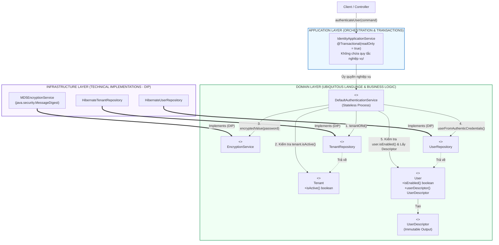

---

### 5. ÁNH XẠ ỨNG DỤNG VÀO DỰ ÁN GAME 2.5D OOP MULTIPLAYER

1. **Thiết kế *Stateless Domain Services* cho các Quy tắc Tương tác Đa Thực thể (`CombatResolutionService`, `StormZoneDamageService`):**
   * *Câu hỏi thiết kế trong Game:* Khi Nhân vật A (Hệ Hỏa) tung chiêu thức diện rộng (AoE) trúng Nhân vật B (Hệ Phong đang bật khiên) và 3 con Quái vật (`Mobs`) trong điều kiện thời tiết Mưa trên bản đồ, ta nên đặt hàm tính toán kết quả va chạm và phản ứng nguyên tố này ở đâu? Đặt vào `Hero A` thì `Hero A` phải biết quá nhiều về cấu trúc giáp của `Mob` và môi trường; đặt vào `Mob` thì bị lặp code!
   * *Áp dụng Chương 7:* Tạo một **Stateless Domain Service** tên là `CombatResolutionService` ngay trong package `combat.domain.service`. Dịch vụ này nhận vào `Attacker (Combatant)`, danh sách `Targets (List<Combatant>)`, `SkillSpec (Value Object)`, và `EnvironmentModifier (Value Object)`, sau đó tính toán ra danh sách `CombatOutcome` (Value Objects) và gọi `target.applyDamage(outcome)` lên từng mục tiêu!
2. **Dùng *Separated Interface Domain Service* cho Hệ thống Tìm đường & Không gian (`PathfindingService` / `SpatialQueryService`):**
   * Đặt `interface PathfindingService` trong tầng `domain` để các `Bot` AI và `Mob` gọi `pathfindingService.findNextWaypoint(currentPos, targetPos)`. Phần cài đặt thuật toán nặng nề như `AStarGridPathfinder` hoặc `SpatialHashGridService` được đặt ở tầng dưới, giúp logic quyết định chiến thuật (FSM) của Bot hoàn toàn tách biệt khỏi cấu trúc lưới ô vuông của bản đồ 66.000 px.

---
---

## CHƯƠNG 8: DOMAIN EVENTS (CÁC SỰ KIỆN MIỀN)

### 1. ĐỀ MỤC & MỤC TIÊU CỐT LÕI (CORE PURPOSE)

#### Hệ thống đề mục đầy đủ theo sách gốc (Trang 285–332):
* **The When and Why of Domain Events** (Khi nào và Tại sao sử dụng Sự kiện Miền)
* **Modeling Events** (Mô hình hóa các Sự kiện Miền)
  * *With Aggregate Characteristics* (Mang các đặc tính của Aggregate xảy ra sự kiện)
  * *Identity* (Định danh của Sự kiện & Thời điểm xảy ra `occurredOn`)
* **Publishing Events from the Domain Model** (Xuất bản Sự kiện từ bên trong Mô hình Miền)
  * *Publisher* (Bộ xuất bản Sự kiện nhẹ trong bộ nhớ — `DomainEventPublisher` dùng `ThreadLocal`)
  * *Subscribers* (Các Bộ đăng ký lắng nghe Sự kiện — Đồng bộ cùng Transaction vs. Bất đồng bộ)
* **Spreading the News to Remote Bounded Contexts** (Lan truyền Tin tức tới các Ngữ cảnh Giới hạn Từ xa)
  * *Messaging Infrastructure Consistency* (Đảm bảo tính nhất quán giữa Database và Hạ tầng Messaging — tránh cần 2PC)
  * *Autonomous Services and Systems* (Các Dịch vụ và Hệ thống Tự trị)
  * *Latency Tolerances* (Độ dung sai về Độ trễ)
* **Event Store** (Kho Lưu trữ Sự kiện)
* **Architectural Styles for Forwarding Stored Events** (Hai phong cách kiến trúc chuyển tiếp Sự kiện đã lưu)
  * *Publishing Notifications as RESTful Resources* (Xuất bản Thông báo dưới dạng Tài nguyên RESTful / Atom Feeds — Mô hình Kéo *Pull*)
  * *Publishing Notifications through Messaging Middleware* (Xuất bản Thông báo qua Middleware Tin nhắn RabbitMQ — Mô hình Đẩy *Push*)
* **Implementation** (Hiện thực hóa chi tiết `EventStore`, `NotificationLog`, và `MessageProducer` chống trùng lặp)
  * *Publishing the `NotificationLog`* (Xuất bản Nhật ký Thông báo phân trang có hỗ trợ bộ nhớ đệm HTTP)
  * *Publishing Message-Based Notifications* (Xuất bản Thông báo dựa trên Tin nhắn)
* **Wrap-Up** (Tổng kết)

#### Vấn đề kỹ thuật & nghiệp vụ cốt lõi và Thảm họa nếu không áp dụng:
* **Vấn đề giải quyết:** Làm thế nào để ghi nhận một sự việc có ý nghĩa nghiệp vụ **đã xảy ra trong quá khứ** của một *Aggregate* và kích hoạt các phản ứng dây chuyền ở cả nội bộ *Bounded Context* lẫn các *Bounded Contexts* từ xa mà **không tạo ra sự phụ thuộc trực tiếp (*Tight Coupling*)** hay làm rò rỉ thư viện Messaging (JMS, RabbitMQ) vào trong *Domain Model*? Đặc biệt, làm sao để đảm bảo **Tính nhất quán nguyên tử (*Atomic Consistency*)** giữa việc lưu trạng thái *Aggregate* vào Database và việc phát sự kiện ra ngoài mà **không phải dùng Giao dịch Phân tán 2 pha (*Two-Phase Commit / XA Transaction*)** đắt đỏ?
* **Thảm họa kỹ thuật nếu không áp dụng:**
  1. **Mất sự kiện hoặc Phát sự kiện "Ma" (*Dual-Write / Ghost Event Disaster*):** Nếu một *Aggregate* hoặc *Application Service* vừa gọi `repository.save(aggregate)` vào MySQL, vừa gọi trực tiếp `rabbitMqChannel.basicPublish(event)` qua mạng:
     * *Kịch bản A:* Gửi tin nhắn qua RabbitMQ thành công, nhưng ngay mili-giây sau lệnh `commit` vào MySQL bị lỗi (ví dụ trùng khóa hoặc đứt kết nối DB) $\rightarrow$ Các hệ thống khác nhận được **Sự kiện Ma (*Ghost Event*)** về một việc chưa hề được lưu!
     * *Kịch bản B:* Commit vào MySQL thành công, nhưng mạng tới RabbitMQ vừa chập chờn $\rightarrow$ **Mất sự kiện vĩnh viễn**, hệ thống rơi vào trạng thái bất nhất!
  2. **Ô nhiễm Mô hình Miền bởi Hạ tầng Tin nhắn (*Infrastructure Pollution*):** Nhét các lớp `ConnectionFactory`, `Topic`, `Queue` của JMS/RabbitMQ vào thẳng bên trong thực thể `BacklogItem` hoặc `Product`, khiến không thể chạy Unit Test cho Domain Model nếu không bật Message Broker.

---

### 2. PHÂN TÍCH LÝ THUYẾT & NGUYÊN LÝ CHUYÊN SÂU

#### A. Thiết kế và Quy ước Đặt tên của một *Domain Event*
* **Tên gọi ở Thì Quá Khứ (*Past Participle Verb*):** Phản ánh chính xác *Ubiquitous Language* về một sự thật lịch sử đã hoàn tất (Ví dụ: `BacklogItemCommitted`, `ProductDiscussionRequested`, `SprintScheduled`, `TaskHoursRemainingEstimated`).
* **Bất biến tuyệt đối (*Immutable*):** Vì quá khứ không thể sửa đổi, một *Domain Event* là bất biến 100% (không có `public setter`).
* **Thuộc tính bắt buộc:** Luôn chứa dấu thời gian xảy ra sự kiện (`Date occurredOn()`), phiên bản sự kiện (`int eventVersion()`), định danh của các *Aggregates* liên quan (`TenantId`, `BacklogItemId`, `SprintId`), và có thể kèm theo các thông tin ngữ cảnh làm giàu sự kiện (*Event Enrichment*) để bên nhận không phải gọi ngược lại truy vấn.

#### B. Cơ chế `DomainEventPublisher` siêu nhẹ dùng `ThreadLocal` ngay trong Domain Model
Làm sao để một thực thể `BacklogItem` tự phát sự kiện trong hàm `commitTo(Sprint)` mà không cần *Dependency Injection* bất kỳ đối tượng hạ tầng nào vào `BacklogItem`?
* Vaughn Vernon thiết kế mẫu **Lightweight In-Memory Publish-Subscribe (Observer Pattern)** sử dụng biến **`ThreadLocal`** trong lớp `DomainEventPublisher`:
  1. Khi bắt đầu một Request ở tầng *Application Service*, các `DomainEventSubscriber` cục bộ được đăng ký vào `DomainEventPublisher.instance()` (danh sách Subscribers này được cô lập riêng biệt cho từng luồng thực thi `ThreadLocal`, hoàn toàn an toàn đa luồng và không tốn bộ nhớ trên *Aggregate*).
  2. Khi phương thức trên *Aggregate* chạy, nó gọi `DomainEventPublisher.instance().publish(new BacklogItemCommitted(...))`.
  3. Các Subscribers cục bộ trên cùng luồng sẽ nhận được sự kiện **ngay lập tức và đồng bộ (*Synchronously in the same thread & transaction*)**!

#### C. Tuyệt kỹ Kiến trúc: Giải bài toán *Messaging Consistency* không cần Two-Phase Commit (2PC) bằng `EventStore` (Transactional Outbox Pattern)
Đây là đóng góp kiến trúc vĩ đại nhất của Chương 8 (trang 303–312):
* Làm thế nào để lưu `BacklogItem` vào Database và đồng thời gửi `BacklogItemCommitted` sang các *Bounded Contexts* khác một cách an toàn 100% mà không dùng *XA / Two-Phase Commit*?
* **Cơ chế hoạt động (Chính là cội nguồn của mẫu *Transactional Outbox* hiện đại):**
  1. Trong cùng cơ sở dữ liệu cục bộ của *Bounded Context*, ta tạo một bảng lưu trữ sự kiện tên là **`tbl_stored_event` (`EventStore`)**.
  2. Tầng *Application Service* (hoặc AOP Aspect) đăng ký một Subscriber mặc định lắng nghe **mọi `DomainEvent`** (`SubscribedToEventType = DomainEvent.class`).
  3. Khi `backlogItem.commitTo(sprint)` phát sự kiện `BacklogItemCommitted`, Subscriber này lập tức tuần tự hóa (*Serialize*) sự kiện thành JSON và **chèn (`INSERT`) vào bảng `tbl_stored_event` trong CÙNG MỘT GIAO DỊCH CƠ SỞ DỮ LIỆU ĐỊA PHƯƠNG (*Same Local Database Transaction*)** với việc lưu `BacklogItem`!
  4. Nếu Transaction thành công: Cả `BacklogItem` và `StoredEvent` đều được cam kết bền vững. Nếu Transaction Rollback: Cả hai cùng biến mất! Hoàn toàn không cần giao dịch phân tán 2 pha (2PC)!

#### D. 2 Phong cách Kiến trúc Chuyển tiếp Sự kiện từ `EventStore` ra Thế giới bên ngoài
Sau khi các sự kiện đã nằm an toàn trong `EventStore` theo thứ tự tăng dần của `eventId`, có 2 cách để phân phối chúng tới các *Bounded Contexts* từ xa:
1. **Phong cách RESTful Notifications (Mô hình Kéo - *Pull Model* qua HTTP / Atom Feeds):**
   * Xuất bản các sự kiện trong `EventStore` thành chuỗi các trang nhật ký thông báo (**`NotificationLog`**) theo số thứ tự (ví dụ mỗi trang chứa 20 sự kiện: `1..20`, `21..40`, `41..60`).
   * Các trang nhật ký cũ đã đầy (`1..20`, `21..40`) là **Bất biến vĩnh viễn (*Archived NotificationLogs*)**, nên Server gắn cờ `Cache-Control: max-age=31536000` để các Proxy HTTP và Client lưu đệm vĩnh viễn! Trang hiện tại đang ghi dở là **`Current NotificationLog`** kèm theo các đường dẫn Hypermedia (`self`, `previous`, `next`).
   * Các hệ thống *Downstream* định kỳ gọi HTTP `GET` để kéo sự kiện mới về mà không cần cài đặt bất kỳ hệ thống Message Broker trung gian nào!
2. **Phong cách Messaging Middleware (Mô hình Đẩy - *Push Model* qua RabbitMQ / ActiveMQ):**
   * Một tiến trình nền (*Background Worker / Timer*) định kỳ đọc các `StoredEvent` mới trong `EventStore` (so với con trỏ `mostRecentPublishedMessageId` lưu trong bảng `PublishedMessageTracker`), đẩy chúng lên *RabbitMQ Fanout Exchange*, rồi cập nhật con trỏ `mostRecentPublishedMessageId`.
   * Nếu tiến trình gửi bị sập giữa chừng trước khi kịp cập nhật con trỏ, lần chạy sau nó sẽ gửi lại sự kiện đó (**At-Least-Once Delivery**). Do đó, các *Subscribers* ở phía nhận bắt buộc phải được thiết kế **Lũy đẳng (*Idempotent Receiver*)** hoặc có cơ chế **Khử trùng lặp (*Event De-duplication*)** dựa trên `notificationId / eventId`!

---

### 3. MỔ XẺ MÃ NGUỒN & CẤU TRÚC THIẾT KẾ (CODE DEEP-DIVE)

Chúng ta sẽ mổ xẻ toàn bộ chuỗi mắt xích: **Thực thể `BacklogItemCommitted` $\rightarrow$ Bộ phát `DomainEventPublisher` (`ThreadLocal`) $\rightarrow$ Lưu trữ cùng Transaction vào `EventStore` $\rightarrow$ Bộ đẩy tin nhắn `NotificationPublisher`** (trang 290–330).

#### ❌ Thiết kế SAI BAN ĐẦU: Gửi tin nhắn qua mạng trực tiếp từ trong Aggregate hoặc Application Service (Lỗi Dual-Write)
```java
public class BadBacklogItem {
    public void commitTo(Sprint aSprint, RabbitTemplate rabbitTemplate) {
        this.sprintId = aSprint.sprintId();
        // THẢM HỌA 1: Bắt Domain Entity phụ thuộc vào thư viện hạ tầng RabbitTemplate!
        // THẢM HỌA 2: Gửi tin nhắn qua mạng ngay khi Database Transaction chưa hề được Commit!
        // Nếu lát nữa lệnh lưu DB bị lỗi OptimisticLockException -> Sự kiện Ma đã bay đi mất!
        rabbitTemplate.convertAndSend("agilepmExchange", "", new BacklogItemCommittedEvent(this.id));
    }
}
```

#### ✅ Thiết kế CHUẨN MỰC SAU REFACTOR: `DomainEvent`, `ThreadLocal DomainEventPublisher` & `EventStore` Outbox

```java
// ============================================================================
// 1. GIAO DIỆN CHUẨN & SỰ KIỆN BẤT BIẾN: DomainEvent & BacklogItemCommitted
// Package: com.saasovation.common.domain.model
// ============================================================================
public interface DomainEvent {
    public int eventVersion();
    public Date occurredOn();
}

public class BacklogItemCommitted implements DomainEvent {
    private BacklogItemId backlogItemId;
    private int eventVersion;
    private Date occurredOn;
    private SprintId sprintId;
    private TenantId tenantId;

    public BacklogItemCommitted(
        TenantId aTenantId,
        BacklogItemId aBacklogItemId,
        SprintId aSprintId) {

        super();
        this.backlogItemId = aBacklogItemId;
        this.eventVersion = 1;
        this.occurredOn = new Date();
        this.sprintId = aSprintId;
        this.tenantId = aTenantId;
    }

    @Override public int eventVersion() { return this.eventVersion; }
    @Override public Date occurredOn() { return this.occurredOn; }
    public BacklogItemId backlogItemId() { return this.backlogItemId; }
    public SprintId sprintId() { return this.sprintId; }
    public TenantId tenantId() { return this.tenantId; }
}

// ============================================================================
// 2. BỘ XUẤT BẢN SỰ KIỆN TRONG BỘ NHỚ DÙNG THREADLOCAL: DomainEventPublisher
// Không cần Dependency Injection vào Aggregate, an toàn đa luồng 100%!
// ============================================================================
public class DomainEventPublisher {

    private static final ThreadLocal<List> subscribers = new ThreadLocal<List>();
    private static final ThreadLocal<Boolean> publishing = new ThreadLocal<Boolean>() {
        protected Boolean initialValue() { return Boolean.FALSE; }
    };

    public static DomainEventPublisher instance() {
        return new DomainEventPublisher();
    }

    public <T> void publish(final T aDomainEvent) {
        if (this.isPublishing()) {
            return; // Ngăn chặn vòng lặp đệ quy vô tận
        }
        try {
            this.setPublishing(true);
            List<DomainEventSubscriber<T>> registeredSubscribers = this.subscribers();

            if (registeredSubscribers != null) {
                Class<?> eventType = aDomainEvent.getClass();
                for (DomainEventSubscriber<T> subscriber : registeredSubscribers) {
                    Class<?> subscribedTo = subscriber.subscribedToEventType();
                    // Khớp đúng kiểu sự kiện hoặc lắng nghe mọi DomainEvent.class
                    if (subscribedTo == eventType || subscribedTo == DomainEvent.class) {
                        subscriber.handleEvent(aDomainEvent);
                    }
                }
            }
        } finally {
            this.setPublishing(false);
        }
    }

    public void reset() {
        if (!this.isPublishing()) {
            this.setSubscribers(null);
        }
    }

    public <T> void subscribe(DomainEventSubscriber<T> aSubscriber) {
        if (this.isPublishing()) { return; }
        this.ensureSubscribersList();
        this.subscribers().add(aSubscriber);
    }
    // ...
}

// ============================================================================
// 3. SUBSCRIBER LƯU SỰ KIỆN VÀO EVENT STORE CÙNG LOCAL TRANSACTION
// Đảm bảo tính nhất quán nguyên tử (Atomic Consistency) mà không cần 2PC!
// ============================================================================
@Aspect
public class DomainEventStoreProcessor {

    @Autowired
    private EventStore eventStore;

    @Before("execution(* com.saasovation..application.*ApplicationService.*(..))")
    public void listen() {
        DomainEventPublisher.instance().reset();

        DomainEventPublisher
            .instance()
            .subscribe(new DomainEventSubscriber<DomainEvent>() {
                @Override
                public void handleEvent(DomainEvent aDomainEvent) {
                    // Lưu trực tiếp vào bảng tbl_stored_event trong CÙNG Transaction với Aggregate!
                    eventStore.append(aDomainEvent);
                }

                @Override
                public Class<DomainEvent> subscribedToEventType() {
                    return DomainEvent.class; // Bắt mọi sự kiện miền phát sinh trong Transaction này
                }
            });
    }
}
```

#### Bảng phân tích kỹ thuật & Ý nghĩa thiết kế:

| Dòng code / Đoạn code then chốt | Giải thích kỹ thuật & Nguyên lý thiết kế (DDD/OOP) được hiện thực hóa |
| :--- | :--- |
| `public class BacklogItemCommitted implements DomainEvent` | **Sự kiện Lịch sử Bất biến (*Immutable Fact*):** Tên class dùng động từ quá khứ phân từ (`Committed`), chỉ có hàm đọc (`getter` kiểu không tiền tố `get`: `backlogItemId()`, `sprintId()`, `occurredOn()`), không có bất kỳ hàm `setter` nào. |
| `private static final ThreadLocal<List> subscribers` | **Cô lập theo Luồng (*ThreadLocal Isolation*) & Không làm bẩn Aggregate:** Mỗi luồng xử lý Request có một danh sách `subscribers` riêng biệt trong `ThreadLocal`. Nhờ đó, `BacklogItem` có thể gọi `DomainEventPublisher.instance().publish(...)` trực tiếp mà không cần tiêm (`@Autowired`) bất kỳ đối tượng Publisher nào vào bên trong Entity! |
| `if (subscribedTo == eventType \|\| subscribedTo == DomainEvent.class)` | **Đa hình lắng nghe Sự kiện (*Polymorphic Subscription*):** Cho phép một Subscriber chuyên biệt chỉ lắng nghe đúng 1 sự kiện cụ thể (như `BacklogItemCommitted.class`), đồng thời cho phép hạ tầng `EventStore` đăng ký lắng nghe lớp cha `DomainEvent.class` để thu thập 100% mọi sự kiện phát ra. |
| `eventStore.append(aDomainEvent);` *(Trong AOP `@Before` ApplicationService)* | **Transactional Outbox / Local Transaction Consistency:** Vì hàm `handleEvent` của `DomainEventPublisher` chạy đồng bộ ngay trên cùng luồng với `ApplicationService`, lệnh `eventStore.append(aDomainEvent)` sẽ `INSERT` bản ghi `StoredEvent` vào chung một Database Transaction với lệnh cập nhật `BacklogItem`. Xóa sổ hoàn toàn lỗi *Ghost Event* và *Lost Event*! |

---

### 4. SƠ ĐỒ TRỰC QUAN HÓA (BẮT BUỘC MÃ MERMAID)

Sơ đồ dưới đây mô tả trọn vẹn kiến trúc **Xuất bản Sự kiện Miền 2 Pha (In-Memory `ThreadLocal` + Local `EventStore` Outbox)** và **2 kênh phân phối ra các Bounded Contexts từ xa (RESTful Pull `NotificationLog` vs. RabbitMQ Push)**:

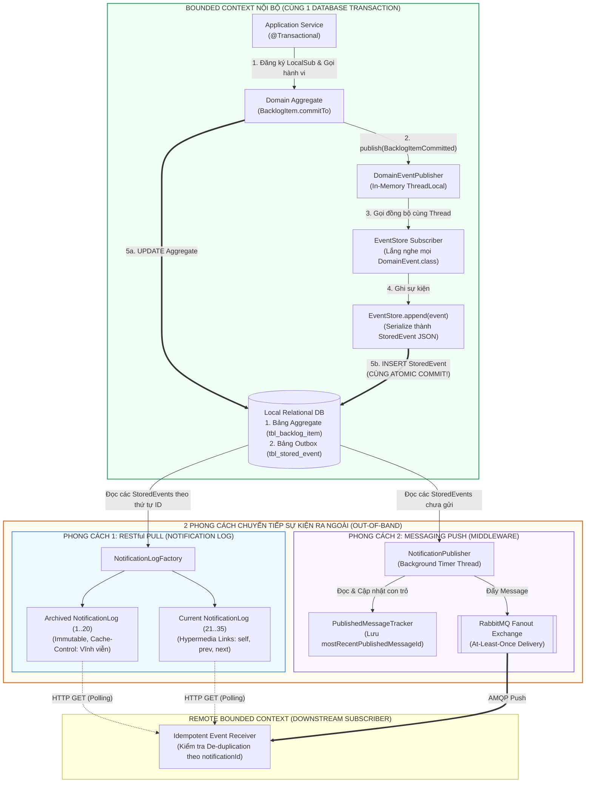

---

### 5. ÁNH XẠ ỨNG DỤNG VÀO DỰ ÁN GAME 2.5D OOP MULTIPLAYER

Chương 8 (*Domain Events*) giải quyết bài toán cốt tử về **Độ kết dính thấp (*Loose Coupling*)** và **Truyền thông mạng tin cậy** trong kiến trúc Game 2.5D của bạn:

1. **Giải phóng `Combat Core` khỏi Hiệu ứng Âm thanh, Hạt (Particles), HUD và Thống kê bằng `DomainEventPublisher`:**
   * *Vấn đề kinh điển khi code Game:* Khi một con Quái vật (`Mob`) bị tiêu diệt hoặc Nhân vật (`Hero`) trúng chiêu chí mạng trong hàm `takeDamage()`, lập trình viên thường viết thẳng vào trong `takeDamage()` các lệnh: `SoundManager.play("explosion.wav")`, `ParticleSystem.spawnBlood(x, y)`, `HudController.addKillScore(1)`, `DropManager.dropGold(x, y)`. Hậu quả là class `Mob` bị dính chặt vào Âm thanh, Đồ họa và Giao diện — không thể chạy trên Server Headless (vì Server làm gì có loa để phát âm thanh!).
   * *Áp dụng Chương 8:* Bên trong `Mob.takeDamage()`, khi `hp <= 0`, thực thể chỉ làm đúng một việc: phát ra sự kiện miền bất biến `DomainEventPublisher.instance().publish(new MobSlainEvent(this.mobId(), killerId, this.position(), this.mobType(), tickNumber))`.
     * Khi chạy trên **Server**: `LootDropSubscriber` và `MatchScoreSubscriber` đăng ký lắng nghe `MobSlainEvent` để rơi vật phẩm và cộng điểm.
     * Khi chạy trên **Client**: `AudioEffectSubscriber` và `IsometricVfxSubscriber` lắng nghe sự kiện đó để nổ hiệu ứng hạt 2.5D và phát âm thanh! Mô hình `Mob` hoàn toàn sạch bóng code đồ họa/âm thanh!
2. **Áp dụng cơ chế *NotificationLog / Sequence Number & De-duplication* cho Giao thức Mạng 4G (UDP/Relay):**
   * Mạng di động 4G thường xuyên bị rớt gói tin (*Packet Loss*) hoặc nhận gói tin trùng lặp (*Duplicate Packets*).
   * Bằng cách áp dụng thiết kế `StoredEvent` và `Notification` của Chương 8: Mỗi sự kiện quan trọng trong trận đấu (`SkillCast`, `HeroDied`, `StormPhaseAdvanced`) đều được gán một số thứ tự tăng dần (`eventSequenceId`) và ghi vào bộ đệm sự kiện của trận đấu (`MatchEventRingBuffer` — tương đương `EventStore` trong RAM).
   * Gói tin gửi qua mạng đính kèm các sự kiện gần nhất. Ở phía Client (hoặc Server), bộ nhận áp dụng mẫu **Idempotent / De-duplicating Receiver**: chỉ cần lưu lại `lastProcessedEventId`; nếu nhận lại sự kiện có `id <= lastProcessedEventId` do cơ chế gửi bù (*Retransmission*), Client tự động bỏ qua mà không bao giờ bị lỗi trừ máu 2 lần hay nổ hiệu ứng 2 lần!


<br/><br/>

---\n

# ĐỢT 6 / 10: BÓC TÁCH CHUYÊN SÂU CHƯƠNG 9 & CHƯƠNG 10 (PHẦN 1)
**Sách:** *Implementing Domain-Driven Design (IDDD)* — **Tác giả:** *Vaughn Vernon*

---

## CHƯƠNG 9: MODULES (CÁC MÔ-ĐUN / GÓI TỔ CHỨC MÔ HÌNH)

### 1. ĐỀ MỤC & MỤC TIÊU CỐT LÕI (CORE PURPOSE)

#### Hệ thống đề mục đầy đủ theo sách gốc (Trang 333–346):
* **Designing with Modules** (Thiết kế với các Mô-đun / Package)
* **Basic Module Naming Conventions** (Các quy ước đặt tên Mô-đun cơ bản)
* **Module Naming Conventions for the Model** (Quy ước đặt tên Mô-đun cho Mô hình Miền)
* **Modules of the Agile Project Management Context** (Các Mô-đun trong Ngữ cảnh Quản lý Dự án Agile)
* **Modules in Other Layers** (Mô-đun trong các Tầng kiến trúc khác — *Application, Infrastructure, Port & Adapter*)
* **Module before Bounded Context** (Sử dụng Mô-đun trước khi phân tách Bounded Context — *Tổ chức tiền Bounded Context*)
* **Wrap-Up** (Tổng kết)

#### Vấn đề kỹ thuật & nghiệp vụ cốt lõi và Thảm họa nếu không áp dụng:
* **Vấn đề giải quyết:** Làm thế nào để nhóm các khái niệm, thực thể (*Entities*), đối tượng giá trị (*Value Objects*) và dịch vụ (*Domain Services*) thành các cấu trúc vật lý (`package` trong Java, `namespace` trong C#) một cách gắn kết logic cao (*High Cohesion*) và khớp nối lỏng (*Low Coupling*)? Làm sao để việc đặt tên package phản ánh trực tiếp **Ngôn ngữ Phổ quát (*Ubiquitous Language*)** thay vì phân chia máy móc theo kiểu kỹ thuật?
* **Thảm họa kỹ thuật nếu không áp dụng:**
  1. **Tổ chức Package theo Kiểu Kỹ thuật Máy móc (*Technical Component Packaging Anti-pattern*):** Lập trình viên chia package thành: `com.company.entities`, `com.company.repositories`, `com.company.services`, `com.company.factories`. Hậu quả là một khái niệm nghiệp vụ duy nhất (ví dụ: `Product` hoặc `Sprint`) bị xé nát ra 4-5 package khác nhau; không ai nhìn vào cấu trúc thư mục mà hiểu được hệ thống làm về nghiệp vụ gì; mức độ phụ thuộc vòng tròn giữa các package kỹ thuật tăng vọt (*Circular Package Dependency*).
  2. **Thảm họa Khớp nối Package (*Uncontrolled Package Tangling*):** Các class trong package này import tự do các class trong package khác không theo quy tắc. Khi muốn trích xuất hoặc chia tách một phân hệ thành microservice/Bounded Context riêng, ta phải đối mặt với một mạng nhện phụ thuộc không thể tháo gỡ.
  3. **Lạm dụng Bounded Context quá sớm (*Premature Bounded Context Decomposition*):** Khi dự án còn nhỏ, đội ngũ vội vã tách thành nhiều Bounded Context / Microservices riêng biệt, gánh chịu chi phí vận hành mạng và serialization quá lớn, thay vì phân chia ranh giới ngữ cảnh sạch sẽ bằng **Modules** ngay trong cùng một mã nguồn đơn khối (*Monolith with Modular Boundaries*).

---

### 2. PHÂN TÍCH LÝ THUYẾT & NGUYÊN LÝ CHUYÊN SÂU

#### A. Triết lý Thiết kế Mô-đun trong DDD (*Designing with Modules*)
Vaughn Vernon nhấn mạnh: **Module không chỉ là nơi chứa file mã nguồn, Module là một thành phần chính thống của Ubiquitous Language!**
* **Tính gắn kết cao (*High Cohesion*):** Các đối tượng trong cùng một Module phải phục vụ cho cùng một khái niệm nghiệp vụ cốt lõi hoặc một cụm chức năng có tính liên quan mật thiết. Nếu một đối tượng thay đổi, các đối tượng cùng Module có khả năng phải thay đổi theo.
* **Khớp nối lỏng (*Low Coupling*):** Giảm thiểu tối đa số lượng liên kết tham chiếu từ Module này sang Module khác. Giao tiếp giữa các Module nên thông qua các lớp Root, các Interface hoặc các Value Objects trung gian.
* **Nguyên tắc Đóng gói theo Ngữ nghĩa (*Semantic Packaging*):** Nhìn vào danh sách Module/Package, một kỹ sư mới vào dự án phải đọc ra ngay được câu chuyện kinh doanh (*Business Story*) của phần mềm, chứ không phải thấy danh sách các công nghệ Java (`controllers`, `beans`, `daos`, `helpers`).

#### B. Quy ước Đặt tên Module Chuẩn DDD (*Module Naming Conventions*)
Quy ước đặt tên package chuẩn trong DDD của Vaughn Vernon tuân theo cấu trúc phân tầng phân cấp có trật tự:
```
[Tên miền tổ chức].[Tên sản phẩm].[Tên Bounded Context].[Tên Tầng].[Tên Khái niệm Miền]
```
Ví dụ chuẩn mực trong *SaaSOvation*:
* **Tầng Miền (*Domain Model Layer*):**
  * `com.saasovation.agilepm.domain.model.product` (Chứa `Product`, `ProductId`, `ProductBacklogItem`, `ProductDiscussion`)
  * `com.saasovation.agilepm.domain.model.product.backlogitem` (Chứa `BacklogItem`, `BacklogItemId`, `Task`, `EstimationLogEntry`, `BusinessPriority`)
  * `com.saasovation.agilepm.domain.model.product.release` (Chứa `Release`, `ReleaseId`, `ScheduledBacklogItem`)
  * `com.saasovation.agilepm.domain.model.product.sprint` (Chứa `Sprint`, `SprintId`, `CommittedBacklogItem`)
  * `com.saasovation.agilepm.domain.model.team` (Chứa `ProductOwner`, `TeamMember`, `Team`)
* **Tầng Ứng dụng (*Application Layer*):**
  * `com.saasovation.agilepm.application.product` (Chứa `ProductApplicationService`)
* **Tầng Hạ tầng / Cổng Adapter (*Port and Adapter Layer*):**
  * `com.saasovation.agilepm.port.adapter.persistence` (Chứa `HibernateProductRepository`)
  * `com.saasovation.agilepm.port.adapter.rest` (Chứa `ProductResource`)
  * `com.saasovation.agilepm.port.adapter.messaging` (Chứa `RabbitMQBacklogItemPublisher`)

#### C. Chiến lược "Module trước khi tách Bounded Context" (*Module before Bounded Context*)
* Đây là lời khuyên thực dụng kinh điển của Vernon: Khi bắt đầu một dự án, nếu ranh giới ngữ nghĩa chưa hoàn toàn rõ ràng, hoặc đội ngũ phát triển còn nhỏ (chỉ có 1 nhóm làm việc), **đừng vội vã chia thành 3-4 repo hoặc 3-4 microservices**.
* Hãy thiết kế hệ thống dưới dạng **Modular Monolith**: Giữ tất cả trong một deployment artifact (1 file `.jar` / `.war`), nhưng chia tách nghiêm ngặt ranh giới nghiệp vụ bằng các **top-level Modules** (`identityaccess`, `collaboration`, `agilepm`). Cấm các package này gọi chéo tầng nội tại của nhau. Đến khi đội ngũ phát triển phình to hoặc cần mở rộng quy mô độc lập, việc "cắt" các Module này thành các Bounded Contexts độc lập sẽ chỉ tốn vài giờ refactor thay vì đập đi xây lại!

---

### 3. MỔ XẺ MÃ NGUỒN & CẤU TRÚC THIẾT KẾ (CODE DEEP-DIVE)

So sánh cấu trúc tổ chức mã nguồn giữa **Thiết kế theo thành phần kỹ thuật (Sai lầm)** và **Thiết kế theo Khái niệm Miền của Bounded Context (Chuẩn mực DDD)**:

#### ❌ Cấu trúc SAI: Chia Module máy móc theo Lớp Kỹ thuật (*Technical Layer Packaging*)
```
com.saasovation.projectovation/
├── entities/                      <-- THẢM HỌA: Gom mọi Entity vào một nơi
│   ├── Product.java
│   ├── BacklogItem.java
│   ├── Task.java
│   ├── Release.java
│   ├── Sprint.java
│   └── TeamMember.java
├── valueobjects/                  <-- Gom mọi Value Object vào một nơi
│   ├── ProductId.java
│   ├── BusinessPriority.java
│   └── EstimationLogEntry.java
├── repositories/                  <-- Gom mọi Repository Interface
│   ├── ProductRepository.java
│   └── BacklogItemRepository.java
└── services/                      <-- Trộn lẫn Application Service & Domain Service
    ├── ProductApplicationService.java
    └── BusinessPriorityCalculator.java
```
*Hệ quả:* Mọi class đều phải `public`, không tận dụng được phạm vi truy cập `package-private` của Java để giấu các thành phần nhạy cảm!

#### ✅ Cấu trúc CHUẨN MỰC: Phân rã theo Ngữ cảnh Giới hạn và Khái niệm Miền (*Domain Concept Modules*)
```
com.saasovation.agilepm/
├── domain/
│   └── model/
│       ├── product/                             <-- Khái niệm Product Root
│       │   ├── Product.java                     (Aggregate Root)
│       │   ├── ProductId.java                   (Value Object)
│       │   ├── ProductBacklogItem.java          (Package-private Entity con)
│       │   ├── ProductDiscussion.java           (Value Object)
│       │   ├── ProductDiscussionRequested.java  (Domain Event)
│       │   ├── ProductRepository.java           (Repository Port Interface)
│       │   │
│       │   ├── backlogitem/                     <-- Phân mô-đun con BacklogItem
│       │   │   ├── BacklogItem.java             (Aggregate Root)
│       │   │   ├── BacklogItemId.java           (Value Object)
│       │   │   ├── Task.java                    (Entity nội bộ Aggregate)
│       │   │   ├── TaskId.java                  (Value Object)
│       │   │   ├── EstimationLogEntry.java      (Value Object)
│       │   │   ├── BusinessPriority.java        (Value Object)
│       │   │   ├── BusinessPriorityCalculator.java (Domain Service)
│       │   │   └── BacklogItemRepository.java   (Repository Port Interface)
│       │   │
│       │   └── sprint/                          <-- Phân mô-đun con Sprint
│       │       ├── Sprint.java                  (Aggregate Root)
│       │       ├── SprintId.java                (Value Object)
│       │       └── SprintRepository.java        (Repository Port Interface)
│       │
│       └── team/                                <-- Phân mô-đun Team & Vai trò
│           ├── ProductOwner.java
│           ├── TeamMember.java
│           └── Member.java
├── application/
│   └── product/
│       ├── ProductApplicationService.java
│       └── commands/
│           └── PlanBacklogItemCommand.java
└── port/
    └── adapter/
        ├── persistence/
        │   └── HibernateProductRepository.java  (Driven Adapter)
        └── rest/
            └── ProductResource.java             (Driving Adapter)
```

#### Bảng phân tích kỹ thuật & Ý nghĩa thiết kế:

| Gói / Cấu trúc Module | Giải thích kỹ thuật & Ý nghĩa thiết kế (DDD/OOP) |
| :--- | :--- |
| `com.saasovation.agilepm.domain.model.product` | **High Cohesion (Gắn kết Khái niệm Miền):** Gom tất cả những gì trực tiếp cấu thành khái niệm `Product` vào cùng một thư mục vật lý. Cho phép lớp con `ProductBacklogItem` để mức truy cập **`package-private` (không khai báo `public`)**, bảo vệ nó khỏi việc bị truy cập trái phép từ các module khác! |
| `...model.product.backlogitem` | **Độc lập Ranh giới Aggregate (*Boundary Isolation*):** `BacklogItem` là một Aggregate độc lập với `Product`. Việc tách riêng nó ra một sub-package giúp kiểm soát rõ ràng sự phụ thuộc một chiều từ `backlogitem` tới `product` thông qua `ProductId`, ngăn chặn việc import bừa bãi. |
| `...port.adapter.persistence` vs. `...domain.model.product` | **Dependency Inversion Principle (DIP):** Package `persistence` import package `domain.model.product` để thực thi `ProductRepository`. Gói `domain` hoàn toàn không có bất kỳ dòng code `import` nào trỏ tới gói `adapter`, đảm bảo mô hình miền hoàn toàn trung lập với hạ tầng. |

---

### 4. SƠ ĐỒ TRỰC QUAN HÓA (BẮT BUỘC MÃ MERMAID)

Sơ đồ gói (Package Diagram) thể hiện mối quan hệ phụ thuộc một chiều, không vòng tròn giữa các Module trong kiến trúc phân tầng chuẩn DDD:

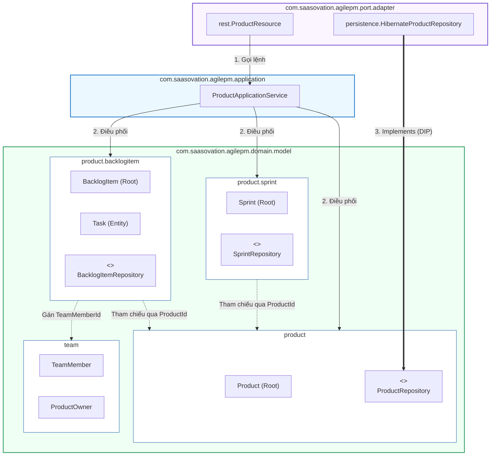

---

### 5. ÁNH XẠ ỨNG DỤNG VÀO DỰ ÁN GAME 2.5D OOP MULTIPLAYER

1. **Chuẩn hóa hệ thống Package trong `Src_Game` theo Module Miền (Xóa bỏ package kiểu `entities/` hỗn tạp):**
   * *Hiện trạng sai lầm phổ biến:* Tạo các package `com.game.entities` (chứa chung cả `Player`, `Skeleton`, `Zombie`, `Bullet`, `Chest`), `com.game.managers` (chứa `SkillManager`, `LootManager`).
   * *Áp dụng Chương 9:* Tái cấu trúc theo Khái niệm Miền:
     * `com.game.combat.hero` (Chứa `HeroCharacter`, `HeroClass`, `SkillSlot`, `PlayerStats`)
     * `com.game.combat.mobs` (Chứa `MobEntity`, `MobType`, `MobSpawnSpec`, `MobLootTable`)
     * `com.game.combat.stormzone` (Chứa `StormCircle`, `ZonePhase`, `ZoneDamageCalculator`)
     * `com.game.network.protocol` (Chứa các gói tin DTO và Packet Serialization)
     * `com.game.presentation.render25d` (Chứa `IsometricRenderer`, `SpriteSheetLoader`, `Camera25D`)
   * *Lợi ích:* Đóng gói các lớp con của Quái vật (`MobBehavior`, `MobAnimationTracker`) ở mức **`package-private`**, chỉ phơi bày giao diện công khai `MobEntity` ra ngoài cho Game Loop điều khiển.
2. **Ngăn chặn rò rỉ phụ thuộc vòng tròn giữa `Combat` và `Render`:**
   * Package `combat` tuyệt đối không được `import com.game.presentation.*`. Chiều phụ thuộc vật lý bắt buộc phải là một chiều: `presentation` import `combat` để đọc dữ liệu vẽ lên màn hình, bảo đảm logic game có thể chạy trơn tru ở chế độ máy chủ không màn hình (*Dedicated Headless Server*).

---
---

## CHƯƠNG 10 (PHẦN 1): AGGREGATES — SCRUM CORE DOMAIN & 4 RULES OF THUMB (CÁC KHỐI KẾT HỢP - PHẦN 1)

### 1. ĐỀ MỤC & MỤC TIÊU CỐT LÕI (CORE PURPOSE)

#### Hệ thống đề mục đầy đủ theo sách gốc (Nửa đầu Chương 10 - Trang 347–367):
* **Using Aggregates in the Scrum Core Domain** (Sử dụng Aggregates trong Miền cốt lõi Scrum của SaaSOvation)
  * *First Attempt: Large-Cluster Aggregate* (Nỗ lực đầu tiên: Khối kết hợp Cụm Lớn — Sai lầm cấu trúc)
  * *Second Attempt: Multiple Aggregates* (Nỗ lực thứ hai: Phân tách thành Nhiều Aggregates)
* **Rule: Model True Invariants in Consistency Boundaries** (Quy tắc 1: Mô hình hóa các Bất biến Thực sự trong Ranh giới Nhất quán)
* **Rule: Design Small Aggregates** (Quy tắc 2: Thiết kế các Aggregates Nhỏ)
  * *Don’t Trust Every Use Case* (Đừng tin mù quáng vào mọi Use Case của Business Analyst)
* **Rule: Reference Other Aggregates by Identity** (Quy tắc 3: Tham chiếu tới các Aggregates khác bằng Định danh)
  * *Making Aggregates Work Together through Identity References* (Làm cho các Aggregates hoạt động cùng nhau qua tham chiếu Định danh)
  * *Model Navigation* (Điều hướng trong Mô hình)
  * *Scalability and Distribution* (Khả năng Mở rộng Quy mô và Phân tán)
* **Rule: Use Eventual Consistency Outside the Boundary** (Quy tắc 4: Sử dụng Nhất quán Cuối cùng bên ngoài Ranh giới)
  * *Ask Whose Job It Is* (Hãy hỏi xem: Đó là nhiệm vụ của AI?)

#### Vấn đề kỹ thuật & nghiệp vụ cốt lõi và Thảm họa nếu không áp dụng:
* **Vấn đề giải quyết:** *Aggregate* là mẫu thiết kế chiến thuật quan trọng nhất nhưng **bị hiểu sai nhiều nhất** trong toàn bộ DDD. Chương 10 giải quyết câu hỏi: **Làm sao để gom cụm các Entities và Value Objects thành một ranh giới nhất quán giao dịch duy nhất (*Transactional Consistency Boundary*) để bảo vệ các quy tắc nghiệp vụ bất biến (*Invariants*), mà không làm sập hiệu năng hệ thống khi nhiều người dùng thao tác đồng thời?**
* **Thảm họa kỹ thuật nếu không áp dụng:**
  1. **Thảm họa Khối kết hợp Cụm Lớn (*Large-Cluster Aggregate Disaster*):** Nhầm lẫn giữa "Mối quan hệ sở hữu trong thế giới thực" với "Ranh giới giao dịch trong phần mềm". Đội ngũ nghĩ rằng: *"Product có BacklogItems, có Releases, có Sprints"* $\rightarrow$ nhét tất cả vào trong 1 class `Product` duy nhất!
  2. **Xung đột Khóa Lạc quan liên tục (*Optimistic Concurrency Collision Avalanche*):** Khi `Product` ôm hàng ngàn `BacklogItem`, `Release`, `Sprint`:
     * Người dùng Bill lập kế hoạch cho 1 `BacklogItem` mới $\rightarrow$ `Product.version` tăng từ 1 lên 2.
     * Cùng giây đó, người dùng Joe lên lịch cho 1 `Release` mới dựa trên `Product.version 1` $\rightarrow$ Giao dịch của Joe bị **Rollback và sập hoàn toàn** vì xung đột khóa lạc quan (*Stale Object Exception*)! Dù 2 hành vi này về mặt nghiệp vụ không hề liên quan gì đến nhau!
  3. **Bộ nhớ RAM nổ tung & Độ trễ I/O tăng vọt (*Memory Explosion & Lazy Loading Hell*):** Để thêm 1 task nhỏ, hệ thống phải nạp cả cây đồ thị gồm hàng ngàn đối tượng vào bộ nhớ. Nếu không bật Lazy Load thì hết RAM; nếu bật Lazy Load thì dính lỗi hàng trăm câu truy vấn phụ lắt nhắt (*N+1 Selects Problem*).

---

### 2. PHÂN TÍCH LÝ THUYẾT & NGUYÊN LÝ CHUYÊN SÂU

#### A. Định nghĩa Chuẩn mực về *Invariant* và *Consistency Boundary*
* **Bất biến (*Invariant*):** Là một **quy tắc nghiệp vụ bắt buộc phải luôn luôn đúng và nhất quán tại mọi thời điểm giao dịch commit**.
  * *Ví dụ về Bất biến thực sự:* Biểu thức $C = A + B$. Nếu $A=2, B=3$ thì $C$ bắt buộc phải bằng $5$. Nếu sau khi commit mà $C \ne 5$, hệ thống rơi vào trạng thái hỏng dữ liệu. Để bảo vệ quy tắc này, $A, B, C$ phải nằm chung trong **một ranh giới giao dịch duy nhất**.
  * *Bất biến Giả (*False Invariants*):* Đội ngũ *SaaSOvation* tự đặt ra quy tắc: *"Nếu 1 backlog item đã lên lịch vào sprint thì không cho xóa khỏi hệ thống"*. Đây không phải là một bất biến tức thời đòi hỏi chung giao dịch, mà là một ràng buộc có thể kiểm tra trước khi gọi lệnh hoặc xử lý bù trừ!

#### B. 4 Quy tắc Vàng Thiết kế Aggregate (*The 4 Aggregate Rules of Thumb*)
Vaughn Vernon đúc kết 4 quy tắc sống còn mà bất kỳ kiến trúc sư nào cũng phải tuân thủ:

##### Quy tắc 1: Mô hình hóa các Bất biến Thực sự trong Ranh giới Nhất quán (*Model True Invariants in Consistency Boundaries*)
* Một Aggregate tương đương với một **Ranh giới Nhất quán Giao dịch (*Transactional Consistency Boundary*)**.
* Mọi thứ bên trong ranh giới của một Aggregate instance phải hoàn toàn nhất quán khi một giao dịch kết thúc.
* **Nguyên tắc ngón tay cái:** Trong một Bounded Context được thiết kế chuẩn, **mỗi giao dịch chỉ được phép chỉnh sửa DUY NHẤT MỘT Aggregate instance** (`Modify only ONE Aggregate instance per transaction`)!

##### Quy tắc 2: Thiết kế các Aggregates Nhỏ (*Design Small Aggregates*)
* Giới hạn Aggregate chỉ gồm **Aggregate Root Entity** và một số lượng tối thiểu các thuộc tính và **Value Objects**.
* Hãy ưu tiên chứa các Value Objects thay vì chứa các Entities con. Tỷ lệ khảo sát thực tế của Niclas Hedhman trên dự án lớn: **70% Aggregates chỉ gồm duy nhất 1 Root Entity bọc các Value Objects**, 30% còn lại chỉ chứa thêm 1 đến 2 Entity con!
* **Đừng tin mù quáng vào mọi Use Case (*Don't Trust Every Use Case*):** Khi Business Analyst viết một Use Case mô tả việc cập nhật hàng loạt nhiều đối tượng cùng lúc (như phê duyệt 100 đơn hàng), lập trình viên không được gộp chúng vào 1 Aggregate khổng lồ. Hãy thực hiện Use Case đó qua nhiều giao dịch độc lập hoặc dùng xử lý lô (*Batch Processing*).

##### Quy tắc 3: Tham chiếu tới các Aggregates khác bằng Định danh (*Reference Other Aggregates by Identity*)
* **TUYỆT ĐỐI KHÔNG giữ tham chiếu trực tiếp dạng con trỏ đối tượng (*Do NOT hold direct object references*)** giữa các Aggregates!
  * *Sai:* `class BacklogItem { private Product product; }` (Tạo ra đồ thị đối tượng sâu, khiến bộ nhớ nạp lan truyền và cám dỗ lập trình viên sửa cả 2 trong 1 transaction).
  * *Đúng:* `class BacklogItem { private ProductId productId; }` (Chỉ lưu giữ Value Object định danh!).
* *Lợi ích:*
  1. **Bộ nhớ cực nhẹ:** Nạp một `BacklogItem` chỉ tốn vài chục bytes, không kích hoạt cơ chế tải lan truyền cả cây dữ liệu.
  2. **Loại bỏ xung đột giao dịch:** Không bao giờ vô tình sửa đổi `Product` khi đang thao tác trên `BacklogItem`.
  3. **Khả năng mở rộng phân tán (*Infinite Scalability*):** Theo bài báo kinh điển *"Life beyond Distributed Transactions"* của Pat Helland (Amazon), các Aggregate tham chiếu qua ID có thể được lưu trữ trên các bảng khác nhau, các database phân vùng khác nhau (*Database Sharding*) hoặc các node NoSQL khác nhau mà không bị ràng buộc bởi khóa ngoại cấp cơ sở dữ liệu.

##### Quy tắc 4: Sử dụng Nhất quán Cuối cùng bên ngoài Ranh giới (*Use Eventual Consistency Outside the Boundary*)
* Khi một hành vi nghiệp vụ trên một Aggregate đòi hỏi cập nhật trạng thái trên một hoặc nhiều Aggregates khác: **HÃY DÙNG NHẤT QUÁN CUỐI CÙNG (*EVENTUAL CONSISTENCY*)!**
* **Cơ chế:** Aggregate A thực thi command $\rightarrow$ commit giao dịch cục bộ của nó $\rightarrow$ phát ra một **Domain Event** $\rightarrow$ Các Subscribers ở các giao dịch tiếp theo sẽ nhận sự kiện, nạp Aggregate B lên và cập nhật độc lập!
* **Quy tắc "Hỏi xem đó là việc của ai" (*Ask Whose Job It Is*):**
  * Thảo luận giữa Vaughn Vernon và Eric Evans đưa ra câu hỏi mấu chốt để phân xử:
  * *"Liệu có phải nhiệm vụ của người dùng đang bấm nút là làm cho dữ liệu của cả 2 nơi khớp nhau ngay lập tức không?"*
    * Nếu ĐÚNG là trách nhiệm trực tiếp của người đó: Xem xét gộp chung hoặc xử lý giao dịch.
    * Nếu đó là nhiệm vụ của một người khác (như Product Owner duyệt sau), hoặc là **nhiệm vụ của hệ thống máy tính tự động cập nhật**: **BẮT BUỘC DÙNG EVENTUAL CONSISTENCY!** Chuyên gia nghiệp vụ trong thực tế hoàn toàn chấp nhận việc dữ liệu có độ trễ vài giây đến vài phút để đổi lấy hệ thống chạy mượt mà không bao giờ bị đơ!

---

### 3. MỔ XẺ MÃ NGUỒN & CẤU TRÚC THIẾT KẾ (CODE DEEP-DIVE)

Chương 10 trình bày màn bóc tách kinh điển: Từ thiết kế cụm lớn bị sập vì Optimistic Locking đến thiết kế tách nhỏ thành 4 Aggregates độc lập giao tiếp qua `ProductId` và `Domain Events` (trang 349–365).

#### ❌ Thiết kế SAI BAN ĐẦU: Khối kết hợp Cụm Lớn (*Large-Cluster Aggregate*)
```java
// THẢM HỌA: Product ôm trọn tất cả con cháu trong cùng một ranh giới Aggregate!
public class Product extends ConcurrencySafeEntity {
    private ProductId productId;
    private TenantId tenantId;
    private String name;
    private String description;

    // Các tập hợp khổng lồ khiến nạp bộ nhớ cực nặng và khóa lạc quan xung đột liên tục!
    private Set<BacklogItem> backlogItems;
    private Set<Release> releases;
    private Set<Sprint> sprints;

    // Phương thức CQS Command: void return type, biến đổi trực tiếp tập hợp nội bộ
    public void planBacklogItem(
        String aSummary, String aCategory,
        BacklogItemType aType, StoryPoints aStoryPoints) {
        
        BacklogItem backlogItem = new BacklogItem(
            this.tenantId(), this.productId(),
            new BacklogItemId(UUID.randomUUID().toString()),
            aSummary, aCategory, aType, aStoryPoints);

        // THẢM HỌA: Thêm phần tử vào Set làm thay đổi trạng thái của Product -> Product.version tăng vọt!
        // Người khác đang tạo Sprint trên cùng Product này sẽ bị xung đột khóa lạc quan (Crash)!
        this.backlogItems.add(backlogItem);
    }
}
```

#### ✅ Thiết kế CHUẨN MỰC SAU REFACTOR: 4 Aggregates Tách Biệt, Tham chiếu qua Identity và Nhà máy Khởi tạo

```java
// ============================================================================
// 1. AGGREGATE 1: PRODUCT (Gọn nhẹ, đóng vai trò Factory sinh BacklogItem)
// Package: com.saasovation.agilepm.domain.model.product
// ============================================================================
public class Product extends ConcurrencySafeEntity {
    private TenantId tenantId;
    private ProductId productId;
    private String name;
    private String description;
    // ĐÃ XÓA SẠCH: Không còn Set<BacklogItem>, Set<Release>, Set<Sprint> ở đây nữa!

    // REFACTOR CQS: Phương thức này đóng vai trò Factory (Chương 11), trả về thực thể BacklogItem MỚI
    // KHÔNG làm thay đổi Product.concurrencyVersion!
    public BacklogItem planBacklogItem(
        String aSummary,
        String aCategory,
        BacklogItemType aType,
        StoryPoints aStoryPoints) {

        BacklogItemId newBacklogItemId =
            new BacklogItemId(UUID.randomUUID().toString().toUpperCase());

        // Khởi tạo Aggregate con với tham chiếu ID ngược về ProductId
        BacklogItem plannedBacklogItem = new BacklogItem(
            this.tenantId(),
            this.productId(),
            newBacklogItemId,
            aSummary,
            aCategory,
            aType,
            aStoryPoints);

        return plannedBacklogItem;
    }
}

// ============================================================================
// 2. AGGREGATE 2: BACKLOGITEM (Đứng độc lập, tham chiếu Product/Sprint qua ID)
// Package: com.saasovation.agilepm.domain.model.product.backlogitem
// ============================================================================
public class BacklogItem extends ConcurrencySafeEntity {
    private TenantId tenantId;
    private ProductId productId;       // THAM CHIẾU QUA IDENTITY (Quy tắc 3)
    private BacklogItemId backlogItemId;
    private ReleaseId releaseId;       // THAM CHIẾU QUA IDENTITY
    private SprintId sprintId;         // THAM CHIẾU QUA IDENTITY
    private BacklogItemStatus status;

    private Set<Task> tasks;           // Cụm nhỏ gồm các Entities/VOs bảo vệ Invariant nội bộ

    // QUY TẮC 4: DÙNG DOMAIN EVENT ĐỂ ĐẠT ĐƯỢC EVENTUAL CONSISTENCY
    public void commitTo(Sprint aSprint) {
        this.assertArgumentNotNull(aSprint, "Sprint must not be null.");
        this.assertArgumentEquals(this.tenantId(), aSprint.tenantId(), "Tenant mismatch.");
        this.assertArgumentEquals(this.productId(), aSprint.productId(), "Product mismatch.");

        this.setSprintId(aSprint.sprintId());
        this.setStatus(BacklogItemStatus.COMMITTED);

        // Bắn Domain Event để phía Sprint tự cập nhật CommittedBacklogItem ở giao dịch riêng!
        DomainEventPublisher
            .instance()
            .publish(new BacklogItemCommitted(
                this.tenantId(),
                this.backlogItemId(),
                this.sprintId()));
    }
}

// ============================================================================
// 3. TẦNG APPLICATION SERVICE: Tuân thủ "Chỉ sửa 1 Aggregate per Transaction"
// Package: com.saasovation.agilepm.application.product
// ============================================================================
public class ProductBacklogItemService {
    @Transactional
    public String planProductBacklogItem(
        String aTenantId, String aProductId,
        String aSummary, String aCategory,
        String aType, String aStoryPoints) {

        TenantId tenantId = new TenantId(aTenantId);
        ProductId productId = new ProductId(aProductId);

        // Chỉ đọc Product để kiểm tra và dùng làm Factory
        Product product = this.productRepository.productOfId(tenantId, productId);

        BacklogItem plannedBacklogItem = product.planBacklogItem(
            aSummary,
            aCategory,
            BacklogItemType.valueOf(aType),
            StoryPoints.valueOf(aStoryPoints));

        // CHỈ THÊM MỚI 1 AGGREGATE DUY NHẤT VÀO DATABASE TRONG GIAO DỊCH NÀY!
        this.backlogItemRepository.add(plannedBacklogItem);

        return plannedBacklogItem.backlogItemId().id();
    }
}
```

#### Bảng phân tích kỹ thuật & Ý nghĩa thiết kế:

| Dòng code / Đoạn code then chốt | Giải thích kỹ thuật & Nguyên lý thiết kế (DDD/OOP) được hiện thực hóa |
| :--- | :--- |
| `private ProductId productId;` *(Trong BacklogItem)* | **Quy tắc 3: Reference by Identity:** Thay vì lưu con trỏ `Product`, ta chỉ lưu Value Object `ProductId`. Nhờ vậy, khi Hibernate nạp `BacklogItem`, nó không kích hoạt truy vấn kéo theo toàn bộ bảng `Product`, tiết kiệm bộ nhớ và cắt đứt liên kết khóa giao dịch. |
| `public BacklogItem planBacklogItem(...)` *(Trả về BacklogItem)* | **Tách biệt CQS & Aggregate Factory:** Đổi từ hàm trả về `void` (sửa đổi bộ sưu tập nội bộ của Product) sang hàm dạng Factory trả về một cá thể `BacklogItem` mới tinh. Bản thân `Product` không bị "dirty", không tăng `concurrencyVersion`, loại bỏ 100% nguy cơ tranh chấp khóa với người khác! |
| `this.backlogItemRepository.add(plannedBacklogItem);` | **Quy tắc 1: Sửa đúng 1 Aggregate per Transaction:** Tầng Application Service nạp `Product` ở chế độ chỉ đọc và chỉ thực hiện thao tác lưu đối với `BacklogItem` mới. Giao dịch diễn ra trong vài mili-giây và luôn thành công. |
| `DomainEventPublisher.instance().publish(new BacklogItemCommitted(...))` | **Quy tắc 4: Eventual Consistency Outside Boundary:** Thay vì trong cùng một giao dịch vừa sửa `BacklogItem`, vừa mở `Sprint` ra để nhét `CommittedBacklogItem` vào (vi phạm quy tắc 1), `BacklogItem` chỉ phát ra sự kiện. Phía `Sprint` sẽ có một Subscriber độc lập xử lý ở giao dịch tiếp theo. |

---

### 4. SƠ ĐỒ TRỰC QUAN HÓA (BẮT BUỘC MÃ MERMAID)

Sơ đồ trực quan hóa bước ngoặt kiến trúc: Từ **Khối kết hợp cụm lớn (Gây tắc nghẽn giao dịch)** sang **Các Aggregates nhỏ độc lập liên kết qua Định danh và Nhất quán cuối cùng**:

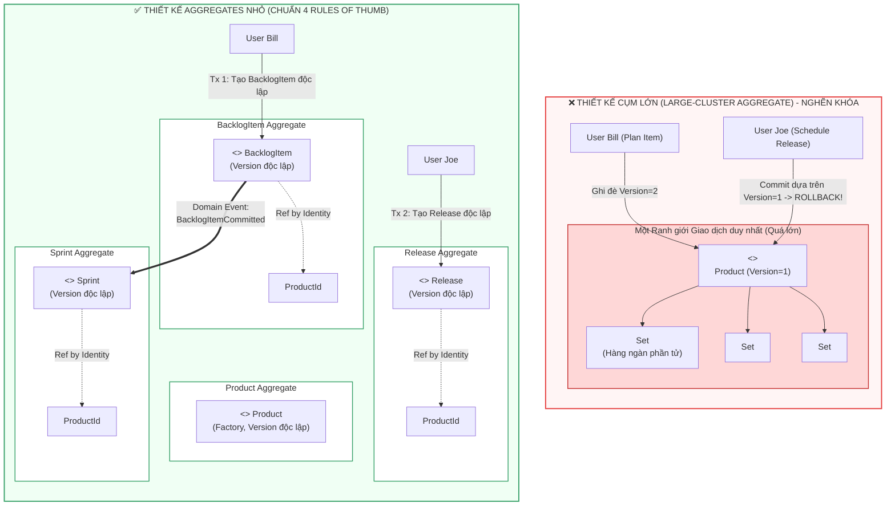

---

### 5. ÁNH XẠ ỨNG DỤNG VÀO DỰ ÁN GAME 2.5D OOP MULTIPLAYER

4 Quy tắc Vàng về Aggregate giải quyết 2 bài toán nhức nhối nhất trong phát triển Game nhiều người chơi: **Chống Hack/Dupe đồ giao dịch** và **Đồng bộ hóa nhặt đồ trên bản đồ**:

1. **Áp dụng Quy tắc 1 & 3 để Chống Lỗi Nhân Bản Trang Bị (*Item Duplication / Race Condition Bug*):**
   * *Thảm họa trong Game RPG:* Người chơi A giao dịch (*Trade*) một thanh kiếm thần cho Người chơi B. Lập trình viên viết một giao dịch mở cả hai nhân vật: `playerA.getInventory().remove(item)` và `playerB.getInventory().add(item)`. Khi mạng lag hoặc có gian lận cố tình ngắt kết nối đúng thời điểm, một lệnh ghi thành công còn lệnh kia rollback, dẫn đến lỗi thanh kiếm xuất hiện trong cả hai túi đồ (*Dupe item*)!
   * *Áp dụng Quy tắc Aggregate:* Túi đồ của mỗi người chơi là một **Aggregate riêng biệt** (`InventoryAggregate`), tham chiếu người chơi qua `PlayerId`. Thao tác giao dịch **không bao giờ sửa 2 Aggregate trong 1 giao dịch trực tiếp**. Thay vào đó:
     * Giao dịch 1: Khóa món đồ trong túi A và phát sinh thực thể tạm thời `TradeSessionAggregate` (lưu mã giao dịch `TradeId`).
     * Giao dịch 2: Rút món đồ khỏi túi A và đưa vào trạng thái trung gian.
     * Giao dịch 3: Nạp món đồ vào túi B. Nếu có bất kỳ sự cố mạng nào xảy ra, hệ thống tự động hoàn trả dựa trên quy tắc bất biến của `TradeSession` mà không bao giờ sinh ra lỗi dupe đồ.
2. **Quy tắc 2 (Small Aggregate) cho Thực thể Quái vật (`MobEntity`) và Hòm đồ rơi (`LootDrop`):**
   * Thay vì để bản đồ thế giới (*World Map*) làm một Aggregate khổng lồ chứa hàng ngàn con Quái và hàng ngàn hòm đồ, mỗi con Quái (`MobEntity`) và mỗi đống chiến lợi phẩm (`LootDrop`) là **một Aggregate nhỏ độc lập** có định danh `LootId`, `MobId`.
   * Khi 2 người chơi cùng lao vào nhặt 1 món đồ cùng 1 mili-giây: Cơ chế **Khóa Lạc quan (*Optimistic Concurrency / Version*)** trên `LootDrop` sẽ đảm bảo người có gói tin tới trước nhận được đồ (`version` nhảy từ 1 lên 2), người tới sau nhận ngay thông báo lỗi *"Vật phẩm đã bị người khác nhặt"* mà không làm đơ Game Loop của máy chủ!


<br/><br/>

---\n

# ĐỢT 7 / 10: BÓC TÁCH CHUYÊN SÂU CHƯƠNG 10 (PHẦN 2)
**Sách:** *Implementing Domain-Driven Design (IDDD)* — **Tác giả:** *Vaughn Vernon*

---

## CHƯƠNG 10 (PHẦN 2): AGGREGATES — REASONS TO BREAK RULES, DISCOVERY & IMPLEMENTATION (CÁC KHỐI KẾT HỢP - PHẦN 2)

### 1. ĐỀ MỤC & MỤC TIÊU CỐT LÕI (CORE PURPOSE)

#### Hệ thống đề mục đầy đủ theo sách gốc (Nửa sau Chương 10 - Trang 367–388):
* **Reasons to Break the Rules** (Các lý do chính đáng để Phá vỡ Quy tắc thiết kế Aggregate)
  * *Reason One: User Interface Convenience* (Lý do 1: Sự tiện lợi của Giao diện người dùng — Tạo hàng loạt *Batch Creation*)
  * *Reason Two: Lack of Technical Mechanisms* (Lý do 2: Thiếu hụt Cơ chế Kỹ thuật / Không có hạ tầng Messaging)
  * *Reason Three: Global Transactions* (Lý do 3: Ràng buộc Giao dịch Toàn cục / Two-Phase Commit do chính sách doanh nghiệp)
  * *Reason Four: Query Performance* (Lý do 4: Hiệu năng Truy vấn / Theta Joins)
  * *Adhering to the Rules* (Kiên định tuân thủ Quy tắc)
* **Gaining Insight through Discovery** (Đạt được Thấu hiểu Sâu sắc thông qua Quá trình Khám phá Mô hình)
  * *Rethinking the Design, Again* (Tái tư duy Thiết kế một lần nữa: Cân nhắc giữa `BacklogItem` và `Task`)
  * *Estimating Aggregate Cost* (Ước tính Chi phí Aggregate — Phương pháp Tính toán trên vỏ phong bì *BOTE Calculations*)
  * *Common Usage Scenarios* (Các Kịch bản Sử dụng Phổ biến & Khảo sát Tranh chấp Khóa)
  * *Memory Consumption* (Tiêu thụ Bộ nhớ RAM và Tác động của Lazy Loading)
  * *Exploring Another Alternative Design* (Khám phá Thiết kế Thay thế: Tách `Task` thành Aggregate Độc lập)
  * *Implementing Eventual Consistency* (Hiện thực hóa Nhất quán Cuối cùng giữa `Task` và `BacklogItem`)
  * *Is It the Team Member’s Job?* (Đó có phải là nhiệm vụ của Thành viên Đội ngũ không? — Tự động vs Thủ công)
  * *Time for Decisions* (Thời điểm Ra Quyết định Kiến trúc: Sự Thực dụng thắng Phân tích Trừu tượng)
* **Implementation** (Chi tiết Hiện thực hóa Kỹ thuật)
  * *Create a Root Entity with Unique Identity* (Tạo Thực thể Gốc với Định danh Duy nhất)
  * *Favor Value Object Parts* (Ưu tiên các Thành phần là Đối tượng Giá trị)
  * *Using Law of Demeter and Tell, Don’t Ask* (Áp dụng Định luật Demeter và Nguyên lý "Hãy ra lệnh, Đừng hỏi han")
  * *Optimistic Concurrency* (Kiểm soát Đồng thời Lạc quan: Quản lý thuộc tính `version` trên Root vs. Child Entities)
  * *Avoid Dependency Injection* (Tránh Tiêm Phụ thuộc Repository/Service vào bên trong Aggregate)
* **Wrap-Up** (Tổng kết)

#### Vấn đề kỹ thuật & nghiệp vụ cốt lõi và Thảm họa nếu không áp dụng:
* **Vấn đề giải quyết:**
  1. Trong thực tế, có những tình huống bắt buộc phải phá vỡ quy tắc "Chỉ sửa 1 Aggregate/giao dịch" (như tạo lô dữ liệu trên UI, thiếu Message Broker, hoặc yêu cầu hiệu năng đọc cực hạn). Làm thế nào để **phá vỡ quy tắc một cách có kiểm soát và an toàn tuyệt đối** mà không phá hủy tính toàn vẹn của mô hình?
  2. Làm sao để đánh giá định lượng chi phí RAM và xung đột giao dịch của một Aggregate trước khi viết code? Vaughn Vernon cung cấp công cụ toán học ước lượng thực chiến: **BOTE (*Back-of-the-envelope*) Calculations**.
  3. Làm sao để lập trình Aggregate đúng chuẩn OOP thuần khiết: Ẩn giấu cấu trúc nội bộ bằng **Law of Demeter** và **Tell, Don’t Ask**, quản lý phiên bản khóa lạc quan (*Optimistic Concurrency Versioning*) khi cập nhật thành phần con, và tại sao **tuyệt đối cấm Dependency Injection** vào trong Aggregate?
* **Thảm họa kỹ thuật nếu không áp dụng:**
  1. **Tê liệt Phân tích (*Analysis Paralysis*):** Đội ngũ tranh cãi bất tận về việc có nên tách `Task` khỏi `BacklogItem` hay không mà không đưa ra được con số định lượng cụ thể về bộ nhớ và tần suất sử dụng thực tế.
  2. **Vi phạm Định luật Demeter & Rò rỉ Trạng thái Nội bộ (*Train Wreck Code*):** Client bên ngoài chọc sâu vào cấu trúc Aggregate bằng chuỗi lệnh nguy hiểm `product.getBacklogItems().get(0).setOrder(5)`. Thực thể gốc mất quyền kiểm soát bất biến (*Invariants*), dữ liệu bị thao túng tùy tiện.
  3. **Rò rỉ Hạ tầng vào Lõi Nghiệp vụ & Cạn kiệt Bộ nhớ Garbage Collection (GC):** Tiêm `Repository` hoặc `DomainService` vào bên trong Aggregate thông qua DI Framework (Spring `@Autowired`), tạo ra hàng triệu liên kết rác trong bộ nhớ RAM, khiến bộ thu gom rác (*Garbage Collector*) bị quá tải chu kỳ quét.

---

### 2. PHÂN TÍCH LÝ THUYẾT & NGUYÊN LÝ CHUYÊN SÂU

#### A. 4 Lý do Chính đáng để Phá vỡ Quy tắc Aggregate (*Reasons to Break the Rules*)
Vaughn Vernon nhấn mạnh: *Nguyên tắc ngón tay cái sinh ra là để tuân theo, nhưng một kiến trúc sư giàu kinh nghiệm phải biết chính xác khi nào và tại sao mình phá luật*:
1. **Lý do 1: User Interface Convenience (Sự tiện lợi của UI — Thao tác Tạo hàng loạt):**
   * Người dùng cần tạo nhanh 10 `BacklogItem` cùng lúc từ một biểu mẫu nhập liệu lô. Việc tạo 10 Aggregate mới trong cùng một Database Transaction là hoàn toàn chấp nhận được, **bởi vì bản thân từng Aggregate mới tạo tự bảo vệ bất biến của chính nó**, và không có xung đột khóa lạc quan với trạng thái đã lưu trước đó.
2. **Lý do 2: Lack of Technical Mechanisms (Thiếu hụt Hạ tầng Kỹ thuật):**
   * Nếu dự án chạy trong môi trường cũ, không có Message Broker (RabbitMQ), không có Timer nền hay Thread Pool để xử lý *Eventual Consistency*. Nếu cố chấp dùng Eventual Consistency sẽ thất bại. Trong trường hợp này, sửa 2 Aggregate trong 1 transaction là giải pháp tình thế chấp nhận được, miễn là ta áp dụng nguyên tắc **User-Aggregate Affinity** (đảm bảo chỉ 1 người dùng thao tác trên cụm đối tượng đó tại một thời điểm).
3. **Lý do 3: Global Transactions (Ràng buộc Giao dịch Toàn cục):**
   * Khi chính sách doanh nghiệp bắt buộc dùng hệ thống Legacy hỗ trợ Two-Phase Commit (2PC). Ta buộc phải tuân theo, nhưng vẫn cố gắng giữ thiết kế mô hình Aggregate độc lập bên trong ranh giới logic.
4. **Lý do 4: Query Performance (Hiệu năng Truy vấn Khắt khe):**
   * Khi việc nạp dữ liệu từ nhiều Repository độc lập qua ID gây suy giảm hiệu năng nghiêm trọng cho màn hình hiển thị, ta có thể dùng phép nối *Theta Join* của Hibernate hoặc cân nhắc phá lệ giữ tham chiếu trực tiếp có chọn lọc (nếu không thể áp dụng CQRS).

#### B. Khám phá Mô hình & Phép Tính Toán trên Vỏ Phong Bì (*BOTE Calculations*)
Để quyết định xem có nên tách `Task` thành một Aggregate riêng biệt khỏi `BacklogItem` hay không, Vernon hướng dẫn đội ngũ *SaaSOvation* thực hiện phép tính định lượng thực tế (**BOTE - Back-Of-The-Envelope Calculations** của Jon Bentley):
* **Giả định sử dụng thực tế (*Assumptions*):**
  * Một Sprint kéo dài khoảng **12 ngày làm việc**.
  * Một `Task` có thời lượng từ **4 đến 16 giờ** (trung bình lấy mốc tối đa là 12 giờ).
  * Mỗi ngày làm việc, thành viên ước lượng lại số giờ còn lại 1 lần $\rightarrow$ tối đa **12 bản ghi ước lượng (`EstimationLogEntry`)** cho mỗi Task.
  * Mỗi `BacklogItem` có trung bình khoảng 11-12 Tasks (chia theo các lát cắt kiến trúc: UI, Application, Domain, Infrastructure) $\rightarrow$ Lấy cận trên là **12 Tasks**.
* **Định lượng Chi phí Bộ nhớ và Tải dữ liệu:**
  * **Tổng số đối tượng nạp trên lý thuyết:** $12 \text{ tasks} \times 12 \text{ logs} = 144 \text{ đối tượng}$.
  * **Thực tế với Lazy Loading:**
    * Khi người dùng chỉ cập nhật số giờ của 1 Task cụ thể: Hệ thống nạp 1 `BacklogItem` + 12 `Task` proxy + 12 `EstimationLogEntry` của riêng Task đó $\rightarrow$ **Tối đa chỉ có 25 đối tượng trong RAM** tại ngày cuối cùng của Sprint!
  * **Phân tích Xung đột Khóa Lạc quan (*Concurrency Contention*):**
    * Ai là người cập nhật giờ? Chỉ có 1 lập trình viên nhận Task đó mới cập nhật giờ của mình mỗi ngày một lần $\rightarrow$ **Xác suất 2 người cùng sửa 1 Task là gần như bằng 0**.
    * Trạng thái của `BacklogItem` chỉ tự động chuyển sang `DONE` khi **tất cả mọi Task đều về 0 giờ** $\rightarrow$ Trong suốt 144 lần cập nhật, chỉ có **duy nhất lần cập nhật thứ 144** là làm thay đổi trạng thái của `BacklogItem` Root và tăng `version` của Root!
  * **Kết luận Kiến trúc Đắt giá (*Pragmatism wins*):** Việc giữ `Task` bên trong `BacklogItem` chỉ tốn tối đa 25 đối tượng trong RAM, không hề gây nghẽn hiệu năng như lo sợ ban đầu. Chi phí để tách `Task` thành Aggregate riêng (phải dùng Domain Event, thêm bảng Event Store, xử lý bất đồng bộ trên UI) là **quá đắt đỏ so với lợi ích thu lại**. Đội ngũ quyết định: **GIỮ NGUYÊN `Task` BÊN TRONG `BacklogItem`!**

#### C. Chi tiết Hiện thực hóa Kỹ thuật (*Implementation Best Practices*)
1. **Law of Demeter (Định luật Demeter - Nguyên lý Biết ít nhất *Least Knowledge*):**
   * Một phương thức của đối tượng chỉ được phép gọi các phương thức của: chính nó, các tham số truyền vào, các đối tượng do chính nó khởi tạo, và các thuộc tính trực tiếp của nó.
   * Cấm tiệt chuỗi gọi xuyên thấu: `a.getB().getC().doSomething()`. Aggregate Root phải đóng vai trò người gác cổng (*Gatekeeper*).
2. **Tell, Don’t Ask (Hãy ra lệnh, Đừng hỏi han):**
   * Thay vì lấy thông tin ra ngoài rồi tính toán: `if (item.getStatus() == X) { item.setStatus(Y); }`, Client phải ra lệnh trực tiếp cho đối tượng: `item.commitTo(sprint);`.
3. **Optimistic Concurrency với Hibernate khi Thành phần Con thay đổi:**
   * Khi ta sửa đổi một thuộc tính bên trong Entity con `ProductBacklogItem`, Hibernate **không tự động tăng version của Root Entity `Product`**!
   * *Giải pháp sai lầm:* Tự viết `this.version(this.version() + 1);` trong hàm `reorderFrom()`. Cách này làm bẩn mô hình và luôn đánh dấu dirty ngay cả khi thứ tự không đổi.
   * *Giải pháp chuẩn DDD của Vernon:* Để Entity con tự sở hữu thuộc tính `concurrencyVersion` của riêng nó; hoặc nếu muốn bảo vệ quy tắc toàn cục, chỉ kích hoạt tăng version của Root khi có một sự kiện làm biến đổi thuộc tính có ý nghĩa nghiệp vụ thực sự trên Root (như thay đổi `status` trên `BacklogItem`).
4. **Tránh Tiêm Phụ thuộc (*Avoid Dependency Injection into Aggregates*):**
   * **CẤM tiêm Repository hoặc Domain Service vào bên trong Aggregate!**
   * *Tại sao?* Aggregate là đối tượng dữ liệu và nghiệp vụ sống ngắn hạn trong RAM. Việc tiêm các Singleton Services vào hàng triệu instance Aggregate gây lãng phí bộ nhớ và cám dỗ Aggregate tự truy vấn DB (mô hình *Disconnected Domain Model* - phản mẫu).
   * *Cách làm chuẩn:* Mọi dữ liệu phụ thuộc phải được **Application Service tra cứu trước từ Repository/Service rồi truyền vào làm tham số (*Pass-by-parameter*)** cho phương thức của Aggregate, hoặc Aggregate thực hiện cơ chế *Double-Dispatch* với Domain Service truyền vào.

---

### 3. MỔ XẺ MÃ NGUỒN & CẤU TRÚC THIẾT KẾ (CODE DEEP-DIVE)

Chúng ta sẽ mổ xẻ 3 kỹ thuật then chốt của Chương 10 (Phần 2):
1. **Phá luật có kiểm soát: Tạo Lô trên UI** (`planBatchOfProductBacklogItems`, trang 367–368).
2. **Hiện thực hóa Law of Demeter & Protected Setter trên Entity con** (`Product.reorderFrom`, trang 383–384).
3. **Khai báo Root Entity chuẩn với Định danh UUID do Repository sinh ra** (`nextIdentity`, trang 380–381).

#### ❌ Thiết kế SAI BAN ĐẦU: Vi phạm Law of Demeter & Tiêm Repository trực tiếp vào Aggregate
```java
// SAI LẦM 1: Tiêm Repository trực tiếp vào Entity (Vi phạm Dependency Injection rule)
public class BadProduct extends ConcurrencySafeEntity {
    @Autowired
    private BacklogItemRepository backlogItemRepository; // THẢM HỌA: Aggregate ôm Singleton Repository!

    public void assignTask(String backlogItemId, String memberId) {
        // Aggregate tự chọc vào DB để tìm đối tượng khác
        BacklogItem item = backlogItemRepository.findById(backlogItemId);
        item.setAssignedMember(memberId);
    }
}

// SAI LẦM 2: Vi phạm Law of Demeter - Client chọc thẳng vào ruột để thao túng thứ tự
public class BadClientService {
    public void reorderItem(Product product, BacklogItemId id, int newOrder) {
        // Vi phạm nghiêm trọng Tell, Don't Ask và Law of Demeter!
        for (ProductBacklogItem pbi : product.getBacklogItems()) {
            if (pbi.getId().equals(id)) {
                pbi.setOrdering(newOrder); // Lộ hàm public setter nguy hiểm trên Entity con!
            }
        }
    }
}
```

#### ✅ Thiết kế CHUẨN MỰC SAU REFACTOR: Law of Demeter, Protected Delegation, và Double-Dispatch sạch sẽ

```java
// ============================================================================
// 1. PHÁ LUẬT CÓ KIỂM SOÁT: TẠO LÔ HÀNG LOẠT TRÊN GIAO DIỆN NGƯỜI DÙNG (UI)
// Package: com.saasovation.agilepm.application.product
// ============================================================================
public class ProductBacklogItemService {

    @Transactional
    public void planBatchOfProductBacklogItems(
        String aTenantId,
        String aProductId,
        BacklogItemDescription[] aDescriptions) {

        TenantId tenantId = new TenantId(aTenantId);
        ProductId productId = new ProductId(aProductId);

        Product product = this.productRepository.productOfId(tenantId, productId);

        // PHÁ LỆ HỢP LÝ: Vòng lặp tạo nhiều Aggregate instances trong cùng 1 Transaction
        // An toàn vì mỗi BacklogItem mới tự chịu trách nhiệm về Invariant của chính nó!
        for (BacklogItemDescription desc : aDescriptions) {
            BacklogItem plannedBacklogItem =
                product.planBacklogItem(
                    desc.summary(),
                    desc.category(),
                    BacklogItemType.valueOf(desc.backlogItemType()),
                    StoryPoints.valueOf(desc.storyPoints()));

            this.backlogItemRepository.add(plannedBacklogItem);
        }
    }
}

// ============================================================================
// 2. AGGREGATE ROOT BẢO VỆ PHẨM GIÁ NỘI BỘ (LAW OF DEMETER & TELL, DON'T ASK)
// Package: com.saasovation.agilepm.domain.model.product
// ============================================================================
public class Product extends ConcurrencySafeEntity {

    private Set<ProductBacklogItem> backlogItems; // Tập hợp Entity con nội bộ

    public void reorderFrom(BacklogItemId anId, int anOrdering) {
        // TELL, DON'T ASK: Client chỉ việc ra lệnh cho Root!
        // Root Entity tự chịu trách nhiệm điều phối việc sắp xếp lại các phần tử con
        for (ProductBacklogItem pbi : this.backlogItems()) {
            pbi.reorderFrom(anId, anOrdering);
        }
    }

    // Trả về tập hợp nhưng chỉ để đọc (Read-only query), KHÔNG có hàm setter bên ngoài
    public Set<ProductBacklogItem> backlogItems() {
        return Collections.unmodifiableSet(this.backlogItems);
    }
}

// ============================================================================
// 3. ENTITY CON NỘI BỘ ĐƯỢC BẢO VỆ TUYỆT ĐỐI (PROTECTED MUTATION)
// Package: com.saasovation.agilepm.domain.model.product
// ============================================================================
public class ProductBacklogItem extends ConcurrencySafeEntity {

    private BacklogItemId backlogItemId;
    private int ordering;

    // PHƯƠNG THỨC BIẾN ĐỔI BỊ GIẤU KÍN (PROTECTED / PACKAGE-PRIVATE)
    // Chỉ có Product (nằm cùng package) mới được phép gọi lệnh này!
    // Bất kỳ Client nào bên ngoài package đều KHÔNG THỂ gọi trực tiếp!
    protected void reorderFrom(BacklogItemId anId, int anOrdering) {
        if (this.backlogItemId().equals(anId)) {
            this.setOrdering(anOrdering);
        } else if (this.ordering() >= anOrdering) {
            this.setOrdering(this.ordering() + 1);
        }
    }

    protected void setOrdering(int anOrdering) {
        this.ordering = anOrdering;
    }

    public BacklogItemId backlogItemId() { return this.backlogItemId; }
    public int ordering() { return this.ordering; }
}

// ============================================================================
// 4. TRÁNH DEPENDENCY INJECTION: TRUYỀN PHỤ THUỘC QUA THAM SỐ (PASS-BY-PARAMETER)
// Package: com.saasovation.agilepm.application.product
// ============================================================================
public class ProductBacklogItemService {

    @Transactional
    public void assignTeamMemberToTask(
        String aTenantId, String aBacklogItemId, String aTaskId, String aTeamMemberId) {

        // 1. Application Service tự tra cứu các phụ thuộc từ Repository
        BacklogItem backlogItem = this.backlogItemRepository.backlogItemOfId(
            new TenantId(aTenantId), new BacklogItemId(aBacklogItemId));

        Team ofTeam = this.teamRepository.teamOfId(
            backlogItem.tenantId(), backlogItem.teamId());

        // 2. Truyền thực thể phụ thuộc vào Aggregate qua tham số phương thức!
        // Aggregate KHÔNG CẦN chứa Repository hay Service nào trong lòng nó!
        backlogItem.assignTeamMemberToTask(
            new TeamMemberId(aTeamMemberId),
            ofTeam,
            new TaskId(aTaskId));
    }
}
```

#### Bảng phân tích kỹ thuật & Ý nghĩa thiết kế:

| Dòng code / Đoạn code then chốt | Giải thích kỹ thuật & Nguyên lý thiết kế (DDD/OOP) được hiện thực hóa |
| :--- | :--- |
| `for (BacklogItemDescription desc : aDescriptions) { ... backlogItemRepository.add(...) }` | **Phá vỡ quy tắc 1 có kiểm soát (UI Batching):** Cho phép tạo nhiều Aggregate instances trong 1 giao dịch. Không vi phạm bất biến vì các `BacklogItem` này hoàn toàn độc lập, không đọc-ghi đè trạng thái của nhau, giúp trải nghiệm người dùng trên web mượt mà. |
| `public void reorderFrom(...)` *(Trên Product)* | **Law of Demeter & Tell, Don’t Ask:** Client bên ngoài không cần biết bên trong `Product` lưu danh sách bằng cấu trúc dữ liệu gì (`Set`, `List` hay `Tree`). Client chỉ "nói" cho `Product` biết ý định muốn sắp xếp lại từ đâu, việc duyệt qua từng phần tử do chính `Product` tự đóng gói. |
| `protected void reorderFrom(...)` *(Trên ProductBacklogItem)* | **Bảo vệ Trạng thái Entity con bằng Package-Private / Protected:** Phương thức làm thay đổi thứ tự `ordering` được để mức truy cập `protected`. Chỉ có `Product` (nằm cùng package `domain.model.product`) mới có quyền gọi. Client bên ngoài nếu cố tình gọi `productBacklogItem.reorderFrom(...)` sẽ bị lỗi biên dịch ngay lập tức! |
| `Collections.unmodifiableSet(this.backlogItems)` | **Defensive Copying & Ngăn chặn Đột biến Ngoài luồng:** Hàm getter `backlogItems()` bọc tập hợp bên trong một `UnmodifiableSet`. Nếu Client bên ngoài cố tình gọi `product.backlogItems().clear()` hoặc `.add()`, máy ảo Java sẽ ném ngay `UnsupportedOperationException`. |
| `backlogItem.assignTeamMemberToTask(..., ofTeam, ...)` | **Nguyên tắc Cấm Dependency Injection vào Aggregate:** Thay vì để `BacklogItem` tự tiêm `TeamRepository` để nạp `Team`, Application Service chịu trách nhiệm nạp `Team` trước rồi truyền vào. `BacklogItem` kiểm tra tính hợp lệ của thành viên thông qua `ofTeam` thuần túy bằng các thao tác trong bộ nhớ (*Memory-only evaluation*). |

---

### 4. SƠ ĐỒ TRỰC QUAN HÓA (BẮT BUỘC MÃ MERMAID)

Sơ đồ tuần tự thể hiện việc thực thi nghiêm ngặt **Law of Demeter**, **Tell, Don’t Ask** và kỹ thuật **Pass-by-Parameter** (không dùng DI) trong quy trình giao việc cho thành viên:

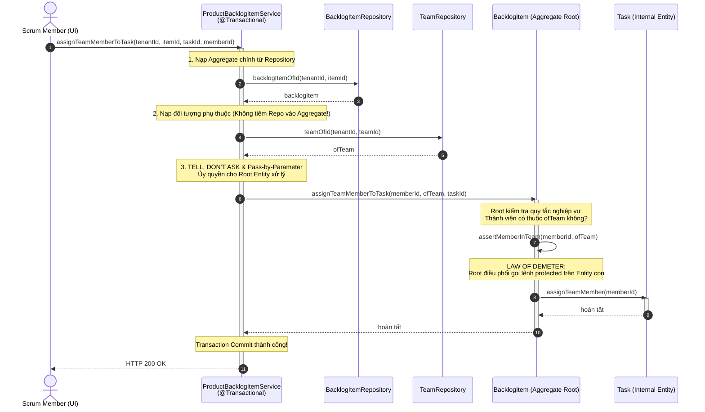

---

### 5. ÁNH XẠ ỨNG DỤNG VÀO DỰ ÁN GAME 2.5D OOP MULTIPLAYER

Các kỹ thuật thực chiến ở phần 2 của Chương 10 giúp tối ưu hóa cực hạn vòng lặp xử lý logic Game (Game Loop):

1. **Áp dụng phép tính BOTE (*Back-of-the-envelope*) để quyết định thiết kế Cụm Quái Vật (`MobGroup` vs. `MobEntity` đơn lẻ):**
   * *Bài toán đặt ra cho Game:* Trên bản đồ 66.000 px, có các bãi quái gồm 1 Boss và 5 Quái con tùy tùng. Ta nên gom 6 con quái này thành 1 Aggregate `MobPack` hay để mỗi con quái là 1 Aggregate `MobEntity` độc lập?
   * *Tính toán BOTE:*
     * Một trận đấu có 20 bãi quái $\times$ 6 con = 120 con quái.
     * Tần suất cập nhật vị trí và va chạm là 20 Hz (20 lần/giây). Nếu gom vào `MobPack`, mỗi khi 1 con quái con bị trúng đạn làm thay đổi máu, toàn bộ `MobPack` bị đánh dấu dirty và khóa phiên bản, gây nghẽn luồng xử lý AI của 5 con quái còn lại.
     * *Quyết định kiến trúc:* **Tách mỗi con quái thành 1 Aggregate `MobEntity` độc lập**, liên kết với nhau qua `LeaderMobId` (Value Object). Khi Boss chết, phát sự kiện `BossSlainEvent`, các quái con đăng ký sự kiện này để tự giải tán mà không cần khóa chung một ranh giới giao dịch!
2. **Thực thi nghiêm ngặt *Law of Demeter* và *Avoid Dependency Injection* trên Thực thể Tướng (`HeroCharacter`):**
   * Class `HeroCharacter` (Aggregate Root) tuyệt đối không được `@Autowired` các lớp như `PhysicsEngine`, `SpatialHashGrid` hay `SkillConfigRepository`.
   * Khi người chơi bấm phím dùng chiêu:
     * `CombatApplicationService` tra cứu thông số chiêu thức từ `SkillCatalog` trước.
     * Truyền `SkillSpec` vào phương thức: `hero.castSkill(slot, skillSpec, currentTargetPos)`.
     * `HeroCharacter` tự trừ Mana, kiểm tra thời gian hồi chiêu (*Cooldown invariant*), và ủy quyền cho bộ phận vũ khí nội bộ kích hoạt đòn đánh mà không để lộ cấu trúc bên trong ra ngoài Client.


<br/><br/>

---\n

# ĐỢT 8 / 10: BÓC TÁCH CHUYÊN SÂU CHƯƠNG 11 & CHƯƠNG 12
**Sách:** *Implementing Domain-Driven Design (IDDD)* — **Tác giả:** *Vaughn Vernon*

---

## CHƯƠNG 11: FACTORIES (CÁC NHÀ MÁY KHỞI TẠO TRONG MÔ HÌNH MIỀN)

### 1. ĐỀ MỤC & MỤC TIÊU CỐT LÕI (CORE PURPOSE)

#### Hệ thống đề mục đầy đủ theo sách gốc (Trang 389–400):
* **Factories in the Domain Model** (Các Nhà máy trong Mô hình Miền)
* **Factory Method on Aggregate Root** (Phương thức Nhà máy đặt trên Aggregate Root)
  * *Creating CalendarEntry Instances* (Khởi tạo các cá thể Lịch trình trong `Collaboration Context`)
  * *Creating Discussion Instances* (Khởi tạo các cá thể Cuộc thảo luận từ Diễn đàn)
* **Factory on Service** (Nhà máy đặt trên Dịch vụ Miền — Khởi tạo kết hợp Dịch thuật Tích hợp)
* **Wrap-Up** (Tổng kết)

#### Vấn đề kỹ thuật & nghiệp vụ cốt lõi và Thảm họa nếu không áp dụng:
* **Vấn đề giải quyết:** Mẫu *Factory* đã quá nổi tiếng từ nhóm Gang of Four (GoF), vậy tại sao DDD lại dành riêng một chương cho nó? Chương 11 giải quyết câu hỏi: **Trong một mô hình DDD, Nhà máy nên cư trú ở đâu (*Where Factories Should Exist*) để vừa bảo vệ tính toàn vẹn của nghiệp vụ, vừa tự động truyền tải ngữ cảnh sở hữu (như `TenantId`, `ProductId`), lại vừa phản ánh chuẩn xác Ngôn ngữ Phổ quát (*Ubiquitous Language*)?**
* **Thảm họa kỹ thuật nếu không áp dụng:**
  1. **Khởi tạo đối tượng rải rác & Vi phạm Bất biến (*Fragmented Object Instantiation*):** Client bên ngoài (Application Service hoặc Controller) tự gọi lệnh `new` để tạo một Aggregate con phức tạp. Kết quả là Client phải tự tìm kiếm và truyền hàng tá tham số (`tenantId`, `calendarId`, `ownerId`). Khi cấu trúc khởi tạo của đối tượng con thay đổi hoặc có thêm quy tắc nghiệp vụ ràng buộc, hàng loạt Client bị lỗi biên dịch.
  2. **Rò rỉ Dữ liệu giữa các Khách thuê (*Multi-Tenant Leakage Disaster*):** Trong hệ thống SaaS đa người thuê (*Multi-tenant*), nếu để Client tự khởi tạo `Discussion` hoặc `CalendarEntry`, lập trình viên rất dễ mắc lỗi lấy nhầm `TenantId` từ session này gán cho đối tượng của session khác, dẫn đến thảm họa rò rỉ dữ liệu bảo mật giữa các công ty khách hàng!
  3. **Biến mất Ngôn ngữ Nghiệp vụ (*Loss of Ubiquitous Language*):** Dùng các hàm khởi tạo máy móc như `new Discussion(forumId, ...)` thay vì để đối tượng cha biểu đạt hành động tự nhiên của chuyên gia: `forum.startDiscussion(...)`.

---

### 2. PHÂN TÍCH LÝ THUYẾT & NGUYÊN LÝ CHUYÊN SÂU

#### A. Vị trí Cư trú Chuẩn mực của Factory trong DDD
Vaughn Vernon chỉ rõ: Trong DDD, ta không cần tạo ra những lớp Factory độc lập cồng kềnh một cách máy móc. Factory chủ yếu tồn tại dưới **2 hình thái chính**:
1. **Factory Method on Aggregate Root (Phương thức Nhà máy nằm ngay trên Aggregate Root):**
   * Đây là nơi tự nhiên và hoàn hảo nhất để đặt Factory!
   * Khi Aggregate $A$ đóng vai trò cha đẻ hoặc quản lý ngữ cảnh của Aggregate $B$, việc đặt hàm tạo $B$ ngay trên $A$ (ví dụ: `Product.planBacklogItem()`, `Forum.startDiscussion()`, `Calendar.createCalendarEntry()`) mang lại 3 lợi ích vượt trội:
     * **Tự động sao chép ngữ cảnh bảo mật:** Aggregate $A$ tự động truyền `TenantId` và định danh của chính nó vào đối tượng mới, Client hoàn toàn không thể làm sai lệch dữ liệu phân vùng khách thuê.
     * **Bảo vệ Bất biến cấp gốc (*Root-Level Invariants*):** Aggregate $A$ có thể kiểm tra trạng thái của chính nó trước khi cho phép sinh con (ví dụ: nếu `Forum` đã bị đóng `isClosed()`, nó sẽ từ chối tạo `Discussion` mới).
     * **Thể hiện Ngôn ngữ Phổ quát:** Thay vì gọi `new Discussion(...)`, gọi `forum.startDiscussion(...)` phản ánh chính xác ngôn ngữ mà chuyên gia nghiệp vụ diễn đạt.
2. **Factory on Domain Service (Nhà máy đặt trên Dịch vụ Miền):**
   * Được sử dụng khi việc tạo ra một đối tượng đòi hỏi:
     * Tra cứu thông tin từ nhiều Aggregate khác nhau.
     * Phụ thuộc vào công nghệ hạ tầng bên ngoài (như gọi sang một Bounded Context khác hoặc gọi API kiểm tra quyền truy cập).
     * Điển hình trong sách là `TranslatingCollaboratorService` (Chương 3): đóng vai trò Factory đúc ra các Value Objects `Author`, `Moderator` từ chuỗi JSON nhận được của `Identity and Access Context`.

#### B. Phân biệt Factory với Hàm Khởi tạo (*Constructor*)
* Dùng **Constructor** trực tiếp khi: Đối tượng đơn giản, không có mối quan hệ phụ thuộc ngữ cảnh cha con phức tạp, và không có bất biến liên Aggregate cần kiểm tra.
* Dùng **Factory Method** khi:
  * Khởi tạo một Aggregate độc lập từ một Aggregate gốc khác nhằm đóng gói sự phức tạp.
  * Cần tạo ra các lớp con đa hình (*Polymorphic Subclasses*) mà Client không cần biết kiểu cụ thể bên dưới.
  * Cần tự động phát sinh các **Domain Events** đi kèm trong quá trình tạo mới (ví dụ: `ForumStarted`, `DiscussionStarted`).

---

### 3. MỔ XẺ MÃ NGUỒN & CẤU TRÚC THIẾT KẾ (CODE DEEP-DIVE)

Chúng ta sẽ mổ xẻ phương thức Factory `createCalendarEntry()` trên `Calendar` Aggregate Root (trang 392–395) trong `Collaboration Context`.

#### ❌ Thiết kế SAI BAN ĐẦU: Client tự khởi tạo bằng `new` và tự lắp ráp thuộc tính
```java
public class BadCalendarEntryApplicationService {
    public String newCalendarEntry(String tenantId, String calendarId, String title, String location, Date start, Date end) {
        Calendar calendar = calendarRepository.calendarOfId(new TenantId(tenantId), new CalendarId(calendarId));
        
        // SAI LẦM 1: Client phải tự kiểm tra trạng thái nội bộ của Calendar!
        if (calendar.isSharedCalendar() && !userCanPostToSharedCalendar(calendar)) {
            throw new SecurityException("Cannot post to this calendar.");
        }

        // SAI LẦM 2: Client tự new và tự truyền tenantId, calendarId -> Rất dễ nhầm lẫn tham số!
        CalendarEntry entry = new CalendarEntry(
            new TenantId(tenantId),
            new CalendarId(calendarId),
            new CalendarEntryId(UUID.randomUUID().toString()),
            new DateRange(start, end),
            location,
            title
        );

        calendarEntryRepository.save(entry);
        return entry.calendarEntryId().id();
    }
}
```

#### ✅ Thiết kế CHUẨN MỰC SAU REFACTOR: Factory Method trên Aggregate Root đóng gói toàn bộ quy tắc

```java
// ============================================================================
// AGGREGATE ROOT ĐÓNG VAI TRÒ FACTORY: Calendar
// Package: com.saasovation.collaboration.domain.model.calendar
// ============================================================================
public class Calendar extends ConcurrencySafeEntity {

    private TenantId tenantId;
    private CalendarId calendarId;
    private String name;
    private String description;
    private CalendarSharer sharer; // Value Object quản lý chia sẻ lịch

    // FACTORY METHOD CHUẨN DDD: Tạo mới một Aggregate CalendarEntry độc lập
    public CalendarEntry createCalendarEntry(
        CalendarEntryId aCalendarEntryId,
        String aDescription,
        String aLocation,
        Owner anOwner,
        DateRange aTimeSpan,
        Alarm anAlarm,
        Repetition aRepetition,
        Set<Participant> anInvitees) {

        // 1. Kiểm tra bất biến của Aggregate Root trước khi cho phép tạo
        this.assertNotReadonly();

        // 2. Tự động chuyển giao TenantId và CalendarId của chính mình sang đối tượng con
        // Ngăn chặn 100% lỗi rò rỉ dữ liệu giữa các Tenant!
        CalendarEntry calendarEntry =
            new CalendarEntry(
                this.tenantId(),
                this.calendarId(),
                aCalendarEntryId,
                aDescription,
                aLocation,
                anOwner,
                aTimeSpan,
                anAlarm,
                aRepetition,
                anInvitees);

        // 3. Tự động phát sinh Domain Event thông báo sự kiện lịch trình mới được lập
        DomainEventPublisher
            .instance()
            .publish(new CalendarEntryCreated(
                this.tenantId(),
                this.calendarId(),
                aCalendarEntryId));

        return calendarEntry;
    }

    private void assertNotReadonly() {
        if (this.isReadonly()) {
            throw new IllegalStateException("Calendar is currently read-only.");
        }
    }
}
```

#### Bảng phân tích kỹ thuật & Ý nghĩa thiết kế:

| Dòng code / Đoạn code then chốt | Giải thích kỹ thuật & Nguyên lý thiết kế (DDD/OOP) được hiện thực hóa |
| :--- | :--- |
| `public CalendarEntry createCalendarEntry(...)` | **Factory Method on Aggregate Root:** Đặt phương thức khởi tạo đối tượng `CalendarEntry` ngay trên lớp gốc `Calendar`. Client bên ngoài không cần biết cấu trúc chi tiết hàm khởi tạo của `CalendarEntry`, chỉ cần gọi phương thức này trên cuốn lịch cha. |
| `this.assertNotReadonly();` | **Bảo vệ Bất biến cấp Gốc (*Root Invariant Protection*):** Chỉ có `Calendar` mới biết nó có đang ở chế độ chỉ đọc (*read-only*) hay không. Việc đặt Factory tại Root giúp tập trung quy tắc kiểm tra hợp lệ, không cho phép sinh ra các sự kiện trên một cuốn lịch đã bị khóa. |
| `new CalendarEntry(this.tenantId(), this.calendarId(), ...)` | **Tự động ràng buộc Ngữ cảnh Khách thuê (*Tenant Context Propagation*):** Lớp `Calendar` tự động truyền `this.tenantId()` và `this.calendarId()` của nó vào đối tượng mới tạo. Loại bỏ hoàn toàn nguy cơ Client truyền nhầm ID của khách hàng khác. |
| `DomainEventPublisher.instance().publish(new CalendarEntryCreated(...))` | **Đóng gói Vòng đời Sự kiện (*Lifecycle Event Encapsulation*):** Sự kiện miền `CalendarEntryCreated` được phát đi ngay tại thời điểm khởi tạo, bảo đảm tính nhất quán trong quy trình xử lý thông báo và nhắc lịch. |

---

### 4. SƠ ĐỒ TRỰC QUAN HÓA (BẮT BUỘC MÃ MERMAID)

Sơ đồ trình bày cơ chế hoạt động của **Factory Method trên Aggregate Root** kết hợp phát sinh **Domain Event**:

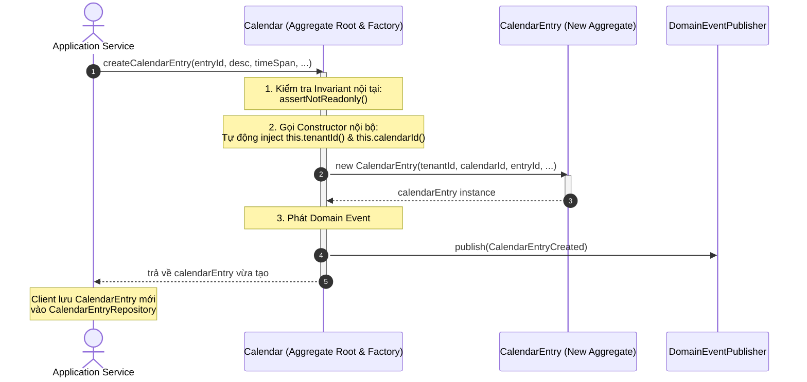

---

### 5. ÁNH XẠ ỨNG DỤNG VÀO DỰ ÁN GAME 2.5D OOP MULTIPLAYER

1. **Đặt Factory Method trên `Room / MatchAggregate` để khởi tạo Người chơi & Đội ngũ:**
   * Thay vì để tầng Network tự khởi tạo `HeroCharacter` khi nhận được gói tin kết nối, hãy đặt phương thức trên `GameMatch`: `gameMatch.spawnHero(playerId, heroClass, spawnPoint)`.
   * *Lợi ích:* `GameMatch` sẽ tự kiểm tra xem phòng đấu đã đủ người chưa (`isFull()`), trận đấu đã bắt đầu chưa, và tự động gán `MatchId`, `TeamSide` vào thực thể Tướng mới sinh ra, ngăn ngừa việc nạp người chơi vào sai trận đấu!
2. **Dùng Factory trên `MonsterSpawner` để tạo 6 loại Mobs với chỉ số ngẫu nhiên có kiểm soát:**
   * Thực thể `MobSpawner` trên bản đồ 66.000 px đóng vai trò Factory: `spawner.spawnMob(MobType.ZOMBIE, difficultyTier)`. Nó sẽ tự động tính toán vị trí nằm trong bán kính cho phép, nhân hệ số máu theo độ khó và đúc ra một thực thể `MobEntity` hoàn chỉnh.

---
---

## CHƯƠNG 12: REPOSITORIES (CÁC KHO LƯU TRỮ TRONG DDD)

### 1. ĐỀ MỤC & MỤC TIÊU CỐT LÕI (CORE PURPOSE)

#### Hệ thống đề mục đầy đủ theo sách gốc (Trang 401–448):
* **Collection-Oriented Repositories** (Kho Lưu trữ Định hướng Tập hợp — Mô phỏng `java.util.Set`)
  * *Hibernate Implementation* (Hiện thực hóa bằng Hibernate / ORM)
  * *Considerations for a TopLink Implementation* (Các lưu ý với TopLink)
* **Persistence-Oriented Repositories** (Kho Lưu trữ Định hướng Lưu trữ — Cho NoSQL và Key-Value Stores)
  * *Coherence Implementation* (Hiện thực hóa với Oracle Coherence)
  * *MongoDB Implementation* (Hiện thực hóa với MongoDB)
* **Additional Behavior** (Các Hành vi Bổ sung — Đếm số lượng, Tính toán tổng hợp)
* **Managing Transactions** (Quản lý Giao dịch — Nơi đặt giao dịch đúng đắn)
  * *A Warning* (Cảnh báo về việc đặt Transaction sai chỗ)
* **Type Hierarchies** (Xử lý Phân cấp Kiểu và Kế thừa trong Repository)
* **Repository versus Data Access Object** (Đối chiếu Repository với Data Access Object - DAO)
* **Testing Repositories** (Kiểm thử Kho lưu trữ)
  * *Testing with In-Memory Implementations* (Kiểm thử với các Bản Cài đặt Trong Bộ nhớ)
* **Wrap-Up** (Tổng kết)

#### Vấn đề kỹ thuật & nghiệp vụ cốt lõi và Thảm họa nếu không áp dụng:
* **Vấn đề giải quyết:** Làm sao để tạo ra một ảo ảnh (*Illusion*) rằng toàn bộ các *Aggregates* của hệ thống đang nằm sẵn trong bộ nhớ RAM, giúp *Domain Model* hoàn toàn không bị vấy bẩn bởi ngôn ngữ SQL hay công nghệ cơ sở dữ liệu? Chương 12 phân biệt rạch ròi giữa **Collection-Oriented** và **Persistence-Oriented Repositories**, đồng thời vạch rõ ranh giới giữa một **Repository chuẩn DDD** và một **DAO tầm thường**.
* **Thảm họa kỹ thuật nếu không áp dụng:**
  1. **Nhầm lẫn Repository với DAO (*DAO Anemic Anti-pattern*):** Tạo ra `CalendarEntryDao` với các hàm `update()`, `insert()`, `delete()` mang đậm mùi vị bảng CSDL; tạo ra Repository cho từng bảng nhỏ thay vì **chỉ tạo Repository cho Aggregate Root**.
  2. **Rò rỉ Quản lý Giao dịch vào Repository (*Transactional Leaks*):** Đặt lệnh `@Transactional` hoặc `session.commit()` bên trong Repository, tước đoạt quyền điều phối giao dịch của tầng *Application Service*, khiến không thể phối hợp nhiều bước nghiệp vụ trong cùng một transaction.
  3. **Lãng phí hàm `save()` trong môi trường ORM:** Liên tục gọi `repository.save(aggregate)` sau mỗi lần sửa đổi nhỏ, trong khi ORM (Hibernate) đã có cơ chế tự động theo dõi thay đổi (*Implicit Dirty Checking / Unit of Work*).

---

### 2. PHÂN TÍCH LÝ THUYẾT & NGUYÊN LÝ CHUYÊN SÂU

#### A. 2 Trường phái Thiết kế Repository Lớn
Vaughn Vernon phân định sâu sắc 2 loại Repository tương ứng với 2 loại công nghệ lưu trữ:

##### 1. Collection-Oriented Repositories (Định hướng Tập hợp)
* **Triết lý:** Mô phỏng hoàn hảo một tập hợp trong bộ nhớ (`java.util.Set`).
* **Đặc điểm giao diện:**
  * Có các phương thức: `add(aggregate)`, `remove(aggregate)`, `aggregateOfId(id)`.
  * **TUYỆT ĐỐI KHÔNG CÓ PHƯƠNG THỨC `save(aggregate)` HOẶC `update(aggregate)`!**
* **Cơ chế hoạt động:** Dựa vào mẫu **Unit of Work** (được tích hợp sẵn trong Hibernate `Session` hoặc JPA `EntityManager`).
  * Khi nạp một đối tượng qua `aggregateOfId()`, Hibernate lưu lại một bản chụp trạng thái ban đầu (*Copy-on-Read Snapshot*).
  * Trong suốt giao dịch, khi ta gọi các phương thức nghiệp vụ làm thay đổi trạng thái đối tượng, Hibernate tự động phát hiện đối tượng bị bẩn (*Dirty Checking*).
  * Khi giao dịch của *Application Service* kết thúc, Hibernate tự động sinh câu lệnh `UPDATE` và đẩy xuống DB (*Automatic Flush*). Do đó, việc gọi một hàm `save()` hay `update()` là hoàn toàn thừa thãi và phá vỡ ảo ảnh về một `Set` trong RAM!

##### 2. Persistence-Oriented Repositories (Định hướng Lưu trữ)
* **Triết lý:** Dành cho các cơ sở dữ liệu **NoSQL, Document Stores (MongoDB), hoặc In-Memory Key-Value Stores (Riak, Coherence)** không có cơ chế *Unit of Work* tự động.
* **Đặc điểm giao diện:**
  * **BẮT BUỘC PHẢI CÓ PHƯƠNG THỨC `save(aggregate)` (hoặc `put()`)!**
  * Khi thay đổi trạng thái của Aggregate, Client phải gọi tường minh: `productRepository.save(product)` để dữ liệu được tuần tự hóa (*Serialized*) thành JSON/BSON và ghi đè vào khóa tương ứng trong NoSQL store.

#### B. Repository vs. Data Access Object (DAO)
Bảng đối chiếu dứt khoát sự khác biệt bản chất giữa Repository và DAO:

| Tiêu chí | Repository (DDD) | Data Access Object - DAO |
| :--- | :--- | :--- |
| **Tư duy thiết kế** | Hướng miền (*Domain-centric*), coi dữ liệu như tập hợp các đối tượng OOP trong RAM. | Hướng cơ sở dữ liệu (*Data/Table-centric*), tập trung vào các câu lệnh CRUD trên bảng. |
| **Phạm vi áp dụng** | **CHỈ tồn tại cho Aggregate Root!** Tuyệt đối không có Repository cho Entity con hay Value Object. | Có thể tạo DAO cho từng bảng bất kỳ trong cơ sở dữ liệu (`UserDao`, `AddressDao`, `OrderLineDao`). |
| **Ngôn ngữ biểu đạt** | Sử dụng triệt để *Ubiquitous Language* (`allUnfinishedBacklogItems()`). | Dùng thuật ngữ kỹ thuật SQL (`findUsersByStatusAndLimitOrderByDateDesc()`). |
| **Vị trí Interface** | Nằm ngay trong **Domain Layer** (áp dụng DIP). | Thường nằm ở tầng Data Access hoặc Infrastructure. |

#### C. Quản lý Giao dịch (*Managing Transactions*)
* **Nguyên tắc bất di bất dịch:** Giao dịch cơ sở dữ liệu phải được bắt đầu và kết thúc tại **Application Layer (Application Service)**, TUYỆT ĐỐI KHÔNG nằm trong Repository hay Domain Model.
* Tại sao? Vì một quy trình nghiệp vụ của Application Service có thể cần: (1) nạp Aggregate $A$, (2) gọi hành vi trên $A$, (3) phát Domain Event lưu vào `EventStore`. Toàn bộ chuỗi này phải được bao bọc trong **CÙNG MỘT Giao dịch** do Application Service kiểm soát (thường qua `@Transactional`).

#### D. Kiểm thử Kho lưu trữ với Bản cài đặt Trong Bộ nhớ (*In-Memory Testing*)
* Điểm tuyệt vời của *Collection-Oriented Repository* là bạn có thể tạo một lớp giả lập `InMemoryProductRepository` kế thừa interface, sử dụng một `Map<ProductId, Product>` trong RAM.
* Giúp toàn bộ bộ kiểm thử đơn vị (*Unit Tests*) của bạn chạy với tốc độ vài mili-giây mà không cần bật Database thật, đồng thời hỗ trợ kiểm chứng tính đúng đắn của logic nghiệp vụ trước khi bận tâm tới cấu hình Hibernate/SQL.

---

### 3. MỔ XẺ MÃ NGUỒN & CẤU TRÚC THIẾT KẾ (CODE DEEP-DIVE)

Chúng ta sẽ mổ xẻ **`ProductRepository` (Interface trong Domain)** và **`HibernateProductRepository` (Driven Adapter trong Infrastructure)** trích từ trang 407–415 của Chương 12.

#### ❌ Thiết kế SAI BAN ĐẦU: Tạo DAO với các hàm `update()`, `insert()` và lẫn lộn Transaction
```java
// THẢM HỌA: DAO bộc lộ bản chất cơ sở dữ liệu và tự ý commit giao dịch
public class ProductDao {
    public void insertProduct(Product p) {
        Connection conn = DatabaseConnection.get();
        // Mở transaction thủ công ở tầng dữ liệu
        conn.setAutoCommit(false);
        PreparedStatement ps = conn.prepareStatement("INSERT INTO tbl_product VALUES (?, ?)");
        // ...
        conn.commit(); // Cướp quyền quản lý giao dịch của tầng Ứng dụng!
    }

    public void updateProduct(Product p) {
        // Hàm update vô nghĩa trong môi trường ORM
    }
}
```

#### ✅ Thiết kế CHUẨN MỰC SAU REFACTOR: Collection-Oriented Repository thuần khiết với Hibernate

```java
// ============================================================================
// 1. GIAO DIỆN KHO LƯU TRỮ (NẰM TRONG DOMAIN LAYER - OUTPUT PORT)
// Package: com.saasovation.agilepm.domain.model.product
// Mô phỏng Set<Product>, KHÔNG có hàm save() hay update()!
// ============================================================================
public interface ProductRepository {

    public ProductId nextIdentity();

    public void add(Product aProduct);

    public void remove(Product aProduct);

    public Product productOfId(TenantId aTenantId, ProductId aProductId);

    public Collection<Product> allProductsOfTenant(TenantId aTenantId);
}

// ============================================================================
// 2. HIỆN THỰC HÓA BẰNG HIBERNATE (NẰM TRONG INFRASTRUCTURE LAYER - DRIVEN ADAPTER)
// Package: com.saasovation.agilepm.port.adapter.persistence
// ============================================================================
public class HibernateProductRepository implements ProductRepository {

    private SessionFactory sessionFactory;

    public HibernateProductRepository(SessionFactory aSessionFactory) {
        super();
        this.sessionFactory = aSessionFactory;
    }

    private Session session() {
        return this.sessionFactory.getCurrentSession();
    }

    @Override
    public ProductId nextIdentity() {
        // Cấp phát định danh sớm (Early Identity Generation) qua UUID
        return new ProductId(UUID.randomUUID().toString().toUpperCase());
    }

    @Override
    public void add(Product aProduct) {
        // Chỉ thêm mới đối tượng vào phiên làm việc của Hibernate (tương đương Set.add())
        this.session().save(aProduct);
    }

    @Override
    public void remove(Product aProduct) {
        // Xóa đối tượng khỏi phiên làm việc (tương đương Set.remove())
        this.session().delete(aProduct);
    }

    @Override
    public Product productOfId(TenantId aTenantId, ProductId aProductId) {
        Query query = this.session().createQuery(
            "from Product as _obj_ where _obj_.tenantId = ? and _obj_.productId = ?");

        query.setParameter(0, aTenantId);
        query.setParameter(1, aProductId);

        return (Product) query.uniqueResult();
    }

    @Override
    @SuppressWarnings("unchecked")
    public Collection<Product> allProductsOfTenant(TenantId aTenantId) {
        Query query = this.session().createQuery(
            "from Product as _obj_ where _obj_.tenantId = ?");

        query.setParameter(0, aTenantId);

        return (Collection<Product>) query.list();
    }
}
```

#### Bảng phân tích kỹ thuật & Ý nghĩa thiết kế:

| Dòng code / Đoạn code then chốt | Giải thích kỹ thuật & Nguyên lý thiết kế (DDD/OOP) được hiện thực hóa |
| :--- | :--- |
| `public interface ProductRepository` | **Output Port thuộc Domain Layer:** Tách biệt hoàn toàn định nghĩa hợp đồng lưu trữ khỏi công nghệ cơ sở dữ liệu. Chỉ làm việc với `Product` (Aggregate Root) và các Value Objects định danh (`TenantId`, `ProductId`). |
| `public void add(Product aProduct)` *(Không có hàm save/update)* | **Collection-Oriented Design:** Thể hiện rõ tư duy xem Repository như một tập hợp đối tượng trong RAM. Ta chỉ `add()` khi một thực thể mới ra đời. Khi một thực thể đang sống bị thay đổi trạng thái, cơ chế *Dirty Checking* tự động của Hibernate sẽ lo việc `UPDATE` khi kết thúc transaction! |
| `public ProductId nextIdentity()` | **Early Identity Generation:** Đặt phương thức sinh định danh ngay trên Repository Interface. Giúp tầng Application Service có thể lấy sẵn ID hợp lệ trước khi gọi hàm khởi tạo `Product`. |
| `this.sessionFactory.getCurrentSession()` | **Giao dịch do Application điều phối:** Repository không tự mở hay đóng session/transaction. Nó gắn vào `CurrentSession` do tầng Application Service quản lý (thông qua Spring `@Transactional`), bảo đảm tính toàn vẹn của Unit of Work. |

---

### 4. SƠ ĐỒ TRỰC QUAN HÓA (BẮT BUỘC MÃ MERMAID)

Sơ đồ thể hiện chu trình hoạt động của **Collection-Oriented Repository kết hợp Unit of Work / Hibernate Dirty Checking** (không cần gọi hàm `save` tường minh):

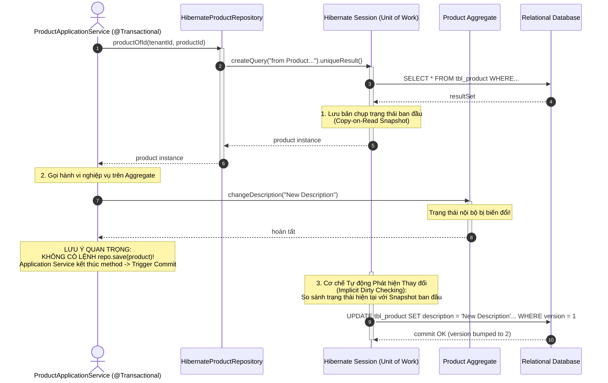

---

### 5. ÁNH XẠ ỨNG DỤNG VÀO DỰ ÁN GAME 2.5D OOP MULTIPLAYER

1. **Thiết kế `PlayerProfileRepository` theo phong cách Collection-Oriented:**
   * Chỉ tạo Repository cho Aggregate Root `PlayerAccount`, tuyệt đối không tạo `ItemRepository` hay `SkillSlotRepository` riêng rẽ (tất cả các trang bị, kỹ năng đều được nạp và lưu cùng lúc với `PlayerAccount`).
   * Sử dụng triển khai `InMemoryPlayerRepository` trong bộ test unit (`Tests/`) để kiểm tra toàn bộ luồng đăng nhập, cộng điểm kinh nghiệm, lên cấp với tốc độ cực đại mà không cần dựng database thật.
2. **Sử dụng Persistence-Oriented Repository cho Bảng Xếp Hạng & Lưu Trữ NoSQL (Redis/MongoDB):**
   * Đối với dữ liệu lịch sử trận đấu (*Match History*) hoặc bảng xếp hạng người chơi (*Leaderboard*), việc lưu dưới dạng Document BSON trong MongoDB hoặc Key-Value trong Redis là phù hợp nhất.
   * Thiết kế `interface MatchRecordRepository` theo phong cách **Persistence-Oriented** với phương thức rõ ràng: `void save(MatchRecordRecord record)`. Mỗi khi trận chiến 2.5D kết thúc, hệ thống tuần tự hóa toàn bộ thông số trận đấu và đẩy vào kho lưu trữ NoSQL chỉ bằng một lệnh `save()` nhanh gọn.


<br/><br/>

---\n

# ĐỢT 9 / 10: BÓC TÁCH CHUYÊN SÂU CHƯƠNG 13
**Sách:** *Implementing Domain-Driven Design (IDDD)* — **Tác giả:** *Vaughn Vernon*

---

## CHƯƠNG 13: INTEGRATING BOUNDED CONTEXTS (TÍCH HỢP CÁC NGỮ CẢNH GIỚI HẠN)

### 1. ĐỀ MỤC & MỤC TIÊU CỐT LÕI (CORE PURPOSE)

#### Hệ thống đề mục đầy đủ theo sách gốc (Trang 449–508):
* **Integration Basics** (Các Nền tảng Tích hợp Cơ bản)
  * *Distributed Systems Are Fundamentally Different* (Hệ thống Phân tán Khác biệt về Căn bản — 8 Ảo tưởng của Điện toán Phân tán)
  * *Exchanging Information across System Boundaries* (Trao đổi Thông tin qua Biên giới Hệ thống)
* **Integration Using RESTful Resources** (Tích hợp Sử dụng Tài nguyên RESTful)
  * *Implementing the RESTful Resource* (Hiện thực hóa Tài nguyên RESTful — Phía Cung cấp Thượng nguồn)
  * *Implementing the REST Client Using an Anticorruption Layer* (Hiện thực hóa Máy khách REST sử dụng Lớp Chống Tham Nhũng — Phía Tiêu thụ Hạ nguồn)
* **Integration Using Messaging** (Tích hợp Sử dụng Cơ chế Truyền Thông điệp / Message Broker)
  * *Staying Informed about Product Owners and Team Members* (Cập nhật Thông tin về Product Owners và Team Members từ `Identity & Access` sang `AgilePM`)
  * *Can You Handle the Responsibility?* (Bạn có thể Xử lý Trách nhiệm này không? — Đánh đổi giữa Event-Driven và RPC)
  * *Long-Running Processes, and Avoiding Responsibility* (Các Tiến trình Chạy dài, và Tránh né Trách nhiệm Giao dịch 2 Pha)
  * *Process State Machines and Time-out Trackers* (Máy Trạng thái Tiến trình và Bộ Theo dõi Quá hạn)
  * *Designing a More Sophisticated Process* (Thiết kế Tiến trình Phức tạp hơn)
  * *When Messaging or Your System Is Unavailable* (Khi Hệ thống Tin nhắn hoặc Ứng dụng Không khả dụng — Bù trừ và Thử lại)
* **Wrap-Up** (Tổng kết)

#### Vấn đề kỹ thuật & nghiệp vụ cốt lõi và Thảm họa nếu không áp dụng:
* **Vấn đề giải quyết:** Nếu Chương 3 mới chỉ phác họa các mẫu quan hệ chiến lược trên bản vẽ (*Context Maps*), thì Chương 13 cung cấp **bản thiết kế kỹ thuật chi tiết nhất để hiện thực hóa việc tích hợp giữa các Bounded Contexts**. Nó giải quyết bài toán: Làm sao để các hệ thống phân tán trao đổi dữ liệu qua REST và Messaging một cách tự trị (*Autonomous*), xử lý các quy trình nghiệp vụ phức tạp kéo dài qua nhiều ngữ cảnh (*Sagas*) mà không bị treo cứng bởi lỗi mạng hay dịch vụ đối tác ngừng hoạt động?
* **Thảm họa kỹ thuật nếu không áp dụng:**
  1. **Ảo tưởng về Mạng Phân tán (*Fallacies of Distributed Computing*) & Sập dây chuyền (*Cascading Failures*):** Lập trình viên thiết kế hệ thống phân tán như thể đang gọi hàm trong bộ nhớ RAM (nghĩ rằng mạng luôn thông, độ trễ bằng 0, băng thông vô hạn). Khi gọi REST đồng bộ liên hoàn $A \rightarrow B \rightarrow C$, chỉ cần hệ thống $C$ bị chậm 2 giây, toàn bộ luồng xử lý của $A$ và $B$ cạn kiệt thread pool và sập toàn bộ hệ thống!
  2. **Bế tắc Giao dịch Phân tán (*Distributed Deadlocks / 2PC Fragility*):** Cố gắng dùng Two-Phase Commit (XA/2PC) để ép dữ liệu ở 3 Bounded Contexts phải nhất quán tức thời. Hệ quả là hệ thống không thể mở rộng quy mô, một dịch vụ bảo trì làm tê liệt toàn bộ các dịch vụ còn lại.
  3. **Mất Dấu vết Tiến trình (*Lost Process State*):** Khi một quy trình đa bước qua mạng bị đứt gánh (ví dụ: trừ tiền thành công nhưng tạo cuộc thảo luận bị lỗi mạng), hệ thống không có **Process State Machine** và **Time-out Tracker**, dẫn đến dữ liệu "mồ côi", người dùng bị trừ tiền nhưng không nhận được dịch vụ mà không ai biết để khắc phục.

---

### 2. PHÂN TÍCH LÝ THUYẾT & NGUYÊN LÝ CHUYÊN SÂU

#### A. 8 Ảo tưởng của Điện toán Phân tán (*The 8 Fallacies of Distributed Computing*)
Vaughn Vernon trích dẫn nghiên cứu kinh điển của L. Peter Deutsch (Sun Microsystems) làm nền tảng cho mọi quyết định tích hợp trong DDD:
1. Mạng luôn đáng tin cậy (*The network is reliable*).
2. Độ trễ luôn bằng 0 (*Latency is zero*).
3. Băng thông là vô hạn (*Bandwidth is infinite*).
4. Mạng là an toàn tuyệt đối (*The network is secure*).
5. Cấu trúc mạng không bao giờ thay đổi (*Topology doesn't change*).
6. Chỉ có một người quản trị duy nhất (*There is one administrator*).
7. Chi phí truyền tải bằng 0 (*Transport cost is zero*).
8. Mạng là đồng nhất (*The network is homogeneous*).
* **Nguyên tắc DDD rút ra:** Không bao giờ được giả định lời gọi sang Bounded Context khác sẽ luôn thành công tức thì. Mọi tích hợp qua biên giới phải được thiết kế với tâm thế: **Mạng chắc chắn sẽ đứt, hệ thống đối tác chắc chắn sẽ chậm hoặc sập!**

#### B. 2 Phương thức Tích hợp Chủ đạo: RESTful vs. Messaging
1. **Tích hợp qua RESTful Resources (Mô hình Kéo - *Pull Model*):**
   * Phù hợp cho các truy vấn dữ liệu theo nhu cầu (*On-demand Queries*), tích hợp với hệ thống bên ngoài hoặc khi không có hạ tầng Message Broker.
   * **Phía Thượng nguồn (Upstream):** Xây dựng *Open Host Service (OHS)* xuất bản các tài nguyên theo định dạng chuẩn *Published Language (PL)* (chuỗi JSON / XML đặc thù).
   * **Phía Hạ nguồn (Downstream):** Bắt buộc phải có **Anticorruption Layer (ACL)** gồm 3 thành phần: *Client Adapter* (thực hiện gọi HTTP) $\rightarrow$ *Translator* (bóc tách JSON) $\rightarrow$ Đúc thành *Value Objects / Entities* của miền hạ nguồn.
2. **Tích hợp qua Messaging (Mô hình Đẩy - *Push Model*):**
   * Phù hợp cho việc thông báo biến động trạng thái theo thời gian thực và đảm bảo tính tự trị cao nhất (*Highest Autonomy*).
   * **Sự kiện Làm giàu Dữ liệu (*Event Enrichment*):** Thay vì chỉ gửi mỗi `UserId`, Domain Event `UserRegistered` đính kèm luôn `username`, `firstName`, `lastName`, `emailAddress`. Nhờ vậy, khi hệ thống *Downstream* nhận sự kiện, nó có đầy đủ dữ liệu để tạo `TeamMember` ngay lập tức mà **không cần phải gọi ngược lại HTTP GET sang IAM** $\rightarrow$ Giảm tải mạng và loại bỏ sự phụ thuộc thời gian thực!

#### C. Quản lý Quy trình Kéo dài: *Process State Machines* & *Time-out Trackers*
Khi một nghiệp vụ đòi hỏi sự phối hợp qua nhiều Bounded Contexts (Ví dụ: Khởi tạo `Product` trong `AgilePM` $\rightarrow$ Yêu cầu tạo `Discussion` trong `Collaboration Context` $\rightarrow$ Xác nhận hoàn tất):
1. **Process Manager / State Machine (Máy Trạng thái Tiến trình):**
   * Đóng vai trò thực thể điều phối quy trình phân tán.
   * Lưu trữ trạng thái tiến trình hiện tại: `SUBMITTED` $\rightarrow$ `CONFIRMED` (hoặc `FAILED`).
   * Sử dụng mã tương quan duy nhất (**Correlation ID** / `ProcessId`) được gắn vào mọi thông điệp gửi đi và nhận về để ghép nối chính xác các phản hồi bất đồng bộ.
2. **Time-out Tracker (Bộ Theo dõi Quá hạn):**
   * Trong thế giới phân tán, sự cố thường không phát ra lỗi `Exception` rõ ràng, mà biểu hiện bằng **sự im lặng chết chóc (*Silence*)** — thông điệp bị thất lạc hoặc hệ thống đối tác bị treo.
   * **Cơ chế:** Khi phát lệnh đi, Process Manager đăng ký một bản ghi hẹn giờ vào bảng `Time-out Tracker` (ví dụ: giới hạn 30 giây).
   * Một tiến trình nền (*Background Worker*) quét các Tracker quá hạn. Nếu hết 30 giây mà không nhận được sự kiện phản hồi `DiscussionStarted`, Tracker sẽ kích hoạt sự kiện quá hạn `ProductDiscussionRequestTimedOut`.
   * **Hành động Bù trừ (*Compensating Action*):** Process Manager nhận sự kiện quá hạn, tự động chuyển trạng thái sang `FAILED`, kích hoạt lệnh hủy/bù trừ và gửi cảnh báo cho người dùng hoặc quản trị viên can thiệp.

#### D. Xử lý khi Hệ thống Tin nhắn bị Gián đoạn (*Unavailable Messaging*)
* **Capped Exponential Back-off (Thử lại Lùi lũy thừa có chặn):** Khi gửi tin nhắn hoặc gọi REST thất bại, không thử lại liên tục làm nghẽn mạng, mà giãn cách thời gian: 1s, 2s, 4s, 8s, 16s... tối đa 32s.
* **Idempotent Consumer (Bên tiêu thụ Lũy đẳng):** Vì mạng có thể gửi lặp lại một tin nhắn nhiều lần (*At-Least-Once Delivery*), bên nhận bắt buộc phải lưu `Tracker` ghi nhận các `EventId` đã xử lý để bỏ qua các tin nhắn trùng lặp.

---

### 3. MỔ XẺ MÃ NGUỒN & CẤU TRÚC THIẾT KẾ (CODE DEEP-DIVE)

Chúng ta sẽ mổ xẻ **`Process State Machine`** kết hợp **`Time-out Tracker`** trong việc tích hợp tạo cuộc thảo luận tự động giữa `AgilePM` và `Collaboration Context` (trang 493–505).

#### ❌ Thiết kế SAI BAN ĐẦU: Gọi đồng bộ đa hệ thống không có xử lý Timeout hay Bù trừ
```java
// THẢM HỌA: Treo luồng vô thời hạn nếu dịch vụ Collaboration bị sập
public class BadProductService {
    public void createProductWithDiscussion(String tenantId, String name) {
        Product product = new Product(tenantId, name);
        productRepository.save(product);

        // Gọi HTTP đồng bộ chặn luồng (Blocking I/O)
        // Nếu server Collaboration bị đơ, request này treo cứng cho đến khi Timeout cấp mạng (thường là vài phút)!
        // Toàn bộ thread pool của Web server bị nuốt chửng!
        DiscussionDTO discussion = httpClient.postForObject(
            "http://collab-service/discussions", 
            new CreateDiscussionRequest(name), 
            DiscussionDTO.class);

        product.setDiscussionId(discussion.getId());
        productRepository.save(product);
    }
}
```

#### ✅ Thiết kế CHUẨN MỰC SAU REFACTOR: Event-Driven Saga với Process State Machine & Time-out Tracker

```java
// ============================================================================
// 1. SỰ KIỆN LÀM GIÀU DỮ LIỆU ĐÍNH KÈM CORRELATION ID
// Package: com.saasovation.agilepm.domain.model.product
// ============================================================================
public class ProductDiscussionRequested implements DomainEvent {
    private String discussionInitiationId; // Process / Correlation ID
    private int eventVersion;
    private Date occurredOn;
    private ProductId productId;
    private String productTitle;
    private TenantId tenantId;

    public ProductDiscussionRequested(
        TenantId aTenantId,
        ProductId aProductId,
        String aProductTitle,
        String aDiscussionInitiationId) {

        super();
        this.discussionInitiationId = aDiscussionInitiationId;
        this.eventVersion = 1;
        this.occurredOn = new Date();
        this.productId = aProductId;
        this.productTitle = aProductTitle;
        this.tenantId = aTenantId;
    }

    public String discussionInitiationId() { return this.discussionInitiationId; }
    public ProductId productId() { return this.productId; }
    // ...
}

// ============================================================================
// 2. PROCESS STATE MACHINE: THỰC THỂ QUẢN LÝ TIẾN TRÌNH PHÂN TÁN
// Package: com.saasovation.agilepm.domain.model.process
// ============================================================================
public class ProductDiscussionCreationProcess extends ConcurrencySafeEntity {

    public enum ProcessStatus {
        SUBMITTED, CONFIRMED, FAILED
    }

    private String processId;                  // Khớp với discussionInitiationId
    private TenantId tenantId;
    private ProductId productId;
    private ProcessStatus status;
    private Date timeOutDate;                  // Mốc thời gian quá hạn

    public ProductDiscussionCreationProcess(
        TenantId aTenantId,
        ProductId aProductId,
        String aProcessId,
        long aTimeOutMillis) {

        super();
        this.tenantId = aTenantId;
        this.productId = aProductId;
        this.processId = aProcessId;
        this.status = ProcessStatus.SUBMITTED;
        // Đặt hẹn giờ quá hạn (ví dụ: hiện tại + 30 giây)
        this.timeOutDate = new Date(System.currentTimeMillis() + aTimeOutMillis);
    }

    // Khi nhận được sự kiện phản hồi thành công từ Collaboration Context
    public void confirmDiscussionStarted(String aDiscussionId) {
        if (this.status == ProcessStatus.SUBMITTED) {
            this.status = ProcessStatus.CONFIRMED;
            DomainEventPublisher
                .instance()
                .publish(new ProductDiscussionCompleted(
                    this.tenantId(),
                    this.productId(),
                    aDiscussionId));
        }
    }

    // Khi Time-out Tracker phát hiện quá hạn mà không có phản hồi
    public void informTimeOut() {
        if (this.status == ProcessStatus.SUBMITTED) {
            this.status = ProcessStatus.FAILED; // Chuyển trạng thái thất bại
            
            // KÍCH HOẠT HÀNH ĐỘNG BÙ TRỪ (COMPENSATING ACTION)
            DomainEventPublisher
                .instance()
                .publish(new ProductDiscussionRequestTimedOut(
                    this.tenantId(),
                    this.productId(),
                    this.processId()));
        }
    }

    public boolean isTimedOut() {
        return this.status == ProcessStatus.SUBMITTED &&
               new Date().after(this.timeOutDate);
    }
}

// ============================================================================
// 3. TIME-OUT TRACKER: TIẾN TRÌNH QUÉT NỀN PHÁT HIỆN SỰ CỐ
// Package: com.saasovation.agilepm.infrastructure.process
// ============================================================================
public class TimeOutTrackerWorker implements Runnable {

    private ProcessRepository processRepository;

    @Override
    public void run() {
        // Quét các tiến trình đang ở trạng thái SUBMITTED nhưng đã quá hạn thời gian
        Collection<ProductDiscussionCreationProcess> timedOutProcesses =
            this.processRepository.allTimedOutProcesses();

        for (ProductDiscussionCreationProcess process : timedOutProcesses) {
            // Đánh thức Process State Machine để xử lý bù trừ
            process.informTimeOut();
            this.processRepository.save(process);
        }
    }
}
```

#### Bảng phân tích kỹ thuật & Ý nghĩa thiết kế:

| Dòng code / Đoạn code then chốt | Giải thích kỹ thuật & Nguyên lý thiết kế (DDD/OOP) được hiện thực hóa |
| :--- | :--- |
| `private String discussionInitiationId;` | **Correlation ID / Process ID:** Khóa định danh tương quan sinh ra từ lúc bắt đầu quy trình. Dù thông điệp đi qua bao nhiêu hàng đợi và hệ thống khác nhau, mã này luôn được truyền kèm để khi kết quả quay về, hệ thống biết chính xác tiến trình nào đang chờ nó. |
| `this.status = ProcessStatus.SUBMITTED;` <br> `this.timeOutDate = new Date(...)` | **Explicit State Machine Modeling:** Mô hình hóa rõ ràng các trạng thái phân tán thay vì để trạng thái trôi nổi ngầm định. Thiết lập mốc thời gian quá hạn tường minh giúp hệ thống luôn chủ động kiểm soát số phận của quy trình. |
| `public void confirmDiscussionStarted(...)` | **Chuyển dịch Trạng thái An toàn (*Idempotent State Transition*):** Chỉ chuyển sang `CONFIRMED` nếu đang ở trạng thái `SUBMITTED`. Nếu thông báo xác nhận đến trễ sau khi tiến trình đã bị đánh dấu `FAILED` do timeout, lệnh này sẽ bị từ chối, ngăn chặn việc cập nhật dữ liệu sai lệch. |
| `public void informTimeOut()` | **Compensating Action (Hành động Bù trừ thay cho Rollback):** Trong hệ thống phân tán không thể gọi `rollback` Database qua mạng. Thay vào đó, ta phát ra sự kiện `ProductDiscussionRequestTimedOut` để các thành phần liên quan thực hiện bù trừ (ví dụ: thông báo cho người dùng, chuyển cờ sản phẩm về chế độ thảo luận ngoại tuyến). |
| `this.processRepository.allTimedOutProcesses()` | **Time-out Tracker Pattern:** Tiến trình nền quét định kỳ đảm bảo không có quy trình nào bị "treo" vô tận trong bộ nhớ khi đối tác sập mạng. Hiện thực hóa nguyên lý *"Expect failures in distributed systems"*. |

---

### 4. SƠ ĐỒ TRỰC QUAN HÓA (BẮT BUỘC MÃ MERMAID)

Sơ đồ trạng thái (State Machine Diagram) và sơ đồ luồng điều phối tích hợp của **Process Manager kết hợp Time-out Tracker**:

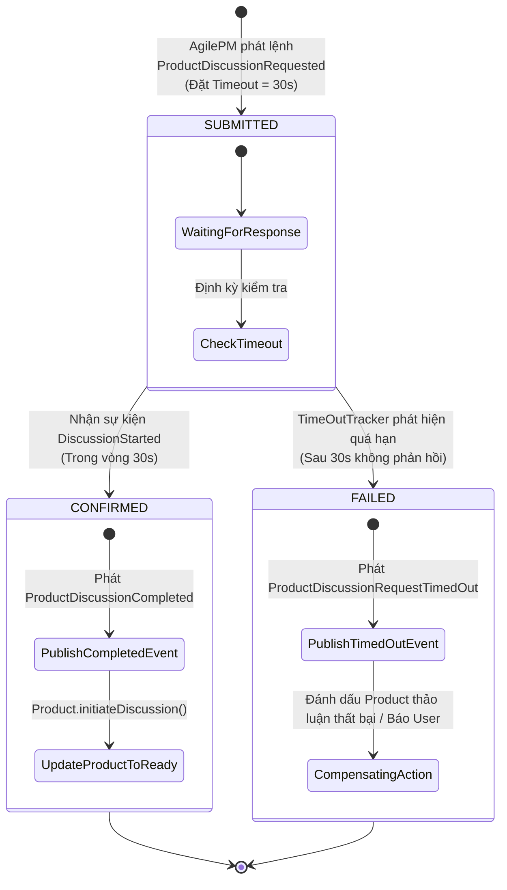

---

### 5. ÁNH XẠ ỨNG DỤNG VÀO DỰ ÁN GAME 2.5D OOP MULTIPLAYER

Chương 13 giải quyết trực tiếp 2 bài toán sống còn trong hạ tầng mạng của Game nhiều người chơi: **Quy trình Ghép trận / Vào phòng (*Matchmaking Saga*)** và **Cơ chế chịu lỗi khi Mạng 4G bị gián đoạn**:

1. **Hiện thực hóa *Matchmaking Process Manager* với *Time-out Tracker* cho Sảnh Chờ (Lobby):**
   * *Quy trình nghiệp vụ:* Khi tìm thấy 4 người chơi phù hợp về ELO:
     1. `MatchmakingContext` tạo một `MatchSetupProcess` (trạng thái `WAITING_CONFIRMATION`, Correlation ID = `matchId`, Timeout = 10 giây).
     2. Gửi sự kiện `MatchFoundPrompt` tới 4 Client.
     3. Từng người chơi bấm nút "Chấp nhận" $\rightarrow$ Client gửi về `AcceptMatchResponse(matchId, playerId)`.
     4. `MatchSetupProcess` cập nhật trạng thái đếm số người đã sẵn sàng:
        * *Nếu đủ 4 người trong 10s:* Chuyển sang `READY` $\rightarrow$ Phát sự kiện `StartGameCountdown` $\rightarrow$ Chuyển cả 4 vào máy chủ chiến đấu.
        * *Nếu hết 10s mà chỉ có 3 người chấp nhận:* **Time-out Tracker kích hoạt** `MatchSetupTimedOut` $\rightarrow$ Thực hiện hành động bù trừ: Đưa 3 người chơi đã bấm chấp nhận trở lại đầu hàng đợi ưu tiên, phạt trừ điểm người không bấm chấp nhận (*Leaver penalty*)!
2. **Thiết kế *Event Enrichment* để giảm băng thông gói tin mạng và chịu lỗi rớt mạng:**
   * Trong gói tin sự kiện `HeroSpawnedPacket` gửi qua mạng UDP/WebSocket, máy chủ đính kèm toàn bộ thông số ban đầu (`heroId`, `classType`, `maxHp`, `moveSpeed`, `skinId`, tọa độ `(x, y, z)`).
   * Nhờ kỹ thuật **Làm giàu Sự kiện (*Event Enrichment*)**, máy khách Client nhận được gói tin là có thể tạo ngay thực thể đồ họa trên màn hình 2.5D mà **không cần phải gửi thêm một gói tin hỏi ngược lại Server: "Tướng này có hình dạng gì và máu bao nhiêu?"** $\rightarrow$ Giúp game chạy mượt mà ngay cả khi đường truyền di động 4G có độ trễ cao và chập chờn.


<br/><br/>

---\n

# ĐỢT 10 / 10: BÓC TÁCH CHUYÊN SÂU CHƯƠNG 14 & APPENDIX A
**Sách:** *Implementing Domain-Driven Design (IDDD)* — **Tác giả:** *Vaughn Vernon*

---

## CHƯƠNG 14: APPLICATION (TẦNG ỨNG DỤNG, GIAO DIỆN VÀ HẠ TẦNG BAO BỌC)

### 1. ĐỀ MỤC & MỤC TIÊU CỐT LÕI (CORE PURPOSE)

#### Hệ thống đề mục đầy đủ theo sách gốc (Trang 509–538):
* **User Interface** (Giao diện Người dùng và Các Chiến lược Kết xuất Mô hình Miền)
  * *Rendering Domain Objects* (Kết xuất trực tiếp Đối tượng Miền — Nguy cơ và Hạn chế)
  * *Render Data Transfer Object from Aggregate Instances* (Kết xuất DTO từ các Thực thể Aggregate qua *DTO Assembler*)
  * *Use a Mediator to Publish Aggregate Internal State* (Sử dụng Mẫu Mediator / Double-Dispatch để Xuất Trạng thái Nội bộ của Aggregate)
  * *Render Aggregate Instances from a Domain Payload Object* (Kết xuất Aggregate từ Đối tượng Trọng tải Miền - DPO)
  * *State Representations of Aggregate Instances* (Các Biểu diễn Trạng thái độc lập — JSON/XML)
  * *Use Case Optimal Repository Queries* (Các Truy vấn Kho lưu trữ Tối ưu cho Từng Trường hợp Sử dụng)
  * *Dealing with Multiple, Disparate Clients* (Xử lý Đa Dạng Máy khách Khác biệt)
  * *Rendition Adapters and Handling User Edits* (Các Bộ chuyển đổi Kết xuất và Xử lý Thao tác Chỉnh sửa của Người dùng)
* **Application Services** (Các Dịch vụ Ứng dụng — Trái tim Điều phối của Hệ thống)
  * *Sample Application Service* (Mổ xẻ Hiện thực hóa Mẫu của một Application Service Chuẩn mực)
  * *Decoupled Service Output* (Tách rời Đầu ra của Dịch vụ — Trả về DTO, Primitive ID hay dùng Presenter Callback)
* **Composing Multiple Bounded Contexts** (Lắp ghép Nhiều Ngữ cảnh Giới hạn tại Tầng Ứng dụng)
* **Infrastructure** (Tầng Hạ tầng Kỹ thuật — Chân đế Hỗ trợ)
* **Enterprise Component Containers** (Các Bộ chứa Thành phần Doanh nghiệp — Spring & IoC Containers)
* **Wrap-Up** (Tổng kết)

#### Vấn đề kỹ thuật & nghiệp vụ cốt lõi và Thảm họa nếu không áp dụng:
* **Vấn đề giải quyết:** Sau khi đã có một *Domain Model* hoàn chỉnh (Entities, Value Objects, Aggregates, Domain Services), làm thế nào để xây dựng một **vùng đệm bảo vệ (*Protective Buffer*)** bao bọc xung quanh nó? Chương 14 giải quyết bài toán: Làm thế nào để điều phối giao dịch (*Transaction*), kiểm tra quyền bảo mật (*Security*), nhận lệnh từ UI và kết xuất dữ liệu hiển thị ra ngoài mà **tuyệt đối không để lộ cấu trúc nội bộ của Domain Model, không gây rò rỉ kết nối cơ sở dữ liệu (*Open Session In View*), và không biến Domain Model thành nô lệ của giao diện?**
* **Thảm họa kỹ thuật nếu không áp dụng:**
  1. **Thảm họa Kết xuất Trực tiếp & Phản mẫu *Open Session In View* (OSIV):** Lập trình viên truyền thẳng thực thể *Aggregate Root* lên tầng Controller/Giao diện (JSP, Thymeleaf, React/JSON Serializer). Khi UI duyệt qua các thuộc tính liên kết lười (*Lazy-loaded collections*), nó kích hoạt hàng trăm câu truy vấn SQL ngoài ý muốn khi View đang render, hoặc ném ra ngoại lệ chết người `LazyInitializationException` vì Session đã đóng.
  2. **Biến Application Service thành Transaction Script (Nhiễm độc Nghiệp vụ):** Viết hàng tá câu lệnh `if-else` kiểm tra logic kinh doanh ngay trong Application Service, biến Domain Model thành mô hình thiếu máu (*Anemic*).
  3. **Rò rỉ Mẫu Biểu mẫu vào Mô hình (*Form/DTO Bleeding*):** Cho phép các đối tượng Request/DTO từ form nhập liệu bên ngoài truyền thẳng vào các phương thức của Domain Entity, làm vỡ tính đóng gói và làm ô nhiễm *Ubiquitous Language*.

---

### 2. PHÂN TÍCH LÝ THUYẾT & NGUYÊN LÝ CHUYÊN SÂU

#### A. 4 Chiến lược Xuất Dữ liệu từ Aggregate lên Giao diện (UI Rendering Strategies)
Vaughn Vernon phân tích sâu sắc ưu và nhược điểm của 4 phương pháp chuyển tải trạng thái từ Domain Model ra thế giới UI:
1. **Rendering Domain Objects Directly (Kết xuất trực tiếp):**
   * Truyền trực tiếp Aggregate lên View. *Đánh đổi:* Đơn giản nhất, nhưng cực kỳ nguy hiểm. Gây rò rỉ cấu trúc nội bộ, cám dỗ tầng UI gọi các phương thức biến đổi trạng thái của Aggregate, và dễ dính lỗi *N+1 Selects / OSIV*. Chỉ nên dùng trong ứng dụng CRUD cực nhỏ.
2. **DTO Assembler (Bộ lắp ráp DTO):**
   * Tầng Ứng dụng duyệt qua Aggregate và chuyển đổi thành một đối tượng thuần dữ liệu (**Data Transfer Object - DTO**).
   * *Ưu điểm:* Đóng gói an toàn, ngắt kết nối hoàn toàn khỏi ORM Session.
   * *Nhược điểm:* Nếu Aggregate không có sẵn các hàm getter, DTO Assembler sẽ đòi hỏi Aggregate phải mở các phương thức getter làm suy yếu tính đóng gói (*Information Hiding*).
3. **Use a Mediator / Visitor to Publish Internal State (Mẫu Mediator & Double-Dispatch):**
   * **Giải pháp OOP đỉnh cao của Vernon!** Aggregate không cần mở bất kỳ hàm `getter` nào!
   * Aggregate định nghĩa phương thức: `public void provideStateTo(ProductStateMediator mediator)`.
   * Khi Client truyền một `Mediator` vào, Aggregate sẽ thực hiện cơ chế **Double-Dispatch**: tự truyền các thuộc tính nội bộ của mình vào các hàm của `Mediator`. Nhờ đó, cấu trúc dữ liệu bên trong vẫn được giấu kín (`private`), nhưng dữ liệu vẫn được chuyển giao ra ngoài an toàn!
4. **Domain Payload Object (DPO):**
   * Là một đối tượng đóng gói gom nhóm các tham chiếu nhẹ (ID và trạng thái cơ bản) của nhiều Aggregates khác nhau để phục vụ cho các trang quản trị tổng hợp.

#### B. Trách nhiệm Chuẩn mực của *Application Service*
Vernon vạch ra ranh giới thép: **Application Service là một bộ điều phối mỏng (*Thin Coordinator*)**, có đúng 6 nhiệm vụ:
1. **Tiếp nhận tham số thô:** Nhận các kiểu nguyên thủy (`String`, `int`, `Date`) hoặc đối tượng Lệnh thô (**Command Object** như `CreateProductCommand`).
2. **Quản lý Bảo mật & Ủy quyền (*Security*):** Kiểm tra xem người dùng hiện tại có quyền thực thi ca sử dụng này không (ví dụ qua `@PreAuthorize` của Spring Security).
3. **Quản lý Giao dịch (*Transaction Demarcation*):** Đảm bảo toàn bộ thao tác trong ca sử dụng nằm trong một ranh giới giao dịch nguyên tử (`@Transactional`).
4. **Nạp Aggregate:** Truy vấn *Repository* để lấy đúng thực thể Aggregate Root tương ứng.
5. **Thực thi Hành vi Miền:** Gọi phương thức nghiệp vụ giàu ngữ nghĩa trên Aggregate Root hoặc ủy quyền cho *Domain Service*.
6. **Trả về Kết quả đã Tách rời (*Decoupled Output*):** Trả về mã định danh nguyên thủy (`String id`), trả về DTO đã chuyển đổi, hoặc sử dụng **Presenter Callback Pattern** để điều hướng phản hồi.

#### C. Lắp ghép Đa Bounded Contexts tại Tầng Ứng dụng (*Composing Multiple Bounded Contexts*)
* Khi một màn hình hiển thị đòi hỏi dữ liệu từ 2 Bounded Contexts khác nhau (ví dụ: lấy thông tin `Product` từ `AgilePM` và lấy danh sách bài thảo luận từ `Collaboration Context`):
* **Nguyên tắc DDD:** Tầng Giao diện/Ứng dụng cấp cao sẽ đóng vai trò **Bộ phối hợp (*Aggregator / Composite Application Service*)**: gọi độc lập vào Application Service của từng Context, sau đó tự ghép nối dữ liệu lại thành một *Composite ViewModel* duy nhất để trả về cho người dùng, **tuyệt đối không được ghép nối chúng ở tầng Domain Model**!

---

### 3. MỔ XẺ MÃ NGUỒN & CẤU TRÚC THIẾT KẾ (CODE DEEP-DIVE)

Chúng ta sẽ mổ xẻ **`ProductApplicationService`** (trang 522–527) và cơ chế **`Mediator Pattern (Double-Dispatch)` để xuất trạng thái Aggregate mà không dùng Getter** (trang 514–515).

#### ❌ Thiết kế SAI: Application Service ôm đồm logic nghiệp vụ và trả Entity sống ra ngoài
```java
// SAI LẦM: Application Service tự tính toán nghiệp vụ và phơi bày Entity sống ra ngoài
@Service
public class BadProductService {
    @Transactional
    public Product updateProductDetails(String productId, String name, String desc) {
        Product product = productRepository.findById(productId);
        
        // NGHIỆP VỤ BỊ RÒ RỈ RA NGOÀI DOMAIN:
        if (name == null || name.trim().isEmpty()) {
            throw new IllegalArgumentException("Product name required!");
        }
        product.setName(name); // Setter vô hồn
        product.setDescription(desc);
        
        // THẢM HỌA: Trả thẳng thực thể Hibernate sống lên UI -> Dễ gây lỗi OSIV hoặc lộ cấu trúc DB!
        return product;
    }
}
```

#### ✅ Thiết kế CHUẨN MỰC SAU REFACTOR: Application Service mỏng, Kiểm soát Giao dịch & Xuất trạng thái qua Mediator

```java
// ============================================================================
// 1. MEDIATOR INTERFACE: Xuất dữ liệu mà KHÔNG cần hàm getter trên Aggregate!
// Package: com.saasovation.agilepm.domain.model.product
// ============================================================================
public interface ProductStateMediator {
    public void writeName(String aName);
    public void writeDescription(String aDescription);
    public void writeProductId(ProductId aProductId);
    public void writeDiscussion(ProductDiscussion aDiscussion);
}

// ============================================================================
// 2. AGGREGATE ROOT HIỆN THỰC HÓA DOUBLE-DISPATCH
// Package: com.saasovation.agilepm.domain.model.product
// ============================================================================
public class Product extends ConcurrencySafeEntity {
    private String name;
    private String description;
    private ProductId productId;
    private ProductDiscussion productDiscussion;

    // DOUBLE-DISPATCH: Đẩy trạng thái nội bộ vào Mediator một cách an toàn tuyệt đối
    public void provideStateTo(ProductStateMediator aMediator) {
        aMediator.writeProductId(this.productId());
        aMediator.writeName(this.name());
        aMediator.writeDescription(this.description());
        aMediator.writeDiscussion(this.productDiscussion());
    }
}

// ============================================================================
// 3. APPLICATION SERVICE CHUẨN MỰC: Điều phối mỏng & Tách biệt Đầu ra
// Package: com.saasovation.agilepm.application.product
// ============================================================================
@Service
public class ProductApplicationService {

    @Autowired private ProductRepository productRepository;
    @Autowired private ProductOwnerRepository productOwnerRepository;

    @Transactional
    public String newProduct(NewProductCommand aCommand) {
        TenantId tenantId = new TenantId(aCommand.getTenantId());
        ProductId productId = this.productRepository.nextIdentity();

        // 1. Kiểm tra sự tồn tại của ProductOwner (Pass-by-parameter)
        ProductOwner productOwner =
            this.productOwnerRepository
                .productOwnerOfId(tenantId, aCommand.getProductOwnerId());

        if (productOwner == null) {
            throw new IllegalArgumentException(
                "Product owner does not exist: " + aCommand.getProductOwnerId());
        }

        // 2. Tạo Aggregate mới và yêu cầu khởi tạo Discussion
        Product product = new Product(
            tenantId,
            productId,
            productOwner.productOwnerId(),
            aCommand.getProductName(),
            aCommand.getProductDescription());

        product.requestDiscussion(DiscussionAvailability.valueOf(aCommand.getDiscussionAvailability()));

        // 3. Thêm mới vào Repository
        this.productRepository.add(product);

        // 4. Trả về Primitive ID tách rời (Decoupled Output)
        return product.productId().id();
    }

    @Transactional(readOnly = true)
    public ProductData productDataOf(String aTenantId, String aProductId) {
        Product product = this.productRepository.productOfId(
            new TenantId(aTenantId), new ProductId(aProductId));

        if (product == null) {
            return null;
        }

        // Sử dụng Mediator để chuyển đổi sang DTO (ProductData)
        ProductDataOutputMediator mediator = new ProductDataOutputMediator();
        product.provideStateTo(mediator);

        return mediator.toProductData();
    }
}
```

#### Bảng phân tích kỹ thuật & Ý nghĩa thiết kế:

| Dòng code / Đoạn code then chốt | Giải thích kỹ thuật & Nguyên lý thiết kế (DDD/OOP) được hiện thực hóa |
| :--- | :--- |
| `public void provideStateTo(ProductStateMediator aMediator)` | **Mediator Pattern & Double-Dispatch:** Khắc phục triệt để nhược điểm của việc mở hàm `getter`. Aggregate chủ động đẩy trạng thái của mình sang đối tượng nhận mà không để lộ cấu trúc trường nội bộ, bảo vệ nguyên lý Đóng gói (*Encapsulation*) tuyệt đối. |
| `@Transactional` *(Trên Application Service)* | **Transaction Demarcation:** Giao dịch bắt đầu và kết thúc tại ranh giới của Application Service. Đảm bảo toàn bộ việc nạp ProductOwner, khởi tạo Product và ghi vào Repository nằm trọn vẹn trong một *Unit of Work*. |
| `product.requestDiscussion(...)` | **Thin Application Service Principle:** Tầng Ứng dụng không tự quyết định trạng thái cuộc thảo luận; nó chỉ gọi phương thức hành vi nghiệp vụ trên chính thực thể `Product` để Aggregate tự bảo vệ logic của mình. |
| `return product.productId().id();` | **Decoupled Service Output:** Chỉ trả về kiểu nguyên thủy `String id` thay vì trả về đối tượng `Product`. Phía Client (UI Controller) sau đó có thể dùng ID này để điều hướng hoặc gọi truy vấn hiển thị độc lập theo chuẩn CQRS. |

---

### 4. SƠ ĐỒ TRỰC QUAN HÓA (BẮT BUỘC MÃ MERMAID)

Sơ đồ kiến trúc thể hiện vai trò "người bảo vệ" của **Application Service** và cơ chế **Mediator Double-Dispatch** xuất dữ liệu ra ngoài:

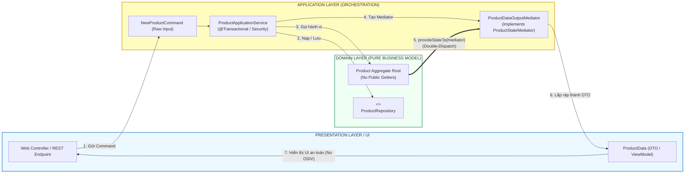

---

### 5. ÁNH XẠ ỨNG DỤNG VÀO DỰ ÁN GAME 2.5D OOP MULTIPLAYER

1. **Ứng dụng *Application Service* làm Cầu nối giữa Mạng Mở Rộng và Vòng lặp Chiến đấu (`GameMatchApplicationService`):**
   * Khi gói tin người chơi gửi tới máy chủ qua Socket UDP/TCP, tầng mạng giải mã thành `CastSkillCommand(playerId, skillSlot, targetCoord)`.
   * Gói tin **không được đi thẳng vào class `Hero`**, mà chuyển qua `CombatApplicationService.handleSkillCast(command)`:
     * Dịch vụ kiểm tra xem trận đấu có đang diễn ra không (`isMatchRunning()`), người chơi có bị cấm chat/gian lận không.
     * Nạp `GameMatch` Aggregate từ RAM Cache.
     * Gọi `match.executeHeroSkill(...)`.
     * Thu thập các sự kiện va chạm trả về và đẩy xuống tầng mạng để phát sóng gói tin đồng bộ tới tất cả người chơi khác.
2. **Dùng *Mediator Pattern* xuất Trạng thái Nhân vật sang Bộ Render 2.5D mà không lộ biến:**
   * Thay vì để `IsometricRenderer` chọc vào `hero.x`, `hero.y`, `hero.currentHp`:
   * Định nghĩa `interface RenderableSnapshotVisitor`. Thực thể `Hero` có phương thức `renderTo(RenderableSnapshotVisitor visitor)`.
   * Bên trong, `Hero` tự truyền tọa độ tính toán theo góc chiếu Isometric và mã sprite frame hiện tại vào `visitor`. Điều này đảm bảo toàn bộ công thức tính toán vật lý nội bộ của nhân vật không bị lộ ra tầng đồ họa.

---
---

## APPENDIX A: AGGREGATES AND EVENT SOURCING: A+ES (KẾT HỢP AGGREGATES VÀ EVENT SOURCING)

### 1. ĐỀ MỤC & MỤC TIÊU CỐT LÕI (CORE PURPOSE)

#### Hệ thống đề mục đầy đủ theo sách gốc (Trang 539–584):
* **Aggregates and Event Sourcing: A+ES** (Tổng quan về Sự kết hợp giữa Aggregates và Event Sourcing)
  * *Advantages and Drawbacks* (Ưu điểm và Đánh đổi của A+ES)
* **Inside an Application Service** (Bên trong một Application Service sử dụng Event Sourcing)
* **Command Handlers** (Các Bộ Xử lý Lệnh Chuyên biệt)
* **Lambda Syntax** (Cú pháp Lambda / Functional trong Xử lý Sự kiện)
* **Concurrency Control** (Kiểm soát Đồng thời trên Luồng Sự kiện — *Stream Versioning*)
* **Structural Freedom with A+ES** (Tự do về Cấu trúc Dữ liệu với A+ES — Xóa bỏ Nỗi đau Cột/Bảng ORM)
* **Performance** (Hiệu năng và Cơ chế Lưu trữ Tối ưu)
  * *Snapshots* (Ảnh chụp nhanh Trạng thái Định kỳ để Tăng tốc Phục dựng)
* **Implementing an Event Store** (Hiện thực hóa một Kho Lưu trữ Sự kiện Thực chiến)
  * *Relational Persistence* (Lưu trữ Sự kiện bằng Cơ sở Dữ liệu Quan hệ JDBC/SQL)
  * *BLOB Persistence* (Lưu trữ Sự kiện bằng Chuỗi Nhị phân BLOB / JSON)
* **Focused Aggregates** (Các Aggregates Tập trung Cao độ vào Hành vi)
* **Read Model Projections** (Các Phép Chiếu Xây dựng Mô hình Đọc — CQRS Projections)
* **Events Enrichment** (Làm giàu Sự kiện)
* **Supporting Tools and Patterns** (Các Công cụ và Mẫu Hỗ trợ)
  * *Event Serializers* (Bộ Tuần tự hóa Sự kiện — JSON, Protobuf)
  * *Event Immutability* (Tính Bất biến Tuyệt đối của Sự kiện)
  * *Value Objects* (Vai trò của Value Objects trong Event Sourcing)
* **Contract Generation, Unit Testing & Specifications** (Sinh Hợp đồng, Kiểm thử Đơn vị theo kịch bản *Given-When-Expect*)
* **Wrap-Up** (Tổng kết)

#### Vấn đề kỹ thuật & nghiệp vụ cốt lõi và Thảm họa nếu không áp dụng:
* **Vấn đề giải quyết:** Làm thế nào để giải phóng *Domain Model* hoàn toàn khỏi **nỗi ám ảnh ánh xạ bảng dữ liệu quan hệ (*Object-Relational Impedance Mismatch*)**? Làm sao để không bao giờ mất dấu bất kỳ một sự thay đổi nào trong lịch sử hệ thống, hỗ trợ kiểm toán hoàn hảo và cho phép tua lại thời gian (*Time-travel Debugging*)? Phụ lục A (đóng góp cùng chuyên gia Rinat Abdullin) cung cấp bản thiết kế hoàn chỉnh cho mô hình **A+ES (Aggregates + Event Sourcing)**.
* **Thảm họa kỹ thuật nếu không áp dụng:**
  1. **Mất mát Vĩnh viễn Dấu vết Nhân quả (*Loss of Historical Intent*):** Trong cơ sở dữ liệu truyền thống dùng lệnh `UPDATE`, giá trị cũ bị xóa đè vĩnh viễn. Khi phát sinh tranh chấp hoặc gian lận (ví dụ: tài khoản tự nhiên mất tiền, hay vật phẩm trong game biến mất), ta không có cách nào biết được chính xác chuỗi hành vi nào đã dẫn đến trạng thái hỏng hóc đó.
  2. **Chi phí Di chuyển Dữ liệu (*Database Migration Nightmare*):** Mỗi lần thay đổi cấu trúc bảng ORM, ta phải chạy các file migration phức tạp (Liquibase/Flyway), gây rủi ro cao làm gián đoạn hệ thống. Với Event Sourcing, cấu trúc sự kiện là bất biến, không bao giờ phải chạy lệnh `ALTER TABLE`!

---

### 2. PHÂN TÍCH LÝ THUYẾT & NGUYÊN LÝ CHUYÊN SÂU

#### A. Trọng tâm Bản chất của A+ES: Tách rời Biến đổi (*Mutation*) khỏi Lưu trữ Bảng
* Trong mô hình truyền thống (ORM): Aggregate được lưu bằng cách ánh xạ các trường dữ liệu của nó vào các cột của bảng SQL.
* Trong **A+ES**:
  * Trạng thái hiện tại của Aggregate **KHÔNG HỀ ĐƯỢC LƯU TRỰC TIẾP XUỐNG CƠ SỞ DỮ LIỆU!**
  * Nơi lưu trữ duy nhất là một **Bảng Ghi Nhật ký Sự kiện Bất biến Chỉ thêm mới (*Append-Only Event Stream*)** trong `EventStore`.
  * Mỗi khi có thay đổi, Aggregate phát sinh một hoặc nhiều **Domain Events** mới và các sự kiện này được nối tiếp vào cuối luồng sự kiện của nó (`streamVersion = streamVersion + 1`).

#### B. 2 Pha Xử lý bên trong Aggregate A+ES: Execute Command vs. Apply Event
Một Aggregate trong A+ES luôn có sự phân tách rạch ròi thành 2 giai đoạn:
1. **Pha 1: Thực thi Lệnh (*Command Execution*):**
   * Phương thức nhận Command (ví dụ: `commitTo(Sprint aSprint)`).
   * **Nhiệm vụ:** Kiểm tra toàn bộ các quy tắc nghiệp vụ bất biến (*Invariants*).
   * **Kết quả:** Nếu hợp lệ, nó **KHÔNG trực tiếp sửa đổi thuộc tính** của mình! Thay vào đó, nó tạo ra một sự kiện miền mới `BacklogItemCommitted` và gọi phương thức nội bộ: `this.apply(event)`.
2. **Pha 2: Biến đổi Trạng thái (*State Mutation* qua `apply` / `mutate`):**
   * Phương thức nội bộ (thường nhận sự kiện và gán thuộc tính: `this.sprintId = event.sprintId()`).
   * **Tuyệt đối không chứa logic kiểm tra điều kiện!** Nó chỉ đơn thuần áp dụng dữ liệu từ sự kiện vào các biến nội bộ.
   * *Tại sao?* Vì khi phục dựng đối tượng trong quá khứ, các quy tắc kiểm tra của tương lai không được phép can thiệp làm gián đoạn việc phát lại sự kiện!

#### C. Cơ chế Phục dựng Trạng thái (*Reconstitution*) & Tối ưu bằng Snapshots
1. **Phục dựng thuần túy (*Replaying Events*):**
   * Khởi tạo một thực thể Aggregate rỗng thông qua hàm khởi tạo không tham số ẩn.
   * Tải toàn bộ danh sách sự kiện lịch sử của Aggregate đó từ `EventStore` theo thứ tự `streamVersion` tăng dần ($1, 2, 3...$).
   * Lần lượt đưa từng sự kiện qua hàm `apply(event)` để đưa đối tượng trở về trạng thái hiện tại.
2. **Tăng tốc bằng Snapshots (Ảnh chụp nhanh):**
   * Nếu một Aggregate sống quá lâu và có hàng ngàn sự kiện (như một tài khoản ngân hàng hoặc một trận đấu game kéo dài), việc phát lại hàng ngàn sự kiện sẽ làm tăng độ trễ.
   * **Giải pháp:** Cứ sau mỗi $N$ sự kiện (ví dụ: 100 sự kiện), hệ thống tự động lưu một bản chụp trạng thái phẳng (**Snapshot**) tại phiên bản đó.
   * Khi nạp lại: Chỉ cần nạp Snapshot phiên bản 100, sau đó chỉ cần phát lại các sự kiện từ 101 trở đi!

#### D. Kiểm soát Đồng thời Lạc quan trên Luồng Sự kiện (*Stream Concurrency Control*)
* Thay vì dựa vào cột `version` trên bảng dữ liệu, `EventStore` kiểm tra phiên bản luồng:
  `eventStore.append(streamId, expectedVersion, newEvents)`
* Nếu trong lúc ta đang xử lý, một Client khác đã kịp chèn một sự kiện mới làm phiên bản hiện tại của luồng trong DB vượt quá `expectedVersion`, `EventStore` sẽ ném ra ngoại lệ `ConcurrencyException` và hủy giao dịch ngay lập tức, bảo đảm tính toàn vẹn 100%.

#### E. Mô hình Kiểm thử Tinh khiết: *Given - When - Expect*
A+ES mang lại năng lực kiểm thử đơn vị tuyệt đỉnh cho các kỹ sư:
* **Given (Cho trước):** Một chuỗi các sự kiện đã xảy ra trong quá khứ (`[ProductCreated, BacklogItemPlanned]`).
* **When (Khi):** Thực thi một lệnh mới (`CommitBacklogItemToSprintCommand`).
* **Expect (Kỳ vọng):** Sự kiện mới nào sẽ được phát sinh? (`[BacklogItemCommitted]`).
* Toàn bộ kịch bản kiểm thử chạy hoàn toàn trong RAM, không cần mock database, không cần ORM!

---

### 3. MỔ XẺ MÃ NGUỒN & CẤU TRÚC THIẾT KẾ (CODE DEEP-DIVE)

Chúng ta sẽ mổ xẻ cấu trúc lớp cơ sở **`EventSourcedRootEntity`** và thực thể **`Product` hiện thực hóa theo kiến trúc A+ES** (trang 541–557).

#### ❌ Thiết kế Cũ: Trộn lẫn Lưu trữ Bảng và Mất dấu Vết Biến đổi
```java
// Thiết kế cũ: Cập nhật trực tiếp trạng thái và lưu đè bảng DB
public class OldProduct {
    private String name;
    public void rename(String newName) {
        this.name = newName; // Lịch sử tên cũ bị xóa vĩnh viễn!
    }
}
```

#### ✅ Thiết kế CHUẨN MỰC SAU REFACTOR: Aggregate kết hợp Event Sourcing (A+ES) với Pha `apply()` riêng biệt

```java
// ============================================================================
// 1. LỚP CƠ SỞ AGGREGATE CHO EVENT SOURCING: EventSourcedRootEntity
// Package: com.saasovation.common.domain.model.eventsourced
// ============================================================================
public abstract class EventSourcedRootEntity {

    private List<DomainEvent> mutatingEvents; // Danh sách sự kiện mới chưa lưu
    private int unmutatedVersion;             // Phiên bản luồng hiện tại

    protected EventSourcedRootEntity() {
        super();
        this.mutatingEvents = new ArrayList<DomainEvent>();
    }

    // Tái tạo lại Aggregate từ chuỗi sự kiện lịch sử (Replay)
    public EventSourcedRootEntity(List<DomainEvent> anEventStream, int aStreamVersion) {
        this();
        for (DomainEvent event : anEventStream) {
            this.mutateWhen(event); // Phát lại từng sự kiện để đắp trạng thái
        }
        this.unmutatedVersion = aStreamVersion;
    }

    // Đăng ký và áp dụng sự kiện mới phát sinh từ lệnh
    protected void apply(DomainEvent aDomainEvent) {
        this.mutatingEvents.add(aDomainEvent);
        this.mutateWhen(aDomainEvent);
    }

    // Phương thức đa hình trừu tượng để lớp con gán thuộc tính tương ứng từng sự kiện
    protected abstract void mutateWhen(DomainEvent aDomainEvent);

    public List<DomainEvent> mutatingEvents() {
        return Collections.unmodifiableList(this.mutatingEvents);
    }

    public int mutatedVersion() {
        return this.unmutatedVersion + 1;
    }

    public int unmutatedVersion() {
        return this.unmutatedVersion;
    }
}

// ============================================================================
// 2. AGGREGATE ROOT HIỆN THỰC HÓA THEO MÔ HÌNH A+ES: Product
// Package: com.saasovation.agilepm.domain.model.product
// ============================================================================
public class Product extends EventSourcedRootEntity {

    private String description;
    private String name;
    private ProductId productId;
    private TenantId tenantId;

    // Constructor phục dựng lại đối tượng từ Event Store
    public Product(List<DomainEvent> anEventStream, int aStreamVersion) {
        super(anEventStream, aStreamVersion);
    }

    // Constructor khởi tạo mới: Phát ra sự kiện ProductCreated
    public Product(TenantId aTenantId, ProductId aProductId, String aName, String aDescription) {
        super();
        this.assertArgumentNotNull(aTenantId, "TenantId must be provided.");
        this.assertArgumentNotNull(aProductId, "ProductId must be provided.");

        // ÁP DỤNG SỰ KIỆN: Không gán trực tiếp this.name = aName!
        this.apply(new ProductCreated(aTenantId, aProductId, aName, aDescription));
    }

    // COMMAND METHOD: Kiểm tra bất biến và phát sự kiện
    public void changeDescription(String aNewDescription) {
        this.assertArgumentNotEmpty(aNewDescription, "Description must be provided.");
        
        // Không sửa thuộc tính trực tiếp! Gọi apply!
        this.apply(new ProductDescriptionChanged(this.tenantId(), this.productId(), aNewDescription));
    }

    // MUTATION METHOD: Duyệt qua từng sự kiện và thay đổi biến nội bộ (Không có logic kiểm tra!)
    @Override
    protected void mutateWhen(DomainEvent aDomainEvent) {
        if (aDomainEvent instanceof ProductCreated) {
            this.when((ProductCreated) aDomainEvent);
        } else if (aDomainEvent instanceof ProductDescriptionChanged) {
            this.when((ProductDescriptionChanged) aDomainEvent);
        }
    }

    private void when(ProductCreated anEvent) {
        this.tenantId = anEvent.tenantId();
        this.productId = anEvent.productId();
        this.name = anEvent.name();
        this.description = anEvent.description();
    }

    private void when(ProductDescriptionChanged anEvent) {
        this.description = anEvent.description();
    }
}
```

#### Bảng phân tích kỹ thuật & Ý nghĩa thiết kế:

| Dòng code / Đoạn code then chốt | Giải thích kỹ thuật & Nguyên lý thiết kế (DDD/OOP) được hiện thực hóa |
| :--- | :--- |
| `public EventSourcedRootEntity(List<DomainEvent> anEventStream, ...)` | **Event Sourcing Reconstitution:** Hàm khởi tạo nhận luồng sự kiện lịch sử từ `EventStore` và duyệt qua từng phần tử để khôi phục lại trạng thái đối tượng. Aggregate không cần nạp từ bất kỳ bảng dữ liệu SQL nào! |
| `this.apply(new ProductDescriptionChanged(...));` | **Command Execution vs. State Mutation:** Phương thức nghiệp vụ chỉ tập trung kiểm tra Guard Clauses, sau đó đúc một sự kiện bất biến và đưa vào `apply()`. Tách rời tuyệt đối giữa việc ra quyết định nghiệp vụ và việc cập nhật trạng thái. |
| `protected void mutateWhen(DomainEvent aDomainEvent)` | **Deterministic State Machine:** Nhận sự kiện và điều phối tới phương thức `when(...)` tương ứng để gán giá trị cho thuộc tính nội bộ. Hàm này đảm bảo cùng một chuỗi sự kiện đầu vào sẽ luôn cho ra đúng một trạng thái duy nhất ở đầu ra (*Deterministic*). |
| `this.mutatingEvents.add(aDomainEvent);` | **Uncommitted Events Collection:** Các sự kiện mới phát sinh được gom vào bộ đệm `mutatingEvents`. Khi tầng Application Service kết thúc, toàn bộ các sự kiện này sẽ được ghi đồng loạt xuống `EventStore` và phát ra ngoài cho các bộ chiếu (*Read Model Projectors*). |

---

### 4. SƠ ĐỒ TRỰC QUAN HÓA (BẮT BUỘC MÃ MERMAID)

Sơ đồ trình bày chu trình hoàn chỉnh của **A+ES (Aggregates + Event Sourcing)** kết hợp **CQRS Projections**:

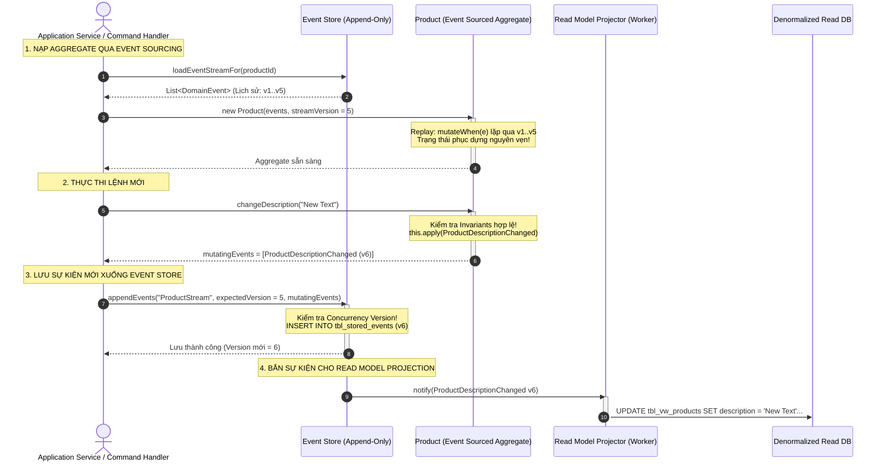

---

### 5. ÁNH XẠ ỨNG DỤNG VÀO DỰ ÁN GAME 2.5D OOP MULTIPLAYER

Mô hình A+ES (Aggregates + Event Sourcing) chính là nền tảng tối thượng cho hệ thống **Netcode Chống Gian Lận (*Server Authoritative Anti-Cheat*)**, **Hệ thống Phát lại Trận đấu (*Match Replay System*)**, và **Bù trừ Độ trễ Mạng (*Lag Compensation*)** trong Game 2.5D của bạn:

1. **Hiện thực hóa Hệ thống Lưu lại & Xem lại Trận đấu (*Match Replay Engine*) với chi phí bộ nhớ tối thiểu:**
   * *Cách làm thông thường tồi tệ:* Mỗi frame hình hoặc mỗi giây, ghi lại toàn bộ trạng thái vị trí của 4 nhân vật, 100 quái vật và hàng ngàn viên đạn vào ổ cứng $\rightarrow$ File Replay nặng hàng gigabytes!
   * *Áp dụng A+ES:* Server chỉ lưu trữ chuỗi các **Domain Events** theo số thứ tự Tick:
     `[Tick 1: MatchStarted, Tick 15: HeroMoved(hero1, dir), Tick 42: SkillCast(hero2, FIREBALL, target), Tick 48: HeroDamaged(hero1, 50), Tick 120: MobSpawned(ZOMBIE, x, y)]`.
   * Khi người chơi muốn xem lại trận đấu (*Replay*), Client chỉ cần tải file text JSON sự kiện (vài trăm kilobytes), tạo một môi trường game trống và **phát lại chuỗi sự kiện (*Replay Events*) qua Game Loop**. Toàn bộ trận đấu 2.5D hiển thị lại chính xác 100% từng khung hình!
2. **Cơ chế *Server-side Rewind* Bù trừ Độ trễ 4G (*Lag Compensation*) cho Xạ thủ / Tung chiêu:**
   * Khi Người chơi A (bị trễ ping 100ms) bắn trúng Người chơi B trên màn hình của A. Gói tin gửi lên Server mất 100ms mới tới nơi, lúc này B đã di chuyển sang vị trí khác trên Server.
   * Nhờ thiết kế A+ES, Server không lưu đè vị trí của B, mà giữ một chuỗi các sự kiện trạng thái trong quá khứ (*Event Ring Buffer*). Server có thể **tua ngược đối tượng `Hero B` về thời điểm cách đây 100ms** bằng cách phát lại sự kiện đến mốc thời gian đó, kiểm tra xem phát bắn của A tại thời điểm đó có trúng Hitbox của B không. Nếu trúng, Server công nhận sát thương và áp dụng sự kiện `DamageApplied` cho hiện tại! Đây chính là bí mật công nghệ đằng sau các game bắn súng/MOBA hiện đại!

