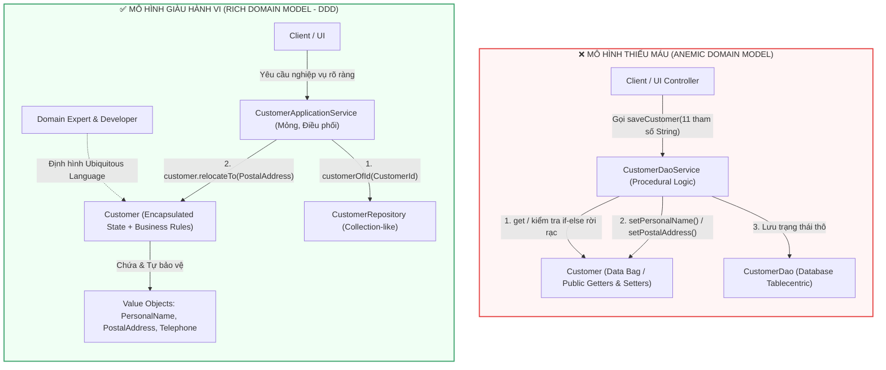
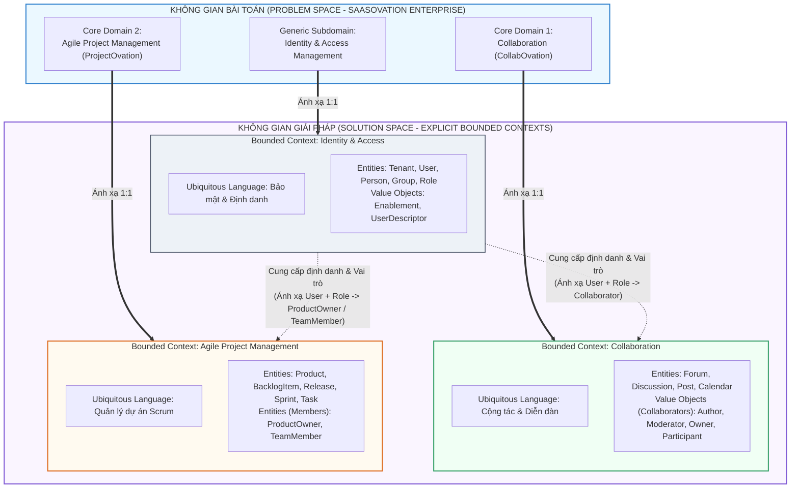

# ĐỢT 1 / 10: BÓC TÁCH CHUYÊN SÂU CHƯƠNG 1 & CHƯƠNG 2
**Sách:** *Implementing Domain-Driven Design (IDDD)* — **Tác giả:** *Vaughn Vernon*

---

## CHƯƠNG 1: GETTING STARTED WITH DDD (BẮT ĐẦU VỚI THIẾT KẾ HƯỚNG MIỀN)

### 1. ĐỀ MỤC & MỤC TIÊU CỐT LÕI (CORE PURPOSE)

#### Hệ thống đề mục đầy đủ theo sách gốc:
* **Can I DDD?** (Tôi có thể áp dụng DDD không?)
* **Why You Should Do DDD** (Tại sao bạn nên thực hành DDD)
  * *Determining the Health of Your Domain Model* (Xác định sức khỏe của Mô hình Miền)
  * *Anemia-Induced Memory Loss* (Chứng mất trí nhớ do Thiếu máu mô hình)
* **How to Do DDD** (Làm thế nào để thực hành DDD)
  * *Ubiquitous Language* (Ngôn ngữ Chung / Ngôn ngữ Phổ quát)
* **The Business Value of Using DDD** (Giá trị kinh doanh của việc sử dụng DDD)
  1. *The Organization Gains a Useful Model of Its Domain* (Tổ chức có được một mô hình hữu ích về miền nghiệp vụ)
  2. *A Refined, Precise Definition and Understanding of the Business Is Developed* (Phát triển sự hiểu biết và định nghĩa tinh chỉnh, chính xác về nghiệp vụ)
  3. *Domain Experts Contribute to Software Design* (Chuyên gia nghiệp vụ đóng góp vào thiết kế phần mềm)
  4. *A Better User Experience Is Gained* (Đạt được trải nghiệm người dùng tốt hơn)
  5. *Clean Boundaries Are Placed around Pure Models* (Đặt các ranh giới sạch sẽ xung quanh các mô hình thuần khiết)
  6. *Enterprise Architecture Is Better Organized* (Kiến trúc doanh nghiệp được tổ chức tốt hơn)
  7. *Agile, Iterative, Continuous Modeling Is Used* (Sử dụng mô hình hóa liên tục, lặp đi lặp lại và linh hoạt)
  8. *New Tools, Both Strategic and Tactical, Are Employed* (Áp dụng các công cụ mới, cả Chiến lược lẫn Chiến thuật)
* **The Challenges of Applying DDD** (Những thách thức khi áp dụng DDD)
  * *Creating a Common Language* (Tạo dựng một ngôn ngữ chung)
  * *Justification for Domain Modeling* (Sự biện minh/Lý do chính đáng cho việc mô hình hóa miền)
  * *Test-First Domain Modeling* (Mô hình hóa miền theo hướng kiểm thử trước)
* **Fiction, with Bucketfuls of Reality** (Câu chuyện giả tưởng nhưng chứa đầy thực tế — Giới thiệu Case Study *SaaSOvation*)
* **Wrap-Up** (Tổng kết)

#### Vấn đề kỹ thuật & nghiệp vụ cốt lõi và Thảm họa nếu không áp dụng:
* **Vấn đề giải quyết:** Chương 1 giải quyết sự đứt gãy nhận thức giữa **Chuyên gia nghiệp vụ (*Domain Experts*)** và **Lập trình viên (*Developers*)**, đồng thời cung cấp bộ tiêu chí định lượng (*DDD Scorecard*) để quyết định khi nào một dự án xứng đáng đầu tư DDD. Nó vạch trần căn bệnh kinh niên của ngành phần mềm: viết code theo kiểu thủ tục (*Procedural Transaction Script*) đội lốt hướng đối tượng (OOP).
* **Thảm họa kỹ thuật nếu không áp dụng:**
  1. **Mô hình miền thiếu máu (*Anemic Domain Model*) & Chứng mất trí nhớ do thiếu máu (*Anemia-Induced Memory Loss*):** Các lớp đối tượng miền chỉ chứa toàn các thuộc tính (`private fields`) cùng hàng loạt hàm `getter/setter` vô hồn (tư duy *JavaBeans* hoặc kéo thả *Visual Basic* kết nối thẳng vào Database). Toàn bộ logic nghiệp vụ bị đẩy hết ra tầng *Application Service* hoặc *Controller*. Hậu quả là không ai đọc vào class mà hiểu được quy tắc kinh doanh là gì; các phương thức `setA()`, `setB()` không thể diễn đạt ý định nghiệp vụ (*Intention-Revealing Interface*).
  2. **Rò rỉ và trùng lặp logic (*Violation of DRY & Tight Coupling*):** Khi đối tượng miền không tự bảo vệ trạng thái của mình, bất kỳ *Client/Service* nào gọi nó cũng phải tự viết lại các đoạn `if-else` kiểm tra hợp lệ. Khi quy tắc nghiệp vụ thay đổi, hệ thống phát sinh lỗi dây chuyền ở hàng chục Service khác nhau.
  3. **Áp dụng sai chỗ (*DDD-Lite* hoặc *Over-engineering*):** Áp dụng các mẫu chiến thuật phức tạp vào một bài toán chỉ thuần túy thêm-sửa-xóa (*CRUD*) gây lãng phí tài nguyên, hoặc ngược lại, nhồi nhét nghiệp vụ cực kỳ phức tạp vào mô hình bảng cơ sở dữ liệu trực tiếp khiến chi phí bảo trì tăng theo cấp số nhân.

---

### 2. PHÂN TÍCH LÝ THUYẾT & NGUYÊN LÝ CHUYÊN SÂU

#### A. Bảng điểm đánh giá dự án DDD (*DDD Project Scorecard*)
Vaughn Vernon nhấn mạnh: **Không phải mọi phần mềm đều cần DDD**. Trước khi bắt đầu, Kiến trúc sư phải chấm điểm hệ thống dựa trên 6 tiêu chí để tránh bẫy *Over-engineering* (điểm từ 0 đến 5 cho mỗi tiêu chí):
1. Toàn bộ ứng dụng hay phần cốt lõi này chỉ là hệ thống nhập xuất dữ liệu thông thường (*Data-centric CRUD*) trên các bảng DB? (Nếu có $\rightarrow$ 0 điểm, dùng *Transaction Script* hoặc *Active Record* cho nhanh).
2. Có dưới 30 thao tác nghiệp vụ đơn giản không? (Nếu chỉ là *Create/Update/Delete* cơ bản $\rightarrow$ 0-1 điểm).
3. Độ phức tạp của quy tắc nghiệp vụ có thay đổi thường xuyên và đòi hỏi sự cộng tác sâu với *Domain Experts* không? (Điểm cao: 4-5).
4. Ngôn ngữ chuyên ngành của miền bài toán có phong phú và khác biệt với ngôn ngữ kỹ thuật (như `Table`, `Row`, `Record`, `DTO`) không?
5. Tuổi thọ dự kiến của phần mềm có kéo dài nhiều năm và là lợi thế cạnh tranh sống còn của công ty không?
* **Nguyên lý:** Tổng điểm **$\ge 7$ điểm** mới nên đầu tư DDD hoàn chỉnh.

#### B. Bệnh lý *Anemic Domain Model* và *Anemia-Induced Memory Loss*
Được Martin Fowler đặt tên nhưng được Vaughn Vernon mổ xẻ ở cấp độ vi mô (code-level):
* **Nguyên nhân gốc rễ:** Lập trình viên bị "nhiễm độc" bởi tư duy hướng dữ liệu (*Data-driven thinking*) và các công cụ ORM (như Hibernate) hoặc đặc tả *JavaBeans* đòi hỏi mỗi thuộc tính phải có `getX()` và `setX()` công khai (`public`).
* **Cơ chế gây hại ("Mất trí nhớ nghiệp vụ"):** Giả sử chuyên gia nghiệp vụ yêu cầu: *"Khi khách hàng đổi tên và số điện thoại liên lạc, hệ thống phải kiểm tra định dạng và ghi nhận lịch sử thay đổi"*. Lập trình viên thiếu máu sẽ gọi `customer.setName(...)` và `customer.setPhone(...)` ở tầng giao diện hoặc tầng ứng dụng. Sáu tháng sau, một lập trình viên khác đọc vào class `Customer` chỉ thấy hai hàm `setName` và `setPhone` rời rạc — hoàn toàn **mất trí nhớ** về việc tại sao chúng được gọi, chúng có phải đi đôi với nhau không, hay có bất biến (*Invariant*) nào cần bảo vệ giữa chúng không.

#### C. Ngôn ngữ Phổ quát (*Ubiquitous Language - UL*)
Đây là trụ cột số 1 của DDD.
* **Cơ chế hoạt động:** Không tồn tại một "ngôn ngữ của bộ phận kinh doanh" rồi được BA dịch sang "ngôn ngữ tài liệu UML" rồi lại được Developer dịch sang "ngôn ngữ lập trình C#/Java". Chỉ có **MỘT ngôn ngữ duy nhất** được nói bởi cả nhóm (Domain Experts + Developers + QA) và **được khắc trực tiếp vào mã nguồn** (tên Class, tên Method, tên biến, tên Module, và kịch bản Unit Test).
* **Sự tiến hóa của UL:** Khởi đầu từ việc vẽ sơ đồ tự do trên bảng trắng (*Whiteboard*), xây dựng từ điển thuật ngữ (*Glossary*), viết các kịch bản kiểm thử chấp nhận (*Acceptance Tests*), nhưng đích đến tối thượng của UL là **Mô hình mã nguồn (*Code Model*)**. Nếu một thuật ngữ không thể hiện diện rõ ràng trong code hoặc khi đọc code lên mà chuyên gia nghiệp vụ không hiểu, tức là *Ubiquitous Language* đã thất bại.

#### D. Khởi đầu Case Study: Công ty *SaaSOvation*
Cuốn sách dẫn dắt người đọc qua công ty phần mềm giả tưởng **SaaSOvation** chuyên cung cấp sản phẩm SaaS đa người thuê (*Multi-tenant*):
1. Sản phẩm đầu tiên: **CollabOvation** (Nền tảng cộng tác doanh nghiệp: *Forums*, *Discussions*, *Shared Calendars*, *Blogs*).
2. Sản phẩm thứ hai (Trọng tâm và phức tạp hơn): **ProjectOvation** (Hệ thống quản lý dự án chuẩn *Scrum*: *Product*, *BacklogItem*, *Release*, *Sprint*, *Task*).
Ở Chương 1, đội ngũ *SaaSOvation* bắt đầu bằng việc mắc lỗi kinh điển: dùng các phương thức kiểu `saveCustomer()` mang đậm mùi vị cơ sở dữ liệu (CRUD) thay vì lắng nghe cách chuyên gia nghiệp vụ mô tả hành vi thực sự của khách hàng.

---

### 3. MỔ XẺ MÃ NGUỒN & CẤU TRÚC THIẾT KẾ (CODE DEEP-DIVE)

Chương 1 trình bày màn đối đầu trực diện giữa **Thiết kế Thiếu máu (*Anemic Domain Model* - Sai lầm)** và **Thiết kế Giàu hành vi (*Rich Domain Model* phản ánh *Ubiquitous Language* - Chuẩn mực)** thông qua ví dụ quản lý thông tin `Customer` (trang 16–19 & 31–33).

#### ❌ Thiết kế SAI BAN ĐẦU: Anemic Domain Model + Transaction Script
```java
// 1. Thực thể Customer bị biến thành túi chứa dữ liệu (Data Holder / JavaBean)
public class Customer {
    private String personalName;
    private String postalAddress;
    private String primaryTelephone;
    private String secondaryTelephone;

    public String getPersonalName() { return personalName; }
    public void setPersonalName(String personalName) { this.personalName = personalName; }
    public String getPostalAddress() { return postalAddress; }
    public void setPostalAddress(String postalAddress) { this.postalAddress = postalAddress; }
    public String getPrimaryTelephone() { return primaryTelephone; }
    public void setPrimaryTelephone(String primaryTelephone) { this.primaryTelephone = primaryTelephone; }
    public String getSecondaryTelephone() { return secondaryTelephone; }
    public void setSecondaryTelephone(String secondaryTelephone) { this.secondaryTelephone = secondaryTelephone; }
}

// 2. Application Service ôm đồm toàn bộ chi tiết lắp ghép trạng thái và mang tên gọi kiểu CRUD
public class CustomerDaoService {
    @Transactional
    public void saveCustomer(
        String customerId,
        String customerFirstName, String customerLastName,
        String streetAddress1, String streetAddress2, String city, String stateOrProvince, String postalCode, String country,
        String homePhone, String mobilePhone) {

        Customer customer = customerDao.readCustomer(customerId);
        if (customer == null) {
            customer = new Customer();
            customer.setCustomerId(customerId);
        }

        // Bơm dữ liệu thô bạo từ bên ngoài thông qua hàng loạt hàm setter
        if (customerFirstName != null || customerLastName != null) {
            customer.setPersonalName(customerFirstName + " " + customerLastName);
        }
        if (streetAddress1 != null || city != null) {
            customer.setPostalAddress(streetAddress1 + " " + city + ", " + stateOrProvince);
        }
        if (homePhone != null) {
            customer.setPrimaryTelephone(homePhone);
        }
        if (mobilePhone != null) {
            customer.setSecondaryTelephone(mobilePhone);
        }

        customerDao.saveCustomer(customer);
    }
}
```

#### ✅ Thiết kế CHUẨN MỰC SAU REFACTOR: Rich Domain Model & Ubiquitous Language
```java
// 1. Thực thể Customer đóng gói hoàn toàn trạng thái và cung cấp Intention-Revealing Interface
public class Customer {
    private CustomerId customerId;
    private PersonalName personalName;
    private PostalAddress postalAddress;
    private Telephone primaryTelephone;
    private Telephone secondaryTelephone;

    public void changePersonalName(String aFirstName, String aLastName) {
        this.setPersonalName(new PersonalName(aFirstName, aLastName));
    }

    public void relocateTo(PostalAddress aPostalAddress) {
        if (aPostalAddress == null) {
            throw new IllegalArgumentException("Postal address is required for relocation.");
        }
        this.setPostalAddress(aPostalAddress);
    }

    public void changePrimaryTelephone(Telephone aTelephone) {
        this.setPrimaryTelephone(aTelephone);
    }

    public void disconnectSecondaryTelephone() {
        this.setSecondaryTelephone(null);
    }

    // Các hàm setter được giấu kín (private) để phục vụ Self-Encapsulation và ORM
    private void setPersonalName(PersonalName aPersonalName) {
        if (aPersonalName == null) {
            throw new IllegalArgumentException("Personal name cannot be null.");
        }
        this.personalName = aPersonalName;
    }
    private void setPostalAddress(PostalAddress aPostalAddress) {
        this.postalAddress = aPostalAddress;
    }
    // ...
}

// 2. Kịch bản kiểm thử phản ánh đúng ngôn ngữ của Domain Expert
public void testCustomerRelocation() {
    Customer customer = customerRepository.customerOfId(new CustomerId("12345"));
    
    customer.relocateTo(
        new PostalAddress(
            "123 Main Street", "Suite 100",
            "Boulder", "CO", "80301", "US"));
            
    assertEquals("Boulder", customer.postalAddress().city());
}
```

#### Bảng phân tích kỹ thuật & Ý nghĩa thiết kế:

| Dòng code / Đoạn code then chốt | Giải thích kỹ thuật & Nguyên lý thiết kế (DDD/OOP) được hiện thực hóa |
| :--- | :--- |
| `public void saveCustomer(...)` *(Bản sai)* | **Phản mẫu CRUD / Transaction Script:** Tên hàm `saveCustomer` với 11 tham số kiểu chuỗi (`String` - *Primitive Obsession*) hoàn toàn vô nghĩa về mặt nghiệp vụ. Chuyên gia nghiệp vụ không bao giờ nói *"Hãy lưu khách hàng vào DB"*, họ nói *"Khách hàng chuyển chỗ ở"* hoặc *"Khách hàng đổi tên"*. Hơn nữa, việc dùng chung một hàm `save` cho cả việc đổi tên lẫn đổi địa chỉ khiến ta không thể phân biệt được sự kiện nghiệp vụ nào vừa thực sự diễn ra. |
| `customer.setPostalAddress(...)` *(Bản sai)* | **Phá vỡ tính Đóng gói (*Encapsulation*) & Gây mất trí nhớ (*Anemia-Induced Memory Loss*):** Cho phép bất kỳ lớp nào bên ngoài ghi đè trực tiếp trạng thái nội tại của `Customer`. Đối tượng `Customer` trở nên thụ động, không thể tự kiểm chứng tính toàn vẹn (*Invariants*) của dữ liệu. |
| `public void relocateTo(PostalAddress aPostalAddress)` *(Bản chuẩn)* | **Giao diện bộc lộ ý định (*Intention-Revealing Interface*) & *Ubiquitous Language*:** Thay thế tên hàm kỹ thuật `setPostalAddress` bằng động từ nghiệp vụ `relocateTo` (chuyển địa điểm cư trú). Bất kỳ ai đọc dòng code này đều hiểu ngay hành vi kinh doanh đang xảy ra. |
| `new PostalAddress("123 Main Street", ...)` *(Bản chuẩn)* | **Khắc phục *Primitive Obsession* bằng *Value Object*:** Thay vì truyền rời rạc 6 biến `String` vào Service rồi nối chuỗi thủ công, ta gom nhóm các thuộc tính có liên quan chặt chẽ thành một khối bất biến (*Conceptual Whole*). Bản thân `PostalAddress` sẽ tự kiểm tra tính hợp lệ ngay trong hàm khởi tạo (*Constructor*). |
| `private void setPersonalName(...)` *(Bản chuẩn)* | **Tự đóng gói (*Self-Encapsulation*):** Giấu kín hàm `setter` ở mức `private`. Bên ngoài bắt buộc phải đi qua cổng hành vi nghiệp vụ `changePersonalName()`, trong khi nội bộ class vẫn có một điểm tập trung duy nhất để kiểm tra điều kiện tiên quyết (*Guard Clause*: `if (aPersonalName == null) throw...`) và tương thích mượt mà với cơ chế Reflection của ORM (Hibernate). |

---

### 4. SƠ ĐỒ TRỰC QUAN HÓA (BẮT BUỘC MÃ MERMAID)

Sơ đồ dưới đây trực quan hóa sự đối lập kiến trúc giữa **Anemic Domain Model** (nơi dữ liệu và hành vi bị xé lẻ) và **Rich Domain Model** theo chuẩn DDD (nơi *Ubiquitous Language* định hình hành vi đóng gói bên trong thực thể):



---

### 5. ÁNH XẠ ỨNG DỤNG VÀO DỰ ÁN GAME 2.5D OOP MULTIPLAYER

1. **Xóa sổ căn bệnh *Anemic Model* trong Thực thể Nhân vật (`PlayerCharacter` / `Monster`):**
   * *Sai lầm phổ biến trong Game OOP:* Biến class `Hero` thành một túi chứa dữ liệu với `public void setHp(int hp)`, `public void setMp(int mp)`, `public void setPosition(float x, float y)`. Sau đó ở khắp các class `SkillManager`, `TrapController`, `PoisonSystem` đều viết lại công thức `hero.setHp(hero.getHp() - damage)`. Kết quả: Khi thêm cơ chế *"Khiên bất tử (Invulnerability Shield)"* hoặc *"Giáp phản sát thương"*, lập trình viên quên sửa ở `PoisonSystem`, dẫn đến lỗi nhân vật bật khiên bất tử vẫn chết vì trúng độc!
   * *Áp dụng Chương 1:* Khóa toàn bộ `setHp`, `setMp` thành `private`. Cung cấp các phương thức phản ánh đúng *Ubiquitous Language* của Game Designer như `hero.absorbDamage(DamageSource source, DamageAmount amount)`, `hero.consumeManaForSkill(ManaCost cost)`, hoặc `hero.teleportTo(GridCoordinate target)`. Mọi quy tắc tính giáp, kháng phép, bất tử và kích hoạt trạng thái chết (`Die`) đều nằm gọn và thống nhất bên trong `Hero`.
2. **Áp dụng *DDD Scorecard* để phân bổ công sức trong dự án Game:**
   * Phần **Core Game Loop** (Hệ thống chiến đấu thời gian thực 2.5D, cơ chế kết hợp nguyên tố *Elemental Reaction*, tính toán va chạm *Hitbox/Hurtbox* và AI của Boss) có độ phức tạp quy tắc cực cao $\rightarrow$ Đạt điểm tuyệt đối trên *DDD Scorecard*, bắt buộc dùng **Rich Domain Model**.
   * Ngược lại, phần **Bảng xếp hạng tĩnh (*Leaderboard History*)**, **Cấu hình âm thanh/đồ họa (*Settings*)** hoặc **Nhật ký đăng nhập (*Login Logs*)** chỉ thuần túy là lưu và đọc dữ liệu $\rightarrow$ Điểm *DDD Scorecard* thấp, chỉ cần dùng cấu trúc đọc/ghi dữ liệu trực tiếp mà không cần dựng *Domain Model* phức tạp.

---
---

## CHƯƠNG 2: DOMAINS, SUBDOMAINS, AND BOUNDED CONTEXTS (MIỀN, MIỀN CON VÀ NGỮ CẢNH GIỚI HẠN)

### 1. ĐỀ MỤC & MỤC TIÊU CỐT LÕI (CORE PURPOSE)

#### Hệ thống đề mục đầy đủ theo sách gốc:
* **Big Picture** (Bức tranh toàn cảnh)
  * *Subdomains and Bounded Contexts at Work* (Cách thức hoạt động của Miền con và Ngữ cảnh giới hạn)
  * *Focus on the Core Domain* (Tập trung vào Miền cốt lõi)
* **Why Strategic Design Is So Incredibly Essential** (Tại sao Thiết kế Chiến lược lại tối quan trọng đến vậy)
* **Real-World Domains and Subdomains** (Các Miền và Miền con trong thế giới thực)
* **Making Sense of Bounded Contexts** (Hiểu thấu đáo về Ngữ cảnh giới hạn)
  * *Room for More than the Model* (Không gian cho nhiều thành phần hơn là chỉ Mô hình miền)
  * *Size of Bounded Contexts* (Kích thước của Ngữ cảnh giới hạn)
  * *Aligning with Technical Components* (Căn chỉnh với các thành phần kỹ thuật)
* **Sample Contexts** (Các Ngữ cảnh mẫu trong dự án *SaaSOvation*)
  * *Collaboration Context* (Ngữ cảnh Cộng tác)
  * *Identity and Access Context* (Ngữ cảnh Định danh và Truy cập)
  * *Agile Project Management Context* (Ngữ cảnh Quản lý Dự án Agile)
* **Wrap-Up** (Tổng kết)

#### Vấn đề kỹ thuật & nghiệp vụ cốt lõi và Thảm họa nếu không áp dụng:
* **Vấn đề giải quyết:** Làm thế nào để chia để trị một hệ thống doanh nghiệp khổng lồ thành các vùng mô hình độc lập, rõ ràng về mặt ngữ nghĩa? Chương 2 giúp phân biệt rạch ròi giữa **Không gian bài toán (*Problem Space* — gồm *Core Domain, Supporting Subdomain, Generic Subdomain*)** và **Không gian giải pháp (*Solution Space* — các *Bounded Contexts*)**.
* **Thảm họa kỹ thuật nếu không áp dụng:**
  1. **Quả cầu bùn lớn (*Big Ball of Mud*) & Tham vọng "Mô hình toàn năng" (*Single Unified Enterprise Model*):** Đội ngũ cố gắng xây dựng một mô hình duy nhất dùng chung cho toàn công ty. Một class `User` hay `Product` phải gánh hàng trăm thuộc tính và phương thức phục vụ cho cả Bảo mật, Diễn đàn, Kế toán, lẫn Quản lý Dự án.
  2. **Đa nghĩa ngôn ngữ (*Linguistic Ambiguity*) & *Object Schizophrenia* (Tâm thần phân liệt đối tượng):** Cùng một từ khóa (như `User`, `Account`, hay `Item`) nhưng ở bộ phận này mang ý nghĩa khác, bộ phận kia mang ý nghĩa khác. Khi nhét chung vào một class, đối tượng rơi vào trạng thái "tâm thần phân liệt" — chứa đầy các trường dữ liệu bằng `null` tùy thuộc vào việc nó đang được gọi ở màn hình nào.
  3. **Sai lầm thực tế của đội ngũ *SaaSOvation* trong sách:** Khi làm dự án đầu tiên (*CollabOvation*), vì chỉ biết *Tactical Patterns* (Entity, Repository) mà mù mờ về *Strategic Design*, một lập trình viên đã nhét toàn bộ các khái niệm quản lý người dùng, phân quyền bảo mật (`User`, `Role`, `Permission`) vào chung một chỗ với mô hình diễn đàn (`Forum`, `Discussion`, `Calendar`). Đến khi làm dự án thứ hai (*ProjectOvation*), họ lại nhét thêm các khái niệm `ProductOwner`, `TeamMember` của Scrum vào đống hỗn độn đó, suýt chút nữa làm sập toàn bộ dự án trước khi kịp tách thành 3 *Bounded Context* độc lập.

---

### 2. PHÂN TÍCH LÝ THUYẾT & NGUYÊN LÝ CHUYÊN SÂU

#### A. Không gian Bài toán (*Problem Space*) vs. Không gian Giải pháp (*Solution Space*)
Đây là sự phân định kiến trúc sắc bén nhất của Vaughn Vernon trong Chương 2:
1. **Không gian Bài toán (*Problem Space* = *Domain* + *Subdomains*):** Là thực tế kinh doanh của doanh nghiệp, tồn tại khách quan dù có phần mềm hay không. Khi phân tích *Problem Space*, ta chia bài toán lớn thành 3 loại **Miền con (*Subdomains*)**:
   * **Miền Cốt lõi (*Core Domain*):** Trái tim tạo ra sự khác biệt cạnh tranh và doanh thu chính cho doanh nghiệp (Với *SaaSOvation*, đó là *Collaboration* và sau đó là *Agile Project Management*). Đây là nơi phải tập trung những kỹ sư giỏi nhất và đầu tư DDD triệt để nhất.
   * **Miền Hỗ trợ (*Supporting Subdomain*):** Cần thiết để *Core Domain* hoạt động và có tính đặc thù riêng của công ty nên không thể mua sẵn phần mềm đóng gói (*Off-the-shelf*), nhưng không phải là vũ khí cạnh tranh cốt lõi (Ví dụ: phân hệ quản lý danh mục hoặc cấu hình khách hàng riêng).
   * **Miền Chung (*Generic Subdomain*):** Bài toán mà mọi công ty đều giống nhau (Ví dụ: *Identity & Access Management* — Đăng nhập, Mã hóa mật khẩu, Phân quyền RBAC; hoặc Cổng thanh toán, Gửi Email). Có thể mua sẵn, dùng thư viện mã nguồn mở, hoặc giao cho đội ngũ ít kinh nghiệm hơn phát triển.
2. **Không gian Giải pháp (*Solution Space* = *Bounded Contexts*):** Là kiến trúc phần mềm do chúng ta thiết kế ra để giải quyết bài toán.
   * **Ngữ cảnh Giới hạn (*Bounded Context*):** Là một **ranh giới ngữ nghĩa tường minh (*Explicit Semantic & Linguistic Boundary*)** mà bên trong đó, một *Domain Model* cụ thể và một *Ubiquitous Language* duy nhất có hiệu lực tuyệt đối. Mọi thuật ngữ bên trong một *Bounded Context* chỉ có **một nghĩa duy nhất, không nhập nhằng**.
   * **Tỷ lệ ánh xạ vàng:** Trong một hệ thống thiết kế tốt (Greenfield), chúng ta luôn hướng tới tỷ lệ **1 Subdomain : 1 Bounded Context**. Tuy nhiên, trong các hệ thống di sản (*Legacy Systems*), một *Bounded Context* khổng lồ thường chứa lẫn lộn nhiều *Subdomains* bên trong (được tách tạm bằng các *Modules/Packages*).

#### B. Bên trong một *Bounded Context* chứa những gì? (*Room for More than the Model*)
Nhiều người lầm tưởng *Bounded Context* chỉ chứa *Domain Model* (Entities, Value Objects). Vaughn Vernon làm rõ: Một *Bounded Context* là một đơn vị kiến trúc hoàn chỉnh, bao gồm:
* Giao diện người dùng (*User Interface* / *Web Controllers* / *RESTful Resources*) phục vụ riêng cho ngữ cảnh đó.
* Tầng Dịch vụ Ứng dụng (*Application Services*) điều phối luồng chạy và giao dịch (*Transactions*).
* Mô hình Miền (*Domain Model*).
* Hạ tầng lưu trữ riêng (*Infrastructure / Persistence* & *Database Schema* riêng biệt).

#### C. Kích thước và Sự căn chỉnh Kỹ thuật của *Bounded Context*
* **Kích thước (*Size*):** Không được quá to (biến thành *Big Ball of Mud*), nhưng cũng không được băm quá nhỏ (*Miniature Bounded Contexts* - ví dụ mỗi *Aggregate* tách thành một *Bounded Context* riêng sẽ gây thảm họa tích hợp mạng). Kích thước chuẩn: Vừa đủ để chứa một *Ubiquitous Language* thống nhất và được sở hữu bởi **một đội phát triển duy nhất (*One Team per Bounded Context*)** (hai đội không bao giờ cùng sửa chung một *Bounded Context*).
* **Căn chỉnh thành phần kỹ thuật (*Aligning with Technical Components*):** Mỗi *Bounded Context* nên tương ứng với **1 Project/Solution trên IDE**, biên dịch ra **1 Artifact độc lập (1 file `.jar` hoặc `.dll`)**, và sở hữu **1 Source Code Repository** riêng.

#### D. Sự tiến hóa của 3 *Bounded Contexts* mẫu trong *SaaSOvation*
Nhờ áp dụng *Strategic Design*, đội ngũ *SaaSOvation* đã đập bỏ mô hình hỗn tạp ban đầu và phân tách thành 3 *Bounded Contexts* sạch sẽ:
1. **`Identity and Access Context` (Generic Subdomain):** Quản lý `Tenant` (Tổ chức thuê bao), `User`, `Group`, `Role`, `Permission`. Ở đây, `User` gắn liền với mật khẩu băm (*Password Hash*) và thông tin định danh (`Person`).
2. **`Collaboration Context` (Core Domain 1):** Quản lý `Forum`, `Discussion`, `Post`, `Calendar`, `CalendarEntry`. Ở đây **không có class `User`!** Thay vào đó, ngữ cảnh này định nghĩa các khái niệm theo đúng vai trò cộng tác: `Author` (Tác giả bài viết), `Moderator` (Người điều phối), `Owner` (Chủ lịch), `Participant` (Người tham gia) — tất cả đều là các **Value Objects** nhẹ nhàng ánh xạ từ `Identity and Access Context` sang!
3. **`Agile Project Management Context` (Core Domain 2 - trọng tâm sách):** Quản lý `Product`, `BacklogItem`, `Release`, `Sprint`, `Task`. Ở đây cũng **không có class `User` hay `Author`**, mà chỉ có `ProductOwner` và `TeamMember`!

---

### 3. MỔ XẺ MÃ NGUỒN & CẤU TRÚC THIẾT KẾ (CODE DEEP-DIVE)

Trong Chương 2, sự khác biệt chí mạng giữa thiết kế thất bại và thiết kế thành công nằm ở việc **tách biệt khái niệm con người (`User`) theo từng *Bounded Context*** thay vì dùng chung một thực thể `User` khổng lồ cho toàn hệ thống (trang 73–84).

#### ❌ Thiết kế SAI BAN ĐẦU: Một class `User` "Thập cẩm" xuyên suốt mọi Subdomain (Unbounded Model)
```java
package com.saasovation.common.domain.model;

// THẢM HỌA: Một thực thể User gánh trách nhiệm của cả 3 Subdomains khác nhau!
public class User extends ConcurrencySafeEntity {
    private TenantId tenantId;
    private String username;
    private String passwordHash;         // Thuộc về Identity & Access
    private Set<Role> roles;             // Thuộc về Identity & Access
    
    // Rò rỉ khái niệm của Collaboration vào User
    private int forumPostsCount;
    private boolean canModerateDiscussions;
    public void postToForum(Forum aForum, String aSubject, String aBodyText) { ... }
    
    // Rò rỉ khái niệm của Agile Project Management (Scrum) vào User
    private boolean isScrumProductOwner;
    private Set<Task> assignedSprintTasks;
    public void estimateTaskHours(Task aTask, int hoursRemaining) { ... }
}
```

#### ✅ Thiết kế CHUẨN MỰC SAU REFACTOR: Phân tách thành 3 *Bounded Contexts* với *Ubiquitous Language* độc lập

```java
// ============================================================================
// CONTEXT 1: IDENTITY AND ACCESS CONTEXT (Generic Subdomain)
// Package: com.saasovation.identityaccess.domain.model.identity
// ============================================================================
public class User extends ConcurrencySafeEntity {
    private TenantId tenantId;
    private String username;
    private String password;
    private Enablement enablement;
    private Person person; // Chứa FullName, ContactInformation

    public UserDescriptor userDescriptor() {
        return new UserDescriptor(
            this.tenantId(),
            this.username(),
            this.person().emailAddress().address());
    }
    // Chỉ chứa các hành vi liên quan đến Bảo mật & Định danh (changePassword, defineEnablement...)
}

// ============================================================================
// CONTEXT 2: COLLABORATION CONTEXT (Core Domain 1)
// Package: com.saasovation.collaboration.domain.model.collaborator
// ============================================================================
// Không hề import class User của IdentityAccess! 
// Định nghĩa Value Object đại diện cho vai trò cộng tác viên trong diễn đàn:
public final class Moderator extends Collaborator {
    public Moderator(String aUsername, String aName, String anEmailAddress) {
        super(aUsername, aName, anEmailAddress);
    }
}

public final class Author extends Collaborator {
    public Author(String aUsername, String aName, String anEmailAddress) {
        super(aUsername, aName, anEmailAddress);
    }
}

// Package: com.saasovation.collaboration.domain.model.forum
public class Forum extends ConcurrencySafeEntity {
    private TenantId tenantId;
    private ForumId forumId;
    private Moderator moderator; // Chỉ làm việc với Moderator của Collaboration Context

    public void moderatePost(Post aPost, Moderator aModerator, String aSubject, String aBodyText) {
        this.assertClosed();
        this.assertModerator(aModerator);
        aPost.alterPostContent(aSubject, aBodyText);
    }

    private void assertModerator(Moderator aModerator) {
        if (!this.moderator().equals(aModerator)) {
            throw new IllegalArgumentException("User is not the assigned moderator of this forum.");
        }
    }
}

// ============================================================================
// CONTEXT 3: AGILE PROJECT MANAGEMENT CONTEXT (Core Domain 2)
// Package: com.saasovation.agilepm.domain.model.team
// ============================================================================
// Trong ngữ cảnh Scrum, "User" được mô hình hóa thành ProductOwner và TeamMember!
public class ProductOwner extends Member {
    public ProductOwner(TenantId aTenantId, String aUsername, String aFirstName, String aLastName, String anEmailAddress, Date anInitializedOn) {
        super(aTenantId, aUsername, aFirstName, aLastName, anEmailAddress, anInitializedOn);
    }
    public ProductOwnerId productOwnerId() {
        return new ProductOwnerId(this.tenantId(), this.username());
    }
}
```

#### Bảng phân tích kỹ thuật & Ý nghĩa thiết kế:

| Dòng code / Đoạn code then chốt | Giải thích kỹ thuật & Nguyên lý thiết kế (DDD/OOP) được hiện thực hóa |
| :--- | :--- |
| `package com.saasovation.identityaccess...` <br> `package com.saasovation.collaboration...` <br> `package com.saasovation.agilepm...` | **Căn chỉnh Kỹ thuật theo *Bounded Context* (*Technical Alignment*):** Tên gói cấp cao nhất sau tên công ty (`identityaccess`, `collaboration`, `agilepm`) phản ánh trực tiếp ranh giới các *Bounded Contexts*. Mỗi nhánh package này nằm trong một dự án/module biên dịch độc lập (`saasovation-identityaccess.jar`, `saasovation-collaboration.jar`, `saasovation-agilepm.jar`), ngăn chặn việc gọi chéo class trực tiếp. |
| `public class User` *(trong IdentityAccess)* | **Sự tinh khiết của Mô hình (*Model Purity*):** Trong `Identity and Access Context`, thực thể `User` chỉ tập trung 100% vào bài toán xác thực (`password`), trạng thái kích hoạt tài khoản (`Enablement`), và thông tin cá nhân (`Person`). Nó hoàn toàn không biết diễn đàn (`Forum`) hay dự án Scrum (`Sprint`, `Task`) là gì. |
| `public final class Moderator extends Collaborator` *(trong Collaboration)* | **Ngữ cảnh là Vua (*Context Is King*) & *Value Object Role*:** Trong ngữ cảnh Cộng tác, chuyên gia nghiệp vụ không quan tâm đến việc đổi mật khẩu hay phân quyền hệ thống của `User`. Họ chỉ quan tâm ai là `Author` (Tác giả đăng bài), ai là `Moderator` (Người kiểm duyệt). Do đó, `Moderator` và `Author` được thiết kế thành các **Value Objects** bất biến (`final`), không cần vòng đời phức tạp của một Entity. |
| `this.assertModerator(aModerator)` | **Biểu đạt quy tắc nghiệp vụ thuần khiết:** Phương thức `moderatePost` của `Forum` kiểm tra quyền kiểm duyệt chỉ bằng một phép so sánh giá trị đơn giản `this.moderator().equals(aModerator)` ngay trong bộ nhớ mà không cần phải chọc sang cơ sở dữ liệu bảo mật hay gọi các hàm kiểm tra `Role/Permission` rườm rà của hệ thống IAM. |
| `public class ProductOwner extends Member` *(trong AgilePM)* | **Cô lập sự thay đổi (*Isolation of Change*):** Trong ngữ cảnh Scrum (`AgilePM`), một người dùng đóng vai trò là `ProductOwner` hoặc `TeamMember`. Nhờ tách biệt hoàn toàn với `User` và `Moderator`, đội ngũ phát triển *ProjectOvation* có thể thoải mái thêm các hành vi đặc thù của Scrum vào `ProductOwner` hoặc `TeamMember` mà không sợ làm hỏng hệ thống diễn đàn *CollabOvation*. |

---

### 4. SƠ ĐỒ TRỰC QUAN HÓA (BẮT BUỘC MÃ MERMAID)

Sơ đồ dưới đây minh họa quá trình chuyển hóa kiến trúc của *SaaSOvation*: từ một mô hình hỗn độn ban đầu sang việc phân định rõ **Problem Space (Subdomains)** và ánh xạ vào **Solution Space (3 Bounded Contexts)** với sự biến đổi ngữ nghĩa của cùng một thực thể con người:



---

### 5. ÁNH XẠ ỨNG DỤNG VÀO DỰ ÁN GAME 2.5D OOP MULTIPLAYER

Chương 2 giải quyết trực tiếp **"cơn ác mộng `God Class Player`"** trong các dự án Game 2.5D nhiều người chơi:

1. **Đập vỡ *God Class `Player`* bằng *Bounded Contexts*:**
   * *Thảm họa thường gặp:* Lập trình viên tạo ra một class `Player` duy nhất dài 5.000 dòng code chứa tất cả mọi thứ: `username`, `passwordHash` (Đăng nhập), `eloRating`, `partyId` (Ghép trận), `inventorySlots`, `goldBalance` (Kinh tế/Túi đồ), và cả `currentHp`, `position25D`, `velocity`, `activeBuffs`, `hitbox` (Chiến đấu thời gian thực). Khi truyền object `Player` này qua lại giữa các hệ thống, bộ nhớ bị phình to và một sửa đổi nhỏ ở tính năng Chợ giao dịch (*Trading*) cũng làm lỗi biên dịch ở *Combat Engine*.
   * *Áp dụng Chương 2:* Chia kiến trúc Server/Client của Game thành các **Bounded Contexts** tách biệt với mô hình riêng cho "Người chơi":
     * **`Account & Auth Context` (Generic Subdomain):** Mô hình hóa là `Account` (chứa `AccountId`, `Credentials`, `BanStatus`).
     * **`Lobby & Matchmaking Context` (Supporting Subdomain):** Mô hình hóa người chơi là `MatchmakingContender` hoặc `PartyMember` (chứa `MMR/ELO`, `PreferredRole`, `ReadyStatus`, `PingLatency`). Hoàn toàn không biết HP, Mana hay tọa độ `X, Y, Z` là gì!
     * **`Economy & Inventory Context` (Supporting Subdomain):** Mô hình hóa người chơi là `InventoryHolder` hoặc `Trader` (chứa `Wallet`, `BagSlots`, `EquipmentLoadout`).
     * **`Real-Time Combat Context` (Core Domain):** Mô hình hóa người chơi là `Combatant` / `HeroActor` (chứa `Transform25D`, `VitalStats`, `SkillCooldowns`, `StatusEffects`). Khi bắt đầu trận đấu, hệ thống chỉ chuyển đổi dữ liệu trang bị từ `Inventory Context` thành các chỉ số chiến đấu bất biến (`CombatStatsSnapshot` Value Object) nạp vào `Combatant`.
2. **Bảo vệ *Core Domain* (Combat Engine 2.5D) khỏi độ trễ hạ tầng:**
   * Nhờ tách `Real-Time Combat Context` ra khỏi `Economy/Database Context`, toàn bộ vòng lặp chiến đấu (*Game Loop 60 ticks/s*) chỉ thao tác trên các đối tượng `Combatant` thuần khiết trong RAM mà không bao giờ bị nghẽn (*I/O Blocking*) bởi các truy vấn cơ sở dữ liệu của hệ thống Túi đồ hay Tài khoản.
