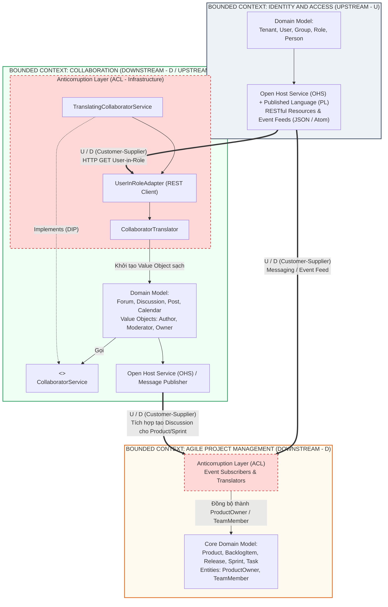
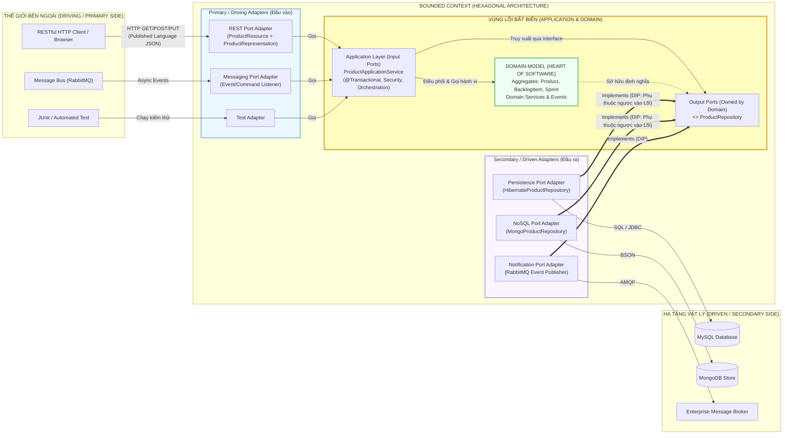

# ĐỢT 2 / 10: BÓC TÁCH CHUYÊN SÂU CHƯƠNG 3 & CHƯƠNG 4 (PHẦN 1)
**Sách:** *Implementing Domain-Driven Design (IDDD)* — **Tác giả:** *Vaughn Vernon*

---

## CHƯƠNG 3: CONTEXT MAPS (BẢN ĐỒ NGỮ CẢNH)

### 1. ĐỀ MỤC & MỤC TIÊU CỐT LÕI (CORE PURPOSE)

#### Hệ thống đề mục đầy đủ theo sách gốc:
* **Why Context Maps Are So Essential** (Tại sao Bản đồ Ngữ cảnh lại tối quan trọng)
  * *Drawing Context Maps* (Vẽ Bản đồ Ngữ cảnh)
  * *Projects and Organizational Relationships* (Các mối quan hệ Dự án và Tổ chức)
* **Mapping the Three Contexts** (Lập bản đồ cho Ba Ngữ cảnh của *SaaSOvation*)
  * *Integrating Collaboration Context and Identity and Access Context* (Tích hợp Ngữ cảnh Cộng tác và Ngữ cảnh Định danh & Truy cập)
  * *Integrating Agile Project Management Context and Identity and Access Context* (Tích hợp Ngữ cảnh Quản lý Dự án Agile và Ngữ cảnh Định danh & Truy cập)
  * *Integrating Agile Project Management Context and Collaboration Context* (Tích hợp Ngữ cảnh Quản lý Dự án Agile và Ngữ cảnh Cộng tác)
* **Wrap-Up** (Tổng kết)

#### Vấn đề kỹ thuật & nghiệp vụ cốt lõi và Thảm họa nếu không áp dụng:
* **Vấn đề giải quyết:** Sau khi Chương 2 đã chia hệ thống thành các *Bounded Contexts* độc lập, câu hỏi sống còn tiếp theo là: **Làm thế nào để các *Bounded Contexts* này giao tiếp và trao đổi dữ liệu với nhau mà không làm ô nhiễm mô hình nội tại (*Ubiquitous Language*) của nhau?** Chương 3 cung cấp bộ công cụ **Context Mapping** gồm 9 mẫu quan hệ tổ chức và tích hợp kỹ thuật giữa các ngữ cảnh Thượng nguồn (*Upstream*) và Hạ nguồn (*Downstream*).
* **Thảm họa kỹ thuật nếu không áp dụng:**
  1. **Sự lây lan của Quả cầu bùn lớn (*Bleeding of the Big Ball of Mud*):** Khi tích hợp với một hệ thống cũ hoặc một phân hệ khác mà không có Lớp Chống Tham Nhũng (*Anticorruption Layer - ACL*), các khái niệm méo mó, cấu trúc bảng dữ liệu hoặc DTO của hệ thống ngoài sẽ tràn thẳng vào giữa *Core Domain*, phá hủy mọi nỗ lực thiết kế hướng đối tượng.
  2. **Khớp nối chặt giữa các Đội ngũ & Hệ thống (*Organizational & Technical Tight Coupling*):** Hệ thống Hạ nguồn (*Downstream*) phụ thuộc mù quáng vào mô hình của Thượng nguồn (*Upstream*). Mỗi khi đội Thượng nguồn đổi tên một trường JSON hoặc sửa API, toàn bộ hệ thống Hạ nguồn sập dây chuyền.
  3. **Bế tắc giao tiếp liên đội (*Inter-team Friction*):** Không xác định rõ quan hệ *Customer-Supplier* (Khách hàng - Nhà cung cấp) hay *Conformist* (Kẻ tuân phục), dẫn đến việc đội làm *Core Domain* phải chờ đợi đội làm hệ thống phụ trong vô vọng mà không biết cách tự xây dựng cơ chế chuyển đổi độc lập.

---

### 2. PHÂN TÍCH LÝ THUYẾT & NGUYÊN LÝ CHUYÊN SÂU

#### A. Bản chất của *Context Map* và Quan hệ *Upstream / Downstream*
* **Context Map không phải là sơ đồ kiến trúc phần cứng (Topology Diagram):** Nó là sơ đồ phản ánh **thực tại hiện hữu (*As-Is Reality*)** của cả hai chiều: **biên giới kỹ thuật giữa các mô hình** và **mối quan hệ chính trị/tổ chức giữa các nhóm phát triển**.
* **Thượng nguồn (*Upstream - U*) & Hạ nguồn (*Downstream - D*):**
  * **Upstream (U):** Là phía cung cấp dữ liệu/dịch vụ. Hành động của đội *Upstream* (thay đổi API, lịch trình phát hành, cấu trúc sự kiện) ảnh hưởng trực tiếp đến sự sống còn của *Downstream*.
  * **Downstream (D):** Là phía phụ thuộc và tiêu thụ dữ liệu từ *Upstream*, nhưng không gây ảnh hưởng ngược lại cho mô hình của *Upstream*.

#### B. 9 Mẫu Quan hệ Tổ chức & Tích hợp trên *Context Map*
Vaughn Vernon hệ thống hóa đầy đủ các mẫu từ Eric Evans và bổ sung kinh nghiệm thực chiến:
1. **Partnership (Quan hệ Đối tác):** Hai nhóm ở hai *Bounded Context* cùng thành công hoặc cùng thất bại (thường phụ thuộc vào chung một mốc phát hành sản phẩm). Cả hai phải lập kế hoạch tích hợp song hành và điều chỉnh mô hình theo nhu cầu của nhau.
2. **Shared Kernel (Nhân Dùng Chung):** Hai nhóm chia sẻ một tập con nhỏ của *Domain Model* (code và database/schema). Việc sửa đổi *Shared Kernel* bắt buộc phải có sự đồng thuận và chạy bộ test chung của cả hai nhóm. *(Vernon cảnh báo: Rất dễ bị lạm dụng thành thùng rác chứa code chung, chỉ nên dùng cực kỳ hạn chế).*
3. **Customer-Supplier Development (Phát triển Khách hàng - Nhà cung cấp):** *Downstream* đóng vai trò **Khách hàng (*Customer*)**, *Upstream* đóng vai trò **Nhà cung cấp (*Supplier*)**. Đội *Downstream* có tiếng nói trọng lượng trong việc yêu cầu *Upstream* cung cấp dữ liệu gì, ưu tiên tính năng nào vào Backlog và cùng định nghĩa bộ kiểm thử chấp nhận tự động (*Automated Acceptance Tests*).
4. **Conformist (Kẻ Tuân Phục):** Khi *Upstream* không có động lực phục vụ *Downstream* (ví dụ: một API khổng lồ bên ngoài hoặc một nhóm nội bộ quá bận rộn), nhưng mô hình của *Upstream* lại **đủ tốt và tương thích**, đội *Downstream* chấp nhận "tuân phục" — bê nguyên xi mô hình khái niệm của *Upstream* vào hệ thống của mình mà không tốn công dịch thuật.
5. **Anticorruption Layer - ACL (Lớp Chống Tham Nhũng):** Vũ khí phòng thủ mạnh nhất của *Downstream*! Khi phải tích hợp với một *Upstream* có mô hình khác biệt hoàn toàn hoặc là một *Big Ball of Mud*, đội *Downstream* dựng lên một bức tường cô lập (gồm các *Facades*, *Adapters*, và *Translators*). ACL giao tiếp với *Upstream* bằng ngôn ngữ của *Upstream*, sau đó **dịch (*Translate*)** hoàn toàn sang các *Entities / Value Objects* thuần khiết thuộc *Ubiquitous Language* của *Downstream*.
6. **Open Host Service - OHS (Dịch vụ Chủ Mở):** Khi một *Bounded Context* ở phía *Upstream* cần phục vụ cho hàng loạt hệ thống *Downstream* khác nhau, thay vì bắt mỗi nơi tự kết nối lắt nhắt, *Upstream* định nghĩa một giao thức/bộ API mở chuẩn hóa (dưới dạng RESTful Resources, RPC, hoặc Messaging Endpoints) để mọi hệ thống dễ dàng tích hợp.
7. **Published Language - PL (Ngôn ngữ Xuất Bản):** Thường đi cặp với *Open Host Service* (**OHS/PL**). Là một định dạng trao đổi thông tin chuẩn hóa, được tài liệu hóa rõ ràng và trung lập (như XML Schema, JSON Schema, Google Protocol Buffers, Atom Feeds, hoặc chuẩn ngành tài chính/y tế) để truyền tải dữ liệu và *Domain Events* qua mạng.
8. **Separate Ways (Đường Ai Nấy Đi):** Khi chi phí tích hợp giữa hai *Bounded Contexts* quá đắt đỏ mà giá trị nghiệp vụ thu lại không đáng kể, hai hệ thống quyết định cắt đứt mọi liên kết kỹ thuật, chấp nhận tự sinh dữ liệu hoặc để người dùng nhập tay ở hai nơi.
9. **Big Ball of Mud (Quả Cầu Bùn Lớn):** Hệ thống di sản nơi các mô hình bị trộn lẫn không còn biên giới, thay đổi một chỗ làm hỏng mười chỗ khác. Trên *Context Map*, ta phải khoanh vùng nó và tuyệt đối dùng **ACL** khi bắt buộc phải giao tiếp với nó.

#### C. Giải phẫu Bản đồ 3 Ngữ cảnh của *SaaSOvation*
Trong dự án thực tế của sách:
* **`Identity and Access Context` (Upstream - U)** cung cấp dịch vụ định danh thông qua **Open Host Service (OHS)** kết hợp **Published Language (PL)** (xuất bản RESTful Resources và *Domain Events* dưới dạng Atom Feeds / Messaging).
* **`Collaboration Context` (Downstream - D so với IAM, nhưng là Upstream - U so với AgilePM):**
  * Khi lấy thông tin người dùng từ `Identity and Access Context`, đội `Collaboration` thiết kế một **Anticorruption Layer (ACL)** tinh gọn đặt ẩn sau một `CollaboratorService` (Domain Service). ACL này gọi sang OHS của IAM, nhận về thông tin `User` và `Role`, rồi dịch ngay lập tức thành các Value Objects `Author`, `Moderator`, `Owner`, `Participant`.
* **`Agile Project Management Context` (Downstream - D so với cả IAM và Collaboration):**
  * Giao tiếp với `Identity and Access Context` qua Messaging để đồng bộ thông tin thành viên dự án thành `ProductOwner` và `TeamMember`.
  * Giao tiếp với `Collaboration Context` theo quan hệ **Customer-Supplier** (hoặc sự kiện bất đồng bộ): khi một `Product` hoặc `Sprint` mới được tạo trong `AgilePM`, nó gửi yêu cầu sang `Collaboration Context` để tự động khởi tạo một `Forum` và `Discussion` thảo luận cho sản phẩm đó!

---

### 3. MỔ XẺ MÃ NGUỒN & CẤU TRÚC THIẾT KẾ (CODE DEEP-DIVE)

Chương 3 (kết hợp chi tiết hiện thực hóa tại trang 95–110 và liên kết đến `UserInRoleAdapter`) minh họa cách thiết kế **Anticorruption Layer (ACL)** để dịch khái niệm từ `Identity and Access Context` (Upstream) sang `Collaboration Context` (Downstream) mà không làm bẩn Domain Model.

#### ❌ Thiết kế SAI BAN ĐẦU: Rò rỉ mô hình Thượng nguồn (*Upstream Leakage*) vào Hạ nguồn
```java
package com.saasovation.collaboration.application;

// SAI LẦM: Collaboration Context import trực tiếp class của IdentityAccess Context!
import com.saasovation.identityaccess.domain.model.identity.User;
import com.saasovation.identityaccess.domain.model.access.Role;

public class ForumApplicationService {
    public void startDiscussion(String aTenantId, String aForumId, String aUsername, String aSubject) {
        // Chọc thẳng sang Repository hoặc API của IdentityAccess và mang đối tượng ngoại lai về
        User user = identityAccessClient.getUser(aTenantId, aUsername);
        Role role = identityAccessClient.getRole(aTenantId, "ForumAuthor");
        
        if (!role.isInRole(user)) {
            throw new SecurityException("User cannot author discussions.");
        }
        
        Forum forum = forumRepository.forumOfId(new TenantId(aTenantId), new ForumId(aForumId));
        // Truyền thẳng đối tượng User của hệ thống bảo mật vào mô hình Diễn đàn!
        forum.startDiscussion(user, aSubject); 
    }
}
```

#### ✅ Thiết kế CHUẨN MỰC SAU REFACTOR: Cô lập hoàn toàn bằng *Domain Service Interface* + *Anticorruption Layer (Adapter + Translator)*

```java
// ============================================================================
// 1. TẦNG DOMAIN MODEL (COLLABORATION CONTEXT - DOWNSTREAM)
// Package: com.saasovation.collaboration.domain.model.collaborator
// Giao diện thuộc về Ubiquitous Language của Collaboration, hoàn toàn mù tịt về IAM!
// ============================================================================
public interface CollaboratorService {
    public Author authorFrom(Tenant aTenant, String anIdentity);
    public Creator creatorFrom(Tenant aTenant, String anIdentity);
    public Moderator moderatorFrom(Tenant aTenant, String anIdentity);
    public Owner ownerFrom(Tenant aTenant, String anIdentity);
    public Participant participantFrom(Tenant aTenant, String anIdentity);
}

// ============================================================================
// 2. TẦNG INFRASTRUCTURE: ANTICORRUPTION LAYER (ACL)
// Package: com.saasovation.collaboration.infrastructure.services
// Đóng vai trò Adapter & Translator nối với Open Host Service (OHS) của IAM
// ============================================================================
public class TranslatingCollaboratorService implements CollaboratorService {

    private UserInRoleAdapter userInRoleAdapter; // Adapter giao tiếp mạng với IAM

    public TranslatingCollaboratorService(UserInRoleAdapter aUserInRoleAdapter) {
        super();
        this.userInRoleAdapter = aUserInRoleAdapter;
    }

    @Override
    public Author authorFrom(Tenant aTenant, String anIdentity) {
        Author author =
            this.userInRoleAdapter()
                .toCollaborator(
                    aTenant,
                    anIdentity,
                    "Author",       // Tên Role cần kiểm tra bên IAM
                    Author.class);  // Kiểu Value Object đích cần dịch ra
        return author;
    }

    @Override
    public Moderator moderatorFrom(Tenant aTenant, String anIdentity) {
        Moderator moderator =
            this.userInRoleAdapter()
                .toCollaborator(
                    aTenant,
                    anIdentity,
                    "Moderator",
                    Moderator.class);
        return moderator;
    }
    // ... Tương tự cho Creator, Owner, Participant
}

// ============================================================================
// 3. TRANSLATOR NỘI BỘ BÊN TRONG ACL
// Chuyển đổi Published Language (JSON/Representations từ IAM) thành Value Object
// ============================================================================
public class CollaboratorTranslator {

    public <T extends Collaborator> T toCollaboratorFromRepresentation(
        String aUserInRoleRepresentation,
        Class<T> aCollaboratorClass) throws Exception {

        RepresentationReader reader = new RepresentationReader(aUserInRoleRepresentation);

        String username = reader.stringValue("username");
        String firstName = reader.stringValue("firstName");
        String lastName = reader.stringValue("lastName");
        String emailAddress = reader.stringValue("emailAddress");

        String name = (firstName + " " + lastName).trim();

        // Dùng Reflection hoặc Factory khởi tạo đúng Value Object (Author, Moderator...)
        Constructor<T> ctor = aCollaboratorClass.getConstructor(
            String.class, String.class, String.class);

        return ctor.newInstance(username, name, emailAddress);
    }
}
```

#### Bảng phân tích kỹ thuật & Ý nghĩa thiết kế:

| Dòng code / Đoạn code then chốt | Giải thích kỹ thuật & Nguyên lý thiết kế (DDD/OOP) được hiện thực hóa |
| :--- | :--- |
| `public interface CollaboratorService` | **Separated Interface (Giao diện tách biệt) & Dependency Inversion:** Đặt interface ngay trong package `domain.model.collaborator` của `Collaboration Context`. Phương thức `authorFrom(Tenant, String)` chỉ sử dụng các khái niệm nội tại của ngữ cảnh Cộng tác, giúp Domain Model không phụ thuộc vào bất kỳ thư viện mạng hay hệ thống ngoại vi nào. |
| `public class TranslatingCollaboratorService implements CollaboratorService` | **Anticorruption Layer (ACL) Facade:** Lớp cài đặt thực tế nằm ở tầng `infrastructure.services`. Đây là chốt chặn biên giới: bên trên nó nói ngôn ngữ của `Collaboration Context`, bên dưới nó ủy quyền cho `UserInRoleAdapter` để nói chuyện với `Identity and Access Context`. |
| `this.userInRoleAdapter().toCollaborator(aTenant, anIdentity, "Author", Author.class)` | **Mẫu Adapter trong ACL:** Đóng gói toàn bộ chi tiết kỹ thuật gọi HTTP REST đến *Open Host Service* của `Identity and Access Context` (ví dụ: `GET /tenants/{tenantId}/users/{username}/inRole/Author`). Nếu hệ thống IAM đổi từ REST sang gRPC hay Database, chỉ cần sửa `UserInRoleAdapter`, mô hình `Forum` không hề hay biết. |
| `public class CollaboratorTranslator` | **Mẫu Translator chuyển đổi *Published Language*:** Nhận chuỗi JSON (`aUserInRoleRepresentation` - *Published Language* của IAM), bóc tách các trường dữ liệu thô (`firstName`, `lastName`) và lắp ghép thành thuộc tính `name` phù hợp với cấu trúc hàm khởi tạo của Value Object `Author(username, name, emailAddress)`. |

---

### 4. SƠ ĐỒ TRỰC QUAN HÓA (BẮT BUỘC MÃ MERMAID)

Sơ đồ dưới đây tái hiện chính xác **Context Map tổng thể của 3 Bounded Contexts trong *SaaSOvation*** cùng luồng hoạt động bên trong **Anticorruption Layer (ACL)**:



---

### 5. ÁNH XẠ ỨNG DỤNG VÀO DỰ ÁN GAME 2.5D OOP MULTIPLAYER

Trong kiến trúc dự án Game 2.5D OOP nhiều người chơi (như cấu trúc `core`, `combat`, `network`, `server`, `persistence` của nhóm):

1. **Dựng *Anticorruption Layer (ACL)* giữa `Network/Server Context` và `Real-Time Combat Context`:**
   * *Thảm họa nếu thiếu ACL:* Các gói tin mạng (`Packet`, `ByteBuffer`, `SocketChannel` hoặc chuỗi JSON `SnapshotDTO`) từ tầng `network` truyền thẳng vào bên trong class `Hero` hoặc `CombatManager`. Hệ quả là mô hình chiến đấu bị trói chặt vào định dạng gói tin mạng; khi đổi giao thức truyền tải (ví dụ tối ưu hóa từ chuỗi Text sang Binary Bitpacking), toàn bộ code chiến đấu bị lỗi!
   * *Áp dụng Chương 3:* Thiết lập quan hệ trên *Context Map*: Tầng `network` sử dụng **Published Language (PL)** là cấu trúc gói tin nhị phân/chuỗi phẳng. Ở biên giới đi vào `combat`, ta đặt một **ACL (`NetworkPacketTranslator` / `CombatCommandAdapter`)** chuyển đổi gói tin thô thành các đối tượng miền thuần khiết: `MoveIntent(DirectionVector)`, `CastSkillCommand(SkillSlot, AimAngle)`, hoặc `DamageEvent`.
2. **Dựng *ACL* bảo vệ `Core/Combat` khỏi thư viện Đồ họa AWT/Swing (`Render Context`):**
   * Đúng như hiến chương kiến trúc của dự án (*"Cấm `import java.awt.*` vào `core/combat/network/server/persistence`"*): `Render Context` (2.5D Renderer) là **Downstream (Conformist hoặc Customer)** đọc trạng thái của `Core/Combat` (Upstream). Trong `Core/Combat`, vị trí và khung va chạm chỉ được mô hình hóa bằng Value Objects toán học thuần khiết của miền (`Vector25D`, `BoundingBox`), tuyệt đối không dùng `java.awt.Rectangle` hay `java.awt.image.BufferedImage`. Tầng `Render` sẽ tự có `SpriteAdapter` ánh xạ tọa độ `(x, y, z)` của miền sang tọa độ điểm ảnh `(screenX, screenY)` và thứ tự vẽ (`Z-Index`).

---
---

## CHƯƠNG 4 (PHẦN 1): ARCHITECTURE — LAYERS, DIP, HEXAGONAL, SOA, REST (KIẾN TRÚC HỆ THỐNG - PHẦN 1)

### 1. ĐỀ MỤC & MỤC TIÊU CỐT LÕI (CORE PURPOSE)

#### Hệ thống đề mục đầy đủ theo sách gốc (Nửa đầu Chương 4 - Trang 113–138):
* **Interviewing the Successful CIO** (Phỏng vấn vị CIO thành công — Bối cảnh lựa chọn kiến trúc thực dụng)
* **Layers** (Kiến trúc Phân tầng truyền thống)
  * *Dependency Inversion Principle* (Nguyên lý Đảo ngược Phụ thuộc - DIP)
* **Hexagonal or Ports and Adapters** (Kiến trúc Lục giác hay Cổng và Bộ chuyển đổi)
* **Service-Oriented** (Kiến trúc Hướng Dịch vụ - SOA)
* **Representational State Transfer—REST** (Chuyển giao Trạng thái Đại diện - REST)
  * *REST as an Architectural Style* (REST như một Phong cách Kiến trúc)
  * *Key Aspects of a RESTful HTTP Server* (Các khía cạnh then chốt của một Máy chủ HTTP chuẩn REST)
  * *Key Aspects of a RESTful HTTP Client* (Các khía cạnh then chốt của một Máy khách HTTP chuẩn REST)
  * *REST and DDD* (Kết hợp REST và DDD)
  * *Why REST?* (Tại sao lại chọn REST?)

#### Vấn đề kỹ thuật & nghiệp vụ cốt lõi và Thảm họa nếu không áp dụng:
* **Vấn đề giải quyết:** Một *Domain Model* dù được thiết kế tinh xảo đến đâu cũng không thể sống lơ lửng trong chân không; nó cần một ngôi nhà kiến trúc (*Architectural Housing*) bao bọc để giao tiếp với người dùng, cơ sở dữ liệu và các hệ thống từ xa. Phần 1 của Chương 4 giải quyết bài toán: **Làm sao để kết nối Domain Model với thế giới bên ngoài (UI, Database, Web API) mà vẫn giữ cho Domain Model hoàn toàn trung lập và độc lập về mặt kiến trúc (*Architecturally Neutral Domain Model*)?**
* **Thảm họa kỹ thuật nếu không áp dụng:**
  1. **Sự phụ thuộc từ trên xuống truyền thống (*Top-Down Infrastructure Coupling*):** Trong kiến trúc 4 tầng cổ điển (UI $\rightarrow$ Application $\rightarrow$ Domain $\rightarrow$ Infrastructure), tầng *Domain* gọi trực tiếp xuống tầng *Infrastructure* (Database, ORM, Messaging). Hậu quả: Không thể chạy Unit Test cho *Domain Model* nếu không bật Database Server; công nghệ lưu trữ rò rỉ làm biến dạng thiết kế đối tượng.
  2. **Biến chất REST thành RPC qua HTTP (*RPC-over-HTTP Anti-pattern*) và Rò rỉ Mô hình Miền ra ngoài API:** Lập trình viên phơi bày trực tiếp các bảng dữ liệu hoặc *Domain Entities* nội bộ ra ngoài qua các hàm REST tự chế kiểu `/api/updateProductStatus`, tạo ra sự kết dính chặt chẽ (*Tight Coupling*) giữa mọi Client bên ngoài với cấu trúc bên trong của *Domain Model*. Khi Refactor một class trong *Domain Model*, hàng loạt ứng dụng Client bị sập!

---

### 2. PHÂN TÍCH LÝ THUYẾT & NGUYÊN LÝ CHUYÊN SÂU

#### A. Kiến trúc Phân tầng (*Layers Architecture*) & Bước ngoặt *Dependency Inversion Principle (DIP)*
1. **4 Tầng cổ điển trong DDD:**
   * **User Interface (Presentation Layer):** Hiển thị thông tin và tiếp nhận thao tác của người dùng (hoặc hệ thống ngoài).
   * **Application Layer:** Tầng điều phối mỏng (*Thin Orchestration Layer*). **Không chứa quy tắc nghiệp vụ (*No Business Logic*)!** Nhiệm vụ của nó là quản lý giao dịch (*Transactions*), kiểm tra bảo mật cấp ứng dụng, nạp *Aggregate* từ *Repository*, gọi phương thức hành vi trên *Aggregate*, và lưu lại.
   * **Domain Layer (Model):** Trái tim của phần mềm — chứa *Entities, Value Objects, Aggregates, Domain Services, Domain Events*.
   * **Infrastructure Layer:** Cung cấp năng lực kỹ thuật (Database ORM, gửi Message, gửi Email, gọi REST).
2. **Strict vs. Relaxed Layers & Cú lật ngược bằng DIP (Robert C. Martin):**
   * Trong phân tầng cổ điển, *Domain Layer* phụ thuộc vào *Infrastructure Layer*.
   * Khi áp dụng **Dependency Inversion Principle (DIP)**: *"Các module cấp cao không được phụ thuộc vào các module cấp thấp; cả hai phải phụ thuộc vào sự trừu tượng (Abstractions). Sự trừu tượng không được phụ thuộc vào chi tiết; chi tiết phải phụ thuộc vào sự trừu tượng."*
   * **Cách thực hiện trong DDD:** Mọi giao diện kho lưu trữ (*Repository Interfaces*, ví dụ `ProductRepository`) và dịch vụ miền (*Domain Service Interfaces*) đều được định nghĩa và thuộc sở hữu của **Domain Layer**. Tầng **Infrastructure** (ví dụ `HibernateProductRepository`) phải hướng mũi tên phụ thuộc **ngược lên trên** để thực thi (`implements`) các giao diện của *Domain Layer*! Thực chất, khi đã áp dụng DIP triệt để, *Domain Layer* nằm ở vị trí trung tâm/đáy độc lập hoàn toàn, còn *Infrastructure* trở thành tầng ngoài cùng phụ thuộc vào *Domain*.

#### B. Kiến trúc Lục giác (*Hexagonal Architecture* hay *Ports and Adapters* - Alistair Cockburn)
Vaughn Vernon khẳng định **Hexagonal Architecture** là mô hình miêu tả chính xác và ưu việt hơn hẳn *Layers Architecture* cho DDD:
* **Cấu trúc đồng tâm (Inside vs. Outside):**
  * **Vùng Lõi Bên Trong (*Inside*):** Gồm **Domain Model** ở chính giữa và **Application Layer** bao quanh. Vùng lõi này hoàn toàn tinh khiết, không chứa bất kỳ dòng code công nghệ ngoại vi nào.
  * **Vùng Bên Ngoài (*Outside*):** Thế giới hạ tầng, UI, Web, Database, Messaging Queue.
* **Cơ chế *Ports* (Cổng) và *Adapters* (Bộ chuyển đổi):**
  * **Port (Cổng):** Là quy ước/giao diện giao tiếp (chính là các API của *Application Service*, hoặc các *Repository Interfaces* của *Domain*).
  * **Primary / Driving Adapters (Bộ chuyển đổi chủ động - Đầu vào):** Đón nhận tín hiệu từ thế giới bên ngoài (HTTP Request từ trình duyệt, REST Client, hoặc Message từ RabbitMQ/ActiveMQ) và chuyển đổi thành lời gọi vào *Application Service* (Ví dụ: `ProductResource` dùng JAX-RS là một HTTP Adapter).
  * **Secondary / Driven Adapters (Bộ chuyển đổi bị động - Đầu ra):** Thực thi các *Ports* do vùng lõi yêu cầu để tương tác với cơ sở dữ liệu (MySQL/Hibernate Adapter, MongoDB Adapter) hoặc phát thông điệp ra ngoài.
* **Lợi ích tuyệt đối:** Bạn có thể tháo một *Adapter* giao diện Web ra và cắm một *Adapter* dòng lệnh (CLI) hoặc bộ *Automated Test Adapter* vào mà không phải sửa một dấu chấm phẩy nào trong *Application* và *Domain Model*!

#### C. Kiến trúc Hướng Dịch vụ (*Service-Oriented Architecture - SOA*) và DDD
* Vernon trích dẫn *SOA Manifesto*: Tư duy SOA chân chính ưu tiên **Giá trị kinh doanh hơn chiến lược kỹ thuật (*Business value over technical strategy*)** và **Tính tự trị hơn sự tập trung hóa (*Autonomy over centralization*)**.
* **Sự cộng hưởng giữa SOA và DDD:** Mỗi *Bounded Context* trong DDD chính là biên giới tự nhiên hoàn hảo để đóng gói một hoặc một nhóm **Business Services** có tính tự trị cao trong SOA, tránh được sai lầm biến SOA thành một mớ các hàm kỹ thuật nhỏ lẻ (*Fine-grained technical RPC endpoints*).

#### D. REST (*Representational State Transfer*) và Nghệ thuật Kết hợp với DDD
Phần này (được đóng góp chuyên sâu cùng chuyên gia Stefan Tilkov) giải quyết hiểu lầm tai hại nhất về REST trong DDD:
1. **4 Trụ cột của REST (Roy Fielding):**
   * Mọi thứ đều là **Tài nguyên (*Resources*)** được định danh bằng **URI** duy nhất.
   * Sử dụng **Giao diện đồng nhất (*Uniform Interface*)** với các động từ HTTP chuẩn (`GET`, `POST`, `PUT`, `DELETE`) và mã trạng thái HTTP chuẩn (`200 OK`, `201 Created`, `400 Bad Request`, `404 Not Found`, `409 Conflict`), chú trọng tính lũy đẳng (*Idempotency* của `GET`, `PUT`, `DELETE`).
   * Định dạng biểu diễn trung gian chuẩn hóa (**Media Types** như `application/json`, `application/vnd.saasovation+xml`).
   * **HATEOAS (*Hypermedia as the Engine of Application State*):** Các phản hồi từ Server chứa các liên kết (*Hypermedia Links*) dẫn dắt Client sang các trạng thái hợp lệ tiếp theo.
2. **Nguyên lý vàng khi kết hợp REST và DDD (Tại trang 136–138):**
   * **TUYỆT ĐỐI KHÔNG phơi bày trực tiếp các *Aggregates* của *Domain Model* thành các *REST Resources* 1-đối-1!**
   * *Tại sao?* Nếu bạn ánh xạ thẳng cấu trúc nội tại của `Product` Aggregate ra REST Resource, mọi sự tinh chỉnh (*Refactoring*) bên trong *Domain Model* sẽ làm gãy vỡ hợp đồng giao tiếp (*Contract*) với tất cả REST Clients bên ngoài!
   * **Giải pháp chuẩn DDD:** Hãy tạo một mô hình **Tài nguyên Truyền thông riêng biệt (*Separate Synthetic / Published Language Resources*)** ở tầng *Adapter* (dùng cho *Open Host Service*). Các *REST Resources* này phản ánh các kịch bản sử dụng (*Use Cases*) của Client, và bên dưới mới ủy quyền cho *Application Services* thao tác lên *Domain Model*.

---

### 3. MỔ XẺ MÃ NGUỒN & CẤU TRÚC THIẾT KẾ (CODE DEEP-DIVE)

Chúng ta sẽ mổ xẻ cách hiện thực hóa **Dependency Inversion Principle (DIP)** kết hợp với **Hexagonal Adapter cho RESTful HTTP (JAX-RS)** được trình bày trong Chương 4 (trang 121–129).

#### ❌ Thiết kế SAI BAN ĐẦU: Domain phụ thuộc vào Infrastructure & Phơi bày trực tiếp Domain Entity qua Web
```java
// 1. SAI LẦM: Domain Service hoặc Application Service khởi tạo trực tiếp lớp hạ tầng Hibernate!
package com.saasovation.agilepm.domain.model.product;
import com.saasovation.agilepm.infrastructure.persistence.HibernateProductRepository; // Vi phạm DIP!

public class ProductService {
    private HibernateProductRepository repository = new HibernateProductRepository();
    // ...
}

// 2. SAI LẦM: Trả trực tiếp Domain Aggregate Root ra ngoài REST API khiến cấu trúc nội bộ bị lộ!
@Path("/products")
public class BadProductController {
    @GET
    @Path("/{id}")
    @Produces(MediaType.APPLICATION_JSON)
    public Product getProductDirectly(@PathParam("id") String id) {
        // Khi serialize thẳng đối tượng Product sang JSON, mọi trường nội bộ đều bị phơi bày
        // Nếu đổi tên biến bên trong Product, mọi Client gọi API này sẽ sập!
        return productRepository.productOfId(new ProductId(id)); 
    }
}
```

#### ✅ Thiết kế CHUẨN MỰC SAU REFACTOR: Đảo ngược Phụ thuộc (DIP) & Cổng/Bộ chuyển đổi Lục giác (Hexagonal Port & Adapter)

```java
// ============================================================================
// 1. VÙNG LÕI: DOMAIN LAYER (Sở hữu Port Interface - Không phụ thuộc hạ tầng)
// Package: com.saasovation.agilepm.domain.model.product
// ============================================================================
public interface ProductRepository {
    public Product productOfId(TenantId aTenantId, ProductId aProductId);
    public void save(Product aProduct);
    // Chỉ sử dụng các kiểu dữ liệu thuần khiết của Domain Model
}

// ============================================================================
// 2. VÙNG NGOÀI (DRIVEN ADAPTER): INFRASTRUCTURE LAYER
// Package: com.saasovation.agilepm.infrastructure.persistence
// Phụ thuộc ngược vào Domain Layer theo đúng nguyên lý DIP
// ============================================================================
import com.saasovation.agilepm.domain.model.product.Product;
import com.saasovation.agilepm.domain.model.product.ProductId;
import com.saasovation.agilepm.domain.model.product.ProductRepository;
import com.saasovation.agilepm.domain.model.tenant.TenantId;

public class HibernateProductRepository implements ProductRepository {
    private SessionFactory sessionFactory;

    @Override
    public Product productOfId(TenantId aTenantId, ProductId aProductId) {
        Query query = this.session().createQuery(
            "from Product as _obj_ where _obj_.tenantId = ? and _obj_.productId = ?");
        query.setParameter(0, aTenantId);
        query.setParameter(1, aProductId);
        return (Product) query.uniqueResult();
    }

    @Override
    public void save(Product aProduct) {
        this.session().saveOrUpdate(aProduct);
    }
}

// ============================================================================
// 3. VÙNG NGOÀI (DRIVING ADAPTER): RESTful HTTP ADAPTER (JAX-RS Port Adapter)
// Package: com.saasovation.agilepm.port.adapter.rest
// Chuyển đổi yêu cầu HTTP thành lời gọi vào Application Service và trả về Published Language
// ============================================================================
@Path("/tenants/{tenantId}/products")
public class ProductResource {

    private ProductApplicationService productApplicationService;

    @GET
    @Path("/{productId}")
    @Produces({ "application/vnd.saasovation.projectovation+json" })
    public Response getProduct(
        @PathParam("tenantId") String aTenantId,
        @PathParam("productId") String aProductId,
        @Context Request aRequest) {

        Product product =
            this.productApplicationService()
                .product(aTenantId, aProductId);

        if (product == null) {
            throw new WebApplicationException(Response.Status.NOT_FOUND);
        }

        Response response = this.buildProductResponse(aRequest, product);
        return response;
    }

    private Response buildProductResponse(Request aRequest, Product aProduct) {
        // Kiểm tra bộ nhớ đệm HTTP (Conditional GET với EntityTag / Version của Aggregate)
        EntityTag etag = this.productEntityTag(aProduct);
        ResponseBuilder conditionalBuilder = aRequest.evaluatePreconditions(etag);

        if (conditionalBuilder != null) {
            return conditionalBuilder.build(); // Trả về HTTP 304 Not Modified
        }

        // Chuyển đổi sang đối tượng đại diện độc lập (Representation - Published Language)
        // Bảo vệ Domain Model khỏi bị phơi bày trực tiếp!
        Object serializer = ObjectSerializer.instance();
        String representation = serializer.serialize(new ProductRepresentation(aProduct));

        Response response =
            Response.ok(representation)
                    .tag(etag)
                    .build();

        return response;
    }
}
```

#### Bảng phân tích kỹ thuật & Ý nghĩa thiết kế:

| Dòng code / Đoạn code then chốt | Giải thích kỹ thuật & Nguyên lý thiết kế (DDD/OOP) được hiện thực hóa |
| :--- | :--- |
| `package com.saasovation.agilepm.domain.model.product;` <br> `public interface ProductRepository` | **Nguyên lý Đảo ngược Phụ thuộc (*Dependency Inversion Principle - DIP*):** Giao diện `ProductRepository` nằm ngay trong gói `domain.model.product` chứ không nằm ở gói `infrastructure`. Điều này khẳng định *Domain Layer* là người đặt ra luật chơi (Port), còn công nghệ lưu trữ chỉ là kẻ phục vụ. |
| `public class HibernateProductRepository implements ProductRepository` | **Secondary / Driven Adapter (Bộ chuyển đổi đầu ra):** Nằm ở tầng hạ tầng, đóng gói toàn bộ sự phức tạp của thư viện Hibernate (`SessionFactory`, câu truy vấn HQL). Khi chạy Unit Test cho Domain/Application, ta dễ dàng thay thế lớp này bằng `InMemoryProductRepository` chỉ mất 1 mili-giây để chạy. |
| `package com.saasovation.agilepm.port.adapter.rest;` <br> `public class ProductResource` | **Primary / Driving Adapter trong *Hexagonal Architecture*:** Tên package `.port.adapter.rest` thể hiện rõ kiến trúc Lục giác. Lớp này đóng vai trò một *Adapter* chuyển đổi giao thức HTTP/REST thành lời gọi hàm Java tới `ProductApplicationService`. |
| `@Produces({ "application/vnd.saasovation.projectovation+json" })` | **Vendor-Specific Media Type (*Published Language*):** Thay vì dùng `application/json` chung chung, việc định nghĩa Media Type riêng của doanh nghiệp giúp định danh rõ hợp đồng dữ liệu (*Published Language*) của *Open Host Service* và hỗ trợ quản lý phiên bản (*Versioning*) dễ dàng. |
| `EntityTag etag = this.productEntityTag(aProduct);` <br> `aRequest.evaluatePreconditions(etag);` | **Tận dụng tối đa sức mạnh của HTTP REST & Concurrency Version:** Kết hợp thuộc tính `concurrencyVersion` của DDD Aggregate để tạo `ETag` chuẩn HTTP. Nếu dữ liệu `Product` chưa thay đổi, Server lập tức trả về mã `304 Not Modified`, tiết kiệm băng thông mạng và tải xử lý. |
| `new ProductRepresentation(aProduct)` | **Tách biệt Tài nguyên REST khỏi Domain Model (*Decoupling Representation from Domain*):** Thay vì serialize thẳng thực thể `Product`, Adapter bọc nó qua lớp `ProductRepresentation`. Nếu ngày mai lập trình viên tách hoặc đổi tên thuộc tính bên trong `Product`, chỉ cần cập nhật hàm khởi tạo của `ProductRepresentation` để giữ nguyên định dạng JSON trả về cho các Client bên ngoài. |

---

### 4. SƠ ĐỒ TRỰC QUAN HÓA (BẮT BUỘC MÃ MERMAID)

Sơ đồ dưới đây kết hợp hai tư tưởng lớn nhất của Chương 4 (Phần 1): **Sự đảo chiều mũi tên phụ thuộc nhờ DIP** và **Kiến trúc Lục giác (Hexagonal / Ports and Adapters)** bao quanh *Domain Model*:



---

### 5. ÁNH XẠ ỨNG DỤNG VÀO DỰ ÁN GAME 2.5D OOP MULTIPLAYER

Kiến trúc Lục giác (*Hexagonal Architecture*) và *Dependency Inversion Principle (DIP)* trong Chương 4 chính là kim chỉ nam cho kiến trúc phân tầng của dự án Game 2.5D OOP nhiều người chơi của bạn:

1. **Biến `Core/Combat` thành trung tâm của Kiến trúc Lục giác (Hexagonal Core):**
   * **Vùng Lõi (*Inside Hexagon*):** Các package `core` và `combat` (chứa các thực thể nhân vật, 6 loại Mobs, 4 hệ nhân vật, quy tắc thu hẹp Vòng bo, máy trạng thái FSM) nằm ở trung tâm tuyệt đối. Chúng **không biết** màn hình hiển thị bằng thư viện `java.awt.Graphics2D` trên PC hay `android.graphics.Canvas` trên Mobile (`Android_Game`), và cũng **không biết** dữ liệu truyền qua mạng bằng Socket TCP/UDP hay chạy Offline một người chơi!
   * **Driving Adapters (Đầu vào):**
     * `KeyboardMouseInputAdapter` (PC) hoặc `TouchJoystickAdapter` (Android): Đọc sự kiện phần cứng và dịch thành các lệnh chuẩn gọi vào cổng đầu vào (`GameMatchApplicationService`).
     * `NetworkServerTickAdapter`: Nhận gói tin điều khiển từ nhiều người chơi qua mạng 4G/LAN và bơm vào vòng lặp xử lý của Server.
   * **Driven Adapters (Đầu ra - Áp dụng DIP):**
     * Trong `core/combat`, ta định nghĩa các Output Ports như `interface MatchStateBroadcaster` hoặc `interface MapConfigRepository`.
     * Ở tầng ngoài (`server`, `persistence`, `render`), các lớp `UdpSnapshotBroadcaster`, `JsonMapConfigLoader`, và `AwtIsometricRenderer` sẽ `implements` các interface đó.
2. **Lợi ích thực chiến cho Kiểm thử Tự động (Bộ Test 15/15 của dự án) & Đa nền tảng (PC + Android):**
   * Nhờ áp dụng **Hexagonal Architecture + DIP**, bạn có thể dùng chung **100% mã nguồn `core` và `combat`** cho cả bản PC (`Src_Game`) lẫn bản Mobile (`Android_Game`).
   * Khi chạy bộ kiểm thử tự động (`Tests` ở chế độ Headless không có màn hình đồ họa và không cần mở cổng mạng thật), bộ Test chỉ cần cắm các `Mock/InMemory Adapters` vào vùng lõi để kiểm tra toàn bộ logic chiến đấu, sát thương vòng bo, và AI của Bot với tốc độ hàng nghìn kịch bản mỗi giây!
