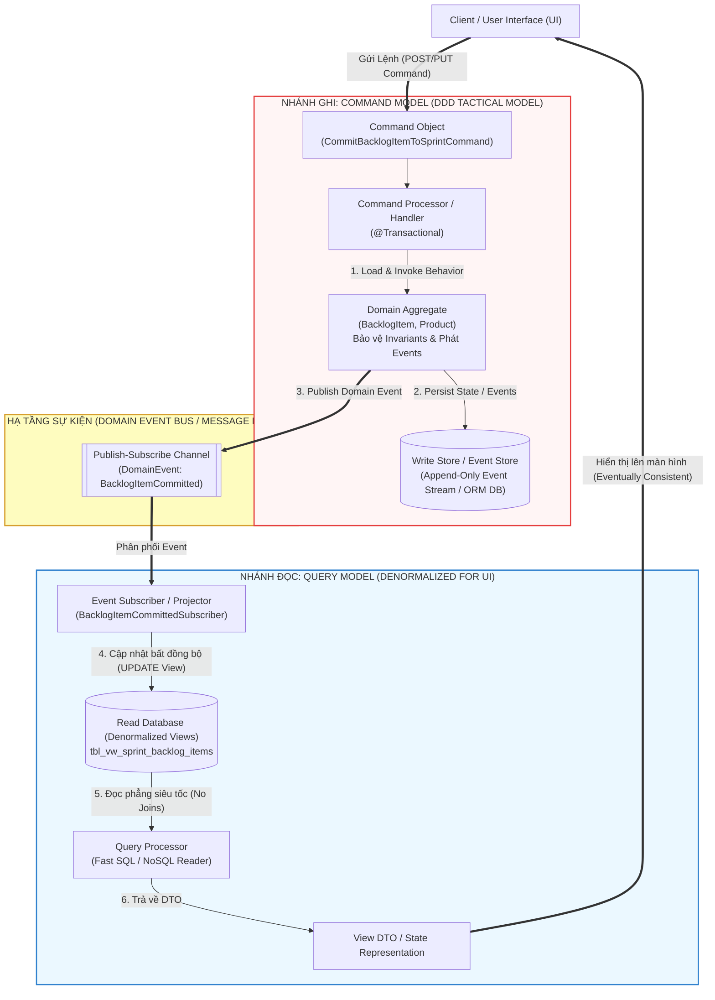
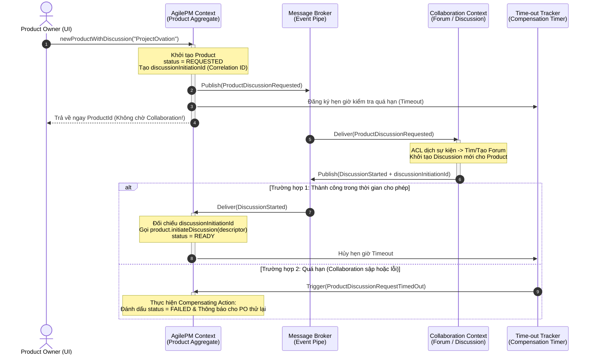

# ĐỢT 3 / 10: BÓC TÁCH CHUYÊN SÂU CHƯƠNG 4 (PHẦN 2)
**Sách:** *Implementing Domain-Driven Design (IDDD)* — **Tác giả:** *Vaughn Vernon*

---

## CHƯƠNG 4 (PHẦN 2): ARCHITECTURE — CQRS, EVENT-DRIVEN ARCHITECTURE, SAGAS, EVENT SOURCING, DATA FABRIC (KIẾN TRÚC HỆ THỐNG - PHẦN 2)

### 1. ĐỀ MỤC & MỤC TIÊU CỐT LÕI (CORE PURPOSE)

#### Hệ thống đề mục đầy đủ theo sách gốc (Nửa sau Chương 4 - Trang 138–169):
* **Command-Query Responsibility Segregation, or CQRS** (Phân tách Trách nhiệm Lệnh - Truy vấn, hay CQRS)
  * *Examining Areas of CQRS* (Khảo sát các vùng thành phần của CQRS)
    * *The Client and Query Processor* (Máy khách và Bộ xử lý Truy vấn)
    * *The Query Model* (Mô hình Truy vấn / Mô hình Đọc)
    * *The Client Drives Command Processing* (Máy khách dẫn dắt việc xử lý Lệnh)
    * *Command Processors* (Các Bộ xử lý Lệnh — *Categorized, Dedicated, Message-Based*)
    * *The Command Model* (Mô hình Lệnh / Mô hình Ghi)
    * *An Event Subscriber Updates the Query Model* (Bộ đăng ký sự kiện cập nhật Mô hình Truy vấn)
  * *Dealing with an Eventually Consistent Query Model* (Xử lý Mô hình Truy vấn Nhất quán Cuối cùng)
* **Event-Driven Architecture** (Kiến trúc Hướng Sự kiện - EDA)
  * *Pipes and Filters* (Đường ống và Bộ lọc)
  * *Long-Running Processes, aka Sagas* (Các Tiến trình Chạy dài, hay còn gọi là Sagas)
  * *Event Sourcing* (Lưu trữ Nguồn Sự kiện)
* **Data Fabric and Grid-Based Distributed Computing** (Lưới Dữ liệu và Điện toán Phân tán dựa trên Grid)
  * *Data Replication* (Nhân bản Dữ liệu)
  * *Event-Driven Fabrics and Domain Events* (Lưới Hướng Sự kiện và Các Sự kiện Miền)
  * *Continuous Queries* (Truy vấn Liên tục)
  * *Distributed Processing* (Xử lý Phân tán)
* **Wrap-Up** (Tổng kết)

#### Vấn đề kỹ thuật & nghiệp vụ cốt lõi và Thảm họa nếu không áp dụng:
* **Vấn đề giải quyết:**
  1. **Mâu thuẫn bất đối xứng giữa Ghi (Transactional Write) và Đọc (Complex UI Read):** Trong DDD, các *Aggregates* được thiết kế chặt chẽ để bảo vệ bất biến (*Invariants*) khi thay đổi trạng thái (Ghi), và liên kết với nhau qua định danh (*Reference by Identity*). Nhưng giao diện người dùng (UI) lại thường xuyên cần hiển thị một bảng tổng hợp lấy dữ liệu từ 5–7 *Aggregates* khác nhau. Làm sao để hiển thị nhanh mà không phá nát ranh giới *Aggregate*? **CQRS** giải quyết triệt để mâu thuẫn này.
  2. **Điều phối quy trình nghiệp vụ trải dài qua nhiều *Bounded Contexts* phân tán:** Làm sao để thực hiện một quy trình kinh doanh gồm nhiều bước qua nhiều hệ thống độc lập mà không dùng Giao dịch Phân tán 2 pha (*Two-Phase Commit - 2PC*) gây nghẽn toàn cục? **Event-Driven Architecture (EDA)** và **Long-Running Processes (Sagas)** là câu trả lời.
  3. **Mất mát lịch sử trạng thái và giới hạn chịu tải:** Làm sao để lưu lại toàn bộ lịch sử nhân quả của mọi biến đổi trong hệ thống và mở rộng quy mô (*Scale-out*) trên hàng chục máy chủ RAM? **Event Sourcing** và **Data Fabric** giải quyết bài toán này.
* **Thảm họa kỹ thuật nếu không áp dụng:**
  1. **Biến dạng Domain Model vì chiều lòng UI (*UI-Driven Model Corruption*):** Để phục vụ một màn hình báo cáo phức tạp, lập trình viên móc nối trực tiếp các *Aggregates* lại với nhau, thêm hàng chục hàm `getter` và câu lệnh `JOIN` khổng lồ vào *Repository*, khiến *Aggregate* phình to và gây lỗi *LazyInitializationException* hoặc *N+1 Queries*.
  2. **Khóa chết hệ thống phân tán (*Distributed Lock / Blocking RPC Cascade*):** Dùng lời gọi đồng bộ nối tiếp nhau hoặc *Two-Phase Commit (2PC)* giữa các *Bounded Contexts*. Khi một dịch vụ phụ bị chậm hoặc sập, toàn bộ giao dịch ở *Core Domain* bị treo cứng.

---

### 2. PHÂN TÍCH LÝ THUYẾT & NGUYÊN LÝ CHUYÊN SÂU

#### A. CQRS (*Command-Query Responsibility Segregation*) — Từ Bertrand Meyer đến Greg Young & Udi Dahan
1. **Nguồn gốc từ CQS (*Command-Query Separation* - Bertrand Meyer):** Ở cấp độ phương thức (*Method level*), một hàm chỉ nên là **Command** (thay đổi trạng thái đối tượng, trả về `void`, không trả về dữ liệu) hoặc là **Query** (chỉ đọc dữ liệu, không gây tác dụng phụ *Side-Effect-Free*, không làm thay đổi trạng thái).
2. **Nâng cấp lên cấp độ Kiến trúc với CQRS:** Khi một mô hình duy nhất không thể vừa tối ưu cho việc kiểm tra quy tắc nghiệp vụ phức tạp (Write), vừa tối ưu cho việc truy vấn hiển thị đa chiều (Read), CQRS tách hệ thống thành **2 Mô hình độc lập**:
   * **Command Model (Write Model):** Chính là **DDD Domain Model** thuần khiết (*Aggregates, Entities, Value Objects*). Chỉ nhận các mệnh lệnh (**Commands** thể hiện đúng *Ubiquitous Language* như `CommitBacklogItemToSprintCommand`), kiểm tra các quy tắc bất biến (*Invariants*), lưu trạng thái và phát ra **Domain Events** (ví dụ `BacklogItemCommitted`).
   * **Query Model (Read Model):** Là mô hình dữ liệu phi chuẩn hóa (*Denormalized Data Model* — các bảng phẳng SQL View hoặc tài liệu NoSQL/JSON được thiết kế đo ni đóng giày cho từng màn hình UI). Query Processor đọc thẳng từ *Query Model* ra DTO để vẽ lên màn hình cực nhanh mà không cần đi qua *Domain Layer*!
3. **3 Phong cách thiết kế *Command Processor* (Bộ xử lý Lệnh):**
   * *Categorized Style (Phong cách phân nhóm):* Một *Application Service* gom nhóm nhiều phương thức xử lý cho các Command cùng chủ đề (ví dụ `AgilePmApplicationService` có hàm `planBacklogItem(PlanBacklogItemCommand)` và `scheduleRelease(ScheduleReleaseCommand)`).
   * *Dedicated Style (Phong cách chuyên biệt - Single Responsibility):* Mỗi lớp Handler chỉ xử lý đúng **1 loại Command duy nhất** thông qua giao diện `CommandHandler<TCommand>` (ví dụ `PlanBacklogItemCommandHandler`).
   * *Message-Based Style (Phong cách hướng thông điệp bất đồng bộ):* Client đẩy Command dưới dạng một tin nhắn vào *Messaging Bus*; Handler ở phía sau nhận và xử lý bất đồng bộ, giúp chịu tải đỉnh điểm (*Peak Load Leveling*).
4. **Cơ chế Đồng bộ & Xử lý Nhất quán Cuối cùng (*Eventual Consistency*):**
   * Khi *Command Model* thực thi xong lệnh và phát ra *Domain Event*, một *Event Subscriber* sẽ bắt sự kiện đó và cập nhật bảng dữ liệu bên *Query Model*.
   * Nếu truyền sự kiện qua mạng bất đồng bộ, sẽ có độ trễ vài chục mili-giây (*Eventual Consistency*) trước khi *Query Model* phản ánh dữ liệu mới. UI cần được thiết kế thông minh (ví dụ: hiển thị dữ liệu lạc quan *Optimistic UI*, báo trạng thái *"Đang xử lý..."*, hoặc gắn kèm *Version/Timestamp* để người dùng không bị bối rối khi màn hình chưa kịp làm mới).

#### B. Kiến trúc Hướng Sự kiện (*Event-Driven Architecture - EDA*)
1. **Pipes and Filters (Đường ống và Bộ lọc):**
   * Chia một luồng xử lý sự kiện phức tạp thành chuỗi các bộ lọc độc lập (**Filters** — mỗi bộ lọc chỉ làm một việc duy nhất theo *Single Responsibility Principle*) được nối với nhau bằng các kênh truyền thông điệp (**Pipes** — các Queue/Topic).
   * Trong sách, Vaughn Vernon minh họa hệ thống xử lý tin nhắn giọng nói (*Phone-in Voice Mail*): `AudioStreamReceiver` $\rightarrow$ *Pipe* $\rightarrow$ `SpeechToTextFilter` $\rightarrow$ *Pipe* $\rightarrow$ `TextAnalyzerFilter` $\rightarrow$ *Pipe* $\rightarrow$ `MessageSender`. Các *Filters* hoàn toàn không biết sự tồn tại của nhau, dễ dàng nhân bản (*Scale-out*) bộ lọc nào bị nghẽn cổ chai.
2. **Long-Running Processes, aka Sagas (Tiến trình Chạy dài / Sagas):**
   * Khi một quy trình kinh doanh kéo dài (từ vài giây đến vài ngày) và đi qua nhiều *Bounded Contexts* hoặc nhiều *Aggregates* phân tán, ta không thể mở một Database Transaction giữ khóa lâu như vậy.
   * **Cơ chế hoạt động của Saga (Process Manager):** Là một trình điều phối phản ứng theo sự kiện: Nhận `Domain Event 1` $\rightarrow$ phát đi `Command A` (hoặc `Event` tiếp theo) $\rightarrow$ chờ các nhánh hoàn tất.
   * **3 cách thiết kế Trình theo dõi trạng thái (*Tracker / Executive*) của Saga:**
     1. *Stateless Process (Choreography / Pipes & Filters):* Không có bộ điều phối trung tâm lưu trạng thái; mỗi bước tự nhận sự kiện trước và bắn sự kiện tiếp theo.
     2. *Dedicated Process Tracker Entity / Aggregate:* Tạo một thực thể chuyên biệt (ví dụ `ProductCreationProcessTracker`) lưu trong Database để theo dõi xem những nhánh sự kiện nào đã hoàn thành, kiểm soát *Timeout* (quá hạn) và phát lệnh **Bù trừ (*Compensating Action*)** nếu một nhánh bị lỗi.
     3. *Merged Tracker into Root Aggregate:* Gộp luôn trạng thái theo dõi tiến trình vào chính *Aggregate Root* khởi phát quy trình (Cách mà *SaaSOvation* áp dụng khi tích hợp `Product` của `AgilePM` với `Discussion` của `Collaboration Context`!).

#### C. Event Sourcing (Lưu trữ Nguồn Sự kiện)
* **Sự thay đổi tư duy căn bản:** Thay vì chỉ lưu **trạng thái hiện tại mới nhất (*Current State*)** của một *Aggregate* bằng câu lệnh `UPDATE` đè lên dòng dữ liệu cũ (làm mất toàn bộ lịch sử *tại sao* đối tượng lại có trạng thái đó), **Event Sourcing** lưu trữ **toàn bộ chuỗi các Domain Events đã từng xảy ra (*Append-Only Event Stream*)** kể từ lúc *Aggregate* được sinh ra!
* **Phục dựng trạng thái (*Reconstitution by Replaying Events*):** Khi cần nạp một *Aggregate* từ `EventStore` lên RAM, hệ thống đọc chuỗi sự kiện của nó (`ProductCreated` $\rightarrow$ `ProductBacklogItemPlanned` $\rightarrow$ `ProductDiscussionInitiated`) và **phát lại (*Replay*)** theo đúng thứ tự thời gian để tái tạo lại trạng thái hiện tại của *Aggregate*.
* **Snapshots (Ảnh chụp nhanh):** Để tránh phải phát lại hàng chục nghìn sự kiện cho một đối tượng sống quá lâu, hệ thống định kỳ lưu một bản chụp trạng thái (*Snapshot* tại phiên bản $N$), khi nạp chỉ cần lấy *Snapshot* gần nhất cộng với các sự kiện phát sinh sau phiên bản $N$.

#### D. Data Fabric and Grid-Based Distributed Computing (Lưới Dữ liệu Phân tán trên RAM)
Phần này (viết cùng chuyên gia Wes Williams về VMware GemFire và Oracle Coherence) giải quyết bài toán quy mô cực lớn:
* Thay vì dùng Database đĩa cứng làm trung tâm, **In-Memory Data Grid (IMDG / Data Fabric)** phân vùng (*Partition/Shard*) và nhân bản (*Replicate*) trực tiếp các *Aggregate Instances* trên bộ nhớ RAM của hàng chục máy chủ vật lý.
* Hỗ trợ **Continuous Queries (Truy vấn liên tục):** Client đăng ký một câu truy vấn với *Data Fabric*; ngay khi bất kỳ *Aggregate* nào trên lưới thay đổi thỏa mãn điều kiện truy vấn, *Data Fabric* tự động đẩy sự kiện cập nhật về cho Client theo thời gian thực.
* Hỗ trợ **Distributed Processing (Function Execution):** Thay vì kéo hàng triệu *Aggregates* qua mạng về ứng dụng để tính toán (**Move Data to Code**), ta gửi hàm xử lý đến chạy trực tiếp ngay trên các Node đang giữ dữ liệu trong RAM (**Move Code to Data**).

---

### 3. MỔ XẺ MÃ NGUỒN & CẤU TRÚC THIẾT KẾ (CODE DEEP-DIVE)

Chúng ta sẽ mổ xẻ 2 mẫu thiết kế kỹ thuật đặc sắc nhất của Chương 4 (Phần 2):
1. **CQRS Dedicated Command Handler & Event Subscriber cập nhật Read Model** (trang 141–146).
2. **Long-Running Process (Saga) hợp nhất trạng thái theo dõi vào Aggregate `Product`** trong dự án *SaaSOvation* (trang 154–159).

#### ❌ Thiết kế SAI BAN ĐẦU: Trộn lẫn Truy vấn Giao diện phức tạp vào Domain Aggregate & Gọi đồng bộ khóa cứng giữa 2 Bounded Contexts
```java
// 1. SAI LẦM KHI CHƯA CÓ CQRS: Bắt Domain Aggregate và Repository gánh câu lệnh JOIN phục vụ riêng cho 1 màn hình báo cáo UI
public class BacklogItem extends ConcurrencySafeEntity {
    // Nhồi nhét thêm các trường chỉ để hiển thị lên bảng tổng hợp của UI!
    private String sprintNameForUiDisplay;
    private String releaseNameForUiDisplay;
    private String productOwnerEmailForUi;
}

// 2. SAI LẦM KHI CHƯA CÓ SAGA/EDA: Gọi RPC đồng bộ chéo qua 2 Bounded Contexts trong cùng 1 Transaction!
@Transactional
public void newProductWithDiscussion(String tenantId, String productName) {
    Product product = new Product(new TenantId(tenantId), new ProductId(UUID.randomUUID().toString()), productName);
    productRepository.save(product);
    
    // NGUY HIỂM: Gọi HTTP đồng bộ sang Collaboration Context vàIdentityAccess Context!
    // Nếu mạng lag hoặc Collaboration Server đang bảo trì, việc tạo Product ở AgilePM bị Rollback và treo cứng!
    User owner = iamRestClient.getUserSync(tenantId, "owner1");
    DiscussionDTO disc = collaborationRestClient.createDiscussionSync(tenantId, owner.getEmail(), productName);
    product.setDiscussionId(disc.getId());
}
```

#### ✅ Thiết kế CHUẨN MỰC SAU REFACTOR: CQRS (Command Handler + Read Model Projection) & Event-Driven Saga

```java
// ============================================================================
// PHẦN A: KIẾN TRÚC CQRS CHUẨN MỰC (WRITE MODEL TÁCH BIỆT READ MODEL)
// ============================================================================

// 1. Dedicated Command Handler (Bên nhánh Command / Write Model)
public interface CommandHandler<TCommand> {
    public void handle(TCommand aCommand);
}

public class CommitBacklogItemToSprintCommandHandler
    implements CommandHandler<CommitBacklogItemToSprintCommand> {

    private BacklogItemRepository backlogItemRepository;
    private SprintRepository sprintRepository;

    @Override
    @Transactional
    public void handle(CommitBacklogItemToSprintCommand aCommand) {
        TenantId tenantId = new TenantId(aCommand.getTenantId());
        
        BacklogItem backlogItem =
            this.backlogItemRepository.backlogItemOfId(
                tenantId,
                new BacklogItemId(aCommand.getBacklogItemId()));

        Sprint sprint =
            this.sprintRepository.sprintOfId(
                tenantId,
                new SprintId(aCommand.getSprintId()));

        // Thực thi hành vi trên Domain Model -> Tự động bắn ra Domain Event: BacklogItemCommitted
        backlogItem.commitTo(sprint);
    }
}

// 2. Event Subscriber cập nhật bảng phẳng bên Query Model (Read Model Projection)
public class BacklogItemCommittedSubscriber implements DomainEventSubscriber<BacklogItemCommitted> {

    private JdbcTemplate queryModelJdbc; // Cập nhật thẳng vào bảng phẳng Denormalized của Read DB

    @Override
    public void handleEvent(BacklogItemCommitted aDomainEvent) {
        // Cập nhật bảng phẳng phục vụ màn hình hiển thị siêu tốc, không cần JOIN lúc đọc!
        this.queryModelJdbc.update(
            "UPDATE tbl_vw_sprint_backlog_items " +
            "SET sprint_id = ?, status = 'COMMITTED', committed_on = ? " +
            "WHERE tenant_id = ? AND backlog_item_id = ?",
            aDomainEvent.sprintId().id(),
            aDomainEvent.occurredOn(),
            aDomainEvent.tenantId().id(),
            aDomainEvent.backlogItemId().id());
    }

    @Override
    public Class<BacklogItemCommitted> subscribedToEventType() {
        return BacklogItemCommitted.class;
    }
}

// ============================================================================
// PHẦN B: LONG-RUNNING PROCESS (SAGA) TRONG SAASOVATION
// Hợp nhất trạng thái tiến trình (ProductDiscussion) vào Product Aggregate
// ============================================================================
public class Product extends ConcurrencySafeEntity {
    private TenantId tenantId;
    private ProductId productId;
    private String name;
    private ProductDiscussion productDiscussion; // Value Object theo dõi trạng thái Saga!
    private String discussionInitiationId;       // Mã định danh tương quan (Correlation ID) của Saga

    // Bước 1 của Saga: Yêu cầu khởi tạo Discussion và phát Domain Event bất đồng bộ
    public void requestDiscussion(DiscussionAvailability anAvailability) {
        if (!this.productDiscussion().availability().isReady()) {
            this.setProductDiscussion(
                ProductDiscussion.fromAvailability(anAvailability));

            // Tạo mã theo dõi tiến trình (Process / Correlation ID) và bắn Event ra Message Bus
            this.setDiscussionInitiationId( UUID.randomUUID().toString().toUpperCase() );

            DomainEventPublisher
                .instance()
                .publish(new ProductDiscussionRequested(
                    this.tenantId(),
                    this.productId(),
                    this.productOwnerId(),
                    this.name(),
                    this.description(),
                    this.productDiscussion().availability().isRequested(),
                    this.discussionInitiationId()));
        }
    }

    // Bước cuối của Saga: Khi nhận được sự kiện DiscussionStarted từ Collaboration Context trả về
    public void initiateDiscussion(DiscussionDescriptor aDescriptor) {
        if (aDescriptor == null) {
            throw new IllegalArgumentException("DiscussionDescriptor must not be null.");
        }
        if (this.productDiscussion().availability().isRequested()) {
            // Chuyển trạng thái Value Object sang READY kèm theo ID của Discussion bên Collaboration
            this.setProductDiscussion(
                this.productDiscussion().nowReady(aDescriptor));
        }
    }
}
```

#### Bảng phân tích kỹ thuật & Ý nghĩa thiết kế:

| Dòng code / Đoạn code then chốt | Giải thích kỹ thuật & Nguyên lý thiết kế (DDD/OOP) được hiện thực hóa |
| :--- | :--- |
| `public class CommitBacklogItemToSprintCommandHandler implements CommandHandler<...>` | **Dedicated Command Processor (CQRS Write Side) & Single Responsibility Principle (SRP):** Mỗi mệnh lệnh nghiệp vụ có một lớp xử lý độc lập. Giúp dễ dàng gắn thêm các *Decorators / Filters* (như Logging, Security, Transaction, Retry) bọc bên ngoài từng Command Handler mà không làm phình to một Application Service duy nhất. |
| `backlogItem.commitTo(sprint);` | **Bảo toàn tính tinh khiết của Command Model:** Bên nhánh Ghi (Write Model), `BacklogItem` chỉ tập trung kiểm tra quy tắc nghiệp vụ của Scrum và phát ra sự kiện `BacklogItemCommitted`, hoàn toàn không cần quan tâm giao diện người dùng (UI) sẽ hiển thị bảng danh sách như thế nào. |
| `UPDATE tbl_vw_sprint_backlog_items SET ...` *(Trong Subscriber)* | **Denormalized Query Model (CQRS Read Side):** Khi sự kiện `BacklogItemCommitted` nổ ra, Subscriber âm thầm cập nhật thẳng vào bảng View phi chuẩn hóa (`tbl_vw_sprint_backlog_items`). Khi người dùng mở màn hình Sprint, Query Processor chỉ cần `SELECT *` từ bảng phẳng này với tốc độ $O(1)$ mà không cần thực hiện bất kỳ phép `JOIN` nặng nề nào. |
| `private ProductDiscussion productDiscussion;` <br> `private String discussionInitiationId;` | **Merged Saga Tracker & Correlation ID:** Thay vì tạo một bảng Saga riêng cho quy trình đơn giản, `Product` sử dụng Value Object `ProductDiscussion` (với các trạng thái `NOT_REQUESTED` $\rightarrow$ `REQUESTED` $\rightarrow$ `READY` hoặc `FAILED`) kết hợp với `discussionInitiationId` (Correlation ID) để theo dõi tiến trình tạo cuộc thảo luận xuyên qua `Collaboration Context`. |
| `DomainEventPublisher.instance().publish(new ProductDiscussionRequested(...))` | **Temporal Decoupling (Tách biệt về mặt thời gian trong EDA/Saga):** Việc tạo `Product` trong `AgilePM` hoàn tất ngay lập tức mà không cần chờ `Collaboration Context` tạo xong `Discussion`. Nếu `Collaboration Context` đang tắt để bảo trì, sự kiện `ProductDiscussionRequested` nằm an toàn trong hàng đợi Message Broker và sẽ được xử lý ngay khi hệ thống đó sống lại! |
| `this.productDiscussion().nowReady(aDescriptor)` | **Hoàn tất chu trình Saga bất biến (*Eventual Consistency Achieved*):** Khi `Collaboration Context` tạo xong cuộc thảo luận và bắn trả về sự kiện `DiscussionStarted` (kèm theo `discussionInitiationId`), `AgilePM` bắt lấy sự kiện đó và gọi `product.initiateDiscussion(descriptor)` để khép kín quy trình. |

---

### 4. SƠ ĐỒ TRỰC QUAN HÓA (BẮT BUỘC MÃ MERMAID)

Chương 4 (Phần 2) có 2 luồng kiến trúc cực kỳ quan trọng, vì vậy chúng ta trực quan hóa bằng **2 sơ đồ Mermaid**: (1) Kiến trúc tổng thể **CQRS kết hợp Event Sourcing**, và (2) Sơ đồ tuần tự **Long-Running Process (Saga)** xuyên qua các *Bounded Contexts* của *SaaSOvation*:

#### Sơ đồ 4.1: Kiến trúc CQRS kết hợp Event Sourcing


#### Sơ đồ 4.2: Sơ đồ Tuần tự (Sequence Diagram) của Tiến trình Chạy dài (Saga) trong *SaaSOvation*


---

### 5. ÁNH XẠ ỨNG DỤNG VÀO DỰ ÁN GAME 2.5D OOP MULTIPLAYER

Chương 4 (Phần 2) cung cấp các mẫu kiến trúc đỉnh cao giải quyết bài toán hiệu năng 60 FPS trên Client, 20 Hz trên Server và đồng bộ mạng trong dự án Game 2.5D của bạn:

1. **Áp dụng *CQRS* để tách bạch *Combat Simulation (Write Model)* và *2.5D Isometric Rendering / HUD (Read Model)*:**
   * *Vấn đề trong Game:* Trong mỗi Tick của vòng lặp game, nhánh tính toán chiến đấu (*Combat Logic*) cần kiểm tra va chạm, trừ máu theo giáp, áp hiệu ứng làm chậm của Vòng bo trên các đối tượng `Hero` và `Mob` đầy đủ quy tắc. Trong khi đó, nhánh Đồ họa (`Render Pipeline 60 FPS`) và bảng thông tin `HUD / Minimap` chỉ cần đọc tọa độ `(x, y, z)`, mã hoạt ảnh (`spriteFrameId`) và phần trăm thanh máu đã được sắp xếp theo thứ tự chiều sâu (`Z-Sorted Renderables`).
   * *Giải pháp CQRS:*
     * **Command Side (Server / Logic Thread 20 Hz):** Nhận các `PlayerInputCommand` (`MoveCommand`, `AttackCommand`), chạy trên mô hình đối tượng `Combat` chuẩn OOP để đảm bảo không ai gian lận (*Anti-cheat invariants*).
     * **Query Side (Render Snapshot / Projection 60 FPS):** Sau mỗi Tick, hệ thống xuất ra một bản chiếu phẳng bất biến (`WorldRenderSnapshot` / `HUDReadModel` — kết hợp mẫu *Double Buffer* của Nystrom). Luồng vẽ đồ họa 2.5D và Minimap chỉ đọc thẳng từ `ReadModel` đã được sắp xếp sẵn theo trục $Y/Z$ này để vẽ lên màn hình cực nhanh mà không bao giờ tranh chấp khóa (*Lock Contention*) với luồng tính toán sát thương!
2. **Áp dụng *Event Sourcing* & *Command Stream* cho tính năng *Netcode Lag Compensation / Killcam / Replay*:**
   * Thay vì chỉ gửi toàn bộ trạng thái nặng nề qua mạng, việc ghi lại chuỗi sự kiện theo thời gian (`MatchStarted` $\rightarrow$ `PlayerMoved` $\rightarrow$ `SkillCast` $\rightarrow$ `ZoneShrunk` $\rightarrow$ `MobSlain`) kèm theo số thứ tự Tick (`tickNumber`) chính là **Event Sourcing**.
   * Nhờ chuỗi sự kiện bất biến này, Server có thể dễ dàng **tua ngược thời gian (*Rewind State*)** về thời điểm 100ms trước để kiểm tra xem cú bắn của người chơi có trúng mục tiêu khi mạng 4G bị trễ hay không (*Server-side Rewind Lag Compensation*), đồng thời cho phép phát lại toàn bộ trận đấu (*Match Replay*).
3. **Áp dụng *Long-Running Process (Saga)* kèm *Time-out Tracker* cho luồng *Sảnh chờ (Lobby) $\rightarrow$ Khởi tạo Trận đấu (Match Initialization)*:**
   * Khi 4 người chơi ở Sảnh chờ bấm "Bắt đầu trận": Một **Matchmaking Saga** được kích hoạt:
     1. Phát sự kiện `MatchInitializationRequested` (kèm `matchCorrelationId`).
     2. Chờ cả 4 máy khách tải xong bản đồ 66.000 px và gửi sự kiện `ClientMapLoaded` về.
     3. Đồng thời bật **Time-out Tracker** (ví dụ: 15 giây). Nếu sau 15 giây có 1 người chơi bị rớt mạng 4G không phản hồi `ClientMapLoaded`, Saga kích hoạt hành động bù trừ (*Compensation*): hủy phiên khởi tạo hoặc tự động thay thế vị trí đó bằng một `Bot` AI rồi phát sự kiện `MatchCountdownStarted` để trận đấu vẫn diễn ra mượt mà!
