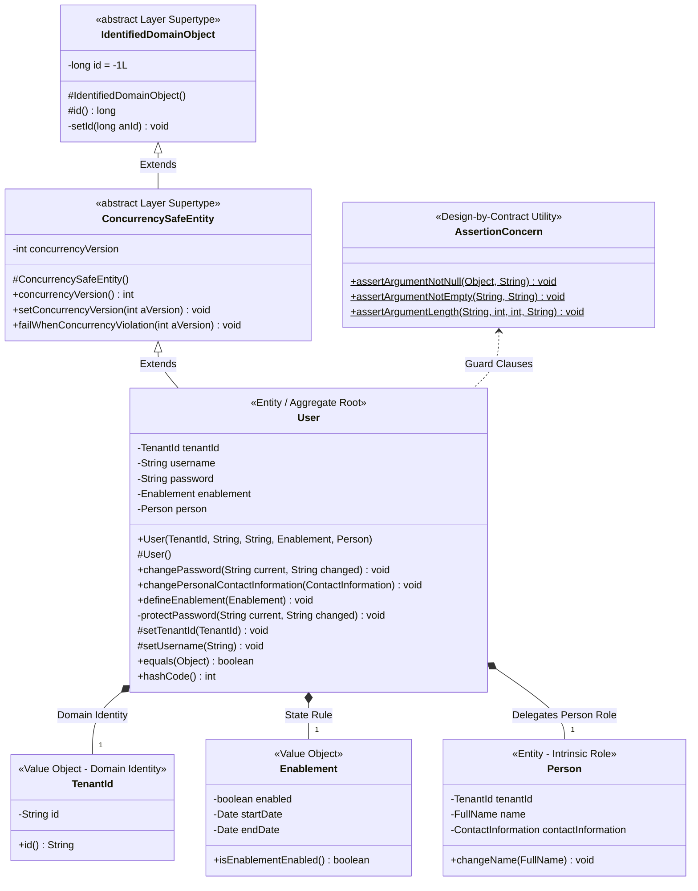
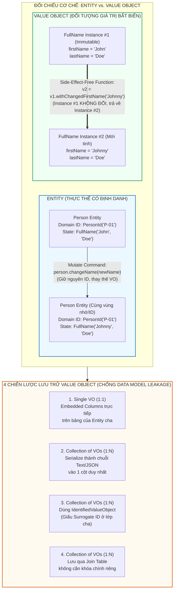

# ĐỢT 4 / 10: BÓC TÁCH CHUYÊN SÂU CHƯƠNG 5 & CHƯƠNG 6
**Sách:** *Implementing Domain-Driven Design (IDDD)* — **Tác giả:** *Vaughn Vernon*

---

## CHƯƠNG 5: ENTITIES (CÁC THỰC THỂ MIỀN)

### 1. ĐỀ MỤC & MỤC TIÊU CỐT LÕI (CORE PURPOSE)

#### Hệ thống đề mục đầy đủ theo sách gốc (Trang 171–218):
* **Why We Use Entities** (Tại sao chúng ta sử dụng Thực thể)
* **Unique Identity** (Định danh Duy nhất)
  * *User Provides Identity* (Người dùng cung cấp Định danh)
  * *Application Generates Identity* (Ứng dụng tự sinh Định danh)
  * *Persistence Mechanism Generates Identity* (Cơ chế Lưu trữ / Database sinh Định danh)
  * *Another Bounded Context Assigns Identity* (Một Ngữ cảnh Giới hạn khác cấp phát Định danh)
  * *When the Timing of Identity Generation Matters* (Khi thời điểm sinh Định danh đóng vai trò quyết định — *Early vs. Late Identity Generation*)
  * *Surrogate Identity* (Định danh Thay thế phục vụ ORM/Database)
  * *Identity Stability* (Tính ổn định bất biến của Định danh)
* **Discovering Entities and Their Intrinsic Characteristics** (Khám phá Thực thể và các Đặc tính Nội tại của chúng)
  * *Uncovering Entities and Properties* (Tìm ra Thực thể và Thuộc tính)
  * *Digging for Essential Behavior* (Đào sâu tìm kiếm Hành vi Cốt lõi)
  * *Roles and Responsibilities* (Vai trò và Trách nhiệm — chống lại *Object Schizophrenia*)
  * *Construction* (Khởi tạo Thực thể — *Constructors* & *Self-Encapsulation*)
  * *Validation* (Kiểm tra tính hợp lệ — *Attribute, Whole-Object, Deferred Validation, Design-by-Contract*)
  * *Change Tracking* (Theo dõi sự thay đổi trạng thái)
* **Wrap-Up** (Tổng kết)

#### Vấn đề kỹ thuật & nghiệp vụ cốt lõi và Thảm họa nếu không áp dụng:
* **Vấn đề giải quyết:** Khi nào một khái niệm trong bài toán cần được mô hình hóa thành một **Entity** (thay vì *Value Object*)? Làm thế nào để cấp phát và bảo vệ **Định danh Duy nhất (*Unique Identity*)** của nó xuyên suốt vòng đời biến đổi trạng thái, đồng thời thiết kế các hành vi nội tại, hàm khởi tạo và cơ chế tự kiểm tra hợp lệ (*Validation*) mà không bị cơ sở dữ liệu làm biến dạng?
* **Thảm họa kỹ thuật nếu không áp dụng:**
  1. **Lạm dụng Entity tràn lan do "Nhiễm độc CSDL" (*Database-Driven Entity Overuse*):** Lập trình viên nhìn đâu cũng thấy bảng Database có cột khóa chính `ID`, nên biến mọi thứ (từ Tên người, Địa chỉ, Tiền tệ, đến Khoảng thời gian) thành *Entity* có bảng riêng và `ID` riêng. Hậu quả là bộ nhớ bị phân mảnh, câu lệnh SQL chất chồng hàng chục phép `JOIN` vô nghĩa.
  2. **Sập cơ chế Tập hợp (`Set` / `HashMap`) do Sinh định danh muộn (*Late Identity Generation Bug*):** Khi để Database tự sinh ID (`AUTO_INCREMENT` / `SEQUENCE`) lúc `INSERT`, một đối tượng `Entity` mới khởi tạo bằng `new` trong bộ nhớ sẽ có `id == null`. Nếu thêm hai đối tượng mới này vào một tập hợp `java.util.Set<Entity>`, hàm `equals()` và `hashCode()` dựa trên `id` sẽ coi hai đối tượng khác nhau là một (làm mất phần tử thứ hai!), hoặc sau khi lưu vào DB thì `id` thay đổi khiến `hashCode` bị đổi và không bao giờ tìm lại được đối tượng trong `Set` nữa!
  3. **Sửa đổi Định danh từ bên ngoài (*Broken Identity Stability*):** Cho phép hàm `public void setId(...)` lộ ra ngoài, dẫn đến việc một lập trình viên vô tình ghi đè ID của thực thể đang sống, làm đứt gãy toàn bộ các liên kết tham chiếu trên hệ thống.

---

### 2. PHÂN TÍCH LÝ THUYẾT & NGUYÊN LÝ CHUYÊN SÂU

#### A. Bản chất của *Entity*: Định danh và Tính liên tục (*Identity & Continuity*)
* Một khái niệm chỉ được mô hình hóa thành **Entity** khi chúng ta quan tâm đến **Nó là ai (*Who it is* — Định danh duy nhất)** hơn là **Nó chứa thuộc tính gì (*What it is*)**, và nó có một vòng đời liên tục trải qua nhiều lần biến đổi trạng thái (*Mutability over Lifecycle*). Hai đối tượng `User` dù trùng cả họ tên lẫn ngày sinh vẫn là hai thực thể hoàn toàn khác nhau nếu có `UserId` khác nhau.

#### B. 4 Chiến lược Cấp phát Định danh (*Identity Generation Strategies*) & Thời điểm Sinh (*Timing*)
1. **User Provides Identity (Người dùng tự nhập):** Người dùng nhập các mã định danh tự nhiên (*Natural Keys*) như `username`, mã ISBN sách, mã SKU sản phẩm. *Rủi ro:* Người dùng nhập sai chính tả rồi đòi sửa lại! Mà định danh thì bắt buộc phải bất biến (*Immutable*). Giải pháp: Chỉ dùng làm thuộc tính tra cứu hoặc yêu cầu tạo mới/hủy cũ.
2. **Application Generates Identity (Ứng dụng tự sinh — Khuyên dùng nhất trong DDD):** Tầng ứng dụng hoặc *Repository* tự sinh định danh ngay trong bộ nhớ trước khi lưu xuống DB (thường dùng `UUID` / `GUID` kết hợp thông tin ngữ cảnh hoặc tiền tố).
   * *Ưu điểm tuyệt đối:* Hỗ trợ **Sinh định danh sớm (*Early Identity Generation*)** — thực thể có ngay định danh hợp lệ ngay khoảnh khắc được `new` ra đời, an toàn tuyệt đối khi đưa vào `Set` hoặc đính kèm vào *Domain Events* trước khi lưu DB!
3. **Persistence Mechanism Generates Identity (Cơ chế lưu trữ sinh):** Tận dụng Sequence của Oracle/PostgreSQL hoặc `AUTO_INCREMENT` của MySQL.
   * *Đánh đổi:* Với `AUTO_INCREMENT`, đây là **Sinh định danh muộn (*Late Identity Generation*)** — phải đợi `Repository.save()` và `flush()` xuống DB mới có ID. Với Oracle Sequence kết hợp cơ chế *Hi/Lo Algorithm* (cấp phát trước một dải số vào bộ nhớ), ta vẫn đạt được *Early Generation* với hiệu năng cao.
4. **Another Bounded Context Assigns Identity (Ngữ cảnh khác cấp phát):** Điển hình trong *SaaSOvation*, `Agile Project Management Context` nhận định danh của `ProductOwner` và `TeamMember` từ `username` do `Identity and Access Context` cấp phát.

#### C. Định danh Nghiệp vụ (*Domain Identity*) vs. Định danh Thay thế (*Surrogate Identity*)
* Trong DDD của Vaughn Vernon, mỗi Entity thường mang **2 loại định danh tách biệt**:
  1. **Domain Identity (Ví dụ: `ProductId`, `UserId`, `TenantId`):** Được thiết kế thành một **Value Object** có kiểu mạnh (*Strongly-typed Value Object*), hiển thị công khai trong *Ubiquitous Language* để các *Aggregates* và *Bounded Contexts* khác tham chiếu tới.
  2. **Surrogate Identity (Ví dụ: `private long id`):** Là khóa chính số nguyên 64-bit phục vụ thuần túy cho ORM (Hibernate) làm khóa ngoại (`Foreign Key`) nối bảng nhanh gọn dưới Database. Thuộc tính `id` này phải được **giấu kín (`private` / `protected`)** bên trong lớp cha `Entity` hoặc `Layer Supertype`, tuyệt đối không lộ ra cho tầng nghiệp vụ hay Client bên ngoài biết!

#### D. Khám phá Hành vi, Tự đóng gói (*Self-Encapsulation*) và Kiểm tra Hợp lệ (*Validation*)
* **Chống lại *Object Schizophrenia* (Tâm thần phân liệt đối tượng) bằng Ủy quyền Vai trò:** Khi một người vừa là `User`, vừa có thông tin cá nhân `Person`, thay vì dùng kế thừa đa tầng hoặc nhồi nhét tất cả vào một class, hãy tách thành các đối tượng đóng vai trò rõ ràng (`User` chứa tham chiếu tới `Person` và `Enablement`).
* **Self-Encapsulation trong Hàm khởi tạo (*Constructor*):** Ngay cả bên trong *Constructor* của Entity, **không bao giờ gán trực tiếp `this.name = aName;`**, mà phải gọi qua hàm setter nội bộ `this.setName(aName);`. Hàm `private/protected setName()` sẽ chứa các chốt chặn kiểm tra điều kiện (**Guards / Assertions** theo trường phái *Design-by-Contract* của Bertrand Meyer). Nhờ đó, không một thực thể nào có thể được khởi tạo ở trạng thái bất hợp lệ!
* **3 Cấp độ Validation trong DDD:**
  1. *Attribute Validation (Kiểm tra từng thuộc tính):* Dùng *Self-Encapsulation Guards* ngay trong các hàm `private setX()` (kiểm tra khác `null`, độ dài chuỗi, khoảng giá trị).
  2. *Whole-Object Validation (Kiểm tra toàn bộ đối tượng):* Khi tính hợp lệ phụ thuộc vào mối quan hệ giữa nhiều thuộc tính cùng lúc, và có những thời điểm đối tượng tạm thời chưa đủ dữ liệu, ta dùng **Deferred Validation (Kiểm tra trì hoãn)** kết hợp mẫu **Specification** hoặc **Notification Pattern** (thu thập toàn bộ danh sách lỗi thay vì ném Exception ngay ở lỗi đầu tiên).
  3. *Object Composition Validation:* Dùng *Domain Service* để kiểm tra tính hợp lệ trải dài qua nhiều đối tượng.

---

### 3. MỔ XẺ MÃ NGUỒN & CẤU TRÚC THIẾT KẾ (CODE DEEP-DIVE)

Chúng ta sẽ mổ xẻ cấu trúc thực thể `User` của `Identity and Access Context` kết hợp với lớp cơ sở `IdentifiedDomainObject` / `ConcurrencySafeEntity` và cơ chế `ValidationNotificationHandler` trong Chương 5 (trang 186–215).

#### ❌ Thiết kế SAI BAN ĐẦU: Định danh kiểu nguyên thủy (`long`), Cho phép sửa ID, và Gán trực tiếp không kiểm soát
```java
public class BadUser {
    private Long id; // Dùng chung khóa chính DB làm định danh nghiệp vụ (Chưa lưu DB thì id == null!)
    private String username;
    private String password;
    private boolean active;

    public BadUser(String username, String password) {
        // Không có Guard Clause kiểm tra null/rỗng!
        this.username = username;
        this.password = password; // Lưu mật khẩu thô (Clear-text password)!
    }

    // THẢM HỌA: Cho phép bên ngoài sửa đổi định danh của Entity đang sống!
    public void setId(Long id) { this.id = id; }
    public Long getId() { return id; }

    // THẢM HỌA: Khi vừa new BadUser() chưa lưu vào DB, id == null -> Ném NullPointerException hoặc làm hỏng HashSet!
    @Override
    public int hashCode() { return id.hashCode(); }
}
```

#### ✅ Thiết kế CHUẨN MỰC SAU REFACTOR: Tách *Surrogate ID* và *Domain ID*, *Self-Encapsulation Guards* & Hành vi giàu ngữ nghĩa

```java
// ============================================================================
// 1. LAYER SUPERTYPE: Giấu kín Surrogate Identity (id) và Version cho ORM
// Package: com.saasovation.common.domain.model
// ============================================================================
public abstract class IdentifiedDomainObject implements Serializable {
    private long id = -1L; // Surrogate ID chỉ phục vụ Hibernate, giấu kín khỏi Client!

    protected IdentifiedDomainObject() { super(); }

    protected long id() { return this.id; }
    private void setId(long anId) { this.id = anId; }
}

public abstract class ConcurrencySafeEntity extends IdentifiedDomainObject {
    private int concurrencyVersion;

    protected ConcurrencySafeEntity() { super(); }

    public int concurrencyVersion() { return this.concurrencyVersion; }
    public void setConcurrencyVersion(int aVersion) {
        this.failWhenConcurrencyViolation(aVersion);
        this.concurrencyVersion = aVersion;
    }

    public void failWhenConcurrencyViolation(int aVersion) {
        if (aVersion != this.concurrencyVersion()) {
            throw new IllegalStateException("Violation of optimistic concurrency!");
        }
    }
}

// ============================================================================
// 2. ENTITY CHUẨN MỰC: User trong Identity and Access Context
// Package: com.saasovation.identityaccess.domain.model.identity
// ============================================================================
public class User extends ConcurrencySafeEntity {
    private TenantId tenantId;      // Domain Identity phần 1 (Strongly-typed Value Object)
    private String username;        // Domain Identity phần 2 (Unique trong phạm vi Tenant)
    private String password;
    private Enablement enablement;  // Value Object đóng gói quy tắc kích hoạt/thời hạn
    private Person person;          // Entity con đảm nhận vai trò thông tin cá nhân

    public User(
        TenantId aTenantId,
        String aUsername,
        String aPassword,
        Enablement anEnablement,
        Person aPerson) {

        this();
        // SELF-ENCAPSULATION: Gọi qua các hàm protected/private setter để kích hoạt Guard Clauses!
        this.setTenantId(aTenantId);
        this.setUsername(aUsername);
        this.setEnablement(anEnablement);
        this.setPerson(aPerson);

        this.protectPassword("", aPassword);

        aPerson.internalOnlySetUser(this);

        DomainEventPublisher
            .instance()
            .publish(new UserRegistered(
                this.tenantId(),
                aUsername,
                aPerson.name(),
                aPerson.emailAddress().address()));
    }

    protected User() { super(); } // Phục vụ riêng cho cơ chế Reflection của Hibernate

    // HÀNH VI CỐT LÕI (ESSENTIAL BEHAVIOR): Thay đổi mật khẩu có kiểm chứng và mã hóa
    public void changePassword(String aCurrentPassword, String aChangedPassword) {
        AssertionConcern.assertArgumentNotEmpty(
            aCurrentPassword, "Current password must be provided.");
        AssertionConcern.assertArgumentEquals(
            this.password(),
            this.asEncryptedValue(aCurrentPassword),
            "Current password not confirmed.");

        this.protectPassword(aCurrentPassword, aChangedPassword);

        DomainEventPublisher
            .instance()
            .publish(new UserPasswordChanged(this.tenantId(), this.username()));
    }

    private void protectPassword(String aCurrentPassword, String aChangedPassword) {
        AssertionConcern.assertArgumentNotSame(
            aCurrentPassword, aChangedPassword, "The password is unchanged.");
        AssertionConcern.assertArgumentNotEmpty(
            aChangedPassword, "The password must be provided.");
        AssertionConcern.assertArgumentLength(
            aChangedPassword, 6, 64, "The password is too short or too long.");

        this.setPassword(this.asEncryptedValue(aChangedPassword));
    }

    // SELF-ENCAPSULATION GUARDS: Ngăn chặn trạng thái bất hợp lệ và khóa chặt Identity Stability!
    protected void setTenantId(TenantId aTenantId) {
        AssertionConcern.assertArgumentNotNull(aTenantId, "The tenantId is required.");
        this.tenantId = aTenantId;
    }

    protected void setUsername(String aUsername) {
        AssertionConcern.assertArgumentNotEmpty(aUsername, "The username is required.");
        AssertionConcern.assertArgumentLength(aUsername, 3, 250, "The username must be 3 to 250 characters.");
        this.username = aUsername;
    }

    // ĐỊNH DANH BẤT BIẾN: equals() và hashCode() dựa trên Domain Identity (tenantId + username), KHÔNG dựa trên Surrogate ID!
    @Override
    public boolean equals(Object anObject) {
        boolean equalObjects = false;
        if (anObject != null && this.getClass() == anObject.getClass()) {
            User typedObject = (User) anObject;
            equalObjects =
                this.tenantId().equals(typedObject.tenantId()) &&
                this.username().equals(typedObject.username());
        }
        return equalObjects;
    }

    @Override
    public int hashCode() {
        return (45217 * 269)
            + this.tenantId().hashCode()
            + this.username().hashCode();
    }
}
```

#### Bảng phân tích kỹ thuật & Ý nghĩa thiết kế:

| Dòng code / Đoạn code then chốt | Giải thích kỹ thuật & Nguyên lý thiết kế (DDD/OOP) được hiện thực hóa |
| :--- | :--- |
| `private long id = -1L;` <br> `protected long id() { return this.id; }` | **Giấu kín *Surrogate Identity* trong *Layer Supertype*:** Thuộc tính `id` kiểu `long` chỉ tồn tại để làm vui lòng cơ chế khóa chính/khóa ngoại của Hibernate dưới Database. Đặt mức truy cập `protected`/`private` giúp không một lớp nghiệp vụ nào bên ngoài bị cám dỗ sử dụng khóa chính DB làm định danh miền. |
| `this.setTenantId(aTenantId);` <br> `this.setUsername(aUsername);` *(Trong Constructor)* | **Self-Encapsulation & Design-by-Contract Guards:** Thay vì gán thẳng biến, hàm khởi tạo ủy quyền cho các hàm `protected setX()`. Mọi hàm `setX()` này đều chạy `AssertionConcern.assertArgumentNotNull/Length(...)`, đảm bảo tính bất biến (*Invariant*) ngay từ mili-giây đầu tiên đối tượng được sinh ra, đồng thời đóng băng định danh (*Identity Stability*) vì bên ngoài không thể gọi hàm `protected` này để sửa lại ID! |
| `protected User() { super(); }` | **Bảo vệ Tính toàn vẹn Khởi tạo trước ORM:** Hibernate yêu cầu một Constructor không tham số để tái tạo đối tượng từ DB. Bằng cách để mức `protected` (thay vì `public`), ta vừa cho phép Hibernate khởi tạo qua Reflection/Proxy, vừa cấm tiệt lập trình viên bên ngoài gọi `new User()` rỗng tạo ra thực thể "chết" thiếu định danh! |
| `public void changePassword(...)` & `private void protectPassword(...)` | **Essential Domain Behavior (Hành vi nghiệp vụ cốt lõi):** Thay vì phơi bày `setPassword()`, thực thể `User` tự kiểm tra mật khẩu hiện tại, tự kiểm tra độ dài mật khẩu mới, tự gọi dịch vụ băm mật khẩu (`asEncryptedValue`) và phát ra sự kiện miền `UserPasswordChanged`. Không có mật khẩu thô (*clear-text*) nào bị lưu trữ. |
| `this.tenantId().equals(typedObject.tenantId()) && this.username().equals(...)` | **So sánh Thực thể qua *Domain Identity* (*Early Identity Safety*):** Hàm `equals()` và `hashCode()` chỉ dựa trên bộ đôi định danh nghiệp vụ (`tenantId` + `username`), vốn đã có giá trị ngay lúc gọi `new User(...)`. Nhờ đó, đối tượng có thể được đưa vào `HashSet<User>` ngay lập tức trước khi lưu vào Database mà không bao giờ gặp lỗi mất phần tử! |

---

### 4. SƠ ĐỒ TRỰC QUAN HÓA (BẮT BUỘC MÃ MERMAID)

Sơ đồ Lớp (Class Diagram) dưới đây thể hiện kiến trúc phân cấp của một **Entity chuẩn DDD** trong *SaaSOvation*, tách biệt rõ ràng giữa **Surrogate Identity** (ở lớp cơ sở), **Domain Identity** (Value Object), **Role Composition** (`Person`, `Enablement`) và **Self-Encapsulated Guards**:



---

### 5. ÁNH XẠ ỨNG DỤNG VÀO DỰ ÁN GAME 2.5D OOP MULTIPLAYER

1. **Áp dụng *Early Application-Generated Identity* cho các Thực thể Động trên Bản đồ 66.000 px (`Hero`, `Mob`, `Projectile`, `LootDrop`):**
   * *Vấn đề trong Game Multiplayer:* Trong trận chiến tốc độ 20 Hz trên Server, mỗi giây có hàng chục quái vật (`Mobs` thuộc 6 chủng loại) được sinh ra (*Spawn*) hoặc vật phẩm rơi ra đất. Nếu chờ luồng Persistence ghi vào cơ sở dữ liệu để lấy ID thì Game Loop sẽ bị treo cứng!
   * *Áp dụng Chương 5:* Mọi thực thể trong trận đấu (`HeroEntity`, `MobEntity`) phải sử dụng **Application-Generated Domain Identity** (ví dụ: `EntityId` kết hợp `MatchId` + bộ đếm nguyên tử `AtomicInteger` hoặc `UUID` rút gọn). Ngay khoảnh khắc `MobFactory` khởi tạo một con quái vật mới trên RAM, nó đã có `MobId` duy nhất và bất biến để phát ngay vào gói tin `Snapshot` gửi cho 4 người chơi và đưa vào bảng băm không gian (`SpatialHashGrid` / `HashSet<MobEntity>`) mà không bao giờ bị lỗi băm (`hashCode` cố định suốt vòng đời).
2. **Chống *Object Schizophrenia* và bảo vệ *Invariants* bằng *Self-Encapsulation Guards* trên Hệ Nhân Vật:**
   * Thay vì để một class `Character` khổng lồ chứa hàng trăm biến `public` hoặc `setter` lỏng lẻo, hãy tách các đặc tính nội tại thành các thành phần có vai trò rõ ràng và khóa chặt bằng `AssertionConcern`: Không bao giờ cho phép khởi tạo một nhân vật có `maxHp <= 0`, `moveSpeed < 0` hay tọa độ nằm ngoài biên giới bản đồ `[0, 66000]`.

---
---

## CHƯƠNG 6: VALUE OBJECTS (CÁC ĐỐI TƯỢNG GIÁ TRỊ)

### 1. ĐỀ MỤC & MỤC TIÊU CỐT LÕI (CORE PURPOSE)

#### Hệ thống đề mục đầy đủ theo sách gốc (Trang 219–264):
* **Value Characteristics** (6 Đặc trưng Cốt lõi của Đối tượng Giá trị)
  * *Measures, Quantifies, or Describes* (Đo lường, Định lượng, hoặc Mô tả một thứ trong miền)
  * *Immutable* (Tính Bất biến tuyệt đối)
  * *Conceptual Whole* (Một chỉnh thể Khái niệm Trọn vẹn — *Whole Value*)
  * *Replaceability* (Tính có thể Thay thế toàn phần)
  * *Value Equality* (So sánh Bằng nhau dựa trên Giá trị thuộc tính)
  * *Side-Effect-Free Behavior* (Hành vi Không gây Tác dụng phụ)
* **Integrate with Minimalism** (Tích hợp giữa các Bounded Contexts với Chủ nghĩa Tối giản)
* **Standard Types Expressed as Values** (Biểu diễn các Kiểu Chuẩn / Danh mục bằng Value Objects & Java Enums)
* **Testing Value Objects** (Kiểm thử hướng miền cho Value Objects)
* **Implementation** (Hiện thực hóa chi tiết trong Java)
* **Persisting Value Objects** (Lưu trữ Value Objects xuống Cơ sở Dữ liệu mà không làm hỏng Mô hình)
  * *Reject Undue Influence of Data Model Leakage* (Từ chối sự ảnh hưởng sai trái của Rò rỉ Mô hình Dữ liệu)
  * *ORM and Single Value Objects* (ORM với một Value Object đơn lẻ)
  * *ORM and Many Values Serialized into a Single Column* (ORM với tập hợp Value Objects tuần tự hóa vào một cột)
  * *ORM and Many Values Backed by a Database Entity* (ORM với tập hợp Value Objects được chống lưng bởi thực thể DB ẩn — *Layer Supertype Trick*)
  * *ORM and Many Values Backed by a Join Table* (ORM với tập hợp Value Objects qua bảng nối)
  * *ORM and Enum-as-State Objects* (ORM với đối tượng Enum biểu diễn trạng thái)
* **Wrap-Up** (Tổng kết)

#### Vấn đề kỹ thuật & nghiệp vụ cốt lõi và Thảm họa nếu không áp dụng:
* **Vấn đề giải quyết:** Vaughn Vernon chỉ ra rằng các lập trình viên thường quá say mê *Entities* mà bỏ quên vũ khí sắc bén nhất của DDD: **Value Objects**. Chương 6 giải quyết câu hỏi: **Làm thế nào để gom nhóm các thuộc tính rời rạc thành những khối khái niệm bất biến, giàu hành vi toán học/nghiệp vụ, hoàn toàn không cần định danh (ID), và lưu trữ chúng xuống Database quan hệ (SQL) mà không để cấu trúc bảng làm ô nhiễm mô hình hướng đối tượng?**
* **Thảm họa kỹ thuật nếu không áp dụng:**
  1. **Ám ảnh Kiểu Nguyên thủy (*Primitive Obsession*):** Biểu diễn tiền tệ bằng một biến `double`, tên đầy đủ bằng 3 biến `String` rời rạc, tọa độ bằng `int x, int y`, hoặc điểm ưu tiên kinh doanh bằng `int`. Hệ quả là các hàm tính toán liên quan đến các giá trị này bị vứt vưởng khắp nơi trong các lớp `Utility` tĩnh (`StringUtils`, `MathHelper`) hoặc làm phình to *Entity*.
  2. **Lỗi Tham chiếu Chia sẻ (*Aliasing Bug*) do đối tượng Khả biến (*Mutable Object*):** Khi hai *Entities* cùng trỏ tới một đối tượng giá trị khả biến (như `java.util.Date` cũ), việc sửa giá trị ở nơi này sẽ âm thầm làm sai lệch trạng thái của thực thể ở nơi khác, gây ra những lỗi đồng thời (*Concurrency Bugs*) cực kỳ khó tìm.
  3. **Sự Rò rỉ Mô hình Dữ liệu (*Data Model Leakage*):** Vì bảng cơ sở dữ liệu cần khóa chính cho quan hệ `1-N` (ví dụ một `Group` chứa danh sách nhiều `GroupMember` Value Objects), lập trình viên đầu hàng trước ORM và biến `GroupMember` thành một `Entity` thực thụ trong Domain Model chỉ để chiều lòng Hibernate!

---

### 2. PHÂN TÍCH LÝ THUYẾT & NGUYÊN LÝ CHUYÊN SÂU

#### A. 6 Đặc trưng Vàng định nghĩa một *Value Object*
Hãy luôn ưu tiên thiết kế một khái niệm thành **Value Object** thay vì *Entity* nếu nó mang 6 đặc tính sau:
1. **Measures, Quantifies, or Describes (Đo lường, Định lượng hoặc Mô tả):** Nó không phải là một "vật thể có căn cước" mà là một thước đo hoặc mô tả đặc tính cho một vật thể khác (Ví dụ: `Money`, `FullName`, `BusinessPriority`, `StoryPoints`, `DateRange`).
2. **Immutable (Bất biến tuyệt đối):** Sau khi được khởi tạo qua *Constructor*, **không một thuộc tính nào của Value Object được phép thay đổi** trong suốt thời gian nó tồn tại. Mọi hàm `setter` đều bị cấm gọi từ bên ngoài. Nhờ bất biến, Value Objects tự động **an toàn đa luồng (*Thread-safe*)**, có thể chia sẻ tham chiếu thoải mái mà không cần `clone()`.
3. **Conceptual Whole (Chỉnh thể Khái niệm Trọn vẹn — Ward Cunningham):** Một giá trị tiền tệ `50.00` sẽ hoàn toàn vô nghĩa nếu đứng tách rời khỏi đơn vị tiền tệ `USD` hay `VND`. Do đó, `amount` và `currency` phải bị khóa chặt vào nhau trong một chỉnh thể `MonetaryValue(BigDecimal amount, Currency currency)`. Tương tự trong *ProjectOvation*, độ ưu tiên của một hạng mục (`BusinessPriority`) là chỉnh thể không thể tách rời của 4 thông số: *Benefit* (Lợi ích), *Penalty* (Thiệt hại nếu không làm), *Cost* (Chi phí), và *Risk* (Rủi ro).
4. **Replaceability (Khả năng Thay thế toàn phần):** Khi giá trị mà một *Entity* đang nắm giữ không còn đúng nữa, ta không sửa bên trong Value Object đó, mà **vứt bỏ toàn bộ thực thể Value Object cũ và gán đè bằng một Value Object mới tinh** (giống hệt như cách ta gán biến nguyên thủy `int a = 5; a = 6;`).
5. **Value Equality (Bằng nhau theo Giá trị):** Hai thực thể Value Object ở hai vùng nhớ khác nhau (`v1 != v2`) được coi là **hoàn toàn bằng nhau (`v1.equals(v2) == true`)** nếu tất cả các thuộc tính cấu thành nên chúng bằng nhau.
6. **Side-Effect-Free Behavior (Hành vi Không Tác dụng phụ - Functional Style):** Value Object không phải là cấu trúc `struct` câm lặng! Nó chứa rất nhiều hàm tính toán và biến đổi nghiệp vụ phức tạp. Nhưng vì nó **Bất biến**, mọi phương thức làm thay đổi giá trị của nó (như cộng hai số tiền, thêm chữ đệm vào `FullName`, hoặc dịch chuyển tọa độ) đều là các **Hàm Không Tác Dụng Phụ (*Side-Effect-Free Functions*)**: giữ nguyên đối tượng gốc và **trả về một thực thể Value Object mới** mang kết quả!

#### B. Chủ nghĩa Tối giản khi Tích hợp (*Integrate with Minimalism*) & Kiểu Chuẩn (*Standard Types*)
* Khi tích hợp dữ liệu từ *Upstream Bounded Context* sang *Downstream* (như từ `Identity and Access` sang `Collaboration`), hãy dùng **Value Objects tối giản** (như `Author`, `Moderator` chỉ chứa đúng 3 thuộc tính `username, name, emailAddress` cần thiết cho diễn đàn) để giảm thiểu trách nhiệm và loại bỏ nhu cầu đồng bộ trạng thái phức tạp.
* Với các **Kiểu Chuẩn (*Standard Types*)** phân loại đối tượng (như `BacklogItemType`: *Feature,Integration, Defect, Foundation* hoặc `BusinessPriorityRatings`), hãy tận dụng `enum` giàu hành vi của Java hoặc các Value Objects chia sẻ tĩnh để vừa đảm bảo an toàn kiểu (*Type-safety*), vừa gắn kèm được các công thức tính toán vào từng loại.

#### C. Chống lại *Data Model Leakage* khi Lưu trữ Value Objects xuống Database
Đây là phần thực chiến cực kỳ đắt giá của Chương 6 (trang 248–263):
* **Trường hợp 1 Value Object đơn lẻ trong Entity:** Dùng cơ chế *Embedded / Component* của ORM (như `<component>` hoặc `@Embedded` trong Hibernate) để trải phẳng các thuộc tính của Value Object (`FullName.firstName`, `FullName.lastName`) vào thẳng các cột cùng bảng với Entity cha (`tbl_person`).
* **Trường hợp một Tập hợp (`Set<ValueObject>`) nằm trong Entity:** Trong SQL, một tập hợp `1-N` thường cần bảng phụ có khóa chính. Làm sao để lưu `Set<GroupMember>` mà không biến `GroupMember` thành Entity? Vaughn Vernon đưa ra 2 kỹ thuật xuất sắc:
  1. *Many Values Serialized into a Single Column:* Tuần tự hóa (*Serialize*) cả danh sách Value Objects thành một chuỗi văn bản/JSON gọn nhẹ và lưu vào một cột `TEXT/VARCHAR` duy nhất trên bảng của Entity cha (không cần bảng phụ, không cần `JOIN`!).
  2. *Many Values Backed by a Database Entity (Kỹ thuật Surrogate Layer Supertype):* Cho Value Object kế thừa từ một lớp cơ sở `IdentifiedValueObject` chứa thuộc tính `private long id = -1L` (chỉ có getter/setter ở mức `package-private` hoặc `private` cho Hibernate đọc qua Reflection). Nhờ đó, đối với thế giới Domain Model bên ngoài, nó là một **Value Object bất biến 100%** (không ai thấy `id`), nhưng đối với Hibernate bên dưới, nó có khóa chính để lưu vào bảng phụ một cách trơn tru!

---

### 3. MỔ XẺ MÃ NGUỒN & CẤU TRÚC THIẾT KẾ (CODE DEEP-DIVE)

Chúng ta sẽ mổ xẻ 2 Value Objects tiêu biểu nhất trong sách: **`FullName`** (trang 243–248, minh họa *Immutability, Side-Effect-Free Functions, Self-Delegation*) và **`BusinessPriority`** (trang 239–244, minh họa *Conceptual Whole* và các phép tính định lượng nghiệp vụ trong *ProjectOvation*).

#### ❌ Thiết kế SAI BAN ĐẦU: *Primitive Obsession* & Đối tượng Khả biến (*Mutable Setter*)
```java
public class BadBacklogItem {
    // PRIMITIVE OBSESSION: Rải rác 4 biến int rời rạc trên thực thể BacklogItem
    private int priorityBenefit;
    private int priorityPenalty;
    private int priorityCost;
    private int priorityRisk;

    // Tính toán thủ công ngay trên Entity hoặc vứt ra hàm static bên ngoài
    public float calculatePriorityScore(int totalBenefit, int totalPenalty, int totalCost, int totalRisk) {
        return ((float)(priorityBenefit + priorityPenalty) / (totalBenefit + totalPenalty)) /
               ((float)(priorityCost + priorityRisk) / (totalCost + totalRisk));
    }
}
```

#### ✅ Thiết kế CHUẨN MỰC SAU REFACTOR: Value Objects Bất biến, Trọn vẹn Khái niệm & Không tác dụng phụ

```java
// ============================================================================
// 1. VALUE OBJECT MÔ TẢ & BIẾN ĐỔI KHÔNG TÁC DỤNG PHỤ: FullName
// Package: com.saasovation.identityaccess.domain.model.identity
// ============================================================================
public final class FullName extends AssertionConcern implements Serializable {

    private String firstName;
    private String lastName;

    public FullName(String aFirstName, String aLastName) {
        super();
        this.setFirstName(aFirstName);
        this.setLastName(aLastName);
    }

    // Copy Constructor (Hỗ trợ tạo bản sao an toàn)
    public FullName(FullName aFullName) {
        this(aFullName.firstName(), aFullName.lastName());
    }

    protected FullName() { super(); } // Chỉ phục vụ ORM (Hibernate Component)

    public String asFormattedName() {
        return this.firstName() + " " + this.lastName();
    }

    // SIDE-EFFECT-FREE FUNCTION: Không sửa đối tượng hiện tại! Trả về một FullName MỚI!
    public FullName withChangedFirstName(String aFirstName) {
        return new FullName(aFirstName, this.lastName());
    }

    public FullName withChangedLastName(String aLastName) {
        return new FullName(this.firstName(), aLastName);
    }

    public String firstName() { return this.firstName; }
    public String lastName() { return this.lastName; }

    // PRIVATE SETTERS + GUARDS: Khóa chặt tính Bất biến (Immutability) sau khi khởi tạo!
    private void setFirstName(String aFirstName) {
        this.assertArgumentNotEmpty(aFirstName, "First name is required.");
        this.assertArgumentLength(aFirstName, 1, 50, "First name must be 50 characters or less.");
        this.assertArgumentTrue(
            Pattern.matches("[A-Z][a-z]*", aFirstName),
            "First name must be at least one character in length, starting with a capital letter.");
        this.firstName = aFirstName;
    }

    private void setLastName(String aLastName) {
        this.assertArgumentNotEmpty(aLastName, "Last name is required.");
        this.assertArgumentLength(aLastName, 1, 50, "Last name must be 50 characters or less.");
        this.lastName = aLastName;
    }

    // VALUE EQUALITY: Hai FullName bằng nhau nếu mọi thuộc tính thành phần bằng nhau
    @Override
    public boolean equals(Object anObject) {
        boolean equalObjects = false;
        if (anObject != null && this.getClass() == anObject.getClass()) {
            FullName typedObject = (FullName) anObject;
            equalObjects =
                this.firstName().equals(typedObject.firstName()) &&
                this.lastName().equals(typedObject.lastName());
        }
        return equalObjects;
    }

    @Override
    public int hashCode() {
        return (59151 * 191) + this.firstName().hashCode() + this.lastName().hashCode();
    }
}

// ============================================================================
// 2. VALUE OBJECT ĐO LƯỜNG & ĐỊNH LƯỢNG PHỨC TẠP: BusinessPriority (Scrum Core Domain)
// Package: com.saasovation.agilepm.domain.model.product.backlogitem
// ============================================================================
public final class BusinessPriority extends AssertionConcern implements Serializable {

    private BusinessPriorityRatings ratings; // Chứa 4 điểm số: benefit, penalty, cost, risk

    public BusinessPriority(BusinessPriorityRatings aRatings) {
        super();
        this.setRatings(aRatings);
    }

    // Hành vi định lượng giàu nghiệp vụ (Rich Quantifying Behavior):
    public float costPercentage(BusinessPriorityTotals aTotals) {
        return (float) 100 * this.ratings().cost() / aTotals.totalCost();
    }

    public float priority(BusinessPriorityTotals aTotals) {
        float costAndRisk =
            this.costPercentage(aTotals) +
            (this.ratings().risk() * 100 / aTotals.totalRisk());

        return this.valuePercentage(aTotals) / costAndRisk;
    }

    public float totalValue() {
        return this.ratings().benefit() + this.ratings().penalty();
    }

    public float valuePercentage(BusinessPriorityTotals aTotals) {
        return (float) 100 * this.totalValue() / aTotals.totalValue();
    }

    public BusinessPriorityRatings ratings() { return this.ratings; }

    private void setRatings(BusinessPriorityRatings aRatings) {
        this.assertArgumentNotNull(aRatings, "The ratings must be provided.");
        this.ratings = aRatings;
    }
    // equals() và hashCode() dựa trên this.ratings()...
}
```

#### Bảng phân tích kỹ thuật & Ý nghĩa thiết kế:

| Dòng code / Đoạn code then chốt | Giải thích kỹ thuật & Nguyên lý thiết kế (DDD/OOP) được hiện thực hóa |
| :--- | :--- |
| `public final class FullName` | **Ngăn chặn Kế thừa làm phá vỡ Tính bất biến (*Final Class*):** Từ khóa `final` ở cấp độ class ngăn không cho bất kỳ lớp con nào kế thừa và ghi đè các phương thức làm biến chất tính bất biến (*Immutability*) hoặc phá vỡ quy tắc đối xứng của hàm `equals()` (`this.getClass() == anObject.getClass()`). |
| `public FullName withChangedFirstName(String aFirstName)` <br> `{ return new FullName(aFirstName, this.lastName()); }` | **Side-Effect-Free Function (Hàm Không Tác dụng phụ):** Khi người dùng muốn sửa tên riêng nhưng giữ nguyên họ, thay vì gọi `name.setFirstName("New")`, họ gọi `name = name.withChangedFirstName("New")`. Đối tượng `FullName` cũ hoàn toàn không bị thay đổi (an toàn cho mọi nơi khác đang tham chiếu tới nó), một thực thể `FullName` mới được sinh ra để thay thế (*Replaceability*). |
| `private void setFirstName(String aFirstName)` | **Immutability + Self-Encapsulation Guards:** Mọi hàm `setter` trên Value Object bắt buộc phải là `private`! Chúng chỉ được gọi duy nhất 1 lần từ bên trong *Constructor* để kiểm tra định dạng Regex (`[A-Z][a-z]*`) và độ dài trước khi niêm phong trạng thái. |
| `public final class BusinessPriority` & `BusinessPriorityRatings` | **Conceptual Whole (Chỉnh thể khái niệm) & Giảm tải cho Entity:** Toàn bộ 4 chỉ số đánh giá ưu tiên và các công thức toán học tính phần trăm chi phí (`costPercentage`), phần trăm giá trị (`valuePercentage`) và trọng số ưu tiên (`priority`) được rút khỏi thực thể `BacklogItem` và đóng gói trọn vẹn vào `BusinessPriority`. Giúp `BacklogItem` gọn nhẹ và `BusinessPriority` có thể được Unit Test độc lập dễ dàng. |
| `this.firstName().equals(typedObject.firstName()) && ...` | **Value Equality (So sánh theo Giá trị):** Khác hẳn với *Entity* (so sánh qua ID), `FullName` và `BusinessPriority` hoàn toàn không có ID; phép so sánh `equals()` và `hashCode()` kiểm tra trực tiếp từng thuộc tính giá trị bên trong. |

---

### 4. SƠ ĐỒ TRỰC QUAN HÓA (BẮT BUỘC MÃ MERMAID)

Sơ đồ dưới đây đối chiếu trực quan **Cơ chế hoạt động giữa Entity (Biến đổi tại chỗ & So sánh theo ID) và Value Object (Bất biến, Hàm không tác dụng phụ & Thay thế toàn phần)**, đồng thời chỉ rõ **Các chiến lược ánh xạ ORM chống rò rỉ dữ liệu (*Data Model Leakage*)**:



---

### 5. ÁNH XẠ ỨNG DỤNG VÀO DỰ ÁN GAME 2.5D OOP MULTIPLAYER

Chương 6 (Value Objects) là chìa khóa vàng giúp mã nguồn của dự án Game 2.5D loại bỏ 80% lỗi tính toán vật lý/sát thương và tối ưu hóa đồng bộ mạng:

1. **Biểu diễn Tọa độ Không gian, Vận tốc và Vòng bo bằng *Immutable Value Objects* (`Vector25D`, `BoundingBox`, `SafeZoneCircle`):**
   * *Sai lầm chết người trong Game Loop:* Dùng một đối tượng `Position` khả biến (`public float x, y, z;`) rồi truyền tham chiếu của nó cho cả `Hero`, `Projectile` (Đạn bay) và `Camera`. Khi `Projectile` cộng thêm vận tốc vào `position.x += vx`, vị trí của `Hero` cũng bị dịch chuyển theo vì cả hai đang trỏ chung vào một vùng nhớ (*Aliasing Bug*)!
   * *Áp dụng Chương 6:* Thiết kế `Vector25D(final float x, final float y, final float z)` là một **Immutable Value Object** tuyệt đối với các **Side-Effect-Free Functions**:
     * `Vector25D nextPos = currentPos.translate(velocityVector.scale(deltaTime));`
     * `float dist = heroPos.groundDistanceTo(zoneCenter);`
     * Tương tự, **Vòng bo (`StormCircle`)** được mô hình hóa bằng Value Object `StormPhaseSpec(Vector25D center, float radius, DamagePerTick dps, Duration shrinkDuration)` có hàm nội suy `StormCircle interpolateAt(float progressRatio)` trả về vòng bo ở từng mili-giây mà không bao giờ gây lỗi tranh chấp luồng giữa Server Tick và Render Thread!
2. **Mô hình hóa Chỉ số 4 Hệ Nhân Vật và 6 Loại Mobs bằng *Conceptual Whole Value Objects* (`CombatStats`, `DamagePayload`):**
   * Thay vì truyền 6 tham số rời rạc `attack(int physicalDmg, int magicDmg, float critChance, float armorPen, ElementType element, boolean isTrueDamage)` vào hàm tấn công, hãy đóng gói thành Value Object `DamagePayload` và `StatBlock`.
   * Khi nhân vật nhận một bùa lợi (*Buff* tăng 20% công kích trong 5 giây), chỉ cần dùng hàm không tác dụng phụ: `CombatStats buffedStats = baseStats.withMultipliedAttack(1.20f)` — sạch sẽ, dễ viết Unit Test kiểm chứng công thức sát thương, và không bao giờ làm hỏng chỉ số gốc (`baseStats`) của nhân vật sau khi hết hiệu lực Buff!
