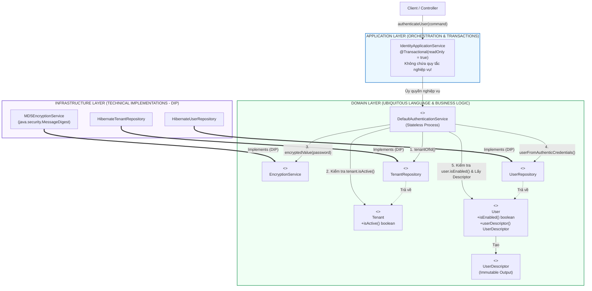
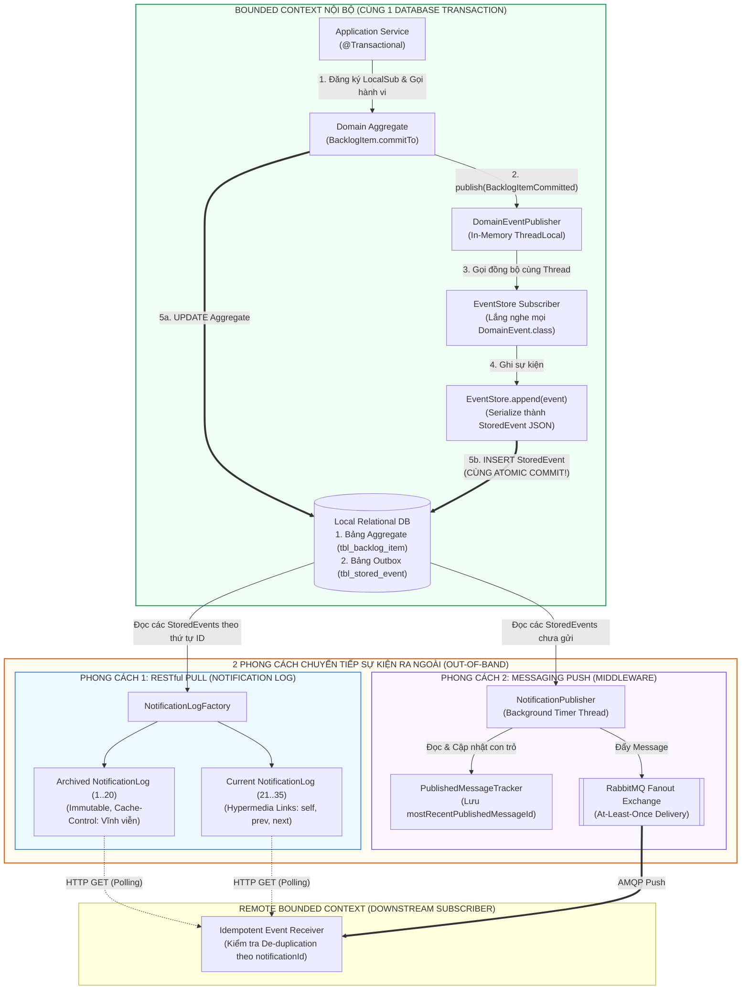

# ĐỢT 5 / 10: BÓC TÁCH CHUYÊN SÂU CHƯƠNG 7 & CHƯƠNG 8
**Sách:** *Implementing Domain-Driven Design (IDDD)* — **Tác giả:** *Vaughn Vernon*

---

## CHƯƠNG 7: SERVICES (CÁC DỊCH VỤ MIỀN)

### 1. ĐỀ MỤC & MỤC TIÊU CỐT LÕI (CORE PURPOSE)

#### Hệ thống đề mục đầy đủ theo sách gốc (Trang 265–284):
* **What a Domain Service Is (but First, What It Is Not)** (Dịch vụ Miền là gì — nhưng trước hết, Nó KHÔNG phải là gì)
* **Make Sure You Need a Service** (Hãy chắc chắn rằng bạn thực sự cần một Dịch vụ Miền)
* **Modeling a Service in the Domain** (Mô hình hóa một Dịch vụ trong Miền nghiệp vụ)
  * *Is Separated Interface a Necessity?* (Giao diện Tách biệt có luôn là điều bắt buộc không?)
  * *A Calculation Process* (Một Quy trình Tính toán — Ví dụ `BusinessPriorityCalculator`)
  * *Transformation Services* (Các Dịch vụ Chuyển đổi / Dịch thuật tích hợp — Ví dụ `CollaboratorService`)
  * *Using a Mini-Layer of Domain Services* (Sử dụng một Tầng con các Dịch vụ Miền)
* **Testing Services** (Kiểm thử các Dịch vụ Miền)
* **Wrap-Up** (Tổng kết)

#### Vấn đề kỹ thuật & nghiệp vụ cốt lõi và Thảm họa nếu không áp dụng:
* **Vấn đề giải quyết:** Trong mô hình hướng đối tượng, sẽ có những quy trình hoặc phép tính nghiệp vụ quan trọng đòi hỏi sự tham gia của nhiều *Entities / Aggregates* cùng lúc, hoặc cần tương tác với một hệ thống bên ngoài (như mã hóa mật khẩu, xác thực đa thực thể, tính điểm ưu tiên tổng thể của toàn bộ sản phẩm). Nếu cố nhét hành vi đó vào một *Entity* bất kỳ thì sẽ làm méo mó trách nhiệm của *Entity* đó (*Misplaced Responsibility*). Chương 7 giải quyết câu hỏi: **Khi nào được phép tạo một *Stateless Domain Service*, và làm sao để phân biệt rạch ròi nó với *Application Service*?**
* **Thảm họa kỹ thuật nếu không áp dụng:**
  1. **Lạm dụng Service dẫn đến *Anemic Domain Model* (*Service Overuse Syndrome*):** Lập trình viên hễ thấy bất kỳ quy tắc nghiệp vụ nào cũng tạo ngay một lớp `XyzService`, rút sạch toàn bộ hành vi ra khỏi *Entities* và *Value Objects*, biến mô hình miền thành những cái xác không hồn chỉ chứa `getter/setter`.
  2. **Nhầm lẫn tai hại giữa *Application Service* và *Domain Service*:** Đổ toàn bộ logic nghiệp vụ cốt lõi (như công thức tính điểm Scrum hay quy tắc kiểm tra mật khẩu) lên tầng *Application Service* (nơi đáng lẽ chỉ quản lý Transaction và Security), hoặc ngược lại, cho *Domain Service* tự mở Database Transaction!
  3. **Ép một *Entity* gánh trách nhiệm ngoại lai (*Object Responsibility Distortion*):** Ví dụ bắt thực thể `User` tự thực hiện thuật toán băm mật khẩu MD5/SHA-256 hoặc tự truy vấn `Repository` để kiểm tra thông tin của `Tenant`, gây kết dính chặt (*Tight Coupling*) giữa `User` với thư viện mã hóa hạ tầng.

---

### 2. PHÂN TÍCH LÝ THUYẾT & NGUYÊN LÝ CHUYÊN SÂU

#### A. Phân biệt Sắc bén: *Domain Service* vs. *Application Service*
Đây là ranh giới kiến trúc mà mọi kỹ sư DDD phải thuộc nằm lòng:
1. **Application Service (Dịch vụ Ứng dụng - Nằm ở Application Layer):**
   * **Không chứa logic nghiệp vụ (*No Business Logic*)!**
   * Là khách hàng (*Client*) trực tiếp của *Domain Model*.
   * Chịu trách nhiệm về kỹ thuật điều phối: Quản lý giao dịch cơ sở dữ liệu (`@Transactional`), kiểm tra quyền truy cập cấp ứng dụng, tra cứu các *Aggregates* từ *Repositories*, sau đó ủy quyền cho *Entities / Value Objects* hoặc *Domain Services* thực thi nghiệp vụ.
2. **Domain Service (Dịch vụ Miền - Nằm ngay trong Domain Layer):**
   * **Chứa logic nghiệp vụ thuần khiết (*Pure Business Logic*)** phản ánh đúng *Ubiquitous Language*, những thứ không thuộc về một *Entity* hay *Value Object* đơn lẻ nào.
   * **Không trạng thái (*Stateless*):** Bản thân *Domain Service* không lưu trữ trạng thái hội thoại giữa các lần gọi. Nó nhận đầu vào là các *Entities / Value Objects*, thực hiện quy trình nghiệp vụ hoặc tính toán trên chúng, và trả về kết quả (hoặc làm biến đổi trạng thái các *Entities* truyền vào).
   * **Tuyệt đối không quản lý Transaction** (không bao giờ gắn `@Transactional` lên *Domain Service*).

#### B. 3 Trường hợp Chính đáng để Thiết kế một *Domain Service*
Vaughn Vernon cảnh báo: **Trước khi tạo một *Domain Service*, hãy luôn cố gắng đặt hành vi đó vào một *Entity* hoặc *Value Object* trước!** Chỉ khi việc đó tỏ ra khiên cưỡng, bạn mới dùng *Domain Service* cho 3 mục đích sau:
1. **Thực hiện một quy trình nghiệp vụ đáng kể trải dài qua nhiều đối tượng (*Significant Business Process*):**
   * *Ví dụ trong `Identity and Access Context`:* Quy trình xác thực người dùng (`AuthenticationService.authenticate(TenantId, username, password)`). Tại sao không đặt hàm `authenticate()` vào thực thể `Tenant` hay `User`? Vì để xác thực, ta phải kiểm tra xem `Tenant` có đang hoạt động (`isActive()`) không, tìm `User` theo `username`, mã hóa `password` truyền vào qua `EncryptionService`, rồi đối chiếu với mật khẩu đã mã hóa của `User` (đang ở trạng thái `isEnabled()`). Đặt vào một `AuthenticationService` giúp quy trình này rõ ràng và đúng nguyên lý *Single Responsibility*.
2. **Thực hiện một quy trình tính toán miền đòi hỏi thông tin từ nhiều *Aggregates* (*A Calculation Process*):**
   * *Ví dụ trong `Agile Project Management Context`:* Lớp `BusinessPriorityCalculator`. Để tính phần trăm chi phí và trọng số ưu tiên của 1 `BacklogItem`, ta phải cộng tổng điểm *Benefit, Penalty, Cost, Risk* của **tất cả các `BacklogItem` chưa hoàn thành** thuộc cùng một `Product` (`BusinessPriorityTotals`). Vì mỗi `BacklogItem` là một *Aggregate* độc lập, không một `BacklogItem` đơn lẻ nào nắm giữ toàn bộ danh sách các `BacklogItem` khác. Do đó, `BusinessPriorityCalculator` (Domain Service) sẽ truy vấn `BacklogItemRepository` để tính ra `BusinessPriorityTotals`!
3. **Dịch vụ Chuyển đổi / Tích hợp (*Transformation Services* kết hợp *Adapter/Translator*):**
   * Đóng vai trò cổng giao tiếp miền (*Domain Interface*) cho một *Anticorruption Layer (ACL)* — chính là `CollaboratorService` đã phân tích ở Chương 3.

#### C. Có phải lúc nào cũng cần *Separated Interface* cho *Domain Service* không?
* **Khi NÊN dùng *Separated Interface* (Interface nằm ở package `domain.model`, Class thực thi nằm ở package `infrastructure`):** Khi *Domain Service* đó phụ thuộc vào công nghệ hạ tầng bên ngoài hoặc tích hợp mạng (Ví dụ: `EncryptionService` cần thư viện mã hóa `java.security.MessageDigest` $\rightarrow$ Class thực thi là `MD5EncryptionService` ở tầng `infrastructure`; hoặc `CollaboratorService` cần gọi HTTP REST $\rightarrow$ Class thực thi là `TranslatingCollaboratorService` ở tầng `infrastructure`).
* **Khi KHÔNG CẦN *Separated Interface* (Viết thẳng một Concrete Class ngay trong package `domain.model`):** Khi *Domain Service* đó chỉ thực hiện logic nghiệp vụ và tính toán thuần túy trên các đối tượng miền (như `BusinessPriorityCalculator`). Việc tạo thêm một `IBusinessPriorityCalculator` chỉ có duy nhất 1 class thực thi `BusinessPriorityCalculatorImpl` là sự rườm rà không cần thiết (*Needless Complexity*). Và tuyệt đối tránh đặt tên lớp kèm hậu tố vô nghĩa `...Impl`!

---

### 3. MỔ XẺ MÃ NGUỒN & CẤU TRÚC THIẾT KẾ (CODE DEEP-DIVE)

Chúng ta sẽ mổ xẻ dịch vụ miền điển hình nhất trong Chương 7: **`DefaultAuthenticationService`** (thực hiện quy trình xác thực liên thực thể trong `Identity and Access Context`, trang 269–277) và **`BusinessPriorityCalculator`** (tính toán liên *Aggregate* trong `AgilePM Context`, trang 277–280).

#### ❌ Thiết kế SAI BAN ĐẦU: Đẩy logic xác thực lên *Application Service* hoặc Bắt *Entity* gánh trách nhiệm mã hóa hạ tầng
```java
// SAI LẦM 1: Viết toàn bộ quy tắc nghiệp vụ xác thực ở tầng Application Service (Anemic Domain!)
public class BadIdentityApplicationService {
    @Transactional(readOnly = true)
    public UserDescriptor login(String tenantId, String username, String password) {
        Tenant tenant = tenantRepo.findById(tenantId);
        // Quy tắc nghiệp vụ bị rò rỉ ra ngoài tầng Application!
        if (tenant != null && tenant.isActive()) {
            User user = userRepo.findByUsername(tenantId, username);
            String md5Password = DigestUtils.md5Hex(password); // Gắn chặt thư viện hạ tầng vào đây!
            if (user != null && user.isEnabled() && user.getPassword().equals(md5Password)) {
                return user.toDescriptor();
            }
        }
        throw new SecurityException("Login failed");
    }
}
```

#### ✅ Thiết kế CHUẨN MỰC SAU REFACTOR: *Stateless Domain Services* tinh khiết và giàu tính biểu đạt

```java
// ============================================================================
// 1. DOMAIN SERVICE QUY TRÌNH XÁC THỰC: AuthenticationService
// Package: com.saasovation.identityaccess.domain.model.identity
// ============================================================================
public interface AuthenticationService {
    public UserDescriptor authenticate(
        TenantId aTenantId,
        String aUsername,
        String aPassword);
}

public class DefaultAuthenticationService
    extends AssertionConcern
    implements AuthenticationService {

    private TenantRepository tenantRepository;
    private UserRepository userRepository;
    private EncryptionService encryptionService; // Một Domain Service khác (Separated Interface)

    public DefaultAuthenticationService(
        TenantRepository aTenantRepository,
        UserRepository aUserRepository,
        EncryptionService anEncryptionService) {

        super();
        this.encryptionService = anEncryptionService;
        this.tenantRepository = aTenantRepository;
        this.userRepository = aUserRepository;
    }

    @Override
    public UserDescriptor authenticate(
        TenantId aTenantId,
        String aUsername,
        String aPassword) {

        // 1. Guard Clauses bảo vệ hợp đồng đầu vào
        this.assertArgumentNotNull(aTenantId, "TenantId must not be null.");
        this.assertArgumentNotEmpty(aUsername, "Username must not be provided.");
        this.assertArgumentNotEmpty(aPassword, "Password must not be provided.");

        UserDescriptor userDescriptor = UserDescriptor.nullDescriptorInstance();

        // 2. Phối hợp kiểm tra quy tắc nghiệp vụ trên Aggregate Tenant
        Tenant tenant = this.tenantRepository.tenantOfId(aTenantId);

        if (tenant != null && tenant.isActive()) {
            // 3. Ủy quyền cho EncryptionService băm mật khẩu
            String encryptedPassword = this.encryptionService.encryptedValue(aPassword);

            // 4. Truy vấn Aggregate User khớp với mật khẩu đã mã hóa
            User user =
                this.userRepository
                    .userFromAuthenticCredentials(
                        aTenantId,
                        aUsername,
                        encryptedPassword);

            // 5. Kiểm tra trạng thái kích hoạt (Enablement) nội tại của User và xuất Value Object
            if (user != null && user.isEnabled()) {
                userDescriptor = user.userDescriptor();
            }
        }

        return userDescriptor;
    }
}

// ============================================================================
// 2. DOMAIN SERVICE TÍNH TOÁN LIÊN AGGREGATE: BusinessPriorityCalculator
// Package: com.saasovation.agilepm.domain.model.product.backlogitem
// Không cần Separated Interface vì 100% là logic miền thuần khiết!
// ============================================================================
public class BusinessPriorityCalculator {

    private BacklogItemRepository backlogItemRepository;

    public BusinessPriorityCalculator(BacklogItemRepository aBacklogItemRepository) {
        super();
        this.backlogItemRepository = aBacklogItemRepository;
    }

    public BusinessPriorityTotals businessPriorityTotals(
        TenantId aTenantId,
        ProductId aProductId) {

        int totalBenefit = 0;
        int totalPenalty = 0;
        int totalCost = 0;
        int totalRisk = 0;

        // Truy vấn tất cả các BacklogItem chưa hoàn thành của Product
        Collection<BacklogItem> outstandingBacklogItems =
            this.backlogItemRepository
                .allOutstandingProductBacklogItems(aTenantId, aProductId);

        for (BacklogItem backlogItem : outstandingBacklogItems) {
            if (backlogItem.hasBusinessPriority()) {
                BusinessPriorityRatings ratings =
                    backlogItem.businessPriority().ratings();

                totalBenefit += ratings.benefit();
                totalPenalty += ratings.penalty();
                totalCost += ratings.cost();
                totalRisk += ratings.risk();
            }
        }

        return new BusinessPriorityTotals(
            totalBenefit,
            totalPenalty,
            (totalBenefit + totalPenalty),
            totalCost,
            totalRisk);
    }
}
```

#### Bảng phân tích kỹ thuật & Ý nghĩa thiết kế:

| Dòng code / Đoạn code then chốt | Giải thích kỹ thuật & Nguyên lý thiết kế (DDD/OOP) được hiện thực hóa |
| :--- | :--- |
| `public class DefaultAuthenticationService ... implements AuthenticationService` | **Stateless Domain Service điều phối đa Aggregate:** Phối hợp nhịp nhàng giữa `Tenant`, `User` và `EncryptionService` mà không lưu giữ bất kỳ biến trạng thái phiên làm việc nào trên Service. Đặt tên `DefaultAuthenticationService` thay vì `AuthenticationServiceImpl` thể hiện chuẩn mực đặt tên sạch sẽ của Vernon. |
| `UserDescriptor userDescriptor = UserDescriptor.nullDescriptorInstance();` | **Mẫu Null Object Pattern & Trả về Value Object bất biến:** Thay vì trả về `null` dễ gây lỗi `NullPointerException` cho tầng gọi hoặc trả về toàn bộ thực thể `User` nặng nề, dịch vụ trả về một Value Object `UserDescriptor` (nếu thất bại thì trả về `nullDescriptorInstance()` có hàm `isNullDescriptor() == true`). |
| `String encryptedPassword = this.encryptionService.encryptedValue(aPassword);` | **Separated Interface bảo vệ Domain khỏi Thư viện Kỹ thuật:** `EncryptionService` là một interface nằm trong `domain.model`, còn thuật toán băm MD5/SHA thực tế nằm trong `MD5EncryptionService` ở tầng `infrastructure.services`. |
| `public class BusinessPriorityCalculator` *(Concrete Class không cần Interface)* | **Thực dụng hóa Thiết kế (*Pragmatic Design*):** Vì `BusinessPriorityCalculator` chỉ làm việc hoàn toàn với các đối tượng miền (`BacklogItem`, `BusinessPriorityRatings`, `BusinessPriorityTotals`) và không dính dáng đến công nghệ hạ tầng ngoài, việc viết thẳng một lớp cụ thể giúp code ngắn gọn, dễ đọc. |
| `return new BusinessPriorityTotals(...)` | **Kết hợp hoàn hảo giữa *Domain Service* và *Value Object*:** Dịch vụ miền gom dữ liệu từ hàng chục `BacklogItem` Aggregates để đúc thành một Value Object tổng hợp `BusinessPriorityTotals`. Sau đó, từng `BacklogItem` có thể nhận `BusinessPriorityTotals` này vào hàm `backlogItem.businessPriority().priority(totals)` để tự tính điểm ưu tiên của chính nó! |

---

### 4. SƠ ĐỒ TRỰC QUAN HÓA (BẮT BUỘC MÃ MERMAID)

Sơ đồ dưới đây minh họa sự phân tách trách nhiệm giữa **Application Service** và **Domain Service**, cùng cách **Domain Service** kết nối các **Aggregates**, **Value Objects** và **Infrastructure Adapters**:



---

### 5. ÁNH XẠ ỨNG DỤNG VÀO DỰ ÁN GAME 2.5D OOP MULTIPLAYER

1. **Thiết kế *Stateless Domain Services* cho các Quy tắc Tương tác Đa Thực thể (`CombatResolutionService`, `StormZoneDamageService`):**
   * *Câu hỏi thiết kế trong Game:* Khi Nhân vật A (Hệ Hỏa) tung chiêu thức diện rộng (AoE) trúng Nhân vật B (Hệ Phong đang bật khiên) và 3 con Quái vật (`Mobs`) trong điều kiện thời tiết Mưa trên bản đồ, ta nên đặt hàm tính toán kết quả va chạm và phản ứng nguyên tố này ở đâu? Đặt vào `Hero A` thì `Hero A` phải biết quá nhiều về cấu trúc giáp của `Mob` và môi trường; đặt vào `Mob` thì bị lặp code!
   * *Áp dụng Chương 7:* Tạo một **Stateless Domain Service** tên là `CombatResolutionService` ngay trong package `combat.domain.service`. Dịch vụ này nhận vào `Attacker (Combatant)`, danh sách `Targets (List<Combatant>)`, `SkillSpec (Value Object)`, và `EnvironmentModifier (Value Object)`, sau đó tính toán ra danh sách `CombatOutcome` (Value Objects) và gọi `target.applyDamage(outcome)` lên từng mục tiêu!
2. **Dùng *Separated Interface Domain Service* cho Hệ thống Tìm đường & Không gian (`PathfindingService` / `SpatialQueryService`):**
   * Đặt `interface PathfindingService` trong tầng `domain` để các `Bot` AI và `Mob` gọi `pathfindingService.findNextWaypoint(currentPos, targetPos)`. Phần cài đặt thuật toán nặng nề như `AStarGridPathfinder` hoặc `SpatialHashGridService` được đặt ở tầng dưới, giúp logic quyết định chiến thuật (FSM) của Bot hoàn toàn tách biệt khỏi cấu trúc lưới ô vuông của bản đồ 66.000 px.

---
---

## CHƯƠNG 8: DOMAIN EVENTS (CÁC SỰ KIỆN MIỀN)

### 1. ĐỀ MỤC & MỤC TIÊU CỐT LÕI (CORE PURPOSE)

#### Hệ thống đề mục đầy đủ theo sách gốc (Trang 285–332):
* **The When and Why of Domain Events** (Khi nào và Tại sao sử dụng Sự kiện Miền)
* **Modeling Events** (Mô hình hóa các Sự kiện Miền)
  * *With Aggregate Characteristics* (Mang các đặc tính của Aggregate xảy ra sự kiện)
  * *Identity* (Định danh của Sự kiện & Thời điểm xảy ra `occurredOn`)
* **Publishing Events from the Domain Model** (Xuất bản Sự kiện từ bên trong Mô hình Miền)
  * *Publisher* (Bộ xuất bản Sự kiện nhẹ trong bộ nhớ — `DomainEventPublisher` dùng `ThreadLocal`)
  * *Subscribers* (Các Bộ đăng ký lắng nghe Sự kiện — Đồng bộ cùng Transaction vs. Bất đồng bộ)
* **Spreading the News to Remote Bounded Contexts** (Lan truyền Tin tức tới các Ngữ cảnh Giới hạn Từ xa)
  * *Messaging Infrastructure Consistency* (Đảm bảo tính nhất quán giữa Database và Hạ tầng Messaging — tránh cần 2PC)
  * *Autonomous Services and Systems* (Các Dịch vụ và Hệ thống Tự trị)
  * *Latency Tolerances* (Độ dung sai về Độ trễ)
* **Event Store** (Kho Lưu trữ Sự kiện)
* **Architectural Styles for Forwarding Stored Events** (Hai phong cách kiến trúc chuyển tiếp Sự kiện đã lưu)
  * *Publishing Notifications as RESTful Resources* (Xuất bản Thông báo dưới dạng Tài nguyên RESTful / Atom Feeds — Mô hình Kéo *Pull*)
  * *Publishing Notifications through Messaging Middleware* (Xuất bản Thông báo qua Middleware Tin nhắn RabbitMQ — Mô hình Đẩy *Push*)
* **Implementation** (Hiện thực hóa chi tiết `EventStore`, `NotificationLog`, và `MessageProducer` chống trùng lặp)
  * *Publishing the `NotificationLog`* (Xuất bản Nhật ký Thông báo phân trang có hỗ trợ bộ nhớ đệm HTTP)
  * *Publishing Message-Based Notifications* (Xuất bản Thông báo dựa trên Tin nhắn)
* **Wrap-Up** (Tổng kết)

#### Vấn đề kỹ thuật & nghiệp vụ cốt lõi và Thảm họa nếu không áp dụng:
* **Vấn đề giải quyết:** Làm thế nào để ghi nhận một sự việc có ý nghĩa nghiệp vụ **đã xảy ra trong quá khứ** của một *Aggregate* và kích hoạt các phản ứng dây chuyền ở cả nội bộ *Bounded Context* lẫn các *Bounded Contexts* từ xa mà **không tạo ra sự phụ thuộc trực tiếp (*Tight Coupling*)** hay làm rò rỉ thư viện Messaging (JMS, RabbitMQ) vào trong *Domain Model*? Đặc biệt, làm sao để đảm bảo **Tính nhất quán nguyên tử (*Atomic Consistency*)** giữa việc lưu trạng thái *Aggregate* vào Database và việc phát sự kiện ra ngoài mà **không phải dùng Giao dịch Phân tán 2 pha (*Two-Phase Commit / XA Transaction*)** đắt đỏ?
* **Thảm họa kỹ thuật nếu không áp dụng:**
  1. **Mất sự kiện hoặc Phát sự kiện "Ma" (*Dual-Write / Ghost Event Disaster*):** Nếu một *Aggregate* hoặc *Application Service* vừa gọi `repository.save(aggregate)` vào MySQL, vừa gọi trực tiếp `rabbitMqChannel.basicPublish(event)` qua mạng:
     * *Kịch bản A:* Gửi tin nhắn qua RabbitMQ thành công, nhưng ngay mili-giây sau lệnh `commit` vào MySQL bị lỗi (ví dụ trùng khóa hoặc đứt kết nối DB) $\rightarrow$ Các hệ thống khác nhận được **Sự kiện Ma (*Ghost Event*)** về một việc chưa hề được lưu!
     * *Kịch bản B:* Commit vào MySQL thành công, nhưng mạng tới RabbitMQ vừa chập chờn $\rightarrow$ **Mất sự kiện vĩnh viễn**, hệ thống rơi vào trạng thái bất nhất!
  2. **Ô nhiễm Mô hình Miền bởi Hạ tầng Tin nhắn (*Infrastructure Pollution*):** Nhét các lớp `ConnectionFactory`, `Topic`, `Queue` của JMS/RabbitMQ vào thẳng bên trong thực thể `BacklogItem` hoặc `Product`, khiến không thể chạy Unit Test cho Domain Model nếu không bật Message Broker.

---

### 2. PHÂN TÍCH LÝ THUYẾT & NGUYÊN LÝ CHUYÊN SÂU

#### A. Thiết kế và Quy ước Đặt tên của một *Domain Event*
* **Tên gọi ở Thì Quá Khứ (*Past Participle Verb*):** Phản ánh chính xác *Ubiquitous Language* về một sự thật lịch sử đã hoàn tất (Ví dụ: `BacklogItemCommitted`, `ProductDiscussionRequested`, `SprintScheduled`, `TaskHoursRemainingEstimated`).
* **Bất biến tuyệt đối (*Immutable*):** Vì quá khứ không thể sửa đổi, một *Domain Event* là bất biến 100% (không có `public setter`).
* **Thuộc tính bắt buộc:** Luôn chứa dấu thời gian xảy ra sự kiện (`Date occurredOn()`), phiên bản sự kiện (`int eventVersion()`), định danh của các *Aggregates* liên quan (`TenantId`, `BacklogItemId`, `SprintId`), và có thể kèm theo các thông tin ngữ cảnh làm giàu sự kiện (*Event Enrichment*) để bên nhận không phải gọi ngược lại truy vấn.

#### B. Cơ chế `DomainEventPublisher` siêu nhẹ dùng `ThreadLocal` ngay trong Domain Model
Làm sao để một thực thể `BacklogItem` tự phát sự kiện trong hàm `commitTo(Sprint)` mà không cần *Dependency Injection* bất kỳ đối tượng hạ tầng nào vào `BacklogItem`?
* Vaughn Vernon thiết kế mẫu **Lightweight In-Memory Publish-Subscribe (Observer Pattern)** sử dụng biến **`ThreadLocal`** trong lớp `DomainEventPublisher`:
  1. Khi bắt đầu một Request ở tầng *Application Service*, các `DomainEventSubscriber` cục bộ được đăng ký vào `DomainEventPublisher.instance()` (danh sách Subscribers này được cô lập riêng biệt cho từng luồng thực thi `ThreadLocal`, hoàn toàn an toàn đa luồng và không tốn bộ nhớ trên *Aggregate*).
  2. Khi phương thức trên *Aggregate* chạy, nó gọi `DomainEventPublisher.instance().publish(new BacklogItemCommitted(...))`.
  3. Các Subscribers cục bộ trên cùng luồng sẽ nhận được sự kiện **ngay lập tức và đồng bộ (*Synchronously in the same thread & transaction*)**!

#### C. Tuyệt kỹ Kiến trúc: Giải bài toán *Messaging Consistency* không cần Two-Phase Commit (2PC) bằng `EventStore` (Transactional Outbox Pattern)
Đây là đóng góp kiến trúc vĩ đại nhất của Chương 8 (trang 303–312):
* Làm thế nào để lưu `BacklogItem` vào Database và đồng thời gửi `BacklogItemCommitted` sang các *Bounded Contexts* khác một cách an toàn 100% mà không dùng *XA / Two-Phase Commit*?
* **Cơ chế hoạt động (Chính là cội nguồn của mẫu *Transactional Outbox* hiện đại):**
  1. Trong cùng cơ sở dữ liệu cục bộ của *Bounded Context*, ta tạo một bảng lưu trữ sự kiện tên là **`tbl_stored_event` (`EventStore`)**.
  2. Tầng *Application Service* (hoặc AOP Aspect) đăng ký một Subscriber mặc định lắng nghe **mọi `DomainEvent`** (`SubscribedToEventType = DomainEvent.class`).
  3. Khi `backlogItem.commitTo(sprint)` phát sự kiện `BacklogItemCommitted`, Subscriber này lập tức tuần tự hóa (*Serialize*) sự kiện thành JSON và **chèn (`INSERT`) vào bảng `tbl_stored_event` trong CÙNG MỘT GIAO DỊCH CƠ SỞ DỮ LIỆU ĐỊA PHƯƠNG (*Same Local Database Transaction*)** với việc lưu `BacklogItem`!
  4. Nếu Transaction thành công: Cả `BacklogItem` và `StoredEvent` đều được cam kết bền vững. Nếu Transaction Rollback: Cả hai cùng biến mất! Hoàn toàn không cần giao dịch phân tán 2 pha (2PC)!

#### D. 2 Phong cách Kiến trúc Chuyển tiếp Sự kiện từ `EventStore` ra Thế giới bên ngoài
Sau khi các sự kiện đã nằm an toàn trong `EventStore` theo thứ tự tăng dần của `eventId`, có 2 cách để phân phối chúng tới các *Bounded Contexts* từ xa:
1. **Phong cách RESTful Notifications (Mô hình Kéo - *Pull Model* qua HTTP / Atom Feeds):**
   * Xuất bản các sự kiện trong `EventStore` thành chuỗi các trang nhật ký thông báo (**`NotificationLog`**) theo số thứ tự (ví dụ mỗi trang chứa 20 sự kiện: `1..20`, `21..40`, `41..60`).
   * Các trang nhật ký cũ đã đầy (`1..20`, `21..40`) là **Bất biến vĩnh viễn (*Archived NotificationLogs*)**, nên Server gắn cờ `Cache-Control: max-age=31536000` để các Proxy HTTP và Client lưu đệm vĩnh viễn! Trang hiện tại đang ghi dở là **`Current NotificationLog`** kèm theo các đường dẫn Hypermedia (`self`, `previous`, `next`).
   * Các hệ thống *Downstream* định kỳ gọi HTTP `GET` để kéo sự kiện mới về mà không cần cài đặt bất kỳ hệ thống Message Broker trung gian nào!
2. **Phong cách Messaging Middleware (Mô hình Đẩy - *Push Model* qua RabbitMQ / ActiveMQ):**
   * Một tiến trình nền (*Background Worker / Timer*) định kỳ đọc các `StoredEvent` mới trong `EventStore` (so với con trỏ `mostRecentPublishedMessageId` lưu trong bảng `PublishedMessageTracker`), đẩy chúng lên *RabbitMQ Fanout Exchange*, rồi cập nhật con trỏ `mostRecentPublishedMessageId`.
   * Nếu tiến trình gửi bị sập giữa chừng trước khi kịp cập nhật con trỏ, lần chạy sau nó sẽ gửi lại sự kiện đó (**At-Least-Once Delivery**). Do đó, các *Subscribers* ở phía nhận bắt buộc phải được thiết kế **Lũy đẳng (*Idempotent Receiver*)** hoặc có cơ chế **Khử trùng lặp (*Event De-duplication*)** dựa trên `notificationId / eventId`!

---

### 3. MỔ XẺ MÃ NGUỒN & CẤU TRÚC THIẾT KẾ (CODE DEEP-DIVE)

Chúng ta sẽ mổ xẻ toàn bộ chuỗi mắt xích: **Thực thể `BacklogItemCommitted` $\rightarrow$ Bộ phát `DomainEventPublisher` (`ThreadLocal`) $\rightarrow$ Lưu trữ cùng Transaction vào `EventStore` $\rightarrow$ Bộ đẩy tin nhắn `NotificationPublisher`** (trang 290–330).

#### ❌ Thiết kế SAI BAN ĐẦU: Gửi tin nhắn qua mạng trực tiếp từ trong Aggregate hoặc Application Service (Lỗi Dual-Write)
```java
public class BadBacklogItem {
    public void commitTo(Sprint aSprint, RabbitTemplate rabbitTemplate) {
        this.sprintId = aSprint.sprintId();
        // THẢM HỌA 1: Bắt Domain Entity phụ thuộc vào thư viện hạ tầng RabbitTemplate!
        // THẢM HỌA 2: Gửi tin nhắn qua mạng ngay khi Database Transaction chưa hề được Commit!
        // Nếu lát nữa lệnh lưu DB bị lỗi OptimisticLockException -> Sự kiện Ma đã bay đi mất!
        rabbitTemplate.convertAndSend("agilepmExchange", "", new BacklogItemCommittedEvent(this.id));
    }
}
```

#### ✅ Thiết kế CHUẨN MỰC SAU REFACTOR: `DomainEvent`, `ThreadLocal DomainEventPublisher` & `EventStore` Outbox

```java
// ============================================================================
// 1. GIAO DIỆN CHUẨN & SỰ KIỆN BẤT BIẾN: DomainEvent & BacklogItemCommitted
// Package: com.saasovation.common.domain.model
// ============================================================================
public interface DomainEvent {
    public int eventVersion();
    public Date occurredOn();
}

public class BacklogItemCommitted implements DomainEvent {
    private BacklogItemId backlogItemId;
    private int eventVersion;
    private Date occurredOn;
    private SprintId sprintId;
    private TenantId tenantId;

    public BacklogItemCommitted(
        TenantId aTenantId,
        BacklogItemId aBacklogItemId,
        SprintId aSprintId) {

        super();
        this.backlogItemId = aBacklogItemId;
        this.eventVersion = 1;
        this.occurredOn = new Date();
        this.sprintId = aSprintId;
        this.tenantId = aTenantId;
    }

    @Override public int eventVersion() { return this.eventVersion; }
    @Override public Date occurredOn() { return this.occurredOn; }
    public BacklogItemId backlogItemId() { return this.backlogItemId; }
    public SprintId sprintId() { return this.sprintId; }
    public TenantId tenantId() { return this.tenantId; }
}

// ============================================================================
// 2. BỘ XUẤT BẢN SỰ KIỆN TRONG BỘ NHỚ DÙNG THREADLOCAL: DomainEventPublisher
// Không cần Dependency Injection vào Aggregate, an toàn đa luồng 100%!
// ============================================================================
public class DomainEventPublisher {

    private static final ThreadLocal<List> subscribers = new ThreadLocal<List>();
    private static final ThreadLocal<Boolean> publishing = new ThreadLocal<Boolean>() {
        protected Boolean initialValue() { return Boolean.FALSE; }
    };

    public static DomainEventPublisher instance() {
        return new DomainEventPublisher();
    }

    public <T> void publish(final T aDomainEvent) {
        if (this.isPublishing()) {
            return; // Ngăn chặn vòng lặp đệ quy vô tận
        }
        try {
            this.setPublishing(true);
            List<DomainEventSubscriber<T>> registeredSubscribers = this.subscribers();

            if (registeredSubscribers != null) {
                Class<?> eventType = aDomainEvent.getClass();
                for (DomainEventSubscriber<T> subscriber : registeredSubscribers) {
                    Class<?> subscribedTo = subscriber.subscribedToEventType();
                    // Khớp đúng kiểu sự kiện hoặc lắng nghe mọi DomainEvent.class
                    if (subscribedTo == eventType || subscribedTo == DomainEvent.class) {
                        subscriber.handleEvent(aDomainEvent);
                    }
                }
            }
        } finally {
            this.setPublishing(false);
        }
    }

    public void reset() {
        if (!this.isPublishing()) {
            this.setSubscribers(null);
        }
    }

    public <T> void subscribe(DomainEventSubscriber<T> aSubscriber) {
        if (this.isPublishing()) { return; }
        this.ensureSubscribersList();
        this.subscribers().add(aSubscriber);
    }
    // ...
}

// ============================================================================
// 3. SUBSCRIBER LƯU SỰ KIỆN VÀO EVENT STORE CÙNG LOCAL TRANSACTION
// Đảm bảo tính nhất quán nguyên tử (Atomic Consistency) mà không cần 2PC!
// ============================================================================
@Aspect
public class DomainEventStoreProcessor {

    @Autowired
    private EventStore eventStore;

    @Before("execution(* com.saasovation..application.*ApplicationService.*(..))")
    public void listen() {
        DomainEventPublisher.instance().reset();

        DomainEventPublisher
            .instance()
            .subscribe(new DomainEventSubscriber<DomainEvent>() {
                @Override
                public void handleEvent(DomainEvent aDomainEvent) {
                    // Lưu trực tiếp vào bảng tbl_stored_event trong CÙNG Transaction với Aggregate!
                    eventStore.append(aDomainEvent);
                }

                @Override
                public Class<DomainEvent> subscribedToEventType() {
                    return DomainEvent.class; // Bắt mọi sự kiện miền phát sinh trong Transaction này
                }
            });
    }
}
```

#### Bảng phân tích kỹ thuật & Ý nghĩa thiết kế:

| Dòng code / Đoạn code then chốt | Giải thích kỹ thuật & Nguyên lý thiết kế (DDD/OOP) được hiện thực hóa |
| :--- | :--- |
| `public class BacklogItemCommitted implements DomainEvent` | **Sự kiện Lịch sử Bất biến (*Immutable Fact*):** Tên class dùng động từ quá khứ phân từ (`Committed`), chỉ có hàm đọc (`getter` kiểu không tiền tố `get`: `backlogItemId()`, `sprintId()`, `occurredOn()`), không có bất kỳ hàm `setter` nào. |
| `private static final ThreadLocal<List> subscribers` | **Cô lập theo Luồng (*ThreadLocal Isolation*) & Không làm bẩn Aggregate:** Mỗi luồng xử lý Request có một danh sách `subscribers` riêng biệt trong `ThreadLocal`. Nhờ đó, `BacklogItem` có thể gọi `DomainEventPublisher.instance().publish(...)` trực tiếp mà không cần tiêm (`@Autowired`) bất kỳ đối tượng Publisher nào vào bên trong Entity! |
| `if (subscribedTo == eventType \|\| subscribedTo == DomainEvent.class)` | **Đa hình lắng nghe Sự kiện (*Polymorphic Subscription*):** Cho phép một Subscriber chuyên biệt chỉ lắng nghe đúng 1 sự kiện cụ thể (như `BacklogItemCommitted.class`), đồng thời cho phép hạ tầng `EventStore` đăng ký lắng nghe lớp cha `DomainEvent.class` để thu thập 100% mọi sự kiện phát ra. |
| `eventStore.append(aDomainEvent);` *(Trong AOP `@Before` ApplicationService)* | **Transactional Outbox / Local Transaction Consistency:** Vì hàm `handleEvent` của `DomainEventPublisher` chạy đồng bộ ngay trên cùng luồng với `ApplicationService`, lệnh `eventStore.append(aDomainEvent)` sẽ `INSERT` bản ghi `StoredEvent` vào chung một Database Transaction với lệnh cập nhật `BacklogItem`. Xóa sổ hoàn toàn lỗi *Ghost Event* và *Lost Event*! |

---

### 4. SƠ ĐỒ TRỰC QUAN HÓA (BẮT BUỘC MÃ MERMAID)

Sơ đồ dưới đây mô tả trọn vẹn kiến trúc **Xuất bản Sự kiện Miền 2 Pha (In-Memory `ThreadLocal` + Local `EventStore` Outbox)** và **2 kênh phân phối ra các Bounded Contexts từ xa (RESTful Pull `NotificationLog` vs. RabbitMQ Push)**:



---

### 5. ÁNH XẠ ỨNG DỤNG VÀO DỰ ÁN GAME 2.5D OOP MULTIPLAYER

Chương 8 (*Domain Events*) giải quyết bài toán cốt tử về **Độ kết dính thấp (*Loose Coupling*)** và **Truyền thông mạng tin cậy** trong kiến trúc Game 2.5D của bạn:

1. **Giải phóng `Combat Core` khỏi Hiệu ứng Âm thanh, Hạt (Particles), HUD và Thống kê bằng `DomainEventPublisher`:**
   * *Vấn đề kinh điển khi code Game:* Khi một con Quái vật (`Mob`) bị tiêu diệt hoặc Nhân vật (`Hero`) trúng chiêu chí mạng trong hàm `takeDamage()`, lập trình viên thường viết thẳng vào trong `takeDamage()` các lệnh: `SoundManager.play("explosion.wav")`, `ParticleSystem.spawnBlood(x, y)`, `HudController.addKillScore(1)`, `DropManager.dropGold(x, y)`. Hậu quả là class `Mob` bị dính chặt vào Âm thanh, Đồ họa và Giao diện — không thể chạy trên Server Headless (vì Server làm gì có loa để phát âm thanh!).
   * *Áp dụng Chương 8:* Bên trong `Mob.takeDamage()`, khi `hp <= 0`, thực thể chỉ làm đúng một việc: phát ra sự kiện miền bất biến `DomainEventPublisher.instance().publish(new MobSlainEvent(this.mobId(), killerId, this.position(), this.mobType(), tickNumber))`.
     * Khi chạy trên **Server**: `LootDropSubscriber` và `MatchScoreSubscriber` đăng ký lắng nghe `MobSlainEvent` để rơi vật phẩm và cộng điểm.
     * Khi chạy trên **Client**: `AudioEffectSubscriber` và `IsometricVfxSubscriber` lắng nghe sự kiện đó để nổ hiệu ứng hạt 2.5D và phát âm thanh! Mô hình `Mob` hoàn toàn sạch bóng code đồ họa/âm thanh!
2. **Áp dụng cơ chế *NotificationLog / Sequence Number & De-duplication* cho Giao thức Mạng 4G (UDP/Relay):**
   * Mạng di động 4G thường xuyên bị rớt gói tin (*Packet Loss*) hoặc nhận gói tin trùng lặp (*Duplicate Packets*).
   * Bằng cách áp dụng thiết kế `StoredEvent` và `Notification` của Chương 8: Mỗi sự kiện quan trọng trong trận đấu (`SkillCast`, `HeroDied`, `StormPhaseAdvanced`) đều được gán một số thứ tự tăng dần (`eventSequenceId`) và ghi vào bộ đệm sự kiện của trận đấu (`MatchEventRingBuffer` — tương đương `EventStore` trong RAM).
   * Gói tin gửi qua mạng đính kèm các sự kiện gần nhất. Ở phía Client (hoặc Server), bộ nhận áp dụng mẫu **Idempotent / De-duplicating Receiver**: chỉ cần lưu lại `lastProcessedEventId`; nếu nhận lại sự kiện có `id <= lastProcessedEventId` do cơ chế gửi bù (*Retransmission*), Client tự động bỏ qua mà không bao giờ bị lỗi trừ máu 2 lần hay nổ hiệu ứng 2 lần!
