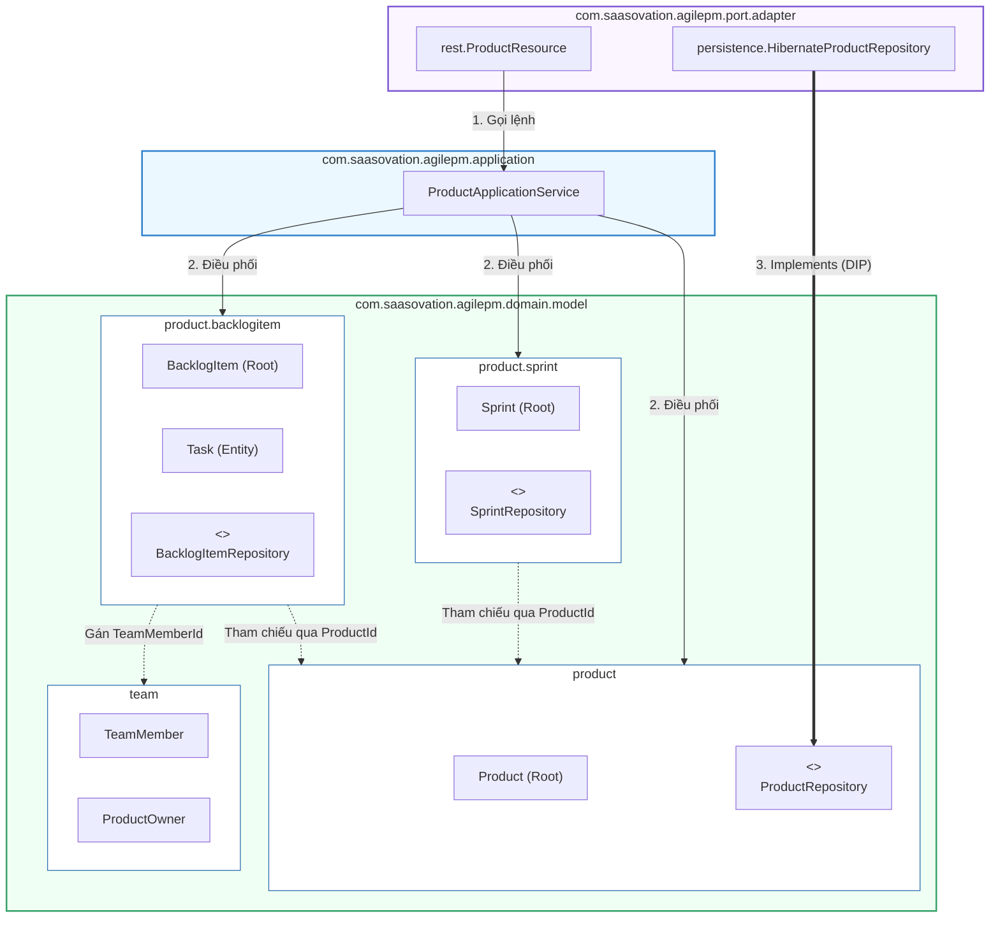
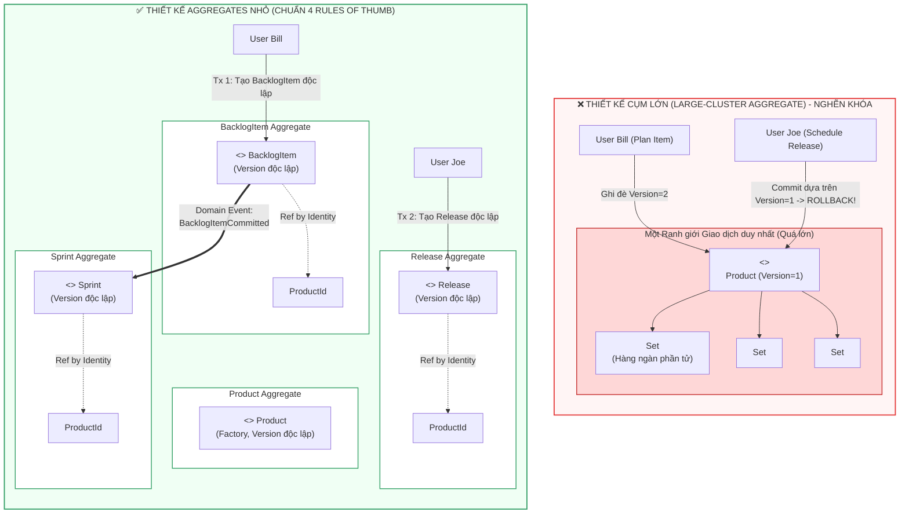

# ĐỢT 6 / 10: BÓC TÁCH CHUYÊN SÂU CHƯƠNG 9 & CHƯƠNG 10 (PHẦN 1)
**Sách:** *Implementing Domain-Driven Design (IDDD)* — **Tác giả:** *Vaughn Vernon*

---

## CHƯƠNG 9: MODULES (CÁC MÔ-ĐUN / GÓI TỔ CHỨC MÔ HÌNH)

### 1. ĐỀ MỤC & MỤC TIÊU CỐT LÕI (CORE PURPOSE)

#### Hệ thống đề mục đầy đủ theo sách gốc (Trang 333–346):
* **Designing with Modules** (Thiết kế với các Mô-đun / Package)
* **Basic Module Naming Conventions** (Các quy ước đặt tên Mô-đun cơ bản)
* **Module Naming Conventions for the Model** (Quy ước đặt tên Mô-đun cho Mô hình Miền)
* **Modules of the Agile Project Management Context** (Các Mô-đun trong Ngữ cảnh Quản lý Dự án Agile)
* **Modules in Other Layers** (Mô-đun trong các Tầng kiến trúc khác — *Application, Infrastructure, Port & Adapter*)
* **Module before Bounded Context** (Sử dụng Mô-đun trước khi phân tách Bounded Context — *Tổ chức tiền Bounded Context*)
* **Wrap-Up** (Tổng kết)

#### Vấn đề kỹ thuật & nghiệp vụ cốt lõi và Thảm họa nếu không áp dụng:
* **Vấn đề giải quyết:** Làm thế nào để nhóm các khái niệm, thực thể (*Entities*), đối tượng giá trị (*Value Objects*) và dịch vụ (*Domain Services*) thành các cấu trúc vật lý (`package` trong Java, `namespace` trong C#) một cách gắn kết logic cao (*High Cohesion*) và khớp nối lỏng (*Low Coupling*)? Làm sao để việc đặt tên package phản ánh trực tiếp **Ngôn ngữ Phổ quát (*Ubiquitous Language*)** thay vì phân chia máy móc theo kiểu kỹ thuật?
* **Thảm họa kỹ thuật nếu không áp dụng:**
  1. **Tổ chức Package theo Kiểu Kỹ thuật Máy móc (*Technical Component Packaging Anti-pattern*):** Lập trình viên chia package thành: `com.company.entities`, `com.company.repositories`, `com.company.services`, `com.company.factories`. Hậu quả là một khái niệm nghiệp vụ duy nhất (ví dụ: `Product` hoặc `Sprint`) bị xé nát ra 4-5 package khác nhau; không ai nhìn vào cấu trúc thư mục mà hiểu được hệ thống làm về nghiệp vụ gì; mức độ phụ thuộc vòng tròn giữa các package kỹ thuật tăng vọt (*Circular Package Dependency*).
  2. **Thảm họa Khớp nối Package (*Uncontrolled Package Tangling*):** Các class trong package này import tự do các class trong package khác không theo quy tắc. Khi muốn trích xuất hoặc chia tách một phân hệ thành microservice/Bounded Context riêng, ta phải đối mặt với một mạng nhện phụ thuộc không thể tháo gỡ.
  3. **Lạm dụng Bounded Context quá sớm (*Premature Bounded Context Decomposition*):** Khi dự án còn nhỏ, đội ngũ vội vã tách thành nhiều Bounded Context / Microservices riêng biệt, gánh chịu chi phí vận hành mạng và serialization quá lớn, thay vì phân chia ranh giới ngữ cảnh sạch sẽ bằng **Modules** ngay trong cùng một mã nguồn đơn khối (*Monolith with Modular Boundaries*).

---

### 2. PHÂN TÍCH LÝ THUYẾT & NGUYÊN LÝ CHUYÊN SÂU

#### A. Triết lý Thiết kế Mô-đun trong DDD (*Designing with Modules*)
Vaughn Vernon nhấn mạnh: **Module không chỉ là nơi chứa file mã nguồn, Module là một thành phần chính thống của Ubiquitous Language!**
* **Tính gắn kết cao (*High Cohesion*):** Các đối tượng trong cùng một Module phải phục vụ cho cùng một khái niệm nghiệp vụ cốt lõi hoặc một cụm chức năng có tính liên quan mật thiết. Nếu một đối tượng thay đổi, các đối tượng cùng Module có khả năng phải thay đổi theo.
* **Khớp nối lỏng (*Low Coupling*):** Giảm thiểu tối đa số lượng liên kết tham chiếu từ Module này sang Module khác. Giao tiếp giữa các Module nên thông qua các lớp Root, các Interface hoặc các Value Objects trung gian.
* **Nguyên tắc Đóng gói theo Ngữ nghĩa (*Semantic Packaging*):** Nhìn vào danh sách Module/Package, một kỹ sư mới vào dự án phải đọc ra ngay được câu chuyện kinh doanh (*Business Story*) của phần mềm, chứ không phải thấy danh sách các công nghệ Java (`controllers`, `beans`, `daos`, `helpers`).

#### B. Quy ước Đặt tên Module Chuẩn DDD (*Module Naming Conventions*)
Quy ước đặt tên package chuẩn trong DDD của Vaughn Vernon tuân theo cấu trúc phân tầng phân cấp có trật tự:
```
[Tên miền tổ chức].[Tên sản phẩm].[Tên Bounded Context].[Tên Tầng].[Tên Khái niệm Miền]
```
Ví dụ chuẩn mực trong *SaaSOvation*:
* **Tầng Miền (*Domain Model Layer*):**
  * `com.saasovation.agilepm.domain.model.product` (Chứa `Product`, `ProductId`, `ProductBacklogItem`, `ProductDiscussion`)
  * `com.saasovation.agilepm.domain.model.product.backlogitem` (Chứa `BacklogItem`, `BacklogItemId`, `Task`, `EstimationLogEntry`, `BusinessPriority`)
  * `com.saasovation.agilepm.domain.model.product.release` (Chứa `Release`, `ReleaseId`, `ScheduledBacklogItem`)
  * `com.saasovation.agilepm.domain.model.product.sprint` (Chứa `Sprint`, `SprintId`, `CommittedBacklogItem`)
  * `com.saasovation.agilepm.domain.model.team` (Chứa `ProductOwner`, `TeamMember`, `Team`)
* **Tầng Ứng dụng (*Application Layer*):**
  * `com.saasovation.agilepm.application.product` (Chứa `ProductApplicationService`)
* **Tầng Hạ tầng / Cổng Adapter (*Port and Adapter Layer*):**
  * `com.saasovation.agilepm.port.adapter.persistence` (Chứa `HibernateProductRepository`)
  * `com.saasovation.agilepm.port.adapter.rest` (Chứa `ProductResource`)
  * `com.saasovation.agilepm.port.adapter.messaging` (Chứa `RabbitMQBacklogItemPublisher`)

#### C. Chiến lược "Module trước khi tách Bounded Context" (*Module before Bounded Context*)
* Đây là lời khuyên thực dụng kinh điển của Vernon: Khi bắt đầu một dự án, nếu ranh giới ngữ nghĩa chưa hoàn toàn rõ ràng, hoặc đội ngũ phát triển còn nhỏ (chỉ có 1 nhóm làm việc), **đừng vội vã chia thành 3-4 repo hoặc 3-4 microservices**.
* Hãy thiết kế hệ thống dưới dạng **Modular Monolith**: Giữ tất cả trong một deployment artifact (1 file `.jar` / `.war`), nhưng chia tách nghiêm ngặt ranh giới nghiệp vụ bằng các **top-level Modules** (`identityaccess`, `collaboration`, `agilepm`). Cấm các package này gọi chéo tầng nội tại của nhau. Đến khi đội ngũ phát triển phình to hoặc cần mở rộng quy mô độc lập, việc "cắt" các Module này thành các Bounded Contexts độc lập sẽ chỉ tốn vài giờ refactor thay vì đập đi xây lại!

---

### 3. MỔ XẺ MÃ NGUỒN & CẤU TRÚC THIẾT KẾ (CODE DEEP-DIVE)

So sánh cấu trúc tổ chức mã nguồn giữa **Thiết kế theo thành phần kỹ thuật (Sai lầm)** và **Thiết kế theo Khái niệm Miền của Bounded Context (Chuẩn mực DDD)**:

#### ❌ Cấu trúc SAI: Chia Module máy móc theo Lớp Kỹ thuật (*Technical Layer Packaging*)
```
com.saasovation.projectovation/
├── entities/                      <-- THẢM HỌA: Gom mọi Entity vào một nơi
│   ├── Product.java
│   ├── BacklogItem.java
│   ├── Task.java
│   ├── Release.java
│   ├── Sprint.java
│   └── TeamMember.java
├── valueobjects/                  <-- Gom mọi Value Object vào một nơi
│   ├── ProductId.java
│   ├── BusinessPriority.java
│   └── EstimationLogEntry.java
├── repositories/                  <-- Gom mọi Repository Interface
│   ├── ProductRepository.java
│   └── BacklogItemRepository.java
└── services/                      <-- Trộn lẫn Application Service & Domain Service
    ├── ProductApplicationService.java
    └── BusinessPriorityCalculator.java
```
*Hệ quả:* Mọi class đều phải `public`, không tận dụng được phạm vi truy cập `package-private` của Java để giấu các thành phần nhạy cảm!

#### ✅ Cấu trúc CHUẨN MỰC: Phân rã theo Ngữ cảnh Giới hạn và Khái niệm Miền (*Domain Concept Modules*)
```
com.saasovation.agilepm/
├── domain/
│   └── model/
│       ├── product/                             <-- Khái niệm Product Root
│       │   ├── Product.java                     (Aggregate Root)
│       │   ├── ProductId.java                   (Value Object)
│       │   ├── ProductBacklogItem.java          (Package-private Entity con)
│       │   ├── ProductDiscussion.java           (Value Object)
│       │   ├── ProductDiscussionRequested.java  (Domain Event)
│       │   ├── ProductRepository.java           (Repository Port Interface)
│       │   │
│       │   ├── backlogitem/                     <-- Phân mô-đun con BacklogItem
│       │   │   ├── BacklogItem.java             (Aggregate Root)
│       │   │   ├── BacklogItemId.java           (Value Object)
│       │   │   ├── Task.java                    (Entity nội bộ Aggregate)
│       │   │   ├── TaskId.java                  (Value Object)
│       │   │   ├── EstimationLogEntry.java      (Value Object)
│       │   │   ├── BusinessPriority.java        (Value Object)
│       │   │   ├── BusinessPriorityCalculator.java (Domain Service)
│       │   │   └── BacklogItemRepository.java   (Repository Port Interface)
│       │   │
│       │   └── sprint/                          <-- Phân mô-đun con Sprint
│       │       ├── Sprint.java                  (Aggregate Root)
│       │       ├── SprintId.java                (Value Object)
│       │       └── SprintRepository.java        (Repository Port Interface)
│       │
│       └── team/                                <-- Phân mô-đun Team & Vai trò
│           ├── ProductOwner.java
│           ├── TeamMember.java
│           └── Member.java
├── application/
│   └── product/
│       ├── ProductApplicationService.java
│       └── commands/
│           └── PlanBacklogItemCommand.java
└── port/
    └── adapter/
        ├── persistence/
        │   └── HibernateProductRepository.java  (Driven Adapter)
        └── rest/
            └── ProductResource.java             (Driving Adapter)
```

#### Bảng phân tích kỹ thuật & Ý nghĩa thiết kế:

| Gói / Cấu trúc Module | Giải thích kỹ thuật & Ý nghĩa thiết kế (DDD/OOP) |
| :--- | :--- |
| `com.saasovation.agilepm.domain.model.product` | **High Cohesion (Gắn kết Khái niệm Miền):** Gom tất cả những gì trực tiếp cấu thành khái niệm `Product` vào cùng một thư mục vật lý. Cho phép lớp con `ProductBacklogItem` để mức truy cập **`package-private` (không khai báo `public`)**, bảo vệ nó khỏi việc bị truy cập trái phép từ các module khác! |
| `...model.product.backlogitem` | **Độc lập Ranh giới Aggregate (*Boundary Isolation*):** `BacklogItem` là một Aggregate độc lập với `Product`. Việc tách riêng nó ra một sub-package giúp kiểm soát rõ ràng sự phụ thuộc một chiều từ `backlogitem` tới `product` thông qua `ProductId`, ngăn chặn việc import bừa bãi. |
| `...port.adapter.persistence` vs. `...domain.model.product` | **Dependency Inversion Principle (DIP):** Package `persistence` import package `domain.model.product` để thực thi `ProductRepository`. Gói `domain` hoàn toàn không có bất kỳ dòng code `import` nào trỏ tới gói `adapter`, đảm bảo mô hình miền hoàn toàn trung lập với hạ tầng. |

---

### 4. SƠ ĐỒ TRỰC QUAN HÓA (BẮT BUỘC MÃ MERMAID)

Sơ đồ gói (Package Diagram) thể hiện mối quan hệ phụ thuộc một chiều, không vòng tròn giữa các Module trong kiến trúc phân tầng chuẩn DDD:



---

### 5. ÁNH XẠ ỨNG DỤNG VÀO DỰ ÁN GAME 2.5D OOP MULTIPLAYER

1. **Chuẩn hóa hệ thống Package trong `Src_Game` theo Module Miền (Xóa bỏ package kiểu `entities/` hỗn tạp):**
   * *Hiện trạng sai lầm phổ biến:* Tạo các package `com.game.entities` (chứa chung cả `Player`, `Skeleton`, `Zombie`, `Bullet`, `Chest`), `com.game.managers` (chứa `SkillManager`, `LootManager`).
   * *Áp dụng Chương 9:* Tái cấu trúc theo Khái niệm Miền:
     * `com.game.combat.hero` (Chứa `HeroCharacter`, `HeroClass`, `SkillSlot`, `PlayerStats`)
     * `com.game.combat.mobs` (Chứa `MobEntity`, `MobType`, `MobSpawnSpec`, `MobLootTable`)
     * `com.game.combat.stormzone` (Chứa `StormCircle`, `ZonePhase`, `ZoneDamageCalculator`)
     * `com.game.network.protocol` (Chứa các gói tin DTO và Packet Serialization)
     * `com.game.presentation.render25d` (Chứa `IsometricRenderer`, `SpriteSheetLoader`, `Camera25D`)
   * *Lợi ích:* Đóng gói các lớp con của Quái vật (`MobBehavior`, `MobAnimationTracker`) ở mức **`package-private`**, chỉ phơi bày giao diện công khai `MobEntity` ra ngoài cho Game Loop điều khiển.
2. **Ngăn chặn rò rỉ phụ thuộc vòng tròn giữa `Combat` và `Render`:**
   * Package `combat` tuyệt đối không được `import com.game.presentation.*`. Chiều phụ thuộc vật lý bắt buộc phải là một chiều: `presentation` import `combat` để đọc dữ liệu vẽ lên màn hình, bảo đảm logic game có thể chạy trơn tru ở chế độ máy chủ không màn hình (*Dedicated Headless Server*).

---
---

## CHƯƠNG 10 (PHẦN 1): AGGREGATES — SCRUM CORE DOMAIN & 4 RULES OF THUMB (CÁC KHỐI KẾT HỢP - PHẦN 1)

### 1. ĐỀ MỤC & MỤC TIÊU CỐT LÕI (CORE PURPOSE)

#### Hệ thống đề mục đầy đủ theo sách gốc (Nửa đầu Chương 10 - Trang 347–367):
* **Using Aggregates in the Scrum Core Domain** (Sử dụng Aggregates trong Miền cốt lõi Scrum của SaaSOvation)
  * *First Attempt: Large-Cluster Aggregate* (Nỗ lực đầu tiên: Khối kết hợp Cụm Lớn — Sai lầm cấu trúc)
  * *Second Attempt: Multiple Aggregates* (Nỗ lực thứ hai: Phân tách thành Nhiều Aggregates)
* **Rule: Model True Invariants in Consistency Boundaries** (Quy tắc 1: Mô hình hóa các Bất biến Thực sự trong Ranh giới Nhất quán)
* **Rule: Design Small Aggregates** (Quy tắc 2: Thiết kế các Aggregates Nhỏ)
  * *Don’t Trust Every Use Case* (Đừng tin mù quáng vào mọi Use Case của Business Analyst)
* **Rule: Reference Other Aggregates by Identity** (Quy tắc 3: Tham chiếu tới các Aggregates khác bằng Định danh)
  * *Making Aggregates Work Together through Identity References* (Làm cho các Aggregates hoạt động cùng nhau qua tham chiếu Định danh)
  * *Model Navigation* (Điều hướng trong Mô hình)
  * *Scalability and Distribution* (Khả năng Mở rộng Quy mô và Phân tán)
* **Rule: Use Eventual Consistency Outside the Boundary** (Quy tắc 4: Sử dụng Nhất quán Cuối cùng bên ngoài Ranh giới)
  * *Ask Whose Job It Is* (Hãy hỏi xem: Đó là nhiệm vụ của AI?)

#### Vấn đề kỹ thuật & nghiệp vụ cốt lõi và Thảm họa nếu không áp dụng:
* **Vấn đề giải quyết:** *Aggregate* là mẫu thiết kế chiến thuật quan trọng nhất nhưng **bị hiểu sai nhiều nhất** trong toàn bộ DDD. Chương 10 giải quyết câu hỏi: **Làm sao để gom cụm các Entities và Value Objects thành một ranh giới nhất quán giao dịch duy nhất (*Transactional Consistency Boundary*) để bảo vệ các quy tắc nghiệp vụ bất biến (*Invariants*), mà không làm sập hiệu năng hệ thống khi nhiều người dùng thao tác đồng thời?**
* **Thảm họa kỹ thuật nếu không áp dụng:**
  1. **Thảm họa Khối kết hợp Cụm Lớn (*Large-Cluster Aggregate Disaster*):** Nhầm lẫn giữa "Mối quan hệ sở hữu trong thế giới thực" với "Ranh giới giao dịch trong phần mềm". Đội ngũ nghĩ rằng: *"Product có BacklogItems, có Releases, có Sprints"* $\rightarrow$ nhét tất cả vào trong 1 class `Product` duy nhất!
  2. **Xung đột Khóa Lạc quan liên tục (*Optimistic Concurrency Collision Avalanche*):** Khi `Product` ôm hàng ngàn `BacklogItem`, `Release`, `Sprint`:
     * Người dùng Bill lập kế hoạch cho 1 `BacklogItem` mới $\rightarrow$ `Product.version` tăng từ 1 lên 2.
     * Cùng giây đó, người dùng Joe lên lịch cho 1 `Release` mới dựa trên `Product.version 1` $\rightarrow$ Giao dịch của Joe bị **Rollback và sập hoàn toàn** vì xung đột khóa lạc quan (*Stale Object Exception*)! Dù 2 hành vi này về mặt nghiệp vụ không hề liên quan gì đến nhau!
  3. **Bộ nhớ RAM nổ tung & Độ trễ I/O tăng vọt (*Memory Explosion & Lazy Loading Hell*):** Để thêm 1 task nhỏ, hệ thống phải nạp cả cây đồ thị gồm hàng ngàn đối tượng vào bộ nhớ. Nếu không bật Lazy Load thì hết RAM; nếu bật Lazy Load thì dính lỗi hàng trăm câu truy vấn phụ lắt nhắt (*N+1 Selects Problem*).

---

### 2. PHÂN TÍCH LÝ THUYẾT & NGUYÊN LÝ CHUYÊN SÂU

#### A. Định nghĩa Chuẩn mực về *Invariant* và *Consistency Boundary*
* **Bất biến (*Invariant*):** Là một **quy tắc nghiệp vụ bắt buộc phải luôn luôn đúng và nhất quán tại mọi thời điểm giao dịch commit**.
  * *Ví dụ về Bất biến thực sự:* Biểu thức $C = A + B$. Nếu $A=2, B=3$ thì $C$ bắt buộc phải bằng $5$. Nếu sau khi commit mà $C \ne 5$, hệ thống rơi vào trạng thái hỏng dữ liệu. Để bảo vệ quy tắc này, $A, B, C$ phải nằm chung trong **một ranh giới giao dịch duy nhất**.
  * *Bất biến Giả (*False Invariants*):* Đội ngũ *SaaSOvation* tự đặt ra quy tắc: *"Nếu 1 backlog item đã lên lịch vào sprint thì không cho xóa khỏi hệ thống"*. Đây không phải là một bất biến tức thời đòi hỏi chung giao dịch, mà là một ràng buộc có thể kiểm tra trước khi gọi lệnh hoặc xử lý bù trừ!

#### B. 4 Quy tắc Vàng Thiết kế Aggregate (*The 4 Aggregate Rules of Thumb*)
Vaughn Vernon đúc kết 4 quy tắc sống còn mà bất kỳ kiến trúc sư nào cũng phải tuân thủ:

##### Quy tắc 1: Mô hình hóa các Bất biến Thực sự trong Ranh giới Nhất quán (*Model True Invariants in Consistency Boundaries*)
* Một Aggregate tương đương với một **Ranh giới Nhất quán Giao dịch (*Transactional Consistency Boundary*)**.
* Mọi thứ bên trong ranh giới của một Aggregate instance phải hoàn toàn nhất quán khi một giao dịch kết thúc.
* **Nguyên tắc ngón tay cái:** Trong một Bounded Context được thiết kế chuẩn, **mỗi giao dịch chỉ được phép chỉnh sửa DUY NHẤT MỘT Aggregate instance** (`Modify only ONE Aggregate instance per transaction`)!

##### Quy tắc 2: Thiết kế các Aggregates Nhỏ (*Design Small Aggregates*)
* Giới hạn Aggregate chỉ gồm **Aggregate Root Entity** và một số lượng tối thiểu các thuộc tính và **Value Objects**.
* Hãy ưu tiên chứa các Value Objects thay vì chứa các Entities con. Tỷ lệ khảo sát thực tế của Niclas Hedhman trên dự án lớn: **70% Aggregates chỉ gồm duy nhất 1 Root Entity bọc các Value Objects**, 30% còn lại chỉ chứa thêm 1 đến 2 Entity con!
* **Đừng tin mù quáng vào mọi Use Case (*Don't Trust Every Use Case*):** Khi Business Analyst viết một Use Case mô tả việc cập nhật hàng loạt nhiều đối tượng cùng lúc (như phê duyệt 100 đơn hàng), lập trình viên không được gộp chúng vào 1 Aggregate khổng lồ. Hãy thực hiện Use Case đó qua nhiều giao dịch độc lập hoặc dùng xử lý lô (*Batch Processing*).

##### Quy tắc 3: Tham chiếu tới các Aggregates khác bằng Định danh (*Reference Other Aggregates by Identity*)
* **TUYỆT ĐỐI KHÔNG giữ tham chiếu trực tiếp dạng con trỏ đối tượng (*Do NOT hold direct object references*)** giữa các Aggregates!
  * *Sai:* `class BacklogItem { private Product product; }` (Tạo ra đồ thị đối tượng sâu, khiến bộ nhớ nạp lan truyền và cám dỗ lập trình viên sửa cả 2 trong 1 transaction).
  * *Đúng:* `class BacklogItem { private ProductId productId; }` (Chỉ lưu giữ Value Object định danh!).
* *Lợi ích:*
  1. **Bộ nhớ cực nhẹ:** Nạp một `BacklogItem` chỉ tốn vài chục bytes, không kích hoạt cơ chế tải lan truyền cả cây dữ liệu.
  2. **Loại bỏ xung đột giao dịch:** Không bao giờ vô tình sửa đổi `Product` khi đang thao tác trên `BacklogItem`.
  3. **Khả năng mở rộng phân tán (*Infinite Scalability*):** Theo bài báo kinh điển *"Life beyond Distributed Transactions"* của Pat Helland (Amazon), các Aggregate tham chiếu qua ID có thể được lưu trữ trên các bảng khác nhau, các database phân vùng khác nhau (*Database Sharding*) hoặc các node NoSQL khác nhau mà không bị ràng buộc bởi khóa ngoại cấp cơ sở dữ liệu.

##### Quy tắc 4: Sử dụng Nhất quán Cuối cùng bên ngoài Ranh giới (*Use Eventual Consistency Outside the Boundary*)
* Khi một hành vi nghiệp vụ trên một Aggregate đòi hỏi cập nhật trạng thái trên một hoặc nhiều Aggregates khác: **HÃY DÙNG NHẤT QUÁN CUỐI CÙNG (*EVENTUAL CONSISTENCY*)!**
* **Cơ chế:** Aggregate A thực thi command $\rightarrow$ commit giao dịch cục bộ của nó $\rightarrow$ phát ra một **Domain Event** $\rightarrow$ Các Subscribers ở các giao dịch tiếp theo sẽ nhận sự kiện, nạp Aggregate B lên và cập nhật độc lập!
* **Quy tắc "Hỏi xem đó là việc của ai" (*Ask Whose Job It Is*):**
  * Thảo luận giữa Vaughn Vernon và Eric Evans đưa ra câu hỏi mấu chốt để phân xử:
  * *"Liệu có phải nhiệm vụ của người dùng đang bấm nút là làm cho dữ liệu của cả 2 nơi khớp nhau ngay lập tức không?"*
    * Nếu ĐÚNG là trách nhiệm trực tiếp của người đó: Xem xét gộp chung hoặc xử lý giao dịch.
    * Nếu đó là nhiệm vụ của một người khác (như Product Owner duyệt sau), hoặc là **nhiệm vụ của hệ thống máy tính tự động cập nhật**: **BẮT BUỘC DÙNG EVENTUAL CONSISTENCY!** Chuyên gia nghiệp vụ trong thực tế hoàn toàn chấp nhận việc dữ liệu có độ trễ vài giây đến vài phút để đổi lấy hệ thống chạy mượt mà không bao giờ bị đơ!

---

### 3. MỔ XẺ MÃ NGUỒN & CẤU TRÚC THIẾT KẾ (CODE DEEP-DIVE)

Chương 10 trình bày màn bóc tách kinh điển: Từ thiết kế cụm lớn bị sập vì Optimistic Locking đến thiết kế tách nhỏ thành 4 Aggregates độc lập giao tiếp qua `ProductId` và `Domain Events` (trang 349–365).

#### ❌ Thiết kế SAI BAN ĐẦU: Khối kết hợp Cụm Lớn (*Large-Cluster Aggregate*)
```java
// THẢM HỌA: Product ôm trọn tất cả con cháu trong cùng một ranh giới Aggregate!
public class Product extends ConcurrencySafeEntity {
    private ProductId productId;
    private TenantId tenantId;
    private String name;
    private String description;

    // Các tập hợp khổng lồ khiến nạp bộ nhớ cực nặng và khóa lạc quan xung đột liên tục!
    private Set<BacklogItem> backlogItems;
    private Set<Release> releases;
    private Set<Sprint> sprints;

    // Phương thức CQS Command: void return type, biến đổi trực tiếp tập hợp nội bộ
    public void planBacklogItem(
        String aSummary, String aCategory,
        BacklogItemType aType, StoryPoints aStoryPoints) {
        
        BacklogItem backlogItem = new BacklogItem(
            this.tenantId(), this.productId(),
            new BacklogItemId(UUID.randomUUID().toString()),
            aSummary, aCategory, aType, aStoryPoints);

        // THẢM HỌA: Thêm phần tử vào Set làm thay đổi trạng thái của Product -> Product.version tăng vọt!
        // Người khác đang tạo Sprint trên cùng Product này sẽ bị xung đột khóa lạc quan (Crash)!
        this.backlogItems.add(backlogItem);
    }
}
```

#### ✅ Thiết kế CHUẨN MỰC SAU REFACTOR: 4 Aggregates Tách Biệt, Tham chiếu qua Identity và Nhà máy Khởi tạo

```java
// ============================================================================
// 1. AGGREGATE 1: PRODUCT (Gọn nhẹ, đóng vai trò Factory sinh BacklogItem)
// Package: com.saasovation.agilepm.domain.model.product
// ============================================================================
public class Product extends ConcurrencySafeEntity {
    private TenantId tenantId;
    private ProductId productId;
    private String name;
    private String description;
    // ĐÃ XÓA SẠCH: Không còn Set<BacklogItem>, Set<Release>, Set<Sprint> ở đây nữa!

    // REFACTOR CQS: Phương thức này đóng vai trò Factory (Chương 11), trả về thực thể BacklogItem MỚI
    // KHÔNG làm thay đổi Product.concurrencyVersion!
    public BacklogItem planBacklogItem(
        String aSummary,
        String aCategory,
        BacklogItemType aType,
        StoryPoints aStoryPoints) {

        BacklogItemId newBacklogItemId =
            new BacklogItemId(UUID.randomUUID().toString().toUpperCase());

        // Khởi tạo Aggregate con với tham chiếu ID ngược về ProductId
        BacklogItem plannedBacklogItem = new BacklogItem(
            this.tenantId(),
            this.productId(),
            newBacklogItemId,
            aSummary,
            aCategory,
            aType,
            aStoryPoints);

        return plannedBacklogItem;
    }
}

// ============================================================================
// 2. AGGREGATE 2: BACKLOGITEM (Đứng độc lập, tham chiếu Product/Sprint qua ID)
// Package: com.saasovation.agilepm.domain.model.product.backlogitem
// ============================================================================
public class BacklogItem extends ConcurrencySafeEntity {
    private TenantId tenantId;
    private ProductId productId;       // THAM CHIẾU QUA IDENTITY (Quy tắc 3)
    private BacklogItemId backlogItemId;
    private ReleaseId releaseId;       // THAM CHIẾU QUA IDENTITY
    private SprintId sprintId;         // THAM CHIẾU QUA IDENTITY
    private BacklogItemStatus status;

    private Set<Task> tasks;           // Cụm nhỏ gồm các Entities/VOs bảo vệ Invariant nội bộ

    // QUY TẮC 4: DÙNG DOMAIN EVENT ĐỂ ĐẠT ĐƯỢC EVENTUAL CONSISTENCY
    public void commitTo(Sprint aSprint) {
        this.assertArgumentNotNull(aSprint, "Sprint must not be null.");
        this.assertArgumentEquals(this.tenantId(), aSprint.tenantId(), "Tenant mismatch.");
        this.assertArgumentEquals(this.productId(), aSprint.productId(), "Product mismatch.");

        this.setSprintId(aSprint.sprintId());
        this.setStatus(BacklogItemStatus.COMMITTED);

        // Bắn Domain Event để phía Sprint tự cập nhật CommittedBacklogItem ở giao dịch riêng!
        DomainEventPublisher
            .instance()
            .publish(new BacklogItemCommitted(
                this.tenantId(),
                this.backlogItemId(),
                this.sprintId()));
    }
}

// ============================================================================
// 3. TẦNG APPLICATION SERVICE: Tuân thủ "Chỉ sửa 1 Aggregate per Transaction"
// Package: com.saasovation.agilepm.application.product
// ============================================================================
public class ProductBacklogItemService {
    @Transactional
    public String planProductBacklogItem(
        String aTenantId, String aProductId,
        String aSummary, String aCategory,
        String aType, String aStoryPoints) {

        TenantId tenantId = new TenantId(aTenantId);
        ProductId productId = new ProductId(aProductId);

        // Chỉ đọc Product để kiểm tra và dùng làm Factory
        Product product = this.productRepository.productOfId(tenantId, productId);

        BacklogItem plannedBacklogItem = product.planBacklogItem(
            aSummary,
            aCategory,
            BacklogItemType.valueOf(aType),
            StoryPoints.valueOf(aStoryPoints));

        // CHỈ THÊM MỚI 1 AGGREGATE DUY NHẤT VÀO DATABASE TRONG GIAO DỊCH NÀY!
        this.backlogItemRepository.add(plannedBacklogItem);

        return plannedBacklogItem.backlogItemId().id();
    }
}
```

#### Bảng phân tích kỹ thuật & Ý nghĩa thiết kế:

| Dòng code / Đoạn code then chốt | Giải thích kỹ thuật & Nguyên lý thiết kế (DDD/OOP) được hiện thực hóa |
| :--- | :--- |
| `private ProductId productId;` *(Trong BacklogItem)* | **Quy tắc 3: Reference by Identity:** Thay vì lưu con trỏ `Product`, ta chỉ lưu Value Object `ProductId`. Nhờ vậy, khi Hibernate nạp `BacklogItem`, nó không kích hoạt truy vấn kéo theo toàn bộ bảng `Product`, tiết kiệm bộ nhớ và cắt đứt liên kết khóa giao dịch. |
| `public BacklogItem planBacklogItem(...)` *(Trả về BacklogItem)* | **Tách biệt CQS & Aggregate Factory:** Đổi từ hàm trả về `void` (sửa đổi bộ sưu tập nội bộ của Product) sang hàm dạng Factory trả về một cá thể `BacklogItem` mới tinh. Bản thân `Product` không bị "dirty", không tăng `concurrencyVersion`, loại bỏ 100% nguy cơ tranh chấp khóa với người khác! |
| `this.backlogItemRepository.add(plannedBacklogItem);` | **Quy tắc 1: Sửa đúng 1 Aggregate per Transaction:** Tầng Application Service nạp `Product` ở chế độ chỉ đọc và chỉ thực hiện thao tác lưu đối với `BacklogItem` mới. Giao dịch diễn ra trong vài mili-giây và luôn thành công. |
| `DomainEventPublisher.instance().publish(new BacklogItemCommitted(...))` | **Quy tắc 4: Eventual Consistency Outside Boundary:** Thay vì trong cùng một giao dịch vừa sửa `BacklogItem`, vừa mở `Sprint` ra để nhét `CommittedBacklogItem` vào (vi phạm quy tắc 1), `BacklogItem` chỉ phát ra sự kiện. Phía `Sprint` sẽ có một Subscriber độc lập xử lý ở giao dịch tiếp theo. |

---

### 4. SƠ ĐỒ TRỰC QUAN HÓA (BẮT BUỘC MÃ MERMAID)

Sơ đồ trực quan hóa bước ngoặt kiến trúc: Từ **Khối kết hợp cụm lớn (Gây tắc nghẽn giao dịch)** sang **Các Aggregates nhỏ độc lập liên kết qua Định danh và Nhất quán cuối cùng**:



---

### 5. ÁNH XẠ ỨNG DỤNG VÀO DỰ ÁN GAME 2.5D OOP MULTIPLAYER

4 Quy tắc Vàng về Aggregate giải quyết 2 bài toán nhức nhối nhất trong phát triển Game nhiều người chơi: **Chống Hack/Dupe đồ giao dịch** và **Đồng bộ hóa nhặt đồ trên bản đồ**:

1. **Áp dụng Quy tắc 1 & 3 để Chống Lỗi Nhân Bản Trang Bị (*Item Duplication / Race Condition Bug*):**
   * *Thảm họa trong Game RPG:* Người chơi A giao dịch (*Trade*) một thanh kiếm thần cho Người chơi B. Lập trình viên viết một giao dịch mở cả hai nhân vật: `playerA.getInventory().remove(item)` và `playerB.getInventory().add(item)`. Khi mạng lag hoặc có gian lận cố tình ngắt kết nối đúng thời điểm, một lệnh ghi thành công còn lệnh kia rollback, dẫn đến lỗi thanh kiếm xuất hiện trong cả hai túi đồ (*Dupe item*)!
   * *Áp dụng Quy tắc Aggregate:* Túi đồ của mỗi người chơi là một **Aggregate riêng biệt** (`InventoryAggregate`), tham chiếu người chơi qua `PlayerId`. Thao tác giao dịch **không bao giờ sửa 2 Aggregate trong 1 giao dịch trực tiếp**. Thay vào đó:
     * Giao dịch 1: Khóa món đồ trong túi A và phát sinh thực thể tạm thời `TradeSessionAggregate` (lưu mã giao dịch `TradeId`).
     * Giao dịch 2: Rút món đồ khỏi túi A và đưa vào trạng thái trung gian.
     * Giao dịch 3: Nạp món đồ vào túi B. Nếu có bất kỳ sự cố mạng nào xảy ra, hệ thống tự động hoàn trả dựa trên quy tắc bất biến của `TradeSession` mà không bao giờ sinh ra lỗi dupe đồ.
2. **Quy tắc 2 (Small Aggregate) cho Thực thể Quái vật (`MobEntity`) và Hòm đồ rơi (`LootDrop`):**
   * Thay vì để bản đồ thế giới (*World Map*) làm một Aggregate khổng lồ chứa hàng ngàn con Quái và hàng ngàn hòm đồ, mỗi con Quái (`MobEntity`) và mỗi đống chiến lợi phẩm (`LootDrop`) là **một Aggregate nhỏ độc lập** có định danh `LootId`, `MobId`.
   * Khi 2 người chơi cùng lao vào nhặt 1 món đồ cùng 1 mili-giây: Cơ chế **Khóa Lạc quan (*Optimistic Concurrency / Version*)** trên `LootDrop` sẽ đảm bảo người có gói tin tới trước nhận được đồ (`version` nhảy từ 1 lên 2), người tới sau nhận ngay thông báo lỗi *"Vật phẩm đã bị người khác nhặt"* mà không làm đơ Game Loop của máy chủ!
