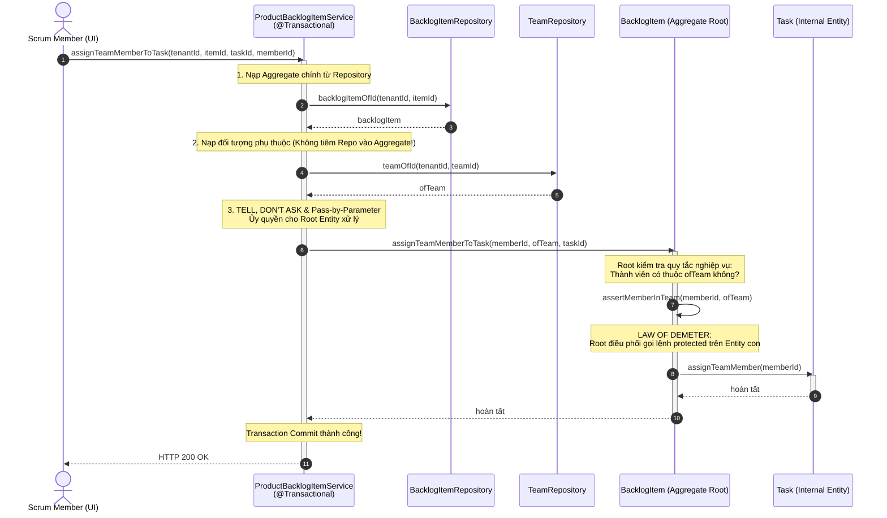

# ĐỢT 7 / 10: BÓC TÁCH CHUYÊN SÂU CHƯƠNG 10 (PHẦN 2)
**Sách:** *Implementing Domain-Driven Design (IDDD)* — **Tác giả:** *Vaughn Vernon*

---

## CHƯƠNG 10 (PHẦN 2): AGGREGATES — REASONS TO BREAK RULES, DISCOVERY & IMPLEMENTATION (CÁC KHỐI KẾT HỢP - PHẦN 2)

### 1. ĐỀ MỤC & MỤC TIÊU CỐT LÕI (CORE PURPOSE)

#### Hệ thống đề mục đầy đủ theo sách gốc (Nửa sau Chương 10 - Trang 367–388):
* **Reasons to Break the Rules** (Các lý do chính đáng để Phá vỡ Quy tắc thiết kế Aggregate)
  * *Reason One: User Interface Convenience* (Lý do 1: Sự tiện lợi của Giao diện người dùng — Tạo hàng loạt *Batch Creation*)
  * *Reason Two: Lack of Technical Mechanisms* (Lý do 2: Thiếu hụt Cơ chế Kỹ thuật / Không có hạ tầng Messaging)
  * *Reason Three: Global Transactions* (Lý do 3: Ràng buộc Giao dịch Toàn cục / Two-Phase Commit do chính sách doanh nghiệp)
  * *Reason Four: Query Performance* (Lý do 4: Hiệu năng Truy vấn / Theta Joins)
  * *Adhering to the Rules* (Kiên định tuân thủ Quy tắc)
* **Gaining Insight through Discovery** (Đạt được Thấu hiểu Sâu sắc thông qua Quá trình Khám phá Mô hình)
  * *Rethinking the Design, Again* (Tái tư duy Thiết kế một lần nữa: Cân nhắc giữa `BacklogItem` và `Task`)
  * *Estimating Aggregate Cost* (Ước tính Chi phí Aggregate — Phương pháp Tính toán trên vỏ phong bì *BOTE Calculations*)
  * *Common Usage Scenarios* (Các Kịch bản Sử dụng Phổ biến & Khảo sát Tranh chấp Khóa)
  * *Memory Consumption* (Tiêu thụ Bộ nhớ RAM và Tác động của Lazy Loading)
  * *Exploring Another Alternative Design* (Khám phá Thiết kế Thay thế: Tách `Task` thành Aggregate Độc lập)
  * *Implementing Eventual Consistency* (Hiện thực hóa Nhất quán Cuối cùng giữa `Task` và `BacklogItem`)
  * *Is It the Team Member’s Job?* (Đó có phải là nhiệm vụ của Thành viên Đội ngũ không? — Tự động vs Thủ công)
  * *Time for Decisions* (Thời điểm Ra Quyết định Kiến trúc: Sự Thực dụng thắng Phân tích Trừu tượng)
* **Implementation** (Chi tiết Hiện thực hóa Kỹ thuật)
  * *Create a Root Entity with Unique Identity* (Tạo Thực thể Gốc với Định danh Duy nhất)
  * *Favor Value Object Parts* (Ưu tiên các Thành phần là Đối tượng Giá trị)
  * *Using Law of Demeter and Tell, Don’t Ask* (Áp dụng Định luật Demeter và Nguyên lý "Hãy ra lệnh, Đừng hỏi han")
  * *Optimistic Concurrency* (Kiểm soát Đồng thời Lạc quan: Quản lý thuộc tính `version` trên Root vs. Child Entities)
  * *Avoid Dependency Injection* (Tránh Tiêm Phụ thuộc Repository/Service vào bên trong Aggregate)
* **Wrap-Up** (Tổng kết)

#### Vấn đề kỹ thuật & nghiệp vụ cốt lõi và Thảm họa nếu không áp dụng:
* **Vấn đề giải quyết:**
  1. Trong thực tế, có những tình huống bắt buộc phải phá vỡ quy tắc "Chỉ sửa 1 Aggregate/giao dịch" (như tạo lô dữ liệu trên UI, thiếu Message Broker, hoặc yêu cầu hiệu năng đọc cực hạn). Làm thế nào để **phá vỡ quy tắc một cách có kiểm soát và an toàn tuyệt đối** mà không phá hủy tính toàn vẹn của mô hình?
  2. Làm sao để đánh giá định lượng chi phí RAM và xung đột giao dịch của một Aggregate trước khi viết code? Vaughn Vernon cung cấp công cụ toán học ước lượng thực chiến: **BOTE (*Back-of-the-envelope*) Calculations**.
  3. Làm sao để lập trình Aggregate đúng chuẩn OOP thuần khiết: Ẩn giấu cấu trúc nội bộ bằng **Law of Demeter** và **Tell, Don’t Ask**, quản lý phiên bản khóa lạc quan (*Optimistic Concurrency Versioning*) khi cập nhật thành phần con, và tại sao **tuyệt đối cấm Dependency Injection** vào trong Aggregate?
* **Thảm họa kỹ thuật nếu không áp dụng:**
  1. **Tê liệt Phân tích (*Analysis Paralysis*):** Đội ngũ tranh cãi bất tận về việc có nên tách `Task` khỏi `BacklogItem` hay không mà không đưa ra được con số định lượng cụ thể về bộ nhớ và tần suất sử dụng thực tế.
  2. **Vi phạm Định luật Demeter & Rò rỉ Trạng thái Nội bộ (*Train Wreck Code*):** Client bên ngoài chọc sâu vào cấu trúc Aggregate bằng chuỗi lệnh nguy hiểm `product.getBacklogItems().get(0).setOrder(5)`. Thực thể gốc mất quyền kiểm soát bất biến (*Invariants*), dữ liệu bị thao túng tùy tiện.
  3. **Rò rỉ Hạ tầng vào Lõi Nghiệp vụ & Cạn kiệt Bộ nhớ Garbage Collection (GC):** Tiêm `Repository` hoặc `DomainService` vào bên trong Aggregate thông qua DI Framework (Spring `@Autowired`), tạo ra hàng triệu liên kết rác trong bộ nhớ RAM, khiến bộ thu gom rác (*Garbage Collector*) bị quá tải chu kỳ quét.

---

### 2. PHÂN TÍCH LÝ THUYẾT & NGUYÊN LÝ CHUYÊN SÂU

#### A. 4 Lý do Chính đáng để Phá vỡ Quy tắc Aggregate (*Reasons to Break the Rules*)
Vaughn Vernon nhấn mạnh: *Nguyên tắc ngón tay cái sinh ra là để tuân theo, nhưng một kiến trúc sư giàu kinh nghiệm phải biết chính xác khi nào và tại sao mình phá luật*:
1. **Lý do 1: User Interface Convenience (Sự tiện lợi của UI — Thao tác Tạo hàng loạt):**
   * Người dùng cần tạo nhanh 10 `BacklogItem` cùng lúc từ một biểu mẫu nhập liệu lô. Việc tạo 10 Aggregate mới trong cùng một Database Transaction là hoàn toàn chấp nhận được, **bởi vì bản thân từng Aggregate mới tạo tự bảo vệ bất biến của chính nó**, và không có xung đột khóa lạc quan với trạng thái đã lưu trước đó.
2. **Lý do 2: Lack of Technical Mechanisms (Thiếu hụt Hạ tầng Kỹ thuật):**
   * Nếu dự án chạy trong môi trường cũ, không có Message Broker (RabbitMQ), không có Timer nền hay Thread Pool để xử lý *Eventual Consistency*. Nếu cố chấp dùng Eventual Consistency sẽ thất bại. Trong trường hợp này, sửa 2 Aggregate trong 1 transaction là giải pháp tình thế chấp nhận được, miễn là ta áp dụng nguyên tắc **User-Aggregate Affinity** (đảm bảo chỉ 1 người dùng thao tác trên cụm đối tượng đó tại một thời điểm).
3. **Lý do 3: Global Transactions (Ràng buộc Giao dịch Toàn cục):**
   * Khi chính sách doanh nghiệp bắt buộc dùng hệ thống Legacy hỗ trợ Two-Phase Commit (2PC). Ta buộc phải tuân theo, nhưng vẫn cố gắng giữ thiết kế mô hình Aggregate độc lập bên trong ranh giới logic.
4. **Lý do 4: Query Performance (Hiệu năng Truy vấn Khắt khe):**
   * Khi việc nạp dữ liệu từ nhiều Repository độc lập qua ID gây suy giảm hiệu năng nghiêm trọng cho màn hình hiển thị, ta có thể dùng phép nối *Theta Join* của Hibernate hoặc cân nhắc phá lệ giữ tham chiếu trực tiếp có chọn lọc (nếu không thể áp dụng CQRS).

#### B. Khám phá Mô hình & Phép Tính Toán trên Vỏ Phong Bì (*BOTE Calculations*)
Để quyết định xem có nên tách `Task` thành một Aggregate riêng biệt khỏi `BacklogItem` hay không, Vernon hướng dẫn đội ngũ *SaaSOvation* thực hiện phép tính định lượng thực tế (**BOTE - Back-Of-The-Envelope Calculations** của Jon Bentley):
* **Giả định sử dụng thực tế (*Assumptions*):**
  * Một Sprint kéo dài khoảng **12 ngày làm việc**.
  * Một `Task` có thời lượng từ **4 đến 16 giờ** (trung bình lấy mốc tối đa là 12 giờ).
  * Mỗi ngày làm việc, thành viên ước lượng lại số giờ còn lại 1 lần $\rightarrow$ tối đa **12 bản ghi ước lượng (`EstimationLogEntry`)** cho mỗi Task.
  * Mỗi `BacklogItem` có trung bình khoảng 11-12 Tasks (chia theo các lát cắt kiến trúc: UI, Application, Domain, Infrastructure) $\rightarrow$ Lấy cận trên là **12 Tasks**.
* **Định lượng Chi phí Bộ nhớ và Tải dữ liệu:**
  * **Tổng số đối tượng nạp trên lý thuyết:** $12 \text{ tasks} \times 12 \text{ logs} = 144 \text{ đối tượng}$.
  * **Thực tế với Lazy Loading:**
    * Khi người dùng chỉ cập nhật số giờ của 1 Task cụ thể: Hệ thống nạp 1 `BacklogItem` + 12 `Task` proxy + 12 `EstimationLogEntry` của riêng Task đó $\rightarrow$ **Tối đa chỉ có 25 đối tượng trong RAM** tại ngày cuối cùng của Sprint!
  * **Phân tích Xung đột Khóa Lạc quan (*Concurrency Contention*):**
    * Ai là người cập nhật giờ? Chỉ có 1 lập trình viên nhận Task đó mới cập nhật giờ của mình mỗi ngày một lần $\rightarrow$ **Xác suất 2 người cùng sửa 1 Task là gần như bằng 0**.
    * Trạng thái của `BacklogItem` chỉ tự động chuyển sang `DONE` khi **tất cả mọi Task đều về 0 giờ** $\rightarrow$ Trong suốt 144 lần cập nhật, chỉ có **duy nhất lần cập nhật thứ 144** là làm thay đổi trạng thái của `BacklogItem` Root và tăng `version` của Root!
  * **Kết luận Kiến trúc Đắt giá (*Pragmatism wins*):** Việc giữ `Task` bên trong `BacklogItem` chỉ tốn tối đa 25 đối tượng trong RAM, không hề gây nghẽn hiệu năng như lo sợ ban đầu. Chi phí để tách `Task` thành Aggregate riêng (phải dùng Domain Event, thêm bảng Event Store, xử lý bất đồng bộ trên UI) là **quá đắt đỏ so với lợi ích thu lại**. Đội ngũ quyết định: **GIỮ NGUYÊN `Task` BÊN TRONG `BacklogItem`!**

#### C. Chi tiết Hiện thực hóa Kỹ thuật (*Implementation Best Practices*)
1. **Law of Demeter (Định luật Demeter - Nguyên lý Biết ít nhất *Least Knowledge*):**
   * Một phương thức của đối tượng chỉ được phép gọi các phương thức của: chính nó, các tham số truyền vào, các đối tượng do chính nó khởi tạo, và các thuộc tính trực tiếp của nó.
   * Cấm tiệt chuỗi gọi xuyên thấu: `a.getB().getC().doSomething()`. Aggregate Root phải đóng vai trò người gác cổng (*Gatekeeper*).
2. **Tell, Don’t Ask (Hãy ra lệnh, Đừng hỏi han):**
   * Thay vì lấy thông tin ra ngoài rồi tính toán: `if (item.getStatus() == X) { item.setStatus(Y); }`, Client phải ra lệnh trực tiếp cho đối tượng: `item.commitTo(sprint);`.
3. **Optimistic Concurrency với Hibernate khi Thành phần Con thay đổi:**
   * Khi ta sửa đổi một thuộc tính bên trong Entity con `ProductBacklogItem`, Hibernate **không tự động tăng version của Root Entity `Product`**!
   * *Giải pháp sai lầm:* Tự viết `this.version(this.version() + 1);` trong hàm `reorderFrom()`. Cách này làm bẩn mô hình và luôn đánh dấu dirty ngay cả khi thứ tự không đổi.
   * *Giải pháp chuẩn DDD của Vernon:* Để Entity con tự sở hữu thuộc tính `concurrencyVersion` của riêng nó; hoặc nếu muốn bảo vệ quy tắc toàn cục, chỉ kích hoạt tăng version của Root khi có một sự kiện làm biến đổi thuộc tính có ý nghĩa nghiệp vụ thực sự trên Root (như thay đổi `status` trên `BacklogItem`).
4. **Tránh Tiêm Phụ thuộc (*Avoid Dependency Injection into Aggregates*):**
   * **CẤM tiêm Repository hoặc Domain Service vào bên trong Aggregate!**
   * *Tại sao?* Aggregate là đối tượng dữ liệu và nghiệp vụ sống ngắn hạn trong RAM. Việc tiêm các Singleton Services vào hàng triệu instance Aggregate gây lãng phí bộ nhớ và cám dỗ Aggregate tự truy vấn DB (mô hình *Disconnected Domain Model* - phản mẫu).
   * *Cách làm chuẩn:* Mọi dữ liệu phụ thuộc phải được **Application Service tra cứu trước từ Repository/Service rồi truyền vào làm tham số (*Pass-by-parameter*)** cho phương thức của Aggregate, hoặc Aggregate thực hiện cơ chế *Double-Dispatch* với Domain Service truyền vào.

---

### 3. MỔ XẺ MÃ NGUỒN & CẤU TRÚC THIẾT KẾ (CODE DEEP-DIVE)

Chúng ta sẽ mổ xẻ 3 kỹ thuật then chốt của Chương 10 (Phần 2):
1. **Phá luật có kiểm soát: Tạo Lô trên UI** (`planBatchOfProductBacklogItems`, trang 367–368).
2. **Hiện thực hóa Law of Demeter & Protected Setter trên Entity con** (`Product.reorderFrom`, trang 383–384).
3. **Khai báo Root Entity chuẩn với Định danh UUID do Repository sinh ra** (`nextIdentity`, trang 380–381).

#### ❌ Thiết kế SAI BAN ĐẦU: Vi phạm Law of Demeter & Tiêm Repository trực tiếp vào Aggregate
```java
// SAI LẦM 1: Tiêm Repository trực tiếp vào Entity (Vi phạm Dependency Injection rule)
public class BadProduct extends ConcurrencySafeEntity {
    @Autowired
    private BacklogItemRepository backlogItemRepository; // THẢM HỌA: Aggregate ôm Singleton Repository!

    public void assignTask(String backlogItemId, String memberId) {
        // Aggregate tự chọc vào DB để tìm đối tượng khác
        BacklogItem item = backlogItemRepository.findById(backlogItemId);
        item.setAssignedMember(memberId);
    }
}

// SAI LẦM 2: Vi phạm Law of Demeter - Client chọc thẳng vào ruột để thao túng thứ tự
public class BadClientService {
    public void reorderItem(Product product, BacklogItemId id, int newOrder) {
        // Vi phạm nghiêm trọng Tell, Don't Ask và Law of Demeter!
        for (ProductBacklogItem pbi : product.getBacklogItems()) {
            if (pbi.getId().equals(id)) {
                pbi.setOrdering(newOrder); // Lộ hàm public setter nguy hiểm trên Entity con!
            }
        }
    }
}
```

#### ✅ Thiết kế CHUẨN MỰC SAU REFACTOR: Law of Demeter, Protected Delegation, và Double-Dispatch sạch sẽ

```java
// ============================================================================
// 1. PHÁ LUẬT CÓ KIỂM SOÁT: TẠO LÔ HÀNG LOẠT TRÊN GIAO DIỆN NGƯỜI DÙNG (UI)
// Package: com.saasovation.agilepm.application.product
// ============================================================================
public class ProductBacklogItemService {

    @Transactional
    public void planBatchOfProductBacklogItems(
        String aTenantId,
        String aProductId,
        BacklogItemDescription[] aDescriptions) {

        TenantId tenantId = new TenantId(aTenantId);
        ProductId productId = new ProductId(aProductId);

        Product product = this.productRepository.productOfId(tenantId, productId);

        // PHÁ LỆ HỢP LÝ: Vòng lặp tạo nhiều Aggregate instances trong cùng 1 Transaction
        // An toàn vì mỗi BacklogItem mới tự chịu trách nhiệm về Invariant của chính nó!
        for (BacklogItemDescription desc : aDescriptions) {
            BacklogItem plannedBacklogItem =
                product.planBacklogItem(
                    desc.summary(),
                    desc.category(),
                    BacklogItemType.valueOf(desc.backlogItemType()),
                    StoryPoints.valueOf(desc.storyPoints()));

            this.backlogItemRepository.add(plannedBacklogItem);
        }
    }
}

// ============================================================================
// 2. AGGREGATE ROOT BẢO VỆ PHẨM GIÁ NỘI BỘ (LAW OF DEMETER & TELL, DON'T ASK)
// Package: com.saasovation.agilepm.domain.model.product
// ============================================================================
public class Product extends ConcurrencySafeEntity {

    private Set<ProductBacklogItem> backlogItems; // Tập hợp Entity con nội bộ

    public void reorderFrom(BacklogItemId anId, int anOrdering) {
        // TELL, DON'T ASK: Client chỉ việc ra lệnh cho Root!
        // Root Entity tự chịu trách nhiệm điều phối việc sắp xếp lại các phần tử con
        for (ProductBacklogItem pbi : this.backlogItems()) {
            pbi.reorderFrom(anId, anOrdering);
        }
    }

    // Trả về tập hợp nhưng chỉ để đọc (Read-only query), KHÔNG có hàm setter bên ngoài
    public Set<ProductBacklogItem> backlogItems() {
        return Collections.unmodifiableSet(this.backlogItems);
    }
}

// ============================================================================
// 3. ENTITY CON NỘI BỘ ĐƯỢC BẢO VỆ TUYỆT ĐỐI (PROTECTED MUTATION)
// Package: com.saasovation.agilepm.domain.model.product
// ============================================================================
public class ProductBacklogItem extends ConcurrencySafeEntity {

    private BacklogItemId backlogItemId;
    private int ordering;

    // PHƯƠNG THỨC BIẾN ĐỔI BỊ GIẤU KÍN (PROTECTED / PACKAGE-PRIVATE)
    // Chỉ có Product (nằm cùng package) mới được phép gọi lệnh này!
    // Bất kỳ Client nào bên ngoài package đều KHÔNG THỂ gọi trực tiếp!
    protected void reorderFrom(BacklogItemId anId, int anOrdering) {
        if (this.backlogItemId().equals(anId)) {
            this.setOrdering(anOrdering);
        } else if (this.ordering() >= anOrdering) {
            this.setOrdering(this.ordering() + 1);
        }
    }

    protected void setOrdering(int anOrdering) {
        this.ordering = anOrdering;
    }

    public BacklogItemId backlogItemId() { return this.backlogItemId; }
    public int ordering() { return this.ordering; }
}

// ============================================================================
// 4. TRÁNH DEPENDENCY INJECTION: TRUYỀN PHỤ THUỘC QUA THAM SỐ (PASS-BY-PARAMETER)
// Package: com.saasovation.agilepm.application.product
// ============================================================================
public class ProductBacklogItemService {

    @Transactional
    public void assignTeamMemberToTask(
        String aTenantId, String aBacklogItemId, String aTaskId, String aTeamMemberId) {

        // 1. Application Service tự tra cứu các phụ thuộc từ Repository
        BacklogItem backlogItem = this.backlogItemRepository.backlogItemOfId(
            new TenantId(aTenantId), new BacklogItemId(aBacklogItemId));

        Team ofTeam = this.teamRepository.teamOfId(
            backlogItem.tenantId(), backlogItem.teamId());

        // 2. Truyền thực thể phụ thuộc vào Aggregate qua tham số phương thức!
        // Aggregate KHÔNG CẦN chứa Repository hay Service nào trong lòng nó!
        backlogItem.assignTeamMemberToTask(
            new TeamMemberId(aTeamMemberId),
            ofTeam,
            new TaskId(aTaskId));
    }
}
```

#### Bảng phân tích kỹ thuật & Ý nghĩa thiết kế:

| Dòng code / Đoạn code then chốt | Giải thích kỹ thuật & Nguyên lý thiết kế (DDD/OOP) được hiện thực hóa |
| :--- | :--- |
| `for (BacklogItemDescription desc : aDescriptions) { ... backlogItemRepository.add(...) }` | **Phá vỡ quy tắc 1 có kiểm soát (UI Batching):** Cho phép tạo nhiều Aggregate instances trong 1 giao dịch. Không vi phạm bất biến vì các `BacklogItem` này hoàn toàn độc lập, không đọc-ghi đè trạng thái của nhau, giúp trải nghiệm người dùng trên web mượt mà. |
| `public void reorderFrom(...)` *(Trên Product)* | **Law of Demeter & Tell, Don’t Ask:** Client bên ngoài không cần biết bên trong `Product` lưu danh sách bằng cấu trúc dữ liệu gì (`Set`, `List` hay `Tree`). Client chỉ "nói" cho `Product` biết ý định muốn sắp xếp lại từ đâu, việc duyệt qua từng phần tử do chính `Product` tự đóng gói. |
| `protected void reorderFrom(...)` *(Trên ProductBacklogItem)* | **Bảo vệ Trạng thái Entity con bằng Package-Private / Protected:** Phương thức làm thay đổi thứ tự `ordering` được để mức truy cập `protected`. Chỉ có `Product` (nằm cùng package `domain.model.product`) mới có quyền gọi. Client bên ngoài nếu cố tình gọi `productBacklogItem.reorderFrom(...)` sẽ bị lỗi biên dịch ngay lập tức! |
| `Collections.unmodifiableSet(this.backlogItems)` | **Defensive Copying & Ngăn chặn Đột biến Ngoài luồng:** Hàm getter `backlogItems()` bọc tập hợp bên trong một `UnmodifiableSet`. Nếu Client bên ngoài cố tình gọi `product.backlogItems().clear()` hoặc `.add()`, máy ảo Java sẽ ném ngay `UnsupportedOperationException`. |
| `backlogItem.assignTeamMemberToTask(..., ofTeam, ...)` | **Nguyên tắc Cấm Dependency Injection vào Aggregate:** Thay vì để `BacklogItem` tự tiêm `TeamRepository` để nạp `Team`, Application Service chịu trách nhiệm nạp `Team` trước rồi truyền vào. `BacklogItem` kiểm tra tính hợp lệ của thành viên thông qua `ofTeam` thuần túy bằng các thao tác trong bộ nhớ (*Memory-only evaluation*). |

---

### 4. SƠ ĐỒ TRỰC QUAN HÓA (BẮT BUỘC MÃ MERMAID)

Sơ đồ tuần tự thể hiện việc thực thi nghiêm ngặt **Law of Demeter**, **Tell, Don’t Ask** và kỹ thuật **Pass-by-Parameter** (không dùng DI) trong quy trình giao việc cho thành viên:



---

### 5. ÁNH XẠ ỨNG DỤNG VÀO DỰ ÁN GAME 2.5D OOP MULTIPLAYER

Các kỹ thuật thực chiến ở phần 2 của Chương 10 giúp tối ưu hóa cực hạn vòng lặp xử lý logic Game (Game Loop):

1. **Áp dụng phép tính BOTE (*Back-of-the-envelope*) để quyết định thiết kế Cụm Quái Vật (`MobGroup` vs. `MobEntity` đơn lẻ):**
   * *Bài toán đặt ra cho Game:* Trên bản đồ 66.000 px, có các bãi quái gồm 1 Boss và 5 Quái con tùy tùng. Ta nên gom 6 con quái này thành 1 Aggregate `MobPack` hay để mỗi con quái là 1 Aggregate `MobEntity` độc lập?
   * *Tính toán BOTE:*
     * Một trận đấu có 20 bãi quái $\times$ 6 con = 120 con quái.
     * Tần suất cập nhật vị trí và va chạm là 20 Hz (20 lần/giây). Nếu gom vào `MobPack`, mỗi khi 1 con quái con bị trúng đạn làm thay đổi máu, toàn bộ `MobPack` bị đánh dấu dirty và khóa phiên bản, gây nghẽn luồng xử lý AI của 5 con quái còn lại.
     * *Quyết định kiến trúc:* **Tách mỗi con quái thành 1 Aggregate `MobEntity` độc lập**, liên kết với nhau qua `LeaderMobId` (Value Object). Khi Boss chết, phát sự kiện `BossSlainEvent`, các quái con đăng ký sự kiện này để tự giải tán mà không cần khóa chung một ranh giới giao dịch!
2. **Thực thi nghiêm ngặt *Law of Demeter* và *Avoid Dependency Injection* trên Thực thể Tướng (`HeroCharacter`):**
   * Class `HeroCharacter` (Aggregate Root) tuyệt đối không được `@Autowired` các lớp như `PhysicsEngine`, `SpatialHashGrid` hay `SkillConfigRepository`.
   * Khi người chơi bấm phím dùng chiêu:
     * `CombatApplicationService` tra cứu thông số chiêu thức từ `SkillCatalog` trước.
     * Truyền `SkillSpec` vào phương thức: `hero.castSkill(slot, skillSpec, currentTargetPos)`.
     * `HeroCharacter` tự trừ Mana, kiểm tra thời gian hồi chiêu (*Cooldown invariant*), và ủy quyền cho bộ phận vũ khí nội bộ kích hoạt đòn đánh mà không để lộ cấu trúc bên trong ra ngoài Client.
