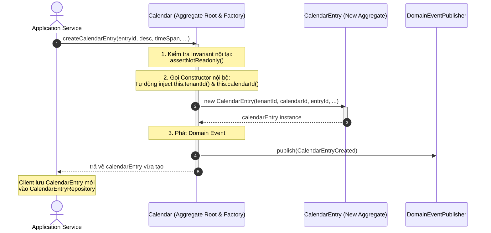
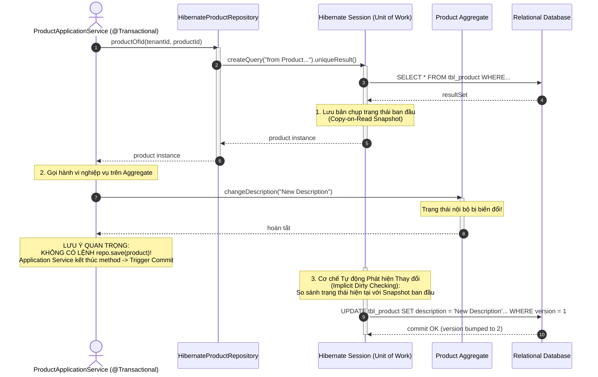

# ĐỢT 8 / 10: BÓC TÁCH CHUYÊN SÂU CHƯƠNG 11 & CHƯƠNG 12
**Sách:** *Implementing Domain-Driven Design (IDDD)* — **Tác giả:** *Vaughn Vernon*

---

## CHƯƠNG 11: FACTORIES (CÁC NHÀ MÁY KHỞI TẠO TRONG MÔ HÌNH MIỀN)

### 1. ĐỀ MỤC & MỤC TIÊU CỐT LÕI (CORE PURPOSE)

#### Hệ thống đề mục đầy đủ theo sách gốc (Trang 389–400):
* **Factories in the Domain Model** (Các Nhà máy trong Mô hình Miền)
* **Factory Method on Aggregate Root** (Phương thức Nhà máy đặt trên Aggregate Root)
  * *Creating CalendarEntry Instances* (Khởi tạo các cá thể Lịch trình trong `Collaboration Context`)
  * *Creating Discussion Instances* (Khởi tạo các cá thể Cuộc thảo luận từ Diễn đàn)
* **Factory on Service** (Nhà máy đặt trên Dịch vụ Miền — Khởi tạo kết hợp Dịch thuật Tích hợp)
* **Wrap-Up** (Tổng kết)

#### Vấn đề kỹ thuật & nghiệp vụ cốt lõi và Thảm họa nếu không áp dụng:
* **Vấn đề giải quyết:** Mẫu *Factory* đã quá nổi tiếng từ nhóm Gang of Four (GoF), vậy tại sao DDD lại dành riêng một chương cho nó? Chương 11 giải quyết câu hỏi: **Trong một mô hình DDD, Nhà máy nên cư trú ở đâu (*Where Factories Should Exist*) để vừa bảo vệ tính toàn vẹn của nghiệp vụ, vừa tự động truyền tải ngữ cảnh sở hữu (như `TenantId`, `ProductId`), lại vừa phản ánh chuẩn xác Ngôn ngữ Phổ quát (*Ubiquitous Language*)?**
* **Thảm họa kỹ thuật nếu không áp dụng:**
  1. **Khởi tạo đối tượng rải rác & Vi phạm Bất biến (*Fragmented Object Instantiation*):** Client bên ngoài (Application Service hoặc Controller) tự gọi lệnh `new` để tạo một Aggregate con phức tạp. Kết quả là Client phải tự tìm kiếm và truyền hàng tá tham số (`tenantId`, `calendarId`, `ownerId`). Khi cấu trúc khởi tạo của đối tượng con thay đổi hoặc có thêm quy tắc nghiệp vụ ràng buộc, hàng loạt Client bị lỗi biên dịch.
  2. **Rò rỉ Dữ liệu giữa các Khách thuê (*Multi-Tenant Leakage Disaster*):** Trong hệ thống SaaS đa người thuê (*Multi-tenant*), nếu để Client tự khởi tạo `Discussion` hoặc `CalendarEntry`, lập trình viên rất dễ mắc lỗi lấy nhầm `TenantId` từ session này gán cho đối tượng của session khác, dẫn đến thảm họa rò rỉ dữ liệu bảo mật giữa các công ty khách hàng!
  3. **Biến mất Ngôn ngữ Nghiệp vụ (*Loss of Ubiquitous Language*):** Dùng các hàm khởi tạo máy móc như `new Discussion(forumId, ...)` thay vì để đối tượng cha biểu đạt hành động tự nhiên của chuyên gia: `forum.startDiscussion(...)`.

---

### 2. PHÂN TÍCH LÝ THUYẾT & NGUYÊN LÝ CHUYÊN SÂU

#### A. Vị trí Cư trú Chuẩn mực của Factory trong DDD
Vaughn Vernon chỉ rõ: Trong DDD, ta không cần tạo ra những lớp Factory độc lập cồng kềnh một cách máy móc. Factory chủ yếu tồn tại dưới **2 hình thái chính**:
1. **Factory Method on Aggregate Root (Phương thức Nhà máy nằm ngay trên Aggregate Root):**
   * Đây là nơi tự nhiên và hoàn hảo nhất để đặt Factory!
   * Khi Aggregate $A$ đóng vai trò cha đẻ hoặc quản lý ngữ cảnh của Aggregate $B$, việc đặt hàm tạo $B$ ngay trên $A$ (ví dụ: `Product.planBacklogItem()`, `Forum.startDiscussion()`, `Calendar.createCalendarEntry()`) mang lại 3 lợi ích vượt trội:
     * **Tự động sao chép ngữ cảnh bảo mật:** Aggregate $A$ tự động truyền `TenantId` và định danh của chính nó vào đối tượng mới, Client hoàn toàn không thể làm sai lệch dữ liệu phân vùng khách thuê.
     * **Bảo vệ Bất biến cấp gốc (*Root-Level Invariants*):** Aggregate $A$ có thể kiểm tra trạng thái của chính nó trước khi cho phép sinh con (ví dụ: nếu `Forum` đã bị đóng `isClosed()`, nó sẽ từ chối tạo `Discussion` mới).
     * **Thể hiện Ngôn ngữ Phổ quát:** Thay vì gọi `new Discussion(...)`, gọi `forum.startDiscussion(...)` phản ánh chính xác ngôn ngữ mà chuyên gia nghiệp vụ diễn đạt.
2. **Factory on Domain Service (Nhà máy đặt trên Dịch vụ Miền):**
   * Được sử dụng khi việc tạo ra một đối tượng đòi hỏi:
     * Tra cứu thông tin từ nhiều Aggregate khác nhau.
     * Phụ thuộc vào công nghệ hạ tầng bên ngoài (như gọi sang một Bounded Context khác hoặc gọi API kiểm tra quyền truy cập).
     * Điển hình trong sách là `TranslatingCollaboratorService` (Chương 3): đóng vai trò Factory đúc ra các Value Objects `Author`, `Moderator` từ chuỗi JSON nhận được của `Identity and Access Context`.

#### B. Phân biệt Factory với Hàm Khởi tạo (*Constructor*)
* Dùng **Constructor** trực tiếp khi: Đối tượng đơn giản, không có mối quan hệ phụ thuộc ngữ cảnh cha con phức tạp, và không có bất biến liên Aggregate cần kiểm tra.
* Dùng **Factory Method** khi:
  * Khởi tạo một Aggregate độc lập từ một Aggregate gốc khác nhằm đóng gói sự phức tạp.
  * Cần tạo ra các lớp con đa hình (*Polymorphic Subclasses*) mà Client không cần biết kiểu cụ thể bên dưới.
  * Cần tự động phát sinh các **Domain Events** đi kèm trong quá trình tạo mới (ví dụ: `ForumStarted`, `DiscussionStarted`).

---

### 3. MỔ XẺ MÃ NGUỒN & CẤU TRÚC THIẾT KẾ (CODE DEEP-DIVE)

Chúng ta sẽ mổ xẻ phương thức Factory `createCalendarEntry()` trên `Calendar` Aggregate Root (trang 392–395) trong `Collaboration Context`.

#### ❌ Thiết kế SAI BAN ĐẦU: Client tự khởi tạo bằng `new` và tự lắp ráp thuộc tính
```java
public class BadCalendarEntryApplicationService {
    public String newCalendarEntry(String tenantId, String calendarId, String title, String location, Date start, Date end) {
        Calendar calendar = calendarRepository.calendarOfId(new TenantId(tenantId), new CalendarId(calendarId));
        
        // SAI LẦM 1: Client phải tự kiểm tra trạng thái nội bộ của Calendar!
        if (calendar.isSharedCalendar() && !userCanPostToSharedCalendar(calendar)) {
            throw new SecurityException("Cannot post to this calendar.");
        }

        // SAI LẦM 2: Client tự new và tự truyền tenantId, calendarId -> Rất dễ nhầm lẫn tham số!
        CalendarEntry entry = new CalendarEntry(
            new TenantId(tenantId),
            new CalendarId(calendarId),
            new CalendarEntryId(UUID.randomUUID().toString()),
            new DateRange(start, end),
            location,
            title
        );

        calendarEntryRepository.save(entry);
        return entry.calendarEntryId().id();
    }
}
```

#### ✅ Thiết kế CHUẨN MỰC SAU REFACTOR: Factory Method trên Aggregate Root đóng gói toàn bộ quy tắc

```java
// ============================================================================
// AGGREGATE ROOT ĐÓNG VAI TRÒ FACTORY: Calendar
// Package: com.saasovation.collaboration.domain.model.calendar
// ============================================================================
public class Calendar extends ConcurrencySafeEntity {

    private TenantId tenantId;
    private CalendarId calendarId;
    private String name;
    private String description;
    private CalendarSharer sharer; // Value Object quản lý chia sẻ lịch

    // FACTORY METHOD CHUẨN DDD: Tạo mới một Aggregate CalendarEntry độc lập
    public CalendarEntry createCalendarEntry(
        CalendarEntryId aCalendarEntryId,
        String aDescription,
        String aLocation,
        Owner anOwner,
        DateRange aTimeSpan,
        Alarm anAlarm,
        Repetition aRepetition,
        Set<Participant> anInvitees) {

        // 1. Kiểm tra bất biến của Aggregate Root trước khi cho phép tạo
        this.assertNotReadonly();

        // 2. Tự động chuyển giao TenantId và CalendarId của chính mình sang đối tượng con
        // Ngăn chặn 100% lỗi rò rỉ dữ liệu giữa các Tenant!
        CalendarEntry calendarEntry =
            new CalendarEntry(
                this.tenantId(),
                this.calendarId(),
                aCalendarEntryId,
                aDescription,
                aLocation,
                anOwner,
                aTimeSpan,
                anAlarm,
                aRepetition,
                anInvitees);

        // 3. Tự động phát sinh Domain Event thông báo sự kiện lịch trình mới được lập
        DomainEventPublisher
            .instance()
            .publish(new CalendarEntryCreated(
                this.tenantId(),
                this.calendarId(),
                aCalendarEntryId));

        return calendarEntry;
    }

    private void assertNotReadonly() {
        if (this.isReadonly()) {
            throw new IllegalStateException("Calendar is currently read-only.");
        }
    }
}
```

#### Bảng phân tích kỹ thuật & Ý nghĩa thiết kế:

| Dòng code / Đoạn code then chốt | Giải thích kỹ thuật & Nguyên lý thiết kế (DDD/OOP) được hiện thực hóa |
| :--- | :--- |
| `public CalendarEntry createCalendarEntry(...)` | **Factory Method on Aggregate Root:** Đặt phương thức khởi tạo đối tượng `CalendarEntry` ngay trên lớp gốc `Calendar`. Client bên ngoài không cần biết cấu trúc chi tiết hàm khởi tạo của `CalendarEntry`, chỉ cần gọi phương thức này trên cuốn lịch cha. |
| `this.assertNotReadonly();` | **Bảo vệ Bất biến cấp Gốc (*Root Invariant Protection*):** Chỉ có `Calendar` mới biết nó có đang ở chế độ chỉ đọc (*read-only*) hay không. Việc đặt Factory tại Root giúp tập trung quy tắc kiểm tra hợp lệ, không cho phép sinh ra các sự kiện trên một cuốn lịch đã bị khóa. |
| `new CalendarEntry(this.tenantId(), this.calendarId(), ...)` | **Tự động ràng buộc Ngữ cảnh Khách thuê (*Tenant Context Propagation*):** Lớp `Calendar` tự động truyền `this.tenantId()` và `this.calendarId()` của nó vào đối tượng mới tạo. Loại bỏ hoàn toàn nguy cơ Client truyền nhầm ID của khách hàng khác. |
| `DomainEventPublisher.instance().publish(new CalendarEntryCreated(...))` | **Đóng gói Vòng đời Sự kiện (*Lifecycle Event Encapsulation*):** Sự kiện miền `CalendarEntryCreated` được phát đi ngay tại thời điểm khởi tạo, bảo đảm tính nhất quán trong quy trình xử lý thông báo và nhắc lịch. |

---

### 4. SƠ ĐỒ TRỰC QUAN HÓA (BẮT BUỘC MÃ MERMAID)

Sơ đồ trình bày cơ chế hoạt động của **Factory Method trên Aggregate Root** kết hợp phát sinh **Domain Event**:



---

### 5. ÁNH XẠ ỨNG DỤNG VÀO DỰ ÁN GAME 2.5D OOP MULTIPLAYER

1. **Đặt Factory Method trên `Room / MatchAggregate` để khởi tạo Người chơi & Đội ngũ:**
   * Thay vì để tầng Network tự khởi tạo `HeroCharacter` khi nhận được gói tin kết nối, hãy đặt phương thức trên `GameMatch`: `gameMatch.spawnHero(playerId, heroClass, spawnPoint)`.
   * *Lợi ích:* `GameMatch` sẽ tự kiểm tra xem phòng đấu đã đủ người chưa (`isFull()`), trận đấu đã bắt đầu chưa, và tự động gán `MatchId`, `TeamSide` vào thực thể Tướng mới sinh ra, ngăn ngừa việc nạp người chơi vào sai trận đấu!
2. **Dùng Factory trên `MonsterSpawner` để tạo 6 loại Mobs với chỉ số ngẫu nhiên có kiểm soát:**
   * Thực thể `MobSpawner` trên bản đồ 66.000 px đóng vai trò Factory: `spawner.spawnMob(MobType.ZOMBIE, difficultyTier)`. Nó sẽ tự động tính toán vị trí nằm trong bán kính cho phép, nhân hệ số máu theo độ khó và đúc ra một thực thể `MobEntity` hoàn chỉnh.

---
---

## CHƯƠNG 12: REPOSITORIES (CÁC KHO LƯU TRỮ TRONG DDD)

### 1. ĐỀ MỤC & MỤC TIÊU CỐT LÕI (CORE PURPOSE)

#### Hệ thống đề mục đầy đủ theo sách gốc (Trang 401–448):
* **Collection-Oriented Repositories** (Kho Lưu trữ Định hướng Tập hợp — Mô phỏng `java.util.Set`)
  * *Hibernate Implementation* (Hiện thực hóa bằng Hibernate / ORM)
  * *Considerations for a TopLink Implementation* (Các lưu ý với TopLink)
* **Persistence-Oriented Repositories** (Kho Lưu trữ Định hướng Lưu trữ — Cho NoSQL và Key-Value Stores)
  * *Coherence Implementation* (Hiện thực hóa với Oracle Coherence)
  * *MongoDB Implementation* (Hiện thực hóa với MongoDB)
* **Additional Behavior** (Các Hành vi Bổ sung — Đếm số lượng, Tính toán tổng hợp)
* **Managing Transactions** (Quản lý Giao dịch — Nơi đặt giao dịch đúng đắn)
  * *A Warning* (Cảnh báo về việc đặt Transaction sai chỗ)
* **Type Hierarchies** (Xử lý Phân cấp Kiểu và Kế thừa trong Repository)
* **Repository versus Data Access Object** (Đối chiếu Repository với Data Access Object - DAO)
* **Testing Repositories** (Kiểm thử Kho lưu trữ)
  * *Testing with In-Memory Implementations* (Kiểm thử với các Bản Cài đặt Trong Bộ nhớ)
* **Wrap-Up** (Tổng kết)

#### Vấn đề kỹ thuật & nghiệp vụ cốt lõi và Thảm họa nếu không áp dụng:
* **Vấn đề giải quyết:** Làm sao để tạo ra một ảo ảnh (*Illusion*) rằng toàn bộ các *Aggregates* của hệ thống đang nằm sẵn trong bộ nhớ RAM, giúp *Domain Model* hoàn toàn không bị vấy bẩn bởi ngôn ngữ SQL hay công nghệ cơ sở dữ liệu? Chương 12 phân biệt rạch ròi giữa **Collection-Oriented** và **Persistence-Oriented Repositories**, đồng thời vạch rõ ranh giới giữa một **Repository chuẩn DDD** và một **DAO tầm thường**.
* **Thảm họa kỹ thuật nếu không áp dụng:**
  1. **Nhầm lẫn Repository với DAO (*DAO Anemic Anti-pattern*):** Tạo ra `CalendarEntryDao` với các hàm `update()`, `insert()`, `delete()` mang đậm mùi vị bảng CSDL; tạo ra Repository cho từng bảng nhỏ thay vì **chỉ tạo Repository cho Aggregate Root**.
  2. **Rò rỉ Quản lý Giao dịch vào Repository (*Transactional Leaks*):** Đặt lệnh `@Transactional` hoặc `session.commit()` bên trong Repository, tước đoạt quyền điều phối giao dịch của tầng *Application Service*, khiến không thể phối hợp nhiều bước nghiệp vụ trong cùng một transaction.
  3. **Lãng phí hàm `save()` trong môi trường ORM:** Liên tục gọi `repository.save(aggregate)` sau mỗi lần sửa đổi nhỏ, trong khi ORM (Hibernate) đã có cơ chế tự động theo dõi thay đổi (*Implicit Dirty Checking / Unit of Work*).

---

### 2. PHÂN TÍCH LÝ THUYẾT & NGUYÊN LÝ CHUYÊN SÂU

#### A. 2 Trường phái Thiết kế Repository Lớn
Vaughn Vernon phân định sâu sắc 2 loại Repository tương ứng với 2 loại công nghệ lưu trữ:

##### 1. Collection-Oriented Repositories (Định hướng Tập hợp)
* **Triết lý:** Mô phỏng hoàn hảo một tập hợp trong bộ nhớ (`java.util.Set`).
* **Đặc điểm giao diện:**
  * Có các phương thức: `add(aggregate)`, `remove(aggregate)`, `aggregateOfId(id)`.
  * **TUYỆT ĐỐI KHÔNG CÓ PHƯƠNG THỨC `save(aggregate)` HOẶC `update(aggregate)`!**
* **Cơ chế hoạt động:** Dựa vào mẫu **Unit of Work** (được tích hợp sẵn trong Hibernate `Session` hoặc JPA `EntityManager`).
  * Khi nạp một đối tượng qua `aggregateOfId()`, Hibernate lưu lại một bản chụp trạng thái ban đầu (*Copy-on-Read Snapshot*).
  * Trong suốt giao dịch, khi ta gọi các phương thức nghiệp vụ làm thay đổi trạng thái đối tượng, Hibernate tự động phát hiện đối tượng bị bẩn (*Dirty Checking*).
  * Khi giao dịch của *Application Service* kết thúc, Hibernate tự động sinh câu lệnh `UPDATE` và đẩy xuống DB (*Automatic Flush*). Do đó, việc gọi một hàm `save()` hay `update()` là hoàn toàn thừa thãi và phá vỡ ảo ảnh về một `Set` trong RAM!

##### 2. Persistence-Oriented Repositories (Định hướng Lưu trữ)
* **Triết lý:** Dành cho các cơ sở dữ liệu **NoSQL, Document Stores (MongoDB), hoặc In-Memory Key-Value Stores (Riak, Coherence)** không có cơ chế *Unit of Work* tự động.
* **Đặc điểm giao diện:**
  * **BẮT BUỘC PHẢI CÓ PHƯƠNG THỨC `save(aggregate)` (hoặc `put()`)!**
  * Khi thay đổi trạng thái của Aggregate, Client phải gọi tường minh: `productRepository.save(product)` để dữ liệu được tuần tự hóa (*Serialized*) thành JSON/BSON và ghi đè vào khóa tương ứng trong NoSQL store.

#### B. Repository vs. Data Access Object (DAO)
Bảng đối chiếu dứt khoát sự khác biệt bản chất giữa Repository và DAO:

| Tiêu chí | Repository (DDD) | Data Access Object - DAO |
| :--- | :--- | :--- |
| **Tư duy thiết kế** | Hướng miền (*Domain-centric*), coi dữ liệu như tập hợp các đối tượng OOP trong RAM. | Hướng cơ sở dữ liệu (*Data/Table-centric*), tập trung vào các câu lệnh CRUD trên bảng. |
| **Phạm vi áp dụng** | **CHỈ tồn tại cho Aggregate Root!** Tuyệt đối không có Repository cho Entity con hay Value Object. | Có thể tạo DAO cho từng bảng bất kỳ trong cơ sở dữ liệu (`UserDao`, `AddressDao`, `OrderLineDao`). |
| **Ngôn ngữ biểu đạt** | Sử dụng triệt để *Ubiquitous Language* (`allUnfinishedBacklogItems()`). | Dùng thuật ngữ kỹ thuật SQL (`findUsersByStatusAndLimitOrderByDateDesc()`). |
| **Vị trí Interface** | Nằm ngay trong **Domain Layer** (áp dụng DIP). | Thường nằm ở tầng Data Access hoặc Infrastructure. |

#### C. Quản lý Giao dịch (*Managing Transactions*)
* **Nguyên tắc bất di bất dịch:** Giao dịch cơ sở dữ liệu phải được bắt đầu và kết thúc tại **Application Layer (Application Service)**, TUYỆT ĐỐI KHÔNG nằm trong Repository hay Domain Model.
* Tại sao? Vì một quy trình nghiệp vụ của Application Service có thể cần: (1) nạp Aggregate $A$, (2) gọi hành vi trên $A$, (3) phát Domain Event lưu vào `EventStore`. Toàn bộ chuỗi này phải được bao bọc trong **CÙNG MỘT Giao dịch** do Application Service kiểm soát (thường qua `@Transactional`).

#### D. Kiểm thử Kho lưu trữ với Bản cài đặt Trong Bộ nhớ (*In-Memory Testing*)
* Điểm tuyệt vời của *Collection-Oriented Repository* là bạn có thể tạo một lớp giả lập `InMemoryProductRepository` kế thừa interface, sử dụng một `Map<ProductId, Product>` trong RAM.
* Giúp toàn bộ bộ kiểm thử đơn vị (*Unit Tests*) của bạn chạy với tốc độ vài mili-giây mà không cần bật Database thật, đồng thời hỗ trợ kiểm chứng tính đúng đắn của logic nghiệp vụ trước khi bận tâm tới cấu hình Hibernate/SQL.

---

### 3. MỔ XẺ MÃ NGUỒN & CẤU TRÚC THIẾT KẾ (CODE DEEP-DIVE)

Chúng ta sẽ mổ xẻ **`ProductRepository` (Interface trong Domain)** và **`HibernateProductRepository` (Driven Adapter trong Infrastructure)** trích từ trang 407–415 của Chương 12.

#### ❌ Thiết kế SAI BAN ĐẦU: Tạo DAO với các hàm `update()`, `insert()` và lẫn lộn Transaction
```java
// THẢM HỌA: DAO bộc lộ bản chất cơ sở dữ liệu và tự ý commit giao dịch
public class ProductDao {
    public void insertProduct(Product p) {
        Connection conn = DatabaseConnection.get();
        // Mở transaction thủ công ở tầng dữ liệu
        conn.setAutoCommit(false);
        PreparedStatement ps = conn.prepareStatement("INSERT INTO tbl_product VALUES (?, ?)");
        // ...
        conn.commit(); // Cướp quyền quản lý giao dịch của tầng Ứng dụng!
    }

    public void updateProduct(Product p) {
        // Hàm update vô nghĩa trong môi trường ORM
    }
}
```

#### ✅ Thiết kế CHUẨN MỰC SAU REFACTOR: Collection-Oriented Repository thuần khiết với Hibernate

```java
// ============================================================================
// 1. GIAO DIỆN KHO LƯU TRỮ (NẰM TRONG DOMAIN LAYER - OUTPUT PORT)
// Package: com.saasovation.agilepm.domain.model.product
// Mô phỏng Set<Product>, KHÔNG có hàm save() hay update()!
// ============================================================================
public interface ProductRepository {

    public ProductId nextIdentity();

    public void add(Product aProduct);

    public void remove(Product aProduct);

    public Product productOfId(TenantId aTenantId, ProductId aProductId);

    public Collection<Product> allProductsOfTenant(TenantId aTenantId);
}

// ============================================================================
// 2. HIỆN THỰC HÓA BẰNG HIBERNATE (NẰM TRONG INFRASTRUCTURE LAYER - DRIVEN ADAPTER)
// Package: com.saasovation.agilepm.port.adapter.persistence
// ============================================================================
public class HibernateProductRepository implements ProductRepository {

    private SessionFactory sessionFactory;

    public HibernateProductRepository(SessionFactory aSessionFactory) {
        super();
        this.sessionFactory = aSessionFactory;
    }

    private Session session() {
        return this.sessionFactory.getCurrentSession();
    }

    @Override
    public ProductId nextIdentity() {
        // Cấp phát định danh sớm (Early Identity Generation) qua UUID
        return new ProductId(UUID.randomUUID().toString().toUpperCase());
    }

    @Override
    public void add(Product aProduct) {
        // Chỉ thêm mới đối tượng vào phiên làm việc của Hibernate (tương đương Set.add())
        this.session().save(aProduct);
    }

    @Override
    public void remove(Product aProduct) {
        // Xóa đối tượng khỏi phiên làm việc (tương đương Set.remove())
        this.session().delete(aProduct);
    }

    @Override
    public Product productOfId(TenantId aTenantId, ProductId aProductId) {
        Query query = this.session().createQuery(
            "from Product as _obj_ where _obj_.tenantId = ? and _obj_.productId = ?");

        query.setParameter(0, aTenantId);
        query.setParameter(1, aProductId);

        return (Product) query.uniqueResult();
    }

    @Override
    @SuppressWarnings("unchecked")
    public Collection<Product> allProductsOfTenant(TenantId aTenantId) {
        Query query = this.session().createQuery(
            "from Product as _obj_ where _obj_.tenantId = ?");

        query.setParameter(0, aTenantId);

        return (Collection<Product>) query.list();
    }
}
```

#### Bảng phân tích kỹ thuật & Ý nghĩa thiết kế:

| Dòng code / Đoạn code then chốt | Giải thích kỹ thuật & Nguyên lý thiết kế (DDD/OOP) được hiện thực hóa |
| :--- | :--- |
| `public interface ProductRepository` | **Output Port thuộc Domain Layer:** Tách biệt hoàn toàn định nghĩa hợp đồng lưu trữ khỏi công nghệ cơ sở dữ liệu. Chỉ làm việc với `Product` (Aggregate Root) và các Value Objects định danh (`TenantId`, `ProductId`). |
| `public void add(Product aProduct)` *(Không có hàm save/update)* | **Collection-Oriented Design:** Thể hiện rõ tư duy xem Repository như một tập hợp đối tượng trong RAM. Ta chỉ `add()` khi một thực thể mới ra đời. Khi một thực thể đang sống bị thay đổi trạng thái, cơ chế *Dirty Checking* tự động của Hibernate sẽ lo việc `UPDATE` khi kết thúc transaction! |
| `public ProductId nextIdentity()` | **Early Identity Generation:** Đặt phương thức sinh định danh ngay trên Repository Interface. Giúp tầng Application Service có thể lấy sẵn ID hợp lệ trước khi gọi hàm khởi tạo `Product`. |
| `this.sessionFactory.getCurrentSession()` | **Giao dịch do Application điều phối:** Repository không tự mở hay đóng session/transaction. Nó gắn vào `CurrentSession` do tầng Application Service quản lý (thông qua Spring `@Transactional`), bảo đảm tính toàn vẹn của Unit of Work. |

---

### 4. SƠ ĐỒ TRỰC QUAN HÓA (BẮT BUỘC MÃ MERMAID)

Sơ đồ thể hiện chu trình hoạt động của **Collection-Oriented Repository kết hợp Unit of Work / Hibernate Dirty Checking** (không cần gọi hàm `save` tường minh):



---

### 5. ÁNH XẠ ỨNG DỤNG VÀO DỰ ÁN GAME 2.5D OOP MULTIPLAYER

1. **Thiết kế `PlayerProfileRepository` theo phong cách Collection-Oriented:**
   * Chỉ tạo Repository cho Aggregate Root `PlayerAccount`, tuyệt đối không tạo `ItemRepository` hay `SkillSlotRepository` riêng rẽ (tất cả các trang bị, kỹ năng đều được nạp và lưu cùng lúc với `PlayerAccount`).
   * Sử dụng triển khai `InMemoryPlayerRepository` trong bộ test unit (`Tests/`) để kiểm tra toàn bộ luồng đăng nhập, cộng điểm kinh nghiệm, lên cấp với tốc độ cực đại mà không cần dựng database thật.
2. **Sử dụng Persistence-Oriented Repository cho Bảng Xếp Hạng & Lưu Trữ NoSQL (Redis/MongoDB):**
   * Đối với dữ liệu lịch sử trận đấu (*Match History*) hoặc bảng xếp hạng người chơi (*Leaderboard*), việc lưu dưới dạng Document BSON trong MongoDB hoặc Key-Value trong Redis là phù hợp nhất.
   * Thiết kế `interface MatchRecordRepository` theo phong cách **Persistence-Oriented** với phương thức rõ ràng: `void save(MatchRecordRecord record)`. Mỗi khi trận chiến 2.5D kết thúc, hệ thống tuần tự hóa toàn bộ thông số trận đấu và đẩy vào kho lưu trữ NoSQL chỉ bằng một lệnh `save()` nhanh gọn.
