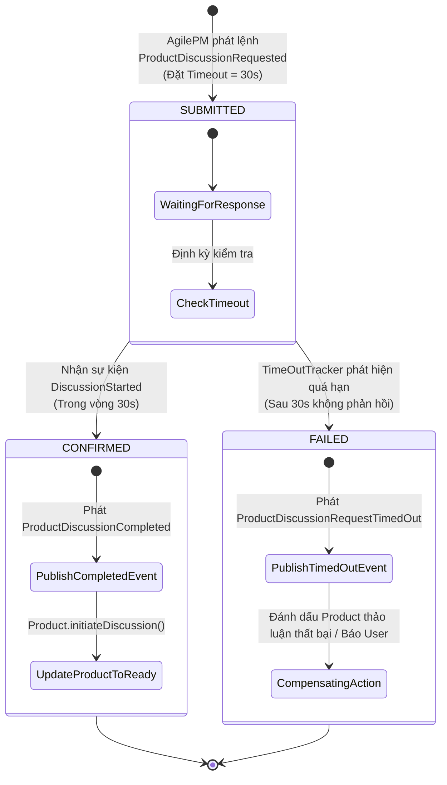

# ĐỢT 9 / 10: BÓC TÁCH CHUYÊN SÂU CHƯƠNG 13
**Sách:** *Implementing Domain-Driven Design (IDDD)* — **Tác giả:** *Vaughn Vernon*

---

## CHƯƠNG 13: INTEGRATING BOUNDED CONTEXTS (TÍCH HỢP CÁC NGỮ CẢNH GIỚI HẠN)

### 1. ĐỀ MỤC & MỤC TIÊU CỐT LÕI (CORE PURPOSE)

#### Hệ thống đề mục đầy đủ theo sách gốc (Trang 449–508):
* **Integration Basics** (Các Nền tảng Tích hợp Cơ bản)
  * *Distributed Systems Are Fundamentally Different* (Hệ thống Phân tán Khác biệt về Căn bản — 8 Ảo tưởng của Điện toán Phân tán)
  * *Exchanging Information across System Boundaries* (Trao đổi Thông tin qua Biên giới Hệ thống)
* **Integration Using RESTful Resources** (Tích hợp Sử dụng Tài nguyên RESTful)
  * *Implementing the RESTful Resource* (Hiện thực hóa Tài nguyên RESTful — Phía Cung cấp Thượng nguồn)
  * *Implementing the REST Client Using an Anticorruption Layer* (Hiện thực hóa Máy khách REST sử dụng Lớp Chống Tham Nhũng — Phía Tiêu thụ Hạ nguồn)
* **Integration Using Messaging** (Tích hợp Sử dụng Cơ chế Truyền Thông điệp / Message Broker)
  * *Staying Informed about Product Owners and Team Members* (Cập nhật Thông tin về Product Owners và Team Members từ `Identity & Access` sang `AgilePM`)
  * *Can You Handle the Responsibility?* (Bạn có thể Xử lý Trách nhiệm này không? — Đánh đổi giữa Event-Driven và RPC)
  * *Long-Running Processes, and Avoiding Responsibility* (Các Tiến trình Chạy dài, và Tránh né Trách nhiệm Giao dịch 2 Pha)
  * *Process State Machines and Time-out Trackers* (Máy Trạng thái Tiến trình và Bộ Theo dõi Quá hạn)
  * *Designing a More Sophisticated Process* (Thiết kế Tiến trình Phức tạp hơn)
  * *When Messaging or Your System Is Unavailable* (Khi Hệ thống Tin nhắn hoặc Ứng dụng Không khả dụng — Bù trừ và Thử lại)
* **Wrap-Up** (Tổng kết)

#### Vấn đề kỹ thuật & nghiệp vụ cốt lõi và Thảm họa nếu không áp dụng:
* **Vấn đề giải quyết:** Nếu Chương 3 mới chỉ phác họa các mẫu quan hệ chiến lược trên bản vẽ (*Context Maps*), thì Chương 13 cung cấp **bản thiết kế kỹ thuật chi tiết nhất để hiện thực hóa việc tích hợp giữa các Bounded Contexts**. Nó giải quyết bài toán: Làm sao để các hệ thống phân tán trao đổi dữ liệu qua REST và Messaging một cách tự trị (*Autonomous*), xử lý các quy trình nghiệp vụ phức tạp kéo dài qua nhiều ngữ cảnh (*Sagas*) mà không bị treo cứng bởi lỗi mạng hay dịch vụ đối tác ngừng hoạt động?
* **Thảm họa kỹ thuật nếu không áp dụng:**
  1. **Ảo tưởng về Mạng Phân tán (*Fallacies of Distributed Computing*) & Sập dây chuyền (*Cascading Failures*):** Lập trình viên thiết kế hệ thống phân tán như thể đang gọi hàm trong bộ nhớ RAM (nghĩ rằng mạng luôn thông, độ trễ bằng 0, băng thông vô hạn). Khi gọi REST đồng bộ liên hoàn $A \rightarrow B \rightarrow C$, chỉ cần hệ thống $C$ bị chậm 2 giây, toàn bộ luồng xử lý của $A$ và $B$ cạn kiệt thread pool và sập toàn bộ hệ thống!
  2. **Bế tắc Giao dịch Phân tán (*Distributed Deadlocks / 2PC Fragility*):** Cố gắng dùng Two-Phase Commit (XA/2PC) để ép dữ liệu ở 3 Bounded Contexts phải nhất quán tức thời. Hệ quả là hệ thống không thể mở rộng quy mô, một dịch vụ bảo trì làm tê liệt toàn bộ các dịch vụ còn lại.
  3. **Mất Dấu vết Tiến trình (*Lost Process State*):** Khi một quy trình đa bước qua mạng bị đứt gánh (ví dụ: trừ tiền thành công nhưng tạo cuộc thảo luận bị lỗi mạng), hệ thống không có **Process State Machine** và **Time-out Tracker**, dẫn đến dữ liệu "mồ côi", người dùng bị trừ tiền nhưng không nhận được dịch vụ mà không ai biết để khắc phục.

---

### 2. PHÂN TÍCH LÝ THUYẾT & NGUYÊN LÝ CHUYÊN SÂU

#### A. 8 Ảo tưởng của Điện toán Phân tán (*The 8 Fallacies of Distributed Computing*)
Vaughn Vernon trích dẫn nghiên cứu kinh điển của L. Peter Deutsch (Sun Microsystems) làm nền tảng cho mọi quyết định tích hợp trong DDD:
1. Mạng luôn đáng tin cậy (*The network is reliable*).
2. Độ trễ luôn bằng 0 (*Latency is zero*).
3. Băng thông là vô hạn (*Bandwidth is infinite*).
4. Mạng là an toàn tuyệt đối (*The network is secure*).
5. Cấu trúc mạng không bao giờ thay đổi (*Topology doesn't change*).
6. Chỉ có một người quản trị duy nhất (*There is one administrator*).
7. Chi phí truyền tải bằng 0 (*Transport cost is zero*).
8. Mạng là đồng nhất (*The network is homogeneous*).
* **Nguyên tắc DDD rút ra:** Không bao giờ được giả định lời gọi sang Bounded Context khác sẽ luôn thành công tức thì. Mọi tích hợp qua biên giới phải được thiết kế với tâm thế: **Mạng chắc chắn sẽ đứt, hệ thống đối tác chắc chắn sẽ chậm hoặc sập!**

#### B. 2 Phương thức Tích hợp Chủ đạo: RESTful vs. Messaging
1. **Tích hợp qua RESTful Resources (Mô hình Kéo - *Pull Model*):**
   * Phù hợp cho các truy vấn dữ liệu theo nhu cầu (*On-demand Queries*), tích hợp với hệ thống bên ngoài hoặc khi không có hạ tầng Message Broker.
   * **Phía Thượng nguồn (Upstream):** Xây dựng *Open Host Service (OHS)* xuất bản các tài nguyên theo định dạng chuẩn *Published Language (PL)* (chuỗi JSON / XML đặc thù).
   * **Phía Hạ nguồn (Downstream):** Bắt buộc phải có **Anticorruption Layer (ACL)** gồm 3 thành phần: *Client Adapter* (thực hiện gọi HTTP) $\rightarrow$ *Translator* (bóc tách JSON) $\rightarrow$ Đúc thành *Value Objects / Entities* của miền hạ nguồn.
2. **Tích hợp qua Messaging (Mô hình Đẩy - *Push Model*):**
   * Phù hợp cho việc thông báo biến động trạng thái theo thời gian thực và đảm bảo tính tự trị cao nhất (*Highest Autonomy*).
   * **Sự kiện Làm giàu Dữ liệu (*Event Enrichment*):** Thay vì chỉ gửi mỗi `UserId`, Domain Event `UserRegistered` đính kèm luôn `username`, `firstName`, `lastName`, `emailAddress`. Nhờ vậy, khi hệ thống *Downstream* nhận sự kiện, nó có đầy đủ dữ liệu để tạo `TeamMember` ngay lập tức mà **không cần phải gọi ngược lại HTTP GET sang IAM** $\rightarrow$ Giảm tải mạng và loại bỏ sự phụ thuộc thời gian thực!

#### C. Quản lý Quy trình Kéo dài: *Process State Machines* & *Time-out Trackers*
Khi một nghiệp vụ đòi hỏi sự phối hợp qua nhiều Bounded Contexts (Ví dụ: Khởi tạo `Product` trong `AgilePM` $\rightarrow$ Yêu cầu tạo `Discussion` trong `Collaboration Context` $\rightarrow$ Xác nhận hoàn tất):
1. **Process Manager / State Machine (Máy Trạng thái Tiến trình):**
   * Đóng vai trò thực thể điều phối quy trình phân tán.
   * Lưu trữ trạng thái tiến trình hiện tại: `SUBMITTED` $\rightarrow$ `CONFIRMED` (hoặc `FAILED`).
   * Sử dụng mã tương quan duy nhất (**Correlation ID** / `ProcessId`) được gắn vào mọi thông điệp gửi đi và nhận về để ghép nối chính xác các phản hồi bất đồng bộ.
2. **Time-out Tracker (Bộ Theo dõi Quá hạn):**
   * Trong thế giới phân tán, sự cố thường không phát ra lỗi `Exception` rõ ràng, mà biểu hiện bằng **sự im lặng chết chóc (*Silence*)** — thông điệp bị thất lạc hoặc hệ thống đối tác bị treo.
   * **Cơ chế:** Khi phát lệnh đi, Process Manager đăng ký một bản ghi hẹn giờ vào bảng `Time-out Tracker` (ví dụ: giới hạn 30 giây).
   * Một tiến trình nền (*Background Worker*) quét các Tracker quá hạn. Nếu hết 30 giây mà không nhận được sự kiện phản hồi `DiscussionStarted`, Tracker sẽ kích hoạt sự kiện quá hạn `ProductDiscussionRequestTimedOut`.
   * **Hành động Bù trừ (*Compensating Action*):** Process Manager nhận sự kiện quá hạn, tự động chuyển trạng thái sang `FAILED`, kích hoạt lệnh hủy/bù trừ và gửi cảnh báo cho người dùng hoặc quản trị viên can thiệp.

#### D. Xử lý khi Hệ thống Tin nhắn bị Gián đoạn (*Unavailable Messaging*)
* **Capped Exponential Back-off (Thử lại Lùi lũy thừa có chặn):** Khi gửi tin nhắn hoặc gọi REST thất bại, không thử lại liên tục làm nghẽn mạng, mà giãn cách thời gian: 1s, 2s, 4s, 8s, 16s... tối đa 32s.
* **Idempotent Consumer (Bên tiêu thụ Lũy đẳng):** Vì mạng có thể gửi lặp lại một tin nhắn nhiều lần (*At-Least-Once Delivery*), bên nhận bắt buộc phải lưu `Tracker` ghi nhận các `EventId` đã xử lý để bỏ qua các tin nhắn trùng lặp.

---

### 3. MỔ XẺ MÃ NGUỒN & CẤU TRÚC THIẾT KẾ (CODE DEEP-DIVE)

Chúng ta sẽ mổ xẻ **`Process State Machine`** kết hợp **`Time-out Tracker`** trong việc tích hợp tạo cuộc thảo luận tự động giữa `AgilePM` và `Collaboration Context` (trang 493–505).

#### ❌ Thiết kế SAI BAN ĐẦU: Gọi đồng bộ đa hệ thống không có xử lý Timeout hay Bù trừ
```java
// THẢM HỌA: Treo luồng vô thời hạn nếu dịch vụ Collaboration bị sập
public class BadProductService {
    public void createProductWithDiscussion(String tenantId, String name) {
        Product product = new Product(tenantId, name);
        productRepository.save(product);

        // Gọi HTTP đồng bộ chặn luồng (Blocking I/O)
        // Nếu server Collaboration bị đơ, request này treo cứng cho đến khi Timeout cấp mạng (thường là vài phút)!
        // Toàn bộ thread pool của Web server bị nuốt chửng!
        DiscussionDTO discussion = httpClient.postForObject(
            "http://collab-service/discussions", 
            new CreateDiscussionRequest(name), 
            DiscussionDTO.class);

        product.setDiscussionId(discussion.getId());
        productRepository.save(product);
    }
}
```

#### ✅ Thiết kế CHUẨN MỰC SAU REFACTOR: Event-Driven Saga với Process State Machine & Time-out Tracker

```java
// ============================================================================
// 1. SỰ KIỆN LÀM GIÀU DỮ LIỆU ĐÍNH KÈM CORRELATION ID
// Package: com.saasovation.agilepm.domain.model.product
// ============================================================================
public class ProductDiscussionRequested implements DomainEvent {
    private String discussionInitiationId; // Process / Correlation ID
    private int eventVersion;
    private Date occurredOn;
    private ProductId productId;
    private String productTitle;
    private TenantId tenantId;

    public ProductDiscussionRequested(
        TenantId aTenantId,
        ProductId aProductId,
        String aProductTitle,
        String aDiscussionInitiationId) {

        super();
        this.discussionInitiationId = aDiscussionInitiationId;
        this.eventVersion = 1;
        this.occurredOn = new Date();
        this.productId = aProductId;
        this.productTitle = aProductTitle;
        this.tenantId = aTenantId;
    }

    public String discussionInitiationId() { return this.discussionInitiationId; }
    public ProductId productId() { return this.productId; }
    // ...
}

// ============================================================================
// 2. PROCESS STATE MACHINE: THỰC THỂ QUẢN LÝ TIẾN TRÌNH PHÂN TÁN
// Package: com.saasovation.agilepm.domain.model.process
// ============================================================================
public class ProductDiscussionCreationProcess extends ConcurrencySafeEntity {

    public enum ProcessStatus {
        SUBMITTED, CONFIRMED, FAILED
    }

    private String processId;                  // Khớp với discussionInitiationId
    private TenantId tenantId;
    private ProductId productId;
    private ProcessStatus status;
    private Date timeOutDate;                  // Mốc thời gian quá hạn

    public ProductDiscussionCreationProcess(
        TenantId aTenantId,
        ProductId aProductId,
        String aProcessId,
        long aTimeOutMillis) {

        super();
        this.tenantId = aTenantId;
        this.productId = aProductId;
        this.processId = aProcessId;
        this.status = ProcessStatus.SUBMITTED;
        // Đặt hẹn giờ quá hạn (ví dụ: hiện tại + 30 giây)
        this.timeOutDate = new Date(System.currentTimeMillis() + aTimeOutMillis);
    }

    // Khi nhận được sự kiện phản hồi thành công từ Collaboration Context
    public void confirmDiscussionStarted(String aDiscussionId) {
        if (this.status == ProcessStatus.SUBMITTED) {
            this.status = ProcessStatus.CONFIRMED;
            DomainEventPublisher
                .instance()
                .publish(new ProductDiscussionCompleted(
                    this.tenantId(),
                    this.productId(),
                    aDiscussionId));
        }
    }

    // Khi Time-out Tracker phát hiện quá hạn mà không có phản hồi
    public void informTimeOut() {
        if (this.status == ProcessStatus.SUBMITTED) {
            this.status = ProcessStatus.FAILED; // Chuyển trạng thái thất bại
            
            // KÍCH HOẠT HÀNH ĐỘNG BÙ TRỪ (COMPENSATING ACTION)
            DomainEventPublisher
                .instance()
                .publish(new ProductDiscussionRequestTimedOut(
                    this.tenantId(),
                    this.productId(),
                    this.processId()));
        }
    }

    public boolean isTimedOut() {
        return this.status == ProcessStatus.SUBMITTED &&
               new Date().after(this.timeOutDate);
    }
}

// ============================================================================
// 3. TIME-OUT TRACKER: TIẾN TRÌNH QUÉT NỀN PHÁT HIỆN SỰ CỐ
// Package: com.saasovation.agilepm.infrastructure.process
// ============================================================================
public class TimeOutTrackerWorker implements Runnable {

    private ProcessRepository processRepository;

    @Override
    public void run() {
        // Quét các tiến trình đang ở trạng thái SUBMITTED nhưng đã quá hạn thời gian
        Collection<ProductDiscussionCreationProcess> timedOutProcesses =
            this.processRepository.allTimedOutProcesses();

        for (ProductDiscussionCreationProcess process : timedOutProcesses) {
            // Đánh thức Process State Machine để xử lý bù trừ
            process.informTimeOut();
            this.processRepository.save(process);
        }
    }
}
```

#### Bảng phân tích kỹ thuật & Ý nghĩa thiết kế:

| Dòng code / Đoạn code then chốt | Giải thích kỹ thuật & Nguyên lý thiết kế (DDD/OOP) được hiện thực hóa |
| :--- | :--- |
| `private String discussionInitiationId;` | **Correlation ID / Process ID:** Khóa định danh tương quan sinh ra từ lúc bắt đầu quy trình. Dù thông điệp đi qua bao nhiêu hàng đợi và hệ thống khác nhau, mã này luôn được truyền kèm để khi kết quả quay về, hệ thống biết chính xác tiến trình nào đang chờ nó. |
| `this.status = ProcessStatus.SUBMITTED;` <br> `this.timeOutDate = new Date(...)` | **Explicit State Machine Modeling:** Mô hình hóa rõ ràng các trạng thái phân tán thay vì để trạng thái trôi nổi ngầm định. Thiết lập mốc thời gian quá hạn tường minh giúp hệ thống luôn chủ động kiểm soát số phận của quy trình. |
| `public void confirmDiscussionStarted(...)` | **Chuyển dịch Trạng thái An toàn (*Idempotent State Transition*):** Chỉ chuyển sang `CONFIRMED` nếu đang ở trạng thái `SUBMITTED`. Nếu thông báo xác nhận đến trễ sau khi tiến trình đã bị đánh dấu `FAILED` do timeout, lệnh này sẽ bị từ chối, ngăn chặn việc cập nhật dữ liệu sai lệch. |
| `public void informTimeOut()` | **Compensating Action (Hành động Bù trừ thay cho Rollback):** Trong hệ thống phân tán không thể gọi `rollback` Database qua mạng. Thay vào đó, ta phát ra sự kiện `ProductDiscussionRequestTimedOut` để các thành phần liên quan thực hiện bù trừ (ví dụ: thông báo cho người dùng, chuyển cờ sản phẩm về chế độ thảo luận ngoại tuyến). |
| `this.processRepository.allTimedOutProcesses()` | **Time-out Tracker Pattern:** Tiến trình nền quét định kỳ đảm bảo không có quy trình nào bị "treo" vô tận trong bộ nhớ khi đối tác sập mạng. Hiện thực hóa nguyên lý *"Expect failures in distributed systems"*. |

---

### 4. SƠ ĐỒ TRỰC QUAN HÓA (BẮT BUỘC MÃ MERMAID)

Sơ đồ trạng thái (State Machine Diagram) và sơ đồ luồng điều phối tích hợp của **Process Manager kết hợp Time-out Tracker**:



---

### 5. ÁNH XẠ ỨNG DỤNG VÀO DỰ ÁN GAME 2.5D OOP MULTIPLAYER

Chương 13 giải quyết trực tiếp 2 bài toán sống còn trong hạ tầng mạng của Game nhiều người chơi: **Quy trình Ghép trận / Vào phòng (*Matchmaking Saga*)** và **Cơ chế chịu lỗi khi Mạng 4G bị gián đoạn**:

1. **Hiện thực hóa *Matchmaking Process Manager* với *Time-out Tracker* cho Sảnh Chờ (Lobby):**
   * *Quy trình nghiệp vụ:* Khi tìm thấy 4 người chơi phù hợp về ELO:
     1. `MatchmakingContext` tạo một `MatchSetupProcess` (trạng thái `WAITING_CONFIRMATION`, Correlation ID = `matchId`, Timeout = 10 giây).
     2. Gửi sự kiện `MatchFoundPrompt` tới 4 Client.
     3. Từng người chơi bấm nút "Chấp nhận" $\rightarrow$ Client gửi về `AcceptMatchResponse(matchId, playerId)`.
     4. `MatchSetupProcess` cập nhật trạng thái đếm số người đã sẵn sàng:
        * *Nếu đủ 4 người trong 10s:* Chuyển sang `READY` $\rightarrow$ Phát sự kiện `StartGameCountdown` $\rightarrow$ Chuyển cả 4 vào máy chủ chiến đấu.
        * *Nếu hết 10s mà chỉ có 3 người chấp nhận:* **Time-out Tracker kích hoạt** `MatchSetupTimedOut` $\rightarrow$ Thực hiện hành động bù trừ: Đưa 3 người chơi đã bấm chấp nhận trở lại đầu hàng đợi ưu tiên, phạt trừ điểm người không bấm chấp nhận (*Leaver penalty*)!
2. **Thiết kế *Event Enrichment* để giảm băng thông gói tin mạng và chịu lỗi rớt mạng:**
   * Trong gói tin sự kiện `HeroSpawnedPacket` gửi qua mạng UDP/WebSocket, máy chủ đính kèm toàn bộ thông số ban đầu (`heroId`, `classType`, `maxHp`, `moveSpeed`, `skinId`, tọa độ `(x, y, z)`).
   * Nhờ kỹ thuật **Làm giàu Sự kiện (*Event Enrichment*)**, máy khách Client nhận được gói tin là có thể tạo ngay thực thể đồ họa trên màn hình 2.5D mà **không cần phải gửi thêm một gói tin hỏi ngược lại Server: "Tướng này có hình dạng gì và máu bao nhiêu?"** $\rightarrow$ Giúp game chạy mượt mà ngay cả khi đường truyền di động 4G có độ trễ cao và chập chờn.
