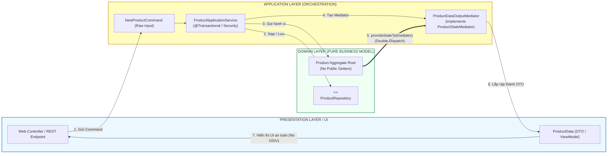
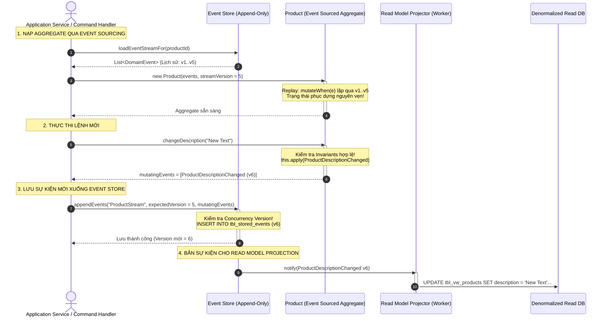

# ĐỢT 10 / 10: BÓC TÁCH CHUYÊN SÂU CHƯƠNG 14 & APPENDIX A
**Sách:** *Implementing Domain-Driven Design (IDDD)* — **Tác giả:** *Vaughn Vernon*

---

## CHƯƠNG 14: APPLICATION (TẦNG ỨNG DỤNG, GIAO DIỆN VÀ HẠ TẦNG BAO BỌC)

### 1. ĐỀ MỤC & MỤC TIÊU CỐT LÕI (CORE PURPOSE)

#### Hệ thống đề mục đầy đủ theo sách gốc (Trang 509–538):
* **User Interface** (Giao diện Người dùng và Các Chiến lược Kết xuất Mô hình Miền)
  * *Rendering Domain Objects* (Kết xuất trực tiếp Đối tượng Miền — Nguy cơ và Hạn chế)
  * *Render Data Transfer Object from Aggregate Instances* (Kết xuất DTO từ các Thực thể Aggregate qua *DTO Assembler*)
  * *Use a Mediator to Publish Aggregate Internal State* (Sử dụng Mẫu Mediator / Double-Dispatch để Xuất Trạng thái Nội bộ của Aggregate)
  * *Render Aggregate Instances from a Domain Payload Object* (Kết xuất Aggregate từ Đối tượng Trọng tải Miền - DPO)
  * *State Representations of Aggregate Instances* (Các Biểu diễn Trạng thái độc lập — JSON/XML)
  * *Use Case Optimal Repository Queries* (Các Truy vấn Kho lưu trữ Tối ưu cho Từng Trường hợp Sử dụng)
  * *Dealing with Multiple, Disparate Clients* (Xử lý Đa Dạng Máy khách Khác biệt)
  * *Rendition Adapters and Handling User Edits* (Các Bộ chuyển đổi Kết xuất và Xử lý Thao tác Chỉnh sửa của Người dùng)
* **Application Services** (Các Dịch vụ Ứng dụng — Trái tim Điều phối của Hệ thống)
  * *Sample Application Service* (Mổ xẻ Hiện thực hóa Mẫu của một Application Service Chuẩn mực)
  * *Decoupled Service Output* (Tách rời Đầu ra của Dịch vụ — Trả về DTO, Primitive ID hay dùng Presenter Callback)
* **Composing Multiple Bounded Contexts** (Lắp ghép Nhiều Ngữ cảnh Giới hạn tại Tầng Ứng dụng)
* **Infrastructure** (Tầng Hạ tầng Kỹ thuật — Chân đế Hỗ trợ)
* **Enterprise Component Containers** (Các Bộ chứa Thành phần Doanh nghiệp — Spring & IoC Containers)
* **Wrap-Up** (Tổng kết)

#### Vấn đề kỹ thuật & nghiệp vụ cốt lõi và Thảm họa nếu không áp dụng:
* **Vấn đề giải quyết:** Sau khi đã có một *Domain Model* hoàn chỉnh (Entities, Value Objects, Aggregates, Domain Services), làm thế nào để xây dựng một **vùng đệm bảo vệ (*Protective Buffer*)** bao bọc xung quanh nó? Chương 14 giải quyết bài toán: Làm thế nào để điều phối giao dịch (*Transaction*), kiểm tra quyền bảo mật (*Security*), nhận lệnh từ UI và kết xuất dữ liệu hiển thị ra ngoài mà **tuyệt đối không để lộ cấu trúc nội bộ của Domain Model, không gây rò rỉ kết nối cơ sở dữ liệu (*Open Session In View*), và không biến Domain Model thành nô lệ của giao diện?**
* **Thảm họa kỹ thuật nếu không áp dụng:**
  1. **Thảm họa Kết xuất Trực tiếp & Phản mẫu *Open Session In View* (OSIV):** Lập trình viên truyền thẳng thực thể *Aggregate Root* lên tầng Controller/Giao diện (JSP, Thymeleaf, React/JSON Serializer). Khi UI duyệt qua các thuộc tính liên kết lười (*Lazy-loaded collections*), nó kích hoạt hàng trăm câu truy vấn SQL ngoài ý muốn khi View đang render, hoặc ném ra ngoại lệ chết người `LazyInitializationException` vì Session đã đóng.
  2. **Biến Application Service thành Transaction Script (Nhiễm độc Nghiệp vụ):** Viết hàng tá câu lệnh `if-else` kiểm tra logic kinh doanh ngay trong Application Service, biến Domain Model thành mô hình thiếu máu (*Anemic*).
  3. **Rò rỉ Mẫu Biểu mẫu vào Mô hình (*Form/DTO Bleeding*):** Cho phép các đối tượng Request/DTO từ form nhập liệu bên ngoài truyền thẳng vào các phương thức của Domain Entity, làm vỡ tính đóng gói và làm ô nhiễm *Ubiquitous Language*.

---

### 2. PHÂN TÍCH LÝ THUYẾT & NGUYÊN LÝ CHUYÊN SÂU

#### A. 4 Chiến lược Xuất Dữ liệu từ Aggregate lên Giao diện (UI Rendering Strategies)
Vaughn Vernon phân tích sâu sắc ưu và nhược điểm của 4 phương pháp chuyển tải trạng thái từ Domain Model ra thế giới UI:
1. **Rendering Domain Objects Directly (Kết xuất trực tiếp):**
   * Truyền trực tiếp Aggregate lên View. *Đánh đổi:* Đơn giản nhất, nhưng cực kỳ nguy hiểm. Gây rò rỉ cấu trúc nội bộ, cám dỗ tầng UI gọi các phương thức biến đổi trạng thái của Aggregate, và dễ dính lỗi *N+1 Selects / OSIV*. Chỉ nên dùng trong ứng dụng CRUD cực nhỏ.
2. **DTO Assembler (Bộ lắp ráp DTO):**
   * Tầng Ứng dụng duyệt qua Aggregate và chuyển đổi thành một đối tượng thuần dữ liệu (**Data Transfer Object - DTO**).
   * *Ưu điểm:* Đóng gói an toàn, ngắt kết nối hoàn toàn khỏi ORM Session.
   * *Nhược điểm:* Nếu Aggregate không có sẵn các hàm getter, DTO Assembler sẽ đòi hỏi Aggregate phải mở các phương thức getter làm suy yếu tính đóng gói (*Information Hiding*).
3. **Use a Mediator / Visitor to Publish Internal State (Mẫu Mediator & Double-Dispatch):**
   * **Giải pháp OOP đỉnh cao của Vernon!** Aggregate không cần mở bất kỳ hàm `getter` nào!
   * Aggregate định nghĩa phương thức: `public void provideStateTo(ProductStateMediator mediator)`.
   * Khi Client truyền một `Mediator` vào, Aggregate sẽ thực hiện cơ chế **Double-Dispatch**: tự truyền các thuộc tính nội bộ của mình vào các hàm của `Mediator`. Nhờ đó, cấu trúc dữ liệu bên trong vẫn được giấu kín (`private`), nhưng dữ liệu vẫn được chuyển giao ra ngoài an toàn!
4. **Domain Payload Object (DPO):**
   * Là một đối tượng đóng gói gom nhóm các tham chiếu nhẹ (ID và trạng thái cơ bản) của nhiều Aggregates khác nhau để phục vụ cho các trang quản trị tổng hợp.

#### B. Trách nhiệm Chuẩn mực của *Application Service*
Vernon vạch ra ranh giới thép: **Application Service là một bộ điều phối mỏng (*Thin Coordinator*)**, có đúng 6 nhiệm vụ:
1. **Tiếp nhận tham số thô:** Nhận các kiểu nguyên thủy (`String`, `int`, `Date`) hoặc đối tượng Lệnh thô (**Command Object** như `CreateProductCommand`).
2. **Quản lý Bảo mật & Ủy quyền (*Security*):** Kiểm tra xem người dùng hiện tại có quyền thực thi ca sử dụng này không (ví dụ qua `@PreAuthorize` của Spring Security).
3. **Quản lý Giao dịch (*Transaction Demarcation*):** Đảm bảo toàn bộ thao tác trong ca sử dụng nằm trong một ranh giới giao dịch nguyên tử (`@Transactional`).
4. **Nạp Aggregate:** Truy vấn *Repository* để lấy đúng thực thể Aggregate Root tương ứng.
5. **Thực thi Hành vi Miền:** Gọi phương thức nghiệp vụ giàu ngữ nghĩa trên Aggregate Root hoặc ủy quyền cho *Domain Service*.
6. **Trả về Kết quả đã Tách rời (*Decoupled Output*):** Trả về mã định danh nguyên thủy (`String id`), trả về DTO đã chuyển đổi, hoặc sử dụng **Presenter Callback Pattern** để điều hướng phản hồi.

#### C. Lắp ghép Đa Bounded Contexts tại Tầng Ứng dụng (*Composing Multiple Bounded Contexts*)
* Khi một màn hình hiển thị đòi hỏi dữ liệu từ 2 Bounded Contexts khác nhau (ví dụ: lấy thông tin `Product` từ `AgilePM` và lấy danh sách bài thảo luận từ `Collaboration Context`):
* **Nguyên tắc DDD:** Tầng Giao diện/Ứng dụng cấp cao sẽ đóng vai trò **Bộ phối hợp (*Aggregator / Composite Application Service*)**: gọi độc lập vào Application Service của từng Context, sau đó tự ghép nối dữ liệu lại thành một *Composite ViewModel* duy nhất để trả về cho người dùng, **tuyệt đối không được ghép nối chúng ở tầng Domain Model**!

---

### 3. MỔ XẺ MÃ NGUỒN & CẤU TRÚC THIẾT KẾ (CODE DEEP-DIVE)

Chúng ta sẽ mổ xẻ **`ProductApplicationService`** (trang 522–527) và cơ chế **`Mediator Pattern (Double-Dispatch)` để xuất trạng thái Aggregate mà không dùng Getter** (trang 514–515).

#### ❌ Thiết kế SAI: Application Service ôm đồm logic nghiệp vụ và trả Entity sống ra ngoài
```java
// SAI LẦM: Application Service tự tính toán nghiệp vụ và phơi bày Entity sống ra ngoài
@Service
public class BadProductService {
    @Transactional
    public Product updateProductDetails(String productId, String name, String desc) {
        Product product = productRepository.findById(productId);
        
        // NGHIỆP VỤ BỊ RÒ RỈ RA NGOÀI DOMAIN:
        if (name == null || name.trim().isEmpty()) {
            throw new IllegalArgumentException("Product name required!");
        }
        product.setName(name); // Setter vô hồn
        product.setDescription(desc);
        
        // THẢM HỌA: Trả thẳng thực thể Hibernate sống lên UI -> Dễ gây lỗi OSIV hoặc lộ cấu trúc DB!
        return product;
    }
}
```

#### ✅ Thiết kế CHUẨN MỰC SAU REFACTOR: Application Service mỏng, Kiểm soát Giao dịch & Xuất trạng thái qua Mediator

```java
// ============================================================================
// 1. MEDIATOR INTERFACE: Xuất dữ liệu mà KHÔNG cần hàm getter trên Aggregate!
// Package: com.saasovation.agilepm.domain.model.product
// ============================================================================
public interface ProductStateMediator {
    public void writeName(String aName);
    public void writeDescription(String aDescription);
    public void writeProductId(ProductId aProductId);
    public void writeDiscussion(ProductDiscussion aDiscussion);
}

// ============================================================================
// 2. AGGREGATE ROOT HIỆN THỰC HÓA DOUBLE-DISPATCH
// Package: com.saasovation.agilepm.domain.model.product
// ============================================================================
public class Product extends ConcurrencySafeEntity {
    private String name;
    private String description;
    private ProductId productId;
    private ProductDiscussion productDiscussion;

    // DOUBLE-DISPATCH: Đẩy trạng thái nội bộ vào Mediator một cách an toàn tuyệt đối
    public void provideStateTo(ProductStateMediator aMediator) {
        aMediator.writeProductId(this.productId());
        aMediator.writeName(this.name());
        aMediator.writeDescription(this.description());
        aMediator.writeDiscussion(this.productDiscussion());
    }
}

// ============================================================================
// 3. APPLICATION SERVICE CHUẨN MỰC: Điều phối mỏng & Tách biệt Đầu ra
// Package: com.saasovation.agilepm.application.product
// ============================================================================
@Service
public class ProductApplicationService {

    @Autowired private ProductRepository productRepository;
    @Autowired private ProductOwnerRepository productOwnerRepository;

    @Transactional
    public String newProduct(NewProductCommand aCommand) {
        TenantId tenantId = new TenantId(aCommand.getTenantId());
        ProductId productId = this.productRepository.nextIdentity();

        // 1. Kiểm tra sự tồn tại của ProductOwner (Pass-by-parameter)
        ProductOwner productOwner =
            this.productOwnerRepository
                .productOwnerOfId(tenantId, aCommand.getProductOwnerId());

        if (productOwner == null) {
            throw new IllegalArgumentException(
                "Product owner does not exist: " + aCommand.getProductOwnerId());
        }

        // 2. Tạo Aggregate mới và yêu cầu khởi tạo Discussion
        Product product = new Product(
            tenantId,
            productId,
            productOwner.productOwnerId(),
            aCommand.getProductName(),
            aCommand.getProductDescription());

        product.requestDiscussion(DiscussionAvailability.valueOf(aCommand.getDiscussionAvailability()));

        // 3. Thêm mới vào Repository
        this.productRepository.add(product);

        // 4. Trả về Primitive ID tách rời (Decoupled Output)
        return product.productId().id();
    }

    @Transactional(readOnly = true)
    public ProductData productDataOf(String aTenantId, String aProductId) {
        Product product = this.productRepository.productOfId(
            new TenantId(aTenantId), new ProductId(aProductId));

        if (product == null) {
            return null;
        }

        // Sử dụng Mediator để chuyển đổi sang DTO (ProductData)
        ProductDataOutputMediator mediator = new ProductDataOutputMediator();
        product.provideStateTo(mediator);

        return mediator.toProductData();
    }
}
```

#### Bảng phân tích kỹ thuật & Ý nghĩa thiết kế:

| Dòng code / Đoạn code then chốt | Giải thích kỹ thuật & Nguyên lý thiết kế (DDD/OOP) được hiện thực hóa |
| :--- | :--- |
| `public void provideStateTo(ProductStateMediator aMediator)` | **Mediator Pattern & Double-Dispatch:** Khắc phục triệt để nhược điểm của việc mở hàm `getter`. Aggregate chủ động đẩy trạng thái của mình sang đối tượng nhận mà không để lộ cấu trúc trường nội bộ, bảo vệ nguyên lý Đóng gói (*Encapsulation*) tuyệt đối. |
| `@Transactional` *(Trên Application Service)* | **Transaction Demarcation:** Giao dịch bắt đầu và kết thúc tại ranh giới của Application Service. Đảm bảo toàn bộ việc nạp ProductOwner, khởi tạo Product và ghi vào Repository nằm trọn vẹn trong một *Unit of Work*. |
| `product.requestDiscussion(...)` | **Thin Application Service Principle:** Tầng Ứng dụng không tự quyết định trạng thái cuộc thảo luận; nó chỉ gọi phương thức hành vi nghiệp vụ trên chính thực thể `Product` để Aggregate tự bảo vệ logic của mình. |
| `return product.productId().id();` | **Decoupled Service Output:** Chỉ trả về kiểu nguyên thủy `String id` thay vì trả về đối tượng `Product`. Phía Client (UI Controller) sau đó có thể dùng ID này để điều hướng hoặc gọi truy vấn hiển thị độc lập theo chuẩn CQRS. |

---

### 4. SƠ ĐỒ TRỰC QUAN HÓA (BẮT BUỘC MÃ MERMAID)

Sơ đồ kiến trúc thể hiện vai trò "người bảo vệ" của **Application Service** và cơ chế **Mediator Double-Dispatch** xuất dữ liệu ra ngoài:



---

### 5. ÁNH XẠ ỨNG DỤNG VÀO DỰ ÁN GAME 2.5D OOP MULTIPLAYER

1. **Ứng dụng *Application Service* làm Cầu nối giữa Mạng Mở Rộng và Vòng lặp Chiến đấu (`GameMatchApplicationService`):**
   * Khi gói tin người chơi gửi tới máy chủ qua Socket UDP/TCP, tầng mạng giải mã thành `CastSkillCommand(playerId, skillSlot, targetCoord)`.
   * Gói tin **không được đi thẳng vào class `Hero`**, mà chuyển qua `CombatApplicationService.handleSkillCast(command)`:
     * Dịch vụ kiểm tra xem trận đấu có đang diễn ra không (`isMatchRunning()`), người chơi có bị cấm chat/gian lận không.
     * Nạp `GameMatch` Aggregate từ RAM Cache.
     * Gọi `match.executeHeroSkill(...)`.
     * Thu thập các sự kiện va chạm trả về và đẩy xuống tầng mạng để phát sóng gói tin đồng bộ tới tất cả người chơi khác.
2. **Dùng *Mediator Pattern* xuất Trạng thái Nhân vật sang Bộ Render 2.5D mà không lộ biến:**
   * Thay vì để `IsometricRenderer` chọc vào `hero.x`, `hero.y`, `hero.currentHp`:
   * Định nghĩa `interface RenderableSnapshotVisitor`. Thực thể `Hero` có phương thức `renderTo(RenderableSnapshotVisitor visitor)`.
   * Bên trong, `Hero` tự truyền tọa độ tính toán theo góc chiếu Isometric và mã sprite frame hiện tại vào `visitor`. Điều này đảm bảo toàn bộ công thức tính toán vật lý nội bộ của nhân vật không bị lộ ra tầng đồ họa.

---
---

## APPENDIX A: AGGREGATES AND EVENT SOURCING: A+ES (KẾT HỢP AGGREGATES VÀ EVENT SOURCING)

### 1. ĐỀ MỤC & MỤC TIÊU CỐT LÕI (CORE PURPOSE)

#### Hệ thống đề mục đầy đủ theo sách gốc (Trang 539–584):
* **Aggregates and Event Sourcing: A+ES** (Tổng quan về Sự kết hợp giữa Aggregates và Event Sourcing)
  * *Advantages and Drawbacks* (Ưu điểm và Đánh đổi của A+ES)
* **Inside an Application Service** (Bên trong một Application Service sử dụng Event Sourcing)
* **Command Handlers** (Các Bộ Xử lý Lệnh Chuyên biệt)
* **Lambda Syntax** (Cú pháp Lambda / Functional trong Xử lý Sự kiện)
* **Concurrency Control** (Kiểm soát Đồng thời trên Luồng Sự kiện — *Stream Versioning*)
* **Structural Freedom with A+ES** (Tự do về Cấu trúc Dữ liệu với A+ES — Xóa bỏ Nỗi đau Cột/Bảng ORM)
* **Performance** (Hiệu năng và Cơ chế Lưu trữ Tối ưu)
  * *Snapshots* (Ảnh chụp nhanh Trạng thái Định kỳ để Tăng tốc Phục dựng)
* **Implementing an Event Store** (Hiện thực hóa một Kho Lưu trữ Sự kiện Thực chiến)
  * *Relational Persistence* (Lưu trữ Sự kiện bằng Cơ sở Dữ liệu Quan hệ JDBC/SQL)
  * *BLOB Persistence* (Lưu trữ Sự kiện bằng Chuỗi Nhị phân BLOB / JSON)
* **Focused Aggregates** (Các Aggregates Tập trung Cao độ vào Hành vi)
* **Read Model Projections** (Các Phép Chiếu Xây dựng Mô hình Đọc — CQRS Projections)
* **Events Enrichment** (Làm giàu Sự kiện)
* **Supporting Tools and Patterns** (Các Công cụ và Mẫu Hỗ trợ)
  * *Event Serializers* (Bộ Tuần tự hóa Sự kiện — JSON, Protobuf)
  * *Event Immutability* (Tính Bất biến Tuyệt đối của Sự kiện)
  * *Value Objects* (Vai trò của Value Objects trong Event Sourcing)
* **Contract Generation, Unit Testing & Specifications** (Sinh Hợp đồng, Kiểm thử Đơn vị theo kịch bản *Given-When-Expect*)
* **Wrap-Up** (Tổng kết)

#### Vấn đề kỹ thuật & nghiệp vụ cốt lõi và Thảm họa nếu không áp dụng:
* **Vấn đề giải quyết:** Làm thế nào để giải phóng *Domain Model* hoàn toàn khỏi **nỗi ám ảnh ánh xạ bảng dữ liệu quan hệ (*Object-Relational Impedance Mismatch*)**? Làm sao để không bao giờ mất dấu bất kỳ một sự thay đổi nào trong lịch sử hệ thống, hỗ trợ kiểm toán hoàn hảo và cho phép tua lại thời gian (*Time-travel Debugging*)? Phụ lục A (đóng góp cùng chuyên gia Rinat Abdullin) cung cấp bản thiết kế hoàn chỉnh cho mô hình **A+ES (Aggregates + Event Sourcing)**.
* **Thảm họa kỹ thuật nếu không áp dụng:**
  1. **Mất mát Vĩnh viễn Dấu vết Nhân quả (*Loss of Historical Intent*):** Trong cơ sở dữ liệu truyền thống dùng lệnh `UPDATE`, giá trị cũ bị xóa đè vĩnh viễn. Khi phát sinh tranh chấp hoặc gian lận (ví dụ: tài khoản tự nhiên mất tiền, hay vật phẩm trong game biến mất), ta không có cách nào biết được chính xác chuỗi hành vi nào đã dẫn đến trạng thái hỏng hóc đó.
  2. **Chi phí Di chuyển Dữ liệu (*Database Migration Nightmare*):** Mỗi lần thay đổi cấu trúc bảng ORM, ta phải chạy các file migration phức tạp (Liquibase/Flyway), gây rủi ro cao làm gián đoạn hệ thống. Với Event Sourcing, cấu trúc sự kiện là bất biến, không bao giờ phải chạy lệnh `ALTER TABLE`!

---

### 2. PHÂN TÍCH LÝ THUYẾT & NGUYÊN LÝ CHUYÊN SÂU

#### A. Trọng tâm Bản chất của A+ES: Tách rời Biến đổi (*Mutation*) khỏi Lưu trữ Bảng
* Trong mô hình truyền thống (ORM): Aggregate được lưu bằng cách ánh xạ các trường dữ liệu của nó vào các cột của bảng SQL.
* Trong **A+ES**:
  * Trạng thái hiện tại của Aggregate **KHÔNG HỀ ĐƯỢC LƯU TRỰC TIẾP XUỐNG CƠ SỞ DỮ LIỆU!**
  * Nơi lưu trữ duy nhất là một **Bảng Ghi Nhật ký Sự kiện Bất biến Chỉ thêm mới (*Append-Only Event Stream*)** trong `EventStore`.
  * Mỗi khi có thay đổi, Aggregate phát sinh một hoặc nhiều **Domain Events** mới và các sự kiện này được nối tiếp vào cuối luồng sự kiện của nó (`streamVersion = streamVersion + 1`).

#### B. 2 Pha Xử lý bên trong Aggregate A+ES: Execute Command vs. Apply Event
Một Aggregate trong A+ES luôn có sự phân tách rạch ròi thành 2 giai đoạn:
1. **Pha 1: Thực thi Lệnh (*Command Execution*):**
   * Phương thức nhận Command (ví dụ: `commitTo(Sprint aSprint)`).
   * **Nhiệm vụ:** Kiểm tra toàn bộ các quy tắc nghiệp vụ bất biến (*Invariants*).
   * **Kết quả:** Nếu hợp lệ, nó **KHÔNG trực tiếp sửa đổi thuộc tính** của mình! Thay vào đó, nó tạo ra một sự kiện miền mới `BacklogItemCommitted` và gọi phương thức nội bộ: `this.apply(event)`.
2. **Pha 2: Biến đổi Trạng thái (*State Mutation* qua `apply` / `mutate`):**
   * Phương thức nội bộ (thường nhận sự kiện và gán thuộc tính: `this.sprintId = event.sprintId()`).
   * **Tuyệt đối không chứa logic kiểm tra điều kiện!** Nó chỉ đơn thuần áp dụng dữ liệu từ sự kiện vào các biến nội bộ.
   * *Tại sao?* Vì khi phục dựng đối tượng trong quá khứ, các quy tắc kiểm tra của tương lai không được phép can thiệp làm gián đoạn việc phát lại sự kiện!

#### C. Cơ chế Phục dựng Trạng thái (*Reconstitution*) & Tối ưu bằng Snapshots
1. **Phục dựng thuần túy (*Replaying Events*):**
   * Khởi tạo một thực thể Aggregate rỗng thông qua hàm khởi tạo không tham số ẩn.
   * Tải toàn bộ danh sách sự kiện lịch sử của Aggregate đó từ `EventStore` theo thứ tự `streamVersion` tăng dần ($1, 2, 3...$).
   * Lần lượt đưa từng sự kiện qua hàm `apply(event)` để đưa đối tượng trở về trạng thái hiện tại.
2. **Tăng tốc bằng Snapshots (Ảnh chụp nhanh):**
   * Nếu một Aggregate sống quá lâu và có hàng ngàn sự kiện (như một tài khoản ngân hàng hoặc một trận đấu game kéo dài), việc phát lại hàng ngàn sự kiện sẽ làm tăng độ trễ.
   * **Giải pháp:** Cứ sau mỗi $N$ sự kiện (ví dụ: 100 sự kiện), hệ thống tự động lưu một bản chụp trạng thái phẳng (**Snapshot**) tại phiên bản đó.
   * Khi nạp lại: Chỉ cần nạp Snapshot phiên bản 100, sau đó chỉ cần phát lại các sự kiện từ 101 trở đi!

#### D. Kiểm soát Đồng thời Lạc quan trên Luồng Sự kiện (*Stream Concurrency Control*)
* Thay vì dựa vào cột `version` trên bảng dữ liệu, `EventStore` kiểm tra phiên bản luồng:
  `eventStore.append(streamId, expectedVersion, newEvents)`
* Nếu trong lúc ta đang xử lý, một Client khác đã kịp chèn một sự kiện mới làm phiên bản hiện tại của luồng trong DB vượt quá `expectedVersion`, `EventStore` sẽ ném ra ngoại lệ `ConcurrencyException` và hủy giao dịch ngay lập tức, bảo đảm tính toàn vẹn 100%.

#### E. Mô hình Kiểm thử Tinh khiết: *Given - When - Expect*
A+ES mang lại năng lực kiểm thử đơn vị tuyệt đỉnh cho các kỹ sư:
* **Given (Cho trước):** Một chuỗi các sự kiện đã xảy ra trong quá khứ (`[ProductCreated, BacklogItemPlanned]`).
* **When (Khi):** Thực thi một lệnh mới (`CommitBacklogItemToSprintCommand`).
* **Expect (Kỳ vọng):** Sự kiện mới nào sẽ được phát sinh? (`[BacklogItemCommitted]`).
* Toàn bộ kịch bản kiểm thử chạy hoàn toàn trong RAM, không cần mock database, không cần ORM!

---

### 3. MỔ XẺ MÃ NGUỒN & CẤU TRÚC THIẾT KẾ (CODE DEEP-DIVE)

Chúng ta sẽ mổ xẻ cấu trúc lớp cơ sở **`EventSourcedRootEntity`** và thực thể **`Product` hiện thực hóa theo kiến trúc A+ES** (trang 541–557).

#### ❌ Thiết kế Cũ: Trộn lẫn Lưu trữ Bảng và Mất dấu Vết Biến đổi
```java
// Thiết kế cũ: Cập nhật trực tiếp trạng thái và lưu đè bảng DB
public class OldProduct {
    private String name;
    public void rename(String newName) {
        this.name = newName; // Lịch sử tên cũ bị xóa vĩnh viễn!
    }
}
```

#### ✅ Thiết kế CHUẨN MỰC SAU REFACTOR: Aggregate kết hợp Event Sourcing (A+ES) với Pha `apply()` riêng biệt

```java
// ============================================================================
// 1. LỚP CƠ SỞ AGGREGATE CHO EVENT SOURCING: EventSourcedRootEntity
// Package: com.saasovation.common.domain.model.eventsourced
// ============================================================================
public abstract class EventSourcedRootEntity {

    private List<DomainEvent> mutatingEvents; // Danh sách sự kiện mới chưa lưu
    private int unmutatedVersion;             // Phiên bản luồng hiện tại

    protected EventSourcedRootEntity() {
        super();
        this.mutatingEvents = new ArrayList<DomainEvent>();
    }

    // Tái tạo lại Aggregate từ chuỗi sự kiện lịch sử (Replay)
    public EventSourcedRootEntity(List<DomainEvent> anEventStream, int aStreamVersion) {
        this();
        for (DomainEvent event : anEventStream) {
            this.mutateWhen(event); // Phát lại từng sự kiện để đắp trạng thái
        }
        this.unmutatedVersion = aStreamVersion;
    }

    // Đăng ký và áp dụng sự kiện mới phát sinh từ lệnh
    protected void apply(DomainEvent aDomainEvent) {
        this.mutatingEvents.add(aDomainEvent);
        this.mutateWhen(aDomainEvent);
    }

    // Phương thức đa hình trừu tượng để lớp con gán thuộc tính tương ứng từng sự kiện
    protected abstract void mutateWhen(DomainEvent aDomainEvent);

    public List<DomainEvent> mutatingEvents() {
        return Collections.unmodifiableList(this.mutatingEvents);
    }

    public int mutatedVersion() {
        return this.unmutatedVersion + 1;
    }

    public int unmutatedVersion() {
        return this.unmutatedVersion;
    }
}

// ============================================================================
// 2. AGGREGATE ROOT HIỆN THỰC HÓA THEO MÔ HÌNH A+ES: Product
// Package: com.saasovation.agilepm.domain.model.product
// ============================================================================
public class Product extends EventSourcedRootEntity {

    private String description;
    private String name;
    private ProductId productId;
    private TenantId tenantId;

    // Constructor phục dựng lại đối tượng từ Event Store
    public Product(List<DomainEvent> anEventStream, int aStreamVersion) {
        super(anEventStream, aStreamVersion);
    }

    // Constructor khởi tạo mới: Phát ra sự kiện ProductCreated
    public Product(TenantId aTenantId, ProductId aProductId, String aName, String aDescription) {
        super();
        this.assertArgumentNotNull(aTenantId, "TenantId must be provided.");
        this.assertArgumentNotNull(aProductId, "ProductId must be provided.");

        // ÁP DỤNG SỰ KIỆN: Không gán trực tiếp this.name = aName!
        this.apply(new ProductCreated(aTenantId, aProductId, aName, aDescription));
    }

    // COMMAND METHOD: Kiểm tra bất biến và phát sự kiện
    public void changeDescription(String aNewDescription) {
        this.assertArgumentNotEmpty(aNewDescription, "Description must be provided.");
        
        // Không sửa thuộc tính trực tiếp! Gọi apply!
        this.apply(new ProductDescriptionChanged(this.tenantId(), this.productId(), aNewDescription));
    }

    // MUTATION METHOD: Duyệt qua từng sự kiện và thay đổi biến nội bộ (Không có logic kiểm tra!)
    @Override
    protected void mutateWhen(DomainEvent aDomainEvent) {
        if (aDomainEvent instanceof ProductCreated) {
            this.when((ProductCreated) aDomainEvent);
        } else if (aDomainEvent instanceof ProductDescriptionChanged) {
            this.when((ProductDescriptionChanged) aDomainEvent);
        }
    }

    private void when(ProductCreated anEvent) {
        this.tenantId = anEvent.tenantId();
        this.productId = anEvent.productId();
        this.name = anEvent.name();
        this.description = anEvent.description();
    }

    private void when(ProductDescriptionChanged anEvent) {
        this.description = anEvent.description();
    }
}
```

#### Bảng phân tích kỹ thuật & Ý nghĩa thiết kế:

| Dòng code / Đoạn code then chốt | Giải thích kỹ thuật & Nguyên lý thiết kế (DDD/OOP) được hiện thực hóa |
| :--- | :--- |
| `public EventSourcedRootEntity(List<DomainEvent> anEventStream, ...)` | **Event Sourcing Reconstitution:** Hàm khởi tạo nhận luồng sự kiện lịch sử từ `EventStore` và duyệt qua từng phần tử để khôi phục lại trạng thái đối tượng. Aggregate không cần nạp từ bất kỳ bảng dữ liệu SQL nào! |
| `this.apply(new ProductDescriptionChanged(...));` | **Command Execution vs. State Mutation:** Phương thức nghiệp vụ chỉ tập trung kiểm tra Guard Clauses, sau đó đúc một sự kiện bất biến và đưa vào `apply()`. Tách rời tuyệt đối giữa việc ra quyết định nghiệp vụ và việc cập nhật trạng thái. |
| `protected void mutateWhen(DomainEvent aDomainEvent)` | **Deterministic State Machine:** Nhận sự kiện và điều phối tới phương thức `when(...)` tương ứng để gán giá trị cho thuộc tính nội bộ. Hàm này đảm bảo cùng một chuỗi sự kiện đầu vào sẽ luôn cho ra đúng một trạng thái duy nhất ở đầu ra (*Deterministic*). |
| `this.mutatingEvents.add(aDomainEvent);` | **Uncommitted Events Collection:** Các sự kiện mới phát sinh được gom vào bộ đệm `mutatingEvents`. Khi tầng Application Service kết thúc, toàn bộ các sự kiện này sẽ được ghi đồng loạt xuống `EventStore` và phát ra ngoài cho các bộ chiếu (*Read Model Projectors*). |

---

### 4. SƠ ĐỒ TRỰC QUAN HÓA (BẮT BUỘC MÃ MERMAID)

Sơ đồ trình bày chu trình hoàn chỉnh của **A+ES (Aggregates + Event Sourcing)** kết hợp **CQRS Projections**:



---

### 5. ÁNH XẠ ỨNG DỤNG VÀO DỰ ÁN GAME 2.5D OOP MULTIPLAYER

Mô hình A+ES (Aggregates + Event Sourcing) chính là nền tảng tối thượng cho hệ thống **Netcode Chống Gian Lận (*Server Authoritative Anti-Cheat*)**, **Hệ thống Phát lại Trận đấu (*Match Replay System*)**, và **Bù trừ Độ trễ Mạng (*Lag Compensation*)** trong Game 2.5D của bạn:

1. **Hiện thực hóa Hệ thống Lưu lại & Xem lại Trận đấu (*Match Replay Engine*) với chi phí bộ nhớ tối thiểu:**
   * *Cách làm thông thường tồi tệ:* Mỗi frame hình hoặc mỗi giây, ghi lại toàn bộ trạng thái vị trí của 4 nhân vật, 100 quái vật và hàng ngàn viên đạn vào ổ cứng $\rightarrow$ File Replay nặng hàng gigabytes!
   * *Áp dụng A+ES:* Server chỉ lưu trữ chuỗi các **Domain Events** theo số thứ tự Tick:
     `[Tick 1: MatchStarted, Tick 15: HeroMoved(hero1, dir), Tick 42: SkillCast(hero2, FIREBALL, target), Tick 48: HeroDamaged(hero1, 50), Tick 120: MobSpawned(ZOMBIE, x, y)]`.
   * Khi người chơi muốn xem lại trận đấu (*Replay*), Client chỉ cần tải file text JSON sự kiện (vài trăm kilobytes), tạo một môi trường game trống và **phát lại chuỗi sự kiện (*Replay Events*) qua Game Loop**. Toàn bộ trận đấu 2.5D hiển thị lại chính xác 100% từng khung hình!
2. **Cơ chế *Server-side Rewind* Bù trừ Độ trễ 4G (*Lag Compensation*) cho Xạ thủ / Tung chiêu:**
   * Khi Người chơi A (bị trễ ping 100ms) bắn trúng Người chơi B trên màn hình của A. Gói tin gửi lên Server mất 100ms mới tới nơi, lúc này B đã di chuyển sang vị trí khác trên Server.
   * Nhờ thiết kế A+ES, Server không lưu đè vị trí của B, mà giữ một chuỗi các sự kiện trạng thái trong quá khứ (*Event Ring Buffer*). Server có thể **tua ngược đối tượng `Hero B` về thời điểm cách đây 100ms** bằng cách phát lại sự kiện đến mốc thời gian đó, kiểm tra xem phát bắn của A tại thời điểm đó có trúng Hitbox của B không. Nếu trúng, Server công nhận sát thương và áp dụng sự kiện `DamageApplied` cho hiện tại! Đây chính là bí mật công nghệ đằng sau các game bắn súng/MOBA hiện đại!
