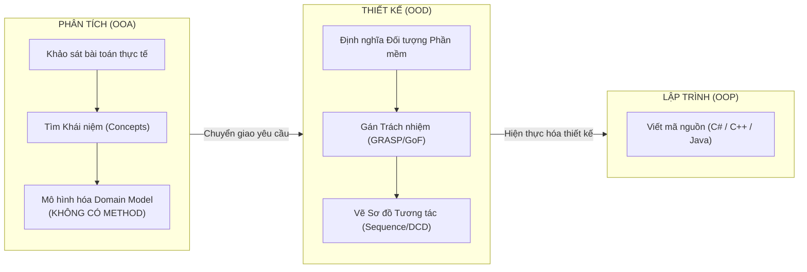
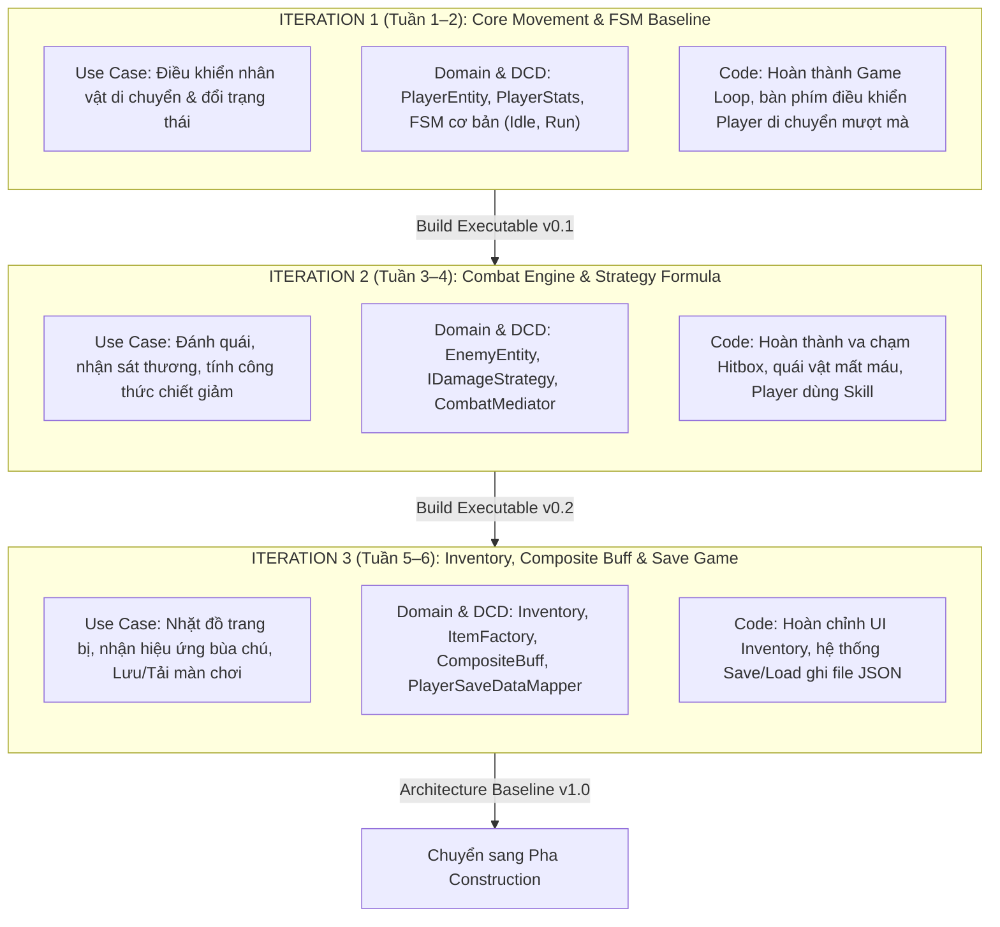

# HỌC PHẦN 1: NỀN TẢNG OOAD VÀ QUY TRÌNH UNIFIED PROCESS (UP)
> **Tài liệu học thuật & Thiết kế Game thực chiến**  
> *Dựa trên sách "Applying UML and Patterns" (3rd Edition) — Craig Larman (PDF tr. 20–127)*

---

## I. BẢN CHẤT CỦA PHÂN TÍCH & THIẾT KẾ HƯỚNG ĐỐI TƯỢNG (OOAD)
*(Tham chiếu: Chương 1, PDF tr. 20–29)*

### 1.1. Định nghĩa chuẩn xác: OOA vs. OOD
Hầu hết các sinh viên thất bại trong môn OOP không phải vì không biết cú pháp code (syntax), mà vì họ **nhảy bổ vào viết code trước khi tư duy cấu trúc**. Trong kỹ nghệ phần mềm, chúng ta phân biệt rạch ròi hai hoạt động:

* **Object-Oriented Analysis (OOA - Phân tích Hướng đối tượng)**:
  * **Mục tiêu**: *"Làm đúng việc"* (Do the right thing).
  * **Bản chất**: Khảo sát miền bài toán thực tế (Problem Domain) để tìm ra các **khái niệm (Concepts)** hoặc các **đối tượng thực tế (Domain Objects)**.
  * **Đặc điểm**: Hoàn toàn **độc lập với công nghệ và ngôn ngữ lập trình**. Không bàn về C#, Java, Database hay Framework.
  * *Ví dụ*: Trong thế giới bán lẻ có `Khách hàng`, `Hóa đơn`, `Mặt hàng`. Trong Game có `Chiến binh`, `Kỹ năng`, `Quái vật`, `Túi đồ`.

* **Object-Oriented Design (OOD - Thiết kế Hướng đối tượng)**:
  * **Mục tiêu**: *"Làm việc đó đúng cách"* (Do the thing right).
  * **Bản chất**: Xác định các **đối tượng phần mềm logic (Software Objects)** và cách chúng cộng tác, trao đổi thông điệp (Collaborating & Message Passing) để đáp ứng yêu cầu.
  * **Đặc điểm**: Đưa ra đặc tả chi tiết về phương thức, kiểu dữ liệu, các mẫu thiết kế (GRASP/GoF) để chuẩn bị cho việc viết code.

---

### 1.2. Trọng tâm cốt lõi: Responsibility-Driven Design (RDD)
Craig Larman nhấn mạnh: **Trọng tâm của thiết kế hướng đối tượng là việc PHÂN BỔ TRÁCH NHIỆM (Assigning Responsibilities).**

Trách nhiệm của một đối tượng được chia làm 2 loại:
1. **Trách nhiệm Nhận thức (Knowing Responsibilities)**:
   * Biết dữ liệu riêng tư của nó (Encapsulated state).
   * Biết về các đối tượng liên quan (References/Associations).
   * Biết những điều mà nó có thể tự suy ra hoặc tính toán từ dữ liệu nội tại.
   * *Ví dụ Game*: `CharacterStats` biết lượng máu tối đa, biết chỉ số giáp hiện tại.
2. **Trách nhiệm Hành động (Doing Responsibilities)**:
   * Tự mình thực hiện một hành động (tính toán, biến đổi dữ liệu).
   * Khởi tạo một đối tượng khác mà nó sở hữu.
   * Điều phối hoặc kiểm soát các hành động của đối tượng khác.
   * *Ví dụ Game*: `CombatEngine.executeAttack()` điều phối việc trừ máu của mục tiêu.

---

## II. TIẾN TRÌNH PHÁT TRIỂN LẶP (ITERATIVE) & UNIFIED PROCESS (UP)
*(Tham chiếu: Chương 2, PDF tr. 30–44)*

### 2.1. Tại sao Mô hình Thác nước (Waterfall) thất bại trong Game & OOP?
Mô hình thác nước giả định rằng con người có thể đặc tả 100% yêu cầu hoàn hảo ngay từ ngày đầu tiên. Thực tế chứng minh:
* Yêu cầu phần mềm luôn biến động theo thời gian (Evolutionary requirements).
* Trong Game Development, yếu tố "chơi có vui không?" (**Gameplay Fun-factor**) chỉ được kiểm chứng khi đã có bản chơi thử thực tế (Playable Build). Thác nước khiến bạn chờ 6 tháng mới thấy game chạy lần đầu — và nếu cơ chế combat dở tệ, toàn bộ kiến trúc bị đập đi xây lại!

### 2.2. Bản chất của Unified Process: Phát triển Lặp & Tiến hóa (Iterative & Evolutionary)
* Dự án được chia thành các chu kỳ nhỏ có độ dài cố định gọi là **Timeboxed Iterations** (thường từ 2 đến 4 tuần).
* Mỗi iteration là một **dự án thu nhỏ** (Mini-project) bao gồm đầy đủ các bước: Lập kế hoạch $\rightarrow$ Phân tích $\rightarrow$ Thiết kế $\rightarrow$ Lập trình $\rightarrow$ Kiểm thử $\rightarrow$ Tích hợp bản build chạy được.
* **Quy tắc vàng của Larman**: Kết thúc mỗi Iteration, **BẮT BUỘC phải tạo ra một bản build chạy được và đã kiểm thử (Tested, Integrated, Executable Baseline)**. Không có khái niệm "Iteration này tôi chỉ ngồi vẽ giấy".

---

### 2.3. Bốn Pha (Phases) của Unified Process
Craig Larman làm rõ ranh giới nghiêm ngặt giữa 4 pha:

```mermaid
gantt
    title BỐN PHA CỦA TIẾN TRÌNH UNIFIED PROCESS (UP)
    dateFormat  X
    axisFormat %s
    section 1. Inception
    Xác định Tầm nhìn, Phạm vi & Tính khả thi (10% Use Cases) :0, 15
    section 2. Elaboration
    Xây dựng Kiến trúc cốt lõi, Giảm thiểu rủi ro (80% Use Cases) :15, 55
    section 3. Construction
    Hoàn thiện các tính năng còn lại & Tối ưu hóa :55, 90
    section 4. Transition
    Beta Test, Sửa lỗi cuối cùng & Phát hành :90, 100
```

1. **Inception (Khởi tạo)**:
   * **Mục đích**: KHÔNG PHẢI là định nghĩa toàn bộ yêu cầu. Mục đích là **Envisioning** (Hình dung phạm vi), kiểm tra tính khả thi, dự toán chi phí sơ bộ và quyết định xem dự án có đáng làm không.
   * **Sản phẩm**: Chỉ viết chi tiết khoảng 10% ca sử dụng cốt lõi nhất.
2. **Elaboration (Tinh chỉnh - TRÁI TIM CỦA OOAD)**:
   * **Mục đích**: Xây dựng **Khung kiến trúc cốt lõi (Core Architecture Baseline)** và dập tắt các rủi ro kỹ thuật lớn nhất (High-risk mitigation).
   * **Sản phẩm**: Chi tiết hóa khoảng 80% ca sử dụng, hoàn thành Domain Model, thiết kế DCD và code xong các khung sườn chính của hệ thống.
3. **Construction (Xây dựng)**:
   * Hiện thực hóa hàng loạt các tính năng còn lại dựa trên khung kiến trúc đã ổn định từ Elaboration.
4. **Transition (Chuyển giao)**:
   * Triển khai, đóng gói, sửa lỗi (bug fix) và tối ưu hiệu năng trước khi release.

---

## III. VÒNG ĐỜI VÀ SỰ DỊCH CHUYỂN CỦA CÁC SẢN PHẨM (ARTIFACTS)
*(Tham chiếu: Chương 4 & Chương 8, PDF tr. 49–53, 120–127)*

Bảng ma trận chỉ rõ mỗi sản phẩm phân tích/thiết kế bắt đầu từ đâu và tiến hóa ra sao:

| Tên Sản phẩm (Artifact) | Bắt đầu tại Pha nào? | Trọng tâm trong Pha Inception | Trọng tâm trong Pha Elaboration |
|:---|:---:|:---|:---|
| **Vision (Tầm nhìn)** | Inception | Tóm tắt mục tiêu cấp cao, bài toán kinh doanh / gameplay cốt lõi (1–3 trang). | Được tinh chỉnh nhẹ nếu phạm vi có sự điều chỉnh. |
| **Use-Case Model** | Inception | Nhận diện tên tất cả các Use Case; chỉ viết chi tiết (Fully Dressed) khoảng **10%** use case cốt lõi. | Chi tiết hóa bổ sung tới **80%** các use case còn lại; bổ sung kịch bản ngoại lệ (Alternate Flows). |
| **Supplementary Specification** | Inception | Ghi nhận các yêu cầu phi chức năng lớn (FPS $\ge$ 60, không lag khi có 100 quái vật, lưu file an toàn). | Làm rõ ràng các ràng buộc kỹ thuật, thư viện đồ họa, chuẩn mã hóa. |
| **Glossary (Thuật ngữ)** | Inception | Định nghĩa từ điển thuật ngữ nghiệp vụ sơ khởi để thống nhất cách gọi giữa các thành viên. | Mở rộng chi tiết các tham số, đơn vị đo lường (HP, Mana, Cooldown, Damage Type). |
| **Domain Model** | **Elaboration** | *Chưa làm* (hoặc chỉ phác thảo thô sơ vài khái niệm chính trên bảng trắng). | **Tập trung cao độ**: Xác định rõ Conceptual Classes, Associations, Attributes (không methods). |
| **Design Model (SSD, Sequence, DCD)** | **Elaboration** | *Chưa làm*. | **Tập trung cao độ**: Vẽ SSD cho hệ thống, áp dụng GRASP để vẽ Sequence Diagrams, tổng hợp ra DCD. |
| **Software Architecture Document (SAD)** | Elaboration | *Chưa làm*. | Bản tổng kết kiến trúc: Phân tầng Layered, quyết định áp dụng GoF Patterns, cơ chế State Machine. |

---

## IV. HAI CASE STUDY GỐC TRONG SÁCH CRAIG LARMAN
*(Tham chiếu: Chương 3, PDF tr. 45–47)*

Craig Larman rất thông minh khi lựa chọn **hai case study song song**:
1. **NextGen POS (Point of Sale)**:
   * **Bản chất**: Hệ thống thông tin xí nghiệp (Enterprise Information System).
   * **Thách thức**: Nhiều quy tắc kế toán phức tạp, tích hợp phần cứng (máy quét mã vạch, máy in hóa đơn), gọi API bên ngoài (thuế, ngân hàng thẻ Visa/Master) và lưu trữ CSDL.
2. **Monopoly Game (Cờ tỷ phú)**:
   * **Bản chất**: Hệ thống mô phỏng (Simulation), dựa trên luật chơi (Rules-based) và trạng thái (State-driven).
   * **Ý nghĩa đối với Đồ án Game của chúng ta**: Monopoly chính là **tiền đề trực tiếp của Game Architecture** trong sách Larman. Hệ thống gồm: `Board`, `Player`, `Die` (Xúc xắc), `Square` (Ô cờ), `Piece` (Quân cờ). Vòng lặp trò chơi (`playRound()`) và cơ chế di chuyển theo luật hoàn toàn tương đồng với Game Engine!

---

## V. CHUYỂN HÓA THỰC CHIẾN SANG ĐỒ ÁN GAME OOP

### 5.1. Định nghĩa Inception cho Đồ án Game OOP
* **Tầm nhìn (Vision)**: Xây dựng một game nhập vai chiến đấu thời gian thực / theo lượt (Action RPG hoặc Turn-based RPG) với kiến trúc Hướng đối tượng chuẩn mực.
* **10% Use Case cốt lõi được chọn viết chi tiết trong Inception**:
  * `UC-01: Khởi tạo và Bắt đầu màn chơi (Start Game Session)`
  * `UC-02: Thực hiện hành động chiến đấu (Execute Combat Action)`
* **Rủi ro kỹ thuật lớn nhất cần dập tắt trong Elaboration**:
  * Ghép nối quá chặt giữa vòng lặp Game (Game Loop/Renderer) và Domain Logic khiến code khó test.
  * Hệ thống tính toán sát thương bị "hard-code" bằng quá nhiều lệnh `if/else`, không mở rộng được trang bị mới.

---

### 5.2. Kế hoạch Lặp (Iteration Plan) cho Đồ án Game (Elaboration Phase)

Chúng ta chia pha Elaboration thành **3 Iteration** theo chuẩn Craig Larman:

---

## VI. TỔNG KẾT BÀI HỌC HỌC PHẦN 1 CHO BÁO CÁO ĐẠI HỌC
Khi viết phần Mở đầu và Phương pháp luận cho Báo cáo Đồ án OOP, bạn cần nêu bật 3 thông điệp đắt giá:
1. **Khẳng định phương pháp**: Đồ án không dùng mô hình Thác nước (Waterfall) mà tuân thủ nghiêm ngặt **Tiến trình Lặp (Unified Process)** để giảm thiểu rủi ro sớm qua 3 Iterations.
2. **Khẳng định tư duy**: Không nhầm lẫn giữa Phân tích (OOA - hiểu bài toán) và Thiết kế (OOD - phân bổ trách nhiệm bằng GRASP).
3. **Mục tiêu kiến trúc**: Pha Elaboration hướng tới một **Executable Architectural Baseline** — đảm bảo code chạy được ở từng tuần thay vì chỉ vẽ sơ đồ lý thuyết.
