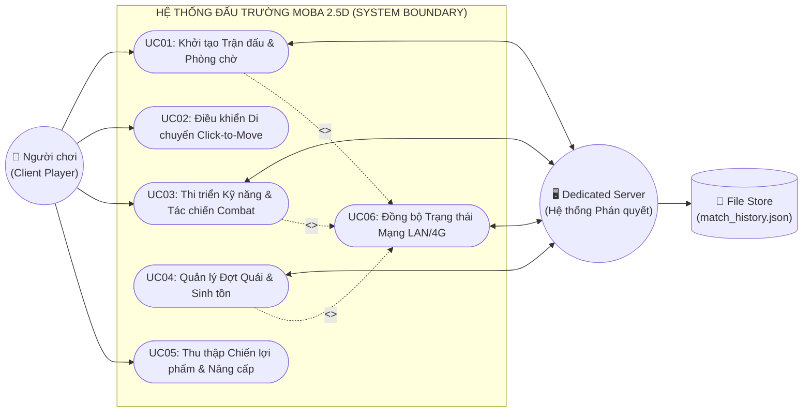
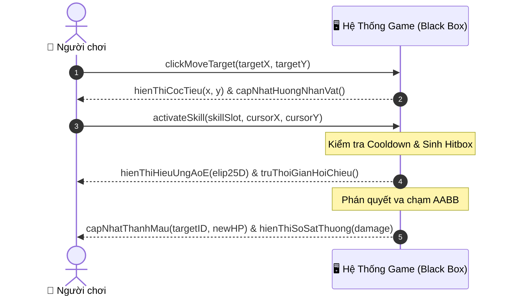
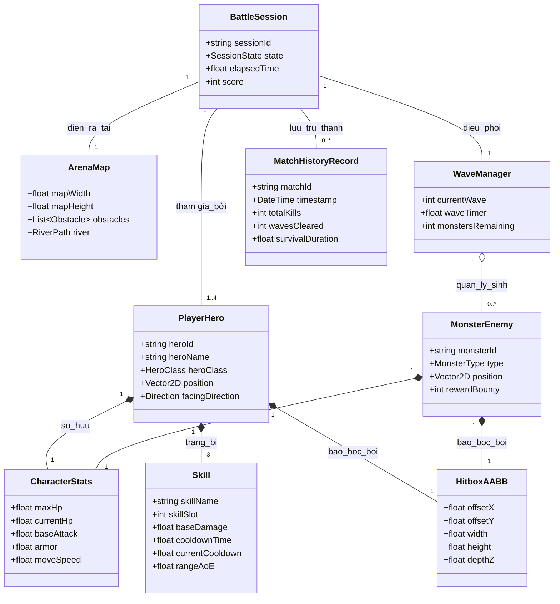

# BÁO CÁO KẾT QUẢ ĐỒ ÁN MÔN HỌC — GIAI ĐOẠN 1
## HỌC PHẦN: LẬP TRÌNH HƯỚNG ĐỐI TƯỢNG (OBJECT-ORIENTED PROGRAMMING)
### TRƯỜNG ĐẠI HỌC XÂY DỰNG HÀ NỘI (HUCE) — KHOA CÔNG NGHỆ THÔNG TIN

---

> **TÊN ĐỀ TÀI:**  
> **PHÂN TÍCH, THIẾT KẾ VÀ XÂY DỰNG HỆ THỐNG TRÒ CHƠI ĐẤU TRƯỜNG THỜI GIAN THỰC 2.5D ACTION RPG MULTIPLAYER ÁP DỤNG PHƯƠNG PHÁP LUẬN OOAD VÀ MẪU THIẾT KẾ (DESIGN PATTERNS)**

---

### BẢNG THÔNG TIN HỌC THUẬT & PHÂN CÔNG NHIỆM VỤ (NHÓM 1)

* **Giảng viên phụ trách**: Bộ môn Công nghệ Phần mềm — Khoa Công nghệ Thông tin (HUCE)
* **Kho mã nguồn & Tài liệu (GitHub Repository)**: [`https://github.com/Tran1209/UML-Patterns-Mastery.git`](https://github.com/Tran1209/UML-Patterns-Mastery.git)
* **Môi trường phát triển**: Java SE Development Kit 17/21 (LTS) — **Pure OOP** (Không dùng Game Engine ngoài).

| STT | Họ và Tên Sinh Viên | GitHub Username | Vai trò Kỹ thuật & Module Chịu trách nhiệm | Trụ cột Nghiên cứu Lý thuyết (Pillar) | Tỷ lệ Đóng góp |
| :-: | :--- | :-: | :--- | :--- | :-: |
| **1** | **Trung Kiên** *(Trưởng nhóm)* | `KienEsto` | **Team Leader & Combat Systems Architect**<br>• Combat Engine, Hitbox AABB, 3 Kỹ năng AOV, Click-to-Move Mouse Navigation | **Craig Larman** (*Applying UML & Patterns*) & **Robert Nystrom** (*Game Patterns*) | **100%** |
| **2** | **Duy Nam** | `Tran1209` | **Lead Software Architect & Core Developer**<br>• Kiến trúc Clean Architecture, Game Loop 60 FPS, Player FSM, Android Port | **Craig Larman** (*OOAD UP*) & **Vaughn Vernon** (*Implementing DDD*) | **100%** |
| **3** | **Nguyễn Đức Huy** | `nguyenduchuy20070406-oss` | **Network & Distributed Systems Engineer**<br>• Dedicated Server 20Hz Tickrate, Gói tin nhị phân TCP/UDP, Sảnh chờ Lobby | **Joshua Glazer & Sanjay Madhav** (*Multiplayer Game Programming*) | **100%** |
| **4** | **Đức Anh** | [`Alonee-code`](https://github.com/Alonee-code) | **Client Graphics & UX Engineer**<br>• Kết xuất 2.5D Dimetric MOBA, Thuật toán Z-Sorting, Camera2D LERP, LPC Sprite | **Robert Nystrom** (*Game Loop & Double Buffer*) & **GoF Patterns** | **100%** |
| **5** | **Huy Hoàng** | [`KienFake`](https://github.com/KienFake) | **Persistence & QA/QC Test Engineer**<br>• Lưu trữ JSON (`IMatchRepository`), Wave Quái vật (`WaveManager`), Bộ 20/20 Unit Tests | **Martin Fowler** (*PoEAA*) & **SOLID Principles** | **100%** |

---

## MỤC LỤC BÁO CÁO GIAI ĐOẠN 1
1. [PHẦN I: MÔ TẢ BÀI TOÁN (PROBLEM STATEMENT & SYSTEM REQUIREMENTS)](#phần-i-mô-tả-bài-toán-problem-statement--system-requirements)
   * 1.1. Bối cảnh thực tiễn & Lý do lựa chọn đề tài
   * 1.2. Mục tiêu kỹ thuật & Phạm vi bài toán
   * 1.3. Mô tả nghiệp vụ thế giới Game (Domain Business Description)
   * 1.4. Yêu cầu hệ thống theo mô hình FURPS+
2. [PHẦN II: KẾT QUẢ PHÂN TÍCH HƯỚNG ĐỐI TƯỢNG (OOA - USE CASES & DOMAIN CLASS)](#phần-ii-kết-quả-phân-tích-hướng-đối-tượng-ooa---use-cases--domain-class)
   * 2.1. Biểu đồ Ca sử dụng Tổng thể (Use Case Diagram)
   * 2.2. Danh mục & Đặc tả chi tiết các Ca sử dụng cốt lõi (Fully Dressed Use Cases)
   * 2.3. Sơ đồ Tuần tự Hệ thống Hộp đen (System Sequence Diagrams - SSD)
   * 2.4. Sơ đồ Lớp Khái niệm (Domain Model / Conceptual Class Diagram)
3. [PHẦN III: GIAO DIỆN CHƯƠNG TRÌNH (PROGRAM USER INTERFACE - GUI)](#phần-iii-giao-diện-chương-trình-program-user-interface---gui)
   * 3.1. Kiến trúc phân tách Giao diện - Nghiệp vụ (Model-View Separation)
   * 3.2. Sơ đồ luồng chuyển màn hình (UI Screen Flow Diagram)
   * 3.3. Đặc tả & Minh họa chi tiết các màn hình (Screen Wireframes & Mockups)
     * 3.3.1. Màn hình Sảnh chờ (Lobby Panel)
     * 3.3.2. Màn hình Đấu trường 2.5D Dimetric MOBA (Game Canvas)
     * 3.3.3. Bảng Điều khiển & HUD Người chơi (Segmented Health Bar & Skill HUD)
     * 3.3.4. Màn hình Thống kê Lịch sử Trận đấu (Match Summary)
4. [PHẦN IV: KẾT QUẢ THIẾT KẾ THÀNH PHẦN (COMPONENT DESIGN)](#phần-iv-kết-quả-thiết-kế-thành-phần-component-design)
   * 4.1. Biểu đồ Thành phần Hệ thống (UML Component Diagram)
   * 4.2. Đặc tả các Thành phần cốt lõi (Core Subsystem Components)
   * 4.3. Bảng Khế ước Giao diện giữa các Thành phần (Component Interfaces / Contracts)
   * 4.4. Kiểm soát tính ghép nối thấp (Low Coupling) và Phân tầng kiến trúc
5. [PHẦN V: TÀI LIỆU THAM KHẢO & KẾ HOẠCH GIAI ĐOẠN 2](#phần-v-tài-liệu-tham-khảo--kế-hoạch-giai-đoạn-2)

---

# PHẦN I: MÔ TẢ BÀI TOÁN (PROBLEM STATEMENT & SYSTEM REQUIREMENTS)

### 1.1. Bối cảnh thực tiễn & Lý do lựa chọn đề tài
Trong quá trình đào tạo kỹ sư Công nghệ Thông tin tại Trường Đại học Xây dựng Hà Nội (HUCE), môn học **Lập trình Hướng đối tượng (OOP)** đóng vai trò hạt nhân xây dựng tư duy mô hình hóa và thiết kế phần mềm. Thay vì xây dựng các phần mềm quản lý CRUD (Create-Read-Update-Delete) thông thường vốn chỉ đóng vai trò bao bọc quanh cơ sở dữ liệu, **Nhóm 1** lựa chọn bài toán: **Xây dựng trò chơi đấu trường hành động trực tuyến nhiều người chơi thời gian thực (Real-time Multiplayer 2.5D Action RPG Arena)**.

Bài toán này mang tính thách thức cao, hội tụ trọn vẹn mọi yêu cầu phức tạp nhất của kỹ nghệ phần mềm:
1. **Mô hình hóa thế giới động**: Quản lý hàng trăm thực thể (Tướng, Quái vật, Đạn bay, Hiệu ứng nổ AoE) tương tác liên tục trong không gian 2.5D.
2. **Xử lý thời gian thực (Real-time Constraints)**: Vòng lặp game (Game Loop) cố định $60\text{ FPS}$ cho đồ họa và $20\text{ Hz}$ cho tính toán logic máy chủ.
3. **Kiến trúc phân tán Client - Server**: Tách biệt hoàn toàn máy khách (Client View) và máy chủ có quyền phán quyết (Authoritative Dedicated Server), triệt tiêu hoàn toàn gian lận tốc độ và sát thương.
4. **Phân rã trách nhiệm & Thiết kế mẫu (Design Patterns)**: Áp dụng phương pháp luận OOAD của Craig Larman và 23 mẫu thiết kế GoF để mã nguồn có tính kết nối lỏng (Low Coupling), độ kết dính cao (High Cohesion), dễ kiểm thử tự động.

### 1.2. Mục tiêu kỹ thuật & Phạm vi bài toán
* **Nguyên tắc "Pure OOP" (100% Thuần Hướng đối tượng)**:
  * Không sử dụng bất kỳ Game Engine hoặc Framework đồ họa trung gian nào (như Unity, Unreal, LibGDX). Toàn bộ hệ thống Vòng lặp game, Phép chiếu 2.5D Dimetric, Thuật toán sắp xếp trục sâu Z-Sorting, Va chạm hình học AABB, và Đồng bộ mạng Socket đều do sinh viên Nhóm 1 tự nghiên cứu và cài đặt bằng **Java SE 17/21 thuần**.
* **Phạm vi hệ thống**:
  * Chế độ Đấu trường Đơn (Singleplayer vs AI Bot): Người chơi thử nghiệm kỹ năng với quái vật và bot máy.
  * Chế độ Đấu trường Nhiều người chơi (Multiplayer LAN/Internet): Tối đa 4 người chơi kết nối đồng thời vào một phòng đấu máy chủ trung tâm.
  * Bền vững dữ liệu: Tự động ghi nhận thông số trận đấu xuống tệp JSON trên ổ đĩa.

### 1.3. Mô tả nghiệp vụ thế giới Game (Domain Business Description)
Trò chơi đưa người chơi vào một **Bình Nguyên MOBA 2.5D** với các quy tắc nghiệp vụ rạch ròi:
* **Hệ thống Nhân vật (Hero Classes)**:
  * Mỗi nhân vật sở hữu các thuộc tính cơ bản: Máu tối đa ($HP_{max}$), Máu hiện tại ($HP_{cur}$), Giáp giảm trừ sát thương ($Armor$), Sát thương cơ bản ($BaseDamage$), và Tốc độ di chuyển ($Speed$).
  * Trạng thái nhân vật tuân theo **Máy trạng thái hữu hạn (FSM)**: `IDLE` (Đứng yên), `RUNNING` (Di chuyển), `ATTACKING` (Ra đòn), `CASTING` (Niệm chiêu), `HURT` (Bị choáng/nhận sát thương), và `DEAD` (Tử trận).
* **Cơ chế Điều khiển Hiện đại chuẩn MOBA (Click-to-Move)**:
  * Người chơi click chuột phải trên bản đồ để định vị điểm đến. Hệ thống tự động tính toán vector đơn vị $\vec{u} = \frac{\vec{P}_{target} - \vec{P}_{current}}{\|\vec{P}_{target} - \vec{P}_{current}\|}$ để dẫn dắt nhân vật mượt mà, đồng thời kích hoạt hiệu ứng cọc tiêu sóng lan tỏa tại điểm click.
  * Người chơi có thể sử dụng các phím tắt nhanh 1 tay: `Q` (Chiêu 1 - Lướt kiếm), `E` (Chiêu 2 - Lốc xoáy lửa), `F` (Chiêu 3 - Thiên thạch Ultimate), hoặc `Chuột Trái` để đánh thường.
* **Bộ 3 Kỹ năng Tác chiến Chuyên sâu**:
  1. *Kỹ năng 1 (`DashStrikeSkill`)*: Lướt nhanh một khoảng $240\text{px}$ theo hướng nhìn, gây sát thương vật lý và xuyên qua đội hình đối phương.
  2. *Kỹ năng 2 (`FlameVortexSkill`)*: Triệu hồi bão lửa xoáy AoE hình Elip 2.5D bán kính $160\text{px}$ xung quanh bản thân, thiêu đốt liên tục các mục tiêu trong phạm vi.
  3. *Kỹ năng 3 (`MeteorUltimateSkill`)*: Chỉ định một vùng đất mục tiêu, sau độ trễ $0.6\text{s}$ một khối thiên thạch từ độ cao $Z = 420\text{px}$ dội thẳng xuống mặt đất, gây sát thương bộc phát cực lớn và đẩy lùi kẻ địch.
* **Hệ sinh thái Quái vật & Quản lý Đợt (`WaveManager`)**:
  * Quái vật gồm 3 chủng loại: Quái cận chiến (Goblin Brawler), Quái bắn xa (Skeleton Archer), và Trùm Đấu trường (Golem Boss).
  * Bộ quản lý `WaveManager` kích hoạt từng đợt quái theo thời gian, gia tăng chỉ số quái sau mỗi đợt, thử thách năng lực sinh tồn của người chơi.

### 1.4. Yêu cầu hệ thống theo mô hình FURPS+
* **Functionality (Chức năng)**: Đăng nhập/Chọn tướng, Tạo/Vào phòng đấu, Tác chiến thời gian thực, Tính toán sát thương theo thời gian thực, Ghi nhận kết quả trận đấu.
* **Usability (Khả dụng)**: Giao diện HUD trực quan, hiển thị thanh máu phân vạch $100\text{ HP/vạch}$ chuẩn Liên Quân, chỉ số hồi chiêu trực quan, camera mượt mà có thể đổi 3 góc nhìn qua phím `[V]`.
* **Reliability (Độ tin cậy)**: 100% các lớp logic nghiệp vụ được bảo vệ bởi bộ **20/20 Unit Tests** tự động; Không xảy ra lỗi treo luồng `ConcurrentModificationException` nhờ cơ chế hàng đợi lệnh bất đồng bộ.
* **Performance (Hiệu năng)**: Tỉ lệ khung hình đồ họa $\ge 60\text{ FPS}$; Độ trễ mạng cục bộ $\le 15\text{ ms}$; Tiêu thụ RAM $\le 200\text{ MB}$ nhờ áp dụng *Flyweight Pattern* và *Object Pool*.
* **Supportability (Khả năng bảo trì & Mở rộng)**: Phân tách module độc lập theo Clean Architecture, dễ dàng bổ sung tướng và kỹ năng mới thông qua Interface `ISkillAction` mà không cần sửa code cũ (*Open-Closed Principle*).

---

# PHẦN II: KẾT QUẢ PHÂN TÍCH HƯỚNG ĐỐI TƯỢNG (OOA - USE CASES & DOMAIN CLASS)

### 2.1. Biểu đồ Ca sử dụng Tổng thể (Use Case Diagram)
Quá trình phân tích OOA xem toàn bộ hệ thống như một **"Hộp đen" (Black Box)** tương tác với các tác nhân bên ngoài:
* **Tác nhân chính (Primary Actor)**: `Người chơi (Player / Client)` — trực tiếp ra lệnh điều khiển qua chuột và bàn phím.
* **Tác nhân hỗ trợ (Supporting Actors)**:
  * `Máy chủ chuyên dụng (Dedicated Server)`: Tiếp nhận gói tin, phán quyết va chạm và đồng bộ thế giới.
  * `Hệ thống Lưu trữ Tệp (File Store)`: Ghi nhận và xuất dữ liệu lịch sử trận đấu dạng JSON.



### 2.2. Danh mục & Đặc tả chi tiết các Ca sử dụng cốt lõi

#### 📋 Bảng Danh mục Ca sử dụng (Use Case Inventory)
| Mã UC | Tên Ca sử dụng | Tác nhân chính | Mức độ ưu tiên | Mục tiêu nghiệp vụ |
| :---: | :--- | :---: | :---: | :--- |
| **UC01** | Khởi tạo Trận đấu & Phòng chờ | Người chơi, Server | **Cao (P1)** | Khởi tạo cửa sổ, chọn tướng, kết nối mạng LAN/Offline. |
| **UC02** | Điều khiển Di chuyển Click-to-Move | Người chơi | **Cao (P1)** | Định vị mục tiêu chuột, dẫn dắt tướng di chuyển mượt mà. |
| **UC03** | Thi triển Kỹ năng & Tác chiến | Người chơi, Server | **Cao (P1)** | Kích hoạt chiêu Q/E/F, tính toán hitbox AABB, trừ máu đối thủ. |
| **UC04** | Quản lý Đợt Quái & Sinh tồn | Dedicated Server | **Trung bình (P2)** | Sinh quái theo chu kỳ `WaveManager`, nâng độ khó theo đợt. |
| **UC05** | Thu thập Vật phẩm & Nâng cấp | Người chơi | **Trung bình (P2)** | Nhặt ngọc hồi phục, tăng tiến chỉ số tấn công/giáp. |
| **UC06** | Đồng bộ Trạng thái Mạng | Dedicated Server | **Cao (P1)** | Truyền tải snapshot vị trí 20Hz, nội suy LERP mượt mà. |

---

#### 📄 Đặc tả Ca sử dụng Mẫu chuẩn mực UP: UC03 — Thi triển Kỹ năng & Tác chiến Combat
* **Tên ca sử dụng**: `UC03: Thi triển Kỹ năng & Tác chiến Combat (Skill Execution)`
* **Phạm vi**: Ứng dụng Trò chơi Đấu trường 2.5D.
* **Mức độ**: Mục tiêu người dùng (User Goal).
* **Tác nhân chính**: Người chơi (`Player`).
* **Tác nhân phụ**: `Dedicated Server`.
* **Tiền điều kiện (Preconditions)**:
  1. Người chơi đã tham gia trận đấu thành công và nhân vật đang ở trạng thái còn sống (`HP > 0`).
  2. Kỹ năng được kích hoạt (Q, E hoặc F) đã hoàn tất thời gian hồi chiêu (`Cooldown == 0`) và nhân vật không bị khống chế cứng.
* **Hậu điều kiện (Postconditions)**:
  1. Kỹ năng bước vào trạng thái hồi chiêu tương ứng.
  2. Thực thể đạn bay (Projectile) hoặc vùng sát thương AoE được sinh ra trong thế giới.
  3. Kẻ địch nằm trong phạm vi chịu sát thương đã bị giảm trừ máu chính xác theo công thức giáp; Nếu $HP \le 0$, chuyển trạng thái kẻ địch sang `DEAD`.
  4. Thông điệp sát thương được gửi đồng bộ tới các Client khác qua máy chủ.
* **Kịch bản thành công chính (Main Success Scenario)**:
  1. Người chơi nhấn phím kích hoạt kỹ năng (`Q`, `E`, hoặc `F`) và click chuột định hướng mục tiêu.
  2. Hệ thống kiểm tra điều kiện hồi chiêu và năng lượng của kỹ năng.
  3. Hệ thống chuyển đổi trạng thái nhân vật sang `CASTING`, kích hoạt hoạt ảnh niệm chiêu tương ứng trên hướng nhìn nhân vật.
  4. Hệ thống khởi tạo vùng sát thương (Hitbox AABB hoặc Elip 2.5D) tại vị trí xác định.
  5. Hệ thống duyệt các thực thể nằm trong vùng tác động:
     - Tính toán chỉ số sát thương thực tế: $Damage_{real} = Damage_{base} \times \frac{100}{100 + Armor_{target}}$.
     - Trừ trực tiếp vào $HP$ của mục tiêu.
     - Kích hoạt hiệu ứng âm thanh, cọc số sát thương nảy lên và rung nhẹ camera.
  6. Hệ thống thiết lập lại thời gian hồi chiêu và đưa nhân vật trở về trạng thái `IDLE` hoặc `RUNNING`.
* **Các luồng rẽ nhánh ngoại lệ (Extensions / Alternative Flows)**:
  * *2a. Kỹ năng đang trong thời gian hồi chiêu*:
    - Hệ thống phát âm thanh cảnh báo "Chưa hồi chiêu", nhấp nháy đỏ biểu tượng kỹ năng trên HUD, không thực hiện hành động.
  * *5a. Không có mục tiêu nào trúng chiêu*:
    - Hiệu ứng kỹ năng tan biến vào không gian sau thời gian sống ($Lifetime$), không có sự kiện trừ máu nào được phát ra.
  * *5b. Mục tiêu bị hạ gục ($HP \le 0$)*:
    - Chuyển mục tiêu sang trạng thái `DEAD`, cộng điểm hạ gục (Kill Score) cho người chơi và phát thông báo lên bảng tin trận đấu.

---

### 2.3. Sơ đồ Tuần tự Hệ thống Hộp đen (System Sequence Diagrams - SSD)
Sơ đồ mô tả tương tác giữa Người chơi và Hệ thống hộp đen cho sự kiện tác chiến:



---

### 2.4. Sơ đồ Lớp Khái niệm (Domain Model / Conceptual Class Diagram)
Tuân thủ nghiêm ngặt **Quy tắc Vàng OOA của Craig Larman**:
* **Không có phương thức (No Methods)**: Chỉ thể hiện các khái niệm thế giới thực, thuộc tính và mối quan hệ.
* **Thể hiện bản số lượng (Multiplicity)** và các liên kết kết hợp (Association):



---

# PHẦN III: GIAO DIỆN CHƯƠNG TRÌNH (PROGRAM USER INTERFACE - GUI)

### 3.1. Kiến trúc phân tách Giao diện - Nghiệp vụ (Model-View Separation)
Hệ thống tuân thủ triệt để nguyên lý **Model-View Separation** của Craig Larman:
* Tầng Logic Miền (`Core`, `Combat`) hoàn toàn độc lập, không import bất kỳ thư viện đồ họa GUI nào (`java.awt.*`, `javax.swing.*`).
* Tầng Giao diện (`UI`, `Render`) đóng vai trò Quan sát viên (Observer) đăng ký lắng nghe các sự kiện từ Domain thông qua `HudObserver` và `IEntityEventListener`. Khi tướng mất máu, Domain chỉ bắn sự kiện `onHealthChanged(newHp)`, lớp `DesktopHudRenderer` tự động bắt sự kiện và vẽ lại thanh máu mà không làm phụ thuộc vòng logic.

### 3.2. Sơ đồ luồng chuyển màn hình (UI Screen Flow Diagram)

```mermaid
stateDiagram-v2
    [*] --> LOBBY_SCREEN : Khởi động ứng dụng (Main)
    
    state LOBBY_SCREEN {
        [*] --> SelectHero : Chọn Tướng & Hệ kỹ năng
        SelectHero --> EnterServerInfo : Nhập IP máy chủ / Chế độ Offline
        EnterServerInfo --> ReadyState : Nhấn [Bắt đầu Trận đấu]
    }

    LOBBY_SCREEN --> BATTLE_ARENA : Kết nối thành công / Khởi tạo Game
    
    state BATTLE_ARENA {
        [*] --> CanvasRender60FPS : Vòng lặp kết xuất 2.5D
        CanvasRender60FPS --> HUD_Update : Đồng bộ thanh máu & Cooldown
        CanvasRender60FPS --> ViewToggle : Nhấn [Phím V] đổi góc nhìn 2.5D/3D
        CanvasRender60FPS --> CombatOverlay : Kích hoạt Q/E/F vẽ vòng ngắm Elip
    }

    BATTLE_ARENA --> MATCH_SUMMARY : Tướng tử trận (GameOver) / Chiến thắng
    MATCH_SUMMARY --> LOBBY_SCREEN : Nhấn [Quay lại Sảnh chờ]
    MATCH_SUMMARY --> [*] : Nhấn [Thoát Game]
```



### 3.3. Đặc tả & Minh họa chi tiết các màn hình (Screen Wireframes & Mockups)

#### 3.3.1. Màn hình Sảnh chờ (Lobby Panel)
* **Chức năng**: Cung cấp giao diện đón tiếp người chơi, cấu hình định danh nhân vật, chọn hệ kỹ năng và thiết lập kết nối mạng.
* **Thành phần điều khiển**:
  * Trường nhập tên hiển thị người chơi (`txtPlayerName`).
  * Khung chọn nhân vật với ảnh xem trước động (Warrior Knight / Assassin / Mage).
  * Nút chuyển chế độ: `[Chơi Đơn Offline (Luyện tập)]` hoặc `[Kết nối Server LAN]`.
  * Khung nhập IP Server (mặc định `127.0.0.1` hoặc IP LAN phòng máy HUCE) và Port `8080`.

```
+-----------------------------------------------------------------------------------+
|                        DAU TRUONG MOBA 2.5D - NHOM 1 (HUCE)                       |
+-----------------------------------------------------------------------------------+
|                                                                                   |
|      [ CHON TUONG ]                     [ CAU HINH PHONG & MAY CHU ]              |
|                                                                                   |
|     +---------------+                  Ten Nguoi Choi: [ Duy Nam________ ]        |
|     |   [ ANH TUONG]|                                                             |
|     |   WARRIOR     |                  Che do: (o) Choi Don     ( ) Dau Mang LAN  |
|     |   KNIGHT      |                                                             |
|     +---------------+                  Server IP : [ 192.168.1.100_____ ]         |
|     (o) Hiep Si                        Port      : [ 8080______________ ]         |
|     ( ) Sat Thu                                                                   |
|     ( ) Phap Su                        Trang thai: [ SAN SANG KET NOI ]           |
|                                                                                   |
|                         +-----------------------------------+                     |
|                         |      [ VAO TRAN CHIEN DAU ]       |                     |
|                         +-----------------------------------+                     |
+-----------------------------------------------------------------------------------+
```

---

#### 3.3.2. Màn hình Đấu trường 2.5D Dimetric MOBA (Game Canvas)
* **Góc nhìn Phép chiếu Dimetric 2.5D**:
  * Góc nghiêng $55^\circ$ chuẩn MOBA (Liên Quân Mobile / Liên Minh Huyền Thoại), trục ngang giữ tỉ lệ $1:1$, trục mặt đất $Y$ thu ngắn theo hệ số $0.68$, trục cao $Z$ thẳng đứng $1.0$.
  * Phím tắt `[V]` chuyển đổi linh hoạt giữa 3 chế độ: `2.5D MOBA 55°` $\leftrightarrow$ `2.5D Cận cảnh 42°` $\leftrightarrow$ `2D Top-Down 90°`.
* **Địa hình & Môi trường**:
  * Thảm cỏ lục bảo trung tâm, dòng sông nguyên tố cắt ngang bản đồ có bờ kè đá 2.5D.
  * Cầu đá bắc qua sông nối hai bờ chiến tuyến, 4 Trụ Thánh Tích cản đường (`Obelisks`).
  * 8 Cây Cổ Thụ nguyên sinh với tán lá 3 tầng nổi bật theo trục độ cao $Z$.
* **Thuật toán Sắp xếp Trục sâu Z-Sorting (`Painter's Algorithm`)**:
  * Mọi đối tượng (Trụ, Cây, Quái, Tướng) được sắp xếp động theo tọa độ đáy $Y_{bottom}$ trước khi vẽ, đảm bảo nhân vật khi đi qua sau thân cây/thân trụ sẽ bị che khuất hoàn toàn tự nhiên theo phối cảnh không gian.

```
+-----------------------------------------------------------------------------------+
| [V: Doi Goc Nhin 2.5D]       FPS: 60 | Ping: 12ms | Wave: 03/10       Score: 1,450 |
+-----------------------------------------------------------------------------------+
|                                     /\                                           |
|       (Rung Cay 2.5D)              /  \  (Cau Da 2.5D)                           |
|           /######\                /    \====================                     |
|          | ####### |              /  *   \  [Quai Goblin]                        |
|             |   |                /        \                                      |
|             |===| (Tru 2.5D)    /  (Song)  \               (Tru Thanh Tich)       |
|            /     \            /            \                  +-------+         |
|           +-------+           /              \                 |  [!]  |         |
|                                                                 +-------+         |
|                                                                                   |
|                   [=== TƯỚNG (PLAYER) ===]                                        |
|                   |  Segmented HP: [||||||||||] [Lv.1]  |                         |
|                   |           (O_O)                     |                         |
|                   |          /|   |\                    |                         |
|                   |           /   \                     |                         |
|                   +-----------------------------+                                 |
|                       ( ) Vong Hao Quang Elip                                     |
|                         \                                                        |
|                          \==> (X) Coc Tieu Chuot Click-to-Move                    |
+-----------------------------------------------------------------------------------+
|  [Q] Luot Kiem (2.4s) |  [E] Loc Lua (SAN SANG) |  [F] Thien Thach (12.0s)        |
+-----------------------------------------------------------------------------------+
```

---

#### 3.3.3. Bảng Điều khiển & HUD Người chơi (Segmented Health Bar & Skill HUD)
* **Thanh máu chia vạch MOBA (Segmented Health Bar)**:
  * Đặt ngay trên đỉnh đầu nhân vật, tự động chia thành các vạch $100\text{ HP}$ chuẩn eSports.
  * Huy hiệu cấp độ hình kim cương kèm số cấp độ hiện tại `[1]`.
* **Cơ chế Định vị Chuột Click-to-Move**:
  * Khi click chuột phải, một cọc tiêu hình thoi kèm 3 vòng sóng đồng tâm lan tỏa trong $0.4\text{s}$ để báo hiệu đích đến cho người chơi.
* **Cụm Phím Kỹ năng AOV (Skill Dock HUD)**:
  * Tọa lạc cố định tại đáy màn hình, gồm 3 ô kỹ năng lớn với viền kim loại nổi bật:
    * `[Q]`: Biểu tượng Thanh gươm lướt.
    * `[E]`: Biểu tượng Lốc xoáy lửa.
    * `[F]`: Biểu tượng Quả cầu thiên thạch.
  * Hiệu ứng hồi chiêu: Khi kỹ năng đang hồi, lớp phủ bán trong suốt màu xám mờ dần theo chiều kim đồng hồ kèm số giây đếm ngược chính xác tới $0.1\text{s}$.
  * Vòng ngắm chiêu thức: Khi nhấn giữ phím chiêu, hệ thống vẽ một **vòng Elip 2.5D bám sát mặt đất** thể hiện phạm vi ảnh hưởng kèm **cột sáng thẳng đứng** định vị mục tiêu.

---

# PHẦN IV: KẾT QUẢ THIẾT KẾ THÀNH PHẦN (COMPONENT DESIGN)

### 4.1. Biểu đồ Thành phần Hệ thống (UML Component Diagram)
Áp dụng nguyên tắc **Clean Architecture** và **Layered Architecture**, hệ thống được phân rã thành 5 thành phần (Components) độc lập, khớp nối hoàn hảo với 5 gói mã nguồn trong thư mục `Src_Game/`:

```mermaid
flowchart TD
    subgraph PRESENTATION_LAYER["TẦNG HIỂN THỊ & GIAO DIỆN (PRESENTATION COMPONENT)"]
        UI_COMP["🎨 Component UI & Render 2.5D<br/>(Package: Src_Game/Render & UI)<br/>• DesktopHudRenderer<br/>• Arena3DSceneRenderer<br/>• LpcCanvasRenderer<br/>• Camera2D LERP"]
    end

    subgraph DOMAIN_LAYER["TẦNG NGHIỆP VỤ CỐT LÕI (CORE DOMAIN COMPONENT)"]
        CORE_COMP["⚙️ Component Core Game Loop<br/>(Package: Src_Game/Core)<br/>• GameEngineLoop (60FPS)<br/>• LivingEntity & Player<br/>• CharacterStateMachine (FSM)<br/>• Vector2D Value Object"]
        
        COMBAT_COMP["⚔️ Component Combat & Physics<br/>(Package: Src_Game/Combat)<br/>• CombatEngine<br/>• Hitbox AABB 2.5D<br/>• WaveManager (Quái vật)<br/>• Skill Strategy Action"]
    end

    subgraph INFRASTRUCTURE_LAYER["TẦNG HẠ TẦNG & DỊCH VỤ KỸ THUẬT (INFRASTRUCTURE COMPONENT)"]
        NET_COMP["📡 Component Network Services<br/>(Package: Src_Game/Network)<br/>• DedicatedServer (20Hz)<br/>• PacketSerializer (Binary)<br/>• SnapshotInterpolator (LERP)"]

        PERSIST_COMP["💾 Component Persistence & QA<br/>(Package: Src_Game/Persistence)<br/>• JsonMatchRepository<br/>• GameUnitTestSuite (20/20 Tests)<br/>• File Store (match_history.json)"]
    end

    %% Giao tiếp giữa các tầng qua Interface
    UI_COMP ==>|Lắng nghe sự kiện (IEntityEventListener)| CORE_COMP
    UI_COMP ==>|Lấy thông số vẽ (IPlayerState)| CORE_COMP
    
    CORE_COMP <==>|Điều phối tác chiến & Va chạm| COMBAT_COMP
    COMBAT_COMP ==>|Thực thi chiêu thức (ISkillAction)| CORE_COMP

    CORE_COMP <==>|Đồng bộ trạng thái 20Hz (INetworkRelay)| NET_COMP
    CORE_COMP ==>|Lưu trữ kết quả (IMatchRepository)| PERSIST_COMP
```

### 4.2. Đặc tả các Thành phần cốt lõi (Core Subsystem Components)

#### 1. Component UI & Render 2.5D (`UI_COMP`)
* **Trách nhiệm**: Tiếp nhận input chuột, bàn phím; Kết xuất đồ họa 60 FPS; Tính toán tọa độ chiếu Dimetric 2.5D; Thực hiện thuật toán Z-Sorting; Vẽ thanh máu chia vạch và HUD kỹ năng.
* **Các lớp tiêu biểu**: `DesktopHudRenderer`, `Arena3DSceneRenderer`, `LpcCanvasRenderer`, `Camera2D`, `GameCanvas`.

#### 2. Component Core Game Loop (`CORE_COMP`)
* **Trách nhiệm**: Quản lý vòng đời thế giới game, điều phối nhịp đập thời gian Fixed Timestep; Quản lý máy trạng thái hữu hạn của nhân vật (`FSM`); Cập nhật tọa độ không gian qua đối tượng giá trị bất biến `Vector2D`.
* **Các lớp tiêu biểu**: `GameEngineLoop`, `LivingEntity`, `Player`, `CharacterStateMachine`, `Vector2D`.

#### 3. Component Combat & Physics (`COMBAT_COMP`)
* **Trách nhiệm**: Kiểm tra va chạm hình học không gian Hitbox AABB ($X, Y, Z$); Tính toán giảm trừ sát thương theo giáp; Điều phối vòng lặp sinh quái vật theo đợt (`WaveManager`); Quản lý chiến lược tung chiêu qua các hành động độc lập (`ISkillAction`).
* **Các lớp tiêu biểu**: `CombatEngine`, `Hitbox`, `WaveManager`, `DashStrikeSkill`, `FlameVortexSkill`, `MeteorUltimateSkill`.

#### 4. Component Network Services (`NET_COMP`)
* **Trách nhiệm**: Vận hành máy chủ chuyên dụng Dedicated Server với chu kỳ tickrate $20\text{ Hz}$; Tuần tự hóa dữ liệu nhị phân tốc độ cao; Quản lý hàng đợi bộ đệm nội suy LERP giúp khử giật lag chuyển động người chơi qua mạng.
* **Các lớp tiêu biểu**: `DedicatedServer`, `NetworkGameClient`, `PacketSerializer`, `SnapshotInterpolator`.

#### 5. Component Persistence & QA (`PERSIST_COMP`)
* **Trách nhiệm**: Chuyển đổi dữ liệu trận đấu (Data Mapper) và lưu trữ bền vững xuống định dạng JSON; Vận hành bộ kiểm thử tự động 20/20 Unit Tests kiểm chứng chất lượng toàn bộ hệ thống.
* **Các lớp tiêu biểu**: `JsonMatchRepository`, `MatchSummary`, `GameUnitTestSuite`.

### 4.3. Bảng Khế ước Giao diện giữa các Thành phần (Component Interfaces / Contracts)
Để đảm bảo các Component không bị phụ thuộc trực tiếp vào lớp cài đặt cụ thể (*Dependency Inversion Principle*), các Component giao tiếp thông qua hệ thống Interface chuẩn:

| Tên Interface / Contract | Thành phần Cung cấp | Thành phần Tiêu thụ | Chức năng nghiệp vụ & Phương thức cốt lõi |
| :--- | :--- | :--- | :--- |
| **`ISkillAction`** | `Combat Component` | `Core Component` | Giao diện chiến lược kỹ năng đa hình (Strategy Pattern):<br>`+ execute(Caster c, Target t, World w): void`<br>`+ getCooldown(): float` |
| **`IPlayerState`** | `Core Component` | `UI Component` | Giao diện máy trạng thái nhân vật (State Pattern):<br>`+ handleInput(Player p, InputCmd cmd): void`<br>`+ update(Player p, float dt): void` |
| **`IEntityEventListener`** | `UI Component` | `Core / Combat` | Giao diện lắng nghe sự kiện bất đồng bộ (Observer Pattern):<br>`+ onHealthChanged(Entity e, float newHp): void`<br>`+ onEntityDied(Entity e): void` |
| **`INetworkRelay`** | `Network Component` | `Core Component` | Giao diện truyền phát gói tin mạng Client-Server:<br>`+ broadcastSnapshot(WorldState state): void`<br>`+ sendClientInput(InputPacket packet): void` |
| **`IMatchRepository`** | `Persistence Comp` | `Core Component` | Giao diện trừu tượng hóa lưu trữ dữ liệu (Repository Pattern):<br>`+ saveMatch(MatchSummary summary): boolean`<br>`+ getMatchHistory(): List<MatchSummary>` |

### 4.4. Kiểm soát tính ghép nối thấp (Low Coupling) và Phân tầng kiến trúc
* **Không có phụ thuộc vòng (Zero Circular Dependency)**: Tầng UI phụ thuộc vào Interface của Domain, Domain không bao giờ phụ thuộc ngược lại UI.
* **Khả năng thay thế linh hoạt (Pluggability)**: Khi cần chuyển đổi cơ chế lưu trữ từ tệp JSON sang Cơ sở dữ liệu SQLite hoặc MySQL, chỉ cần tạo lớp `SqliteMatchRepository` hiện thực hóa `IMatchRepository` mà không cần sửa đổi bất kỳ dòng code nào trong `GameEngineLoop` hay `CombatEngine`.

---

# PHẦN V: TÀI LIỆU THAM KHẢO & KẾ HOẠCH GIAI ĐOẠN 2

### 5.1. Tài liệu Tham khảo Chính thức (References)
1. **Craig Larman** (2004). *Applying UML and Patterns: An Introduction to Object-Oriented Analysis and Design and Iterative Development* (3rd Edition). Prentice Hall PTR. *(Tham chiếu trọng tâm: Chương 6 về Use Case, Chương 9-11 về Domain Model, Chương 16-17 về 9 nguyên tắc GRASP, Chương 25-26 về GoF Patterns)*.
2. **Erich Gamma, Richard Helm, Ralph Johnson, John Vlissides (GoF)** (1994). *Design Patterns: Elements of Reusable Object-Oriented Software*. Addison-Wesley. *(Tham chiếu mẫu Strategy, State, Observer, Composite, Factory)*.
3. **Robert Nystrom** (2014). *Game Programming Patterns*. Genever Benning. *(Tham chiếu mẫu Game Loop, Update Method, Component, Bytecode, Spatial Partition, Double Buffer)*.
4. **Joshua Glazer & Sanjay Madhav** (2015). *Multiplayer Game Programming: Architecting Networked Games*. Addison-Wesley Professional. *(Tham chiếu cơ chế Snapshot LERP, Client-Side Prediction, Dead Reckoning)*.
5. **Martin Fowler** (2002). *Patterns of Enterprise Application Architecture*. Addison-Wesley. *(Tham chiếu Repository Pattern, Data Mapper, Separated Interface)*.
6. **Vaughn Vernon** (2013). *Implementing Domain-Driven Design*. Addison-Wesley. *(Tham chiếu Bounded Context, Entities, Value Objects, Aggregates)*.

### 5.2. Kế hoạch Triển khai Giai đoạn 2 (Từ 05/11/2026 trở đi)
* **Tuần 4 - 5**: Hoàn thiện tích hợp 8 hạng mục mở rộng trên nền 2.5D (Vòng bo sinh tồn, Hệ thống trang bị hòm đồ, Tối ưu gói tin nén Delta Compression).
* **Tuần 6**: Kiểm thử tải mạng thực tế trên phòng máy LAN HUCE, kiểm nghiệm khả năng chịu tải 4 Client đồng thời và bảo toàn 100% tính toàn vẹn dữ liệu.
* **Tuần 7**: Hoàn thiện báo cáo toàn văn 7 chương, đóng gói bộ cài đặt thực thi JAR + APK và chuẩn bị slide bảo vệ đồ án tốt nghiệp xuất sắc trước Hội đồng chấm thi.
