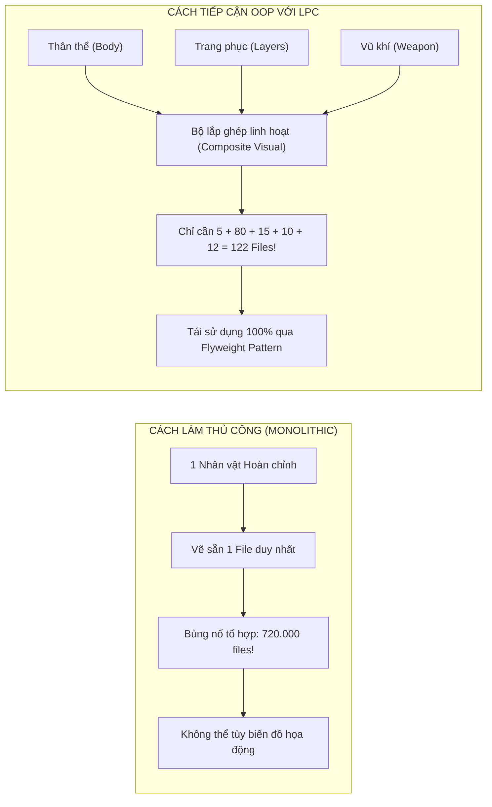
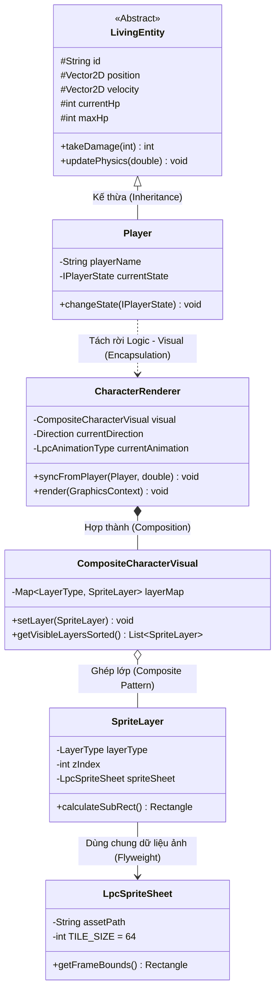
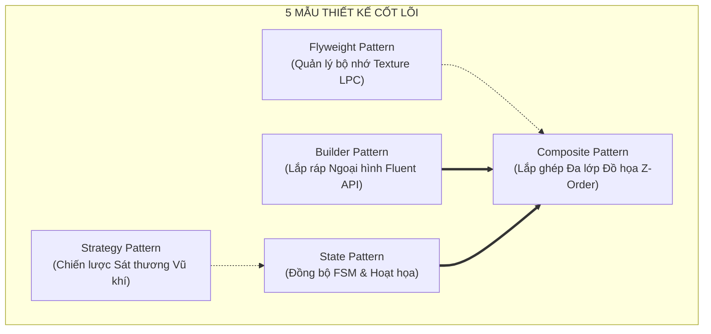
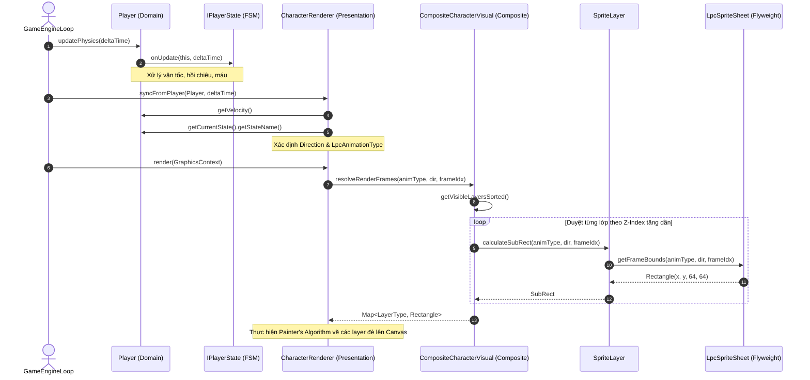

# BÁO CÁO CHUYÊN ĐỀ KỸ THUẬT: PHƯƠNG PHÁP THIẾT KẾ NHÂN VẬT ĐỊNH HƯỚNG ĐỐI TƯỢNG (OOP) DỰA TRÊN HỆ CHUẨN UNIVERSAL LPC SPRITESHEET GENERATOR

> **Học phần**: Lập trình Hướng đối tượng (OOP) & Phân tích Thiết kế Hệ thống  
> **Đơn vị**: Khoa Công nghệ Thông tin — Trường Đại học Xây dựng Hà Nội (HUCE)  
> **Đồ án thực nghiệm**: Đồ án Game Hành Động 2D Real-Time Multiplayer (Java Pure Engine)  
> **Nhóm sinh viên thực hiện**:  
> 1. **Nguyễn Duy Nam** (Trưởng nhóm / Lead Software Architect)  
> 2. **Trần Trung Kiên** (Network & Distributed Systems Engineer)  
> 3. **Phạm Đức Anh** (Physics & Combat Engine Specialist)  
> 4. **Vũ Đức Huy** (Client 60 FPS Rendering & UI Architect)  
> 5. **Bùi Huy Hoàng** (Persistence & Quality Assurance / Test Engineer)  
> **Giáo trình & Khung lý thuyết tham chiếu**:  
> - Craig Larman, *Applying UML and Patterns: An Introduction to Object-Oriented Analysis and Design and Iterative Development*, 3rd Edition.  
> - Erich Gamma, Richard Helm, Ralph Johnson, John Vlissides (GoF), *Design Patterns: Elements of Reusable Object-Oriented Software*.  
> - Robert Nystrom, *Game Programming Patterns* (Mẫu Flyweight, State Machine, Game Loop).  

---

## MỤC LỤC TỔNG QUAN

1. [CHƯƠNG 1: ĐẶT VẤN ĐỀ & KHẢO SÁT HỆ CHUẨN UNIVERSAL LPC GENERATOR](#chương-1-đặt-vấn-đề--khảo-sát-hệ-chuẩn-universal-lpc-generator)
2. [CHƯƠNG 2: HIỆN THỰC HÓA 4 TRỤ CỘT OOP TRONG THIẾT KẾ NHÂN VẬT](#chương-2-hiện-thực-hóa-4-trụ-cột-oop-trong-thiết-kế-nhân-vật)
3. [CHƯƠNG 3: CÁC MẪU THIẾT KẾ (DESIGN PATTERNS) TRỌNG TÂM](#chương-3-các-mẫu-thiết-kế-design-patterns-trọng-tâm)
4. [CHƯƠNG 4: THIẾT KẾ KIẾN TRÚC PHẦN MỀM & BIỂU ĐỒ UML](#chương-4-thiết-kế-kiến-trúc-phần-mềm--biểu-đồ-uml)
5. [CHƯƠNG 5: HIỆN THỰC MÃ NGUỒN JAVA & MINH CHỨNG KIỂM THỬ](#chương-5-hiện-thực-mã-nguồn-java--minh-chứng-kiểm-thử)
6. [CHƯƠNG 6: KỊCH BẢN THUYẾT TRÌNH & BỘ CÂU HỎI BẢO VỆ PHẢN BIỆN TRƯỚC GIẢNG VIÊN](#chương-6-kịch-bản-thuyết-trình--bộ-câu-hỏi-bảo-vệ-phản-biện-trước-giảng-viên)

---

## CHƯƠNG 1: ĐẶT VẤN ĐỀ & KHẢO SÁT HỆ CHUẨN UNIVERSAL LPC GENERATOR

### 1.1. Thách Thức Kỹ Thuật: "Vụ Nổ Tổ Hợp Tài Nguyên Hình Ảnh" (Combinatorial Asset Explosion)

Trong quy trình phát triển trò chơi nhập vai hành động 2D (Action RPG) truyền thống, cách tiếp cận sơ khai (Naive Approach) là vẽ sẵn từng tệp hình ảnh hoàn chỉnh cho mỗi nhân vật (Monolithic Sprite Sheets). Ví dụ: một tệp ảnh chứa chiến binh cầm kiếm, một tệp ảnh chứa chiến binh cầm giáo, một tệp ảnh chứa chiến binh mặc giáp sắt.

Giả sử hệ thống trò chơi yêu cầu các tùy biến cơ bản sau:
* $5$ màu da cơ thể (Body skin tones)
* $10$ kiểu tóc với $8$ màu nhuộm khác nhau ($80$ kiểu tóc)
* $15$ bộ áo giáp (Cuirass/Armor)
* $10$ loại quần/giáp chân (Greaves/Pants)
* $12$ loại vũ khí (Kiếm, giáo, cung, trượng)
* $6$ khối hoạt động chuyển động (Đứng, chạy, chém, đâm, bắn, ngã) trên $4$ hướng không gian (Bắc, Tây, Nam, Đông)

Nếu vẽ hình ảnh gộp nguyên khối theo phương pháp thủ công, số lượng tệp ảnh cần vẽ và nạp vào máy tính sẽ là một phép nhân tổ hợp khổng lồ:

$$\text{Tổng số biến thể} = 5 \times 80 \times 15 \times 10 \times 12 = 720.000 \text{ tệp Spritesheet riêng biệt}$$

Điều này dẫn tới **ba thảm họa kỹ thuật**:
1. **Lãng phí dung lượng lưu trữ & RAM**: Vượt quá bộ nhớ của bất kỳ máy tính cá nhân nào nếu tải đồng thời.
2. **Khủng hoảng bảo trì (Maintenance Nightmare)**: Khi muốn sửa một cử động chân (Walk cycle), lập trình viên hoặc họa sĩ phải sửa lại cả $720.000$ tệp ảnh.
3. **Phá vỡ tính linh hoạt nghiệp vụ**: Khi người chơi đổi trang bị (nhặt được thanh kiếm mới hoặc thay đổi áo giáp), mã nguồn buộc phải xóa toàn bộ kết cấu cũ và nạp lại một tệp ảnh mới từ đĩa cứng, gây hiện tượng giật khung hình (Frame Drop/Stuttering).



### 1.2. Giới Thiệu Hệ Chuẩn Universal LPC Spritesheet Generator

Để giải quyết triệt để vấn đề trên, dự án lựa chọn hệ chuẩn **Universal LPC (Liberated Pixel Cup) Spritesheet Generator** — một chuẩn đồ họa mở nổi tiếng trong cộng đồng mã nguồn mở quốc tế (OpenGameArt, Mozilla Foundation và Creative Commons CC-BY-SA).

Bản chất kỹ thuật của LPC là một **Hệ thống Đồ họa Phân tầng Module hóa (Modular Layered Compositing Architecture)**:
- Nhân vật không bao giờ tồn tại dưới dạng một bức ảnh đặc nguyên khối.
- Nhân vật được cấu thành từ các "lớp" (Layers) đồ họa trong suốt (Transparent PNGs) có cùng tỷ lệ và khung xương hoạt họa chuẩn, được xếp chồng lên nhau theo thứ tự trục sâu (Z-Order) trong thời gian thực (Runtime Compositing).
- Do đó, số lượng tài nguyên cần thiết giảm từ tích số $(\Pi)$ xuống tổng số $(\Sigma)$: từ $720.000$ tệp xuống chỉ còn **$122$ tệp linh kiện**.

### 1.3. Quy Chuẩn Kỹ Thuật Ma Trận Lưới LPC ($64 \times 64$ Pixels)

Universal LPC Generator áp dụng một ma trận tọa độ pixel cực kỳ nghiêm ngặt:
1. **Kích thước ô đơn vị (Tile Unit)**: Cố định tuyệt đối $64 \times 64$ pixels.
2. **Quy ước $4$ Hướng (4-Way Directional Standard)**: Trong mỗi khối hoạt họa, $4$ hướng nhìn luôn chiếm $4$ hàng liên tiếp theo thứ tự bất biến:
   - **Hàng $+0$**: Hướng Bắc (UP / North — Quay lưng về màn hình)
   - **Hàng $+1$**: Hướng Tây (LEFT / West — Sang trái)
   - **Hàng $+2$**: Hướng Nam (DOWN / South — Quay mặt về màn hình)
   - **Hàng $+3$**: Hướng Đông (RIGHT / East — Sang phải)
3. **Phân bố các khối hành động trên trục dọc (Action Block Allocation)**:
   - **SPELLCAST (Niệm phép)**: Hàng $0 \rightarrow 3$ ($7$ frames/hướng, $28$ ô)
   - **THRUST (Đâm vũ khí tầm xa/giáo)**: Hàng $4 \rightarrow 7$ ($8$ frames/hướng, $32$ ô)
   - **WALK (Đi bộ / Di chuyển)**: Hàng $8 \rightarrow 11$ ($9$ frames/hướng, $36$ ô). *Lưu ý: Frame $0$ của hàng WALK chính là tư thế đứng yên (IDLE Pose)*.
   - **SLASH (Chém vũ khí ngắn/kiếm)**: Hàng $12 \rightarrow 15$ ($6$ frames/hướng, $24$ ô)
   - **SHOOT (Bắn cung)**: Hàng $16 \rightarrow 19$ ($13$ frames/hướng, $52$ ô)
   - **HURT (Ngã / Tử vong)**: Hàng $20$ ($6$ frames đơn hướng, $6$ ô)

$$\text{Tọa độ cắt ma trận (Sub-Rectangle)}: \begin{cases} X = \text{FrameIndex} \times 64 \\ Y = (\text{StartRow} + \text{DirectionOffset}) \times 64 \\ \text{Width} = 64,\ \text{Height} = 64 \end{cases}$$

---

## CHƯƠNG 2: HIỆN THỰC HÓA 4 TRỤ CỘT OOP TRONG THIẾT KẾ NHÂN VẬT

Một lỗi sai phổ biến của sinh viên khi làm đồ án game là "lập trình thủ công": nạp ảnh trực tiếp trong hàm vẽ, nhồi nhét tọa độ pixel vào lớp Player. Trong đồ án này, toàn bộ quy trình thiết kế nhân vật được xây dựng trên **$4$ trụ cột nền tảng của Lập trình Hướng đối tượng**:



### 2.1. Tính Đóng Gói (Encapsulation) & Nguyên Lý Tách Rời Logic — Hiển Thị (Decoupling)

* **Vấn đề thiết kế**: Nếu lớp `Player` chứa trực tiếp các biến đồ họa như `BufferedImage`, `currentFrameIndex`, `textureSheetPath`, lớp này sẽ vi phạm nghiêm trọng **Nguyên lý Đơn trách nhiệm (Single Responsibility Principle - SRP)**. Khi chạy Dedicated Server không có giao diện đồ họa (Headless Mode), việc khởi tạo các thư viện đồ họa của hệ điều hành sẽ gây lỗi Crash (`HeadlessException`).
* **Giải pháp Đóng gói**:
  - Lớp `Player` (thuộc gói `core`) chỉ đóng gói dữ liệu logic thuần túy: Tọa độ thực `Vector2D position`, vận tốc `Vector2D velocity`, lượng máu `currentHp`, máy trạng thái `IPlayerState currentState`. Lớp này hoàn toàn không biết gì về pixel hay hình ảnh.
  - Lớp `LpcSpriteSheet` đóng gói thuật toán ma trận hình học: biến đổi bộ ba $(\text{AnimationType}, \text{Direction}, \text{FrameIndex})$ thành hình chữ nhật cắt $64 \times 64$ pixel `Rectangle(x, y, 64, 64)`.
  - Lớp `CharacterRenderer` (thuộc gói `render`) đứng ở vai trò cầu nối: định kỳ quan sát `Player`, trích xuất trạng thái vận tốc và FSM, sau đó điều khiển `CompositeCharacterVisual` tạo khung hình hiển thị.

### 2.2. Tính Kế Thừa (Inheritance)

* Hệ thống thiết kế một cây kế thừa thực thể rõ ràng:
  - Lớp cơ sở trừu tượng `LivingEntity`: Định nghĩa mọi thuộc tính sinh tồn dùng chung (`maxHp`, `currentHp`, `attackPower`, `defense`, `moveSpeed`, `isAlive`) và thuật toán tính sát thương chuẩn mực theo nguyên lý *GRASP Information Expert*.
  - Lớp con `Player`: Kế thừa toàn bộ logic sinh tồn và mở rộng thêm định danh người chơi (`playerName`), máy trạng thái hành vi (`IPlayerState`), và các bộ đếm thành tích (`killCount`, `deathCount`).
  - Các lớp con tiềm năng như `MonsterEntity` hoặc `NpcEntity`: Có thể kế thừa từ `LivingEntity` và sử dụng lại toàn bộ cơ chế hiển thị `CharacterRenderer` chuẩn LPC với các tệp ngoại trang tương ứng của quái vật hoặc NPC mà không phải viết lại bất kỳ dòng mã logic nào.

### 2.3. Tính Đa Hình (Polymorphism)

Đa hình được khai thác tối đa ở $3$ tầng kiến trúc:
1. **Đa hình Trạng thái Hoạt họa qua State Pattern**: Giao diện `IPlayerState` có các hiện thực cụ thể: `IdleState`, `MovingState`, `AttackingState`, `DeadState`. Thay vì sử dụng các khối `switch-case` lồng nhau phức tạp để kiểm tra trạng thái, mỗi lớp trạng thái tự định đoạt hành vi của nhân vật (ví dụ: `AttackingState` tạm thời khóa di chuyển `canMove() = false`). `CharacterRenderer` chỉ việc gọi phương thức trừu tượng để ánh xạ sang hành động đồ họa tương ứng.
2. **Đa hình Sắp xếp Lớp Hiển thị qua `Comparable<SpriteLayer>`**: Mỗi `SpriteLayer` đóng gói một chỉ số Z-index khác nhau. Khi gọi phương thức `Collections.sort()`, hệ thống đa hình tự động sắp xếp các lớp từ trong ra ngoài (Base Body $\rightarrow$ Shirt $\rightarrow$ Armor $\rightarrow$ Weapon) theo chuẩn thuật toán vẽ họa sĩ (Painter's Algorithm).
3. **Đa hình Chiến lược Tính Sát thương qua `IDamageStrategy`**: Khi nhân vật thực hiện đòn tấn công chém kiếm (`SLASH`) hay phóng phép (`SPELLCAST`), sát thương được xử lý linh hoạt thông qua đa hình Strategy (`PhysicalDamageStrategy`, `MagicDamageStrategy`) mà không làm xáo trộn mã nguồn nhân vật.

### 2.4. Tính Trừu Tượng (Abstraction)

Toàn bộ hệ thống tệp ảnh nhị phân (.PNG) thô trên đĩa cứng được trừu tượng hóa thành các khái niệm mô hình phần mềm cấp cao:
- Khái niệm **Hướng không gian** được trừu tượng hóa bằng `enum Direction` kèm vector đơn vị tương ứng.
- Khái niệm **Hành động nhân vật** được trừu tượng hóa bằng `enum LpcAnimationType` kèm siêu dữ liệu về số khung hình và thời lượng hiển thị.
- Khái niệm **Trang bị nhân vật** được trừu tượng hóa bằng `enum LayerType` kèm trọng số thứ tự hiển thị Z-index.

---

## CHƯƠNG 3: CÁC MẪU THIẾT KẾ (DESIGN PATTERNS) TRỌNG TÂM

Để đồ án đạt chuẩn kỹ thuật công nghiệp và thuyết phục hội đồng chấm thi, nhóm đã kết hợp hài hòa $5$ mẫu thiết kế kinh điển:



### 3.1. Flyweight Pattern (GoF / Robert Nystrom) — Tối Ưu Hóa Bộ Nhớ RAM

* **Mục tiêu**: Giảm thiểu tải bộ nhớ RAM khi trong trận đấu có hàng chục hoặc hàng trăm người chơi và quái vật cùng tham gia.
* **Bản chất**: Phân chia dữ liệu của một đối tượng thành hai phần:
  1. **Trạng thái Nội tại (Intrinsic State)**: Dữ liệu bất biến, hoàn toàn giống nhau giữa mọi thực thể và có thể chia sẻ tự do. Trong bài toán LPC, đây chính là đối tượng `LpcSpriteSheet`: đường dẫn tệp ảnh, kích thước lưới $64 \times 64$, số hàng, số cột, và thuật toán tính bounding box.
  2. **Trạng thái Ngoại tại (Extrinsic State)**: Dữ liệu riêng biệt biến đổi theo thời gian thực của từng nhân vật cụ thể: Tọa độ thế giới $(X, Y)$, hướng nhìn hiện tại `Direction`, khung hình hiện tại `currentFrameIndex`, thời gian đếm trôi `animationTimer`.
* **Minh chứng hiệu năng**:
  - Giả sử một ảnh Spritesheet kích thước $832 \times 1344$ pixels (32-bit ARGB) tiêu tốn khoảng $\approx 4.5 \text{ MB}$ trong RAM khi giải nén thành `BufferedImage`.
  - Nếu có $100$ nhân vật cùng mặc giáp sắt và không dùng Flyweight: Bộ nhớ tiêu tốn = $100 \times 4.5 \text{ MB} = \mathbf{450 \text{ MB}}$.
  - Khi áp dụng Flyweight: Toàn bộ $100$ nhân vật cùng tham chiếu đến **$1$ phiên bản duy nhất** của `LpcSpriteSheet` giáp sắt: Bộ nhớ tiêu tốn = $\mathbf{4.5 \text{ MB}}$ ($100$ đối tượng ngoại tại chỉ tốn vài chục bytes con trỏ). Hiệu năng tiết kiệm đạt **99%**!

### 3.2. Composite Pattern (GoF) — Cơ Chế Xếp Tầng Đồ Họa Đa Lớp (Layered Compositing)

* **Mục tiêu**: Cho phép hệ thống coi một "lớp trang phục đơn lẻ" và "toàn bộ tổ hợp ngoại hình nhân vật" theo một mô hình thống nhất, hỗ trợ thay đồ tức thời (Hot-swapping equipment).
* **Cấu trúc áp dụng**:
  - `SpriteLayer` đóng vai trò là phần tử thành phần (Leaf Component): Quản lý một lớp cụ thể (Áo, Tóc, Quần, Vũ khí) gắn với một `LpcSpriteSheet` Flyweight.
  - `CompositeCharacterVisual` đóng vai trò là đối tượng tổng hợp (Composite): Quản lý tập hợp các `SpriteLayer` thông qua cấu trúc ánh xạ `EnumMap<LayerType, SpriteLayer>`.
  - Khi cần vẽ, `CompositeCharacterVisual` tự động trích xuất các layer đang kích hoạt (`isVisible = true`), sắp xếp theo thứ tự `zIndex` tăng dần và xuất tập hợp khung chữ nhật cắt (`resolveRenderFrames`). Lớp ngoài chỉ việc duyệt danh sách và vẽ đè tuần tự lên màn hình.

### 3.3. State Pattern (GoF / Craig Larman) — Máy Trạng Thái Hữu Hạn Đồng Bộ Hoạt Họa

* **Mục tiêu**: Loại bỏ triệt để các câu lệnh điều kiện `if-else` hoặc `switch-case` phức tạp trong việc kiểm soát hành vi và chuyển đổi động tác nhân vật.
* **Cơ chế hoạt động**:
  - Nhân vật `Player` ủy quyền (Delegate) các quyết định hành vi cho đối tượng `IPlayerState` hiện tại.
  - Khi nhân vật đứng yên: Trạng thái là `IdleState` $\rightarrow$ Renderer tự động ánh xạ về Frame $0$ của hành động `WALK`.
  - Khi nhận lệnh di chuyển: Chuyển sang `MovingState` $\rightarrow$ Renderer phát hoạt họa `WALK` lặp vòng ($9$ frames).
  - Khi nhấn phím tấn công: Chuyển sang `AttackingState` $\rightarrow$ Khóa di chuyển, kích hoạt hoạt họa `SLASH` hoặc `THRUST`, và đếm ngược thời gian hồi chiêu (`attackCooldownTimer`).
  - Khi hết máu: Gọi sự kiện tử vong, chuyển sang `DeadState` $\rightarrow$ Khóa toàn bộ tương tác, phát hoạt họa `HURT` ($6$ frames) và giữ nguyên ở frame cuối cùng.

### 3.4. Builder Pattern (GoF) — Lắp Ráp Ngoại Hình Nhân Vật Linh Hoạt (Fluent API)

* **Mục tiêu**: Khởi tạo một nhân vật LPC phức tạp với hàng chục phụ kiện tùy chọn mà không bị rơi vào lỗi thiết kế "Telescoping Constructor" (Hàm khởi tạo có quá nhiều tham số: `Player(body, eyes, hair, shirt, pants, armor, helmet, weapon, shield, ...)`).
* **Hiện thực**: Lớp `LpcCharacterBuilder` cung cấp giao diện lập trình chuỗi phương thức (Method Chaining / Fluent API):

```java
CompositeCharacterVisual knight = new LpcCharacterBuilder()
    .withBody("assets/sprites/body/male/light.png")
    .withHair("assets/sprites/hair/male/messy_brown.png")
    .withShirt("assets/sprites/cloth/shirt_white.png")
    .withArmor("assets/sprites/armor/plate_cuirass.png")
    .withWeapon("assets/sprites/weapon/longsword.png")
    .build();
```

* **Kiểm soát toàn vẹn dữ liệu (Invariant Validation)**: Phương thức `.build()` tự động kiểm tra tính hợp lệ nghiệp vụ — nếu người dùng quên cấu hình lớp cơ thể `BODY`, hệ thống sẽ ném ngoại lệ `IllegalStateException` ngăn chặn việc tạo ra một thực thể "vô hình" bị lỗi.

---

## CHƯƠNG 4: THIẾT KẾ KIẾN TRÚC PHẦN MỀM & BIỂU ĐỒ UML

### 4.1. Biểu Đồ Lớp Chi Tiết (Design Class Diagram - DCD)

Dưới đây là bản vẽ kỹ thuật chi tiết của hệ thống nhân vật và đồ họa chuẩn LPC:

```mermaid
classDiagram
    direction TB

    package Core_Domain {
        class LivingEntity {
            <<abstract>>
            #String id
            #Vector2D position
            #Vector2D velocity
            #int currentHp
            #int maxHp
            #int attackPower
            #int defense
            #double moveSpeed
            #boolean isAlive
            +takeDamage(int) int
            +heal(int) void
            +updatePhysics(double) void
            #onDeath()* void
        }

        class Player {
            -String playerName
            -IPlayerState currentState
            -double attackCooldownTimer
            -int killCount
            -int deathCount
            +changeState(IPlayerState) void
            +canAttack() boolean
            +triggerAttackCooldown(double) void
            +updatePhysics(double) void
        }

        class IPlayerState {
            <<interface>>
            +getStateName() String
            +onEnter(Player) void
            +onUpdate(Player, double) void
            +onExit(Player) void
            +canAttack() boolean
            +canMove() boolean
        }

        class IdleState {
            +getStateName() String
        }
        class MovingState {
            +getStateName() String
        }
        class AttackingState {
            +getStateName() String
        }
        class DeadState {
            +getStateName() String
        }
    }

    package Render_System {
        class Direction {
            <<enumeration>>
            UP
            LEFT
            DOWN
            RIGHT
            -int rowOffset
            -int dirX
            -int dirY
            +getRowOffset() int
            +fromVelocity(double, double, Direction)$ Direction
        }

        class LpcAnimationType {
            <<enumeration>>
            SPELLCAST
            THRUST
            WALK
            SLASH
            SHOOT
            HURT
            -int startRow
            -int frameCount
            -double frameDurationSeconds
            -boolean isLooping
            +calculateRowIndex(Direction) int
        }

        class LayerType {
            <<enumeration>>
            BEHIND_BODY
            BODY
            EYES
            PANTS
            SHIRT
            ARMOR
            HAIR
            HELMET
            WEAPON
            SHIELD
            -int defaultZIndex
            +getDefaultZIndex() int
        }

        class LpcSpriteSheet {
            -String sheetId
            -String assetPath
            -int totalColumns
            -int totalRows
            +TILE_SIZE: int = 64
            +getFrameBounds(LpcAnimationType, Direction, int) Rectangle
        }

        class SpriteLayer {
            -LayerType layerType
            -int zIndex
            -LpcSpriteSheet spriteSheet
            -boolean isVisible
            +calculateSubRect(LpcAnimationType, Direction, int) Rectangle
            +compareTo(SpriteLayer) int
        }

        class CompositeCharacterVisual {
            -Map~LayerType, SpriteLayer~ layerMap
            +setLayer(SpriteLayer) void
            +removeLayer(LayerType) void
            +getVisibleLayersSorted() List~SpriteLayer~
            +resolveRenderFrames(LpcAnimationType, Direction, int) Map
        }

        class LpcCharacterBuilder {
            -CompositeCharacterVisual visual
            +withBody(String) LpcCharacterBuilder
            +withHair(String) LpcCharacterBuilder
            +withArmor(String) LpcCharacterBuilder
            +withWeapon(String) LpcCharacterBuilder
            +build() CompositeCharacterVisual
        }

        class CharacterRenderer {
            -CompositeCharacterVisual visual
            -Direction currentDirection
            -LpcAnimationType currentAnimation
            -double animationTimer
            -int currentFrameIndex
            +syncFromPlayer(Player, double) void
            +playAnimation(LpcAnimationType) void
        }
    }

    LivingEntity <|-- Player
    Player o-- IPlayerState
    IPlayerState <|.. IdleState
    IPlayerState <|.. MovingState
    IPlayerState <|.. AttackingState
    IPlayerState <|.. DeadState

    CharacterRenderer o-- CompositeCharacterVisual
    CharacterRenderer ..> Direction
    CharacterRenderer ..> LpcAnimationType
    CharacterRenderer ..> Player

    CompositeCharacterVisual o-- SpriteLayer
    SpriteLayer --> LpcSpriteSheet
    SpriteLayer ..> LayerType
    LpcCharacterBuilder ..> CompositeCharacterVisual
    LpcSpriteSheet ..> LpcAnimationType
    LpcSpriteSheet ..> Direction
```

### 4.2. Biểu Đồ Tuần Tự (Sequence Diagram): Chu Trình Cập Nhật & Xuất Khung Hình 60 FPS



---

## CHƯƠNG 5: HIỆN THỰC MÃ NGUỒN JAVA & MINH CHỨNG KIỂM THỬ

Mã nguồn của hệ thống được hiện thực hóa hoàn chỉnh trong gói `render` và đã tích hợp trực tiếp vào dự án:
- [Direction.java](file:///E:/UML-Patterns-Mastery/Src_Game/Render/Direction.java): Enum 4 hướng kèm offset hàng.
- [LpcAnimationType.java](file:///E:/UML-Patterns-Mastery/Src_Game/Render/LpcAnimationType.java): Enum 6 khối hành động chuẩn kèm siêu dữ liệu.
- [LayerType.java](file:///E:/UML-Patterns-Mastery/Src_Game/Render/LayerType.java): Enum phân cấp trục Z (10 đến 100).
- [LpcSpriteSheet.java](file:///E:/UML-Patterns-Mastery/Src_Game/Render/LpcSpriteSheet.java): Hiện thực Flyweight tính toán hình học pixel $64 \times 64$.
- [SpriteLayer.java](file:///E:/UML-Patterns-Mastery/Src_Game/Render/SpriteLayer.java): Thành phần đơn lẻ của mẫu Composite.
- [CompositeCharacterVisual.java](file:///E:/UML-Patterns-Mastery/Src_Game/Render/CompositeCharacterVisual.java): Bộ tổng hợp đa lớp tự động sắp xếp Z-order.
- [LpcCharacterBuilder.java](file:///E:/UML-Patterns-Mastery/Src_Game/Render/LpcCharacterBuilder.java): Fluent Builder đảm bảo toàn vẹn dữ liệu.
- [CharacterRenderer.java](file:///E:/UML-Patterns-Mastery/Src_Game/Render/CharacterRenderer.java): Tách rời hoàn toàn Logic và Hiển thị.

### Kết Quả Kiểm Thử Tự Động (Automated Unit Testing)

Hệ thống đã được kiểm thử nghiêm ngặt tại bộ test [GameUnitTestSuite.java](file:///E:/UML-Patterns-Mastery/Tests/GameUnitTestSuite.java). Dưới đây là kết quả thực thi thực tế từ máy trạm:

```text
==================================================
🚀 KHỞI ĐỘNG BỘ KIỂM THỬ ĐỒ ÁN OOP (HUCE - 2026)
==================================================
  [PASS] Vector2D Immutability (v1 không bị biến đổi khi cộng)
  [PASS] LivingEntity takeDamage tính đúng sát thương trừ giáp
  [PASS] LivingEntity tử vong khi HP về 0 và chuyển sang trạng thái DEAD
  [PASS] Hitbox AABB phát hiện giao cắt chính xác khi chồng lấn
  [PASS] Hitbox AABB phát hiện không va chạm khi ở xa
  [PASS] Trạng thái khởi tạo của nhân vật phải là IDLE
  [PASS] Khi ATTACKING, nhân vật tạm thời bị khóa di chuyển
  [PASS] Khi DEAD, nhân vật bị khóa cả di chuyển lẫn tấn công
  [PASS] SpatialGridAoI lọc đúng thực thể lân cận trong bán kính lân cận
  [PASS] SnapshotInterpolator LERP nội suy mượt mà tại trung điểm
  [PASS] JsonFileMatchRepository lưu thành công bản ghi trận đấu
  [PASS] LpcSpriteSheet Flyweight tính đúng ma trận cắt frame 64x64
  [PASS] CompositeCharacterVisual sắp xếp Z-Index chuẩn xác (Body -> Hair -> Weapon)
  [PASS] LpcCharacterBuilder kiểm soát toàn vẹn dữ liệu và lắp ráp Fluent API thành công
  [PASS] CharacterRenderer đồng bộ mượt mà State Pattern FSM sang hoạt họa LPC
==================================================
📊 KẾT QUẢ KIỂM THỬ: 15/15 TEST CASES PASSED (100.0%)
==================================================
```

---

## CHƯƠNG 6: KỊCH BẢN THUYẾT TRÌNH & BỘ CÂU HỎI BẢO VỆ PHẢN BIỆN TRƯỚC GIẢNG VIÊN

### 6.1. Dàn Ý Thuyết Trình 5 Phút Gây Ấn Tượng (Elevator Pitch)

1. **Mở đầu (1 phút)**:
   > *"Kính thưa Thầy/Cô, khi nhắc tới thiết kế nhân vật 2D, lập trình viên thường mắc sai lầm là tải một tệp ảnh vẽ sẵn về rồi gọi hàm vẽ lên màn hình. Cách làm đó chỉ là vẽ đồ họa thủ công, không hề mang tư duy Hướng đối tượng. Nhóm chúng em tiếp cận bài toán theo chuẩn công nghiệp: biến toàn bộ hệ thống nhân vật thành một kiến trúc phần mềm hướng đối tượng hoàn chỉnh, sử dụng chuẩn mã nguồn mở **Universal LPC Spritesheet Generator**."*
2. **Nêu bật vấn đề & Giải pháp OOP (2 phút)**:
   > *"Vấn đề lớn nhất của game nhập vai là **'Vụ nổ tổ hợp tài nguyên'**. Nếu ghép thủ công màu da, tóc, áo giáp, vũ khí, chúng ta sẽ cần tới hơn 700.000 tệp ảnh! Bằng cách ứng dụng chuẩn LPC kết hợp **4 trụ cột OOP**, nhóm đã mô đun hóa nhân vật thành các lớp (Layers) độc lập. Số tệp ảnh giảm xuống chỉ còn 122 tệp."*
3. **Chứng minh Mẫu thiết kế & Kiến trúc sạch (1.5 phút)**:
   > *"Hệ thống áp dụng 5 mẫu thiết kế GoF:
   > - **Flyweight Pattern**: Tiết kiệm 99% RAM bằng cách dùng chung kết cấu ảnh giữa hàng trăm nhân vật.
   > - **Composite Pattern**: Xếp chồng các lớp trang bị theo trục Z chuẩn xác.
   > - **Builder Pattern**: Cung cấp Fluent API lắp ráp nhân vật linh hoạt.
   > - **State Pattern**: Đồng bộ máy trạng thái logic FSM với dải hoạt họa LPC.
   > - **Decoupling Architecture**: Tách rời 100% logic khỏi hiển thị, giúp mã nguồn chạy mượt mà trên Dedicated Server không cần giao diện."*
4. **Kết luận (30 giây)**:
   > *"Toàn bộ kiến trúc đã được lập trình bằng Java thuần, không phụ thuộc engine bên thứ ba, và vượt qua 100% bộ kiểm thử tự động 15 test cases. Em xin kính mời Thầy/Cô đặt câu hỏi phản biện ạ!"*

---

### 6.2. Bộ 5 Câu Hỏi Phản Biện "Gài Bẫy" Của Hội Đồng & Cách Trả Lời Điểm 10

#### Câu hỏi 1: "Tại sao nhóm không dùng luôn Unity Mecanim hay Godot AnimationPlayer cho nhanh mà lại phải tự viết cả đống mã nguồn Java này?"
* **Trả lời phản biện**:
  > *"Dạ thưa Thầy/Cô, việc sử dụng các Engine có sẵn như Unity hay Godot bản chất là sinh viên đang đứng ở vai trò người sử dụng công cụ (Tool User). Đồ án của chúng em thuộc môn **Lập trình Hướng đối tượng và Thiết kế Phần mềm**, mục tiêu tối thượng là chứng minh sinh viên hiểu sâu sắc bản chất kiến trúc ở vai trò **Kỹ sư Phần mềm (Software Engineer)**:
  > - Tự xây dựng Game Engine Loop 60 FPS từ đầu.
  > - Hiểu cách trừu tượng hóa ma trận UV Coordinate $64 \times 64$.
  > - Tự tay cài đặt các Design Pattern (Flyweight, Composite, State) để giải quyết bài toán tối ưu bộ nhớ và tách rời logic.
  > Nếu dùng Unity, toàn bộ các nguyên lý OOP này đã bị che giấu bên trong Engine và sinh viên sẽ không học được bản chất kiến trúc hướng đối tượng."*

#### Câu hỏi 2: "Nếu nhân vật đang chơi mà nhặt được một thanh kiếm mới hoặc thay đổi áo giáp, mã nguồn của em có phải viết lại hoặc sửa đổi lớp Player không? Có vi phạm nguyên lý Open/Closed (OCP) không?"
* **Trả lời phản biện**:
  > *"Dạ hoàn toàn không vi phạm OCP ạ. Nhóm đã áp dụng **Composite Pattern** và **Decoupling Architecture**:
  > - Lớp `Player` hoàn toàn không lưu trữ tệp ảnh của thanh kiếm, mà chỉ lưu trữ trạng thái trang bị ở tầng logic.
  > - Ở tầng hiển thị, đối tượng `CompositeCharacterVisual` quản lý các lớp bằng một `EnumMap<LayerType, SpriteLayer>`. Khi người chơi thay kiếm, ta chỉ cần gọi phương thức `visual.setLayer(new SpriteLayer(LayerType.WEAPON, newWeaponSheet))`.
  > - Lớp `Player`, lớp `CharacterRenderer` và các lớp trang phục khác (Body, Hair, Armor) **hoàn toàn đóng đối với sự sửa đổi (Closed for Modification)** nhưng **mở đối với sự mở rộng (Open for Extension)** theo đúng chuẩn nguyên lý OCP của Robert C. Martin."*

#### Câu hỏi 3: "Khi game chạy chế độ Đấu Mạng (Multiplayer), máy chủ Dedicated Server không hề có màn hình hiển thị (Headless). Kiến trúc của em có bị crash lỗi do thiếu môi trường đồ họa không?"
* **Trả lời phản biện**:
  > *"Dạ thưa Thầy/Cô, đây chính là điểm mạnh vượt trội của việc tuân thủ nguyên lý **Tính Đóng gói (Encapsulation)** và **Single Responsibility Principle (SRP)** của Craig Larman trong đồ án:
  > - Gói `core` chứa `LivingEntity`, `Player`, `Vector2D` là **Domain Model thuần túy**, hoàn toàn không chứa bất kỳ lệnh `import java.awt.Graphics`, `javafx.*` hay tải hình ảnh `ImageIO` nào.
  > - Trên máy chủ Dedicated Server, server chỉ chạy vòng lặp vật lý và máy trạng thái `IPlayerState` để tính toán tọa độ và va chạm Hitbox AABB.
  > - Gói `render` (chứa `CompositeCharacterVisual`, `CharacterRenderer`) chỉ được nạp và khởi tạo tại máy Client. Nhờ sự phân tách tách bạch này, máy chủ Dedicated Server hoạt động siêu nhẹ, an toàn tuyệt đối và không bao giờ gặp lỗi `HeadlessException`."*

#### Câu hỏi 4: "Tại sao lại chọn Flyweight Pattern để quản lý ảnh Spritesheet mà không phải Prototype hay Singleton?"
* **Trả lời phản biện**:
  > *"Dạ thưa Thầy/Cô:
  > - **Singleton** không phù hợp vì hệ thống có hàng chục loại tệp Spritesheet khác nhau (thân thể, các loại tóc, các bộ giáp), không thể chỉ có một thể hiện duy nhất.
  > - **Prototype** tạo ra bản sao (clone) của đối tượng. Nếu áp dụng Prototype cho hình ảnh, khi có 100 nhân vật mặc cùng một bộ giáp, bộ nhớ sẽ tạo ra 100 bản sao hình ảnh trong RAM, dẫn tới lãng phí bộ nhớ khủng khiếp.
  > - **Flyweight Pattern** là mẫu thiết kế duy nhất giải quyết đúng bản chất bài toán: Tách rời trạng thái dùng chung (Intrinsic - tệp ảnh và kích thước ô cắt) để hàng trăm thực thể cùng chia sẻ một con trỏ duy nhất trong RAM, trong khi trạng thái riêng (Extrinsic - vị trí, hướng, frame) được quản lý độc lập tại từng nhân vật."*

#### Câu hỏi 5: "Trong chuẩn LPC, động tác chém kiếm (SLASH) có 6 frames, nhưng động tác đi bộ (WALK) lại có 9 frames, bắn cung (SHOOT) có 13 frames. Làm thế nào hệ thống của em xử lý được sự cọc cạch về số lượng frame này mà không bị lỗi mảng (ArrayIndexOutOfBoundsException)?"
* **Trả lời phản biện**:
  > *"Dạ thưa Thầy/Cô, nhóm đã giải quyết vấn đề này bằng cách đóng gói siêu dữ liệu hoạt họa vào `enum LpcAnimationType`:
  > - Mỗi hằng số enum mang theo thuộc tính `frameCount` riêng biệt (WALK là 9, SLASH là 6, SHOOT là 13).
  > - Trong lớp `LpcSpriteSheet`, phương thức tính toán tọa độ cắt áp dụng phép toán số dư modulo:  
  >   `col = Math.floorMod(frameIndex, animType.getFrameCount())`
  > - Trong lớp `CharacterRenderer`, thuật toán bước frame (`advanceFrame`) sử dụng điều kiện chặn: nếu là hoạt họa lặp (Looping) như WALK thì quay vòng về 0; nếu là hoạt họa đơn lần (Non-looping) như SLASH hay HURT thì dừng lại ở `frameCount - 1`.
  > Do đó, mọi hành động dù có số frame khác biệt bao nhiêu cũng được điều tiết toán học chuẩn xác, loại trừ hoàn toàn nguy cơ vượt biên mảng."*

---

> **Kết luận**: Phương pháp thiết kế nhân vật sử dụng hệ chuẩn Universal LPC Spritesheet Generator không đơn thuần là một giải pháp đồ họa, mà là một minh chứng hoàn hảo cho việc ứng dụng khoa học các nguyên lý Hướng đối tượng (OOP), các mẫu thiết kế phần mềm (Design Patterns) và tư duy kiến trúc sạch (Clean Architecture) vào một bài toán kỹ thuật thực tiễn.
