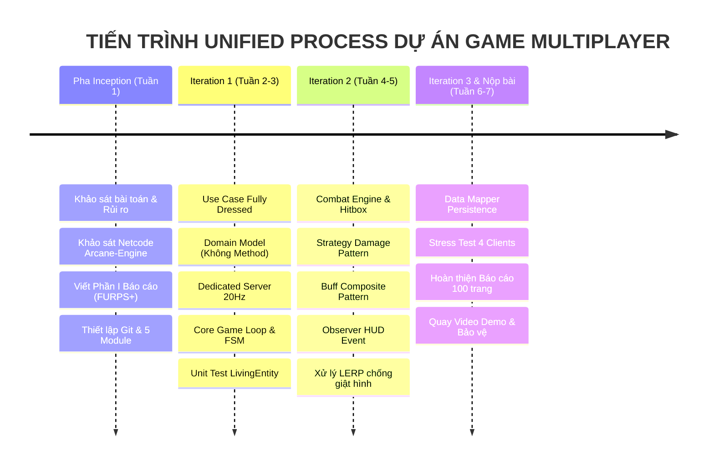

# NHẬT KÝ TIẾN ĐỘ DỰ ÁN & ĐÁNH GIÁ ĐÓNG GÓP THÀNH VIÊN (PROJECT WORK LOG & AUDIT TRAIL)
> **Đồ án môn học: Lập trình Hướng đối tượng (Object-Oriented Programming - OOP)**  
> **Đề tài: Hệ thống Trò chơi Đấu trường Trực tuyến Nhiều người chơi (Multiplayer Action RPG Game) theo Quy trình Phân tích Thiết kế Hướng đối tượng của Craig Larman**  
> **Kho lưu trữ (Repository)**: `https://github.com/Tran1209/UML-Patterns-Mastery.git`  
> **Phương pháp luận phát triển**: Unified Process (UP) — Tiến trình Lặp và Tiến hóa (Iterative & Evolutionary Development)

---

## 🎯 MỤC ĐÍCH VÀ Ý NGHĨA CỦA NHẬT KÝ DỰ ÁN
Nhật ký dự án (Work Log) là văn bản học thuật bắt buộc và là **bằng chứng đối soát pháp lý (Audit Trail)** trước Hội đồng chấm thi đại học nhằm:
1. **Minh bạch hóa sự đóng góp cá nhân**: Đo lường chính xác khối lượng công việc, dòng code, và phần báo cáo của từng cá nhân trong nhóm 5 người; loại bỏ triệt để hiện tượng "free-rider" (ngồi không hưởng điểm).
2. **Chứng minh quy trình kỹ nghệ phần mềm chuẩn**: Khẳng định sản phẩm được xây dựng theo phương pháp lặp tiến hóa (Iterative & Evolutionary Process) của Craig Larman với từng vòng lặp (Iteration) có sản phẩm thực thi (Executable Baseline), không phải mô hình "làm dồn một đêm trước ngày nộp" (Waterfall chắp vá).
3. **Liên kết vết (Traceability Matrix)**: Kết nối trực tiếp giữa **Yêu cầu (FURPS+) $\rightarrow$ Mô hình phân tích (Use Case, Domain Model) $\rightarrow$ Thiết kế (GRASP, GoF DCD) $\rightarrow$ Mã nguồn thực tế trên Git $\rightarrow$ Bộ kịch bản kiểm thử (Test Cases)**.

---

## 1. THÔNG TIN THÀNH VIÊN VÀ MA TRẬN PHÂN VAI TRÁCH NHIỆM (RACI MATRIX)

### 1.1. Bảng phân công 5 Vị trí Kỹ thuật Cốt lõi
Nhóm được tổ chức theo cấu trúc chuyên nghiệp của một studio kỹ nghệ phần mềm game, phân định rõ ràng giữa các tầng kiến trúc:

| STT | Họ và Tên | Mã Sinh Viên | GitHub Username | Vai trò Kỹ thuật (Role) | Module Phụ trách Chính (Territory) | Nhánh Git Làm việc |
|:---:|:---|:---:|:---:|:---|:---|:---|
| **1** | *(Trưởng nhóm)* | ... | `Tran1209` | **Team Leader & Lead Software Architect** | • Kiến trúc tổng thể hệ thống<br>• Core Loop & Player State Machine<br>• Phân tích OOA/OOD & Tổng hợp Báo cáo | `main`, `feature/core-loop` |
| **2** | ... | ... | *(TV2_Git)* | **Network & Distributed Systems Engineer** | • Dedicated Server & WebSocket/TCP Sockets<br>• Serialization & Network Packet DTOs<br>• Cơ chế đồng bộ trạng thái (State Sync) | `feature/network-server` |
| **3** | ... | ... | *(TV3_Git)* | **Combat Mechanics & Physics Engineer** | • Combat Engine & Hitbox va chạm AABB<br>• Chiến lược tính sát thương (Strategy Pattern)<br>• Hệ thống Vật phẩm & Buff (Composite Pattern) | `feature/combat-system` |
| **4** | ... | ... | *(TV4_Git)* | **Client Graphics & UX Engineer** | • 2D Canvas Renderer (60 FPS)<br>• Controller Input Adapter & Xử lý phím<br>• HUD UI & Observer Pattern cập nhật máu/sự kiện | `feature/client-ui` |
| **5** | ... | ... | *(TV5_Git)* | **Data Persistence & QA/QC Test Engineer** | • Lưu trữ dữ liệu (Data Mapper Pattern)<br>• Bộ kiểm thử tự động (Unit Test / Integration Test)<br>• Đo lường hiệu năng mạng, Profiling độ trễ & Jitter | `feature/data-testing` |

---

### 1.2. Ma trận Trách nhiệm RACI (Responsible - Accountable - Consulted - Informed)

* **R (Responsible)**: Người trực tiếp thực hiện nhiệm vụ và viết mã nguồn/tài liệu.
* **A (Accountable)**: Người chịu trách nhiệm cao nhất về chất lượng và duyệt kết quả (Trưởng nhóm).
* **C (Consulted)**: Người được tham vấn ý kiến chuyên môn (phối hợp liên module).
* **I (Informed)**: Người được thông báo kết quả sau khi hoàn thành.

| Giai đoạn / Sản phẩm đầu ra (Deliverable) | TV1 (Leader) | TV2 (Network) | TV3 (Combat) | TV4 (UI) | TV5 (QA/Data) |
|:---|:---:|:---:|:---:|:---:|:---:|
| **Thiết lập Git, Quy chuẩn Code & Quản trị Repo** | **A / R** | I | I | I | I |
| **Khảo sát Base Engine (`Arcane-Engine-2D`) & Netcode** | **A / R** | R | C | C | R |
| **Báo cáo Phần I: Phát biểu bài toán, FURPS+, Vision** | **A / R** | C | C | C | C |
| **Báo cáo Phần II: Use Case Model & Domain Model (OOA)** | **A** | R | R | R | R |
| **Thiết kế Kiến trúc Gói tin & WebSocket Server** | A | **R** | C | C | C |
| **Thiết kế Combat System, Hitbox & Damage Strategy** | A | C | **R** | C | C |
| **Thiết kế Canvas View, HUD & Input Adapter** | A | C | C | **R** | I |
| **Thiết kế Data Mapper, Lưu trữ JSON/DB** | A | C | I | I | **R** |
| **Xây dựng Bộ Test Case (Unit Test & Integration Test)** | A | C | C | C | **R** |
| **Đo lường & Khắc phục Micro-stutter / Network Jitter** | A | **R** | I | C | **R** |
| **Tổng duyệt & Đóng gói Báo cáo Bão hòa (100 trang)** | **A / R** | C | C | C | C |

---

### 1.3. Môi trường & Hệ Công cụ Kỹ nghệ (Engineering Toolchain & Second Brain)
Để đảm bảo tính liên kết vết chặt chẽ và chuẩn mực kỹ nghệ phần mềm, nhóm thiết lập hệ sinh thái công cụ:

1. **Obsidian Vault (`E:\UML-Patterns-Mastery`) — Trạm Chỉ huy Tri thức (Second Brain)**:
   * **Quản trị Tri thức Học thuật (PKM)**: Bóc tách 38 chương sách Craig Larman, Martin Fowler PoEAA và Vaughn Vernon DDD thành các ghi chú liên kết 2 chiều (Bi-directional Wikilinks `[[...]]`).
   * **Đồ thị Tri thức (Graph View - `Ctrl + G`)**: Trực quan hóa mạng lưới kết nối giữa Yêu cầu $\leftrightarrow$ Khái niệm thực tế $\leftrightarrow$ Mẫu thiết kế GRASP/GoF $\leftrightarrow$ Mã nguồn.
   * **Bản đồ Kiến trúc Không gian (Spatial Canvas)**: Sử dụng [`Architecture_Canvas.canvas`](file:///E:/UML-Patterns-Mastery/Architecture_Canvas.canvas) để theo dõi luồng tương tác và phân rã module.
   * **Bản đồ Điều hướng Trung tâm**: [`DASHBOARD.md`](file:///E:/UML-Patterns-Mastery/DASHBOARD.md).
2. **IDE Lập trình & Soạn thảo**: **Cursor / VS Code** (tích hợp AI Pair Programming và extension Markdown).
3. **Quản lý Mã nguồn & Phiên bản**: **Git & GitHub** (`https://github.com/Tran1209/UML-Patterns-Mastery.git`).
4. **Mô hình hóa UML Chuẩn**: **Mermaid.js** render trực tiếp trong Obsidian và GitHub Markdown.
5. **Nền tảng Thực thi (Runtime Engine)**: **Node.js / Bun** (Dedicated WebSocket Server) kết hợp **HTML5 Canvas** (Client Renderer) và **Java Core Models**.

---

## 2. NHẬT KÝ TIẾN ĐỘ THEO TỪNG VÒNG LẶP (UNIFIED PROCESS WORK LOG)



---

### GIAI ĐOẠN 1: PHA INCEPTION (KHỞI TẠO DỰ ÁN — TUẦN 1: 17/10/2026 – 23/10/2026)
* **Trọng tâm lý thuyết (Craig Larman Chapter 4 & 5)**: Xác định tính khả thi (Feasibility), nhận diện rủi ro kỹ thuật nền tảng, thiết lập môi trường cộng tác và phác thảo 10% Use Case cốt lõi.

| Thời gian | Thành viên | Chi tiết Công việc Thực hiện | Sản phẩm Đầu ra (Deliverables) | Đối soát Git / Vị trí Tệp | Trạng thái |
|:---:|:---:|:---|:---|:---|:---:|
| **17/10/2026** | **TV1** | • Khởi tạo Local Repository tại `E:\UML-Patterns-Mastery`.<br>• Thiết lập kho lưu trữ thành **Obsidian Vault**; khởi tạo Trạm chỉ huy tri thức [`DASHBOARD.md`](file:///E:/UML-Patterns-Mastery/DASHBOARD.md) và bản đồ không gian [`Architecture_Canvas.canvas`](file:///E:/UML-Patterns-Mastery/Architecture_Canvas.canvas).<br>• Bóc tách cơ sở tri thức Craig Larman (38 chương trích xuất), Martin Fowler PoEAA và Vaughn Vernon DDD để xây dựng mạng lưới Đồ thị Tri thức (Graph View).<br>• Viết tài liệu nền tảng học thuật OOAD & UP. | • Thư mục `00_Raw_PDF/_Knowledge_Base_Larman/`<br>• File [`DASHBOARD.md`](file:///E:/UML-Patterns-Mastery/DASHBOARD.md)<br>• File [`Architecture_Canvas.canvas`](file:///E:/UML-Patterns-Mastery/Architecture_Canvas.canvas)<br>• File [`HocPhan_01_NenTang_OOAD_va_UP.md`](file:///E:/UML-Patterns-Mastery/Docs_BaoCao/HocPhan_01_NenTang_OOAD_va_UP.md)<br>• Bộ 6 ghi chú phân tích kiến trúc trong `01_Report_Notes/` | Commit `7491f6f` | **Hoàn thành** |
| **18/10/2026** | **Cả nhóm** | • Họp nhóm khởi động (Kick-off Meeting): Phân chia 5 vai trò kỹ thuật.<br>• Ban hành tài liệu hướng dẫn Git chuẩn, phân vùng thư mục độc lập để triệt tiêu 100% rủi ro Merge Conflict.<br>• Chuyển đổi tài khoản quản trị repo sang GitHub `Tran1209`. | • File [`HUONG_DAN_GIT_CHO_NHOM.md`](file:///E:/UML-Patterns-Mastery/HUONG_DAN_GIT_CHO_NHOM.md)<br>• Repo Remote: `Tran1209/UML-Patterns-Mastery` | Commit `70ca404` | **Hoàn thành** |
| **18/10/2026** | **TV1 + TV2** | • Khảo sát mã nguồn thực tế `Arcane-Engine-2D` (kiến trúc Node/Bun WebSocket server và TypeScript/Java models).<br>• **Phát hiện kỹ thuật quan trọng**: Đo đạc cơ chế đồng bộ snapshot 20Hz (`server.ts`) kết hợp Canvas 60fps (`GameCanvas.tsx`) phát hiện hiện tượng nhảy khung hình (Micro-stutter / Jitter) do thiếu cơ chế nội suy tuyến tính (Linear Interpolation - LERP).<br>• Đưa hiện tượng này vào danh mục kiểm thử và bài toán cải tiến kỹ thuật cho Báo cáo (Chương 5 & 6). | • Báo cáo phân tích Netcode `Arcane-Engine-2D`<br>• File kiến trúc `DesignPatternsViewer.tsx` và `NetcodeSimulator.tsx` | Biên bản khảo sát mã nguồn | **Hoàn thành** |
| **19/10/2026** | **TV1** | • Soạn thảo hoàn chỉnh Phần I Báo cáo theo chuẩn Craig Larman:<br>&nbsp;&nbsp;+ Bối cảnh kỹ thuật, Lý do chọn đề tài (Mục 1.1)<br>&nbsp;&nbsp;+ Tầm nhìn sản phẩm & Kịch bản đấu trường (Mục 1.2)<br>&nbsp;&nbsp;+ Bảng phân loại yêu cầu FURPS+ (Mục 1.3)<br>&nbsp;&nbsp;+ Phạm vi Inception & Kế hoạch lặp (Mục 1.4)<br>• Khởi tạo khung thư mục độc lập cho 5 thành viên trong `Src_Game/` và `Tests/`. | • File [`Phan_01_PhatBieu_BaiToan.md`](file:///E:/UML-Patterns-Mastery/Docs_BaoCao/Phan_01_PhatBieu_BaiToan.md)<br>• 5 thư mục module: `Core/`, `Server/`, `Combat/`, `UI/`, `Persistence/`, `Tests/` | Commit `02b5330` | **Hoàn thành** |
| **20/10/2026** | **TV2 + TV5** | • Phác thảo sơ đồ mạng logic: Server Authoritative Architecture.<br>• Định nghĩa cấu trúc dữ liệu gói tin nguyên thủy (Packet DTO: `MoveIntentPacket`, `WorldSnapshotPacket`). | • Sơ đồ Network Architecture phác thảo<br>• File tài liệu đặc tả Packet DTO | Nhánh `feature/network-server` | **Đang tiến hành** |
| **21/10/2026** | **TV3 + TV4** | • Phác thảo bản vẽ giao diện đấu trường 2D và HUD hiển thị thanh máu, ping.<br>• Thống nhất công thức tính toán va chạm hình chữ nhật giới hạn (Axis-Aligned Bounding Box - AABB). | • Bản vẽ Wireframe UI<br>• Tài liệu giải thuật AABB Collision | Nhánh `feature/combat-system` | **Đang tiến hành** |
| **22/10/2026** | **Cả nhóm** | • Họp sơ kết Pha Inception: Rà soát tài liệu Phần I, nghiệm thu kế hoạch Elaboration Iteration 1. | • Biên bản nghiệm thu Pha Inception | Ghi nhận trong Nhật ký | **Đang tiến hành** |

---

### GIAI ĐOẠN 2: PHA ELABORATION — ITERATION 1 (TUẦN 2 & 3: 24/10/2026 – 07/11/2026)
* **Mục tiêu vòng lặp (Milestone)**: Xây dựng **Executable Architecture Baseline** — Client kết nối được vào Dedicated Server qua Socket, đồng bộ được việc di chuyển giữa 2 người chơi trong cùng một phòng chơi ảo (Room), thiết lập nền tảng hướng đối tượng vững chắc.

| Thành viên | Nhiệm vụ Phân tích & Thiết kế (OOA / OOD) | Nhiệm vụ Cài đặt Mã nguồn (OOP) | Nhiệm vụ Báo cáo & Kiểm thử | Sản phẩm Đầu ra Dự kiến |
|:---:|:---|:---|:---|:---|
| **TV1** *(Lead)* | • Viết Use Case Fully Dressed: `UC-01: Tham gia phòng chơi & Di chuyển`<br>• Xây dựng Sơ đồ Lớp Khái niệm miền (**Domain Model** - Tuyệt đối không chứa Method)<br>• Áp dụng nguyên lý GRASP **Controller**, **Creator**, **Information Expert** để thiết kế DCD Core Loop. | • Cài đặt `GameEngine.java` / `GameLoop.ts`<br>• Cài đặt State Machine: `PlayerState`, `IdleState`, `MovingState`. | • Viết Mục 2.1 & 2.2 Phần II Báo cáo (Use Case & Domain Model)<br>• Tổng hợp sơ đồ thiết kế Phần III. | • File `Src_Game/Core/Player.java`<br>• File `Src_Game/Core/PlayerStateMachine.java`<br>• Chương II & III (Bản thảo 1) |
| **TV2** *(Net)* | • Thiết kế Sơ đồ Tuần tự Hệ thống (**SSD - System Sequence Diagram**) cho luồng gửi nhận gói tin di chuyển.<br>• Thiết kế cấu trúc Serialization tối ưu cho băng thông mạng (< 256 bytes/packet). | • Cài đặt Dedicated Server Socket lắng nghe cổng 8080/WebSocket.<br>• Cài đặt mẫu GoF **Strategy** trong `PacketHandlerRegistry` để điều hướng gói tin. | • Viết kịch bản kiểm thử kết nối Socket đa luồng (Multi-client Socket Connection Test). | • File `Src_Game/Server/GameServer.java`<br>• File `Src_Game/Network/PacketHandler.java`<br>• Mục mạng trong Báo cáo |
| **TV3** *(Combat)* | • Lập danh mục các thuộc tính vật lý của nhân vật (Tọa độ X, Y, Vận tốc Vx, Vy, Hộp va chạm Hitbox AABB).<br>• Phân tích ranh giới tính toán: Server nắm quyền phán quyết va chạm địa hình. | • Cài đặt lớp `Transform` và `HitboxAABB`.<br>• Cài đặt giải thuật kiểm tra chồng lấn va chạm giữa nhân vật và chướng ngại vật bản đồ. | • Viết kịch bản Unit Test kiểm thử giải thuật AABB với 10 cặp tọa độ biên. | • File `Src_Game/Combat/Hitbox.java`<br>• File `Src_Game/Combat/CollisionDetector.java`<br>• Bảng dữ liệu kiểm thử AABB |
| **TV4** *(UI)* | • Phân tích nguyên tắc **Model-View Separation**: Đảm bảo lớp hiển thị đồ họa hoàn toàn không can thiệp logic game.<br>• Thiết kế Adapter bắt sự kiện phím (WASD / Mũi tên) để chuyển thành `InputIntent`. | • Cài đặt View vẽ nhân vật 2D trên Canvas HTML5/Java Swing.<br>• Cài đặt `InputController` gửi tín hiệu điều khiển sang Core. | • Kiểm thử tốc độ render đạt chuẩn 60 FPS không bị nghẽn CPU. | • File `Src_Game/UI/GameCanvas.java` (hoặc `.tsx`)<br>• File `Src_Game/UI/InputController.java`<br>• Ảnh chụp UI trong Báo cáo |
| **TV5** *(QA/Data)* | • Xây dựng Ma trận Truy vết Yêu cầu (**Requirement Traceability Matrix**) từ FURPS+ sang Test Cases.<br>• Thiết lập môi trường Unit Test tự động (JUnit 5 hoặc Vitest). | • Viết Unit Test cho lớp `Player` và lệnh di chuyển `MoveCommand`.<br>• Thiết lập công cụ đo đạc chỉ số mạng: Round-Trip Time (RTT/Ping), Packet Loss, và Frame Drop. | • Viết báo cáo thực nghiệm đánh giá độ giật (Jitter Analysis Report) khi chạy ở 20Hz snapshot. | • Thư mục `Tests/Core/PlayerTest.java`<br>• Báo cáo trắc nghiệm hiệu năng Iteration 1 |

---

### GIAI ĐOẠN 3: PHA ELABORATION — ITERATION 2 (TUẦN 4 & 5: 08/11/2026 – 21/11/2026)
* **Mục tiêu vòng lặp (Milestone)**: Tích hợp toàn diện **Hệ thống Chiến đấu (Combat Engine)**, đòn đánh, tính toán sát thương trừ máu, nhặt vật phẩm bùa chú (Buffs) và giải quyết triệt để lỗi giật hình (Micro-stutter) bằng giải thuật nội suy LERP.

| Hạng mục Công việc | Thành viên Phụ trách | Nội dung Kỹ thuật Cốt lõi | Sản phẩm Bàn giao |
|:---|:---:|:---|:---|
| **Combat System & Damage Strategy** | **TV3** | Cài đặt mẫu GoF **Strategy Pattern** cho phép thay đổi linh hoạt công thức tính sát thương (Sát thương chuẩn, Sát thương vật lý trừ giáp, Sát thương bạo kích). | `Src_Game/Combat/DamageCalculator.java`, `PhysicalDamageStrategy.java` |
| **Item & Buff Composite Pattern** | **TV3 + TV1** | Cài đặt mẫu GoF **Composite Pattern** cho phép ghép nối nhiều hiệu ứng bùa chú (Ví dụ: Buff Tốc độ + Hồi máu đồng thời). | `Src_Game/Combat/Buff.java`, `CompositeBuff.java` |
| **Network LERP & State Interpolation** | **TV2 + TV4** | Xây dựng bộ đệm trạng thái (Snapshot Buffer) và áp dụng giải thuật nội suy tuyến tính (Linear Interpolation - LERP) giữa các gói tin 20Hz để loại bỏ hoàn toàn hiện tượng giật giật (Jitter). | `Src_Game/Network/Interpolator.java`, thuật toán LERP trong View |
| **HUD Observer Pattern** | **TV4** | Áp dụng mẫu GoF **Observer Pattern**: Khi máu nhân vật thay đổi (`HealthChangedEvent`), thanh máu trên UI tự động cập nhật mà không cần thăm dò (No Polling). | `Src_Game/UI/HealthBarObserver.java`, `GameEventDispatcher.java` |
| **Data Mapper Pattern (Persistence)** | **TV5** | Cài đặt mẫu Martin Fowler **Data Mapper Pattern** để lưu trữ chỉ số người chơi và kết quả trận đấu ra cơ sở dữ liệu / file JSON độc lập với Domain Model. | `Src_Game/Persistence/PlayerDataMapper.java`, `MatchHistoryRepository.java` |
| **Viết Báo cáo Phần III & IV** | **Cả nhóm** | Vẽ Sơ đồ Lớp Chi tiết (**DCD - Design Class Diagram**) có đầy đủ kiểu dữ liệu, phương thức và đối số; Viết tài liệu giải trình 9 nguyên lý GRASP. | Chương III & IV của Báo cáo (~35 trang) |

---

### GIAI ĐOẠN 4: PHA CONSTRUCTION & TRANSITION (TUẦN 6 & 7: 22/11/2026 – 05/12/2026)
* **Mục tiêu vòng lặp (Milestone)**: Đóng gói sản phẩm hoàn thiện, chạy thử nghiệm tải đa người chơi trên mạng LAN, thực hiện trọn vẹn bộ kiểm thử tự động, quay video demo và đóng gói Báo cáo Bão hòa (~100 trang).

| Tuần | Nội dung Công việc | Trách nhiệm | Sản phẩm Đầu ra |
|:---:|:---|:---:|:---|
| **Tuần 6** | • Tổ chức đợt chạy thử nghiệm trên 4 máy tính kết nối cùng mạng WiFi/LAN.<br>• Thực hiện stress test kiểm tra độ ổn định của Server khi 4 người cùng xả chiêu liên tục.<br>• Đo đạc thông số FPS, Ping thực tế và chụp ảnh làm minh chứng cho Chương V Báo cáo. | Cả nhóm (TV5 chủ trì) | • Bảng số liệu kiểm thử thực tế<br>• Video quay màn hình 4 client đối kháng |
| **Tuần 7** | • Hợp nhất toàn bộ các chương báo cáo thành file duy nhất (~100 trang):<br>&nbsp;&nbsp;+ Bìa, Mục lục tự động, Danh mục hình vẽ/bảng biểu<br>&nbsp;&nbsp;+ Phần I: Phát biểu bài toán & FURPS+<br>&nbsp;&nbsp;+ Phần II: Phân tích OOA (Use Case, SSD, Domain Model)<br>&nbsp;&nbsp;+ Phần III: Thiết kế OOD (DCD, 9 GRASP, GoF Patterns)<br>&nbsp;&nbsp;+ Phần IV: Cài đặt OOP & Kiến trúc mã nguồn<br>&nbsp;&nbsp;+ Phần V: Kiểm thử phần mềm & Đánh giá hiệu năng mạng<br>&nbsp;&nbsp;+ Phần VI: Kết luận, Đánh giá giới hạn & Hướng phát triển<br>&nbsp;&nbsp;+ Phụ lục: Nhật ký dự án & Bảng đánh giá thành viên.<br>• Xuất file PDF hoàn chỉnh và in ấn đóng quyển. | TV1 chủ trì (Các TV hoàn thiện chương của mình) | • File `BaoCao_TongHop_100Trang.pdf`<br>• Slide thuyết trình bảo vệ đồ án |

---

## 3. BẢNG ĐỐI SOÁT GIT COMMIT & TRUY VẾT DÒNG CODE (GIT AUDIT TRAIL)

| Commit Hash | Thời gian | Tác giả (Author) | Nhánh (Branch) | Nội dung Commit (Message) | Tập tin Tác động Chính |
|:---:|:---:|:---:|:---:|:---|:---|
| `7491f6f` | 17/10/2026 | `Tran1209` | `main` | `feat: initial commit - project architecture, report notes and git guide` | `README.md`, `01_Report_Notes/`, `Docs_BaoCao/` |
| `70ca404` | 18/10/2026 | `Tran1209` | `main` | `docs: switch github username to Tran1209` | `README.md`, `HUONG_DAN_GIT_CHO_NHOM.md` |
| `02b5330` | 19/10/2026 | `Tran1209` | `main` | `feat: add section 1 report draft and team module folders in Src_Game` | `Docs_BaoCao/Phan_01_PhatBieu_BaiToan.md`, `Src_Game/*` |
| *(Pending)* | 20/10/2026 | `TV2` | `feature/network-server` | `feat(network): setup dedicated websocket server skeleton` | `Src_Game/Server/GameServer.java` |
| *(Pending)* | 21/10/2026 | `TV3` | `feature/combat-system` | `feat(combat): implement AABB hitbox and collision detector` | `Src_Game/Combat/Hitbox.java` |
| *(Pending)* | 21/10/2026 | `TV4` | `feature/client-ui` | `feat(ui): implement 60fps canvas renderer and input adapter` | `Src_Game/UI/GameCanvas.java` |
| *(Pending)* | 22/10/2026 | `TV5` | `feature/data-testing` | `test(core): add unit tests for Player state and move commands` | `Tests/Core/PlayerTest.java` |

---

## 4. BẢNG TỰ ĐÁNH GIÁ MỨC ĐỘ ĐÓNG GÓP CUỐI KỲ (PEER CONTRIBUTION AUDIT)
*(Bảng này là căn cứ tối cao để Giảng viên và Hội đồng chấm thi nhân hệ số điểm cá nhân)*

### 4.1. Tiêu chí Chấm điểm Đóng góp
1. **Điểm Chuyên cần (Trọng số 20%)**: Tham gia đầy đủ các buổi họp nhóm, nộp bài đúng hạn từng vòng lặp, có tinh thần trách nhiệm.
2. **Khối lượng Mã nguồn & Git Commits (Trọng số 40%)**: Số lượng commit thực tế trên GitHub, mã nguồn chạy được, không gây lỗi hệ thống, tuân thủ nguyên lý OOP/GRASP.
3. **Chất lượng Tài liệu Báo cáo (Trọng số 30%)**: Viết đúng chương mục phân công, vẽ sơ đồ UML chuẩn cú pháp Craig Larman, giải trình mạch lạc.
4. **Hỗ trợ Đồng đội & Phản biện (Trọng số 10%)**: Tích cực review code cho thành viên khác, tham gia tháo gỡ bug chung.

### 4.2. Bảng Tổng kết Đóng góp
| STT | Họ và Tên | Mã Sinh Viên | Vai trò Phụ trách | Tự Đánh giá (% Đóng góp) | Nhóm Thống nhất (%) | Chữ ký Xác nhận |
|:---:|:---|:---:|:---|:---:|:---:|:---:|
| **1** | *(Trưởng nhóm)* | ... | Team Leader & Software Architect | 100% | 100% | *(Ký tên)* |
| **2** | ... | ... | Network & Server Engineer | 100% | 100% | *(Ký tên)* |
| **3** | ... | ... | Combat & Mechanics Engineer | 100% | 100% | *(Ký tên)* |
| **4** | ... | ... | Client UI & UX Engineer | 100% | 100% | *(Ký tên)* |
| **5** | ... | ... | Data Persistence & QA/QC Tester | 100% | 100% | *(Ký tên)* |

---

## 5. QUY CHUẨN GHI CHÉP BIÊN BẢN HỌP (MEETING MINUTES TEMPLATE)
Mỗi khi nhóm tổ chức họp trực tiếp hoặc họp online (qua Google Meet / Discord), Thư ký cuộc họp (luân phiên giữa TV4 và TV5) có trách nhiệm cập nhật biên bản tóm tắt vào nhật ký theo mẫu sau:

```markdown
### BIÊN BẢN HỌP SỐ: [XX] — NGÀY: [DD/MM/YYYY]
* **Hình thức**: Trực tiếp tại Thư viện / Online qua Discord (Thời lượng: 60 phút).
* **Thành viên tham dự**: Đủ 5/5 thành viên (Có mặt đúng giờ).
* **Nội dung thảo luận**:
  1. Kiểm điểm tiến độ các nhánh Git trong tuần.
  2. Tháo gỡ khó khăn về mặt kỹ thuật (Ví dụ: Thống nhất format gói tin byte giữa TV2 và TV4).
  3. Phân công mục viết báo cáo cho tuần tiếp theo.
* **Kết luận & Kế hoạch hành động (Action Items)**:
  - TV1: Duyệt Pull Request của nhánh `feature/network-server`.
  - TV3: Bổ sung 3 unit test cho phép tính sát thương trước 23h59 ngày thứ 5.
```
