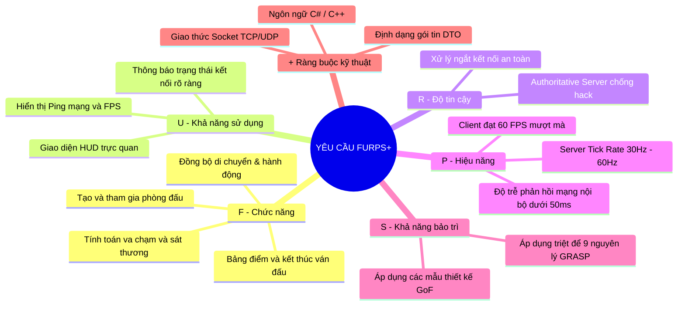
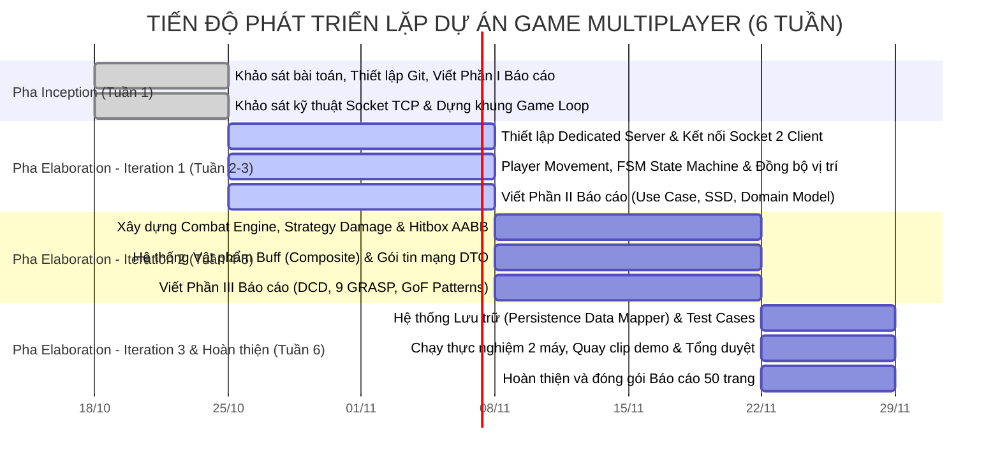

# PHẦN I: PHÁT BIỂU VÀ MÔ TẢ BÀI TOÁN
> **Đồ án môn học: Lập trình Hướng đối tượng (OOP)**  
> **Tên đề tài: Xây dựng Hệ thống Trò chơi Nhiều người chơi (Multiplayer Game) theo Tiến trình Unified Process và Nguyên lý Thiết kế Hướng đối tượng của Craig Larman**

---

## 1.1. BỐI CẢNH KỸ THUẬT VÀ LÝ DO CHỌN ĐỀ TÀI (TECHNICAL MOTIVATION)

Trong kỷ nguyên phát triển phần mềm hiện đại, các hệ thống trò chơi trực tuyến nhiều người chơi (Multiplayer Real-time Games) là một trong những phân nhánh phần mềm phức tạp nhất, đòi hỏi sự kết hợp đồng thời giữa:
1. **Lập trình Hướng đối tượng đa hình (Polymorphic OOP)** để mô hình hóa thế giới trò chơi đa dạng.
2. **Giao tiếp mạng thời gian thực (Real-time Socket Networking)** với độ trễ thấp và độ tin cậy cao.
3. **Quản lý trạng thái phân tán và bảo toàn dữ liệu (State Synchronization & Consistency)**.

Tuy nhiên, trong quá trình phát triển, các dự án game thường mắc phải các lỗi kiến trúc kinh điển:
* **Mã nguồn hỗn loạn (Spaghetti Code)**: Lạm dụng hàm cập nhật theo chu kỳ khung hình (`Update()`), nhồi nhét xử lý đồ họa, phím bấm và tính toán sát thương vào chung một lớp ("God Object" / Monolithic Class).
* **Ghép nối chặt chẽ (Tight Coupling)**: Tầng giao diện người dùng (UI) phụ thuộc trực tiếp vào dữ liệu socket mạng hoặc logic nghiệp vụ, khiến việc kiểm thử đơn vị (Unit Testing) và tái sử dụng mã nguồn trở nên bất khả thi.
* **Lỗ hổng gian lận từ phía máy khách (Client-Authoritative Flaw)**: Đặt trọn niềm tin vào Client trong việc tính toán kết quả trận đấu, dẫn đến nguy cơ bị can thiệp bộ nhớ hoặc can thiệp gói tin (hack tốc độ, hack sát thương).

Nhằm giải quyết triệt để các vấn đề trên, đề tài này được xây dựng với mục tiêu áp dụng toàn diện phương pháp luận **Phân tích và Thiết kế Hướng đối tượng (OOAD)** theo giáo trình kinh điển *"Applying UML and Patterns"* của Craig Larman, kết hợp với các mẫu thiết kế của Gang of Four (GoF) và kiến trúc máy chủ nắm quyền (**Authoritative Dedicated Server**). Thông qua đề tài, nhóm hướng tới việc tạo ra một kiến trúc game phân tầng sạch sẽ, nơi các nguyên lý phân bổ trách nhiệm (Responsibility-Driven Design - RDD) được tôn trọng tuyệt đối.

---

## 1.2. TẦM NHÌN SẢN PHẨM VÀ MÔ TẢ KỊCH BẢN TRÒ CHƠI (PRODUCT VISION & GAMEPLAY)
*(Tham chiếu: Chapter 7: Vision Document — Craig Larman)*

### 1.2.1. Định danh sản phẩm & Tầm nhìn cốt lõi
* **Tên dự án**: **[Tên Game của Nhóm - Ví dụ: TankArena 2D / BomberCraft / BattleRoom]**
* **Thể loại**: Trò chơi đối kháng nhiều người chơi (2–4 người) qua mạng cục bộ (LAN / Socket TCP/UDP), phong cách đồ họa 2D góc nhìn từ trên xuống (Top-down 2D).
* **Mục tiêu sản phẩm**: Cung cấp một môi trường đấu trường công bằng, độ trễ thấp, nơi người chơi tương tác với nhau trong cùng một không gian ảo được kiểm soát chặt chẽ bởi Server trung tâm.

### 1.2.2. Mô hình Phòng đấu (Lobby & Room Model)
1. **Giai đoạn Tiền trận đấu (Pre-game)**:
   * Người chơi khởi động Client, nhập địa chỉ IP/Cổng của Server và tên nhân vật.
   * Người chơi có thể tự tạo phòng mới (Create Room) hoặc tham gia phòng có sẵn (Join Room).
   * Phòng chơi có sức chứa tối đa quy định (2 đến 4 người). Khi tất cả người chơi bấm nút **Sẵn sàng (Ready)**, Server sẽ kích hoạt đếm ngược 3 giây để nạp trận đấu.
2. **Giai đoạn Trong trận đấu (In-game Gameplay)**:
   * Mỗi người chơi điều khiển một thực thể nhân vật xuất phát tại các vị trí cố định trên bản đồ.
   * **Hành động hợp lệ**:
     * Di chuyển 4 hướng (hoặc 8 hướng) qua cụm phím WASD / Mũi tên.
     * Thực hiện đòn tấn công / kỹ năng bằng phím Space / Chuột.
     * Nhặt các hòm bùa chú (Power-ups / Buffs) xuất hiện ngẫu nhiên trên bản đồ (tăng tốc độ, khiên bảo vệ, đạn lửa, hồi máu).
   * **Quy tắc tính toán thế giới (Authoritative Rule)**: Client chỉ gửi "Ý định hành động" (Input Intent). Toàn bộ việc phát hiện va chạm vật lý (Collision Detection AABB), tính toán sát thương trừ máu, và nhặt bùa chú đều do Server tính toán độc quyền và phát sóng (Broadcast) kết quả về cho các Client hiển thị.
3. **Giai đoạn Kết thúc trận đấu (Post-game)**:
   * Trận đấu kết thúc khi chỉ còn duy nhất 1 người chơi sống sót (Last Man Standing) hoặc hết thời gian thi đấu (người có điểm tiêu diệt cao nhất sẽ thắng).
   * Hệ thống hiển thị bảng thành tích (Leaderboard), lưu lịch sử ván đấu xuống cơ sở dữ liệu/file JSON và đưa người chơi trở về sảnh chờ.

---

## 1.3. ĐẶC TẢ YÊU CẦU HỆ THỐNG THEO CHUẨN FURPS+ (SYSTEM REQUIREMENTS)
*(Tham chiếu: Chapter 5: Evolutionary Requirements — Craig Larman)*

Nhóm áp dụng mô hình phân loại yêu cầu **FURPS+** của Craig Larman để định lượng chính xác các tiêu chí kỹ thuật:

### Bảng chi tiết yêu cầu FURPS+:
* **F (Functionality)**:
  * `FR-01`: Quản lý phiên kết nối (Connect, Handshake, Disconnect).
  * `FR-02`: Quản lý phòng chờ (Lobby, Room State, Ready Toggle).
  * `FR-03`: Đồng bộ vị trí thực thể (Position Replication, Velocity Sync).
  * `FR-04`: Hệ thống Chiến đấu (Combat System, Damage Calculation, Health Sync).
  * `FR-05`: Hệ thống Vật phẩm & Bùa chú (Item Spawning, Buff Composite).
  * `FR-06`: Lưu trữ lịch sử trận đấu (Persistence Match Result).
* **U (Usability)**:
  * Giao diện đồ họa tách biệt hoàn toàn theo mô hình **Model-View Separation**.
  * Cung cấp chỉ số Ping hiển thị trực tiếp trên góc màn hình để theo dõi chất lượng đường truyền.
* **R (Reliability)**:
  * Khi 1 người chơi thoát đột ngột (Alt+F4 hoặc rớt mạng), Server tự động hủy thực thể của người đó và thông báo cho các Client còn lại mà không làm sập phòng chơi (Graceful Disconnection).
* **P (Performance)**:
  * Tốc độ xử lý khung hình tối thiểu đạt 60 FPS trên Client.
  * Server tối ưu hóa việc đóng gói dữ liệu, kích thước mỗi gói tin đồng bộ trạng thái không vượt quá 256 bytes.
* **S (Supportability)**:
  * Cấu trúc mã nguồn module hóa cao, dễ dàng bổ sung thêm các loại vũ khí hoặc chế độ chơi mới mà không phải sửa đổi mã nguồn cốt lõi (tuân thủ nguyên lý *Open-Closed Principle*).
* **+ (Technical Constraints)**:
  * Nền tảng phát triển: C# (.NET Core) hoặc C++ với thư viện đồ họa 2D nhẹ (Raylib / SFML / MonoGame) hoặc Unity Engine.
  * Kiến trúc mạng Socket thuần, không sử dụng các dịch vụ đám mây "hộp đen" làm mất đi tính nguyên bản của môn học.

---

## 1.4. PHẠM VI PHA INCEPTION VÀ KẾ HOẠCH PHÁT TRIỂN LẶP (ITERATION PLAN)
*(Tham chiếu: Chapter 2 & 4 — Craig Larman)*

### 1.4.1. Tuyên bố Ranh giới Pha Inception (Scope Definition)
Theo phương pháp luận của Craig Larman, mục đích của pha Inception không phải là cố gắng đặc tả 100% tất cả các chi tiết, mà là **xác định tính khả thi (Feasibility)** và dập tắt các rủi ro kỹ thuật nền tảng. Do đó, nhóm xác định phạm vi trong pha Inception:
* **Các Use Case được chọn viết chi tiết (Khoảng 10%)**:
  * `UC-01: Tham gia phòng đấu (Join Game Room)`
  * `UC-02: Thực hiện hành động chiến đấu (Execute Combat Action)`
* **Các tính năng hoãn lại (Deferred to Construction phase)**:
  * Hệ thống tài khoản nâng cao, cửa hàng trang phục (Skins), hệ thống chat voice, bảng xếp hạng toàn cầu.

### 1.4.2. Kế hoạch Lặp (Iteration Plan) trong Pha Elaboration
Dự án được phân bổ thành **3 Iteration** (mỗi chu kỳ kéo dài 2 tuần) với mục tiêu tạo ra bản build thực thi được (**Executable Architecture Baseline**) sau mỗi chu kỳ:

