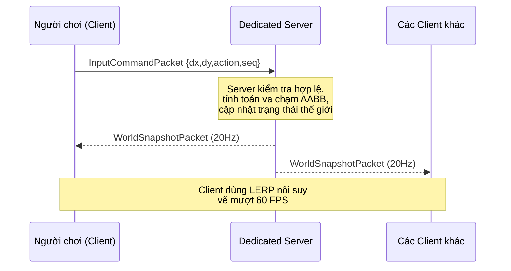
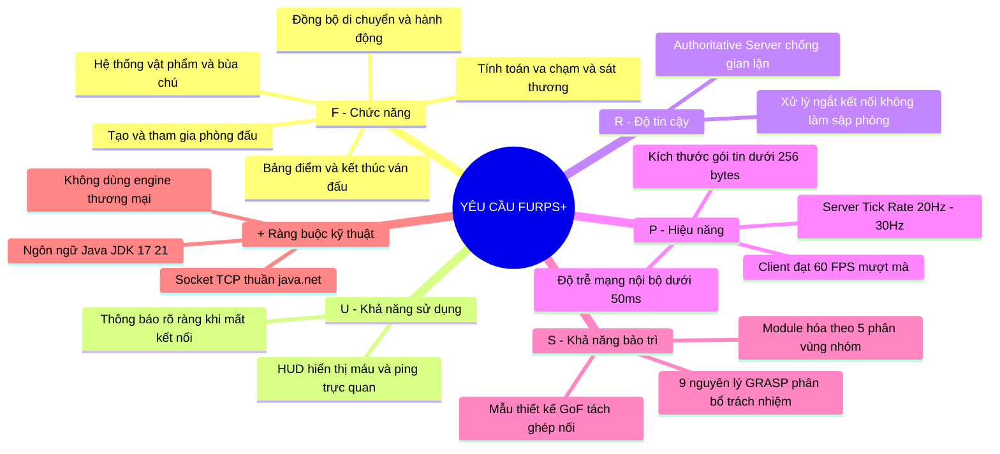
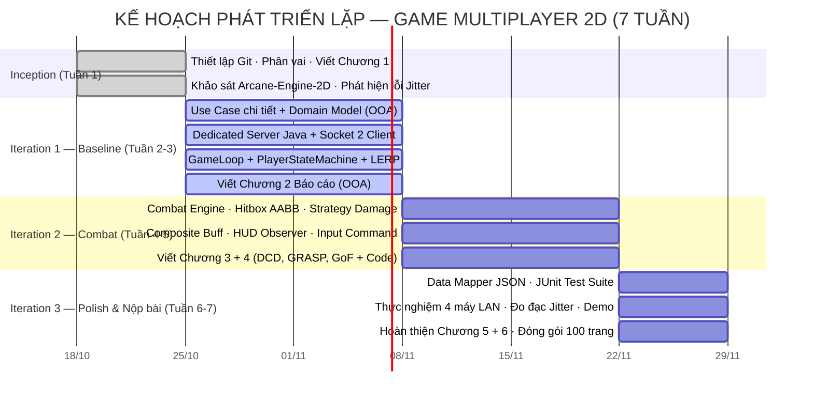

# PHẦN I: PHÁT BIỂU VÀ MÔ TẢ BÀI TOÁN

> **Môn học**: Lập trình Hướng đối tượng (OOP)
> **Trường**: Đại học Xây dựng Hà Nội (HUCE) — Khoa Công nghệ Thông tin
> **Nhóm thực hiện**: Nam · Kiên · Anh · Huy · Hoàng
> **Ngôn ngữ cài đặt**: Java 2d A

---

## 1.0. GIỚI THIỆU TỔNG QUAN

Trong thập niên 2020, phần mềm không còn tồn tại đơn lẻ. Hầu hết ứng dụng hiện đại — từ trò chơi trực tuyến đến hệ thống thương mại điện tử — đều vận hành trên nền tảng **phân tán, đa người dùng, thời gian thực**. Điều này đặt ra một yêu cầu căn bản với kỹ sư phần mềm hiện đại: không chỉ biết viết code chạy đúng, mà phải biết **thiết kế hệ thống chịu tải, dễ bảo trì và không bị vỡ khi mở rộng quy mô**.

Báo cáo này trình bày quá trình phân tích, thiết kế và cài đặt một **trò chơi đối kháng nhiều người chơi qua mạng (Real-time Multiplayer 2D Action RPG)** bằng ngôn ngữ Java, áp dụng phương pháp luận **Object-Oriented Analysis & Design (OOAD)** theo khung Unified Process của Craig Larman. Đây là bài toán phần mềm đại diện cho ba thách thức kỹ thuật cốt lõi mà một sinh viên OOP cần chinh phục trước khi tốt nghiệp:

1. **Mô hình hóa thế giới thực bằng đối tượng** — thiết kế phân cấp lớp, quan hệ kế thừa, giao diện, đa hình.
2. **Đồng bộ trạng thái qua mạng** — xử lý độ trễ, mất gói, đảm bảo tính nhất quán giữa Server và nhiều Client.
3. **Kiến trúc sạch, dễ kiểm thử** — tách biệt tầng nghiệp vụ, giao diện và lưu trữ; áp dụng các mẫu thiết kế để mã nguồn không bị "vỡ" khi thêm tính năng.

### Tại sao lại là game — không phải một CRUD app thông thường?

Ứng dụng quản lý thông thường (CRUD) về cơ bản là một lớp bọc cho cơ sở dữ liệu. Trong khi đó, game multiplayer thời gian thực đặt ra toàn bộ các vấn đề OOP và kỹ nghệ phần mềm trong một bài toán duy nhất: vòng lặp game (Game Loop), máy trạng thái (State Machine), chiến lược đa hình (Strategy Pattern), quan sát sự kiện (Observer), đồng bộ mạng, kiểm thử tự động, và phân chia công việc nhóm. Đây là lý do nhóm lựa chọn bài toán này như một **"phòng thực hành OOP toàn diện"**.

---

## 1.1. BỐI CẢNH VÀ LÝ DO CHỌN ĐỀ TÀI

### 1.1.1. Vấn đề thực tiễn — Khi thiếu phương pháp luận

| Lỗi kiến trúc            | Biểu hiện cụ thể                                                                                  | Hậu quả kỹ thuật                                                                |
| :----------------------- | :------------------------------------------------------------------------------------------------ | :------------------------------------------------------------------------------ |
| **God Object**           | Nhét toàn bộ logic — vẽ màn hình, xử lý phím, tính sát thương, gửi gói tin — vào một lớp duy nhất | Không thể kiểm thử, không thể bảo trì; thêm 1 tính năng làm vỡ 5 tính năng khác |
| **Client-Authoritative** | Để Client tự tính toán vị trí và kết quả chiến đấu, rồi gửi lên Server                            | Dễ bị hack tốc độ, hack sát thương; người chơi dịch chuyển tức thời             |
| **Tight Coupling**       | Lớp vẽ đồ họa đọc trực tiếp từ Socket mạng                                                        | Không viết Unit Test được; sửa mạng là vỡ giao diện và ngược lại                |
| **Micro-stutter**        | Server gửi trạng thái 20 lần/giây, Client vẽ 60 khung/giây nhưng thiếu bộ đệm nội suy             | Nhân vật đối thủ nhảy cóc giật cục; trải nghiệm chơi game rất tệ                |

Mỗi lỗi trên đều có một giải pháp tương ứng trong bộ công cụ OOAD + Modern Engineering mà nhóm áp dụng.

### 1.1.2. Nền tảng lý thuyết — Chiến lược "Ngoại Larman, Nội Hiện Đại"

Nhóm áp dụng chiến lược kết hợp hai lớp kiến thức bổ sung cho nhau:

**Lớp ngoài — Khung phương pháp luận (Larman 2004):**
Craig Larman trong *Applying UML and Patterns* (3rd ed.) cung cấp một khung phân tích và thiết kế có hệ thống: từ Use Case Diagram, Domain Model (OOA), Design Class Diagram (OOD), đến 9 nguyên lý GRASP phân bổ trách nhiệm. 

> **Giới hạn được thừa nhận**: Larman viết năm 2004, trước khi kiến trúc microservice, reactive programming và distributed systems trở thành tiêu chuẩn ngành. Một số phần như UP Process nặng-tài-liệu đã được thực tế thay thế bằng Agile/Scrum. Nhóm ghi nhận điều này và trình bày phần phản biện ở Chương 6.

**Lớp trong — Kỹ thuật hiện đại (2015–2024):**

|  #  | Sách                                              | Tác giả         | Áp dụng vào                                     | Thành viên phụ trách |
| :-: | :------------------------------------------------ | :-------------- | :---------------------------------------------- | :------------------: |
|  1  | *Applying UML and Patterns* (3rd ed.)             | Craig Larman    | Khung OOAD, 9 GRASP, báo cáo học thuật          |         Nam          |
|  2  | *Game Programming Patterns*                       | Robert Nystrom  | Game Loop, Component/ECS, Spatial Partition     |      Anh + Huy       |
|  3  | *Multiplayer Game Programming*                    | Glazer & Madhav | LERP, Snapshot Interpolation, Client Prediction |      Kiên, Nam       |
|  4  | *Patterns of Enterprise Application Architecture* | Martin Fowler   | Data Mapper, Repository, Persistence Layer      |        Hoàng         |
|  5  | *Implementing Domain-Driven Design*               | Vaughn Vernon   | Aggregate Root, Value Objects, Domain Events    |         Nam          |
|     |                                                   |                 |                                                 |                      |

### 1.1.3. Lý do chọn đề tài

Nhóm chọn đề tài game multiplayer vì ba lý do:

1. **Bao phủ toàn bộ kiến thức OOP**: Kế thừa, đa hình, đóng gói, các mẫu thiết kế GoF và nguyên lý GRASP — tất cả đều hiện diện trong một bài toán duy nhất.
2. **Sản phẩm chạy được để minh chứng**: Kết quả cuối cùng là một game thực sự chạy được trên mạng LAN, 2–4 người cùng chơi — không chỉ là lý thuyết trên giấy.
3. **Cầu nối học thuật ↔ thực tế**: Dùng Larman làm nền tảng phân tích, nhưng triển khai kỹ thuật theo tiêu chuẩn ngành hiện đại.

---

## 1.2. MÔ TẢ SẢN PHẨM VÀ KỊCH BẢN TRÒ CHƠI

*(Tham chiếu: Chương 7 — Vision Document, Craig Larman)*

### 1.2.1. Thông tin nhận dạng sản phẩm

| Thuộc tính                | Nội dung                                                                    |
| :------------------------ | :-------------------------------------------------------------------------- |
| **Tên dự án**             |                                                                             |
| **Nền tảng mã nguồn mẫu** | Arcane-Engine-2D (Aethelgard)                                               |
| **Thể loại**              | Đấu trường đối kháng nhiều người chơi (2–4 người) qua mạng LAN / Socket TCP |
| **Góc nhìn**              | 2D                                                                          |
| **Ngôn ngữ cài đặt**      | **Java (JDK 17 / 21)**                                                      |
| **Giao tiếp mạng**        | `java.net.Socket` / `ServerSocket` (TCP thuần)                              |
| **Kiến trúc Server**      | Dedicated Authoritative Server — Server là nguồn phán quyết duy nhất        |

### 1.2.2. Tầm nhìn sản phẩm (Product Vision)

> *"Cung cấp một đấu trường chiến đấu công bằng, độ trễ thấp, nơi mọi phán quyết — di chuyển, va chạm, sát thương — đều do Server trung tâm quyết định và không thể bị gian lận từ phía Client."*

### 1.2.3. Kịch bản trò chơi (Gameplay Scenario)

**Giai đoạn 1 — Chuẩn bị (Pre-game):**
- Người chơi khởi động ứng dụng Client, nhập địa chỉ IP/cổng của Server và chọn tên nhân vật.
- Người chơi tạo phòng mới hoặc tham gia phòng đang chờ. Phòng chứa tối đa 4 người.
- Khi tất cả bấm **"Sẵn sàng"**, Server đếm ngược 3 giây rồi bắt đầu trận.

**Giai đoạn 2 — Trong trận (In-game):**

- Người chơi điều khiển nhân vật bằng **WASD** (di chuyển) và **Space / Chuột** (tấn công).
- Client **chỉ gửi ý định** (`InputCommandPacket`). Server tự tính toán tất cả.
- Server phát sóng ảnh chụp trạng thái (`WorldSnapshotPacket`) ở tần số **20Hz**.
- Client dùng giải thuật **nội suy tuyến tính (LERP)** để vẽ mượt mà ở **60 FPS** dù chỉ nhận dữ liệu 20 lần/giây:

$$P_{render}(t) = P_{old} + \bigl(P_{new} - P_{old}\bigr) \times \alpha, \quad \alpha = \frac{t - t_{old}}{t_{new} - t_{old}}$$

**Giai đoạn 3 — Kết thúc (Post-game):**
- Trận kết thúc khi chỉ còn 1 người sống (Last Man Standing) hoặc hết giờ.
- Server ghi kết quả xuống file JSON qua **Data Mapper Pattern** (Martin Fowler).
- Bảng thành tích hiển thị, tất cả trở về phòng chờ.

---

## 1.3. ĐẶC TẢ YÊU CẦU HỆ THỐNG THEO CHUẨN FURPS+

*(Tham chiếu: Chương 5 — Evolutionary Requirements, Craig Larman)*

FURPS+ là mô hình phân loại yêu cầu phần mềm do Grady Booch và cộng sự đề xuất, được Craig Larman tích hợp vào khung Unified Process. Mô hình bao gồm 5 chiều chất lượng chính (**F**unctionality, **U**sability, **R**eliability, **P**erformance, **S**upportability) và phần mở rộng (**+**) cho các ràng buộc kỹ thuật. Đây là công cụ giúp nhóm đảm bảo không bỏ sót bất kỳ chiều chất lượng nào của hệ thống khi đặc tả yêu cầu.

### Bảng đặc tả chi tiết FURPS+

**F — Chức năng (Functionality):**

| Mã yêu cầu | Mô tả | Người thực hiện |
|:---:|:---|:---:|
| `FR-01` | Quản lý phiên kết nối: Connect, Handshake, Disconnect | Kiên |
| `FR-02` | Quản lý phòng chờ: tạo phòng, vào phòng, toggle Ready | Kiên |
| `FR-03` | Đồng bộ vị trí nhân vật theo chu kỳ 20Hz (Position Sync) | Kiên + Huy |
| `FR-04` | Hệ thống chiến đấu: Hitbox AABB, tính sát thương, trừ máu | Anh |
| `FR-05` | Hệ thống vật phẩm và bùa chú (Composite Buff Pattern) | Anh |
| `FR-06` | Lưu lịch sử trận đấu xuống file JSON (Data Mapper) | Hoàng |

**U — Khả năng sử dụng (Usability):**
- Giao diện HUD tách biệt hoàn toàn khỏi logic game theo mô hình **Model-View Separation** — thay đổi giao diện không ảnh hưởng đến nghiệp vụ.
- Hiển thị Ping (ms) và FPS trực tiếp trên màn hình chơi game.
- Thông báo rõ ràng khi người chơi mất kết nối hoặc phòng bị giải tán.

**R — Độ tin cậy (Reliability):**
- Khi 1 người chơi thoát đột ngột, Server tự hủy thực thể và thông báo các Client còn lại mà không làm sập trận đấu (*Graceful Disconnection*).
- Server là nguồn duy nhất phán quyết mọi kết quả — không có Client nào có thể can thiệp vào logic trận đấu.
- Thiết kế theo nguyên tắc **Fail-Safe Defaults**: khi không nhận được Input từ người chơi quá 200ms, nhân vật tự động đứng yên thay vì tiếp tục hành động cũ.

**P — Hiệu năng (Performance):**
- Client duy trì tốc độ render tối thiểu **60 FPS** nhờ tách rời chu kỳ vật lý (Fixed Timestep) và chu kỳ vẽ — theo *Game Loop Pattern* của Robert Nystrom.
- Mỗi gói tin `WorldSnapshotPacket` không vượt quá **256 bytes** sau khi tối ưu hóa delta-encoding.
- Thuật toán **Snapshot Interpolation (LERP)** loại bỏ hoàn toàn hiện tượng giật hình (Micro-stutter) giữa Server 20Hz và Canvas 60fps — theo Glazer & Madhav, Ch.7.

**S — Khả năng bảo trì (Supportability):**
- Áp dụng 9 nguyên lý **GRASP** của Craig Larman để phân bổ trách nhiệm vào đúng lớp (Low Coupling, High Cohesion, Controller, Creator, Information Expert...).
- Áp dụng các mẫu GoF: **Strategy** (sát thương), **Observer** (HUD), **State** (FSM nhân vật), **Composite** (bùa chú), **Command** (input).
- Mã nguồn phân vùng thành 5 module độc lập — thêm loại vũ khí mới chỉ cần thêm 1 class, không sửa code cũ (*Open-Closed Principle*).

**+ — Ràng buộc kỹ thuật (Technical Constraints):**
- **Ngôn ngữ**: Java (JDK 17 / 21) — ngôn ngữ OOP thuần, khớp 100% với giáo trình Craig Larman và mã nguồn mẫu `com.aethelgard.*` đã phân tích.
- **Mạng**: Socket TCP thuần (`java.net.Socket`, `ServerSocket`) — không dùng framework mạng bậc cao để giữ nguyên bản chất học thuật và có thể kiểm tra từng lớp giao thức.
- **Không dùng engine thương mại**: Toàn bộ Game Loop, Canvas rendering và Physics tự cài đặt để thể hiện hiểu biết OOP thực chất — không phải gọi API có sẵn.

---

## 1.4. PHẠM VI VÀ KẾ HOẠCH PHÁT TRIỂN LẶP

*(Tham chiếu: Chương 2 & 4 — Craig Larman)*

### 1.4.1. Phạm vi pha Inception

Theo phương pháp luận Unified Process, pha Inception **không đặc tả 100% chi tiết** mà tập trung vào hai mục tiêu: xác định tính khả thi (*Feasibility*) và nhận diện, dập tắt các rủi ro kỹ thuật nền tảng (*Risk Mitigation*). Nhóm nhận diện bốn rủi ro chính sau:

| Rủi ro                                       |    Mức độ     | Phương án giảm thiểu                                            |
| :------------------------------------------- | :-----------: | :-------------------------------------------------------------- |
| Giật hình khi đồng bộ mạng (Micro-stutter)   |    🔴 Cao     | Cài đặt LERP Snapshot Buffer ngay từ Iteration 1                |
| Gian lận từ Client (hack vị trí, sát thương) |    🔴 Cao     | Dùng Dedicated Authoritative Server ngay từ đầu                 |
| Xung đột khi 5 người code chung một codebase | 🟡 Trung bình | Phân vùng thư mục Git riêng biệt theo nhánh tính năng           |
| Độ trễ mạng vượt ngưỡng 50ms trên LAN        | 🟡 Trung bình | Tối ưu kích thước gói tin; đo đạc và kiểm thử trong Iteration 2 |

**Use Case được chọn viết đầy đủ trong Inception (~10% theo Larman):**
- `UC-01`: Người chơi tham gia phòng đấu và di chuyển nhân vật.
- `UC-02`: Người chơi thực hiện tấn công và nhận sát thương.

**Tính năng hoãn lại (Deferred to Future Release):** Hệ thống tài khoản đăng nhập, cửa hàng trang phục, chat thoại, bảng xếp hạng toàn cầu.

### 1.4.2. Kế hoạch vòng lặp phát triển (7 tuần)

---

*Chú thích tài liệu tham khảo chương này:*
- *[1] Craig Larman — Applying UML and Patterns, 3rd ed. (2004), Ch. 5, 7*
- *[2] Robert Nystrom — Game Programming Patterns (2014), Ch. 9 (Game Loop)*
- *[3] Glazer & Madhav — Multiplayer Game Programming (2015), Ch. 7*
- *[4] Martin Fowler — PoEAA (2002), Ch. 10 (Data Mapper)*
- *[5] Vaughn Vernon — Implementing DDD (2013), Ch. 10 (Aggregates)*
