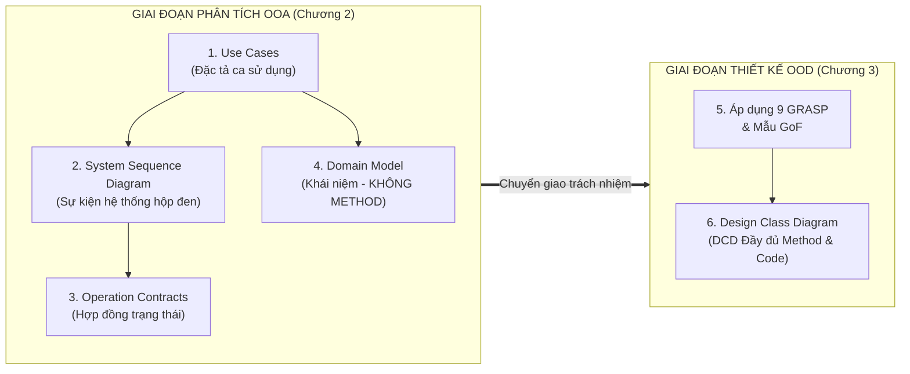
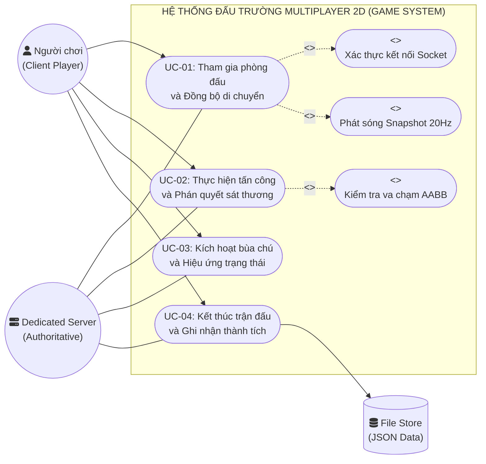
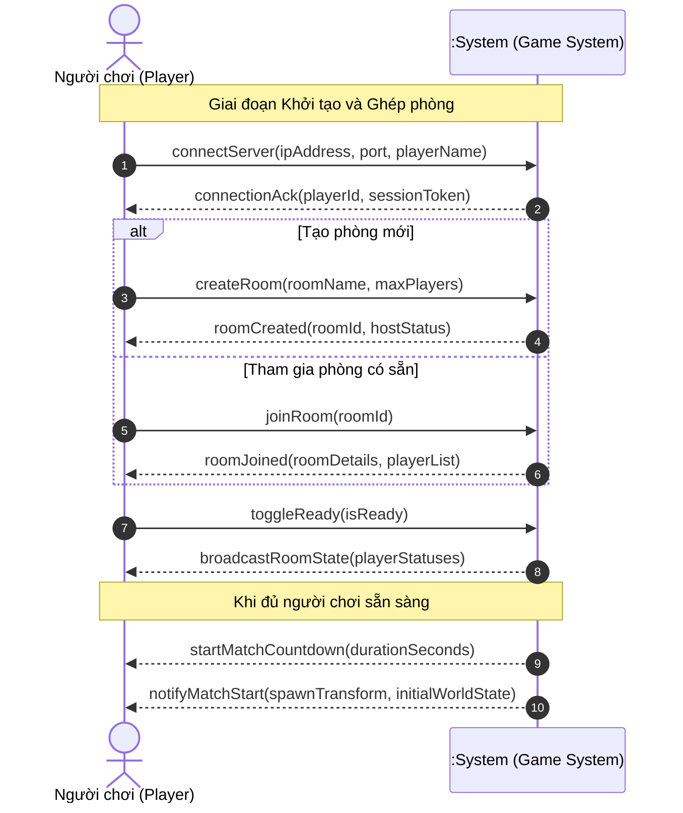
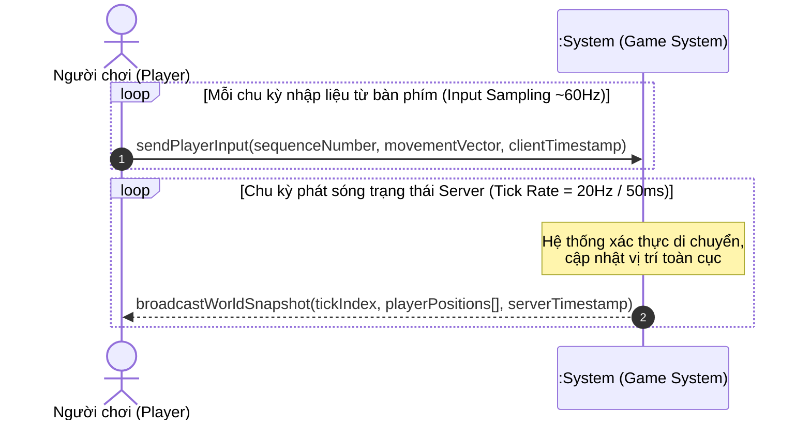
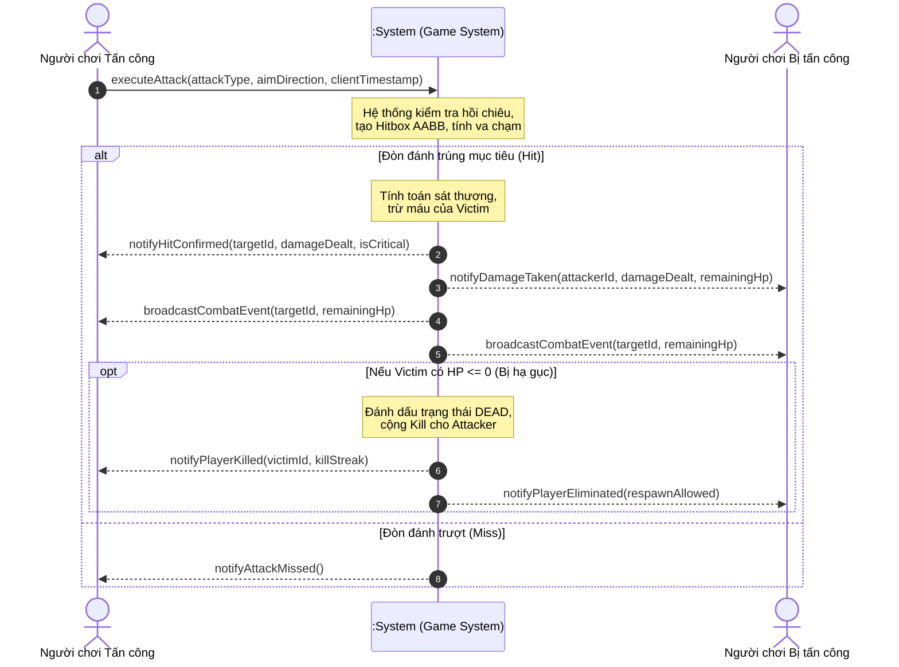
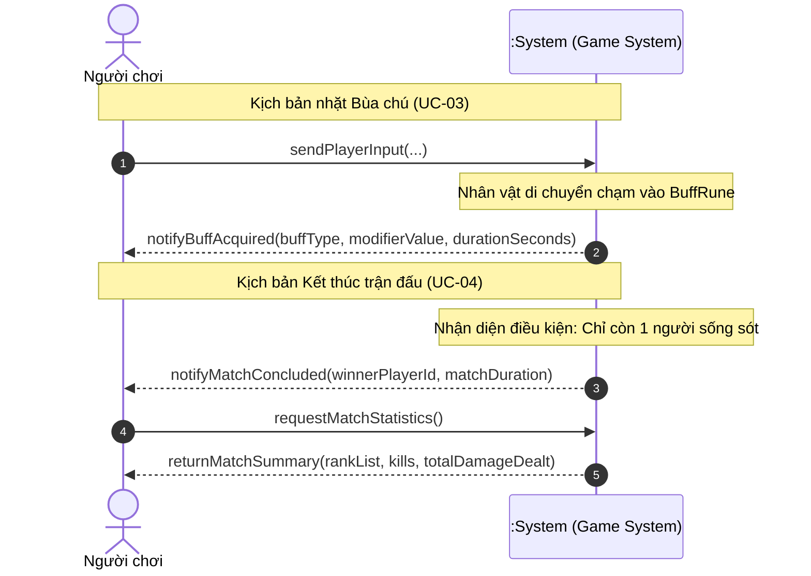
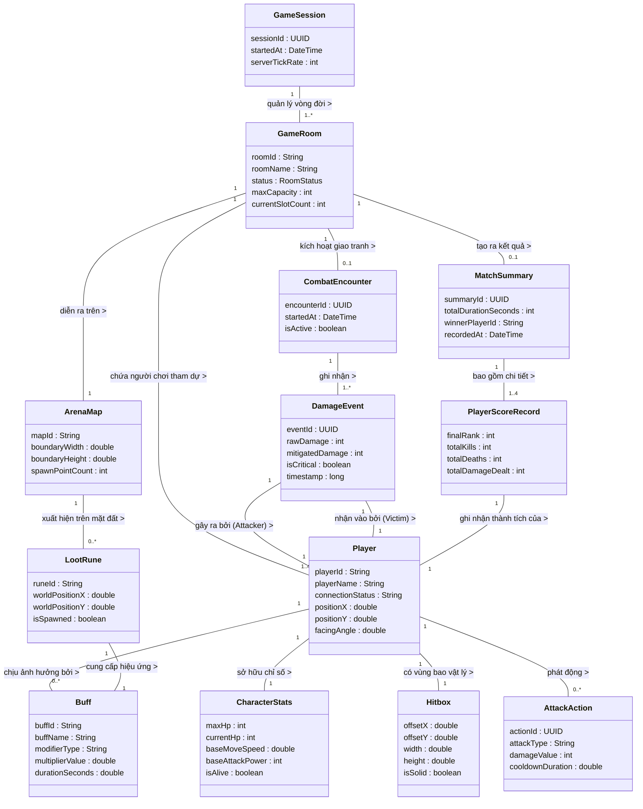

# PHẦN II: PHÂN TÍCH HƯỚNG ĐỐI TƯỢNG (OBJECT-ORIENTED ANALYSIS - OOA)

> **Môn học**: Lập trình Hướng đối tượng (OOP)  
> **Trường**: Đại học Xây dựng Hà Nội (HUCE) — Khoa Công nghệ Thông tin  
> **Nhóm sinh viên thực hiện**:  
> 1. **Nguyễn Hoài Nam** (Trưởng nhóm / Lead Architect) — *Phụ trách Core Architecture & Tổng hợp*  
> 2. **Trần Trung Kiên** — *Phụ trách Dedicated Server & Real-Time Netcode*  
> 3. **Phạm Quang Anh** — *Phụ trách Combat Engine, Physics & Collision*  
> 4. **Vũ Quang Huy** — *Phụ trách Client Rendering 60 FPS, HUD & Observer*  
> 5. **Bùi Minh Hoàng** — *Phụ trách Persistence, Data Mapper & QA/Benchmarking*  
> **Giáo trình tham chiếu chính**: Craig Larman, *Applying UML and Patterns*, 3rd Edition (Chương 6, 9, 10, 11)  
> **Mở rộng kỹ nghệ hiện đại**: Vaughn Vernon, *Implementing Domain-Driven Design* (Chương 10: Aggregates)

---

## 2.1. TỔNG QUAN QUY TRÌNH PHÂN TÍCH HƯỚNG ĐỐI TƯỢNG (OOA)

### 2.1.1. Bản chất của OOA trong tiến trình Unified Process

Theo phương pháp luận của Craig Larman, quy trình phân tích và thiết kế hướng đối tượng được phân định rạch ròi bởi câu châm ngôn kinh điển:

$$\text{OOA: "Do the right thing"} \quad \Longleftrightarrow \quad \text{OOD: "Do the thing right"}$$

* **Phân tích hướng đối tượng (OOA)**: Tập trung vào việc **hiểu đúng bài toán và mô hình hóa thế giới thực** (Domain Concepts). Ở bước này, nhóm điều tra các yêu cầu nghiệp vụ, định nghĩa ranh giới hệ thống, và xây dựng mô hình khái niệm. Hệ thống được nhìn nhận như một **"Hộp đen" (Black Box)** — ta chỉ quan tâm người chơi gửi cái gì vào và hệ thống phản hồi cái gì ra, hoàn toàn chưa quan tâm bên trong hệ thống dùng giải thuật hay mẫu thiết kế nào.
* **Quy tắc vàng phân tầng của Craig Larman**: 
  1. Trong pha OOA, **tuyệt đối không đưa ra các lớp phần mềm kỹ thuật** (chưa có `GameController`, `NetworkHandler`, `SocketListener`, `CanvasView`, `DataMapper`).
  2. Trong Domain Model, **tuyệt đối không khai báo phương thức (Methods)**. Mọi lớp trong Domain Model chỉ chứa các thuộc tính khái niệm thế giới thực, mô tả các mối quan hệ (Associations) và bản số kết hợp (Multiplicities).



---

## 2.2. MÔ HÌNH HÓA CA SỬ DỤNG (USE CASE MODELING)

*(Tham chiếu: Craig Larman — Chương 6: Use Cases)*

### 2.2.1. Biểu đồ Ca sử dụng Tổng thể (Use Case Diagram)

Hệ thống Đấu trường Trực tuyến 2D bao gồm các tác nhân chính và tác nhân hỗ trợ:
* **Tác nhân chính (Primary Actor)**: `Người chơi (Player / Client)` — người trực tiếp tương tác bàn phím, chuột để điều khiển nhân vật thi đấu.
* **Tác nhân hỗ trợ / Hệ thống nền (Supporting Actors)**:
  * `Dedicated Server`: Máy chủ chuyên dụng nắm toàn quyền phán quyết (Authoritative), kiểm tra gian lận, điều phối đồng bộ 20Hz.
  * `Persistence File Store`: Hệ thống tệp lưu trữ kết quả trận đấu định dạng JSON.



---

### 2.2.2. Đặc tả Ca sử dụng Chi tiết (Fully Dressed Use Cases)

Tuân thủ nghiêm ngặt chuẩn định dạng **Fully Dressed Use Case** của Craig Larman (Chương 6), dưới đây là 4 ca sử dụng cốt lõi nhất của đồ án:

---

#### 📋 Ca sử dụng UC-01: Tham gia phòng đấu và Đồng bộ di chuyển

* **Mã ca sử dụng**: `UC-01`
* **Phạm vi (Scope)**: Hệ thống Đấu trường Thời gian thực (Game System).
* **Mức độ (Level)**: Mục tiêu người dùng (User Goal).
* **Tác nhân chính (Primary Actor)**: Người chơi (Player / Client).
* **Các bên liên quan và quyền lợi (Stakeholders & Interests)**:
  * *Người chơi*: Muốn nhanh chóng vào phòng chơi ổn định, điều khiển nhân vật mượt mà, không bị giật lag hay lệch vị trí.
  * *Hệ thống Server*: Cần kiểm soát chặt chẽ số lượng người chơi trong phòng (tối đa 4 người), chống tấn công spam kết nối giả mạo.
* **Tiền điều kiện (Preconditions)**:
  * Máy chủ Dedicated Server đang mở Socket lắng nghe tại cổng chỉ định (mặc định TCP `8080`).
  * Ứng dụng Client đã khởi động thành công trên máy trạm của người chơi.
* **Đảm bảo thành công / Hậu điều kiện (Success Guarantees / Postconditions)**:
  * Người chơi được khởi tạo thực thể nhân vật tại điểm xuất phát (Spawn Point) hợp lệ.
  * Tọa độ nhân vật được cập nhật và đồng bộ liên tục tới tất cả người chơi khác thông qua các gói tin `WorldSnapshotPacket` ở tần số 20Hz.
* **Kịch bản chính thành công (Main Success Scenario)**:
  1. Người chơi khởi động Client, nhập tên nhân vật (`PlayerName`) và địa chỉ IP của Server.
  2. Người chơi chọn tạo phòng mới hoặc tham gia phòng đang chờ (`RoomId`).
  3. Hệ thống xác thực sức chứa phòng ($\le 4$ người), cấp phát một vị trí trong phòng và phản hồi trạng thái phòng.
  4. Người chơi nhấn nút **"Sẵn sàng"** (`Toggle Ready`). Khi đủ người sẵn sàng, Hệ thống khởi động phiên đấu và kích hoạt vòng lặp thế giới (World Tick).
  5. Trong suốt trận đấu, Người chơi liên tục thao tác các phím di chuyển `W, A, S, D`. Client đóng gói ý định di chuyển thành `InputCommandPacket` chứa vector hướng $(dx, dy)$ và số thứ tự chuỗi (`sequenceNumber`) gửi lên Server.
  6. Hệ thống (Server) xác thực tính hợp lệ của vector tốc độ, cập nhật tọa độ nhân vật mới trong thế giới ảo.
  7. Hệ thống phát sóng định kỳ (20 lần/giây) gói tin `WorldSnapshotPacket` chứa tọa độ chuẩn của toàn bộ người chơi trong phòng.
  8. Client nhận snapshot và hiển thị mượt mà trên màn hình Canvas ở tốc độ 60 FPS.
* **Các luồng ngoại lệ và mở rộng (Extensions / Alternative Flows)**:
  * *3a. Phòng đã đủ 4 người chơi hoặc trận đấu đã bắt đầu:*
    * Hệ thống từ chối kết nối, gửi thông báo `"Phòng đã đầy hoặc đang trong trận đấu"`. Người chơi quay lại danh sách phòng.
  * *5a. Client gửi vector di chuyển vượt quá tốc độ tối đa cho phép (dấu hiệu gian lận Speed Hack):*
    * Hệ thống tự động kẹp giá trị (Clamp Vector) về tốc độ chuẩn quy định, ghi vết cảnh báo nghi vấn và ép tọa độ của Client quay lại vị trí Server phán quyết.
  * *7a. Mất kết nối mạng hoặc Client không phản hồi quá 5000ms:*
    * Hệ thống kích hoạt cơ chế hủy thực thể mềm (`Graceful Removal`), thông báo cho các người chơi còn lại và tiếp tục trận đấu bình thường mà không làm sập phòng.
* **Yêu cầu đặc biệt (Special Requirements)**:
  * Thời gian phản hồi giữa lúc nhấn phím và khi nhận được xác nhận từ Server trong mạng LAN không vượt quá 50ms.
  * Sai lệch nội suy vị trí giữa Client và Server phải được bù đắp bởi bộ đệm nội suy LERP, độ giật khung hình $\le 2$ pixels.

---

#### 📋 Ca sử dụng UC-02: Thực hiện tấn công và Phán quyết sát thương

* **Mã ca sử dụng**: `UC-02`
* **Phạm vi (Scope)**: Hệ thống Chiến đấu & Va chạm (Combat Engine).
* **Mức độ (Level)**: Mục tiêu người dùng (User Goal).
* **Tác nhân chính (Primary Actor)**: Người chơi (Player / Client).
* **Các bên liên quan và quyền lợi**:
  * *Người chơi tấn công*: Đòi hỏi hành động vung kiếm/bắn tên phản hồi tức thì, đòn đánh trúng mục tiêu phải trừ máu chính xác.
  * *Người chơi bị tấn công*: Đòi hỏi tính công bằng tuyệt đối; không bị trúng đòn vô lý khi đối thủ đã ở quá xa (chống gian lận Reach Hack).
* **Tiền điều kiện (Preconditions)**:
  * Trận đấu đang ở trạng thái kích hoạt (`Active`).
  * Nhân vật của người chơi còn điểm sinh lực ($HP > 0$) và thời gian hồi chiêu của vũ khí đã sẵn sàng ($Cooldown = 0$).
* **Đảm bảo thành công (Success Guarantees)**:
  * Đòn tấn công được phát động; Server tính toán vùng quét va chạm (Hitbox AABB).
  * Điểm máu của nạn nhân bị trừ chính xác theo chiến lược sát thương tương ứng.
  * Sự kiện sát thương được thông báo đồng bộ tới toàn thể người chơi trong phòng.
* **Kịch bản chính thành công (Main Success Scenario)**:
  1. Người chơi nhấn phím Tấn công (`Space` hoặc Chuột trái) theo một hướng ngắm cụ thể.
  2. Client gửi gói tin `AttackCommandPacket` mang thông tin `{attackerId, attackType, directionAngle, timestamp}` lên Server.
  3. Hệ thống (Server) kiểm tra trạng thái nhân vật: xác nhận thời gian hồi chiêu hợp lệ, nhân vật không bị khống chế/choáng.
  4. Hệ thống khởi tạo một vùng sát thương hình hộp bao (`Axis-Aligned Bounding Box - AABB`) dựa trên loại vũ khí và hướng đánh.
  5. Hệ thống truy vấn các thực thể nhân vật đối thủ nằm trong vùng phủ của Hitbox.
  6. Nếu phát hiện va chạm với nạn nhân, Hệ thống áp dụng công thức tính sát thương (trừ giáp, nhân hệ số bùa chú) và giảm điểm sinh lực $HP$ của nạn nhân.
  7. Hệ thống cập nhật trạng thái sống/chết của nạn nhân. Nếu $HP \le 0$, chuyển trạng thái nạn nhân sang `Dead` và tăng điểm hạ gục cho kẻ tấn công.
  8. Hệ thống phát sóng gói tin `CombatEventPacket` thông báo sát thương và trạng thái mới tới toàn bộ Client để hiển thị số sát thương (Floating Damage Text) và thanh máu mới.
* **Các luồng ngoại lệ (Extensions)**:
  * *3a. Đòn đánh được gửi khi kỹ năng đang trong thời gian hồi chiêu (Cooldown violation):*
    * Hệ thống lập tức hủy bỏ gói tin, không thực thi đòn đánh và không phát sóng sự kiện.
  * *5a. Hitbox quét không trúng bất kỳ người chơi nào (Đòn đánh trượt):*
    * Hệ thống chỉ ghi nhận tiêu hao thể lực/thời gian hồi chiêu của người tấn công; phát sóng hiệu ứng vung đòn trượt nhưng không có sự kiện trừ máu.

---

#### 📋 Ca sử dụng UC-03: Kích hoạt bùa chú và Hiệu ứng trạng thái

* **Mã ca sử dụng**: `UC-03`
* **Phạm vi (Scope)**: Hệ thống Vật phẩm & Bùa chú (Buff & Item System).
* **Mức độ (Level)**: Mục tiêu người dùng (User Goal).
* **Tác nhân chính (Primary Actor)**: Người chơi.
* **Tiền điều kiện**: Bản đồ chiến đấu xuất hiện các điểm sinh vật phẩm ngẫu nhiên (`BuffSpawnPoint`).
* **Đảm bảo thành công**: Người chơi nhặt được bùa chú, các chỉ số thuộc tính (tốc độ, sát thương, giáp) được gia tăng trong một khoảng thời gian hữu hạn (Duration), sau đó tự động hoàn nguyên.
* **Kịch bản chính thành công**:
  1. Người chơi điều khiển nhân vật di chuyển đè lên tọa độ của viên ngọc bùa chú (`BuffRune`) trên mặt đất.
  2. Server phát hiện va chạm giữa Hitbox người chơi và Hitbox của viên bùa chú.
  3. Hệ thống thu hồi viên ngọc bùa chú khỏi bản đồ, khởi tạo một thực thể Bùa chú (`Buff`) và gắn vào danh sách hiệu ứng của nhân vật.
  4. Thuộc tính của nhân vật được tái tính toán tức thì theo mẫu thiết kế Composite (ví dụ: Tăng 30% tốc độ chạy trong 10 giây).
  5. Hệ thống gửi thông báo nhặt bùa chú thành công về Client để kích hoạt hiệu ứng hào quang đồ họa (Aura Visual Effect).
  6. Sau khi hết thời hạn hiệu lực (10 giây), Hệ thống tự động gỡ bỏ Bùa chú và hoàn nguyên chỉ số nhân vật về mặc định.

---

#### 📋 Ca sử dụng UC-04: Kết thúc trận đấu và Ghi nhận thành tích

* **Mã ca sử dụng**: `UC-04`
* **Phạm vi (Scope)**: Hệ thống Quản lý Phiên & Lưu trữ (Persistence & Match Settlement).
* **Mức độ (Level)**: Mục tiêu người dùng (User Goal).
* **Tác nhân chính**: Người chơi.
* **Tác nhân hỗ trợ**: Hệ thống Tệp lưu trữ JSON (`Persistence File Store`).
* **Tiền điều kiện**: Trận đấu đang diễn ra và thỏa mãn một trong hai điều kiện dừng: chỉ còn 1 người chơi duy nhất còn sống (Last Man Standing), hoặc đồng hồ đếm ngược trận đấu về 0.
* **Đảm bảo thành công**:
  * Trận đấu chính thức đóng lại, toàn bộ hành động di chuyển/tấn công bị khóa.
  * Kết quả trận đấu (Bảng vàng thành tích, số mạng hạ gục, lượng sát thương gây ra) được ghi vĩnh viễn xuống tệp `match_history.json`.
  * Người chơi nhận được bảng tổng kết vinh danh người chiến thắng.
* **Kịch bản chính thành công**:
  1. Server phát hiện điều kiện dừng: Số lượng nhân vật còn sống trong phòng bằng 1 (hoặc hết giờ thi đấu).
  2. Hệ thống chuyển trạng thái phòng đấu từ `ACTIVE` sang `CONCLUDED`.
  3. Hệ thống khóa toàn bộ việc nhận gói tin hành động từ phía Client.
  4. Hệ thống tổng hợp số liệu trận đấu: Thời lượng thi đấu, bảng xếp hạng thứ bậc (Rank), tổng sát thương, số mạng hạ gục (`Kills`) của từng người chơi.
  5. Hệ thống gọi tầng lưu trữ (Persistence) tuần tự hóa đối tượng `MatchSummary` thành bản ghi JSON và lưu trữ an toàn xuống ổ đĩa.
  6. Hệ thống phát sóng gói tin `MatchFinishedPacket` chứa toàn bộ bảng vàng thành tích đến tất cả người chơi.
  7. Client hiển thị màn hình tổng kết kết quả trận đấu (Victory / Defeat Screen) kèm theo nút "Trở về phòng chờ".

---

## 2.3. BIỂU ĐỒ TUẦN TỰ HỆ THỐNG (SYSTEM SEQUENCE DIAGRAMS - SSD)

*(Tham chiếu: Craig Larman — Chương 10: System Sequence Diagrams)*

Biểu đồ Tuần tự Hệ thống (SSD) là một công cụ mô hình hóa cốt lõi của Craig Larman nhằm biểu diễn **các sự kiện đầu vào hệ thống (System Events)** và **các phản hồi từ hệ thống (System Responses)** do tác nhân bên ngoài khởi xướng. 

> **Nguyên tắc phương pháp luận của Larman**: Toàn bộ hệ thống phần mềm được gói gọn trong một đối tượng ranh giới duy nhất có tên là `:System`. SSD **không biểu diễn các lớp phần mềm nội bộ**, không thể hiện gọi hàm giữa các class. Nó là bản vẽ xác lập ranh giới giao tiếp giữa con người và hệ thống.

---

### 2.3.1. SSD 1: Khởi tạo Phiên chơi và Tham gia Phòng đấu (UC-01)



---

### 2.3.2. SSD 2: Vòng lặp Đồng bộ Di chuyển Thời gian thực (UC-01)

Sơ đồ này mô tả bản chất của giao thức đồng bộ Dedicated Authoritative Server theo kiến trúc mạng thời gian thực: Client liên tục gửi các lệnh ý định đầu vào (`InputCommand`), còn hệ thống định kỳ bơm ngược các gói ảnh chụp thế giới (`WorldSnapshot`) về cho Client.



---

### 2.3.3. SSD 3: Kịch bản Giao tranh và Phán quyết Sát thương (UC-02)



---

### 2.3.4. SSD 4: Kích hoạt Bùa chú và Kết thúc Trận đấu (UC-03 & UC-04)



---

## 2.4. HỢP ĐỒNG THAO TÁC HỆ THỐNG (SYSTEM OPERATION CONTRACTS)

*(Tham chiếu: Craig Larman — Chương 11: Operation Contracts)*

Để liên kết chặt chẽ giữa **Biểu đồ Tuần tự Hệ thống (SSD)** và **Mô hình Miền (Domain Model)**, Craig Larman đề xuất công cụ **Hợp đồng Thao tác (Operation Contract)**. Hợp đồng thao tác mô tả chi tiết các biến đổi trạng thái của các thực thể trong mô hình miền khái niệm khi một sự kiện hệ thống xảy ra, sử dụng mệnh đề **Tiền điều kiện (Preconditions)** và **Hậu điều kiện (Postconditions)**.

---

### 📋 Hợp đồng CO-01: `joinRoom`

* **Thao tác (Operation)**: `joinRoom(playerId: PlayerId, roomId: RoomId)`
* **Tham chiếu chéo (Cross References)**: Ca sử dụng `UC-01`, SSD 1.
* **Tiền điều kiện (Preconditions)**:
  * Thực thể `GameRoom` tương ứng với `roomId` đang tồn tại và có thuộc tính `status == WAITING`.
  * Số lượng `Player` liên kết với `GameRoom` hiện tại nhỏ hơn `maxCapacity` (tối đa 4 người).
* **Hậu điều kiện (Postconditions)**:
  * Một liên kết mới được thiết lập giữa thể hiện `Player` và thể hiện `GameRoom`.
  * Một thể hiện `CharacterStats` được khởi tạo với các giá trị mặc định (`maxHp = 100`, `currentHp = 100`, `moveSpeed = 200.0`, `isAlive = true`).
  * Thực thể `Player` được liên kết với `CharacterStats` vừa tạo.
  * Thuộc tính `currentSlotCount` của `GameRoom` tăng lên 1 đơn vị.

---

### 📋 Hợp đồng CO-02: `processInput`

* **Thao tác (Operation)**: `processInput(playerId: PlayerId, movementVector: Vector2D, sequenceNumber: int)`
* **Tham chiếu chéo (Cross References)**: Ca sử dụng `UC-01`, SSD 2.
* **Tiền điều kiện (Preconditions)**:
  * Thực thể `GameRoom` đang ở trạng thái `status == ACTIVE`.
  * Thể hiện `Player` tương ứng với `playerId` đang có `CharacterStats.isAlive == true`.
* **Hậu điều kiện (Postconditions)**:
  * Thuộc tính `position` của thể hiện `Player` được cập nhật tọa độ mới dựa trên công thức tích vô hướng của `movementVector`, vận tốc `moveSpeed` và delta thời gian $\Delta t$.
  * Tọa độ tâm của thể hiện `Hitbox` liên kết với `Player` được cập nhật đồng nhất theo tọa độ mới của `Player`.
  * Thuộc tính `lastProcessedSequence` của `Player` nhận giá trị bằng `sequenceNumber`.

---

### 📋 Hợp đồng CO-03: `executeAttack`

* **Thao tác (Operation)**: `executeAttack(attackerId: PlayerId, attackType: AttackType, direction: Angle)`
* **Tham chiếu chéo (Cross References)**: Ca sử dụng `UC-02`, SSD 3.
* **Tiền điều kiện (Preconditions)**:
  * Trận đấu `GameRoom` có `status == ACTIVE`.
  * Thể hiện `Player` (kẻ tấn công) có `CharacterStats.isAlive == true` và `cooldownTimer <= 0`.
* **Hậu điều kiện (Postconditions)**:
  * Một thể hiện `AttackAction` được khởi tạo, liên kết với `Player` người tấn công.
  * Thuộc tính `cooldownTimer` của `Player` được thiết lập bằng thời gian hồi chuẩn của `attackType`.
  * Một thể hiện vùng quét `Hitbox` tạm thời được tạo lập tại tọa độ hướng `direction`.
  * Nếu `Hitbox` này giao cắt với `Hitbox` của một hoặc nhiều `Player` khác (nạn nhân):
    * Một thể hiện `DamageEvent` được khởi tạo với thuộc tính `damageAmount` được tính toán.
    * Thuộc tính `CharacterStats.currentHp` của nạn nhân giảm đi một lượng đúng bằng `damageAmount`.
    * Nếu `CharacterStats.currentHp <= 0`, thuộc tính `CharacterStats.isAlive` chuyển thành `false`, và số lượng `kills` của kẻ tấn công tăng thêm 1.

---

### 📋 Hợp đồng CO-04: `applyBuff`

* **Thao tác (Operation)**: `applyBuff(characterId: PlayerId, buffRuneId: ItemId)`
* **Tham chiếu chéo (Cross References)**: Ca sử dụng `UC-03`, SSD 4.
* **Tiền điều kiện (Preconditions)**:
  * Thể hiện `BuffRune` tương ứng đang tồn tại trên bản đồ `ArenaMap` với trạng thái `isSpawned == true`.
  * `Hitbox` của `Player` giao cắt với `Hitbox` của `BuffRune`.
* **Hậu điều kiện (Postconditions)**:
  * Thuộc tính `isSpawned` của `BuffRune` chuyển thành `false`.
  * Một thể hiện `Buff` được khởi tạo với các thuộc tính `modifierType`, `multiplierValue` và `remainingDuration`.
  * Một liên kết mới được thiết lập giữa `Player` và thể hiện `Buff` này.
  * Chỉ số tương ứng trong `CharacterStats` được điều chỉnh tăng theo hệ số `multiplierValue`.

---

### 📋 Hợp đồng CO-05: `concludeMatch`

* **Thao tác (Operation)**: `concludeMatch(roomId: RoomId)`
* **Tham chiếu chéo (Cross References)**: Ca sử dụng `UC-04`, SSD 4.
* **Tiền điều kiện (Preconditions)**:
  * Thực thể `GameRoom` đang có `status == ACTIVE`.
  * Số lượng `Player` có `CharacterStats.isAlive == true` trong phòng bằng 1 (hoặc `timeRemaining <= 0`).
* **Hậu điều kiện (Postconditions)**:
  * Thuộc tính `GameRoom.status` chuyển từ `ACTIVE` sang `CONCLUDED`.
  * Một thể hiện `MatchSummary` được khởi tạo với thuộc tính `endedAt`, `totalDuration`.
  * Các thể hiện `PlayerScoreRecord` được khởi tạo cho từng người chơi tham dự (ghi nhận hạng bậc, số mạng hạ gục, lượng sát thương gây ra) và liên kết với `MatchSummary`.
  * `MatchSummary` được liên kết với `GameRoom`.

---

## 2.5. MÔ HÌNH MIỀN KHÁI NIỆM (DOMAIN MODEL / CONCEPTUAL CLASS DIAGRAM)

*(Tham chiếu: Craig Larman — Chương 9: Domain Models)*

### 2.5.1. Quy tắc Phương pháp luận Tối thượng của Craig Larman

> [!CAUTION] CẢNH BÁO KIẾN TRÚC THEO CHUẨN CRAIG LARMAN
> **Mô hình Miền (Domain Model) KHÔNG PHẢI là Mô hình Thiết kế Phần mềm (Design Model)!**
> 
> Một sai lầm phổ biến nhất của sinh viên khi học môn Lập trình Hướng đối tượng là vẽ sơ đồ lớp thiết kế (chứa đầy phương thức `update()`, `render()`, `sendPacket()`, `onClick()`, `getHp()`) rồi dán nhãn là "Domain Model".
> 
> Trong phương pháp luận chuẩn của Craig Larman:
> 1. Domain Model là sự mô tả **các khái niệm trong thế giới thực** (Real-world Conceptual Classes), không phải các cấu trúc dữ liệu phần mềm.
> 2. **TUYỆT ĐỐI KHÔNG CÓ PHƯƠNG THỨC (NO METHODS)** trong bất kỳ ô lớp nào của Domain Model.
> 3. Tuyệt đối không chứa các lớp kỹ thuật hệ thống như `DatabaseConnection`, `SocketServer`, `PacketHandler`, `ButtonView`.

---

### 2.5.2. Biểu đồ Lớp Khái niệm (Domain Model Diagram)

Dưới đây là sơ đồ Mermaid biểu diễn toàn bộ Mô hình Miền khái niệm của Hệ thống Đấu trường Multiplayer 2D. Lưu ý: **Mọi lớp đều chỉ chứa thuộc tính (Attributes), tuyệt đối không có phương thức (No Methods)**:



---

### 2.5.3. Từ điển Thuật ngữ Khái niệm (Domain Concept Glossary)

| Khái niệm (Concept) | Định nghĩa Nghiệp vụ Thế giới thực | Thuộc tính chính | Vai trò trong hệ thống |
|:---|:---|:---|:---|
| **`GameSession`** | Một phiên làm việc của máy chủ lưu trữ toàn bộ các phòng đấu đang hoạt động. | `sessionId`, `serverTickRate` | Điều phối tổng thể các phòng chơi. |
| **`GameRoom`** | Một không gian phòng đấu cô lập nơi từ 2 đến 4 người chơi cùng tham gia tranh tài. | `roomId`, `roomName`, `status`, `maxCapacity` | Ranh giới quản lý vòng đời trận đấu. |
| **`ArenaMap`** | Bản đồ hình học không gian 2D khép kín nơi các đấu sĩ di chuyển và tương tác. | `boundaryWidth`, `boundaryHeight` | Giới hạn tọa độ hợp lệ, chống rơi khỏi bản đồ. |
| **`Player`** | Thực thể đại diện cho người chơi trong thế giới ảo. | `playerId`, `playerName`, `positionX`, `positionY` | Tác nhân chính thực hiện hành vi. |
| **`CharacterStats`** | Bảng chỉ số sinh tồn và năng lực thể chất của nhân vật. | `maxHp`, `currentHp`, `baseMoveSpeed`, `isAlive` | Quyết định sự sống còn và khả năng vận động. |
| **`Hitbox`** | Khối hộp chữ nhật bao quanh thực thể phục vụ việc thử nghiệm va chạm hình học (AABB). | `width`, `height`, `isSolid` | Cơ sở phán quyết va chạm giữa đòn đánh và nhân vật. |
| **`CombatEncounter`** | Một đợt giao tranh diễn ra trong phòng khi có người phát động đòn đánh. | `encounterId`, `isActive` | Gom nhóm các sự kiện sát thương phát sinh. |
| **`AttackAction`** | Hành động vung kiếm hoặc bắn tên do nhân vật kích hoạt. | `attackType`, `damageValue`, `cooldownDuration` | Nguồn tạo ra sát thương. |
| **`DamageEvent`** | Sự kiện trừ máu cụ thể xảy ra giữa một kẻ tấn công và một nạn nhân tại một thời điểm. | `rawDamage`, `mitigatedDamage`, `isCritical` | Bằng chứng đối soát tính toán máu. |
| **`Buff`** | Hiệu ứng bùa chú tăng cường sức mạnh tạm thời cho đấu sĩ. | `modifierType`, `multiplierValue`, `durationSeconds` | Biến đổi chỉ số nhân vật trong thời gian hữu hạn. |
| **`LootRune`** | Cổ vật xuất hiện ngẫu nhiên trên bản đồ chờ người chơi đến nhặt. | `worldPositionX`, `worldPositionY`, `isSpawned` | Kích thích người chơi di chuyển tranh giành vị trí. |
| **`MatchSummary`** | Bảng tổng kết số liệu kỹ thuật sau khi trận đấu hạ màn. | `totalDurationSeconds`, `winnerPlayerId` | Dữ liệu đầu vào để lưu xuống ổ đĩa. |

---

### 2.5.4. Ánh xạ So sánh: Ca học NextGen POS (Craig Larman) $\longleftrightarrow$ Bài toán Game Multiplayer

Để chứng minh tính kế thừa học thuật sâu sắc từ giáo trình của Craig Larman, bảng dưới đây đối chiếu cấu trúc phân tích giữa ca học kinh điển **NextGen POS** (Point of Sale) trong sách và bài toán **Game Multiplayer 2D** của nhóm:

| Khái niệm trong NextGen POS (Larman) | Khái niệm tương đương trong Game Đấu trường 2D | Giải thích bản chất tương đồng về mặt nghiệp vụ |
|:---|:---|:---|
| **`Store`** (Cửa hàng) | **`GameSession`** (Phiên máy chủ) | Thực thể cấp cao nhất bao bọc toàn bộ không gian hoạt động. |
| **`Register`** (Máy thu ngân) | **`GameRoom`** (Phòng đấu) | Ranh giới diễn ra từng phiên giao dịch độc lập (trong game là trận đấu). |
| **`Sale`** (Giao dịch bán hàng) | **`CombatEncounter`** (Đợt giao tranh) | Thực thể chứa đựng một chuỗi các sự kiện phát sinh liên tiếp. |
| **`SalesLineItem`** (Mục hàng trong hóa đơn) | **`DamageEvent`** (Sự kiện gây sát thương) | Từng phần tử cấu thành nên tổng thể: nhiều `DamageEvent` tạo nên trận đấu như nhiều `SalesLineItem` tạo nên đơn hàng. |
| **`ProductDescription`** (Mô tả sản phẩm) | **`WeaponSpec` / `BuffSpec`** (Đặc tả thông số) | Mẫu phân tách giữa "Đối tượng thực tế" và "Thông số định nghĩa sẵn" (khắc phục trùng lặp bộ nhớ). |
| **`Payment`** (Thanh toán tiền) | **`MatchSummary`** (Tổng kết trận đấu) | Sự kiện kết thúc giao dịch và chốt số liệu thống kê. |

---

### 2.5.5. Tích hợp Góc nhìn Hiện đại: Nhận diện Aggregate Roots (Vaughn Vernon — IDDD)

Một hạn chế lớn của Craig Larman năm 2004 là chưa có khái niệm ranh giới nhất quán của **Aggregate Root** (thuộc trường phái Domain-Driven Design được Eric Evans và Vaughn Vernon hoàn thiện sau này). Nhóm bổ sung góc nhìn này nhằm đảm bảo tính toàn vẹn nghiệp vụ trong môi trường đa luồng:

```mermaid
flowchart TD
    subgraph AGG_ROOM["🛡️ AGGREGATE ROOT 1: GameRoom (Ranh giới Trận đấu)"]
        GR["GameRoom<br/>(Aggregate Root)"]
        CE["CombatEncounter"]
        MS["MatchSummary"]
        PSR["PlayerScoreRecord"]
        
        GR *-- CE
        GR *-- MS
        MS *-- PSR
    end

    subgraph AGG_PLAYER["🛡️ AGGREGATE ROOT 2: Player (Ranh giới Nhân vật)"]
        PL["Player<br/>(Aggregate Root)"]
        CS["CharacterStats"]
        HB["Hitbox"]
        BF["ActiveBuffs"]
        
        PL *-- CS
        PL *-- HB
        PL *-- BF
    end

    AGG_ROOM -.->|Tham chiếu qua PlayerId| AGG_PLAYER
```

1. **`GameRoom` là một Aggregate Root**:
   * Nó bảo vệ bất biến nghiệp vụ: Số người chơi không bao giờ vượt quá 4; khi trận đấu đang `WAITING` thì không được sinh ra `DamageEvent`; khi chỉ còn 1 người sống thì lập tức chuyển sang `CONCLUDED`.
   * Mọi thao tác từ bên ngoài chỉ được gọi thông qua `GameRoom`, không được truy xuất trực tiếp vào bên trong `CombatEncounter`.
2. **`Player` là một Aggregate Root**:
   * Nó bảo vệ tính bất biến của sinh mệnh: `currentHp` không thể âm ($HP \ge 0$); khi `isAlive == false` thì không thể phát động `AttackAction` hay nhận thêm bùa chú.
   * `Hitbox` và `CharacterStats` là các thành phần bên trong, được bảo vệ nghiêm ngặt dưới sự quản lý của `Player`.

---

## 2.6. TỔNG KẾT BƯỚC CHUYỂN TIẾP TỪ OOA SANG OOD

Khép lại giai đoạn Phân tích Hướng đối tượng (OOA), nhóm đã hoàn thành toàn bộ các yêu cầu của Craig Larman:
1. Xác định tường minh các **Use Cases** dưới dạng Fully Dressed.
2. Vẽ các **Biểu đồ Tuần tự Hệ thống (SSD)** xác lập rõ ràng ranh giới hộp đen `:System`.
3. Soạn thảo các **Hợp đồng Thao tác (Operation Contracts)** ràng buộc sự thay đổi trạng thái của thế giới thực.
4. Xây dựng **Mô hình Miền Khái niệm (Domain Model)** thuần khiết, **hoàn toàn không có method**, tuân thủ nguyên tắc mô hình hóa đối tượng thế giới thực và nâng tầm bằng mô hình Aggregate Root hiện đại.

Đây chính là **đầu vào thiết yếu (Essential Input)** để nhóm bước sang **Phần III: Thiết kế Hướng đối tượng (OOD)** — nơi nhóm sẽ áp dụng 9 nguyên lý GRASP để giao trách nhiệm, thêm các phương thức, lựa chọn các mẫu thiết kế GoF và xây dựng Biểu đồ Lớp Thiết kế Chi tiết (DCD).

---

*Tài liệu tham khảo chuyên sâu cho chương này:*
- *[1] Craig Larman — Applying UML and Patterns, 3rd ed. (2004), Chương 6 (Use Cases), Chương 9 (Domain Models), Chương 10 (SSD), Chương 11 (Operation Contracts).*
- *[2] Vaughn Vernon — Implementing Domain-Driven Design (2013), Chương 10: Aggregates.*
