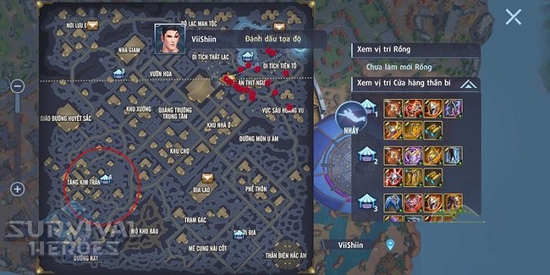

# 🎮 Survival Heroes 2.5D — Godot 4.7 (.NET 8 C#) + SOLID/Design Patterns + Photon Cloud Demo

Dự án mẫu thực chiến kết hợp:
1. **Kiến trúc SOLID & Game Programming Patterns** (chắt lọc từ 177 scripts của `Unity-Technologies/game-programming-patterns-demo`).
2. **Kiến trúc Mạng Photon (`PhotonRealtime` + `GodotPunBridge`)** chạy trực tiếp trên **Godot 4.7 (.NET 8)** không phụ thuộc `UnityEngine`.
3. **Bản đồ Thế giới *Survival Heroes* (170m $\times$ 170m) từ trên nhìn xuống**:
   - Đầy đủ **22 Địa Danh Tiếng Việt**: *Quảng Trường Trung Tâm, Tàng Kim Trấn, Giáo Đường Huyết Sắc, Nơi Lưu Đày, Nhà Giam, Vườn Hoa, Bộ Lạc Man Tộc, Di Tích Thất Lạc, Di Tích Tiên Tổ, Vực Sâu Hoang Vu, Khu Xưởng, Khu Nhà Ở, Đường Mòn U Ám, Khu Chợ, Địa Lao, Trạm Gác, Mê Cung Hài Cốt, Phế Thôn, Nghĩa Địa, Thần Điện Hắc Ám, Đường Ray, Mỏ Kho Báu*.
   - **Giao diện Bản đồ Chiến thuật & Nhảy Dù (`[Phím M]`)**: Click chuột lên bản đồ để **Đánh dấu tọa độ (`ViiShiin`)**, xem vị trí **Rồng Cổ Đại**, xem **3 Cửa Hàng Thần Bí (Lều #1 Nghĩa Địa, Lều #2 Tàng Kim Trấn, Lều #3 Nhà Giam)** và bấm nút **`🪂 NHẢY`** để đáp dù thẳng xuống địa danh đã chọn.

---

## 🚀 Cách Mở & Chạy Game

### Yêu cầu
- **Godot Engine 4.7+ Mono (.NET)** và **.NET 8 SDK**.

### Chạy ngay
1. Mở **Godot 4.7 (.NET) Editor** $\rightarrow$ **Import** file [`project.godot`](./project.godot).
2. Bấm **`F5`** (hoặc chạy trực tiếp file [`Chay_Thu_Game_SurvivalHeroes.bat`](./Chay_Thu_Game_SurvivalHeroes.bat)).

---

## 🎮 Phím Điều Khiển Trong Trận

| Phím / Chuột | Chức năng |
| :--- | :--- |
| **`Phím M`** | Mở / Đóng **Bản Đồ Chiến Thuật Từ Trên Nhìn Xuống** & Chọn điểm **Nhảy Dù (`🪂 NHẢY`)** |
| **`Click Chuột Trái lên Bản đồ`** | Đánh dấu tọa độ (`📍 ViiShiin: Đánh dấu tọa độ`) |
| **`W, A, S, D`** | Di chuyển Tướng trên mặt phẳng 2.5D |
| **`Con trỏ Chuột`** | Xoay hướng ngắm kỹ năng 360° |
| **`Chuột Trái (LMB)` / `Q` / `W` / `E`** | Tung bộ 4 chiêu thức theo Vũ khí đang cầm (Có **InputBufferQueue đệm phím combo 180ms**) |
| **`Phím F`** | Nhặt Hộp Vũ Khí dưới đất (hoặc chạy chạm vào Lều Cửa Hàng Thần Bí / Trụ Hồi Máu) |
| **`Phím 1 / 2 / 3`** | Đổi nhanh Vũ khí để kiểm thử (**`1`**: Đại Kiếm Chiến Binh, **`2`**: Cung Tuyệt Mệnh, **`3`**: Trượng Hỏa Long) |

---

## 🗂️ Cấu Trúc Mã Nguồn

- [`Scripts/Patterns/SolidAndDesignPatterns25D.cs`](./Scripts/Patterns/SolidAndDesignPatterns25D.cs): Hiện thực hóa `IDamageable`, `IExplodable`, `ISwitchable`, `InputBufferQueue` (Command), `HeroStateMachine` (State), `GodotNodePool<T>` (Object Pool), `ArenaEventBus` (Observer), `ExplosiveBarrel3D` và `HealingShrineSwitch3D`.
- [`Scripts/Gameplay/SurvivalHeroesWorldMap.cs`](./Scripts/Gameplay/SurvivalHeroesWorldMap.cs): Dữ liệu 22 Địa danh tiếng Việt, `TacticalMapCanvas` vẽ bản đồ từ trên nhìn xuống, và `MysteryShopTent3D` (3 Cửa Hàng Thần Bí).
- [`Scripts/Gameplay/ArenaGameManager.cs`](./Scripts/Gameplay/ArenaGameManager.cs): Khởi dựng thế giới 170m $\times$ 170m, điều phối Vòng Bo, 9 ô lưới `GodotCullArea`, AI Bot Survivors và giao diện HUD.
- [`Scripts/Gameplay/HeroCharacter.cs`](./Scripts/Gameplay/HeroCharacter.cs): Nhân vật Tướng hỗ trợ đồng bộ mạng Photon (`GodotPhotonView`, `IPunObservable`, `[PunRPC]`).
- [`Scripts/Gameplay/WeaponSkillSystem.cs`](./Scripts/Gameplay/WeaponSkillSystem.cs): Hệ thống Vũ khí & Kỹ năng theo **Strategy Pattern**.
- [`Scripts/PhotonRealtime/`](./Scripts/PhotonRealtime/) & [`Scripts/PhotonBridge/`](./Scripts/PhotonBridge/): Tầng kết nối Photon Cloud và cầu nối sang Godot 4 C#.
